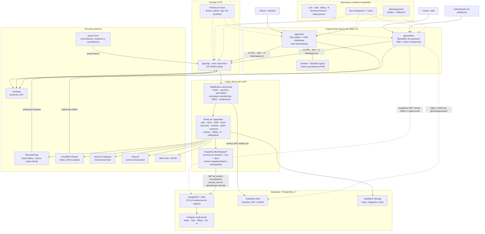

# Arquitectura actual de Factory Fitness

**Corte del análisis:** 18 de julio de 2026 
**Rama y commit:** `main` · `d9f1fda7` 
**Lectura arquitectónica:** monolito modular distribuido en tres aplicaciones desplegables, con Supabase como plataforma de identidad y datos.

> **Uso permitido:** evidencia histórica para comprender requisitos y deuda. Factory Fitness no es origen de migración para Allfit V1: no se reutilizan sus datos, IDs, ETL, backfills ni contratos de compatibilidad.

## Diagrama de funcionamiento

Las flechas continuas representan tráfico o ejecución en runtime. Las discontinuas representan acceso híbrido o dependencias de build.

## Cómo funciona una petición normal

1. El usuario entra a `fitness` o `admin`. En la PWA, el primer segmento de la URL identifica el workspace; en Admin, el layout protegido obtiene la membresía actual del usuario.
2. La PWA autentica contra las rutas `/auth` de Hono y conserva `access_token`, `refresh_token` y workspace en el cliente. Admin usa el cliente SSR de Supabase y cookies para establecer la sesión; una vez hidratado crea un cliente HTTP para la API.
3. Las llamadas de negocio llegan a Hono con `Authorization: Bearer <JWT>` y `X-Workspace-Id`. Las rutas públicas, webhooks y jobs usan cadenas de middleware diferentes.
4. La API valida el JWT con el JWKS de Supabase, comprueba que el usuario pertenece al workspace y aplica RBAC o entitlements cuando la capacidad lo requiere.
5. El handler valida el payload con Zod y delega en un paquete de dominio. Los servicios reciben un `SupabaseClient` y el `workspaceId`; la mayoría ejecuta consultas con el JWT del usuario, por lo que RLS sigue siendo la última barrera de datos.
6. Las operaciones privilegiadas, webhooks y jobs programados pueden crear un cliente `service_role`. Por eso su autorización vive explícitamente en middleware o lógica server-side antes de tocar datos.
7. Supabase separa los datos en `public`, `rbac`, `billing`, `crm` y `ai`. El aislamiento principal es por `workspace_id`, membresías de `rbac.workspace_users` y políticas RLS.
8. Billing, video, IA, email y push salen desde la API hacia proveedores externos. MercadoPago y Cloudflare devuelven eventos por webhooks; Vercel Cron dispara reconciliaciones, reintentos de billing y recordatorios.

## Lectura arquitectónica

- **Estilo:** no son microservicios. Es un monolito modular con tres superficies desplegables y librerías de dominio compiladas dentro de ellas.
- **Multi-tenancy:** el tenant viaja como `X-Workspace-Id`; la API valida membresía y la base repite el aislamiento con RLS.
- **Acceso a datos:** es híbrido. La PWA está orientada a API; Admin usa acceso directo a Supabase para autenticación, SSR y algunas lecturas iniciales, y la API para la mayor parte de las operaciones de dominio.
- **Lógica de negocio:** está principalmente en `packages/*`, pero aún existen reglas y consultas inline en rutas grandes de API y algunos componentes/páginas de Admin.
- **Datos:** Supabase ofrece Auth, PostgREST/RPC, PostgreSQL y Storage. Realtime está habilitado en configuración, pero no hay suscripciones Realtime activas en el código revisado.
- **Operación local:** `bun run dev` levanta Supabase, registra los aliases de Portless, compila paquetes y ejecuta las tres apps con Turbo.
- **Despliegue y cambios de esquema:** la API declara jobs de Vercel Cron; las migraciones se publican a Supabase desde GitHub Actions cuando cambia `supabase/migrations` en `main`.

## Límites y puntos de atención

1. **Frontera de datos no uniforme.** El acceso directo de Admin a Supabase reduce latencia y facilita SSR, pero reparte la autorización entre Server Components, RLS y API. Las nuevas mutaciones deberían mantener una frontera consistente.
2. **`service_role` es una frontera crítica.** Omite RLS; cada uso debe estar precedido por una comprobación explícita de usuario, secreto interno, firma o pertenencia al workspace.
3. **Paquetes no equivalen todavía a aislamiento total.** Varios handlers consultan Supabase inline y algunas vistas Admin mezclan carga, autorización y presentación.
4. **PWA stateful.** La experiencia offline depende de Service Worker, persistencia de TanStack Query, tokens locales y refresh automático; logout, cambio de usuario y cambio de workspace deben limpiar todo ese estado de forma coordinada.
5. **Observabilidad funcional, no operativa completa.** PostHog cubre eventos de producto en navegador y servidor; no aparece en el repositorio una capa centralizada equivalente para trazas, métricas técnicas y errores distribuidos.

## Evidencia principal

- Orquestación: [`package.json`](https://github.com/dinnartec/factory-fitness/blob/d9f1fda7/package.json), [`turbo.json`](https://github.com/dinnartec/factory-fitness/blob/d9f1fda7/turbo.json), [`scripts/dev.ts`](https://github.com/dinnartec/factory-fitness/blob/d9f1fda7/scripts/dev.ts), [`portless.json`](https://github.com/dinnartec/factory-fitness/blob/d9f1fda7/portless.json).
- Aplicaciones: [`apps/web/package.json`](https://github.com/dinnartec/factory-fitness/blob/d9f1fda7/apps/web/package.json), [`apps/admin/package.json`](https://github.com/dinnartec/factory-fitness/blob/d9f1fda7/apps/admin/package.json), [`apps/api/package.json`](https://github.com/dinnartec/factory-fitness/blob/d9f1fda7/apps/api/package.json).
- Composición y middleware API: [`apps/api/src/index.ts`](https://github.com/dinnartec/factory-fitness/blob/d9f1fda7/apps/api/src/index.ts), [`apps/api/src/middleware/auth.ts`](https://github.com/dinnartec/factory-fitness/blob/d9f1fda7/apps/api/src/middleware/auth.ts), [`apps/api/src/middleware/community.ts`](https://github.com/dinnartec/factory-fitness/blob/d9f1fda7/apps/api/src/middleware/community.ts).
- Clientes: [`apps/web/lib/api.ts`](https://github.com/dinnartec/factory-fitness/blob/d9f1fda7/apps/web/lib/api.ts), [`packages/core/src/api-client.ts`](https://github.com/dinnartec/factory-fitness/blob/d9f1fda7/packages/core/src/api-client.ts), [`packages/auth/src/clients/server.ts`](https://github.com/dinnartec/factory-fitness/blob/d9f1fda7/packages/auth/src/clients/server.ts).
- Servicios de dominio: [`packages/exercises/src/services/list-exercises.ts`](https://github.com/dinnartec/factory-fitness/blob/d9f1fda7/packages/exercises/src/services/list-exercises.ts) y los demás paquetes bajo [`packages/`](https://github.com/dinnartec/factory-fitness/tree/d9f1fda7/packages).
- Datos: [`supabase/config.toml`](https://github.com/dinnartec/factory-fitness/blob/d9f1fda7/supabase/config.toml), [`supabase/migrations`](https://github.com/dinnartec/factory-fitness/tree/d9f1fda7/supabase/migrations).
- Operación: [`apps/api/vercel.json`](https://github.com/dinnartec/factory-fitness/blob/d9f1fda7/apps/api/vercel.json), [`.github/workflows/migrate.yml`](https://github.com/dinnartec/factory-fitness/blob/d9f1fda7/.github/workflows/migrate.yml).
