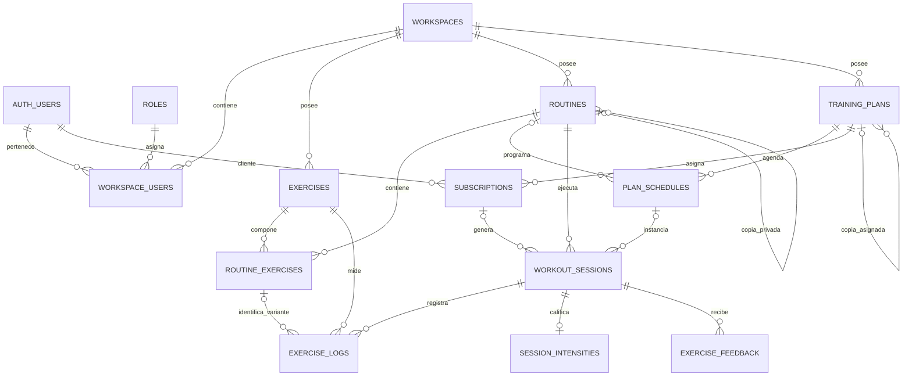
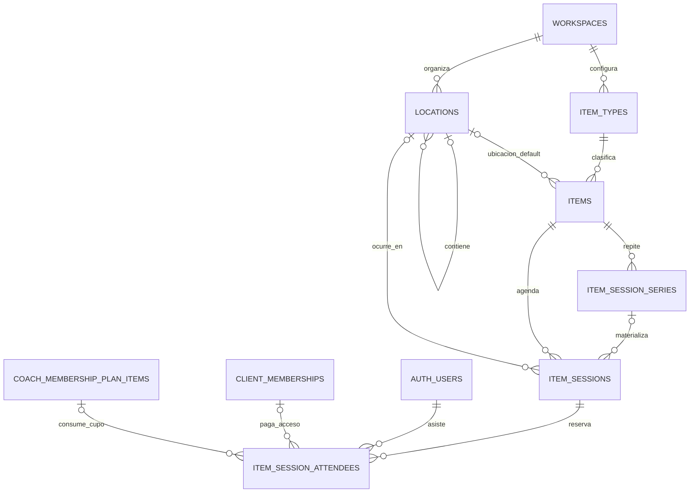
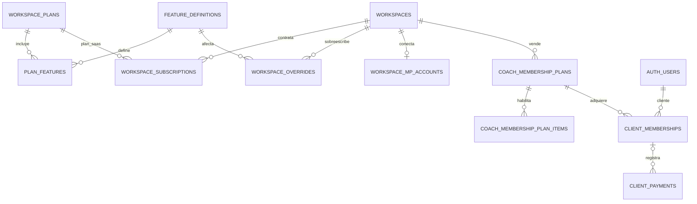

# Análisis de la base de datos actual — Factory Fitness

**Corte:** 18 de julio de 2026<br>
**Rama y commit:** `main` · `d9f1fda7`<br>
**Fuente canónica utilizada:** 100 migraciones bajo `supabase/migrations`.

> **Uso permitido:** evidencia histórica para comprender requisitos y deuda. Factory Fitness no es origen de migración para Allfit V1: no se reutilizan sus datos, IDs, ETL, backfills ni contratos de compatibilidad.

> La instancia local no estaba disponible durante esta revisión y Docker no estaba iniciado. Los conteos marcados como “estáticos” provienen de reconstruir el historial SQL del repositorio; deben contrastarse con `pg_catalog` antes de ejecutar cambios de producción.

## 1. Resumen ejecutivo

Factory Fitness usa PostgreSQL como núcleo multi-tenant y Supabase como capa de Auth, PostgREST/RPC, RLS y Storage. El repositorio define **70 tablas activas**:

| Esquema | Tablas | Responsabilidad |
| --- | ---: | --- |
| `public` | 36 | Entrenamiento, usuarios, agenda, progreso, nutrición, archivos y notificaciones |
| `billing` | 16 | Suscripción SaaS, entitlements, productos del coach, membresías y pagos |
| `rbac` | 11 | Workspaces, membresías, roles, permisos y administración de plataforma |
| `crm` | 4 | Leads, etapas, actividad y configuración |
| `ai` | 3 | Conversaciones, mensajes y ejecuciones de herramientas |

No se incluyen en ese total las tablas administradas por Supabase en `auth`, `storage`, `realtime`, etc.

La valoración general es: **modelo funcionalmente rico, bien separado por dominios y con buena defensa mediante constraints/RLS, pero con integridad multi-tenant y endurecimiento de funciones todavía incompletos**.

Fortalezas principales:

- Las 70 tablas propias habilitan RLS.
- Todas las tablas creadas por el repositorio declaran primary key.
- Uso consistente de UUID, `timestamptz`, `numeric` para dinero y soft delete.
- Checks para estados, capacidad, fechas, visibilidad y reglas de producto.
- Índices parciales para filas activas y combinaciones de alta frecuencia.
- Separación real entre RBAC, billing, CRM e IA.
- Operaciones de reserva y creación compleja usan funciones transaccionales y locks.

Riesgos principales:

1. Las relaciones entre tablas tenant-aware suelen usar una FK al `id` global del padre, sin incluir `workspace_id`; la base permite asociaciones entre tenants si una operación privilegiada se equivoca.
2. Existe una cantidad material de FKs sin un índice completo cuyo prefijo cubra la FK. Los índices parciales ayudan a las consultas activas, pero no siempre a cascadas o validaciones sobre todas las filas.
3. `public.reserve_item_session_attendee` es `SECURITY DEFINER`, acepta el usuario objetivo como parámetro y no revoca explícitamente `EXECUTE` a `PUBLIC`/`anon`/`authenticated`.
4. El RBAC depende de una función central llamada desde muchas políticas. Es una buena centralización, pero su costo puede multiplicarse por fila.
5. Hay referencias polimórficas (`resource_type/resource_id`, `product_type/product_id`) que no pueden usar foreign keys normales.

## 2. Mapa general del esquema

```mermaid
flowchart TB
    auth["auth.users<br/>identidad Supabase"]
    ws["rbac.workspaces<br/>raíz del tenant"]
    membership["rbac.workspace_users<br/>usuario + workspace + rol"]
    roles["rbac.roles / permissions<br/>catálogo y overrides"]

    auth --> membership
    ws --> membership
    roles --> membership

    subgraph fitness["public · operación fitness"]
        training["Ejercicios → rutinas → planes<br/>→ suscripciones → sesiones → logs"]
        progress["Check-ins · medidas · récords<br/>feedback · nutrición"]
        schedule["Tipos → items → series/sesiones<br/>→ asistentes"]
        support["Perfiles · tokens · videos<br/>push y entregas"]
    end

    subgraph monetization["billing"]
        saas["Planes SaaS → suscripción del workspace<br/>→ features y overrides"]
        commerce["Cuenta MP → productos del coach<br/>→ membresías → pagos"]
    end

    subgraph acquisition["crm"]
        leads["Etapas → leads → actividad"]
    end

    subgraph assistant["ai"]
        conversations["Conversaciones → mensajes<br/>→ tool executions"]
    end

    ws --> training
    ws --> progress
    ws --> schedule
    ws --> support
    ws --> saas
    ws --> commerce
    ws --> leads
    ws --> conversations
    auth --> training
    auth --> progress
    auth --> schedule
    auth --> commerce
    auth --> conversations
```



`rbac.workspaces` es la raíz lógica del tenant. Casi todas las filas de negocio llevan `workspace_id`; `auth.users` es una raíz global administrada por Supabase.

## 3. Modelo relacional de entrenamiento



Puntos importantes del flujo:

- `training_plans` representa programas de entrenamiento, no planes SaaS ni productos de pago. Las columnas comerciales fueron eliminadas en julio.
- Al asignar un programa se puede crear una copia privada mediante `source_plan_id`, `assigned_client_id` y `assigned_subscription_id`.
- `plan_schedules` define días/posiciones y puede apuntar a rutina, descanso, deporte o check-in.
- `workout_sessions` es la instancia ejecutable. Desde junio admite tanto sesiones de plan como autoentrenamiento/manuales, por lo que `subscription_id` puede ser nulo.
- `exercise_logs` identifica el ejercicio y, cuando aplica, el `routine_exercise_id`; esto permite distinguir variantes/unilateralidad dentro de la misma rutina.
- `session_intensities` reemplazó el concepto anterior de rating de rutina y mantiene una relación uno-a-uno por `session_id` único.

## 4. Modelo de agenda, clases y membresías



- `item_types` define categorías de oferta y evolucionó de catálogo global a configuración global o por workspace.
- `items` es el producto operativo: clase, sesión, servicio o contenido agendable.
- `item_session_series` describe recurrencia; `item_sessions` materializa ocurrencias concretas.
- `item_session_attendees` registra reserva, asistencia, cancelación y consumo de cuota.
- Los catálogos de estado (`item_session_statuses`, `item_session_attendee_statuses`) se modelan como tablas referenciadas, no como enums; esto facilita metadatos y presentación.
- `locations` es jerárquica mediante `parent_location_id` y distingue sede/espacio, modalidad física, live o video.

## 5. Modelo de billing



Hay tres conceptos que comparten nombres parecidos pero tienen responsabilidades distintas:

| Concepto | Tabla | Significado |
| --- | --- | --- |
| Plan de producto Dinnartec | `billing.workspace_plans` | Lo que Dinnartec cobra al workspace |
| Programa fitness | `public.training_plans` | Rutinas/calendario que ejecuta un cliente |
| Producto del coach | `billing.coach_membership_plans` | Membresía o pase que el coach vende a sus clientes |

Asimismo:

- `billing.workspace_subscriptions` controla acceso SaaS del workspace.
- `public.subscriptions` asigna un programa de entrenamiento a un cliente.
- `billing.client_memberships` representa una compra/membresía comercial del cliente.

La separación conceptual es correcta, aunque la palabra “plan/subscription” repetida en tres contextos aumenta la carga cognitiva y exige nombres muy explícitos en código y analítica.

## 6. Catálogo completo de tablas

### 6.1 `rbac` — identidad organizacional y permisos

| Tabla | Función y relaciones principales |
| --- | --- |
| `workspaces` | Tenant raíz; propietario en `auth.users`, slug público, branding y configuración operativa. |
| `workspace_users` | Membresía N:M entre usuario y workspace; PK compuesta `(workspace_id, user_id)` y rol asignado. |
| `roles` | Catálogo global de roles base. |
| `permissions` | Permisos por rol base: recurso, acción y alcance propio. |
| `permission_catalog` | Catálogo normalizado de capacidades disponibles. |
| `workspace_custom_roles` | Habilita nombres/roles personalizados dentro de un workspace. |
| `workspace_role_permissions` | Override permitido/denegado por workspace, rol, recurso y acción. |
| `workspace_role_settings` | Ajustes de visibilidad/asignación por rol dentro del workspace. |
| `member_staff_assignments` | Relación entre un miembro y miembros del staff, con rol de relación. Usa FKs compuestas hacia `workspace_users`. |
| `platform_admins` | Grants globales para administración Dinnartec. |
| `platform_admin_audit_events` | Auditoría de accesos y acciones de platform admin. |

### 6.2 `public` — dominio fitness y operación

| Grupo | Tablas | Función |
| --- | --- | --- |
| Usuario y acceso | `users_profiles`, `auth_tokens`, `invite_links` | Perfil global del usuario, tokens de flujos especiales e invitaciones por workspace. |
| Taxonomía fitness | `muscle_groups`, `equipment`, `global_exercises` | Catálogo global curado. |
| Ejercicios | `exercises`, `routine_exercises`, `exercise_feedback` | Ejercicios del workspace/cliente, composición de rutina y feedback por ejecución. |
| Rutinas y planes | `routines`, `training_plans`, `plan_schedules`, `subscriptions` | Plantillas, copias asignadas, calendario y asignación a clientes. |
| Ejecución | `workout_sessions`, `exercise_logs`, `session_intensities`, `free_activities` | Sesiones planificadas/manuales, sets, esfuerzo percibido y actividad libre. |
| Progreso | `progress_check_in_requests`, `progress_check_ins`, `body_measurements`, `personal_records`, `client_progress_tracking_recommendations` | Solicitudes, check-ins, mediciones, récords y recomendaciones configurables. |
| Nutrición | `meals`, `nutrition_goals` | Registro alimentario y objetivos nutricionales. |
| Agenda | `item_types`, `items`, `locations`, `item_session_series`, `item_sessions` | Oferta, espacios, recurrencia y sesiones concretas. |
| Asistencia | `item_session_attendee_statuses`, `item_session_statuses`, `item_session_attendees` | Catálogos de estados y reservas/asistencia. |
| Actividad cliente | `client_activity_events` | Timeline/auditoría funcional de cambios del cliente. |
| Archivos y comunicación | `video_assets`, `web_push_subscriptions`, `notification_deliveries` | Activos de Cloudflare, endpoints push y deduplicación/entrega de notificaciones. |

`users_profiles` no contiene `workspace_id`: un usuario mantiene un único perfil compartido entre sus workspaces. Esto puede ser deliberado, pero implica que datos personales como identificación, dirección o métricas no son copias independientes por organización.

### 6.3 `billing` — monetización y entitlements

| Grupo | Tablas | Función |
| --- | --- | --- |
| Catálogo SaaS | `workspace_plans`, `feature_categories`, `feature_definitions`, `plan_features`, `mp_plan_mappings` | Planes Dinnartec, catálogo de features y mapeo a MercadoPago. |
| Estado SaaS | `workspace_subscriptions`, `workspace_overrides`, `billing_events`, `ambassador_grants` | Suscripción del workspace, excepciones, eventos idempotentes y grants comerciales. |
| Cuenta del coach | `workspace_mp_accounts`, `workspace_payment_methods` | OAuth/cuenta MercadoPago y métodos operativos/manuales. |
| Productos del coach | `coach_membership_plans`, `coach_membership_plan_items`, `coach_mp_plan_mappings` | Membresías/pases, recursos habilitados y sincronización externa. |
| Cliente final | `client_memberships`, `client_payments` | Compra vigente, periodos, estados, pagos y reembolsos. |

### 6.4 `crm`

| Tabla | Función |
| --- | --- |
| `lead_stages` | Pipeline configurable por workspace; etapas open/won/lost. |
| `leads` | Contacto, propietario, etapa, plan interesado y conversión a usuario. |
| `lead_activity` | Timeline append-like con snapshot del actor y metadata. |
| `workspace_settings` | Reglas de seguimiento, actualmente días para alerta. |

### 6.5 `ai`

| Tabla | Función |
| --- | --- |
| `conversations` | Conversación de un usuario dentro de un workspace. |
| `messages` | Mensajes con `content`, `parts` y metadata JSONB. |
| `tool_executions` | Entrada, salida, estado, error y duración de cada herramienta invocada. |

## 7. Integridad y cardinalidad

### 7.1 Lo que está bien resuelto

- PKs explícitas en todas las tablas.
- Uniques compuestos para casos como rol/recurso/acción, orden de rutina, sets de ejercicio, una intensidad por sesión y una notificación diaria por usuario/kind.
- Índices únicos parciales para “una suscripción activa”, “una membresía activa” y registros no eliminados.
- Checks que evitan intervalos negativos, fin antes de inicio, capacidad cero, estados inválidos y contratos inconsistentes de productos.
- Uso correcto de `numeric(10,2)`/`numeric(12,2)` en dinero y `timestamptz` para instantes.
- FKs compuestas en `member_staff_assignments`, uno de los pocos puntos donde el workspace sí forma parte explícita de la relación.

### 7.2 Integridad multi-tenant incompleta — prioridad alta

El patrón más común es:

```sql
workspace_id uuid not null references rbac.workspaces(workspace_id),
routine_id uuid not null references public.routines(id)
```

Esto prueba que el workspace y la rutina existen, pero no que ambos sean del mismo tenant. El mismo patrón aparece en relaciones críticas:

- `routine_exercises → routines/exercises`.
- `plan_schedules → training_plans/routines`.
- `workout_sessions → subscriptions/routines/plan_schedules`.
- `exercise_logs → workout_sessions/exercises/routine_exercises`.
- `crm.leads → lead_stages/training_plans`.
- `client_memberships → coach_membership_plans`.
- `item_sessions → items/locations/series`.
- `item_session_attendees → sessions/memberships/plan_items`.

RLS limita qué fila puede ver o mutar un usuario normal, pero no convierte esas FKs en relaciones tenant-safe. `service_role`, funciones `SECURITY DEFINER`, migraciones y errores server-side pueden introducir referencias cruzadas.

La solución estructural es añadir `UNIQUE (workspace_id, id)` en padres críticos y usar FKs compuestas `(workspace_id, parent_id)`. Debe migrarse por dominios y acompañarse de consultas de detección de anomalías antes de validar constraints.

### 7.3 Relaciones polimórficas

Dos zonas renuncian deliberadamente a FK estricta:

- `coach_membership_plan_items(resource_type, resource_id)` puede apuntar a training plan, item o item type; `feature_key` cubre features lógicos.
- `client_payments(product_type, product_id)` puede apuntar a varios tipos de producto.

Los checks validan cuándo un ID debe existir, pero no validan que el recurso exista ni que pertenezca al mismo workspace. A largo plazo conviene usar tablas de unión tipadas por recurso o triggers defensivos, especialmente para cobros y cuotas.

### 7.4 Soft delete

`deleted_at` aparece de forma generalizada y numerosos uniques/índices son parciales `WHERE deleted_at IS NULL`. Es coherente para preservar historial, pero implica:

- `ON DELETE CASCADE` solo actúa en borrados físicos, no en soft delete.
- Los hijos pueden seguir “activos” si el padre se marca eliminado y la aplicación no propaga el estado.
- Un índice parcial no sustituye necesariamente al índice completo requerido para validar FKs o borrar físicamente un padre.

## 8. Seguridad, RLS y privilegios

### 8.1 Cobertura

- 70 de 70 tablas propias tienen `ENABLE ROW LEVEL SECURITY` en las migraciones.
- La reconstrucción estática estima 227 políticas activas, incluidas políticas de `storage.objects`.
- Aproximadamente 106 políticas activas invocan `rbac.has_permission`.
- El análisis estático encuentra 22 políticas con `auth.uid()` sin el patrón init-plan `(select auth.uid())`.

Estos conteos necesitan verificación en `pg_policies`, pero muestran una arquitectura de seguridad muy dependiente de RLS y de un helper RBAC central.

### 8.2 RPC privilegiado expuesto — prioridad crítica

`public.reserve_item_session_attendee`:

- Es `SECURITY DEFINER`.
- Recibe `p_user_id`, workspace, membresía, estado y consumo de cuota desde el llamador.
- Hace inserts directos en `item_session_attendees`.
- No valida `auth.uid()` ni el rol del actor.
- Se concede a `service_role`, pero no se revoca el permiso `EXECUTE` que PostgreSQL entrega a `PUBLIC` por defecto.
- La redefinición de julio conserva la misma firma y tampoco añade el `REVOKE`.

La corrección debe revocar ejecución a `PUBLIC`, `anon` y `authenticated`, concederla únicamente al rol realmente necesario y añadir una validación defensiva dentro de la función.

### 8.3 `SECURITY DEFINER` y `search_path`

El historial contiene 38 menciones de `SECURITY DEFINER`. Las funciones más recientes de billing y operaciones suelen fijar `search_path`; helpers centrales como `rbac.has_permission`, `rbac.has_role`, `rbac.is_workspace_owner` y la creación inicial de workspace no lo hacen explícitamente.

Las referencias internas están mayormente cualificadas con esquema, lo que reduce el riesgo, pero la práctica recomendada es `SET search_path = ''` y nombres completamente cualificados. También conviene revocar `EXECUTE` de `PUBLIC` por defecto y concederlo función por función.

### 8.4 Privilegios amplios

Las migraciones otorgan privilegios amplios sobre tablas/rutinas de `rbac`, `billing`, `crm` y `ai` a roles Supabase, apoyándose en RLS para el aislamiento. Es compatible con el patrón PostgREST, pero hace que un error de policy sea inmediatamente explotable. Las funciones y tablas que solo usa la API con `service_role` deberían tener grants más estrechos.

## 9. Índices y rendimiento

El historial contiene aproximadamente 190 sentencias `CREATE INDEX`. Hay buen uso de:

- `(workspace_id, status, created_at/start_at)`.
- Índices parciales sobre `deleted_at IS NULL`.
- Índices únicos parciales para invariantes de filas activas.
- Índices especializados para agenda, workout sessions y cuotas de asistencia.

### 9.1 FKs sin índice completo

PostgreSQL no crea índices automáticamente en la columna hija de una FK. Una auditoría materializada anterior documentada en este repositorio —con cinco migraciones todavía pendientes en aquella instancia— reportó 94 de 177 FKs sin un índice completo cuyo prefijo cubriera la relación. La instancia no estaba disponible para repetir hoy ese conteo, pero el análisis estático vuelve a encontrar candidatos relevantes:

- `exercise_logs.exercise_id`.
- `routine_exercises.exercise_id`.
- `plan_schedules.routine_id`.
- `workout_sessions.routine_id`.
- `item_sessions.series_id`, `location_id`, `responsible_user_id`.
- `item_session_attendees.user_id` como índice independiente completo.
- `crm.leads.stage_id`, `owner_id`, `interested_plan_id`, `converted_client_id`.
- `crm.lead_activity.lead_id`, `actor_user_id`.
- `billing.client_payments.membership_id`, `enrollment_id`.
- Varias relaciones de auditoría/invitación hacia `auth.users`.

No deben añadirse todos mecánicamente: hay que priorizar por crecimiento, joins, cascadas y planes reales. Las primeras tablas a medir son logs, sesiones, asistentes, pagos, actividad CRM, notificaciones y auditoría.

### 9.2 Costo de RLS

`rbac.has_permission` es central y estable, pero se usa en más de cien políticas. Si PostgreSQL la evalúa por fila en colecciones grandes, el costo de joins contra membresías/permisos se multiplica. Las optimizaciones candidatas son:

- envolver valores constantes con `SELECT` cuando sea válido;
- asegurar índices sobre `(user_id, workspace_id)` y claves consultadas por el helper;
- medir `EXPLAIN (ANALYZE, BUFFERS)` con JWT realista;
- evitar que una policy repita checks equivalentes en subconsultas anidadas.

### 9.3 JSONB

El esquema usa JSONB para metadata, configuración de landing/PWA, features, tracking items, mensajes y tool calls. Es adecuado para estructuras variables. No se observan GIN generalizados; eso no es un defecto mientras JSONB se lea como documento. Si se empieza a filtrar con `@>`, `?` o claves internas en tablas de crecimiento alto, deberán añadirse índices GIN o de expresión específicos.

### 9.4 Paginación

PostgREST está limitado a 1.000 filas. Las tablas de crecimiento continuo (`exercise_logs`, `workout_sessions`, `lead_activity`, `client_activity_events`, `notification_deliveries`, `billing_events`) necesitan paginación por cursor y selección explícita de columnas para evitar truncamiento silencioso.

## 10. Calidad y evolución del modelo

- `users_profiles.birthdate` es la fuente futura, pero `age` permanece por compatibilidad y puede quedar obsoleto; debería eliminarse cuando todos los consumidores calculen edad.
- `users_profiles` es global, mientras la mayoría de datos son tenant-aware. Hay que decidir explícitamente qué campos pertenecen a la persona y cuáles deberían vivir en un perfil por workspace.
- `item_types.workspace_id` es nullable para soportar tipos globales y locales. Es flexible, pero obliga a mantener reglas de precedencia y uniqueness condicionales.
- Las columnas de snapshot/metadata en CRM y billing preservan historial correctamente, aunque requieren una política de versión/shape para no acumular JSON incompatible.
- Los UUID v4 son adecuados para IDs expuestos y desacoplamiento, pero generan índices más grandes y menos localizados que UUIDv7. Solo justificaría migración en tablas de altísimo volumen.
- La base usa enums PostgreSQL en billing y tablas lookup en agenda. Ambos enfoques son válidos, pero los enums son más difíciles de retirar/cambiar; deben reservarse para vocabularios realmente estables.

## 11. Recomendaciones priorizadas

### P0 — seguridad inmediata

1. Revocar ejecución pública de `reserve_item_session_attendee` y validar actor, workspace y usuario objetivo dentro del RPC.
2. Inventariar todas las funciones `SECURITY DEFINER`, privilegios efectivos y `search_path`; aplicar deny-by-default.

### P1 — integridad y rendimiento

3. Introducir FKs tenant-safe por fases, empezando por billing, sesiones, planes, CRM y asistencia.
4. Consultar `pg_constraint`/`pg_index` en una instancia actual y crear los índices de FK prioritarios según tamaño y uso.
5. Medir las policies con `EXPLAIN ANALYZE`, optimizar `auth.uid()`/`has_permission` y asegurar índices de soporte.
6. Añadir paginación obligatoria en tablas append-like y listados administrativos.

### P2 — mantenibilidad

7. Sustituir referencias polimórficas críticas por tablas de unión tipadas o validaciones transaccionales.
8. Separar conceptualmente datos personales globales de datos del cliente dentro de un workspace.
9. Retirar `age` cuando `birthdate` sea consumida en todo el sistema.
10. Añadir tests SQL de RLS, cross-tenant, RPCs y concurrencia de reservas/pagos a CI.

## 12. Evidencia principal

- Configuración Supabase: [`supabase/config.toml`](https://github.com/dinnartec/factory-fitness/blob/d9f1fda7/supabase/config.toml).
- RBAC inicial: [`20260401212249_rbac_infrastructure.sql`](https://github.com/dinnartec/factory-fitness/blob/d9f1fda7/supabase/migrations/20260401212249_rbac_infrastructure.sql).
- Núcleo de entrenamiento: [`20260401212253_exercises.sql`](https://github.com/dinnartec/factory-fitness/blob/d9f1fda7/supabase/migrations/20260401212253_exercises.sql), [`20260401212254_routines.sql`](https://github.com/dinnartec/factory-fitness/blob/d9f1fda7/supabase/migrations/20260401212254_routines.sql), [`20260401212256_training_plans.sql`](https://github.com/dinnartec/factory-fitness/blob/d9f1fda7/supabase/migrations/20260401212256_training_plans.sql), [`20260401212300_workout_sessions.sql`](https://github.com/dinnartec/factory-fitness/blob/d9f1fda7/supabase/migrations/20260401212300_workout_sessions.sql).
- Billing: [`20260428000000_billing.sql`](https://github.com/dinnartec/factory-fitness/blob/d9f1fda7/supabase/migrations/20260428000000_billing.sql), [`20260501000001_coach_billing_products.sql`](https://github.com/dinnartec/factory-fitness/blob/d9f1fda7/supabase/migrations/20260501000001_coach_billing_products.sql), [`20260702161614_plan_memberships_upgrade.sql`](https://github.com/dinnartec/factory-fitness/blob/d9f1fda7/supabase/migrations/20260702161614_plan_memberships_upgrade.sql).
- Agenda y RPC de reserva: [`20260519183354_items_and_schedules.sql`](https://github.com/dinnartec/factory-fitness/blob/d9f1fda7/supabase/migrations/20260519183354_items_and_schedules.sql).
- RBAC editable: [`20260529000000_workspace_users_staff_permissions.sql`](https://github.com/dinnartec/factory-fitness/blob/d9f1fda7/supabase/migrations/20260529000000_workspace_users_staff_permissions.sql).
- CRM: [`20260603190000_crm_leads.sql`](https://github.com/dinnartec/factory-fitness/blob/d9f1fda7/supabase/migrations/20260603190000_crm_leads.sql).
- IA: [`20260417000000_ai_assistant.sql`](https://github.com/dinnartec/factory-fitness/blob/d9f1fda7/supabase/migrations/20260417000000_ai_assistant.sql).
- Autoentrenamiento: [`20260628123000_self_training_manual_workouts.sql`](https://github.com/dinnartec/factory-fitness/blob/d9f1fda7/supabase/migrations/20260628123000_self_training_manual_workouts.sql).
