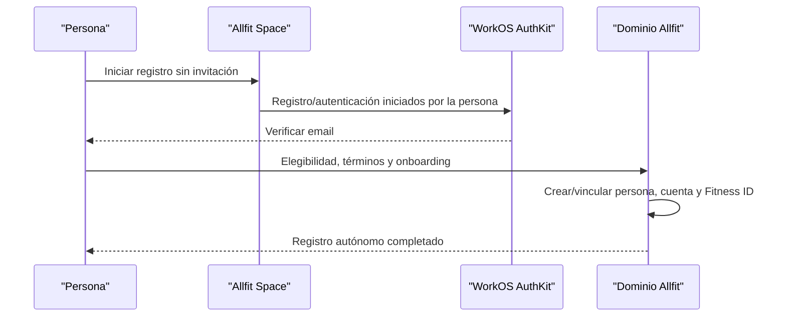
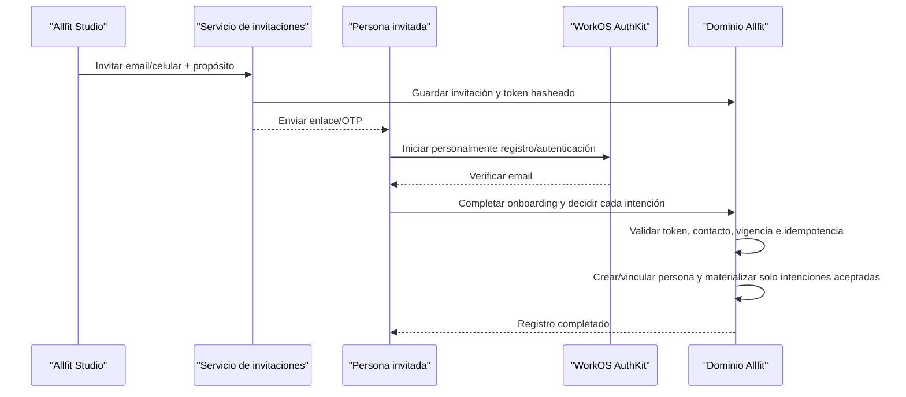
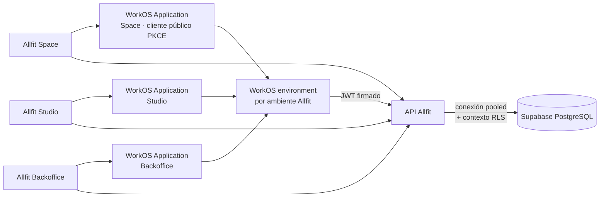
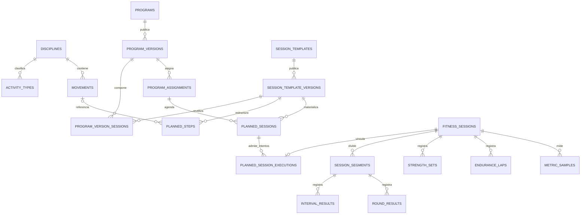

# ADR — Decisiones de arquitectura de Allfit

**Estado general:** mixto; cada ADR conserva su estado y la ejecución avanza con gates por rebanada<br>
**Fecha de consolidación:** 5 de agosto de 2026<br>
**Alcance:** identidad, invitaciones, autenticación, acceso a PostgreSQL, operación profesional, consentimiento, terminación de relaciones, retención y disposición de datos, entrenamiento multidisciplina, Nutrición no clínica y topología de repositorios.

## Índice de decisiones

| ADR | Decisión |
| --- | --- |
| ADR-001 | Registro directo en Space e invitaciones opcionales desde Studio |
| ADR-002 | WorkOS AuthKit para autenticación y Supabase únicamente como PostgreSQL |
| ADR-003 | Núcleo de entrenamiento multidisciplina |
| ADR-004 | Operación profesional siempre dentro de una organización |
| ADR-005 | Terminación de relaciones y retención restringida de datos |
| ADR-006 | Evolución de práctica unipersonal a equipo sin cambiar de organización |
| ADR-007 | Categorías de consentimiento explícito para V1 |
| ADR-008 | Intenciones tipadas y aceptación parcial de invitaciones |
| ADR-009 | Versionado independiente e inmutable de plantillas de sesión |
| ADR-010 | Múltiples intentos y una ejecución primaria por sesión planificada |
| ADR-011 | Correcciones profesionales sin sobrescribir ejecuciones ajenas |
| ADR-012 | Eliminación, anonimización y conservación restringida por categoría |
| ADR-013 | Contratos mínimos y versionados de resultados por tipo de actividad |
| ADR-014 | Independencia funcional sin tolerancia física separada en V1 |
| ADR-015 | Consentimiento a la parte responsable con acceso por profesionales asignados |
| ADR-016 | Contratos versionados de campos para los scopes V1 |
| ADR-017 | V1 exclusiva para personas adultas, sin representación de menores |
| ADR-018 | Procedencia explícita y coexistencia de afirmaciones del perfil |
| ADR-019 | Desacoplar y pausar asignaciones al terminar una relación |
| ADR-020 | Ocultación de sesiones autónomas por relación |
| ADR-021 | Capacidades diferidas sin modelo físico especulativo en V1 |
| ADR-022 | Decisiones operativas de Fase 3: rol staff, suplencia profesional y soporte con break-glass |
| ADR-023 | Acceso histórico restringido a grants frozen |
| ADR-024 | Integridad compuesta entre persona, organización y relación |
| ADR-025 | Idempotencia durable independiente del replay HTTP |
| ADR-026 | Gobernanza cerrada de verificadores y acceso break-glass |
| ADR-027 | Nutrición personal y guía profesional no clínica en V1 |
| ADR-028 | Backoffice con rol base, deberes temporales y separación break-glass |
| ADR-029 | Monorepo de implementación con deployables independientes |

Cada sección conserva su contexto, decisión, invariantes, consecuencias y pruebas. Las nuevas decisiones de arquitectura de esta refactorización deben añadirse a este mismo documento.

---

## ADR-001 — Registro directo en Space e invitaciones opcionales desde Studio

**Estado:** en revisión<br>
**Fecha:** 18 de julio de 2026

### Contexto

Allfit Space debe permitir que cualquier persona elegible se registre y use su Fitness ID de forma autónoma, sin depender de una organización o invitación. Allfit Studio también necesita proponer relaciones con profesionales u organizaciones, pero una organización no debe crear credenciales, aceptar términos, completar perfiles ni tomar decisiones de privacidad en nombre de otra persona.

### Decisión

Existen dos entradas al mismo flujo de identidad:

1. **Registro directo en Space:** la persona inicia personalmente el registro mediante WorkOS AuthKit, acredita elegibilidad adulta, acepta términos y completa onboarding sin invitación.
2. **Invitación opcional desde Studio:** Studio emite una invitación por email o celular; la persona se registra o inicia sesión por sí misma y decide sus intenciones.

La invitación no es requisito para crear una cuenta, activar el Fitness ID o usar las funciones personales de Space. El registro directo crea únicamente persona, cuenta, perfil inicial y evidencia propia del onboarding; no crea organización, membresía, relación profesional, asignación ni grants de servicio.

Allfit Studio **solo puede emitir invitaciones por email o celular** para iniciar propuestas hacia otra persona.

Studio nunca puede:

- usar la operación administrativa `Create User` de WorkOS o cualquier flujo equivalente para registrar al invitado;
- crear una persona canónica en `identity.people`;
- completar un perfil fitness;
- aceptar términos o consentimientos;
- crear una membresía o relación efectiva antes de la aceptación;
- asignar de forma efectiva un programa a alguien que todavía no se ha registrado.

Cuando el proceso se origina en Studio, antes de la aceptación existe únicamente una invitación, no una persona provisional. La persona y cuenta se materializan cuando su titular verifica el contacto, acredita elegibilidad y completa personalmente el onboarding. En el registro directo de Space no existe invitación ni debe crearse una artificial.

### Invariantes

1. Space permite registro directo sin invitación, organización o relación profesional.
2. Una invitación no es una persona ni una cuenta.
3. El email/celular de una invitación no se usa para crear automáticamente un usuario de WorkOS.
4. Solo el titular que controla el contacto puede iniciar/completar el registro o autenticación mediante AuthKit.
5. Si la invitación usa email, el email verificado por WorkOS debe coincidir con el destino normalizado. Si usa celular, la aceptación exige una prueba de control separada y aprobada; el token de AuthKit no prueba control del teléfono.
6. Una invitación no concede permisos ni acceso a datos.
7. La aceptación materializa únicamente las intenciones que la persona acepta.
8. Una persona ya registrada en Space acepta la invitación con su identidad existente; no se crea otra.
9. El registro directo no materializa intenciones, membresías, relaciones, asignaciones o grants inexistentes.
10. Ambos caminos producen el mismo tipo de persona, cuenta y Fitness ID canónicos.
11. El flujo completo es idempotente, transaccional y auditable.

### Flujo de registro directo en Space



### Flujo de invitación desde Studio



### Modelo conceptual de la invitación

`identity.invitations` debe contener como mínimo:

- `id`;
- `organization_id`;
- `invited_by_person_id`;
- `channel`: `email` o `phone`;
- destino normalizado y protegido;
- `token_hash`, nunca el token plano;
- propósito/tipo de invitación;
- `status`;
- `expires_at`;
- `sent_at`, `delivered_at`, `completed_at`, `revoked_at`;
- `completed_by_person_id`, nullable hasta completar el flujo;
- timestamps y datos mínimos de auditoría.

Las propuestas viven como filas independientes en `identity.invitation_intents`, con tipo, estado, dependencias y referencias tipadas. La invitación es el sobre; no debe almacenar una aceptación general equivalente a “aceptar todo”.

Estados recomendados:

```text
pending → sent → delivered → opened → completed
                       ├── expired
                       ├── revoked
                       └── blocked
```

No crear una tabla “persona provisional”. Si se necesita CRM antes del registro, el lead/contacto pertenece al dominio CRM y tampoco debe confundirse con `identity.people`.

### Aceptación transaccional

La operación de aceptación debe:

1. verificar el access token de AuthKit —firma mediante JWKS, `iss`, `exp`, `iat`, `sub`, `sid` y `client_id` de la WorkOS Application esperada—;
2. comprobar que la evidencia aprobada de control del canal coincide con la invitación;
3. validar token, expiración, estado, organización e intenciones;
4. encontrar la persona ya vinculada a la cuenta o crearla durante onboarding;
5. registrar aceptación o rechazo individual de cada intención presentada;
6. crear únicamente membresías, relaciones y asignaciones expresamente aceptadas y cuyas dependencias se cumplan;
7. registrar consentimientos explícitos por separado;
8. marcar la invitación como completada aunque alguna intención opcional haya sido rechazada;
9. registrar auditoría/outbox;
10. completar todo en una única transacción idempotente.

### Seguridad

- Tokens aleatorios de alta entropía, de un solo uso y almacenados como hash.
- Expiración corta y revocación inmediata.
- Rate limiting por organización, actor, destino e IP.
- Respuestas que no permitan enumerar si un contacto ya tiene cuenta.
- Acceso a invitaciones limitado al emisor autorizado y al destinatario durante aceptación.
- Las credenciales de PostgreSQL permanecen exclusivamente en backend.
- El contacto se retiene únicamente durante el periodo necesario.
- Toda aceptación, rechazo, expiración y revocación queda auditada.

AuthKit verifica email como identidad primaria. La ruta de invitación por celular queda bloqueada hasta decidir e implementar un OTP propio o proveedor específico, con propósito, expiración, rate limit, evidencia y retención. Un desafío SMS antifraude de WorkOS Radar no se considera automáticamente prueba de identidad para aceptar una invitación.

### Consecuencias

#### Positivas

- La persona controla su identidad, términos y privacidad.
- Studio no necesita permisos administrativos para crear usuarios en WorkOS.
- Se evita crear usuarios falsos, incompletos o duplicados.
- Las relaciones efectivas siempre apuntan a personas verificadas.
- El modelo de RLS es más simple: no existen personas activas sin identidad autenticable.

#### Costos

- Studio no puede asignar ni operar sobre una persona antes de que acepte.
- Los flujos comerciales deben distinguir invitación pendiente de cliente activo.
- La conversión depende de entrega y aceptación del destinatario.
- Se necesita un proceso robusto para reenvío, expiración y cambio de contacto.

### Escenarios de prueba obligatorios

1. Studio crea invitación y no aparece ningún usuario WorkOS ni fila en `identity.people`.
2. Un token expirado o revocado no puede aceptarse.
3. Una cuenta con email/celular diferente no puede aceptar la invitación.
4. Una persona existente acepta sin crear duplicados.
5. Dos reintentos concurrentes producen una sola aceptación.
6. Una invitación aceptada no puede reutilizarse.
7. Rechazar una intención no crea relación, asignación ni consentimiento.
8. Un miembro sin permiso no puede invitar ni consultar contactos invitados.
9. Aceptar la relación y rechazar el programa produce una relación sin asignación.
10. Completar una invitación nunca concede scopes de datos, términos, pagos o usos secundarios implícitos.
11. Una persona se registra directamente en Space sin que exista o se cree una invitación.
12. El registro directo no crea organización, membresía, relación, asignación ni grant.
13. Esa persona acepta después una invitación de Studio usando el mismo `person_id` y Fitness ID.

---

## ADR-002 — WorkOS AuthKit para autenticación y Supabase únicamente como PostgreSQL

**Estado:** aceptada para V1<br>
**Fecha:** 3 de agosto de 2026<br>
**Supersedida parcialmente por:** ADR-029 sustituye únicamente la separación física de los repositorios de producto; conserva Applications, deployables, identidad y superficies independientes

### Contexto

Allfit Studio y Allfit Space compartirán identidad y datos. En el momento de esta decisión se proyectaron repositorios y aplicaciones independientes; ADR-029 consolidó después el código en un monorepo sin cambiar la independencia de las aplicaciones ni de sus despliegues. Se decidió no utilizar Supabase Auth ni acceso directo desde los clientes a la Data API de Supabase.

### Decisión

- WorkOS AuthKit será la única fuente de autenticación.
- Existirá un environment de WorkOS aislado por ambiente de Allfit.
- Space, Studio y Backoffice tendrán WorkOS Applications separadas dentro del mismo environment y compartirán la misma base de usuarios de ese environment.
- Supabase se usará únicamente como servicio administrado de PostgreSQL.
- Space y Studio nunca se conectarán directamente a PostgreSQL ni usarán claves `anon`/`service_role`.
- Una API/backend propio verificará los JWT de WorkOS AuthKit y será el único acceso runtime a la BD.
- Personas, organizaciones, roles, relaciones, deberes y consentimientos de negocio vivirán en PostgreSQL. Las Organizations, roles, permissions y claims organizacionales de WorkOS no son autoridad de dominio para Allfit V1.
- La RLS de PostgreSQL se conservará como defensa en profundidad usando contexto transaccional establecido por el backend.

### Arquitectura



### Topología por ambiente

```text
development
├── WorkOS environment allfit-dev
│   ├── WorkOS Application Space dev
│   ├── WorkOS Application Studio dev
│   └── WorkOS Application Backoffice dev
└── Supabase project allfit-dev

staging
├── WorkOS environment allfit-staging
│   ├── WorkOS Application Space staging
│   ├── WorkOS Application Studio staging
│   └── WorkOS Application Backoffice staging
└── Supabase project allfit-staging

production
├── WorkOS environment allfit-prod
│   ├── WorkOS Application Space prod
│   ├── WorkOS Application Studio prod
│   └── WorkOS Application Backoffice prod
└── Supabase project allfit-prod
```

No se crea un environment por producto: las Applications del mismo environment comparten usuarios sin duplicar cuentas. Los environments sí permanecen aislados entre development, staging y production; sus usuarios, claves, webhooks y configuración no se promueven automáticamente.

Space es una aplicación móvil pública y usa Authorization Code con PKCE; nunca incorpora una API key o client secret de WorkOS en el bundle. Studio y Backoffice usan el flujo y almacenamiento de sesión apropiados para aplicaciones web, con redirect URIs y políticas de sesión independientes.

### Identidad externa y persona de dominio

WorkOS AuthKit autentica un usuario mediante:

- `issuer`: claim `iss` del environment o dominio de autenticación configurado;
- `subject`: claim `sub`, que contiene el WorkOS user ID;
- `session_id`: claim `sid` de la sesión;
- `client_id`: WorkOS Application que obtuvo el access token;
- `iat`, `exp` y demás claims admitidos por el contrato de sesión.

PostgreSQL mantiene la identidad de dominio:

```text
identity.people
└── identity.accounts
    ├── provider = 'workos'
    ├── issuer
    ├── subject          # WorkOS user ID del claim sub
    ├── person_id
    ├── created_at
    └── last_seen_at
```

Constraints recomendados:

- `unique (provider, issuer, subject)`;
- un usuario WorkOS vinculado pertenece a una sola persona de dominio;
- no usar email o celular como FK o identificador estable;
- email/celular se consideran atributos verificables y mutables.

### Verificación de cada petición

La API debe validar antes de consultar la BD:

1. firma contra el JWKS correspondiente al `client_id` de la WorkOS Application;
2. `iss` permitido para el environment o dominio de autenticación del ambiente;
3. `exp`, `iat` y temporalidad;
4. `sub` con formato de WorkOS user ID y `sid` de sesión;
5. `client_id` permitido para la superficie Space, Studio o Backoffice solicitada;
6. estado local de la cuenta/persona;
7. membresías, relaciones, deberes y consentimientos en PostgreSQL.

Los claims `org_id`, `role` y `permissions` de WorkOS se ignoran para autorización de negocio. La organización efectiva continúa viajando explícitamente en la ruta de Studio y se valida contra PostgreSQL.

El claim `auth_time` permite exigir autenticación reciente mediante `max_age`, pero **no demuestra por sí solo que hubo MFA**. La política MFA de AuthKit se configura por environment y no se aplica de la misma forma a usuarios SSO, por lo que activarla no basta para inferir AAL2 en Backoffice. Antes de habilitar una operación que exige `aal2`, la integración debe fijar y probar cómo obtiene evidencia verificable de MFA/step-up desde WorkOS y cómo la ata a la sesión. Mientras esa evidencia no exista, el backend solo establece `app.authn_assurance = 'aal1'` y las operaciones AAL2 fallan cerradas.

Decodificar un JWT sin verificar firma y claims no autentica a nadie.

### Contexto RLS en PostgreSQL

No se utilizarán `auth.uid()` ni roles `anon`/`authenticated`. El backend verifica WorkOS AuthKit, resuelve la persona y establece contexto local dentro de la misma transacción:

Los helpers propios de autorización y RLS se alojan en el schema técnico privado `access_control`; no se crean objetos Allfit en el schema `auth` administrado por Supabase.

```sql
begin;

select set_config('app.current_person_id', $1, true);
select set_config('app.workos_user_id', $2, true);
select set_config('app.client_id', $3, true);
select set_config('app.request_id', $4, true);

-- queries o funciones de dominio

commit;
```

El tercer argumento `true` hace que el valor sea local a la transacción. Esto es obligatorio con conexiones pooled para evitar que el contexto de una persona se filtre a la siguiente petición.

Helper conceptual:

```sql
create function identity.current_person_id()
returns uuid
language sql
stable
set search_path = ''
as $$
  select nullif(current_setting('app.current_person_id', true), '')::uuid
$$;
```

Las policies deben negar acceso si el contexto está ausente o es inválido.

### Roles de PostgreSQL

Separar credenciales y privilegios:

| Rol | Uso | Propiedad/BYPASSRLS |
| --- | --- | --- |
| `allfit_migrator` | CI de migraciones | Puede administrar esquema; no lo usa runtime |
| `allfit_api` | Peticiones autenticadas | No owner, `NOBYPASSRLS`, privilegios mínimos |
| `allfit_worker` | Jobs/webhooks | Grants específicos; no acceso universal por defecto |
| `allfit_readonly` | Diagnóstico controlado | Solo vistas/tablas autorizadas |

El backend no debe conectarse como `postgres` ni como propietario de las tablas.

### Conexiones

- Backends persistentes: conexión directa o pooler de sesión según red y arquitectura.
- Serverless/edge: Supavisor en transaction mode.
- Migrations, dumps y administración: conexión directa con credencial separada.
- Con transaction pooling, toda petición que dependa de RLS debe abrir una transacción y usar configuración local.
- No usar configuración de sesión para identidad.

### Invitaciones

La decisión documentada en la sección ADR-001 permanece:

- Space permite que la persona inicie registro/autenticación con AuthKit y onboarding sin invitación.
- El registro directo crea el Fitness ID sin organización, membresía, relación, asignación o grant de servicio.
- Studio crea `identity.invitations` con email/celular.
- Studio nunca usa la operación administrativa `Create User` de WorkOS para registrar a un invitado.
- La persona inicia personalmente el registro o autenticación mediante AuthKit.
- Si ya tiene cuenta, inicia sesión con la existente.
- La API valida que el contacto verificado coincida con la invitación.
- Después materializa persona, membresía, relación o asignación aceptada.

Una persona registrada directamente en Space puede aceptar después una invitación con la misma cuenta y `person_id`; la invitación nunca crea una segunda identidad.

Un registro iniciado por la persona puede producir temporalmente un usuario WorkOS antes de finalizar el onboarding de dominio. Eso no autoriza acceso a datos: hasta crear/vincular `identity.accounts`, la API debe responder con estado `registration_incomplete` y limitar los endpoints disponibles.

### Qué componentes de Supabase no se utilizarán

- Supabase Auth.
- Acceso directo desde `supabase-js` a tablas de negocio.
- Claves `anon` o `service_role` en Space/Studio.
- `auth.users`, `auth.uid()` o claims de Supabase en policies.
- PostgREST/Data API como frontera pública de las aplicaciones.

Storage, Realtime o Edge Functions requerirían un ADR separado antes de incorporarse; no forman parte de esta decisión.

### Referencias de WorkOS

- [Applications: clientes separados con una base de usuarios compartida](https://workos.com/docs/authkit/applications).
- [Environments: aislamiento de usuarios, claves y configuración](https://workos.com/docs/authkit/environments).
- [Sessions: access tokens, JWKS y claims](https://workos.com/docs/authkit/sessions).
- [Reauthentication: `auth_time` y `max_age`](https://workos.com/docs/authkit/reauthentication).
- [Multi-Factor Authentication: configuración por environment y comportamiento SSO](https://workos.com/docs/authkit/mfa).
- [Authorization Code con PKCE para clientes públicos](https://workos.com/docs/reference/authkit/authentication/get-authorization-url).

### Consecuencias

#### Positivas

- Identidad independiente de Supabase.
- Una sola base de usuarios WorkOS compartida entre las Applications del mismo ambiente.
- Ninguna credencial de BD llega a navegadores o móviles.
- Autorización de negocio centralizada en PostgreSQL.
- RLS continúa protegiendo frente a errores de consulta del backend.
- Es posible migrar de proveedor PostgreSQL sin reconstruir identidad.

#### Costos

- Se necesita una API propia para todo acceso a datos.
- El backend debe verificar JWT y establecer correctamente el contexto RLS.
- Se pierde la comodidad de `auth.uid()` y del acceso directo con `supabase-js`.
- WorkOS y Supabase deben configurarse coordinadamente por ambiente.
- Los tests deben cubrir identidad, pooler, contexto transaccional y RLS.

### Pruebas obligatorias

1. Tokens de otro WorkOS environment o issuer son rechazados.
2. Tokens emitidos para un WorkOS Application no autorizado son rechazados.
3. Ninguna credencial distinta del access token de AuthKit se acepta en la API.
4. Token válido sin `identity.accounts` solo accede al onboarding.
5. El `sub` resuelve exactamente una persona.
6. Falta de contexto RLS produce cero filas/denegación.
7. El contexto no sobrevive al `commit` ni se filtra entre conexiones pooled.
8. `allfit_api` no puede desactivar RLS ni consultar como otra persona sin contexto válido.
9. Space, Studio y Backoffice aplican permisos diferentes sobre la misma persona.
10. `org_id`, `role` o `permissions` de WorkOS nunca sustituyen la autorización de PostgreSQL.
11. Space completa Authorization Code con PKCE sin client secret ni API key en el bundle.
12. Una sesión sin evidencia verificable de MFA/step-up nunca establece `aal2`.
13. Ningún bundle frontend contiene credenciales de PostgreSQL o API keys de WorkOS.

---

## ADR-003 — Núcleo de entrenamiento multidisciplina

**Estado:** en revisión<br>
**Fecha:** 18 de julio de 2026

### Contexto

La primera rebanada funcional de Allfit se validará con entrenamiento de fuerza, pero Allfit Space y Allfit Studio deben soportar running, ciclismo, natación, entrenamiento híbrido, cross-training, calistenia, movilidad, yoga, pilates, clases y futuras disciplinas.

Un modelo construido alrededor de `exercises`, `routines`, `sets`, `reps` y `weight` convertiría musculación en la estructura universal y obligaría a deformar o duplicar las demás disciplinas.

### Decisión

El núcleo universal se modelará con:

- disciplina;
- tipo de actividad;
- movimiento opcional;
- programa y versión;
- plantilla de sesión;
- paso planificado;
- asignación;
- sesión planificada;
- sesión ejecutada;
- segmento ejecutado;
- resultados tipados por modalidad;
- métricas temporales cuando corresponda.

“Ejercicio” será un nombre de producto válido dentro de fuerza, pero no la entidad universal. “Rutina” será un nombre de producto válido para una plantilla de fuerza, pero no el nombre físico universal.

### Modelo conceptual



### Entidades universales

#### `catalog.disciplines`

Familias amplias y extensibles:

- strength;
- running;
- cycling;
- swimming;
- hybrid;
- cross_training;
- calisthenics;
- mobility;
- yoga;
- pilates;
- recovery;
- custom.

No se codifican como columnas booleanas ni como enum difícil de retirar. Se usa catálogo con código estable, estado y metadata controlada.

#### `catalog.activity_types`

Describe qué clase de actividad ocurre dentro de una disciplina:

- strength_workout;
- easy_run;
- interval_run;
- cycling_ride;
- pool_swim;
- yoga_practice;
- pilates_class;
- mobility_session;
- amrap;
- emom;
- for_time.

Un activity type determina qué targets/resultados especializados son válidos, pero no crea una tabla nueva automáticamente.

#### `catalog.movements`

Acción reutilizable y opcional:

- sentadilla;
- press de banca;
- dominada;
- postura de yoga;
- ejercicio de movilidad;
- técnica de natación.

No toda actividad requiere movimientos. Una carrera continua puede definirse mediante duración/distancia/zona sin fingir que “correr” es un ejercicio de fuerza.

#### `training.session_templates`

Identidad estable de una plantilla reutilizable. Su contenido ejecutable vive en versiones. En UI puede llamarse:

- rutina, en fuerza;
- entrenamiento, en running;
- secuencia, en yoga;
- práctica, en movilidad;
- workout, en cross-training.

`training.session_template_versions` contiene nombre presentado, disciplina, tipo de actividad, instrucciones, duración, pasos y targets. El borrador es mutable; publicar crea una versión inmutable con número consecutivo. `program_version_sessions` referencia una versión exacta, nunca “la última”.

#### `training.planned_steps`

Bloques ordenados de intención. Cada paso tiene columnas comunes y una especialización tipada:

- movimiento o instrucción opcional;
- orden y bloque/superset;
- duración/distancia objetivo;
- intensidad/zona objetivo;
- recuperación;
- tabla especializada de fuerza, endurance, intervalos, rondas o movilidad.

Los targets consultados o validados frecuentemente no se almacenan únicamente en JSONB.

#### `fitness.sessions`

Hecho universal ejecutado:

- persona;
- disciplina y activity type;
- inicio/fin y zona horaria original;
- fuente y procedencia;
- sesión planificada opcional;
- organización/relación opcional;
- estado y visibilidad.

#### `fitness.session_segments`

Partes temporales u ordenadas de una sesión:

- calentamiento;
- bloque de fuerza;
- intervalo;
- recuperación;
- ronda;
- enfriamiento;
- transición de una sesión híbrida.

Permite combinar modalidades sin añadir columnas incompatibles a `fitness.sessions`.

### Especializaciones de resultados

| Modalidad | Tablas/resultados candidatos |
| --- | --- |
| Fuerza | `strength_sets`: reps, load, RPE, RIR, tempo, set type |
| Running/ciclismo | `endurance_laps`, route summary, elevation, pace/speed, power, cadence |
| Natación | laps/lengths, stroke, pool length, interval, SWOLF |
| Yoga/pilates/movilidad | movement/sequence completion, side, duration, perceived difficulty, range |
| Cross-training | `round_results`, `interval_results`, time cap, rounds, reps, load |
| Híbrido | session segments con modalidades diferentes y transiciones |
| Wearables | `metric_samples`: heart rate, power, cadence, GPS y otras series temporales |

No se creará una única tabla `results(type, value, metadata)` para todo. Los resultados comunes pueden compartir procedencia y unidades, pero las estructuras consultadas frecuentemente serán tipadas.

### Unidades

- Guardar valor numérico y unidad canónica, no texto como `"5 km"`.
- Definir dimensiones: distancia, duración, masa, velocidad, potencia, frecuencia, energía y otras.
- Normalizar para cálculos y conservar la unidad original cuando provenga de dispositivo/importación.
- Dinero y métricas físicas no comparten un catálogo genérico de unidades.
- No usar `float` cuando la exactitud contractual sea necesaria; elegir `numeric`, enteros en unidad mínima o tipos apropiados según métrica/volumen.

### JSONB

JSONB se permite para:

- payload original de integración;
- extensiones poco consultadas;
- metadata versionada;
- datos experimentales antes de estabilizar el contrato.

No se permite como sustituto de:

- distancia, duración, carga o repeticiones consultadas;
- relaciones conocidas;
- targets principales;
- métricas usadas en filtros, progreso o RLS.

Todo JSONB de dominio debe tener `schema_version`. Si una clave se vuelve operacional, se promueve a columna/tabla tipada y se indexa según acceso real.

### Métricas temporales y particionamiento

`fitness.metric_samples` debe diseñarse para alto volumen y posible partición temporal futura, pero no se particionará inicialmente. La partición se activará cuando tamaño, retención y planes reales lo justifiquen.

Las muestras deben incluir:

- sesión/persona;
- tipo de métrica;
- timestamp u offset;
- valor/unidad;
- fuente/dispositivo;
- calidad/procedencia;
- clave externa para deduplicación cuando aplique.

### Invariantes

1. Un programa publicado compone versiones exactas e inmutables de plantilla, no sesiones personales ni referencias a “la última”.
2. Una asignación apunta a una versión inmutable.
3. Las sesiones planificadas nacen de una asignación/versión de plantilla y pertenecen a una persona.
4. Una sesión ejecutada puede ser espontánea o vincularse como intento de una sola sesión planificada; una planificada puede tener varios intentos.
5. Una sesión ejecutada siempre declara disciplina y activity type.
6. Un segmento pertenece a una sola sesión ejecutada.
7. Los objetivos planificados nunca se sobrescriben con resultados.
8. Los resultados especializados mantienen FK a sesión/segmento y persona derivable.
9. No toda disciplina requiere movimientos, sets o repeticiones.
10. Agregar una disciplina no exige alterar la tabla universal de sesiones, salvo que aparezca un atributo verdaderamente común.

### Validación mínima del modelo V1

Aunque la interfaz inicial se concentre en fuerza, el esquema no se aprueba hasta representar sin hacks:

1. una sesión de fuerza con sets, cargas, RPE y descansos;
2. una carrera por intervalos con distancia, ritmo, laps y heart rate;
3. una práctica de yoga/movilidad basada en secuencia y duración;
4. una sesión híbrida con segmentos de fuerza y endurance.

No es necesario construir las cuatro experiencias completas. Sí deben existir fixtures y pruebas de integridad que demuestren que el núcleo no depende de musculación.

### Consecuencias

#### Positivas

- Se agregan disciplinas mediante catálogos y extensiones tipadas.
- El historial personal puede mezclar actividades sin perder semántica.
- Programas híbridos son naturales.
- Las consultas principales permanecen tipadas e indexables.
- La UI puede usar el vocabulario propio de cada disciplina.

#### Costos

- Existen más tablas que en un modelo JSON/EAV.
- Cada disciplina necesita contrato y pruebas específicas.
- La analítica transversal requiere una capa común de métricas/resúmenes.
- No todas las disciplinas encajan exactamente en movimiento → resultado; los vínculos deben ser opcionales.

### Alternativas rechazadas

#### Una tabla universal con muchas columnas nullable

Produce combinaciones inválidas, checks complejos y cambios de tabla por cada modalidad.

#### EAV o JSONB para todos los targets/resultados

Reduce integridad, tipos, rendimiento e indexación, y desplaza validaciones críticas a la aplicación.

#### Una base/esquema por disciplina

Duplica persona, programa, calendario, privacidad y ejecución; dificulta entrenamiento híbrido y progreso longitudinal.

---

## ADR-004 — Operación profesional siempre dentro de una organización

**Estado:** en revisión<br>
**Fecha:** 18 de julio de 2026

### Contexto

Un profesional es una capacidad de una persona y puede mantener un perfil, especialidades y credenciales propios. Sin embargo, prestar servicios mediante Allfit Studio requiere un contexto operativo estable para clientes, oferta, programas, permisos, pagos, auditoría y suscripción de producto.

Modelar al “coach independiente” y al “gimnasio” como raíces incompatibles duplicaría relaciones, comercio y autorización. También fallaría cuando una misma persona trabaja por cuenta propia y para una o varias organizaciones.

### Decisión

- Toda persona profesional puede crear y mantener su perfil profesional independientemente de una organización.
- Para prestar servicios, gestionar clientes, publicar oferta, asignar programas o recibir pagos mediante Allfit Studio, el profesional debe actuar dentro de una organización.
- Si trabaja de forma independiente, Allfit crea durante el onboarding una organización de tipo `professional_practice`, registra `solo_professional` como modalidad de onboarding y crea su membresía inicial como propietario.
- La organización unipersonal es una frontera técnica y operativa; no afirma por sí sola que exista una persona jurídica, razón social o registro tributario.
- Una persona puede conservar su organización unipersonal y, simultáneamente, pertenecer como profesional a otras organizaciones.
- Cada operación profesional debe registrar tanto el actor profesional como la organización bajo la cual actuó.
- La oferta comercial tiene siempre una organización vendedora, aunque públicamente destaque el perfil de una persona profesional.

Tipos estables como `professional_practice`, `gym`, `studio`, `academy` o `clinic` describen la clase principal de operación; no crean modelos raíz separados. `solo_professional` no es un tipo de organización, sino una modalidad de onboarding.

### Invariantes

1. El perfil profesional pertenece a la persona, no a una organización.
2. Existir como profesional no concede acceso a Allfit Studio ni a datos de clientes.
3. Ninguna acción profesional sobre un cliente ocurre sin una organización activa y una membresía profesional vigente.
4. La práctica creada mediante onboarding `solo_professional` tiene exactamente una membresía propietaria inicial para la persona que la crea.
5. Cambiar o terminar una membresía organizacional no elimina el perfil profesional global.
6. Una relación de servicio identifica a la persona atendida, al profesional responsable y a la organización de contexto.
7. Programas publicados, asignaciones, productos, órdenes y pagos conservan la organización de origen y el actor cuando aplique.
8. Una organización unipersonal no exige datos legales o tributarios hasta que una operación regulada —por ejemplo facturación o pagos— los requiera.

### Consecuencias

#### Positivas

- Un único modelo soporta coaches independientes, gimnasios, estudios y futuras clases de proveedor.
- Billing, permisos, oferta, marketplace y auditoría mantienen una frontera consistente.
- Un profesional puede operar en varios contextos sin duplicar su identidad ni su perfil.
- La transición de profesional independiente a equipo u organización con staff no exige migrar a otra entidad raíz.

#### Costos

- El onboarding independiente debe crear una organización y membresía de forma transaccional e idempotente.
- La interfaz debe ocultar complejidad organizacional cuando no aporte valor al profesional independiente.
- Las consultas y comandos profesionales deben exigir contexto organizacional explícito y evitar seleccionar uno de forma ambigua.

### Escenarios de prueba obligatorios

1. Una persona crea su perfil profesional sin obtener acceso a clientes ni operaciones de Studio.
2. El onboarding `solo_professional` crea una sola `professional_practice` y una sola membresía propietaria ante reintentos concurrentes.
3. Un profesional publica o asigna únicamente bajo una organización donde tiene membresía y permiso vigentes.
4. La misma persona opera desde su organización unipersonal y desde un gimnasio sin duplicar su perfil profesional.
5. Al terminar su membresía en un gimnasio, conserva su perfil y su organización propia, pero pierde las facultades operativas del gimnasio.
6. Toda relación, asignación, oferta y pago permite identificar la organización de origen y el actor profesional.

---

## ADR-005 — Terminación de relaciones y retención restringida de datos

**Estado:** aceptada para V1<br>
**Fecha:** 18 de julio de 2026<br>
**Ratificación:** 23 de julio de 2026

> **Resolución ratificada:** terminar una relación no equivale a revocar el consentimiento. En el instante efectivo `T`, los grants `active` de la relación pasan a `frozen`: cesan el acceso en vivo, la operación y toda escritura, pero la organización conserva una vista histórica limitada al conjunto previamente autorizado y a filas con instante de negocio `<= T`. `revoked` continúa significando acceso nulo. ADR-023 define quién puede ejercer la lectura histórica y bajo qué predicado; esa autorización no puede ampliar la ventana ni reactivar capacidades operativas.

### Contexto

Una relación profesional da acceso temporal a categorías del Fitness ID para prestar un servicio. Al terminarla, es necesario distinguir propiedad, procedencia, acceso en vivo, lectura histórica y retención. Conservar una ventana histórica no permite seguir gestionando a la persona ni consultar datos posteriores al corte.

La persona necesita continuidad de su historial y la organización necesita preservar la evidencia del servicio prestado. Esa continuidad no se implementa copiando datos: el dato permanece person-céntrico y la autorización cambia de una vista en vivo a una ventana histórica congelada.

### Decisión

- En el instante efectivo `T`, terminar una relación cambia todos sus grants `active` a `frozen` y registra `frozen_at = T`.
- Un grant `frozen` no habilita operación, escritura, contribuciones, correcciones, observaciones, asignaciones, recordatorios ni datos creados después de `T`.
- La organización conserva únicamente lectura histórica sobre el conjunto que estaba autorizado por el grant, su versión de scope, su nivel y las restricciones aplicables, siempre acotada a filas con instante de negocio `<= T`.
- La lectura histórica usa la superficie y el predicado separados definidos por ADR-023: caso acotado, actor humano, propósito cerrado, MFA y auditoría por lectura.
- Un grant `revoked` no habilita lectura en vivo ni histórica. La terminación no cambia por sí sola un grant a `revoked`.
- La persona conserva en su Fitness ID el perfil, las versiones asignadas, sesiones planificadas, ejecuciones, resultados y registros compartidos que le correspondan.
- La organización conserva sus activos propios —programas maestros, metodología, oferta y configuración—, la ventana histórica congelada y los registros bilaterales necesarios según finalidad y plazo.
- Pueden retenerse, por finalidad y plazo definidos, evidencia de asignaciones, comentarios/evaluaciones profesionales, contratos, órdenes, facturas, pagos, reembolsos, consentimientos, revocaciones, auditoría, seguridad, fraude y conciliación.
- La persona sale de listados y flujos operativos normales. La lectura `frozen` no reutiliza esos endpoints ni presenta a la persona como cliente activo.
- No hay snapshot, copia ni tabla `archive`. El filtro de autorización se aplica sobre las fuentes canónicas y toda anonimización se ejecuta una sola vez, en su lugar.
- Si la persona vuelve, se crea una relación nueva con grants nuevos; la relación nueva no hereda ni fusiona la ventana de la anterior.
- Si la persona elimina su cuenta y no conserva relaciones activas, la disposición anonimiza la información para todos, incluido el gimnasio. Ningún grant `frozen` permite atravesar esa anonimización.
- Las métricas de negocio irreversiblemente anónimas pueden conservarse sin llaves de enlace o posibilidad razonable de reidentificación.
- Al vencer el plazo aplicable, los datos se eliminan o anonimizan. Una excepción requiere un `legal_hold` documentado, con motivo, actor, alcance y vigencia.
- Los datos retenidos no pueden reutilizarse para marketing, entrenamiento de IA o analítica identificable sin una base y autorización separadas.
- Los plazos concretos se definen por categoría, finalidad y jurisdicción; no se codifica una única retención global.

**Mapeo V1:** billing y suscripciones están diferidos. La condición de servicio activo se representa con `service_relationships.status = 'active'`; incorporar suscripciones más adelante no cambia la transición `active → frozen`.

### Matriz de salida de la relación

| Categoría | Resultado al terminar |
| --- | --- |
| Perfil, objetivos e historial fitness previamente autorizados | Lectura `frozen` solo dentro del scope/field-set aceptado y con instante `<= T`; sin operación ni escritura |
| Datos creados después de `T`, futuras sesiones nuevas y datos de otras relaciones | Nunca quedan disponibles para la organización anterior |
| Categorías no concedidas o excluidas por el contrato aplicable | Nunca se incorporan a la ventana congelada |
| Programa maestro de la organización | La organización conserva propiedad/autoría |
| Versión asignada | La persona conserva el snapshot; la asignación activa se desacopla y pausa según ADR-019; la organización conserva evidencia mínima |
| Ejecuciones y resultados autorizados hasta `T` | Permanecen en el Fitness ID y pueden formar parte de la lectura `frozen`; no admiten contribución posterior |
| Comentarios y evaluaciones profesionales previos | Conservan autoría y pueden integrar la ventana histórica cuando la regla de campo los marque `historical_readable`; nunca vuelven a ser editables |
| Contratos, órdenes, facturas, pagos y reembolsos | Retención por finalidad operativa/legal aplicable |
| Consentimientos, revocaciones, auditoría, seguridad y fraude | Evidencia append-only con acceso restringido |
| Analítica anonimizada | Puede conservarse si no permite reidentificar a la persona |

### Invariantes

1. Terminar una relación hace cesar inmediatamente toda autoridad operativa y de escritura.
2. La terminación transiciona sus grants `active` a `frozen` con un único instante efectivo `T`; no los marca `revoked`.
3. Un grant `frozen` nunca devuelve filas con instante de negocio posterior a `T`.
4. La persona no pierde su historial porque termine una relación u organización.
5. La lectura histórica nunca amplía scope, field-set, nivel o finalidad aceptados ni convierte un grant `revoked` en legible.
6. La organización no pierde la autoría de sus programas maestros ni la evidencia mínima de operaciones bilaterales.
7. No existe una segunda copia del historial para la organización.
8. La anonimización por cierre de cuenta alcanza las fuentes canónicas y, por tanto, todas las vistas `frozen`.
9. Toda categoría retenida tiene regla de plazo y acción final: eliminar, anonimizar o conservar bajo hold documentado.
10. Los registros financieros, de consentimiento y auditoría no se modifican para simular que nunca existieron; su tratamiento final sigue la política aplicable.

### Consecuencias

#### Positivas

- El Fitness ID permanece portable y bajo control de la persona.
- La organización puede consultar el historial autorizado del servicio sin recibir actividad futura ni recuperar capacidades operativas.
- La terminación tiene un efecto técnico comprobable en RLS y contratos de API.
- Retención, acceso y eliminación dejan de depender de un `deleted_at` genérico.

#### Costos

- Se necesita clasificar los datos y definir plazos por categoría y jurisdicción.
- Studio requiere la superficie histórica separada y el predicado de autorización específico definidos por ADR-023.
- La terminación debe coordinar relación, grants, listados operativos, asignaciones y políticas de retención.
- Los plazos y bases de conservación necesitan validación jurídica antes de producción.

### Alternativas rechazadas

- **Revocar todo acceso al terminar:** contradice la vista histórica ratificada y confunde terminación con revocación explícita.
- **Copiar a una tabla `archive`:** divide la fuente de verdad, multiplica disposición y exige merges al volver la persona.
- **Conservar datos identificables después de eliminar la cuenta:** se descarta; la anonimización alcanza también la vista del gimnasio.

### Decisiones todavía abiertas

1. Plazos de retención por categoría en `privacy.retention_policies`.
2. Validación jurídica de la política completa para Colombia antes de producción.

### Escenarios de prueba obligatorios

1. Terminar una relación cambia todos sus grants `active` a `frozen` con el mismo `frozen_at = T`.
2. Después de `T` fallan todas las escrituras, contribuciones y consultas operativas de la relación terminada.
3. `access_control.can_read_frozen` devuelve solo el conjunto autorizado con instante `<= T`.
4. Una fila posterior a `T`, incluso bajo el mismo scope, nunca aparece en detalle, conteos, derivados o cachés de la organización anterior.
5. Un grant `revoked` no permite lectura histórica.
6. La persona continúa viendo su historial, resultados y versión asignada.
7. El cierre de cuenta sin relaciones activas anonimiza las fuentes canónicas y ninguna vista `frozen` conserva identificación nominal.
8. Volver a la misma organización crea una relación y grants nuevos sin fusionar ventanas.
9. Al vencer `retention_until`, el proceso aplica la acción configurada salvo un hold vigente.
10. Los datos retenidos no aparecen en segmentación comercial, contexto de IA ni analítica identificable.

---

## ADR-006 — Evolución de práctica unipersonal a equipo sin cambiar de organización

**Estado:** en revisión<br>
**Fecha:** 18 de julio de 2026

### Contexto

Un profesional puede comenzar solo y después contratar asistentes, incorporar otros profesionales o construir una empresa. Si “independiente” fuera un tipo permanente, el modelo quedaría obsoleto al invitar al primer integrante o exigiría migrar clientes, programas, pagos y auditoría hacia una nueva organización.

El tamaño actual del equipo y la clase de operación son dimensiones diferentes. Un gimnasio puede tener un solo integrante y una práctica profesional puede tener varios; por eso no deben representarse con el mismo atributo.

### Decisión

- La organización creada para un profesional independiente nace como `organization_kind = 'professional_practice'`.
- `solo_professional` describe la modalidad de onboarding y procedencia inicial; no limita la evolución posterior ni gobierna autorización.
- La condición unipersonal se deriva de las membresías activas y no se persiste como `is_independent` o tipo permanente.
- La práctica puede incorporar staff y otros profesionales conservando el mismo `organization_id`, clientes, relaciones, programas, productos, pagos, suscripción y auditoría.
- El tipo principal de organización describe su operación —práctica profesional, gimnasio, estudio, academia o clínica—, no el número de integrantes.
- Añadir miembros no cambia `organization_kind`. Un cambio real de actividad principal requiere una transición explícita y auditada, no una migración de identidad.
- Cada relación de servicio conserva la organización y el profesional responsable. Una reasignación cambia al responsable mediante historial efectivo, sin reemplazar la procedencia anterior.
- Los límites comerciales o de SaaS pueden depender del número de miembros, sedes o capacidades, sin alterar la identidad de la organización.

### Invariantes

1. Invitar al primer integrante adicional nunca crea otra organización ni migra datos.
2. `organization_id` permanece estable durante el crecimiento de práctica unipersonal a equipo.
3. El número de integrantes se calcula con membresías activas; no se usa para definir ownership.
4. Un profesional puede pertenecer a su práctica y a otras organizaciones sin duplicar su perfil.
5. Programas, productos y relaciones conservan organización de origen y autoría profesional cuando aplique.
6. Reasignar un cliente no elimina al profesional anterior del historial de responsabilidad.
7. Permisos de nuevos integrantes nacen de su membresía y roles; incorporarse al equipo no concede acceso retroactivo ilimitado.

### Consecuencias

#### Positivas

- El crecimiento del negocio no exige migraciones de identidad ni datos.
- El mismo modelo cubre profesional solo, práctica con equipo y profesional vinculado a varios negocios.
- Billing, permisos y límites de producto pueden evolucionar independientemente de la categoría organizacional.
- Se conserva quién atendió a cada persona y bajo qué organización.

#### Costos

- Studio necesita flujos de invitación, roles y administración de equipo incluso para organizaciones creadas como unipersonales.
- Las reasignaciones de profesional responsable requieren historial temporal/auditable.
- La interfaz debe cambiar gradualmente de experiencia personal a gestión de equipo sin exponer complejidad prematuramente.

### Escenarios de prueba obligatorios

1. Una práctica con un propietario invita staff y conserva el mismo `organization_id` y todos sus datos.
2. El segundo miembro no cambia `organization_kind` ni invalida contratos existentes.
3. Un profesional adicional solo ve clientes autorizados por rol, asignación y relación.
4. Reasignar un cliente conserva el historial del responsable anterior y activa al nuevo desde una fecha efectiva.
5. El propietario puede operar simultáneamente desde su práctica y como miembro de un gimnasio sin mezclar clientes o permisos.
6. Un cambio de plan SaaS por crecimiento no crea otra organización.
7. Una transición real de categoría organizacional registra actor, fecha, motivo y valores anterior/nuevo.

---

## ADR-007 — Categorías de consentimiento explícito para V1

**Estado:** en revisión<br>
**Fecha:** 18 de julio de 2026

### Contexto

Aceptar una relación profesional no debe abrir automáticamente todo el Fitness ID. El acompañamiento necesita datos producidos dentro de esa relación, pero el historial previo, las métricas corporales y el contexto de salud tienen finalidades y niveles de sensibilidad diferentes.

Como política de producto, Allfit tratará los datos fitness como sensibles y aplicará minimización y autorización explícita, aunque la clasificación jurídica exacta de cada campo dependa de la jurisdicción. En Colombia, los datos de salud y biométricos están sujetos a protección reforzada y, salvo excepciones legales, autorización explícita.

### Decisión

V1 tendrá siete scopes independientes:

| Scope | Contenido | Regla V1 |
| --- | --- | --- |
| `relationship_training` | Programa asignado, sesiones planificadas y resultados producidos dentro de la relación | Aceptación explícita necesaria para activar el acompañamiento basado en resultados |
| `prior_training_history` | Sesiones, resultados y récords anteriores o autónomos, fuera de la relación | Opcional y denegado por defecto |
| `body_progress` | Peso, medidas, composición corporal y fotografías de progreso | Opcional, separado y denegado por defecto |
| `health_context` | Dolor, lesiones declaradas, limitaciones, recuperación y otros datos relacionados con salud | Opcional, separado, minimizado y denegado por defecto |
| `nutrition_intake` | Comidas, componentes, cantidades, nutrientes y resúmenes diarios manuales | Opcional, separado, denegado por defecto y solo lectura profesional |
| `nutrition_guidance` | Objetivos, versiones, targets, racional profesional y decisiones de la persona | Opcional; `contribute` exige profesional nutricional verificado |
| `nutrition_media` | Una fotografía elegida por comida | Opcional, separado y solo efectivo junto con `nutrition_intake/read` |

La relación comercial o profesional puede existir sin `relationship_training`, pero las funciones que requieren consultar resultados deben permanecer inactivas o limitadas. El producto debe explicar esta consecuencia antes de aceptar o rechazar el scope.

Cuenta, identidad básica, términos, membresía organizacional, contrato, orden, factura, pago, evidencia de consentimiento y auditoría no se modelan como `data_grants` de coaching; cada uno tiene su propia finalidad y base de tratamiento.

Los scopes nutricionales no se heredan de los cuatro scopes de entrenamiento ni de la aceptación de la relación. Scopes futuros como `wearables`, `biometrics`, `ai_context`, `public_sharing` y `research_or_model_training` permanecen separados de los siete scopes V1.

### Reglas del grant

Cada grant registra como mínimo:

- persona titular;
- destinatario;
- `scope_code`;
- propósito;
- nivel de acceso;
- relación contextual;
- inicio y vencimiento;
- versión del texto presentado;
- instante, canal y evidencia de aceptación;
- revocación y actor cuando aplique.

No se permiten casillas premarcadas, un scope `all_data` ni consentimiento implícito por inactividad. Conceder nuevamente un scope crea un nuevo evento; no elimina la evidencia de concesiones o revocaciones anteriores.

### Invariantes

1. Aceptar una relación no concede `prior_training_history`, `body_progress` ni `health_context`.
2. `relationship_training` solo cubre planificación y resultados producidos dentro de la relación correspondiente.
3. Las sesiones autónomas o de otra relación no aparecen por inferencia en `relationship_training`.
4. Cada scope puede concederse, rechazarse, expirar o revocarse independientemente.
5. RLS y contratos de API aplican denegación por defecto cuando falta un grant vigente.
6. Revocar un scope cambia el acceso efectivo inmediatamente y no borra la evidencia histórica.
7. Ningún scope de entrenamiento autoriza publicación, marketing, biometría, contexto de IA o entrenamiento de modelos.
8. Los datos opcionales no bloquean funciones que no los necesitan.
9. La aplicación informa finalidad, destinatario, datos incluidos y efecto de negar/revocar antes de solicitar el consentimiento.

### Consecuencias

#### Positivas

- La persona entiende qué parte de su Fitness ID comparte y para qué.
- Un coach recibe los datos mínimos necesarios sin obtener el historial completo.
- Los permisos pueden revocarse por categoría sin terminar necesariamente toda la relación.
- IA, wearables, publicación y usos secundarios quedan aislados desde el diseño.

#### Costos

- El onboarding de la relación necesita una pantalla explícita de scopes y consecuencias.
- Las consultas deben distinguir datos de la relación frente a historial previo o autónomo.
- El diccionario de datos debe asignar cada campo sensible a una categoría inequívoca.
- La redacción y evidencia de autorización necesitan validación jurídica por jurisdicción antes de producción.

### Escenarios de prueba obligatorios

1. Aceptar solo `relationship_training` permite ver resultados de sesiones asignadas dentro de la relación, pero no historial anterior o autónomo.
2. Rechazar `relationship_training` mantiene la relación registrada y bloquea las funciones que dependen de resultados.
3. Conceder `body_progress` no concede `health_context` ni historial previo.
4. Revocar un scope retira inmediatamente sus datos de endpoints y contexto autorizado.
5. Una relación nueva no hereda grants de una relación anterior, aunque participe el mismo profesional u organización.
6. Ningún grant V1 habilita datos para IA, publicación, marketing o entrenamiento de modelos.
7. Los eventos permiten reconstruir qué texto, finalidad, destinatario y scopes aceptó la persona en cada momento.
8. No existe un camino de API o RLS equivalente a `all_data`.

### Referencia jurídica inicial

- [Ley 1581 de 2012 — categorías especiales y tratamiento de datos sensibles](https://www.secretariasenado.gov.co/senado/basedoc/ley_1581_2012.html).
- [Decreto 1377 de 2013 — información y consentimiento expreso para datos sensibles](https://www.funcionpublica.gov.co/eva/gestornormativo/norma.php?i=53646).

Estas referencias orientan la baseline colombiana y no sustituyen la validación jurídica del flujo, textos y finalidades concretas.

---

## ADR-008 — Intenciones tipadas y aceptación parcial de invitaciones

**Estado:** en revisión<br>
**Fecha:** 18 de julio de 2026

### Contexto

Una invitación puede iniciar varios pasos relacionados —registro, membresía, relación profesional o programa—, pero no debe convertirlos en una aceptación indivisible. Términos, scopes de datos, contratos y pagos requieren evidencia y finalidades propias.

Un payload genérico que materialice todo al usar el token permitiría crear permisos, relaciones o asignaciones no comprendidas por la persona. También impediría aceptar una relación y rechazar un programa, o registrarse sin aceptar propuestas opcionales.

### Decisión

La invitación es un sobre temporal y puede contener únicamente intenciones tipadas compatibles con su propósito:

| Propósito | Intenciones V1 permitidas |
| --- | --- |
| `staff_invitation` | `organization_membership` |
| `client_invitation` | `service_relationship` y, opcionalmente, `program_assignment` |

Cada intención se presenta, acepta o rechaza de forma independiente:

- `organization_membership`: organización y rol propuesto;
- `service_relationship`: organización, profesional responsable, tipo de servicio y fecha tentativa;
- `program_assignment`: programa, versión exacta y fecha tentativa, dependiente de una relación aceptada.

Términos y política de privacidad, cada `data_grant`, contratos comerciales, compras, pagos, IA, publicación, marketing, biometría y entrenamiento de modelos quedan fuera de la aceptación de la invitación y producen evidencia separada.

Las invitaciones de staff y clientes no se mezclan. Una invitación puede completarse parcialmente; `completed` significa que la persona decidió las intenciones presentadas, no que las aceptó todas.

### Modelo y estados

```text
identity.invitations
└── identity.invitation_intents
    ├── proposed
    ├── accepted
    ├── rejected
    ├── revoked
    └── expired
```

`identity.invitations` conserva contacto, emisor, organización, propósito, token, entrega y expiración. Cada `invitation_intent` conserva tipo, estado, referencias tipadas, versión del texto presentado, decisión, actor y timestamps.

Las referencias vinculantes no viven únicamente en JSONB. El modelo lógico debe usar columnas/FKs con checks o tablas especializadas para membresía, relación y asignación. Metadata no vinculante —mensaje o contexto de presentación— sí puede usar una extensión versionada.

### Dependencias

- `program_assignment` exige que `service_relationship` haya sido aceptada y pueda materializarse.
- El rol de una membresía debe existir y ser asignable por el emisor.
- La versión de programa debe estar publicada, vigente y pertenecer al contexto autorizado.
- Rechazar una intención dependiente no revierte otras intenciones válidamente aceptadas.
- Si una dependencia falla por cambio de estado, la intención no se materializa y el flujo informa el motivo; nunca se degrada silenciosamente a otra entidad o versión.

### Invariantes

1. Una invitación no crea entidades de dominio antes de una decisión autenticada del destinatario.
2. Aceptar una intención no acepta las demás.
3. Aceptar una invitación no concede términos, consentimientos, scopes, pagos ni usos secundarios.
4. Una asignación solo apunta a la versión exacta presentada y aceptada.
5. Una intención rechazada permanece como evidencia y no puede materializarse posteriormente sin una nueva propuesta.
6. La aceptación parcial es válida y no elimina la cuenta/persona creada durante onboarding.
7. Cada materialización es transaccional, idempotente y auditable.
8. Los reintentos concurrentes producen como máximo una membresía, relación o asignación por intención.
9. No existe una operación `accept_all` que evite mostrar y registrar decisiones separadas.

### Consecuencias

#### Positivas

- La persona entiende y controla cada vínculo que está creando.
- Staff, clientes y programas usan flujos claros sin entidades provisionales.
- Las propuestas opcionales pueden rechazarse sin bloquear el registro o la relación principal.
- Auditoría puede demostrar qué se presentó y qué decidió la persona.

#### Costos

- El onboarding necesita pasos y estados por intención.
- La API debe resolver dependencias y resultados parciales de forma explícita.
- El modelo requiere más filas y constraints que un payload único.

### Escenarios de prueba obligatorios

1. Aceptar `service_relationship` y rechazar `program_assignment` crea solo la relación.
2. Rechazar una relación impide materializar su asignación dependiente.
3. Aceptar una membresía de staff no crea relación de cliente ni grants de Fitness ID.
4. Completar una invitación con intenciones rechazadas conserva la persona/cuenta y la evidencia de decisiones.
5. Una versión de programa retirada o diferente de la presentada no puede sustituirse silenciosamente.
6. Dos reintentos concurrentes de la misma intención crean una sola entidad.
7. Revocar la invitación bloquea decisiones todavía pendientes, sin deshacer intenciones ya materializadas; esas entidades siguen su propio ciclo de vida.
8. Ningún flujo de invitación concede automáticamente `relationship_training`, otros scopes, términos, pagos, IA o publicación.

---

## ADR-009 — Versionado independiente e inmutable de plantillas de sesión

**Estado:** en revisión<br>
**Fecha:** 18 de julio de 2026

### Contexto

Las plantillas se reutilizan entre programas y también pueden originar sesiones independientes. Congelar su contenido únicamente dentro de cada versión de programa duplicaría estructuras y dificultaría biblioteca, procedencia y reutilización. Mantenerlas mutables, en cambio, cambiaría retrospectivamente lo asignado a una persona.

También es necesario separar una actualización de biblioteca de una adaptación específica para un programa o una persona.

### Decisión

- `training.session_templates` representa la identidad estable, ownership y procedencia de la plantilla.
- `training.session_template_versions` contiene el contenido ejecutable versionado.
- Solo el borrador es mutable. Publicar crea una versión inmutable con `version_number` entero consecutivo por plantilla.
- Pasos, targets, instrucciones, disciplina, tipo de actividad, duración estimada y medios esenciales pertenecen a la versión publicada.
- `training.program_version_sessions` referencia `session_template_version_id`; una versión de programa nunca sigue automáticamente la versión más reciente de una plantilla.
- Publicar una nueva versión de plantilla no modifica programas, asignaciones o sesiones planificadas existentes.
- Una adaptación reutilizable crea otra versión y conserva `derived_from_version_id`.
- Una modificación específica para una persona se modela como revisión/snapshot auditable de prescripción, no como edición de la plantilla maestra.
- Una versión publicada puede retirarse para nuevos usos, pero no editarse ni eliminarse si está referenciada.

### Modelo conceptual

```text
training.session_templates
└── training.session_template_versions
    └── training.planned_steps
        ├── strength_targets
        ├── endurance_targets
        ├── interval_targets
        └── mobility_targets

training.program_versions
└── training.program_version_sessions
    └── session_template_version_id
```

La entidad estable contiene datos que no deben cambiar el significado histórico —propietario, organización de origen, procedencia y estado general—. La versión contiene todo lo que la persona vio o debía ejecutar, incluido el nombre presentado cuando sea relevante para el historial.

### Ciclo de publicación

```text
draft mutable → published immutable → retired para nuevos usos
                      └── nueva revisión → nuevo draft → nueva versión
```

No se crea una versión por autosave. El borrador usa control de concurrencia/optimistic locking. La publicación es una operación explícita y transaccional que valida estructura, targets, unidades y referencias, calcula `content_hash` y asigna el siguiente `version_number`.

La numeración es un entero por plantilla con `UNIQUE (template_id, version_number)`; no se usa SemVer. `change_kind` puede registrar `correction`, `progression`, `adaptation` o `localization` sin alterar la numeración.

### Relación con programas y personas

- Un programa borrador puede seleccionar versiones publicadas de plantilla.
- Publicar el programa congela la composición y posición de esas versiones en `program_version_sessions`.
- Adoptar una nueva versión de plantilla requiere una acción explícita en un nuevo borrador/versión de programa.
- Si un programa necesita contenido diferente, crea una versión derivada en vez de overrides operativos dentro de JSONB.
- Una sesión planificada conserva `program_version_id`, `session_template_version_id` y, si fue personalizada, la revisión/snapshot de prescripción aplicable.
- Cambiar una prescripción personal no modifica la versión de plantilla ni el programa publicado.

### Invariantes

1. Una versión publicada de plantilla es inmutable.
2. Los pasos y targets pertenecen a `session_template_version_id`, no a la identidad estable.
3. Toda composición publicada referencia versiones exactas y publicadas.
4. Ninguna consulta histórica resuelve “latest template version”.
5. Retirar una versión impide nuevas selecciones, pero conserva referencias existentes.
6. Una versión referenciada no se elimina físicamente.
7. `derived_from_version_id` conserva procedencia sin compartir filas mutables.
8. Las adaptaciones personales son revisiones de prescripción auditables y no nuevas ediciones silenciosas de la biblioteca.
9. Un proceso/IA puede crear borradores, pero publicar requiere actor autorizado y auditable.

### Consecuencias

#### Positivas

- Las plantillas se reutilizan sin duplicar contenido en cada programa.
- El historial permanece estable y explicable.
- Los programas actualizan plantillas de forma intencional.
- Biblioteca, derivaciones y adaptaciones conservan procedencia.

#### Costos

- Se añaden `session_template_versions` y `program_version_sessions`.
- El editor debe gestionar borrador, publicación, retiro y actualización manual de referencias.
- Las personalizaciones requieren un modelo separado de revisión de prescripción.
- Los medios esenciales también necesitan referencias estables o versionadas para no romper el historial.

### Escenarios de prueba obligatorios

1. Publicar una plantilla crea versión 1 inmutable; editar después crea un nuevo borrador y versión 2.
2. Un programa publicado con plantilla v1 continúa apuntando a v1 después de publicar v2.
3. Un nuevo programa puede seleccionar v2 sin modificar asignaciones anteriores.
4. No se puede publicar un programa que apunte a una plantilla en borrador o retirada para nuevos usos.
5. Retirar v1 no rompe programas, asignaciones o sesiones que ya la referencian.
6. Una adaptación crea una versión nueva con `derived_from_version_id` y pasos propios.
7. Personalizar la sesión de una persona conserva template/programa de origen y registra una revisión de prescripción.
8. Reintentos concurrentes de publicación no asignan el mismo `version_number` ni crean dos versiones equivalentes.
9. Ningún endpoint histórico cambia de contenido al aparecer una versión más reciente.

---

## ADR-010 — Múltiples intentos y una ejecución primaria por sesión planificada

**Estado:** en revisión<br>
**Fecha:** 18 de julio de 2026

### Contexto

Una persona puede iniciar y abandonar una sesión, reanudarla, repetirla, importar otra ejecución desde un dispositivo o invalidar un registro erróneo. Una relación uno-a-uno entre sesión planificada y ejecutada perdería estos hechos o forzaría sobrescrituras.

Al mismo tiempo, adherencia y progresión necesitan una única ejecución que represente el cumplimiento de la prescripción. Varios intentos históricos no deben hacer que una sesión planificada cuente varias veces.

### Decisión

- Una sesión planificada admite cero o múltiples ejecuciones vinculadas como intentos numerados.
- Una ejecución pertenece como máximo a una sesión planificada.
- Como máximo una ejecución completada y válida puede ser la primaria para cumplimiento y progresión.
- El primer intento completado se selecciona inicialmente como primario.
- Completar otro intento no reemplaza al primario de forma automática; cambiarlo requiere acción explícita y auditable.
- Reanudar una ejecución `in_progress` o `paused` no crea otro intento.
- Todos los intentos válidos permanecen en el Fitness ID; la adherencia del plan cuenta una sola sesión y la progresión usa la primaria.
- El cumplimiento dividido mediante varias ejecuciones complementarias queda fuera de V1.

### Modelo

```text
training.planned_sessions
└── training.planned_session_executions
    ├── attempt 1 → fitness.sessions (abandoned)
    ├── attempt 2 → fitness.sessions (completed, primary)
    └── attempt 3 → fitness.sessions (completed, retry)
```

`training.planned_session_executions` contiene como mínimo:

- `planned_session_id`;
- `fitness_session_id`;
- `attempt_number`;
- `attempt_role`;
- `is_primary`;
- `linked_at` y actor/origen del vínculo;
- `invalidated_at`, actor y motivo cuando aplique.

Constraints:

```text
UNIQUE (fitness_session_id)
UNIQUE (planned_session_id, attempt_number)
UNIQUE (planned_session_id) WHERE is_primary = true
```

La selección primaria debe validar que la ejecución esté completada, no invalidada y pertenezca a la misma persona. La integridad que cruce estado entre tablas se aplica mediante un comando transaccional con tests de concurrencia.

### Creación, reanudación y concurrencia

El comando para iniciar debe bloquear la sesión planificada, revisar intentos activos y usar idempotency key:

1. Si existe un intento `in_progress` o `paused`, devuelve ese intento para reanudar.
2. Si no existe, crea la ejecución y el siguiente `attempt_number` en una sola transacción.
3. Crear un nuevo intento mientras otro sigue activo exige una acción explícita que abandone/cierre el anterior o una autorización de excepción.
4. Reintentos de red, doble clic y sincronización offline no crean intentos duplicados.

### Estado y analítica

| Condición | Estado operativo de la sesión planificada |
| --- | --- |
| Sin intentos | `scheduled` |
| Intento activo | `in_progress` |
| Solo intentos abandonados | `attempted` |
| Existe primaria completada | `completed` |
| Cancelada antes de ejecutar | `cancelled` |
| Omitida | `skipped` |

El estado puede materializarse por rendimiento, pero su transición debe coincidir con los intentos. No basta un `completed_at` sin identificar la ejecución que produjo el cumplimiento.

Se separan dos métricas:

- cumplimiento del plan: una sesión planificada completada mediante su primaria;
- actividad real: todas las ejecuciones válidas que ocurrieron.

Los récords personales pueden considerar todos los intentos válidos. La progresión prescrita usa únicamente la primaria, salvo una regla futura explícita y versionada.

### Invariantes

1. Una ejecución se vincula como intento de máximo una sesión planificada.
2. Los números de intento son únicos y monotónicos dentro de la sesión planificada.
3. Solo una ejecución completada y válida puede ser primaria.
4. Reanudar no crea un intento nuevo.
5. Cambiar la primaria conserva historial de la selección anterior y actor/motivo.
6. Invalidar la primaria no promueve silenciosamente otro intento; deja la sesión pendiente de resolución.
7. Intentos abandonados, retries e invalidados no se borran para simular una única ejecución.
8. Adherencia cuenta máximo un cumplimiento por sesión planificada.
9. Una sesión espontánea puede existir sin vínculo de intento.
10. V1 no combina varias ejecuciones como cumplimiento parcial de una sola prescripción.

### Consecuencias

#### Positivas

- El historial refleja abandono, repetición, importación e invalidación sin sobrescrituras.
- Adherencia y progresión tienen una fuente inequívoca.
- Offline e idempotencia pueden manejar duplicados de transporte sin perder intentos reales.
- El modelo queda preparado para retries sin implementar todavía sesiones divididas.

#### Costos

- Se añade una tabla de vínculo y lógica transaccional para numeración/primaria.
- La UI debe distinguir continuar, abandonar y empezar otro intento.
- Analítica debe separar ejecuciones físicas de cumplimiento del plan.
- Cambiar o invalidar la primaria requiere herramientas y auditoría.

### Escenarios de prueba obligatorios

1. Iniciar dos veces con la misma idempotency key devuelve el mismo intento.
2. Reanudar una ejecución pausada no incrementa `attempt_number`.
3. Abandonar el intento 1 y completar el 2 selecciona el 2 como primaria.
4. Completar el intento 3 no reemplaza automáticamente la primaria 2.
5. Dos transacciones concurrentes no crean el mismo número ni dos primarias.
6. Una ejecución no puede vincularse a dos sesiones planificadas.
7. Invalidar la primaria deja resolución pendiente y conserva todos los resultados históricos.
8. Adherencia cuenta una sesión; actividad real puede contar varios intentos completados.
9. Una sesión espontánea permanece válida sin `planned_session_execution`.
10. La API rechaza agrupar varios intentos como cumplimiento dividido en V1.

---

## ADR-011 — Correcciones profesionales sin sobrescribir ejecuciones ajenas

**Estado:** en revisión<br>
**Fecha:** 18 de julio de 2026

### Contexto

Una ejecución y sus resultados pertenecen al historial de la persona, aunque un profesional los capture durante una sesión acompañada. El profesional necesita corregir errores propios y aportar criterio técnico, pero no debe poder reescribir declaraciones de la persona, datos de dispositivos o hechos completados sin evidencia.

Un permiso genérico `manage_execution` mezclaría captura, anotación, corrección, invalidación y ownership. La procedencia de cada dato debe determinar qué acciones son válidas.

### Decisión

Un profesional con relación activa, scope vigente y capacidad específica puede:

- capturar resultados durante una ejecución activa;
- corregir mientras está activa los valores que él mismo está registrando;
- revisar posteriormente sus propias capturas mediante una revisión append-only y notificación a la persona;
- crear, revisar o invalidar sus propias observaciones/notas profesionales conservando versiones;
- proponer correcciones sobre valores introducidos por la persona, estado final, vínculo de intento o clasificación relevante;
- reportar duplicados, fraude o datos de integración problemáticos para un flujo restringido.

No puede:

- sobrescribir directamente datos declarados por la persona;
- modificar datos crudos de wearables/integraciones;
- editar RPE, dolor, sensaciones u otras declaraciones subjetivas de la persona;
- cambiar silenciosamente el estado final, la ejecución primaria o el vínculo con una sesión planificada;
- escribir directamente récords o métricas derivadas;
- eliminar una ejecución o resultado para ocultar el valor original.

### Matriz de autoridad

| Categoría | Acción profesional |
| --- | --- |
| Prescripción futura | Nueva revisión de prescripción; no modifica ejecución pasada |
| Captura propia durante sesión activa | Crear/corregir con procedencia profesional |
| Captura propia después de completar | Revisión auditada; conserva original y notifica |
| Valor declarado por la persona | Propuesta; requiere aceptación de la persona |
| Raw de dispositivo/integración | Inmutable; reportar, excluir de análisis o crear normalización separada |
| Nota/evaluación profesional propia | Versionar o invalidar conservando historial |
| Declaración subjetiva de la persona | No editar; comentar o solicitar corrección |
| Estado final, vínculo de intento o primaria | Propuesta o soporte restringido; nunca cambio silencioso |
| Métrica/PR derivado | Recalcula el sistema con algoritmo versionado |

### Procedencia

Toda captura conserva como mínimo:

```text
subject_person_id
recorded_by_person_id
source
relationship_id
organization_id
recorded_at
```

Las fuentes se distinguen explícitamente:

- `person_reported`;
- `professional_entry`;
- `professional_observation`;
- `device_observation`;
- `system_derived`.

La persona es sujeto/propietaria lógica del historial. `recorded_by` y `source` conservan autoría y método de captura, pero no transfieren ownership.

### Propuestas y revisiones

`fitness.correction_proposals` registra propuestas sobre datos que el profesional no puede revisar directamente:

- target tipado;
- valor propuesto;
- motivo;
- actor y relación;
- estado `pending`, `accepted`, `rejected`, `withdrawn` o `expired`;
- persona que revisó y timestamps.

Aceptar una propuesta ejecuta un comando tipado que crea `fitness.revision_events` y actualiza la proyección canónica. No se aplican JSON Patch arbitrarios sobre tablas. La revisión conserva valor anterior, valor nuevo, actor, motivo, procedencia y timestamp.

Los datos raw de integración permanecen inmutables. Una anomalía puede producir `excluded_from_analysis`, un registro normalizado separado y un recálculo versionado, pero nunca alterar el payload original.

### Capacidades

No existe `manage_execution`. Las capacidades son explícitas:

```text
execution.read
execution.contribute
execution.annotate
execution.propose_correction
own_capture.revise
professional_note.revise
execution.invalidate_request
```

Un access level general del grant no amplía estas capacidades ni permite evitar ownership, procedencia o aprobación. `relationship_training` con `contribute` habilita captura dentro de la relación, no edición universal del historial.

### Fin de relación

Al terminar la relación:

- se bloquean nuevas capturas, notas y propuestas operativas;
- las propuestas pendientes expiran o quedan bloqueadas según política;
- revisiones ya aceptadas permanecen en el historial;
- notas retenidas siguen ADR-005;
- una disputa posterior usa soporte restringido y auditado, no endpoints normales de Studio.

### Invariantes

1. Ninguna corrección destruye el valor original ni su procedencia.
2. Un profesional solo revisa directamente capturas u observaciones de su propia autoría.
3. Cambiar un valor declarado por la persona requiere su aceptación o soporte restringido con fundamento auditado.
4. Raw de dispositivo/importación es inmutable.
5. Métricas derivadas registran algoritmo/versión y se recalculan; no se editan manualmente.
6. Una nota profesional no puede suplantar una declaración de la persona.
7. Toda revisión registra actor, motivo, relación, before/after y timestamp.
8. Terminar la relación bloquea nuevas correcciones operativas.
9. Ningún rol organizacional por sí solo concede corrección sobre clientes.
10. Los comandos de corrección son tipados e idempotentes.

### Consecuencias

#### Positivas

- La persona conserva control y trazabilidad de su historial.
- El profesional puede corregir errores propios sin perder evidencia.
- Dispositivo, persona, profesional y sistema mantienen procedencias diferenciadas.
- Auditoría y analítica pueden reconstruir el valor observado y el canónico.

#### Costos

- Se necesitan propuestas, eventos de revisión y proyecciones canónicas.
- La UI debe mostrar solicitudes, before/after, autor y motivo.
- Recalcular métricas derivadas requiere jobs/eventos versionados.
- Soporte necesita un flujo excepcional separado de Studio operativo.

### Escenarios de prueba obligatorios

1. Un profesional con `contribute` registra y corrige su captura durante una sesión activa.
2. Revisar una captura profesional completada conserva el original y notifica a la persona.
3. Proponer cambiar un valor de la persona no altera el canónico hasta que ella acepta.
4. Rechazar o expirar una propuesta no modifica resultados.
5. Un profesional no puede editar RPE/dolor declarado por la persona ni raw de wearable.
6. Excluir raw de análisis conserva el payload y produce una decisión auditada.
7. Modificar un dato base recalcula el resultado derivado con versión de algoritmo.
8. Un profesional no puede cambiar directamente primaria, estado final o vínculo de intento.
9. Terminar la relación bloquea nuevas propuestas y revisiones operativas.
10. Un admin de organización sin relación/scope/capacidad no puede corregir datos del cliente.

---

## ADR-012 — Eliminación, anonimización y conservación restringida por categoría

**Estado:** en revisión<br>
**Fecha:** 18 de julio de 2026

### Contexto

ADR-005 define qué ocurre al terminar una relación profesional, pero el ecosistema también necesita reglas para el cierre de una cuenta u organización, la desconexión de una integración, la revocación de un propósito y el vencimiento de una obligación de conservación.

Un `deleted_at` universal no expresa si el dato debe desaparecer físicamente, permanecer solo como estadística irreversible o conservarse con acceso excepcional. Tampoco distingue anonimización de seudonimización: reemplazar un identificador, cifrarlo o separar la llave sigue permitiendo reidentificar y, por tanto, no equivale a eliminar el dato personal.

### Decisión

Todo dato administrado por Allfit debe pertenecer a una categoría con una política versionada y una disposición final explícita:

- `delete`: eliminación física de los sistemas activos cuando termina la finalidad o procede una solicitud válida de supresión;
- `anonymize`: transformación irreversible que elimina identificadores directos, indirectos y llaves de enlace cuando solo subsiste una finalidad estadística legítima;
- `retain_restricted`: conservación temporal y mínima por obligación legal o contractual, evidencia bilateral, seguridad, fraude, controversia o `legal_hold` documentado.

La política se resuelve por categoría, finalidad, evento de inicio, jurisdicción y versión. No existe un plazo global ni conservación indefinida por defecto. Un `legal_hold` suspende únicamente la disposición de los registros dentro de su alcance y debe registrar motivo, actor, vigencia y liberación.

Revocar un grant elimina todo acceso del tercero. Terminar una relación corta el acceso en vivo y transiciona sus grants `active` a `frozen` según ADR-005; ninguno de los dos eventos elimina por sí solo los datos del Fitness ID. La eliminación o anonimización ocurre por cierre de cuenta, solicitud válida de la persona o vencimiento de su propia finalidad. Los registros conservados quedan fuera de listados activos, analítica identificable, marketing y contexto ordinario de IA; la única excepción de lectura es la superficie histórica acotada definida por ADR-023.

### Matriz de disposición V1

| Categoría o evento | Disposición |
| --- | --- |
| PII privada, preferencias y perfil personal al cerrar el Fitness ID | `delete`, salvo campos mínimos afectados por una obligación o hold |
| Historial fitness, fotos, medidas, contexto de salud y datos opcionales ante supresión válida | `delete`; la organización no conserva una copia completa |
| Revocación de un scope | Revocar todo acceso del tercero; el dato permanece con la persona hasta que aplique su política propia |
| Terminación de relación | Cortar acceso en vivo y congelar la ventana histórica en `T`; el dato permanece con la persona hasta que aplique su política propia |
| Invitaciones vencidas, rechazadas o completadas | Invalidar token de inmediato y eliminar contacto/payload tras la ventana mínima de seguridad y auditoría |
| Borradores de onboarding, archivos temporales y cargas abandonadas | `delete` al vencer su finalidad breve |
| Tokens de sesión, dispositivo e integración | Revocar y `delete` al cerrar sesión, desconectar o retirar autorización según corresponda |
| Payload raw de integraciones/wearables | `delete` después de normalización y ventana diagnóstica; el dato normalizado sigue la política personal |
| Copias temporales usadas como contexto de IA | `delete` al terminar el run y su ventana técnica; nunca entrenamiento de modelos por defecto |
| Analítica y métricas agregadas sin necesidad de identidad | `anonymize` de forma irreversible antes de conservación estadística |
| Contratos, órdenes, facturas, pagos y reembolsos | `retain_restricted` durante el plazo aplicable y luego ejecutar su disposición final |
| Consentimientos, revocaciones, auditoría y evidencia de seguridad/fraude | `retain_restricted`, append-only y con finalidad/plazo definidos |
| Evidencia bilateral de relación, asignación y servicio | `retain_restricted` en su mínima expresión; nunca el Fitness ID completo |
| Programas, plantillas y activos propios de la organización | Archivar/conservar con autoría y procedencia; no son PII eliminable por cerrar la cuenta de un cliente |
| Contenido afectado por controversia o `legal_hold` | `retain_restricted` solo dentro del alcance y hasta liberar el hold |

### Identidad, integridad referencial y respaldos

- Al cerrar la cuenta se deshabilita/elimina el acceso en WorkOS AuthKit, se revocan sesiones y se desvincula `identity.accounts` conforme al flujo coordinado.
- `identity.person_private` y demás PII se eliminan. Puede permanecer un tombstone técnico sin PII únicamente si una referencia histórica legítima lo exige.
- Un tombstone no conserva email, teléfono, nombre ni una llave accesible de reidentificación.
- La supresión se propaga a cachés, índices, réplicas, storage y sistemas derivados.
- En backups, la eliminación se completa mediante expiración documentada. Una restauración no puede reactivar datos cuya disposición ya fue ejecutada; los eventos de disposición deben reaplicarse antes de abrir el sistema restaurado.
- Puede conservarse de forma restringida un marcador mínimo de supresión/no contacto cuando sea necesario para evitar reimportar o volver a contactar a la persona; ese marcador sigue siendo dato protegido y tiene política propia.

### Modelo lógico mínimo

- `privacy.retention_policies`: categoría, finalidad, jurisdicción, evento inicial, duración/regla, acción final, versión y vigencia.
- `privacy.erasure_requests`: solicitud, sujeto, alcance, base, estado, decisiones por categoría y resolución.
- `privacy.legal_holds`: motivo, alcance tipado, actor, inicio, vencimiento/revisión y liberación.
- `privacy.disposition_events`: categoría, target tipado, política aplicada, acción, resultado, actor/job y timestamps.

Las tablas con datos sujetos a disposición exponen su categoría y la información necesaria para calcular `retention_until`, sin copiar una constante a cada servicio. El worker de disposición es idempotente, auditable y aplica borrado o anonimización mediante comandos tipados; no usa patches genéricos.

### Invariantes

1. Cada categoría personal tiene finalidad, trigger, política versionada y disposición final.
2. `soft delete`, cifrado y seudonimización no satisfacen por sí solos una eliminación o anonimización.
3. La anonimización es irreversible y elimina tanto identificadores directos como vías razonables de enlace.
4. Revocar acceso no elimina automáticamente el dato que la persona conserva en su Fitness ID.
5. Una obligación o hold conserva solo el mínimo necesario y nunca mantiene acceso operativo ordinario.
6. Ningún hold es global o indefinido por defecto; tiene alcance, revisión, vigencia y liberación auditados.
7. Los datos retenidos no se reutilizan para marketing, IA o analítica identificable sin base y autorización independientes.
8. Los activos no personales de una organización conservan autoría/procedencia aunque se archive su creador o cierre una relación.
9. La disposición alcanza sistemas activos y derivados; los backups convergen mediante expiración y no reintroducen datos eliminados.
10. Los plazos concretos se validan por categoría y jurisdicción antes de producción.

### Consecuencias

#### Positivas

- El ciclo de vida del dato es comprobable y no depende de un `deleted_at` ambiguo.
- La persona puede cerrar su cuenta sin borrar evidencia que Allfit esté obligado a conservar ni dejar su Fitness ID navegable para terceros.
- Analítica histórica puede sobrevivir únicamente sin capacidad razonable de reidentificación.
- Integraciones, IA, storage y backups quedan incluidos en la supresión, no solo PostgreSQL.

#### Costos

- Se necesita inventario de categorías y validación jurídica por jurisdicción.
- El backend requiere orquestación de disposición, holds y restauraciones.
- La anonimización debe probarse contra identificadores indirectos y conjuntos pequeños.
- Soporte y cumplimiento necesitan una interfaz separada, restringida y auditada.

### Escenarios de prueba obligatorios

1. Cerrar una cuenta revoca sesiones y elimina PII y datos personales configurados sin afectar activos legítimos de organizaciones.
2. Revocar `body_progress` bloquea al profesional, pero no borra las medidas del Fitness ID de la persona.
3. Una solicitud de supresión produce decisiones trazables por categoría y no una respuesta global opaca.
4. Un registro bajo hold no se elimina; otro registro fuera de su alcance sí ejecuta su política vencida.
5. Liberar un hold reanuda la disposición pendiente de manera idempotente.
6. Desconectar un wearable elimina credenciales de inmediato y sus raw payloads según la ventana configurada.
7. La analítica conservada no contiene identificadores ni llaves que permitan volver a la persona.
8. Un rol operativo no puede consultar registros `retain_restricted`.
9. Restaurar un backup reaplica disposiciones posteriores al snapshot antes de habilitar tráfico.
10. Reintentar un job no duplica eventos ni cambia el resultado de una disposición ya completada.

---

## ADR-013 — Contratos mínimos y versionados de resultados por tipo de actividad

**Estado:** en revisión<br>
**Fecha:** 18 de julio de 2026

### Contexto

El núcleo multidisciplina necesita resultados comparables sin convertir fuerza en el modelo universal ni almacenar cada modalidad dentro de un JSON libre. Una disciplina agrupa semántica, pero no determina por sí sola todos los resultados: una carrera continua y una carrera por intervalos pertenecen a running y requieren contratos distintos.

También es necesario separar el hecho de completar una actividad del nivel de detalle capturado. Una persona puede registrar válidamente una práctica sin wearable o sin diligenciar cada paso; ese registro no debe fingir precisión suficiente para calcular adherencia detallada o progresión.

### Decisión

Cada `catalog.activity_type` debe admitir uno o más contratos de resultados publicados y versionados. La plantilla, sesión planificada o ejecución congela la versión aplicable; una modificación futura del contrato no cambia el historial.

Toda ejecución conserva:

- el envelope universal de sesión;
- `result_contract_id` y versión;
- `result_completeness` certificado;
- `result_validation_status` y evidencia de validación;
- resultados tipados por modalidad y procedencia.

Los niveles certificados son:

- `summary`: mínimo necesario para un registro histórico válido de la modalidad;
- `detailed`: suficiente para contrastar resultados contra targets o pasos planificados;
- `sensor_enriched`: cumple `detailed` y añade series o mediciones de dispositivos.

`partial` es un estado de ingesta para una importación o captura que todavía no satisface `summary`; no se presenta como nivel certificado ni alimenta adherencia o progresión precisa. El estado de ejecución y la completitud son dimensiones diferentes: `completed` no implica `detailed` ni `sensor_enriched`.

### Envelope universal

Toda sesión ejecutada registra como mínimo:

- `subject_person_id`;
- `discipline_code` y `activity_type_code`;
- `started_at` y `ended_at`, o una duración efectiva consistente;
- timezone original;
- estado de ejecución;
- fuente, procedencia y actor/dispositivo de captura;
- vínculo opcional a planificación, relación y organización;
- contrato, versión y nivel de resultados.

Cada observación especializada conserva sesión y, cuando aplique, segmento/paso/movimiento, orden o intervalo temporal, valor y unidad canónica, fuente, actor, momento, validez y revisiones. `NULL` significa “no capturado”; cero significa un cero observado. No se rellenan métricas faltantes con valores por defecto.

### Contratos iniciales V1

| Familia inicial | Mínimo `summary` | Mínimo `detailed` |
| --- | --- | --- |
| Fuerza/calistenia | Duración efectiva y cantidad de esfuerzos o sets completados | Al menos un set con movimiento o paso, orden, estado y una cantidad lograda entre repeticiones, duración o distancia; carga, RPE, RIR y tempo son opcionales |
| Running | Duración y distancia efectivas | Laps o intervalos ordenados con duración y distancia lograda; vínculo al paso planificado cuando exista |
| Yoga/movilidad | Duración efectiva y estado de realización | Secuencia ordenada con postura/movimiento, lado cuando aplique, estado y al menos duración, repeticiones o rango observado |
| Híbrido | Al menos dos segmentos de familias diferentes, ordenados y con límites temporales; cada uno cumple su contrato `summary` | Cada segmento cumple el contrato `detailed` de su propio `activity_type`; las transiciones permanecen explícitas |

La frecuencia cardiaca, calorías, GPS, ruta, RPE, carga, movimientos, segmentos y datos de wearable no son universales. Un contrato concreto puede exigir alguno cuando sea esencial para su semántica, pero no se añaden como columnas obligatorias de `fitness.sessions`.

Natación, ciclismo, pilates, cross-training y nuevas modalidades no pueden producir resultados certificados hasta publicar su contrato, fixtures y pruebas. Pueden ingresar temporalmente como actividad `partial` sin forzar sus datos dentro de contratos ajenos.

### Resultados derivados

Ritmo, velocidad, volumen, récords, adherencia y demás valores calculables no se capturan como una segunda verdad cuando pueden derivarse de observaciones base. Si se materializan, registran:

- código y versión del algoritmo;
- inputs y revisiones utilizados;
- timestamp de cálculo;
- estado de vigencia;
- capacidad de recálculo.

Una revisión de un dato base invalida o recalcula los derivados afectados conforme a ADR-011.

### Modelo lógico y validación

- `catalog.result_contracts`: código, versión, familia, nivel, estado, reglas publicadas y vigencia.
- `catalog.activity_type_result_contracts`: asociación entre tipo de actividad y contratos permitidos/default por vigencia.
- `fitness.sessions`: contrato/version congelados, completitud y estado de validación.
- `fitness.result_validation_events`: contrato, nivel solicitado/alcanzado, errores tipados, actor/job y timestamp.
- Tablas tipadas como `strength_sets`, `endurance_laps`, resultados de secuencia, segmentos, intervalos y muestras temporales.

El comando idempotente `finalize_execution` resuelve y congela la versión, valida el envelope, el mínimo del nivel solicitado, unidades/rangos y la integridad entre detalles. Los checks y FKs protegen reglas por fila; las reglas que cruzan tablas se validan dentro del comando transaccional, no mediante `CHECK` que consulte otras filas.

JSONB puede expresar reglas publicadas o extensiones experimentales con `schema_version`, pero ningún resultado usado para filtros, progresión, adherencia o RLS depende únicamente de claves JSON sin contrato tipado.

### Invariantes

1. El contrato operativo se selecciona por `activity_type`, no solo por disciplina.
2. Toda ejecución histórica conserva la versión exacta del contrato aplicado.
3. `completed`, `summary`, `detailed` y `sensor_enriched` no son sinónimos.
4. Un nivel superior satisface los mínimos de los niveles inferiores.
5. Ningún sensor o resultado subjetivo es obligatorio para todas las disciplinas.
6. Targets planificados y resultados observados permanecen separados.
7. `NULL` nunca se transforma implícitamente en cero.
8. Los resultados operativos frecuentes usan estructuras, valores y unidades tipados.
9. Los derivados conservan algoritmo/versión y se recalculan al cambiar sus inputs.
10. Una modalidad nueva necesita contrato publicado, fixtures y pruebas antes de certificar resultados.

### Consecuencias

#### Positivas

- El historial acepta capturas manuales, profesionales e importadas sin inventar precisión.
- Adherencia y progresión pueden declarar qué nivel de datos necesitan.
- Agregar disciplinas no ensancha la tabla universal ni deforma sus resultados.
- Las versiones permiten evolucionar contratos sin reinterpretar sesiones antiguas.

#### Costos

- Se necesita gobernanza y versionado de contratos por tipo de actividad.
- La finalización exige validación transaccional entre tablas.
- La UI debe comunicar cuándo un registro es parcial, resumen o detallado.
- Cada modalidad nueva requiere fixtures y pruebas propias.

### Escenarios de prueba obligatorios

1. Una sesión de fuerza `summary` se completa sin carga/RPE y no habilita progresión por movimiento.
2. Fuerza `detailed` rechaza un set sin movimiento/paso o sin cantidad lograda.
3. Running `summary` exige duración y distancia; ritmo se deriva y no se duplica como verdad independiente.
4. Running por intervalos `detailed` conserva orden, duración, distancia y vínculo opcional al paso.
5. Yoga `summary` no exige wearable ni detalle de cada postura.
6. Yoga/movilidad `detailed` valida secuencia, lado y cantidad observada cuando correspondan.
7. Una sesión híbrida exige al menos dos familias y valida cada segmento con su contrato congelado.
8. `sensor_enriched` sin detalle válido no se certifica como tal.
9. Una importación incompleta permanece `partial` y no alimenta adherencia detallada.
10. Publicar otra versión del contrato no altera ni revalida silenciosamente ejecuciones históricas.
11. Corregir un dato base recalcula derivados con algoritmo/version auditados.
12. Reintentar `finalize_execution` no duplica detalles ni eventos de validación.

---

## ADR-014 — Independencia funcional sin tolerancia física separada en V1

**Estado:** en revisión<br>
**Fecha:** 18 de julio de 2026

### Contexto

Allfit Space y Allfit Studio deben funcionar como productos con valor propio, pero comparten persona, Fitness ID, relaciones, consentimientos, entrenamiento y transacciones. Interpretar “independencia” como dos dominios físicos de persistencia desde V1 exigiría duplicar o sincronizar esas verdades mediante consistencia eventual, eventos, resolución de conflictos y controles de privacidad distribuidos.

La arquitectura necesita declarar qué fallos deben quedar aislados y cuáles forman parte del riesgo aceptado. Sin esa definición, “independiente” puede prometer una disponibilidad que una única base compartida no puede cumplir o, en el extremo contrario, permitir que un job exclusivo de Studio degrade innecesariamente Space.

### Decisión

En V1, independencia significa:

- valor funcional y comercial propio para Space y Studio;
- frontends, WorkOS Applications y contratos HTTP separados;
- despliegues de frontend independientes;
- límites de dominio y módulos/workers extraíbles;
- aislamiento operativo razonable mediante cuotas, pools, timeouts, rate limits y colas diferenciadas.

No significa tolerancia física separada ante la caída total de PostgreSQL, WorkOS AuthKit o infraestructura API compartida. El ecosistema mantiene por ambiente un WorkOS environment y un PostgreSQL/Supabase compartidos. Una indisponibilidad total de la fuente autoritativa puede degradar ambos productos y constituye un riesgo explícitamente aceptado para V1.

No se fijan SLO, RTO o RPO numéricos en este ADR. Deben acordarse antes de producción, medirse por producto y contrastarse con los límites reales de las dependencias compartidas.

### Matriz de aislamiento y degradación

| Fallo | Comportamiento V1 |
| --- | --- |
| Frontend de Space | Studio continúa funcionando |
| Frontend de Studio | Space continúa funcionando |
| Worker o integración exclusiva de Studio | Space continúa; Studio reintenta mediante cola/DLQ sin bloquear requests síncronos |
| Proveedor externo usado por V1 | El núcleo continúa cuando la operación puede degradarse; la capacidad afectada aplica timeout/circuit breaker |
| Endpoint/módulo específico de un producto | El otro contrato permanece disponible si API y PostgreSQL compartidos están sanos |
| WorkOS AuthKit | Login/refresh pueden fallar; la API solo acepta tokens vigentes que pueda verificar de forma segura |
| PostgreSQL compartido | Ambos productos pierden operaciones que requieren estado autoritativo; se permiten únicamente degradaciones explícitas |
| Caché, réplica o read model atrasado | Nunca concede permisos, consentimiento, capacidad, pago o estado confirmado |

### Degradación segura

- Space puede conservar borradores locales de ejecuciones y sincronizarlos después mediante comandos idempotentes y detección de conflictos.
- Studio puede conservar borradores no enviados, pero no confirmar asignaciones, membresías organizacionales o cambios de permisos sin estado autoritativo.
- Autorización, grants y operaciones sensibles V1 fallan cerrados; capacidades futuras de disponibilidad y dinero deben heredar esta regla.
- La UI distingue `draft/local`, `pending_sync`, `confirmed` y `failed`; nunca presenta un dato cacheado como confirmación del servidor.
- Reintentar tras recuperación conserva idempotency keys y no duplica ejecuciones, asignaciones o invitaciones.

### Aislamiento operativo obligatorio desde V1

- rate limits, presupuestos de concurrencia y observabilidad separados por WorkOS Application/contrato;
- límites de conexión, `statement_timeout` y queries cancelables para contener noisy neighbors;
- colas, retries y dead-letter queues separadas por dominio o clase de trabajo;
- circuit breakers y timeouts para proveedores externos;
- jobs con credenciales/grants específicos, sin rol universal;
- outbox/inbox e idempotencia para procesamiento asíncrono;
- métricas de disponibilidad, errores y latencia diferenciadas para Space y Studio;
- restauración, backups y recuperación probados sobre la dependencia compartida.

Compartir deployment de API en la primera etapa es válido si mantiene estos límites. Los módulos o workers pueden separarse físicamente cuando su perfil de carga o fallo lo justifique, sin separar todavía la fuente de verdad.

### Disparadores para separación física

Se reevalúa esta decisión cuando exista evidencia de uno o más de estos factores:

- SLO, RTO, RPO o ventanas de mantenimiento incompatibles entre productos/dominios;
- requisito contractual de que un producto continúe escribiendo durante la caída del otro;
- obligación regulatoria, residencia o aislamiento de datos;
- noisy neighbors demostrados que no se controlan con cuotas, pools o optimización;
- escalamiento, costos o perfiles de carga claramente divergentes;
- equipos que necesitan autonomía de despliegue de backend con ownership separado;
- incidentes repetidos cuyo blast radius compartido excede el riesgo aceptado.

La extracción se realiza por bounded context/dominio —por ejemplo booking, commerce, integrations o intelligence—, no copiando todas las entidades en una `space_database` y una `studio_database`. Cada extracción define fuente de verdad, contratos/eventos, consistencia, privacidad, reconciliación y estrategia de backfill/cutover. Identidad, privacidad y Fitness ID mantienen una autoridad inequívoca.

### Invariantes

1. Independencia funcional no se presenta como alta disponibilidad física separada.
2. Space y Studio no duplican el Fitness ID para simular aislamiento.
3. Un fallo exclusivo de frontend, worker o proveedor de un producto no debe derribar el otro cuando las dependencias comunes están sanas.
4. PostgreSQL compartido es un dominio de fallo común aceptado y observado en V1.
5. Ningún cache/read model atrasado autoriza operaciones sensibles.
6. Toda operación diferida es idempotente y expone su estado real al usuario.
7. Autorización y consentimiento fallan cerrados; capacidad y dinero heredarán la regla cuando entren en alcance.
8. Los recursos compartidos tienen límites por producto/dominio para contener noisy neighbors.
9. La separación futura ocurre por dominio y declara una única fuente de verdad.
10. SLO/RTO/RPO deben definirse y probarse antes de producción; no se infieren de la topología.

### Consecuencias

#### Positivas

- Se conserva consistencia fuerte para identidad, privacidad y entrenamiento compartidos, extensible a futuros dominios.
- V1 evita sincronización distribuida y resolución prematura de conflictos.
- Los fallos locales se contienen sin prometer supervivencia ante una caída de la base común.
- Los eventos y límites de dominio preparan una extracción basada en evidencia.

#### Costos

- PostgreSQL, WorkOS AuthKit y la infraestructura API compartida mantienen blast radius común.
- Se requieren observabilidad, cuotas y pruebas de degradación desde el inicio.
- El modo offline/draft necesita estados visibles, idempotencia y reconciliación.
- Una separación futura seguirá siendo un proyecto explícito, no una consecuencia automática de usar schemas.

### Escenarios de prueba obligatorios

1. Una caída del frontend de Space no afecta Studio y viceversa.
2. Un worker de Studio saturado no consume el presupuesto reservado de requests de Space.
3. Un proveedor externo usado por V1 abre su circuit breaker sin bloquear operaciones independientes.
4. PostgreSQL no disponible impide confirmaciones sensibles en ambos productos y muestra degradación explícita.
5. Space crea un borrador local durante la caída y lo sincroniza una sola vez al recuperarse.
6. Studio no confirma asignación, cambio de permisos o grant usando caché/read model atrasado.
7. Reintentos posteriores a recuperación no duplican operaciones.
8. Métricas y alertas permiten distinguir impacto Space, Studio, dominio y dependencia compartida.
9. Un ejercicio de restauración cumple los RTO/RPO acordados antes de producción.
10. Una propuesta de extracción identifica dominio, fuente de verdad y consistencia; se rechaza si solo duplica tablas por producto.

---

## ADR-015 — Consentimiento a la parte responsable con acceso por profesionales asignados

**Estado:** en revisión<br>
**Fecha:** 20 de julio de 2026

### Contexto

Un consentimiento concedido únicamente al profesional dificulta equipos, reemplazos y responsabilidad organizacional. Concederlo a toda la organización, en cambio, puede interpretarse como acceso para cualquier miembro. Mantener grants independientes para organización y profesional duplica evidencia y vuelve ambiguas la revocación, la reasignación y la terminación.

Además, la organización unipersonal de Allfit es una frontera técnica/operativa y no implica por sí sola una persona jurídica. El modelo debe distinguir quién responde legal o contractualmente por el servicio, dónde se opera y qué persona concreta consulta los datos.

### Decisión

Para los servicios V1, cada consentimiento se concede en el contexto de una `service_relationship` a la parte responsable identificada y se materializa operativamente sobre la organización de esa relación.

- `relationship_id` y `grantee_organization_id` son obligatorios en los grants de servicio.
- La evidencia de consentimiento identifica a la parte natural o jurídica responsable, el nombre presentado de la organización, propósito, scope, texto/version y vigencia.
- El grant no habilita a todos los miembros de la organización.
- Los profesionales son actores autorizados, no receptores independientes del consentimiento.
- El acceso efectivo exige simultáneamente relación y grant vigentes, asignación profesional efectiva, membresía activa, capacidad explícita, propósito y scope compatibles.
- Un administrador no obtiene acceso a datos fitness por su rol administrativo.
- `grantee_person_id` no se usa para grants normales de servicio en V1; queda reservado para futuros flujos personales que no dependan de una organización.

La clasificación jurídica definitiva de responsable/encargado depende del contrato y la operación real. El modelo conserva la parte responsable comunicada a la persona sin inferir que toda `professional_practice` es una persona jurídica.

### Organización unipersonal y organización empresarial

| Caso | Parte responsable presentada | Organización operativa | Actor autorizado |
| --- | --- | --- | --- |
| Coach independiente | El coach como persona natural, junto con su nombre comercial cuando aplique | Su `professional_practice` | El coach asignado |
| Gimnasio/empresa | La persona jurídica o parte contractual identificada | La organización del gimnasio | Profesionales explícitamente asignados |
| Equipo profesional sin persona jurídica distinta | La persona natural/parte contractual definida | La `professional_practice` compartida | Solo integrantes asignados y autorizados |

La interfaz nunca presenta una organización técnica como si demostrara por sí sola existencia o personalidad jurídica.

### Reasignación

Cuando cambia el profesional dentro de la misma organización y permanecen la misma parte responsable, finalidad y scopes:

1. la asignación anterior termina con vigencia efectiva;
2. el profesional anterior pierde acceso inmediatamente;
3. el nuevo profesional accede desde el inicio efectivo de su asignación;
4. el evento conserva actor, motivo, before/after y timestamps;
5. la persona recibe una notificación clara;
6. el grant no se duplica ni requiere una nueva aceptación.

Se requiere un nuevo consentimiento si cambia la organización, la parte responsable, la finalidad o el scope. Si un coach abandona un gimnasio y continúa atendiendo desde su propia práctica, se crea una nueva relación y nuevos grants.

### Modelo lógico mínimo

- `privacy.data_grants`: sujeto, relación, organización grantee, scope, nivel, propósito, vigencia, estado y versión/evidencia.
- `privacy.consent_events`: eventos append-only con snapshot de la parte responsable, organización presentada, texto, canal y decisión de la persona.
- `organizations.relationship_professional_assignments`: relación, profesional, rol en la atención, vigencia, actor y motivo.
- `privacy.access_events`: actor humano real, organización, relación, scope, propósito y recurso consultado.

La representación tipada de una parte responsable natural o jurídica se cierra en el modelo lógico; no se implementa como un UUID polimórfico sin integridad referencial.

### Invariantes

1. Todo grant de servicio V1 pertenece a una relación y organización concretas.
2. La persona conoce la parte responsable, finalidad, scope y vigencia que acepta.
3. Membresía o rol administrativo por sí solos no conceden acceso al Fitness ID.
4. Solo profesionales con asignación efectiva y capacidad compatible ejercen el grant.
5. La organización no hereda acceso a categorías no incluidas en el scope.
6. Reasignar dentro de la misma parte responsable revoca al actor anterior antes de habilitar al nuevo.
7. Cambiar organización, parte responsable, finalidad o scope exige un nuevo consentimiento.
8. Cada acceso registra al profesional real; no se audita únicamente a la organización.
9. Una práctica unipersonal no se trata automáticamente como persona jurídica.
10. Revocar el grant bloquea a todos sus actores autorizados sin borrar la evidencia histórica.

### Consecuencias

#### Positivas

- La responsabilidad y la finalidad permanecen estables durante reemplazos internos.
- El acceso continúa siendo individual, mínimo y auditable.
- Coaches unipersonales y gimnasios usan el mismo modelo operativo.
- La revocación tiene un único efecto inequívoco sobre la relación.

#### Costos

- El onboarding debe mostrar parte responsable, organización y profesionales asignados sin confundirlos.
- RLS necesita combinar grant, relación, asignación, membresía y capacidad.
- Reasignaciones requieren notificación e historial efectivo.
- El modelo lógico deberá representar partes naturales/jurídicas con integridad.

### Escenarios de prueba obligatorios

1. Un coach asignado con grant vigente accede únicamente a los scopes concedidos.
2. Otro coach de la misma organización sin asignación no accede.
3. Un administrador organizacional sin asignación/capacidad no accede a datos fitness.
4. En una práctica unipersonal, el consentimiento identifica al coach como parte responsable y opera mediante su organización.
5. Reasignar dentro de la misma parte responsable revoca al anterior, habilita al nuevo, notifica y conserva un solo grant.
6. Dos profesionales concurrentes solo acceden si ambos tienen asignaciones explícitas vigentes.
7. Cambiar a otra organización o parte responsable exige otra relación y consentimiento.
8. Cambiar o ampliar el scope exige aceptación independiente.
9. Revocar el grant bloquea inmediatamente a todos los profesionales que lo ejercían.
10. Cada lectura sensible audita al actor humano, organización, relación, scope y propósito.

### Referencias normativas de contexto

- [Ley 1581 de 2012 — Secretaría del Senado](https://www.secretariasenado.gov.co/senado/basedoc/ley_1581_2012.html): finalidad, libertad, acceso restringido, autorización y deberes de responsables/encargados.
- [SIC — autorización explícita para datos sensibles de salud](https://www.sic.gov.co/boletin-juridico-abril-2017/tratamiento-de-los-datos-sensibles-en-casos-relativos-a-la-salud).

Estas referencias orientan la arquitectura y no sustituyen la validación jurídica de contratos, responsables y encargados antes de producción.

---

## ADR-016 — Contratos versionados de campos para los scopes V1

**Estado:** en revisión<br>
**Fecha:** 20 de julio de 2026

### Contexto

Nombrar un scope sin definir sus recursos, campos y exclusiones permite que cada endpoint lo interprete de forma distinta. También puede ampliar silenciosamente consentimientos anteriores cuando se añaden columnas nuevas. Una misma sesión puede mezclar resultados de entrenamiento, dolor, biometría y ubicación; autorizar la fila completa violaría la separación de categorías acordada en ADR-007.

El scope responde **qué datos** pueden tratarse para una finalidad. `access_level` y las capacidades responden **qué acciones** puede ejecutar el actor. Estas dimensiones no se combinan en un permiso genérico.

### Decisión

Cada scope V1 es un contrato publicado e inmutable identificado por `scope_code + definition_version`. Todo grant y evento de consentimiento conserva la versión exacta aceptada.

- Ampliar recursos, campos, finalidades o acciones máximas crea otra versión y exige nueva aceptación.
- Retirar exposición por seguridad puede aplicarse inmediatamente sin ampliar el consentimiento.
- Ningún campo nuevo entra automáticamente en grants existentes.
- Los endpoints declaran scope, versión mínima compatible, propósito y proyección devuelta.
- RLS controla elegibilidad de filas; tablas sensibles y vistas/proyecciones autorizadas controlan campos.
- El frontend no es la frontera de redacción.
- Un derivado hereda la clasificación más restrictiva de sus inputs.
- `NULL`, conteos, errores o metadatos no deben revelar una categoría no concedida.

### `relationship_training`

**Finalidad:** planificar, acompañar y evaluar entrenamiento producido dentro de la relación concreta.

Incluye:

- identidad técnica, vigencia y profesionales asignados de la relación;
- programa/versión asignados y snapshots de prescripción;
- plantillas/versiones, sesiones planificadas, pasos, instrucciones y targets;
- intentos y sesiones ejecutadas vinculadas a esa relación;
- fecha, duración, estado, disciplina, activity type, fuente y completitud;
- sets, reps, carga de ejercicio, duración, distancia, laps, intervalos, rondas y segmentos;
- RPE, RIR, tempo y demás resultados propios del entrenamiento;
- cumplimiento/adherencia derivados de esos datos;
- observaciones profesionales operativas, revisiones y procedencia ligadas a la ejecución.

Excluye:

- sesiones previas o autónomas fuera de la relación;
- peso corporal, composición, medidas y fotografías;
- dolor, lesiones, limitaciones, recuperación y readiness;
- frecuencia cardiaca, biometría, GPS/ruta y raw de wearables;
- nutrición, pagos, mensajes y notas internas no compartidas.

La carga externa de un ejercicio pertenece a entrenamiento; el peso corporal de la persona pertenece a `body_progress`. Un campo de dolor capturado durante una sesión sigue perteneciendo a `health_context`.

Acciones posibles: `read`, `contribute`, `annotate` y `propose_correction`, siempre combinadas con capacidades y procedencia de ADR-011. No permite overwrite personal.

### `prior_training_history`

**Finalidad:** permitir al profesional comprender la experiencia ejecutada fuera de la relación actual.

Incluye:

- sesiones anteriores al inicio de la relación;
- sesiones autónomas realizadas mientras el grant esté vigente;
- fecha, duración, disciplina, activity type, estado y completitud;
- resultados `summary` y `detailed` tipados;
- movimientos, sets, reps, cargas, laps, intervalos y segmentos ejecutados;
- récords personales, volumen, distancia, duración y ritmo derivados;
- procedencia general: personal, profesional, dispositivo o importación.

Excluye:

- programas maestros, plantillas privadas y metodología de otras organizaciones;
- notas u observaciones privadas de profesionales anteriores;
- identidad de organización/profesional anterior cuando no sea necesaria;
- body progress, health context, fotografías, biometría, GPS y raw de wearables;
- pagos y registros comerciales anteriores.

Acciones V1: `read` y `propose_correction`; nunca contribución o modificación directa. ADR-020 permite que la persona reduzca este conjunto mediante ocultaciones individuales por relación; nunca lo amplía sin grant.

### `body_progress`

**Finalidad:** evaluar evolución corporal compartida voluntariamente.

Incluye:

- fecha/hora, fuente, método, calidad y procedencia;
- peso y altura cuando participe en cálculos corporales;
- grasa corporal, masa grasa, masa magra y masa muscular cuando exista;
- perímetros corporales;
- BMI y tendencias derivadas;
- fotografías seleccionadas explícitamente como progreso;
- región, pose, lado, fecha y revisiones de esas fotografías.

Excluye:

- EXIF y geolocalización innecesarios;
- archivos de galería no seleccionados;
- diagnósticos, lesiones, dolor y limitaciones;
- entrenamientos, biometría continua, nutrición y notas privadas.

La UI debe mencionar explícitamente que `body_progress` incluye fotografías. Si producto requiere consentimiento independiente para ellas, se crea en una decisión futura `progress_photos`; no se oculta como campo implícito.

Acciones V1: `read` por defecto. `contribute` requiere access level explícito y conserva procedencia profesional; corregir datos de la persona sigue ADR-011.

### `health_context`

**Finalidad:** adaptar el entrenamiento con seguridad usando solo contexto relevante; no construir una historia clínica.

Incluye:

- dolor, lesión o molestia declarados;
- área corporal, lado, severidad, inicio, resolución y estado;
- limitaciones de movimiento, actividades restringidas y contraindicaciones declaradas;
- recuperación percibida, fatiga, soreness, sueño y readiness declarados;
- notas que la persona decide compartir;
- observaciones profesionales separadas y versionadas.

Excluye:

- historia clínica completa;
- diagnósticos no necesarios, medicamentos, laboratorios e imágenes diagnósticas;
- información sexual/reproductiva y datos de terceros;
- documentos médicos completos;
- frecuencia cardiaca, ECG, biometría, raw de wearables e inferencias médicas de IA.

Acciones V1: `read` por defecto. `contribute` explícito permite observaciones profesionales, solicitudes de actualización y propuestas de corrección; nunca editar declaraciones personales.

### Datos fuera de los siete scopes

Requieren contratos futuros independientes: `wearables`, `biometrics`, `precise_location`, `ai_context`, `public_sharing`, `research_or_model_training`, mensajería y marketing. Nutrición entra únicamente mediante `nutrition_intake`, `nutrition_guidance` y `nutrition_media`; ninguno permite nutrición clínica o terapéutica.

### Modelo lógico mínimo

- `privacy.scope_definitions`: código, versión, finalidad, estado, publicación y reemplazo.
- Un diccionario versionado de recursos/campos por definición, revisable y generador de contratos/proyecciones; sus filas no sustituyen RLS ni autorización en código/SQL.
- `privacy.data_grants.scope_definition_id` o clave equivalente a la versión exacta.
- `privacy.consent_events` conserva la definición y el texto aceptados.
- Tablas/proyecciones separadas para entrenamiento, body progress, health context, biometría y ubicación.
- Registro de clasificación/procedencia para métricas derivadas.

### Invariantes

1. Un scope no es un array libre ni una etiqueta interpretada por el frontend.
2. Todo grant congela una definición publicada e inmutable.
3. Ampliar contenido o finalidad exige nueva versión y aceptación.
4. Scope y access level son dimensiones independientes.
5. Conceder un scope no concede otro ni un uso secundario.
6. Los datos derivados heredan la clasificación más restrictiva de sus inputs.
7. Salud, biometría, ubicación y body progress no se filtran únicamente en UI.
8. Propiedad intelectual y notas privadas de otra organización no entran en `prior_training_history`.
9. `health_context` es contexto fitness minimizado, no historia clínica.
10. Cada endpoint y prueba pueden enumerar exactamente los campos visibles y ocultos.

### Consecuencias

#### Positivas

- La persona sabe qué comparte y una nueva columna no amplía su consentimiento.
- API, RLS y pruebas usan el mismo contrato verificable.
- Los campos sensibles pueden coexistir en una experiencia sin compartir la fila completa.
- Nuevos scopes se incorporan sin reinterpretar grants históricos.

#### Costos

- Se necesita gobernanza/versionado de definiciones y proyecciones.
- Las consultas mixtas deben redactar o separar datos por categoría.
- Cambios materiales requieren migración de contrato y reconsentimiento.
- La UI debe explicar fotografías y datos de salud de forma explícita.

### Escenarios de prueba obligatorios

1. `relationship_training` devuelve resultados de la relación y oculta sesiones autónomas, peso y dolor.
2. Dolor registrado dentro de una sesión permanece oculto sin `health_context`.
3. `prior_training_history` expone ejecuciones elegibles sin programas/notas privadas anteriores.
4. `body_progress` devuelve mediciones/fotos seleccionadas sin EXIF o geolocalización.
5. `health_context` devuelve declaraciones relevantes y no documentos clínicos/biometría.
6. Conceder uno de los siete scopes no cambia respuestas de los otros seis.
7. Un grant `read` no permite `contribute` aunque el scope cubra el recurso.
8. Un profesional con `contribute` crea su propia observación pero no modifica una declaración personal.
9. Publicar una definición v2 con campos nuevos no amplía grants v1.
10. Un derivado de peso permanece protegido por `body_progress`; uno basado en dolor por `health_context`.
11. Frecuencia cardiaca, GPS y raw de wearable permanecen ocultos aun con los siete scopes V1.
12. Errores, conteos y campos nulos no permiten inferir categorías denegadas.

### Referencias normativas de contexto

- [Ley 1581 de 2012 — Secretaría del Senado](https://www.secretariasenado.gov.co/senado/basedoc/ley_1581_2012.html): datos sensibles, finalidad, autorización explícita, circulación restringida y seguridad.
- [SIC — tratamiento de datos sensibles relativos a la salud](https://sedeelectronica.sic.gov.co/publicaciones/boletin-juridico/concepto/tratamiento-de-datos-sensibles-relativos-la-salud).

Estas referencias orientan la clasificación y minimización; los field-sets y textos de consentimiento requieren validación jurídica antes de producción.

---

## ADR-017 — V1 exclusiva para personas adultas, sin representación de menores

**Estado:** aceptada para V1<br>
**Fecha:** 20 de julio de 2026<br>
**Ratificación:** 23 de julio de 2026

> **Resolución ratificada:** V1 permanece limitada a personas de **18 años o más**. La propuesta de admitir desde los 14 años como usuarios autónomos se descarta para esta baseline. La presencia de adolescentes en gimnasios se reconoce como una necesidad comercial real, pero su soporte entrará, si se prioriza, como una rebanada vertical propia para personas de 14 a 17 años con representación, autorización y salvaguardas específicas; no como una reducción del entero de edad mínima.

### Contexto

Atender a una persona menor de edad no consiste únicamente en permitir que un adulto marque una casilla. Requiere modelar la identidad y autoridad del representante, la participación del menor, cambios de custodia o representación, acceso a datos, salvaguardas y la transición al alcanzar la mayoría de edad.

V1 no incluirá esas capacidades. La exclusión es una decisión de alcance de producto y arquitectura; no afirma que Allfit nunca pueda prestar servicios a menores mediante una versión futura diseñada y validada para ello.

### Decisión

Allfit Studio y Allfit Space V1 solo activan un Fitness ID para personas que cumplan la política de elegibilidad adulta: **18 años o más**. El límite se aplica globalmente en V1 y no puede reducirse por organización, profesional, país, disciplina o tipo de servicio.

V1 no modela ni permite:

- perfiles, Fitness IDs o relaciones de servicio de menores;
- cuentas dependientes o tuteladas;
- representantes legales, acudientes o vínculos padre/madre-hijo;
- consentimiento parental o acceso de guardianes;
- cuentas familiares que permitan operar el perfil de otra persona;
- excepciones aprobadas por un coach, gimnasio, organización o miembro de soporte.

La autorización de un representante no convierte a un menor en elegible para V1. Soportar menores exige un ADR futuro, revisión jurídica y un diseño específico de protección y seguridad.

La administración de membresías, ingreso o asistencia de menores en establecimientos tampoco cambia esta decisión: booking, asistencia y membresías comerciales están diferidos. Si una fase futura habilita entrenamiento personalizado y Fitness ID para adolescentes, deberá distinguir la participación del adolescente de la autorización de su representante y modelar identidad, representación, vigencia, revocación y transición al cumplir 18 años.

### Control de elegibilidad durante el registro

La elegibilidad se comprueba después de que el titular controla su autenticación y **antes** de:

- crear o activar `identity.people` y su vínculo local `identity.accounts`;
- iniciar el perfil fitness;
- recopilar datos corporales, de salud o entrenamiento;
- materializar intenciones de membresía, relación o programa;
- emitir grants o consentimientos de servicio.

V1 registra evidencia mínima y versionada de la decisión de elegibilidad: resultado, regla aplicada, método, actor o sujeto declarante y timestamp. Si la única finalidad es comprobar mayoría de edad, no se conserva la fecha de nacimiento completa; una declaración explícita y versionada de ser mayor de 18 años es suficiente para V1. Si el producto necesita posteriormente la fecha exacta para otra finalidad, deberá incorporarla como dato personal con procedencia, finalidad y controles propios.

Una invitación puede existir antes de conocer la edad porque no es una persona ni concede derechos. Al intentar aceptarla:

1. el destinatario controla personalmente su autenticación;
2. el backend evalúa la elegibilidad adulta;
3. si es elegible, continúa el onboarding y puede aceptar intenciones por separado;
4. si no es elegible, no crea persona, relación, membresía, asignación, consentimiento ni grant, y marca el intento como no elegible.

Una organización que ya conoce que el destinatario es menor no debe invitarlo; si esa información llega al backend, la operación se rechaza. No se infiere mayoría de edad a partir de una invitación, medio de pago, afirmación del profesional, membresía o usuario WorkOS.

### Usuario WorkOS temporal

La propia persona puede alcanzar el control de edad después de crear y verificar temporalmente un usuario en WorkOS AuthKit. Ese sujeto externo todavía no es una persona de dominio ni puede usar endpoints operativos.

Cuando el resultado es no elegible:

- no se crea el vínculo local activo con un Fitness ID;
- se bloquea el onboarding con estado `ineligible_age`;
- el usuario WorkOS se deshabilita y elimina mediante una política corta, segura y auditable;
- se conserva únicamente la evidencia mínima necesaria para seguridad, prevención de reintentos abusivos y auditoría durante su plazo definido;
- no se conservan datos fitness, corporales o de salud.

### Descubrimiento posterior

Si después de la activación se descubre que la declaración era incorrecta o que la persona es menor:

1. se restringe inmediatamente la persona y se revocan sesiones, grants y accesos operativos;
2. se detienen relaciones, asignaciones y servicios activos;
3. se abre un caso auditable de soporte y disposición;
4. los datos se eliminan, anonimizan o conservan de forma restringida conforme a ADR-012, finalidad, plazo y holds aplicables;
5. la cuenta no se convierte en perfil tutelado ni se reactiva mediante autorización parental.

### Modelo lógico mínimo

- Una política versionada de elegibilidad con edad mínima global de 18 años para V1.
- Eventos o declaraciones de elegibilidad asociados al intento de onboarding y, solo al resultar elegible, a la persona activada.
- Estados explícitos `eligible_adult`, `ineligible_age` y `review_required`; un estado desconocido no equivale a elegible.
- Procedencia del resultado: declaración de la persona, regla aplicada y cualquier revisión autorizada.
- Retención corta y separada para intentos no elegibles, sin crear un perfil fitness incompleto.

Los nombres físicos se decidirán en el modelo lógico. No se añadirá un simple `is_minor` mutable a `identity.people` como única evidencia.

### Invariantes

1. Toda persona activa en V1 tiene evidencia vigente de elegibilidad adulta.
2. `unknown`, ausencia de dato o fallo del control nunca significan mayoría de edad.
3. La elegibilidad se aplica en backend y pruebas; términos y UI no son la única frontera.
4. Ninguna intención de invitación se materializa antes de resolver la elegibilidad.
5. WorkOS AuthKit autenticado no implica persona elegible ni Fitness ID activo.
6. Un tercero no puede declarar o aceptar la mayoría de edad en nombre del titular.
7. La autorización parental no habilita excepciones en V1.
8. Antes de resolver elegibilidad no se recopilan datos fitness, corporales o de salud.
9. Un caso no elegible no deja una persona, relación o grant parcialmente creados.
10. El soporte futuro de menores no reutiliza esta declaración como sustituto de representación y consentimiento.

### Consecuencias

#### Positivas

- El alcance de identidad, consentimiento y privacidad de V1 permanece verificable.
- No se simula representación legal mediante roles o permisos insuficientes.
- Se minimizan los datos personales recopilados solo para controlar la edad.
- Un diseño futuro para menores puede incorporar salvaguardas completas sin compatibilidad accidental con un modelo incompleto.

#### Costos

- Allfit no puede atender en V1 academias, familias o profesionales cuyo servicio incluya menores.
- Debe existir un control de elegibilidad y un flujo de disposición para errores o declaraciones falsas.
- Una declaración de mayoría de edad reduce fricción y datos, pero no constituye verificación documental de identidad.

### Escenarios de prueba obligatorios

1. Una persona que declara cumplir la política puede completar onboarding y activar un único Fitness ID.
2. Una persona no elegible se detiene antes de crear persona, cuenta local, perfil o datos fitness.
3. Aceptar una invitación siendo no elegible no materializa ninguna de sus intenciones.
4. Reintentos e idempotencia no permiten omitir el control ni crear entidades parciales.
5. Ningún endpoint permite crear representante, dependiente, consentimiento parental o perfil familiar en V1.
6. Una organización no puede marcar manualmente a un menor como elegible.
7. El fallo o ausencia del control produce `review_required` o rechazo, nunca acceso operativo.
8. Descubrir posteriormente que una persona es menor restringe la cuenta, revoca grants y activa disposición.
9. Un usuario WorkOS temporal no elegible no puede consultar ni escribir datos de dominio y converge a eliminación.
10. La evidencia conserva versión y procedencia sin almacenar fecha de nacimiento completa cuando no existe otra finalidad.

### Referencias normativas de contexto

- [Ley 1581 de 2012 — Secretaría del Senado, artículo 7](https://www.secretariasenado.gov.co/senado/basedoc/ley_1581_2012.html): protección especial de los datos personales de niños, niñas y adolescentes.
- [Decreto 1377 de 2013 — Función Pública, artículo 12](https://www1.funcionpublica.gov.co/eva/gestornormativo/norma.php?i=53646): requisitos particulares para su tratamiento y participación del representante.

Estas referencias explican por qué soportar menores requiere un alcance propio. La implementación, los textos de elegibilidad y la política de retención deben someterse a validación jurídica antes de producción.

---

## ADR-018 — Procedencia explícita y coexistencia de afirmaciones del perfil

**Estado:** en revisión<br>
**Fecha:** 20 de julio de 2026

### Contexto

Un atributo del perfil puede haber sido declarado por la persona, observado por un profesional, medido por un dispositivo, inferido por un algoritmo o contrastado por una autoridad. Esos orígenes no tienen el mismo significado ni deben sobrescribirse entre sí.

Por ejemplo, una persona puede declarar nivel intermedio, un coach observar nivel principiante y un algoritmo inferir nivel intermedio a partir del historial. Ninguno de esos valores convierte automáticamente a los otros en incorrectos. Una única columna mutable perdería autoría, evidencia, vigencia y contexto.

También es necesario separar procedencia y verificación. Que un dato provenga de un dispositivo no significa que sea exacto; que lo escriba un profesional no lo convierte en verdad verificada; y verificar una credencial concreta no verifica todo el perfil de quien la presenta.

### Decisión

Todo dato de perfil que afecte personalización, presentación, acceso o decisiones operativas conserva su procedencia. V1 distingue cinco clases canónicas:

| Clase | Significado | Ejemplos |
| --- | --- | --- |
| `person_declared` | La propia persona afirma el valor, aunque otro actor autorizado lo transcriba | objetivo, experiencia percibida, preferencias, disponibilidad, dolor o sensación subjetiva |
| `professional_observation` | Un profesional registra su propia evaluación u observación dentro de una relación autorizada | nivel técnico observado, movilidad, calidad de movimiento |
| `device_observed` | Un dispositivo o integración produce una medición u observación | peso de báscula, frecuencia cardiaca, actividad importada |
| `system_inferred` | Allfit calcula o recomienda un valor a partir de otros datos | nivel sugerido, tendencia, recomendación o carga estimada |
| `authority_verified` | Un flujo autorizado contrasta una afirmación concreta con evidencia o una fuente competente | control de contacto, credencial profesional o afiliación confirmada |

La clase describe el origen semántico del valor. El actor que lo registra y el método de captura son dimensiones separadas. Si un profesional transcribe “la persona reporta dolor 4/10”, la procedencia continúa siendo `person_declared`, con el profesional como `recorded_by`; no se transforma en observación profesional.

### Verificación independiente

“Verificado” no es un booleano general del perfil ni una reputación transferible. Es el estado de una afirmación concreta y conserva:

- sujeto y atributo verificado;
- valor o referencia exacta evaluada;
- verificador y autoridad/fuente;
- método y referencia de evidencia, sin copiar documentos completos cuando no sea necesario;
- resultado, fecha, vigencia, expiración y revocación;
- política o criterio aplicado.

Un valor puede ser declarado y posteriormente verificado sin perder su declaración original. La proyección puede mostrar el estado verificado, pero el evento de verificación no cambia la autoría del valor.

La declaración de mayoría de edad definida en ADR-017 es `person_declared`. Aplicar la política de elegibilidad permite o bloquea el onboarding, pero no debe presentarse como verificación documental de identidad o fecha de nacimiento.

### Autoridad por tipo de atributo

| Tipo de atributo | Regla V1 |
| --- | --- |
| Objetivos, preferencias, disponibilidad y experiencia subjetiva | La persona es autoridad sobre su declaración; observaciones e inferencias se muestran aparte |
| Dolor, esfuerzo percibido, sensación o estado subjetivo | No se sobrescribe por un profesional, dispositivo o algoritmo |
| Evaluación técnica profesional | Pertenece al profesional autor; otro profesional crea su propia observación |
| Medición de dispositivo | Conserva dispositivo, integración, unidad, calidad y raw de origen; no se etiqueta automáticamente como verificada |
| Inferencia o recomendación | Conserva algoritmo, versión, inputs, confianza y vigencia; nunca reemplaza silenciosamente el dato fuente |
| Identidad, contacto o credencial | Solo el flujo competente puede otorgar estado verificado y puede revocarlo o dejarlo vencer |

Las notas privadas de una organización o profesional no forman parte del perfil personal por el hecho de referirse a la persona. Deben permanecer como registros organizacionales separados, con finalidad, acceso y retención propios.

### Coexistencia y proyección actual

Para un mismo atributo pueden coexistir varias afirmaciones. Cada una conserva como mínimo:

```text
subject_person_id
attribute_code
typed_value
source_kind
recorded_by_actor
source_reference
recorded_at
effective_at
supersedes_or_invalidates
data_category_and_scope
```

Los metadatos adicionales dependen del origen:

- profesional: relación, organización y autor;
- dispositivo: integración, dispositivo, unidad, calidad e identificador externo;
- inferencia: algoritmo, versión, inputs, confianza y expiración;
- verificación: verificador, método, evidencia mínima, vigencia y estado.

Una proyección “actual” puede seleccionar qué valor usa cada caso de producto, pero la regla de selección debe ser explícita y versionada por atributo/contexto. La proyección no elimina afirmaciones alternativas ni presenta una inferencia como declaración de la persona.

La UI y la API muestran procedencia, vigencia o confianza cuando sean materiales para interpretar el dato. No se usa una insignia genérica de “perfil verificado” para afirmar que todos sus atributos fueron comprobados.

### Cambios y correcciones

- La persona actualiza una declaración creando una nueva revisión que reemplaza su declaración anterior sin borrar historial material.
- Un profesional revisa únicamente sus observaciones; sobre una declaración personal presenta una propuesta que la persona acepta o rechaza.
- Otro profesional crea una observación independiente y no edita la del autor anterior.
- El raw de un dispositivo permanece inmutable; normalización, exclusión o corrección generan registros derivados separados.
- Una inferencia recalculada crea otro resultado con su algoritmo/versión e invalida o deja vencer la anterior según política.
- Una verificación solo puede renovarse, revocarse o reemplazarse mediante el flujo autorizado correspondiente.

### Privacidad y autorización

La procedencia no concede acceso. Cada afirmación sigue la categoría y el scope del dato que contiene:

- una observación profesional sobre dolor continúa bajo `health_context`;
- una medición corporal continúa bajo `body_progress` aunque provenga de un dispositivo;
- una inferencia hereda la clasificación más restrictiva de sus inputs;
- el acceso a evidencia de verificación puede ser más restringido que el acceso al estado resultante;
- compartir un valor no comparte automáticamente sus documentos, inputs o notas privadas de origen.

### Modelo lógico mínimo

- Catálogo gobernado de clases de procedencia y reglas por atributo.
- Afirmaciones/revisiones append-only o historial equivalente en estructuras tipadas de dominio.
- Referencias explícitas a actor, relación, organización, integración, algoritmo o verificación cuando apliquen.
- Proyecciones actuales reproducibles desde afirmaciones y reglas de selección versionadas.
- Eventos de verificación separados del valor y evidencia minimizada con retención propia.
- Clasificación y scope tanto del valor como de sus derivados.

Esto no autoriza una tabla EAV universal ni un JSON de perfil abierto. Los valores siguen siendo tipados y se separan por dominio/sensibilidad; la procedencia es una capacidad transversal común.

### Invariantes

1. Todo valor material del perfil conserva procedencia, actor y tiempo.
2. `recorded_by` no cambia quién originó semánticamente la afirmación.
3. Declaración, observación, medición, inferencia y verificación no se sobrescriben entre sí.
4. `device_observed` no equivale a `authority_verified`.
5. Una credencial verificada no convierte todo el perfil en verificado.
6. Una inferencia conserva algoritmo, versión, inputs, confianza y vigencia.
7. Los datos subjetivos de la persona no se corrigen sin su aceptación.
8. Un profesional solo revisa directamente observaciones propias.
9. Procedencia o verificación nunca amplían scopes ni capacidades.
10. Los derivados heredan la clasificación más restrictiva de sus inputs.
11. Una proyección actual es reproducible y no destruye afirmaciones históricas.
12. Las notas privadas no se incorporan silenciosamente al Fitness ID.

### Consecuencias

#### Positivas

- La persona y los profesionales pueden interpretar por qué aparece un valor.
- Allfit puede personalizar sin presentar inferencias como hechos declarados.
- Correcciones, verificaciones y disputas conservan evidencia y autoría.
- Integraciones y algoritmos pueden evolucionar sin reescribir el perfil histórico.

#### Costos

- Las consultas necesitan proyecciones y reglas de precedencia por atributo.
- UI y API deben comunicar origen, vigencia y confianza cuando corresponda.
- Las verificaciones requieren ciclo de vida y retención de evidencia separados.
- Mantener afirmaciones coexistentes es más complejo que una fila mutable de perfil.

### Escenarios de prueba obligatorios

1. Una persona declara nivel intermedio y un profesional observa nivel principiante; ambos valores permanecen visibles con su origen.
2. Una inferencia recomienda otro nivel sin cambiar la declaración ni la observación.
3. Un profesional que transcribe una declaración conserva `person_declared` y registra su autoría como capturador.
4. Otro profesional no puede editar una observación ajena.
5. Una medición de dispositivo conserva dispositivo/unidad/calidad y no aparece como verificada.
6. Recalcular una inferencia conserva algoritmo y versión anteriores.
7. Verificar una credencial no marca objetivos, experiencia u otros atributos como verificados.
8. Una verificación vencida o revocada deja de mostrarse vigente sin borrar su historial.
9. Una observación de dolor permanece oculta sin `health_context`, independientemente de su origen.
10. Un derivado de inputs con scopes distintos hereda la categoría más restrictiva.
11. Una propuesta profesional aceptada crea revisión; rechazarla no cambia la declaración.
12. Eliminar una nota privada de la organización de una proyección personal no altera el perfil de la persona.

---

## ADR-019 — Desacoplar y pausar asignaciones al terminar una relación

**Estado:** en revisión<br>
**Fecha:** 20 de julio de 2026

### Contexto

ADR-005 define que terminar una relación corta el acceso operativo y de escritura, congela en `T` la ventana histórica de la organización y preserva para la persona el snapshot de las versiones asignadas. Quedaba por decidir qué ocurre con una asignación todavía activa, sus sesiones futuras y la capacidad de continuar entrenando.

Cancelar todo automáticamente haría que la persona pierda un plan ya incorporado a su Fitness ID. Mantener la asignación como si aún fuera administrada permitiría al profesional seguir actuando después de terminar su autoridad. Convertirla silenciosamente en autoentrenamiento también podría generar sesiones o incumplimientos sin una decisión consciente.

### Decisión

Cuando una relación profesional alcanza su fecha efectiva de terminación, toda asignación activa originada y administrada por esa relación se **desacopla de la gestión profesional y queda pausada** en estado `detached_pending_choice`.

La transición:

- revoca inmediatamente grants, capacidades y acceso operativo de la organización anterior;
- conserva la misma asignación, `program_version_id`, snapshot/revisiones de prescripción, autoría y relación de origen;
- elimina toda autoridad de edición, reprogramación, generación, anotación o seguimiento del profesional;
- pausa la generación de nuevas sesiones, recordatorios y cálculos de incumplimiento;
- mantiene las sesiones completadas o iniciadas como historial de la persona;
- conserva las sesiones futuras ya materializadas, visibles para la persona pero pausadas;
- no crea una copia ni cambia silenciosamente a otra versión del programa.

### Decisión posterior de la persona

Desde `detached_pending_choice`, únicamente la persona puede decidir:

1. `continue_personally`: la misma asignación pasa a `active_personal`, conserva el snapshot y reanuda su calendario bajo control personal.
2. `end_assignment`: la asignación pasa a `ended`; las sesiones futuras no iniciadas se cancelan con motivo explícito y las iniciadas/completadas permanecen.

No responder mantiene la asignación pausada. En ese estado no se generan nuevas ocurrencias, no se envían recordatorios de cumplimiento y no se penaliza adherencia.

La persona puede compartir posteriormente la asignación o sus resultados con otra relación, pero esto exige un nuevo grant y aceptación independiente. La nueva organización no hereda gestión, observaciones, notas privadas ni permisos de la anterior. Adoptar el plan profesionalmente requiere una acción explícita y auditable del nuevo profesional y de la persona.

### Sesiones en el momento de terminación

- Una sesión completada conserva el contexto y autoría históricos.
- Una sesión iniciada puede terminarse por la persona como actividad propia; desde el momento efectivo el profesional anterior no puede verla, capturar resultados ni corregirla operativamente.
- Una sesión futura permanece pausada hasta la decisión de la persona.
- Cancelar la asignación nunca elimina ejecuciones, intentos o resultados existentes.

Si la terminación fue programada para una fecha futura, la relación y la gestión continúan únicamente hasta ese instante. La transición se ejecuta con el tiempo efectivo de negocio, no con la hora en que un worker procese el evento.

### Propiedad intelectual y atribución

Continuar personalmente permite usar el contenido exacto que fue asignado y conservarlo como parte del historial. No concede:

- propiedad sobre el programa maestro;
- acceso a nuevas versiones, borradores o metodología privada;
- derecho a publicar, vender o redistribuir el contenido;
- acceso a notas privadas de la organización.

La asignación conserva `origin_relationship_id`, organización/profesional autor, versión y revisiones previas como atribución histórica inmutable. El cambio de gestión no reescribe quién prescribió el contenido.

### Modelo lógico mínimo

- Estados diferenciados `active_managed`, `detached_pending_choice`, `active_personal` y `ended`, además de los estados previos necesarios.
- Contexto de origen inmutable y contexto de gestión efectivo separado.
- Evento append-only de desacoplamiento con causa, actor/proceso, `effective_at` y relación terminada.
- Evento de decisión personal con versión presentada, decisión y timestamp.
- Estado pausado de sesiones futuras o regla equivalente que impida ejecución automática del calendario.
- Comando transaccional e idempotente que termina la relación, congela grants, revoca capacidades operativas y desacopla asignaciones.

Los nombres físicos se decidirán en el modelo lógico. No se representa la continuidad borrando `relationship_id`, copiando la asignación o fingiendo que siempre fue personal.

### Invariantes

1. Una relación terminada no puede administrar asignaciones.
2. Toda asignación administrada por la relación se desacopla exactamente una vez en su tiempo efectivo.
3. Desacoplar no cambia versión, snapshot, origen ni atribución.
4. `detached_pending_choice` no genera sesiones, recordatorios ni incumplimiento.
5. Solo la persona puede continuar personalmente o terminar la asignación desacoplada.
6. Continuar personalmente reutiliza la misma asignación; no crea una copia divergente.
7. Terminar cancela únicamente sesiones futuras no iniciadas y nunca borra historial.
8. Una organización nueva no hereda gestión ni grants.
9. La organización anterior no accede a actividad creada después de la terminación.
10. Los reintentos y la concurrencia no producen estados, eventos o decisiones duplicados.

### Consecuencias

#### Positivas

- La persona conserva continuidad sin mantener autoridad del profesional anterior.
- El sistema no interpreta silencio como aceptación de autoentrenamiento.
- Historial, atribución y propiedad intelectual permanecen explicables.
- Una relación futura comienza con permisos y decisiones nuevas.

#### Costos

- Se añade un estado intermedio y una decisión de producto para la persona.
- Generación de calendario, adherencia y notificaciones deben respetar la pausa.
- La terminación coordina relación, grants, asignaciones y sesiones de forma transaccional/eventual idempotente.

### Escenarios de prueba obligatorios

1. Terminar una relación desacopla todas sus asignaciones activas, corta acceso profesional en vivo y congela la ventana histórica en el tiempo efectivo.
2. Una asignación desacoplada conserva versión, snapshot, revisiones y origen.
3. Las sesiones completadas/iniciadas permanecen; las futuras quedan pausadas.
4. Mientras no exista decisión no se generan sesiones, recordatorios ni incumplimientos.
5. `continue_personally` reactiva la misma asignación sin duplicarla y sin devolver acceso a la organización.
6. `end_assignment` cancela futuras no iniciadas y conserva intentos/resultados históricos.
7. Una sesión iniciada puede finalizarla la persona, pero el profesional anterior no puede contribuir después del corte.
8. Una nueva relación no ve ni gestiona la asignación sin nuevo grant y adopción explícita.
9. Continuar no expone programa maestro, futuras versiones o notas privadas.
10. Terminación, worker y decisión concurrentes convergen a un único estado válido y eventos idempotentes.

---

## ADR-020 — Ocultación de sesiones autónomas por relación

**Estado:** en revisión<br>
**Fecha:** 20 de julio de 2026

### Contexto

`prior_training_history` permite compartir con una relación sesiones anteriores o autónomas, incluidas las realizadas mientras el grant está vigente. Quedaba por decidir si conceder el scope obliga a mostrar todo el conjunto elegible o si la persona puede excluir sesiones concretas.

El Fitness ID pertenece longitudinalmente a la persona y una relación puede necesitar contexto sin adquirir visibilidad irreversible sobre toda actividad privada. Al mismo tiempo, ocultar una fila solo en UI sería insuficiente si conteos, récords, adherencia, errores o derivados permiten inferirla.

### Decisión

La persona puede ocultar cualquier sesión autónoma o previa para una relación concreta. La regla de visibilidad es una **denegación por relación** que reduce el conjunto autorizado por `prior_training_history`.

El acceso efectivo requiere simultáneamente:

1. relación vigente;
2. grant vigente de `prior_training_history` con su versión exacta;
3. actor profesional autorizado por asignación, membresía y capacidad;
4. ausencia de una denegación individual para esa sesión y relación.

Una excepción individual nunca concede acceso si falta cualquiera de los tres primeros requisitos. Denegar prevalece sobre permitir.

### Alcance de la ocultación

- Sin `prior_training_history`, ninguna sesión autónoma es visible.
- Con el grant, las sesiones elegibles se comparten conforme al contrato aceptado, incluidas futuras sesiones autónomas mientras esté vigente.
- La persona puede excluir una sesión antes o después de que haya sido visible.
- La exclusión se aplica a la relación y a su organización responsable completa, no solamente al coach actualmente asignado.
- Reasignar profesionales dentro de la misma relación no evita la exclusión.
- La misma sesión puede estar compartida con una relación y oculta para otra.
- Las reglas de una relación no se heredan al crear otra relación.
- Revocar el grant bloquea todo el conjunto. Terminar la relación bloquea el acceso en vivo y los datos posteriores al corte; la lectura `frozen` queda sujeta al predicado separado de ADR-005.

La interfaz de consentimiento debe explicar que el scope cubre sesiones futuras durante su vigencia y permitir revisar las exclusiones antes de confirmar. Ocultar o volver a compartir después es una acción autenticada y auditable de la persona.

### Efecto sobre consultas y derivados

Una sesión oculta no aparece en:

- listados, detalle, búsqueda o exportaciones profesionales;
- conteos, fechas mínimas/máximas, paginación o estados que permitan inferirla;
- récords, tendencias, volumen, adherencia o recomendaciones calculados para la relación;
- cachés, índices, read models o contexto de IA accesibles por la organización;
- propuestas de corrección o anotaciones nuevas del profesional.

Las proyecciones profesionales calculan derivados únicamente sobre el conjunto autorizado. Los derivados que ya incluían la sesión se invalidan y recalculan o se retiran. La respuesta no contiene placeholders ni indica cuántas sesiones fueron ocultadas.

Para no presentar el historial como completo, la experiencia profesional muestra siempre una advertencia neutral equivalente a:

> Este historial contiene únicamente información compartida por la persona y puede no representar su actividad completa.

La advertencia no cambia según existan exclusiones, por lo que no revela su uso.

### Sesiones que no califican

La ocultación individual de este ADR aplica a sesiones autónomas, espontáneas, importadas o anteriores elegibles bajo `prior_training_history`.

Una ejecución originada dentro de la relación y vinculada a su planificación permanece bajo `relationship_training`; no puede reclasificarse como autónoma para evitar ese contrato. La persona puede revocar el scope correspondiente o terminar la relación conforme a sus reglas, pero no alterar la procedencia histórica.

Vincular posteriormente una sesión autónoma a una sesión planificada de la relación exige confirmación explícita de la persona. La operación conserva su procedencia y explica el cambio de contexto/visibilidad; un profesional no puede vincular una sesión oculta por sí solo.

### Separación de scopes

Compartir una sesión no comparte automáticamente todos sus campos. `prior_training_history` mantiene las exclusiones definidas en ADR-016:

- dolor o limitaciones requieren `health_context`;
- peso o composición requieren `body_progress`;
- frecuencia cardiaca, GPS, biometría y raw de wearables permanecen fuera de los siete scopes V1;
- notas privadas y propiedad intelectual de otra organización nunca se incluyen.

Una denegación de sesión bloquea también cualquier campo o derivado de esa sesión que de otro modo fuese visible por combinación de scopes dentro de la misma relación.

### Cambios posteriores y acceso previo

Ocultar una sesión produce efecto para todo acceso futuro y obliga a invalidar cachés/proyecciones. No borra:

- el dato del Fitness ID;
- eventos de consentimiento u ocultación;
- logs de acceso mínimos sujetos a retención;
- el hecho de que un profesional pudo haberla consultado legítimamente antes.

Allfit no puede garantizar que un tercero olvide información ya vista o exportada conforme al permiso vigente. La UI debe explicar esta limitación antes de aplicar una ocultación retroactiva.

### Modelo lógico mínimo

- Regla de visibilidad por `subject_person_id`, `fitness_session_id` y `relationship_id`.
- Estado/effectividad append-only o historial equivalente para ocultar y volver a compartir.
- Actor exclusivamente personal o flujo de soporte restringido que actúe por solicitud verificable; una organización no modifica la preferencia.
- Evaluación server-side/RLS junto al grant y la asignación profesional.
- Invalidación idempotente de cachés, read models y derivados autorizados.
- Eventos auditables que no expongan la sesión a actores sin autorización.

Los nombres físicos se decidirán en el modelo lógico. No se persiste una visibilidad global `is_hidden` porque la decisión cambia entre relaciones.

### Invariantes

1. Sin grant vigente no existe acceso, aunque una sesión no esté oculta.
2. Una regla individual solo reduce acceso y denegar siempre prevalece.
3. La visibilidad se evalúa por relación/organización responsable, no por coach aislado.
4. Una reasignación profesional no cambia las exclusiones.
5. Ningún conteo, derivado, error o metadato revela una sesión oculta.
6. Ocultar no elimina ni modifica la sesión personal.
7. La organización no crea, elimina ni evita reglas de ocultación.
8. Una sesión de la relación no se reclasifica para evadir `relationship_training`.
9. Otros scopes no reexponen una sesión oculta dentro de la misma relación.
10. Cambios, revocaciones y reintentos son efectivos, auditables e idempotentes.

### Consecuencias

#### Positivas

- La persona mantiene control granular sin crear scopes por sesión.
- Las organizaciones reciben únicamente el historial que continúa autorizado.
- Reasignaciones internas respetan la misma decisión de privacidad.
- Las consultas no inducen a creer que el historial compartido es necesariamente completo.

#### Costos

- Toda consulta, agregado y read model profesional debe aplicar exclusiones.
- Ocultar después de compartir no puede retirar conocimiento previamente adquirido.
- Cambios de visibilidad requieren invalidación y recálculo de derivados.
- La UI debe permitir gestionar exclusiones sin revelarlas a la organización.

### Escenarios de prueba obligatorios

1. Sin `prior_training_history`, una sesión autónoma no es visible aunque no tenga exclusión.
2. Con grant vigente, una sesión elegible es visible salvo denegación individual.
3. Ocultarla la elimina de detalle, búsqueda, conteos, paginación, récords y agregados profesionales.
4. La misma sesión puede verse en relación A y permanecer oculta en relación B.
5. Reasignar el coach dentro de la relación no reexpone la sesión.
6. Revocar el grant bloquea todo; terminar la relación bloquea el acceso en vivo y todo dato posterior al corte, independientemente de reglas individuales.
7. Volver a compartir exige acción de la persona y no restaura un grant vencido.
8. Un profesional u organización no puede modificar la regla ni vincular una sesión oculta a su planificación.
9. Dolor, peso, frecuencia cardiaca, GPS y raw siguen ocultos aunque la sesión sea compartida.
10. Un derivado previamente calculado se invalida y deja de filtrar información después de ocultar.
11. Las respuestas profesionales muestran siempre la advertencia neutral y nunca el número de exclusiones.
12. Reintentos concurrentes de ocultar/mostrar convergen a una sola preferencia efectiva y eventos auditables.

---

## ADR-021 — Capacidades diferidas sin modelo físico especulativo en V1

**Estado:** en revisión<br>
**Fecha:** 20 de julio de 2026

### Contexto

La arquitectura objetivo describe un ecosistema mayor que la primera baseline. Crear desde V1 tablas, permisos, JSON o estados para todas las capacidades futuras aumentaría el alcance, fijaría decisiones todavía no validadas y trasladaría deuda especulativa al nuevo diseño.

No anticipar ningún límite tampoco es deseable: identidad, versionado, privacidad, eventos y separación de dominios deben permitir ampliaciones posteriores sin duplicar el Fitness ID o reescribir el historial.

### Decisión

V1 implementa únicamente el flujo vertical de identidad adulta, operación profesional básica y entrenamiento compartido. Las capacidades diferidas se documentan como límites conceptuales, pero **no producen DDL, permisos ni contratos operativos en la baseline**.

### Capacidades incluidas en la baseline V1

- Fitness ID, cuenta, elegibilidad adulta y perfiles personales/profesionales.
- Organizaciones, sedes básicas, membresías de staff, roles y práctica profesional.
- Invitaciones, relaciones, profesionales asignados, consentimiento y siete scopes V1.
- Catálogo global mínimo de disciplinas/tipos/movimientos y contenido privado de entrenamiento.
- Plantillas, programas, versiones, asignaciones y calendario básico.
- Sesiones planificadas, autónomas y ejecutadas, intentos y resultados tipados.
- Progreso básico, procedencia, correcciones y contratos de resultados.
- Nutrición manual no clínica, resúmenes calculados, foto opcional y objetivos personales/propuestos.
- RLS, auditoría, outbox/inbox, idempotencia, retención y disposición.

El catálogo V1 admite definiciones globales gobernadas por Allfit y contenido privado de personas u organizaciones necesario para entrenar. Publicación comercial, listings, descubrimiento y marketplace quedan fuera.

### Capacidades diferidas a expansión operativa

- clases grupales, agenda de oferta, reservas, recursos, recurrencia, capacidad y asistencia;
- productos, precios, órdenes, cobros, pagos externos/manuales, reembolsos, facturación y conciliación;
- membresías comerciales, suscripciones de cliente y entitlements;
- marketplace, perfiles públicos comerciales, listings, descubrimiento y reviews;
- billing SaaS persistido dentro de esta baseline.

V1 no procesa ni registra pagos coach-cliente. Una compra no es requisito para crear relaciones o asignaciones del flujo vertical inicial.

### Capacidades diferidas a extensiones avanzadas

- conectores de wearables, credenciales, webhooks y almacenamiento general de raw;
- biometría continua, ECG y GPS/rutas precisas;
- nutrición clínica/terapéutica, catálogos externos de alimentos, recetas, suplementos y recuperación avanzada más allá del contexto declarado V1;
- IA contextual, recomendaciones automáticas, agentes y entrenamiento de modelos;
- mensajería, comunidad, social, eventos y comercio físico;
- publicación pública, investigación y usos secundarios;
- menores, representantes y cuentas familiares;
- especialización completa de todas las disciplinas;
- separación física de bases/servicios por producto.

### Contrato `sensor_enriched`

El núcleo puede definir y probar `sensor_enriched` para demostrar que los resultados tipados admiten muestras de sensores sin deformar la sesión universal. Esto no incorpora en V1 conectores, credenciales, raw streams, GPS preciso, biometría continua ni scopes de wearable.

Fixtures o importaciones técnicas controladas pueden validar el contrato. Una integración productiva requiere su propia ampliación vertical, consentimiento y política de retención.

### Regla para el modelo físico V1

Una capacidad diferida no justifica:

- schemas o tablas vacíos “por si acaso”;
- columnas nullable, enums o estados en entidades actuales sin operación V1;
- JSONB/EAV genérico para capturar datos futuros;
- roles, capacidades, scopes o feature flags que simulen una autorización inexistente;
- endpoints, jobs, webhooks, seeds o eventos sin consumidor V1;
- FKs hacia entidades todavía no modeladas;
- dependencias requeridas para completar el flujo vertical.

Los documentos pueden nombrar dominios futuros para explicar fronteras y orden de expansión. Esa mención no autoriza migraciones en la baseline.

### Preparación permitida

V1 sí conserva fundamentos que ya necesita y que facilitan crecer:

- IDs estables y ownership inequívoco;
- límites de dominio y contratos HTTP separados;
- versionado inmutable de plantillas, programas, scopes y resultados;
- outbox/inbox e idempotencia;
- clasificación, procedencia, retención y disposición de datos;
- migraciones aditivas y una única autoridad de esquema;
- códigos de catálogo estables y extensibles cuando tienen uso V1.

No se añade una abstracción solo porque podría reutilizarse. Debe resolver una operación actual y conservar semántica clara.

### Puerta de entrada para una capacidad diferida

Cada ampliación futura repite las puertas de diseño:

1. alcance, actores y casos de uso;
2. términos y contraejemplos del dominio;
3. ownership, procedencia y ciclo de vida;
4. datos sensibles, finalidades y scopes nuevos;
5. operaciones, autorización y transacciones;
6. ADR y modelo lógico aprobados;
7. migraciones, RLS, contratos, pruebas y observabilidad;
8. criterios de salida y disposición.

Una capacidad no entra parcialmente mediante una columna o permiso aislado. Su primera entrega debe ser una rebanada vertical coherente.

### Invariantes

1. La baseline V1 se reconstruye y funciona sin schemas de capacidades diferidas.
2. Ninguna tabla/campo V1 existe únicamente para una función futura.
3. Un scope V1 no incluye datos de una capacidad diferida.
4. Marketplace/publicación no se infieren del contenido privado de entrenamiento.
5. V1 no procesa ni registra pagos coach-cliente, sean internos, externos o manuales.
6. Membresía organizacional de staff no se confunde con membresía comercial.
7. `sensor_enriched` no implica conectores o raw de wearables en producción.
8. Feature flags no sustituyen modelo, autorización o consentimiento inexistentes.
9. Cada ampliación futura tiene ADR, DDL, RLS y pruebas propios.
10. Incorporar una capacidad no duplica persona, organización o historial existente.

### Consecuencias

#### Positivas

- La baseline permanece pequeña, explicable y comprobable.
- Se evita convertir hipótesis de producto en deuda estructural.
- Las futuras capacidades entran con privacidad y ownership deliberados.
- El núcleo mantiene extensibilidad mediante contratos y dominios ya necesarios.

#### Costos

- Algunas capacidades requerirán nuevas migraciones y decisiones aunque ya aparezcan en diagramas conceptuales.
- No habrá commerce, reservas, marketplace, wearables o IA productivos en la primera baseline.
- Ciertos catálogos o abstracciones se incorporarán solo cuando llegue su caso de uso.

### Escenarios de prueba obligatorios

1. La baseline se reconstruye sin schemas/tablas `booking`, `commerce`, `marketplace`, `integrations` o `intelligence`.
2. Ningún endpoint V1 crea productos, reservas, pagos, listings, conectores o runs de IA.
3. Solo existen los tres scopes nutricionales aprobados; no existen scopes V1 de wearables, biometría, ubicación precisa, IA o publicación.
4. Contenido privado de entrenamiento no aparece en búsquedas o perfiles públicos.
5. Una relación y asignación se completan sin orden, pago o membresía comercial.
6. El catálogo global mínimo y el contenido privado satisfacen el flujo de entrenamiento sin tablas de marketplace.
7. `sensor_enriched` pasa fixtures tipados sin credenciales, webhooks o raw stores productivos.
8. No existen columnas/JSON placeholders referidos únicamente a capacidades diferidas.
9. Añadir una capacidad futura mediante fixtures aislados no puede habilitarla sin sus migraciones, permisos y scopes.
10. El pipeline detecta dependencias o DDL de dominios diferidos introducidos fuera de una ampliación aprobada.

---

## ADR-022 — Decisiones operativas de Fase 3

**Estado:** aceptada para V1 y recertificada en Fase 2<br>
**Fecha:** 22 de julio de 2026<br>
**Recertificación:** 26 de julio de 2026

### Contexto

El mapa de dominios difirió explícitamente a la Fase 3 un conjunto de decisiones operativas: el catálogo exacto de roles organizacionales (§4.14), la autoridad de terminación y la concurrencia de profesionales en una relación (§5.15), el catálogo de `access_level` y el alcance de la auditoría de lectura (§6.18), la autoridad de publicación del catálogo (§7.18), la materialización del calendario (§8.21) y las ventanas de corrección de ejecuciones (§9.22).

Al escribir la matriz de operaciones y la de seguridad, esas decisiones dejaron de poder posponerse: sin ellas no es posible declarar actor, filtros obligatorios ni condición de fila. Tres de las resoluciones **introducen conceptos que no existían** en los documentos de Fase 2 y por eso exigen un ADR propio en lugar de quedar solo en un entregable derivado.

### Decisión

#### 1. El catálogo de roles organizacionales de V1 es cerrado y tiene cuatro roles

`owner`, `admin`, `coach` y `staff`. No hay roles personalizados por organización ni alcance de rol por sede.

`staff` es el concepto nuevo. Cubre recepción y personal administrativo: crea invitaciones y consulta el directorio de personas relacionadas con la organización —nombre, estado de relación y estado de invitación— y **ningún** dato fitness, de perfil, corporal o de salud. Existe porque en un gimnasio real quien invita y da de alta no siempre es quien entrena, y sin este rol esa persona necesitaría `admin`, que es un permiso mayor.

Ningún rol, incluido `owner`, concede por sí mismo acceso al Fitness ID de nadie.

#### 2. Una relación admite un titular efectivo y suplencias aceptadas por la persona

En cada instante hay **un** profesional titular por relación. Además pueden existir suplencias, y son el segundo concepto nuevo:

- las propone el titular o un `admin` de la organización;
- tienen vigencia acotada con fecha de fin **obligatoria**;
- **requieren aceptación explícita de la persona** antes de conceder cualquier acceso;
- ejercen exactamente los grants ya vigentes, sin ampliarlos;
- caducan solas, y la fórmula de acceso rechaza a un suplente vencido aunque el job de expiración no haya corrido;
- la persona puede terminarlas en cualquier momento sin justificar y sin afectar al titular ni a la relación.

Se rechazó la alternativa de que un `admin` designara suplentes con acceso inmediato: habría permitido que la organización ampliara unilateralmente el conjunto de personas que ven datos de alguien, que es exactamente lo que ADR-015 impide para el titular.

#### 3. Soporte y aprobación de break-glass son deberes de plataforma separados

Tercer concepto nuevo. Soporte opera normalmente sobre **metadatos**: identificadores, estados, marcas de tiempo, errores y contadores, sin nombres ni contenido. Para acceder a datos de una persona necesita una ventana break-glass que exige propósito/caso, sujeto y categorías concretas, fecha de fin obligatoria y quorum independiente según ADR-026.

V1 separa dos actores de plataforma:

- `A10` — soporte solicitante: diagnostica, solicita una ventana y, una vez aprobada, solo él puede ejercerla o cerrarla;
- `A12` — aprobador de seguridad/privacidad: aprueba/rechaza o revisa; no puede ejercer, y quien aprobó un caso no registra su revisión posterior.

`A10` y `A12` no son roles organizacionales, no pertenecen al catálogo `owner/admin/coach/staff` y no reciben autoridad mediante una membresía de gimnasio. Son deberes internos provisionados por el control de acceso de plataforma. El backend solo establece `actor_kind` y `platform_duty` después de validar esa autorización confiable; WorkOS AuthKit autentica, pero un grupo o claim enviado por el cliente nunca decide por sí solo la autorización.

Una aprobación válida exige:

- aprobador distinto del solicitante;
- deber efectivo `approve_break_glass`;
- solicitud todavía pendiente;
- sujeto, categorías, propósito/caso y duración inmutables desde la solicitud;
- `UNIQUE(request_id,approver_person_id)`, un rechazo terminal y apertura solo al completar uno o dos aprobadores según sensibilidad.

Si no existen todos los actores independientes requeridos —solicitante, quorum y revisor— break-glass queda indisponible y falla cerrado. Un turno unipersonal no habilita autoaprobación.

Cada ejercicio exige que el actor sea el `A10` solicitante de la ventana, escribe un `ACCESS_EVENT` marcado que **la persona afectada puede ver** y falla si la auditoría no puede persistirse. Break-glass no habilita escritura: soporte no observa, no corrige y no propone.

La alternativa —resolver incidencias con acceso directo a la base bajo procedimiento manual— se rechazó porque deja el acceso más sensible del sistema fuera del modelo de auditoría.

#### 4. Decisiones diferidas que quedan cerradas sin introducir conceptos nuevos

| Ámbito | Resolución |
| --- | --- |
| Terminación de relación | Persona y `admin`/`owner` con efecto inmediato; el `coach` solicita. Motivo opcional, visible solo para quien lo declaró |
| Reactivación | Relación nueva con grants desde cero, enlazada a la anterior para mostrar continuidad sin conceder acceso |
| Relaciones simultáneas | Una relación activa por par persona–organización |
| `access_level` | `read` y `contribute` |
| Vigencia de grants | Indefinida, con recordatorio de revisión a los 12 meses que **no** corta el acceso |
| Auditoría de lectura | Toda lectura amparada por un grant, con actor humano real; retención de 24 meses |
| Invalidación tras revocación | Transaccional e inmediata; no existe ventana de caché tolerada |
| Jurisdicción | Colombia (Ley 1581 y Decreto 1377) con techo GDPR; 30 días corridos para resolver una supresión |
| Catálogo | Disciplinas, tipos de actividad, unidades y contratos solo los publica la plataforma; las organizaciones crean movimientos privados, promovibles a global mediante moderación explícita |
| Idiomas del catálogo | Solo español en V1, con la estructura de alias lista para traducir sin cambio de modelo |
| Calendario | Las sesiones se materializan **dentro de la transacción de asignación**; no existe job periódico de calendario |
| Asignaciones simultáneas | Sin límite; los solapamientos de agenda se advierten, no se bloquean |
| Reprogramación | Solo el coach, y solo sobre la parte administrada por una relación con periodo de gestión vigente |
| Zona horaria | La de la persona en el momento del hecho |
| Ejecución primaria | Solo la persona puede cambiarla |
| Edición de ejecuciones | Indefinida y append-only mediante revisiones; sin ventana de congelamiento |
| Propuestas de corrección | Vencen a los 30 días y se cancelan al terminar la relación |
| Notificación de revisiones | Obligatoria hacia la persona |
| Jobs de V1 | Outbox, notificaciones, expiraciones, recordatorio de revisión de grants, disposición, resolución de supresión, reaplicación tras restauración y recálculo de derivados; cada uno con credencial propia y grants mínimos |

### Invariantes

1. Ningún rol organizacional concede acceso a datos fitness sin relación, asignación y grant.
2. `staff` no puede leer perfil, ejecuciones, progreso corporal ni contexto de salud de nadie.
3. Ningún profesional adicional accede a los datos de una persona sin aceptación explícita de esa persona.
4. Una suplencia sin fecha de fin no existe.
5. Un suplente nunca ejerce un scope que el titular no tenga.
6. En cada instante hay como máximo un titular efectivo por relación.
7. Soporte no tiene acceso ordinario a datos de personas.
8. `A10` no aprueba y `A12` no ejerce; ningún actor puede aprobar su propia solicitud.
9. Ninguna ventana break-glass es indefinida, de alcance total ni mutable después de solicitarse.
10. Solo el solicitante exacto puede ejercer o cerrar su ventana aprobada.
11. Todo ejercicio de break-glass es visible para la persona afectada.
12. Break-glass no concede escritura sobre datos de una persona.

### Consecuencias

#### Positivas

- El catálogo de roles queda cerrado y comprobable, sin roles personalizados que multipliquen la superficie de autorización.
- La suplencia resuelve un caso operativo real —vacaciones, cobertura, especialidad— sin que la organización pueda ampliar por su cuenta quién ve datos personales.
- El acceso más sensible del sistema, el de soporte, entra al modelo de auditoría en lugar de vivir fuera de él.
- La agenda deja de depender de que un job periódico corra a tiempo.

#### Costos

- La aceptación de suplencias añade fricción cuando la cobertura es urgente: si la persona no responde, no hay suplente.
- Auditar toda lectura bajo grant convierte `ACCESS_EVENT` en la tabla de mayor crecimiento del sistema y obliga a particionarla en Fase 4.
- Materializar el calendario al asignar escribe decenas de filas en una sola transacción.
- Un cuarto rol es una condición más que probar en cada policy.

### Escenarios de prueba obligatorios

1. `staff` lista el directorio y no obtiene ninguna columna de perfil, ejecución, medida corporal o salud.
2. `staff` crea una invitación y no puede asignar programas ni ejercer grants.
3. Un suplente propuesto y no aceptado no lee absolutamente nada.
4. Un suplente aceptado ejerce los grants vigentes y **no** obtiene ninguno adicional.
5. Un suplente con vigencia expirada es rechazado aunque el job de expiración no haya corrido.
6. La persona termina una suplencia sin afectar al titular ni a la relación.
7. Existe como máximo un titular efectivo por relación bajo escritura concurrente.
8. Un `coach` no puede terminar la relación; su solicitud no cambia ningún estado ni corta accesos.
9. Soporte consulta metadatos sin obtener nombres, contactos ni contenido.
10. `A10` no puede aprobar, `A12` no puede ejercer y un aprobador no puede revisar posteriormente su propio caso.
11. Una ventana sin propósito/caso, fin, alcance, quorum, AAL2 o separación suficiente es rechazada.
12. Solo el `A10` solicitante puede ejercer o cerrar la ventana aprobada.
13. Un ejercicio de break-glass aparece en el historial de accesos de la persona afectada.
14. Break-glass no permite escribir observaciones, correcciones ni resultados.
15. Una categoría restringida no abre con una sola aprobación y vence a los 15 minutos aunque el job no haya corrido.
16. Asignar un programa materializa todas sus sesiones en la misma transacción, en la zona horaria de la persona.
17. Revocar un grant corta el acceso en la lectura inmediatamente posterior, sin ventana de caché.
18. Un grant sin uso durante doce meses genera recordatorio y **conserva** el acceso.

### Recertificación de Fase 2

El 26 de julio de 2026 se recorrieron de nuevo el mapa de ownership, el ERD conceptual y los escenarios afectados. La recertificación confirma:

1. `staff` pertenece a Organizaciones y nunca es actor de datos fitness;
2. titular y suplente son variantes de una asignación de Relaciones, no roles ni grants nuevos;
3. la decisión de la persona sobre una suplencia pertenece al historial de la asignación;
4. solicitud, aprobación y ejercicio break-glass pertenecen a Soporte de plataforma;
5. `A10` y `A12` son deberes de plataforma separados de los roles organizacionales;
6. `HISTORICAL_ACCESS_CASE` pertenece a Privacidad y no se confunde con break-glass;
7. terminación cierra titular y suplencias, congela grants y no deja accesos de soporte implícitos;
8. retención conserva evidencia restringida, nunca autoridad operativa.

---

## ADR-023 — Acceso histórico restringido a grants `frozen`

**Estado:** aceptada para V1<br>
**Fecha:** 23 de julio de 2026

### Contexto

ADR-005 conserva para la organización una ventana histórica sobre grants `frozen`, pero la fórmula profesional normal exige relación y asignación vigentes. Reutilizar esa fórmula haría imposible la lectura histórica; omitirla permitiría que cualquier miembro administrativo navegara el Fitness ID de antiguos clientes.

La lectura histórica debe demostrar una finalidad legítima sin transformar retención en acceso cotidiano. También debe respetar el corte `T`, las restricciones personales, la minimización por campo, la revocación posterior y la anonimización.

### Decisión

#### 1. No existe un quinto rol organizacional

El catálogo V1 permanece cerrado en `owner`, `admin`, `coach` y `staff`. Ningún rol obtiene por sí mismo acceso `frozen`.

La autorización se materializa mediante un `privacy.historical_access_case` que concede, para **una relación terminada**, la capacidad protegida `read_frozen_relationship_history` a **una membresía activa concreta**:

- `owner` o `admin`, mediante la capacidad `manage_historical_access`, abre y cierra el caso;
- puede autorizarse a sí mismo, a otro `owner`/`admin` o al antiguo coach titular de esa relación, siempre que su membresía continúe activa;
- `staff`, suplentes vencidos, miembros terminados y cualquier coach sin participación histórica en la relación son inelegibles;
- la asignación profesional anterior no concede nada por sí sola: el antiguo titular pierde toda capacidad directa en `T`;
- el caso fija organización, relación, membresía autorizada, propósito, referencia externa, justificación, apertura y expiración;
- su vigencia máxima es de 24 horas; cada nueva necesidad exige otro caso.

`manage_historical_access` permite administrar casos, no leer datos. `read_frozen_relationship_history` existe únicamente dentro del caso autorizado y nunca se asigna a un rol mediante `role_capabilities`.

#### 2. Superficie separada y de solo lectura

La lectura ocurre exclusivamente bajo:

`GET /studio/v1/organizations/{orgId}/historical-relationships/{relationshipId}`

La petición identifica el caso mediante `X-Historical-Access-Case`. Puede consultar recursos históricos subordinados por relación, pero:

- no reutiliza `/clients`;
- no lista ni busca antiguos clientes;
- no habilita exportaciones masivas en V1;
- no permite observaciones, correcciones, asignaciones, reprogramación o cualquier escritura;
- no revela si existe una relación ante un actor que no supera el predicado completo.

#### 3. Propósito cerrado, caso vigente y MFA

El caso usa uno de estos propósitos:

- `service_dispute`;
- `legal_or_regulatory_obligation`;
- `customer_support_request`;
- `security_investigation`;
- `authorized_quality_review`.

También exige `case_reference`, justificación no vacía y autenticación reforzada `aal2`/MFA. Marketing, recuperación comercial, entrenamiento de IA y curiosidad operativa están prohibidos.

#### 4. Predicado separado

`access_control.can_read_frozen(relationship_id, scope_code, resource, field, occurred_at)` es distinto de `access_control.can_access`. El actor siempre sale del contexto transaccional, nunca de un parámetro.

Devuelve verdadero únicamente cuando:

```text
actor humano autenticado con AAL2/MFA
∧ membresía autorizada activa en la organización de la ruta
∧ caso histórico abierto, no vencido y asignado a esa membresía
∧ propósito y relación coinciden con el caso
∧ relación terminada
∧ grant de esa relación y organización en status = 'frozen'
∧ occurred_at <= data_grants.frozen_at
∧ scope/version originales cubren el recurso y campo
∧ scope_resource_rules.historical_readable = true
∧ no existe denegación histórica aplicable
∧ la política de retención todavía permite conservar el dato
```

La asignación profesional efectiva no forma parte de esta fórmula. La existencia de un caso tampoco evita ninguna de las demás condiciones.

#### 5. Toda lectura se audita

Cada lectura, incluida colección, detalle o intento denegado, escribe `ACCESS_EVENT` en la misma transacción con:

- actor humano y membresía;
- organización, relación, grant, scope y versión cuando el predicado alcanzó a resolverlos;
- `historical_access_case_id` cuando fue presentado y resoluble;
- propósito, recurso y field-set aplicado;
- timestamp, `request_id`, resultado y modo `frozen`.

Si el evento no puede persistirse, la lectura falla cerrada. La persona puede consultar estos eventos en su historial de accesos. El log no copia valores sensibles.

#### 6. Las denegaciones son monotónicas después del corte

- Una denegación efectiva en `T` permanece fuera de la ventana.
- La persona puede añadir una denegación después de `T` para reducir la ventana.
- Restaurar después de `T` no vuelve a ampliar el histórico congelado.
- Detalle, conteos, derivados, cursores y cachés aplican la misma exclusión.

`session_visibility_denials.frozen_denied_at` registra el primer instante desde el que la exclusión se vuelve irreversible para esa relación terminada. Es metadato de autorización, no una copia del dato fitness.

#### 7. Revocación posterior

La persona puede revocar un grant `frozen`. La transición `frozen → revoked`:

- corta inmediatamente toda lectura histórica;
- cierra todos los casos abiertos de la relación —el caso abarca la relación y no un scope individual—;
- invalida proyecciones, cachés y exportaciones pendientes;
- conserva evidencia de consentimiento, acceso y revocación bajo acceso restringido;
- nunca reactiva el grant anterior.

Volver a compartir exige relación y consentimiento nuevos. La eliminación de cuenta aplica además la anonimización definida por ADR-005.

#### 8. Field-set histórico

`scope_resource_rules.historical_readable` define un subconjunto del field-set aceptado:

| Scope | Regla histórica V1 |
| --- | --- |
| `relationship_training` | Programas entregados, sesiones, ejecuciones, resultados y notas bilaterales materializados hasta `T` |
| `prior_training_history` | Solo sesiones que fueron compartidas y no quedaron denegadas |
| `body_progress` | Medidas estructuradas históricas; fotos, archivos y EXIF quedan excluidos |
| `health_context` | Sin lectura `frozen` en V1; la evidencia bilateral imprescindible se conserva separada y restringida |

El perfil/proyección actual, estados en vivo, actividad de otras relaciones y cualquier dato posterior a `T` quedan fuera.

Un derivado sobrevive únicamente si estaba materializado en `T`, su regla está marcada `historical_readable` y **todos** sus inputs continúan permitidos. No se recalcula con datos posteriores ni puede reconstruir inputs excluidos. Los agregados irreversiblemente anónimos se rigen por ADR-005, no por el grant.

### Invariantes

1. Ningún rol organizacional concede por sí solo lectura `frozen`.
2. El antiguo titular pierde toda capacidad directa en `T`.
3. `staff` nunca ejerce un caso histórico.
4. Un caso autoriza una membresía, organización, relación y propósito exactos durante máximo 24 horas.
5. `manage_historical_access` no concede lectura.
6. `access_control.can_access` nunca acepta grants `frozen`; `access_control.can_read_frozen` nunca acepta grants `active` o `revoked`.
7. No existe escritura, exportación masiva ni dato posterior a `T` bajo la superficie histórica.
8. Una denegación o revocación posterior solo reduce acceso; ninguna acción posterior a `T` amplía la ventana.
9. Toda lectura histórica produce `ACCESS_EVENT` o falla.
10. Solo sobreviven campos marcados `historical_readable`; `health_context`, medios y EXIF quedan fuera en V1.

### Consecuencias

#### Positivas

- La organización conserva evidencia útil sin mantener un CRM de antiguos clientes.
- Owner/admin administran el proceso sin recibir acceso implícito.
- El antiguo coach puede participar en una disputa concreta sin conservar acceso cotidiano.
- La autorización se expresa sobre columnas y estados auditables.
- Revocación, ocultación y eliminación continúan bajo control de la persona.

#### Costos

- Se añade `privacy.historical_access_cases` y una dimensión `historical_readable` al contrato de scopes.
- Toda lectura histórica exige MFA, contexto adicional y escritura de auditoría.
- Las denegaciones necesitan metadatos monotónicos después de `T`.
- Los endpoints históricos no pueden reutilizar directamente los read models operativos.

### Escenarios de prueba obligatorios

1. Un `owner` sin caso recibe vacío aunque conozca relación y persona.
2. Un `admin` con caso abierto para otra membresía no puede ejercerlo.
3. El antiguo coach sin caso pierde todo acceso en `T`.
4. El antiguo coach con membresía activa y caso exacto puede leer solo campos históricos `<= T`.
5. `staff` no puede ser autorizado ni ejercer el caso.
6. Un caso vencido, cerrado, de otra organización, relación, membresía o propósito falla.
7. Una petición sin MFA falla antes de leer datos.
8. La superficie histórica no admite escrituras ni exportación masiva.
9. Cada lectura exitosa o denegada registra `ACCESS_EVENT`; si falla la auditoría, no se sirve el dato.
10. Una denegación vigente en `T` o creada después oculta detalle, conteos y derivados; restaurarla después no amplía la ventana.
11. `frozen → revoked` cierra casos e invalida toda lectura inmediatamente.
12. `health_context`, fotos, EXIF, perfil actual y datos posteriores a `T` nunca aparecen.
13. Un derivado con un input denegado o no histórico queda excluido.
14. Cerrar la cuenta anonimiza también lo que antes devolvía la superficie histórica.

---

## ADR-024 — Integridad compuesta entre persona, organización y relación

**Estado:** aceptada para V1
**Fecha:** 26 de julio de 2026

### Contexto

Varias tablas V1 transportan más de un identificador de contexto: persona y relación, relación y organización, ejecución y segmento, o asignación y autor profesional. Dos FKs simples solo demuestran que ambos IDs existen; no demuestran que pertenezcan al mismo sujeto o tenant.

RLS protege qué filas puede operar un actor, pero puede ser omitida por workers, funciones privilegiadas o migraciones. La API tampoco es una restricción estructural. Repetir el patrón defectuoso de la base anterior permitiría construir filas físicamente válidas pero semánticamente cruzadas.

### Decisión

1. Toda identidad cross-table que ya está presente en el hijo se protege con una **FK compuesta** hacia una `UNIQUE` portadora del padre.
2. Se permite repetir `person_id` u `organization_id` para enrutamiento y RLS únicamente cuando una FK compuesta demuestra su procedencia.
3. Elegibilidad temporal, targets polimórficos, estado de una primaria y familia de un paso se protegen con `CONSTRAINT TRIGGER DEFERRABLE INITIALLY IMMEDIATE`.
4. Los padres mutables reciben triggers recíprocos cuando su cambio podría dejar un hijo efectivo inválido.
5. `privacy.access_events`, por ser particionada y de alto volumen, conserva referencias sin FK dura hacia cada agregado, pero solo admite escritura por `privacy.log_access_event(...)` y un trigger guardián valida el contexto.
6. Cada invariante debe tener una prueba negativa ejecutada por un rol con `BYPASSRLS` y sin `SUPERUSER`.
7. La lista exhaustiva de 27 invariantes, constraints y pruebas es [`V1_CROSS_TABLE_INTEGRITY_MATRIX.md`](../03_PROPOSED_DESIGN/V1_CROSS_TABLE_INTEGRITY_MATRIX.md).

### Invariantes

1. Una relación anterior pertenece a la misma persona y organización.
2. Una asignación profesional nunca mezcla relación y membresía de organizaciones distintas.
3. Consentimiento, grant, denegación y caso histórico no pueden cambiar el sujeto o tenant de su relación.
4. Una asignación, periodo de gestión, sesión planificada y ejecución conservan la misma persona a lo largo del recorrido.
5. Un resultado no puede apuntar a un segmento de otra ejecución.
6. Autoría profesional, observación y propuesta de corrección corresponden al sujeto del dato.
7. Una tabla de target tipado solo puede especializar un paso de la familia compatible.
8. RLS, API y jobs no son sustitutos de estas constraints.
9. Ninguna inconsistencia puede sobrevivir al `COMMIT`, aunque el constraint sea diferible.

### Consecuencias

#### Positivas

- Los cruces de tenant fallan incluso con `BYPASSRLS`.
- Las columnas repetidas dejan de ser una fuente de drift y se convierten en claves de integridad y enrutamiento.
- La suite puede atribuir cada rechazo a un constraint o guardián concreto.
- Los comandos atómicos pueden ordenar cierres y altas sin relajar el estado final.

#### Costos

- Se añaden claves portadoras redundantes y columnas `person_id`/`organization_id` en algunas tablas hijas.
- Los triggers de estado necesitan locks ordenados y pruebas de concurrencia.
- Las escrituras de auditoría validan contexto antes de insertar.
- El DDL y la restauración deben conservar nombres, diferibilidad y triggers recíprocos.

### Escenarios de prueba obligatorios

1. Una membresía de otra organización no puede asignarse aunque exista y RLS esté omitida.
2. Un grant no puede usar persona, organización, consentimiento o scope de otra relación.
3. Una planificación y una ejecución de personas distintas no pueden enlazarse.
4. Un resultado no puede usar el segmento de otra ejecución.
5. Una observación o propuesta no puede atribuirse al sujeto equivocado.
6. Diferir constraints permite una transición atómica válida, pero el `COMMIT` rechaza una transición incompleta.
7. Un rol con `BYPASSRLS` obtiene los mismos errores de integridad.
8. Restaurar y reejecutar migraciones conserva los 27 invariantes.

---

## ADR-025 — Idempotencia durable independiente del replay HTTP

**Estado:** aceptada para V1<br>
**Fecha:** 26 de julio de 2026

### Contexto

Space admite borradores locales que pueden permanecer sin conexión más de 24 horas. Conservar una respuesta HTTP por 24 horas no impide que, tras purgarla, el mismo comando vuelva a crear una ejecución, claim, medición o efecto crítico. Tampoco basta una key global sin actor, WorkOS Application, superficie u operación, y un estado `processing` persistente podría bloquear reintentos después de un crash.

Un `PUT` convergente reduce duplicados, pero no evita que un draft antiguo sobrescriba una revisión posterior. La idempotencia de transporte y la identidad de una intención de negocio son garantías distintas.

### Decisión

1. Todo comando HTTP V1 que muta dominio exige `Idempotency-Key` UUIDv4 para replay y `Command-Id` UUIDv7 para identidad durable; jobs derivan ambas identidades con UUIDv5. `OP-SUP-003` no se deduplica porque cada lectura break-glass debe auditarse por separado.
2. El servidor calcula principal, WorkOS Application, superficie y `operation_code`; el caller no declara su scope.
3. La respuesta mínima expira a las 24 horas. El tombstone de comando permanece mientras el actor o agregado sean invocables y nunca contiene el body ni datos personales/de dominio.
4. Repetir una identidad con hash distinto devuelve `409`. Repetirla con el mismo hash nunca ejecuta otra vez, aunque el response haya expirado.
5. Receipt, efecto de dominio, auditoría y outbox se confirman en una sola transacción. Un constraint trigger impide confirmar `processing`; crash, `5xx` y errores retryables revierten todo.
6. Los creates offline igualan `Command-Id` con la PK UUIDv7 del agregado o evento. Las transiciones restantes usan receipt durable, lock y estado convergente.
7. `OP-EXE-005` exige revisión base/`If-Match`; un draft obsoleto no pisa resultados confirmados.
8. Disponer el efecto marca el receipt. Un retry devuelve `410` y no recrea el dato.
9. Los jobs derivan UUIDv5 determinístico de operación, target y ciclo.
10. El contrato físico, algoritmo, retención y suite obligatoria se fijan en [`V1_IDEMPOTENCY_CONTRACT.md`](../03_PROPOSED_DESIGN/V1_IDEMPOTENCY_CONTRACT.md).

### Invariantes

1. Expirar el replay HTTP nunca vuelve ejecutable un comando resuelto.
2. Dos actores, clients, superficies u operaciones no comparten outcome por coincidencia de key.
3. El mismo `Command-Id` no acepta dos hashes.
4. Ninguna fila `processing` sobrevive al commit.
5. Un timeout después del commit converge al outcome ya resuelto.
6. Un efecto dispuesto no se recrea.
7. El receipt no se usa como copia de datos de dominio.

### Consecuencias

#### Positivas

- Los borradores offline pueden sincronizar después de 24 horas sin duplicar efectos.
- Crash y concurrencia tienen un comportamiento transaccional verificable.
- La respuesta sensible no se retiene para sostener la deduplicación.
- Los conflictos de drafts obsoletos son explícitos y no producen last-write-wins silencioso.

#### Costos

- Cada comando crea un tombstone operacional mínimo.
- Space debe persistir `Command-Id`, key por operación y revisión base junto al borrador.
- API y workers deben canonicalizar el request de la misma forma.
- La disposición debe actualizar receipts asociados sin conservar el dato eliminado.

### Escenarios de prueba obligatorios

1. Dos requests concurrentes con las mismas identidades producen un solo efecto.
2. Misma key o command ID con body distinto devuelve `409`.
3. Retry posterior a 24 horas no ejecuta de nuevo.
4. Crash antes del commit no deja `processing`.
5. Un error retryable permite reintento y un rechazo final se reproduce.
6. La misma key en actores u operaciones distintas no mezcla outcomes.
7. Un draft obsoleto no sobrescribe una revisión confirmada.
8. Retry de un efecto dispuesto devuelve `410`.
9. Receipt y response no contienen PII ni payload de dominio.
10. Cada comando de la matriz demuestra identidad y convergencia.

---

## ADR-026 — Gobernanza cerrada de verificadores y acceso break-glass

**Estado:** aceptada para V1<br>
**Fecha:** 26 de julio de 2026

### Contexto

ADR-018 separó una afirmación de su verificación y ADR-022 separó soporte solicitante (`A10`) de aprobación/auditoría (`A12`). Faltaba cerrar quién puede verificar, qué evidencia puede usar, cómo se recertifican esos deberes, cuántas aprobaciones exige una lectura excepcional y qué ocurre ante conflicto o abuso.

Dejar esas decisiones a un claim, role o permission de WorkOS, un procedimiento manual o una aprobación genérica permitiría convertir curaduría en autoridad universal, autoaprobar accesos sensibles o mantener deberes indefinidos.

### Decisión

1. V1 solo verifica afirmaciones de **credenciales profesionales**. WorkOS verifica el email de autenticación; la prueba de control de celular pertenece al contrato separado de identidad. La mayoría de edad continúa como declaración de elegibilidad; identidad documental, salud, biometría, afiliación comercial y perfil completo no reciben estado `authority_verified`.
2. `A11` es el actor de plataforma, pero verificar exige el deber separado `verify_professional_credentials`, AAL2 y una asignación interna vigente. Tener `curate_catalog` no concede verificación.
3. Solo se admiten `official_registry_lookup` e `issuer_confirmation`. No se copian documentos: se conserva autoridad, referencia mínima, instante, resultado, fingerprint y versión de política.
4. La verificación exige `valid_to`, con máximo de doce meses y nunca posterior al vencimiento publicado por la autoridad. Renovar, revocar o apelar crea otro evento; no reescribe la afirmación.
5. El verificador no puede ser el sujeto, autor/capturador de la afirmación, miembro activo de una organización compartida con el sujeto, profesional asignado suyo ni decisor de la apelación que revisa. Un conflicto o evidencia ambigua falla cerrado como `unverifiable`.
6. Los deberes `A10`, `A11` verificador y `A12` se provisionan fuera de roles organizacionales, vencen como máximo a los 90 días y requieren recertificación por seguridad/privacidad. Revocarlos corta inmediatamente nuevas decisiones y cierra ventanas break-glass abiertas del `A10` afectado.
7. Break-glass usa cinco propósitos cerrados, referencia obligatoria a un caso, AAL2, sujeto exacto, categorías concretas y alcance inmutable. No existe `other`, acceso a “toda la cuenta” ni extensión de una ventana.
8. `relationship_training`, `prior_training_history` y `nutrition_guidance` requieren una aprobación `A12` y duran como máximo 30 minutos. `body_progress`, `health_context` y `nutrition_intake` requieren **dos aprobaciones de A12 distintos** y duran como máximo 15 minutos. Una solicitud mixta hereda el quorum y plazo más restrictivos.
9. `nutrition_media`, identidad/contacto, secretos de autenticación, pagos, raw de sensores, evidencia documental y notas privadas organizacionales nunca son categorías break-glass V1. Soporte no puede usar una ventana para invocar `OP-NUT-013`, obtener URLs de storage o leer bytes de fotos.
10. Ningún aprobador puede ser solicitante, sujeto, repetirse en la misma solicitud, compartir organización/relación activa con el sujeto o ejercer la ventana. Cualquier rechazo es terminal; la ventana solo abre al completar el quorum.
11. Toda solicitud pendiente vence a los 30 minutos. Toda ventana se evalúa por timestamp aunque el job no haya corrido, es solo lectura, nunca cacheable y cada ejercicio exitoso o denegado produce auditoría durable antes de entregar contenido.
12. El 100% de ventanas ejercidas recibe revisión posterior dentro de las 24 horas corridas siguientes al primer ejercicio por un `A12/audit_break_glass` que no solicitó ni aprobó el caso. Si ese actor no existe, break-glass falla cerrado.
13. Intentar escribir, pedir una categoría prohibida, alterar auditoría o ejercer una ventana ajena cierra las ventanas del actor, suspende su deber, abre incidente de seguridad, preserva evidencia y activa revisión de sus accesos anteriores. Un acceso fuera de tiempo/alcance se deniega y alerta; nunca amplía la ventana.
14. El contrato exacto, catálogo, transiciones y pruebas se fijan en [`V1_VERIFICATION_AND_BREAK_GLASS_GOVERNANCE.md`](../03_PROPOSED_DESIGN/V1_VERIFICATION_AND_BREAK_GLASS_GOVERNANCE.md).

### Invariantes

1. Ninguna credencial de catálogo, grupo del cliente o rol de gimnasio concede por sí solo autoridad de verificación o break-glass.
2. Una verificación cubre una afirmación, método, fuente y vigencia exactos.
3. Evidencia ambigua o conflicto de interés nunca produce `verified`.
4. La máxima sensibilidad exige dos aprobadores distintos y una ventana de máximo 15 minutos.
5. Un rechazo cierra la solicitud; aprobaciones parciales no conceden acceso.
6. El solicitante exacto es el único que puede ejercer y cerrar la ventana.
7. Aprobación, ejercicio y revisión posterior no recaen en la misma persona para un caso ejercido.
8. Ausencia de auditoría, aprobador o revisor independiente falla cerrado.
9. Break-glass jamás habilita escritura ni una categoría prohibida.
10. Todo abuso conserva evidencia y reduce autoridad; nunca se resuelve borrando eventos.

### Consecuencias

#### Positivas

- La etiqueta verificada deja de depender de criterio libre o documentos copiados.
- Curaduría y verificación comparten actor técnico sin compartir automáticamente deberes.
- Los accesos más sensibles reciben quorum, duración y revisión reforzados.
- Conflictos y abuso tienen efectos operativos comprobables.

#### Costos

- La operación de soporte sensible necesita hasta cuatro personas: solicitante, dos aprobadores y revisor.
- Las asignaciones de deberes requieren recertificación trimestral.
- `break_glass_approvals` deja de ser una decisión única por solicitud y pasa a registrar quorum.
- La disponibilidad de soporte falla cerrada cuando no existe separación suficiente.

### Escenarios de prueba obligatorios

1. Un curador sin `verify_professional_credentials` no registra verificaciones.
2. Una consulta de registro oficial válida verifica una sola credencial y vence dentro de doce meses.
3. Un documento subido, una declaración de edad o evidencia ambigua no producen `authority_verified`.
4. El sujeto, autor, profesional asignado o miembro de una organización compartida no verifica la afirmación.
5. Una categoría estándar abre con un A12; una restringida permanece cerrada hasta dos aprobaciones distintas.
6. Un rechazo, solicitud vencida o deber expirado impiden abrir o ejercer.
7. La ventana restringida vence a los 15 minutos aunque el job no haya corrido.
8. El solicitante no aprueba, los aprobadores no ejercen y ninguno revisa posteriormente su propio caso.
9. Cada lectura y denegación queda auditada antes de servir contenido.
10. Un intento de escritura o categoría prohibida suspende el deber y abre incidente sin borrar evidencia.

---

## ADR-027 — Nutrición personal y guía profesional no clínica en V1

**Estado:** aceptada para V1<br>
**Fecha:** 28 de julio de 2026

### Contexto

La baseline aprobada difería nutrición para evitar esconder ingestas, macros o planes dentro de `health_context`. Antes de comenzar la Fase 5, producto decidió incorporar una rebanada nutricional completa, manteniendo el sistema greenfield y sin reutilizar datos, identificadores, contratos o migraciones de Factory Fitness.

El cambio necesita dominio, ownership, privacidad, autoridad profesional, estructuras físicas y contratos propios. Una tabla genérica de notas, un JSON de salud o un único scope `nutrition` no preservan la separación entre ingestas, orientación y medios.

### Decisión

1. Nutrición es el noveno dominio conceptual y usa el schema físico `nutrition`.
2. La persona es dueña lógica de sus comidas, componentes, nutrientes, fotos, objetivos y decisiones. Space es una superficie de captura; no una fuente paralela.
3. V1 incluye registro manual estructurado, seis nutrientes iniciales (`energy`, `protein`, `carbohydrates`, `fat`, `fiber`, `water`), resúmenes diarios calculados, una foto opcional por comida y una línea versionada de objetivos.
4. V1 excluye nutrición clínica o terapéutica, diagnósticos, medicamentos, laboratorios, prescripción médica, suplementos, catálogo global de alimentos, recetas, menús, códigos de barras, proveedores externos e IA nutricional.
5. Privacidad publica tres scopes independientes: `nutrition_intake`, `nutrition_guidance` y `nutrition_media`. El último nunca revela una comida sin `nutrition_intake/read`.
6. Un profesional solo lee nutrición o propone objetivos cuando coinciden organización de ruta, relación activa, asignación efectiva, membresía vigente, capability `guide_nutrition`, credencial `nutrition_professional` verificada y grant suficiente. Ningún rol organizacional concede acceso por sí solo.
7. La persona puede publicar una meta propia, que se activa inmediatamente. Una versión profesional exige un `rationale` no vacío de hasta 2000 caracteres, es inmutable y permanece `proposed` hasta decisión personal explícita; aceptarla reemplaza la activa y rechazarla no cambia la meta vigente.
8. El profesional nunca modifica comidas, adjunta fotos, decide por la persona ni activa objetivos directamente.
9. Terminar la relación cancela propuestas pendientes y congela el grant. La superficie histórica solo puede mostrar guía profesional emitida por esa relación hasta `T`; excluye comidas, resúmenes, fotos y metas personales, y exige el caso, AAL2, propósito y auditoría de ADR-023.
10. Space admite captura offline de datos estructurados con `Command-Id`. La foto se adjunta después mediante una revisión idempotente; el servidor elimina EXIF/geolocalización y falla cerrado si no puede sanearla.
11. Resúmenes diarios son vistas/proyecciones, no snapshots ni tablas materializadas. Space puede emitir a la persona una URL de storage firmada por hasta 300 segundos; Studio nunca recibe esa URL y obtiene la foto por un proxy autenticado que reevalúa ambos scopes en cada GET, registra el acceso, no redirige y transmite únicamente el objeto saneado. Revocación, borrado o anonimización invalidan detalles, conteos, cursores, agregados, cachés, enlaces autenticados y URLs firmadas según su superficie.
12. Los datos canónicos permanecen mientras la cuenta esté activa salvo borrado personal, hold o política de disposición. El acceso `frozen` nunca crea una copia independiente.
13. La incorporación es greenfield: no existen ETL, backfill, mapeos de ID, compatibilidad, reconciliación, reconsentimiento o importación desde Factory Fitness.
14. La primera rebanada de Fase 5 se amplía de ocho a veintiuna operaciones HTTP: conserva las ocho actuales e incorpora `OP-NUT-001..013`.

### Modelo físico cerrado

El dominio se materializa en ocho tablas: `nutrient_definitions`, `meals`, `meal_items`, `meal_nutrient_values`, `goal_sets`, `goal_versions`, `goal_targets` y `goal_decisions`. El total de la baseline pasa de 91 a 99 tablas en diez schemas.

### Invariantes

1. Una comida pertenece a una persona y sus ítems/nutrientes heredan ese sujeto mediante claves portadoras.
2. Cada persona tiene un único `goal_set` y como máximo una versión `active`.
3. Contenido de una versión publicada no se actualiza; estados cambian solo mediante funciones cerradas.
4. Una propuesta profesional conserva autor, membresía, asignación, relación, organización, credencial y vigencia comprobadas en el instante de publicación. Las superficies públicas minimizan esa procedencia a `author.kind` y `author.person_id`; no serializan membresía, asignación, organización, verificación ni nombre.
5. Solo la persona del `goal_set` decide una propuesta y solo una vez.
6. `nutrition_media` sin `nutrition_intake` produce cero filas y cero señales derivadas.
7. La revocación se evalúa antes de detalle, conteo, paginación, resumen o URL.
8. Eventos de outbox transportan identificadores y versión de contrato; nunca notas, nutrientes o medios.

### Escenarios de prueba obligatorios

1. Una persona registra offline una comida y sincroniza la foto después sin duplicar el agregado.
2. Otra persona, un admin, un `staff` y un coach sin asignación reciben cero acceso.
3. Un coach asignado sin capability, credencial o grant falla cerrado.
4. `nutrition_intake/read` expone estructura pero no foto; `nutrition_media/read` aislado no revela la comida.
5. Para Space, la persona recibe una URL HTTPS de storage por máximo 300 segundos; para Studio, la combinación de ambos scopes entrega un enlace al proxy autenticado `OP-NUT-013`, nunca una URL de storage.
6. Un profesional autorizado propone; la versión no se activa hasta aceptación de la persona.
7. Aceptaciones concurrentes producen una sola meta activa y una sola decisión por versión.
8. Revocar `nutrition_intake` o `nutrition_media` hace que el mismo enlace Studio previamente entregado responda `404` sin bytes en la lectura inmediatamente posterior; revocar cualquier scope invalida además su superficie y todos sus derivados.
9. Tras terminar la relación, un caso histórico válido solo ve guía emitida hasta `T`.
10. El esquema se reconstruye sin ningún artefacto, dato o dependencia de Factory Fitness.

---

## ADR-028 — Backoffice con rol base, deberes temporales y separación break-glass

**Estado:** aceptada para V1<br>
**Fecha:** 3 de agosto de 2026<br>
**Supersede:** la consolidación informal `DT-019` que absorbía `A11/A12` en `A10`<br>
**Ratifica:** ADR-022 y ADR-026

### Contexto

Las HU de Backoffice declaraban un único `allfit_admin` con acceso ordinario a todas las categorías. ADR-022 y ADR-026, en cambio, separan soporte, verificación, aprobación y auditoría, y exigen deber temporal, AAL2, quorum y break-glass para contenido sensible. La mezcla no permite compilar una política RLS segura ni demostrar mínimo privilegio.

### Decisión

1. Se adopta la **opción B**: separación de deberes y break-glass son obligatorios en V1.
2. `allfit_admin` es únicamente la asignación base que permite iniciar sesión en Backoffice. No concede lectura, escritura ni deber implícito.
3. Los modos humanos permanecen separados: `A10` soporte/operación ordinaria, `A11` curaduría o verificación y `A12` seguridad/privacidad. Son modos derivados del deber ejercido, no roles de organización ni roles PostgreSQL.
4. El catálogo cerrado inicial de deberes es: `view_platform_metrics`, `diagnose_support_metadata`, `view_billing_metadata`, `manage_organization_lifecycle`, `request_break_glass`, `verify_professional_credentials`, `curate_global_catalog`, `manage_platform_commercial`, `manage_platform_access`, `audit_platform_access`, `approve_break_glass`, `audit_break_glass` y `manage_privacy_requests`.
5. Todo deber exige AAL2, otorgante distinto del sujeto, `valid_from`, `valid_to` de máximo 90 días, estado y recertificación. El servidor lo resuelve dentro de cada transacción desde `support.platform_duty_assignments`; grupos, headers, payloads o caché no son autoridad.
6. Soporte ordinario usa proyecciones cerradas de identificadores, estados, fechas, errores y contadores. Una búsqueda de persona exige coincidencia exacta o identificador, referencia de caso y devuelve contacto enmascarado; no existe exploración por nombre.
7. Entrenamiento e historial previo son categorías break-glass estándar: un aprobador independiente y máximo 30 minutos. Cuerpo, salud y `nutrition_intake` son restringidas: dos aprobadores distintos y máximo 15 minutos.
8. `nutrition_media`, identidad/contacto completos, secretos de autenticación, pagos detallados, raw de sensores, documentos y notas privadas no son categorías break-glass. Los casos de identidad y cobro sólo usan operaciones dedicadas, minimizadas y sin secretos.
9. Solicitante, aprobadores y revisor se validan por persona y por caso. Nadie autoaprueba, ejerce una ventana ajena, revisa su propia solicitud/aprobación ni escribe mediante break-glass.
10. La autoridad física se materializa en cinco tablas `support`: `platform_role_assignments`, `platform_duty_assignments`, `break_glass_requests`, `break_glass_approvals` y `break_glass_events`.
11. `OP-SUP-001..006` cubren solicitud, decisión, ejercicio, cierre, metadatos y revisión break-glass; `OP-SUP-007..009` cubren rol base y auditoría; `OP-SUP-010..011` administran y consultan deberes.
12. Toda lectura sensible permitida o denegada escribe `break_glass_events` y `privacy.access_events` antes de devolver contenido. Si no puede auditar, falla cerrada. La persona afectada ve actor, categoría, propósito, instante y resultado, no el expediente interno.
13. Suspender, revocar o vencer `request_break_glass` cierra las ventanas abiertas del actor. Retirar el rol base revoca la sesión y todos sus deberes efectivos sin borrar historial.
14. Ningún runtime usa owner, superuser o `BYPASSRLS`; el rol de conexión de soporte sólo ejecuta funciones/proyecciones cerradas.
15. Backoffice usa un WorkOS Application propia dentro del WorkOS environment compartido y la API sólo acepta ese `client_id` en `/backoffice/v1`. Los WorkOS Applications de Space u Studio no obtienen acceso por compartir `sub` o `person_id`.
16. El bootstrap inicial y una recuperación por pérdida total de autoridad no son endpoints. Una ceremonia operativa con aprobación de dos personas usa temporalmente `allfit_migrator` para insertar, en una sola transacción, al menos dos roles base y sus deberes `manage_platform_access` cruzados: cada destinatario tiene como otorgante a la otra persona. El pipeline deshabilita esa credencial al terminar y conserva evidencia; no hay seed ni excepción de autoasignación.

### Invariantes

1. Rol base vigente y deber vigente son condiciones distintas y ambas son necesarias.
2. No hay autoasignación de rol o deber ni eliminación de su historial.
3. Nunca queda cero `allfit_admin` activos; la ausencia de un actor independiente para una función sensible hace que ésta falle cerrada.
4. Un deber vencido no se prolonga por caché, sesión o retraso de un job.
5. La vista ordinaria no devuelve nombres, contactos completos ni contenido personal.
6. Una aprobación parcial, un rechazo o una solicitud vencida nunca abren ventana.
7. Cada ejercicio está ligado por FK a solicitud, solicitante, sujeto y asignación de deber exactos.
8. Break-glass no concede DML, exportación masiva, storage ni una categoría prohibida.

### Consecuencias

- Las HU de Backoffice se corrigen para distinguir metadatos ordinarios, operaciones dedicadas y contenido break-glass.
- El schema `support` aumenta de una a cinco tablas; la baseline documental pasa de 111 a 115 tablas antes de incorporar otros P0.
- La matriz de operaciones restaura `A11/A12`, añade las fichas `OP-SUP-001..006` y crea `OP-SUP-010..011`.
- RLS separa `PR-22` para break-glass y `PR-28` para rol/deber de plataforma.
- Los contratos de retención definitivos siguen gobernados por `DB-P5-015`; hasta aprobarlos no se autoriza purga física de estos registros.

### Escenarios de prueba obligatorios

1. Un `allfit_admin` sin deber entra al Backoffice pero no puede ejecutar ninguna operación.
2. Un header o grupo que declare un deber inexistente no concede acceso.
3. Nadie se asigna rol o deber a sí mismo ni retira el último administrador base.
4. Un deber vencido o revocado corta la operación en la siguiente transacción y cierra ventanas abiertas cuando corresponde.
5. La búsqueda ordinaria no permite exploración por nombre y sólo devuelve contacto enmascarado.
6. Una ventana estándar abre con un A12 independiente; una restringida exige dos personas distintas.
7. Solicitante, aprobador o revisor con conflicto es rechazado.
8. Identidad completa, pagos detallados, medios o storage se rechazan aunque exista ventana.
9. Una falla al escribir auditoría impide devolver contenido.
10. Los roles runtime no pueden seleccionar tablas sensibles ni modificar/borrar historial de rol, deber, aprobación o evento.
11. Una instalación vacía no ofrece endpoint de autoaprovisionamiento: el bootstrap exige dos personas existentes, autoridad `allfit_migrator`, asignaciones cruzadas y evidencia; el mismo intento con un rol runtime falla.

---

## ADR-029 — Monorepo de implementación con deployables independientes

**Estado:** aceptada para V1<br>
**Fecha:** 5 de agosto de 2026<br>
**Supersede:** las referencias vigentes que asignaban API, migraciones o clientes a `allfitone-studio`, `allfitone-space` o `allfitone-backoffice` como repositorios de implementación separados<br>
**Ratifica:** ADR-002 en identidad, autenticación, superficies y aislamiento por Application; no cambia sus decisiones de seguridad

### Contexto

La API, el worker y los clientes participan en los mismos flujos verticales: Studio asigna, Space ejecuta y Studio consulta el resultado autorizado. Mantenerlos en repositorios de código separados obligaría a coordinar manualmente contratos, DTOs, cambios de dominio y migraciones que deben evolucionar de forma atómica.

La independencia de un producto o deployable no exige un repositorio propio. Son ejes distintos: el repositorio define dónde se versiona el código y el deployable define qué se construye, configura, escala y publica de manera independiente.

### Decisión

1. `allfitone` es el único monorepo de implementación para la plataforma V1.
2. El monorepo produce cinco deployables independientes:
   - `apps/api`: API Hono con las superficies `/space/v1`, `/studio/v1`, `/catalog/v1` y `/backoffice/v1`;
   - `apps/worker`: consumidores de outbox y trabajos programados;
   - `apps/studio-web`: cliente web de Allfit Studio;
   - `apps/backoffice-web`: cliente web de Allfit Backoffice;
   - `apps/space`: aplicación Expo de Allfit Space.
3. El código reutilizable vive en `packages/`. La baseline incluye `auth-provider`, `queue`, `contracts` y `db`; una aplicación nunca importa código interno de otra aplicación.
4. `packages/db` es el único propietario de la configuración local de Supabase, la historia de migraciones, los schemas declarativos si se adoptan, los seeds, las pruebas de base de datos y los tipos generados. Un solo pipeline aplica migraciones.
5. `packages/contracts/openapi` contiene la fuente canónica del OpenAPI ejecutable y `packages/contracts/generated` sus DTOs generados para API y clientes. `allfitone-docs` conserva los requisitos, el contexto arquitectónico y la trazabilidad contractual, y enlaza la especificación sin mantener otra copia del YAML.
6. Cada deployable conserva configuración, secretos, pipeline, artefacto, observabilidad, límites de recursos y estrategia de rollback propios. Turborepo selecciona las tareas afectadas; compartir repositorio no obliga a desplegar todo junto.
7. `allfitone-docs` continúa como repositorio normativo de producto y arquitectura. `allfitone-design-system` continúa como biblioteca publicada y `allfitone-landing-page` como sitio de marketing; ninguno se incorpora al monorepo de la plataforma en V1.
8. Una separación futura ocurre por dominio y solo ante evidencia medida de SLO, regulación, escala o incidentes. No se separa por producto duplicando API, identidad, contratos, grants o base de datos.

### Topología normativa

```text
allfitone/
├── apps/
│   ├── api/
│   ├── worker/
│   ├── studio-web/
│   ├── backoffice-web/
│   └── space/
└── packages/
    ├── auth-provider/
    ├── queue/
    ├── contracts/
    └── db/

allfitone-docs/          documentación normativa
allfitone-design-system/ biblioteca UI publicada
allfitone-landing-page/  sitio público de marketing
```

### Invariantes

1. Solo `packages/db` produce y despliega la historia de migraciones.
2. Solo `apps/api` accede a PostgreSQL durante requests; los clientes nunca usan PostgreSQL, PostgREST ni credenciales Supabase directamente.
3. Ninguna aplicación importa otra aplicación. La lógica compartida se extrae a un paquete con interfaz explícita.
4. Los tipos crudos de base de datos no salen del backend; los clientes consumen DTOs de `packages/contracts`.
5. Una modificación incompatible del contrato se versiona por superficie aunque todos los consumidores vivan en el mismo repositorio.
6. Un cambio en un deployable no despliega otros deployables no afectados.
7. La topología del repositorio no concede acceso entre superficies, no comparte secretos y no altera la validación de `client_id`.

### Consecuencias

#### Positivas

- API, clientes, worker, contratos y migraciones pueden evolucionar en una sola revisión y un solo commit.
- Las herramientas del monorepo pueden comprobar dependencias, tipos y alcance afectado de extremo a extremo.
- Se elimina la publicación intermedia de DTOs privados para sincronizar clientes del mismo producto.
- La propiedad de la base de datos y del contrato ejecutable queda físicamente inequívoca.

#### Costos

- El CI necesita filtrado por grafo y caché para no ejecutar ni desplegar todo ante cada cambio.
- Las fronteras entre aplicaciones y dominios deben imponerse con reglas automatizadas, no con la separación accidental de repositorios.
- Los permisos del repositorio cubren más código y requieren protección de ramas y ownership por paths cuando el equipo crezca.
- La narrativa contractual y el OpenAPI ejecutable viven en repositorios distintos; sus enlaces y trazabilidad deben revisarse sin introducir una segunda copia del YAML.

### Escenarios de prueba obligatorios

1. Un cambio exclusivo de `apps/space` no construye ni despliega Studio, Backoffice, API o worker.
2. Un cambio de `packages/contracts` ejecuta validación y build de todos sus consumidores afectados.
3. Un cambio de `packages/db` ejecuta pruebas de base de datos y de los deployables backend afectados, pero solo el pipeline autorizado puede aplicar migraciones.
4. Una importación desde una aplicación hacia otra falla en lint o en la verificación de fronteras.
5. Un OpenAPI inválido o una diferencia entre la especificación canónica y los DTOs generados falla en CI.
6. Un token emitido para una Application sigue siendo rechazado en otra superficie aunque ambas vivan en el mismo repositorio.
7. Un fallo o rollback de un deployable no obliga a publicar una versión nueva de los otros cuatro.
