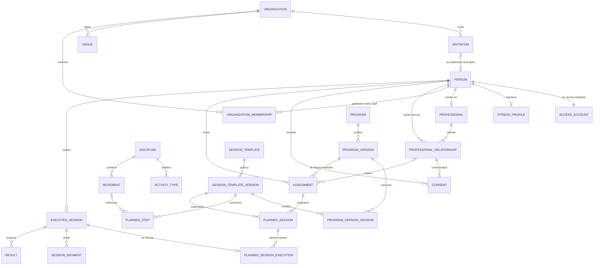

# Glosario de dominio — Allfit One

**Fecha:** 28 de julio de 2026
**Estado:** aprobado y recertificado con Nutrición V1. 
**Alcance:** identidad, organizaciones, relación profesional, privacidad, entrenamiento y Nutrición no clínica.

## Cómo leer este documento

Para cada concepto se responden las mismas siete preguntas:

1. ¿Qué es?
2. ¿Qué no es?
3. ¿Quién lo crea?
4. ¿Quién es dueño del dato?
5. ¿Puede existir sin una cuenta de acceso en WorkOS AuthKit?
6. ¿Cuál es su ciclo de vida?
7. ¿Cuáles son sus ejemplos y contraejemplos?

“Dueño del dato” significa aquí **propietario lógico y fuente de verdad dentro del producto**. No reemplaza el análisis jurídico sobre responsable, encargado, autor, licenciante o titular de derechos.

## Decisiones transversales

- La persona es la raíz del Fitness ID.
- WorkOS AuthKit autentica; el claim `sub` no representa por sí solo a la persona de dominio.
- Una persona puede registrarse directamente en Space y activar su Fitness ID sin invitación, organización o relación profesional.
- Allfit Studio nunca crea usuarios WorkOS ni personas. Solo crea invitaciones dirigidas a un email o celular.
- Una invitación pendiente no es una persona, cuenta, membresía, relación, consentimiento ni asignación.
- La persona invitada debe verificar su contacto y completar personalmente el registro antes de que existan esas entidades.
- V1 solo activa personas de 18 años o más; no existen perfiles tutelados, representantes, consentimiento parental ni cuentas familiares.
- Esta edad mínima fue ratificada el 23 de julio de 2026. Las personas de 14 a 17 años no entran como usuarios autónomos en V1; un soporte futuro deberá diseñarse como flujo representado independiente.
- La elegibilidad adulta se resuelve antes de crear la persona, recopilar datos fitness o materializar intenciones; un usuario WorkOS temporal no demuestra elegibilidad.
- Una invitación contiene intenciones tipadas; cada intención se acepta o rechaza por separado y la aceptación parcial es válida.
- Cliente, atleta y profesional son roles de una persona, no personas diferentes.
- Una organización no es propietaria automática del historial fitness personal.
- Una relación profesional no concede acceso ilimitado; el acceso depende de propósito, scope y consentimiento.
- El consentimiento de servicio identifica a la parte responsable y se materializa en la organización de la relación; solo lo ejercen profesionales explícitamente asignados.
- Ser miembro o administrador de una organización no concede acceso al Fitness ID.
- V1 separa `relationship_training`, `prior_training_history`, `body_progress` y `health_context`; aceptar uno no concede los demás.
- La persona puede ocultar sesiones autónomas por relación; la denegación reduce `prior_training_history`, se aplica a toda la organización responsable y no revela que existen datos ocultos.
- Cada scope congela una definición versionada de recursos/campos; agregar datos o finalidades exige nueva aceptación.
- Scope define qué datos; `access_level` y capacidades definen qué acciones. Un derivado hereda la categoría más sensible de sus inputs.
- Terminar una relación corta el acceso en vivo y toda escritura, y congela en `T` la ventana histórica previamente autorizada; no equivale a revocar el consentimiento ni permite conservar acceso cotidiano.
- Leer esa ventana exige un caso histórico de máximo 24 horas para una membresía exacta, MFA, propósito permitido y auditoría; ningún rol organizacional la obtiene automáticamente.
- Las asignaciones administradas por una relación terminada se desacoplan y pausan; solo la persona decide continuarlas personalmente o terminarlas.
- Lo planificado y lo ejecutado son hechos diferentes.
- Disciplina, tipo de actividad, plantilla, paso, sesión y segmento forman el núcleo universal.
- Ejercicio y rutina son términos de interfaz para fuerza, no nombres universales del modelo físico.
- Los resultados se especializan por modalidad; no se fuerza running, yoga o natación dentro de sets/repeticiones.
- Una versión publicada de plantilla es inmutable; programas y sesiones apuntan a versiones exactas, nunca a “la última”.
- El origen, actor y método de captura deben conservarse en datos creados por terceros, dispositivos o importaciones.
- El perfil distingue `person_declared`, `professional_observation`, `device_observed`, `system_inferred` y `authority_verified`; procedencia y verificación son dimensiones separadas.
- En V1, `authority_verified` solo cubre credenciales profesionales contrastadas por `A11/verify_professional_credentials` con registro oficial o confirmación del emisor; no verifica edad, identidad civil, salud, dispositivos ni el perfil completo.
- Varias afirmaciones sobre un atributo pueden coexistir; una proyección actual no las sobrescribe ni presenta inferencias como declaraciones.
- Un profesional puede revisar su propia captura o proponer correcciones, pero nunca sobrescribir silenciosamente datos de la persona o raw de dispositivos.
- Todo dato personal tiene una política versionada cuya disposición es eliminar, anonimizar irreversiblemente o conservar con acceso restringido.
- Revocar un scope elimina el acceso del tercero, no el dato que la persona conserva en su Fitness ID; seudonimizar tampoco equivale a anonimizar.
- Space y Studio son independientes funcionalmente, pero comparten en V1 identidad y persistencia autoritativa; independencia no promete tolerancia física separada.
- Booking/clases, marketplace, conectores de wearables, IA, comunidad y publicación pública son capacidades diferidas sin DDL en la baseline V1.
- El **plan comercial** que una persona le paga a su gimnasio entra a V1 por DT-017: suscripción recurrente mensual o anual, con la plata yendo directo a la cuenta de pasarela de la organización. Allfit refleja el estado; no cobra, no gira y no almacena datos de tarjeta.
- La falta de pago **suspende de forma indefinida y nunca termina**: los grants no se tocan, el programa no se desacopla y el coach conserva la lectura pero pierde la escritura.
- V1 conserva catálogo global mínimo y contenido privado de entrenamiento; “contenido existente” no significa “publicable en marketplace”.
- `sensor_enriched` valida la extensibilidad del contrato de resultados, pero no incorpora conectores ni raw streams productivos.
- Los fallos locales se aíslan por contrato, recursos y colas; autorización, consentimiento, capacidad y dinero nunca dependen de caché obsoleta.
- Allfit accede a los datos **por rol y con auditoría**: el rol define qué categorías ve cada integrante del equipo, cada lectura queda registrada con su identidad real y visible para la persona afectada, y el registro es inmutable.
- La autorización se aplica en PostgreSQL con RLS y privilegios mínimos, no solamente en el frontend.

---

## Concepto de soporte obligatorio: invitación

| Pregunta | Respuesta |
| --- | --- |
| **1. ¿Qué es?** | Un sobre temporal y opcional emitido desde Studio para que el titular de un email o celular se registre o use su cuenta existente y decida propuestas tipadas de membresía, relación o programa. Contiene canal, destino normalizado, organización, emisor, propósito, expiración y token seguro. |
| **2. ¿Qué no es?** | No es requisito para registrarse o usar Space. Tampoco es una persona, cuenta de acceso, perfil, membresía, relación profesional, consentimiento ni asignación, ni demuestra que el titular del contacto haya aceptado participar. |
| **3. ¿Quién lo crea?** | Un miembro autorizado de una organización desde Studio. El backend genera y envía el token; Studio nunca invoca `Create User` ni otro flujo administrativo de WorkOS AuthKit en nombre del invitado. |
| **4. ¿Quién es dueño del dato?** | La organización es responsable de la intención y su finalidad; Allfit custodia entrega y seguridad. El email/celular sigue siendo dato personal del destinatario y debe conservarse solo durante la vigencia/retención definida. |
| **5. ¿Puede existir sin Auth?** | Sí. Esa es precisamente su función. El destinatario todavía no es un usuario ni una persona del dominio. |
| **6. ¿Cuál es su ciclo de vida?** | Creada → enviada → entregada → abierta → completada, expirada, revocada o bloqueada por no elegibilidad. Cada intención pasa independientemente por propuesta, aceptación, rechazo, revocación o expiración. Completar no significa aceptar todo. El token es de un solo uso y se almacena hasheado. |
| **7. Ejemplos y contraejemplos** | **Ejemplo:** Ana acepta la relación con su coach y rechaza el programa propuesto. **Contraejemplos:** Studio crea a Ana con `Create User` o un botón “aceptar todo” concede relación, programa y datos. |

### Implicación para la BD

`identity.invitations` referencia a la organización y al actor emisor, pero no requiere `person_id`. `identity.invitation_intents` contiene propuestas tipadas de `organization_membership`, `service_relationship` o `program_assignment` con estados independientes y referencias verificables. Un RPC/backend transaccional crea/vincula la persona y materializa únicamente intenciones aceptadas cuyas dependencias se cumplen, después de resolver la elegibilidad adulta. El registro directo en Space usa el mismo onboarding de identidad sin crear invitación ni intenciones. Términos, grants, contratos y pagos producen aceptaciones separadas.

---

## 1. Persona

| Pregunta | Respuesta |
| --- | --- |
| **1. ¿Qué es?** | El ser humano canónico alrededor del cual se construye el Fitness ID. Es el sujeto al que pertenecen identidad, preferencias, relaciones, historial de entrenamiento y progreso. La misma persona puede entrenar sola, ser cliente de varios profesionales y también prestar servicios profesionales. |
| **2. ¿Qué no es?** | No es una credencial de acceso, un usuario de una organización, un cliente comercial, un profesional ni un perfil público. Tampoco es una copia distinta por cada gimnasio. |
| **3. ¿Quién lo crea?** | El servicio de registro después de que la propia persona verifica su email mediante WorkOS, acredita elegibilidad de 18 años o más y completa el onboarding requerido. Una invitación por celular exige además la prueba separada de control del canal. Puede originarse desde una invitación de Studio o desde un registro espontáneo en Space. Studio nunca crea la persona directamente. |
| **4. ¿Quién es dueño del dato?** | La persona es el dueño lógico de su identidad e historial personal. Allfit actúa como custodio de la fuente canónica. Cada organización conserva autoría y responsabilidad sobre los registros operativos que haya producido, pero no obtiene propiedad sobre toda la persona. |
| **5. ¿Puede existir sin usuario WorkOS?** | No como persona activa en V1. Antes de completar el registro directo no existe persona de dominio; si el flujo empezó desde Studio puede existir una invitación separada. Por retención o auditoría, una persona podría permanecer anonimizada/archivada después de cerrar su cuenta, pero no nace sin que su titular complete WorkOS AuthKit y el onboarding. |
| **6. ¿Cuál es su ciclo de vida?** | Elegibilidad adulta resuelta → registrada/activa → restringida o suspendida → eventualmente anonimizada/archivada. No se crea una persona nueva al entrar a otra organización. Las fusiones por duplicados excepcionales deben conservar alias, procedencia y auditoría. Si se descubre que es menor, se restringe y se inicia disposición; no se convierte en perfil tutelado. |
| **7. Ejemplos y contraejemplos** | **Ejemplo:** Ana, adulta, entrena sola, pertenece a un gimnasio y contrata dos profesionales; continúa siendo una sola persona. **Contraejemplos:** crear tres filas de Ana, una por cada relación u organización, o activar el perfil de un menor porque su acudiente lo autorizó. |

### Implicación para la BD

`identity.people` debe ser independiente de WorkOS AuthKit, pero `identity.accounts` nace vinculado a la persona durante el registro elegible. La declaración de mayoría de edad conserva política, método, procedencia y timestamp; no requiere guardar la fecha de nacimiento completa si no existe otra finalidad. Un intento no elegible no crea persona ni perfil. Los datos privados y sensibles pueden separarse en tablas específicas para simplificar RLS y consentimientos.

---

## 2. Cuenta de acceso

| Pregunta | Respuesta |
| --- | --- |
| **1. ¿Qué es?** | La identidad externa autenticada por WorkOS AuthKit. Se identifica por la combinación estable de `issuer` del WorkOS environment y claim `sub`, y se vincula con la persona canónica mediante `identity.accounts`. Space, Studio y Backoffice usan WorkOS Applications separadas del mismo WorkOS environment por ambiente. |
| **2. ¿Qué no es?** | No es la persona, su perfil fitness, su rol profesional ni su membresía en una organización. Borrar o bloquear una cuenta no debe borrar automáticamente a la persona ni su historial. |
| **3. ¿Quién lo crea?** | WorkOS AuthKit cuando la propia persona inicia registro/SSO, verifica el email y completa el flujo permitido. Una invitación de Studio puede iniciar la navegación, pero Studio nunca usa `Create User`. El backend crea el vínculo local durante el onboarding. |
| **4. ¿Quién es dueño del dato?** | El titular controla el uso de su cuenta; Allfit administra autenticación, seguridad y recuperación. Una organización puede invitar o solicitar acceso, pero no debe apropiarse de la cuenta personal. |
| **5. ¿Puede existir sin WorkOS AuthKit?** | No. Por definición, la cuenta de acceso corresponde a un sujeto de WorkOS AuthKit. Puede existir una invitación pendiente, pero todavía no es una cuenta. |
| **6. ¿Cuál es su ciclo de vida?** | Registro/verificación iniciada → activa → bloqueada o recuperación → desactivada/eliminada. La invitación es una entidad previa y separada. Los proveedores federados deben vincularse a un mismo usuario WorkOS AuthKit, no producir personas duplicadas. |
| **7. Ejemplos y contraejemplos** | **Ejemplo:** `(issuer, sub)` de WorkOS AuthKit vinculado a Ana, aunque use email o un IdP federado. **Contraejemplo:** usar email/celular como identidad inmutable o tratar cada WorkOS Application como una persona diferente. |

### Implicación para la BD

`identity.accounts` debe imponer `UNIQUE (provider, issuer, subject)` e impedir que una cuenta activa se vincule con dos personas. La aceptación de invitaciones, creación del perfil y materialización de relaciones deben ser transaccionales y auditadas.

---

## 3. Perfil fitness

| Pregunta | Respuesta |
| --- | --- |
| **1. ¿Qué es?** | La descripción actual del contexto fitness de una persona: objetivos declarados, disciplinas, experiencia, preferencias, disponibilidad, equipamiento y otras condiciones relevantes para personalizar la experiencia. |
| **2. ¿Qué no es?** | No es el historial completo, un registro de sesiones, una medición corporal, un diagnóstico médico ni un documento libre donde se almacena cualquier dato. Tampoco es el perfil público de marketplace. |
| **3. ¿Quién lo crea?** | Principalmente la persona. Un profesional puede crear observaciones propias o transcribir una declaración dentro de una relación autorizada; dispositivos producen mediciones, el sistema crea inferencias y un flujo competente verifica afirmaciones concretas. Cada caso conserva una procedencia diferente. |
| **4. ¿Quién es dueño del dato?** | La persona. Deben conservarse sujeto, origen semántico, actor capturador, fuente y tiempo. Una observación conserva autoría profesional; una inferencia, algoritmo; una verificación, autoridad y evidencia. Ninguno de ellos obtiene ownership sobre el perfil completo. |
| **5. ¿Puede existir sin Auth?** | No en V1. El perfil comienza cuando la persona completa su registro y onboarding, directamente en Space o desde una invitación de Studio. Una invitación, cuando existe, conserva solo datos mínimos y todavía no es un perfil. |
| **6. ¿Cuál es su ciclo de vida?** | Se crea progresivamente mediante afirmaciones/revisiones. Declaraciones, observaciones, mediciones, inferencias y verificaciones pueden coexistir; una proyección selecciona el valor actual sin destruir alternativas. Puede archivarse o exportarse y las verificaciones/inferencias pueden vencer o revocarse. |
| **7. Ejemplos y contraejemplos** | **Ejemplo:** Ana declara nivel intermedio, su coach observa nivel principiante y Allfit infiere una recomendación; se conservan los tres. **Contraejemplos:** sobrescribir la declaración con la inferencia, marcar como verificado todo el perfil por una credencial o guardar todos los sets en un JSON de perfil. |

### Implicación para la BD

Conviene dividir el perfil por categorías de sensibilidad y frecuencia de cambio, en vez de crear una sola tabla enorme con permisos a nivel de columna. Los valores permanecen tipados y conservan revisiones/procedencia transversal; no se crea una tabla EAV ni un JSON abierto.

Clases V1:

| Procedencia | Regla |
| --- | --- |
| `person_declared` | La afirmación pertenece a la persona, aunque un profesional autorizado la transcriba |
| `professional_observation` | Evaluación propia del profesional; solo su autor puede revisarla directamente |
| `device_observed` | Medición con integración, dispositivo, unidad y calidad; no implica verificación |
| `system_inferred` | Resultado con algoritmo, versión, inputs, confianza y vigencia |
| `authority_verified` | Afirmación concreta contrastada por un flujo competente; no verifica el resto del perfil |

La verificación conserva valor evaluado, autoridad, método, evidencia mínima, vigencia, expiración y revocación. Objetivos, preferencias y estados subjetivos mantienen a la persona como autoridad; las notas privadas profesionales u organizacionales no entran automáticamente en el Fitness ID. Toda afirmación sigue su categoría y scope, y un derivado hereda la clasificación más restrictiva de sus inputs.

---

## 4. Profesional

| Pregunta | Respuesta |
| --- | --- |
| **1. ¿Qué es?** | Una persona habilitada para ofrecer servicios fitness o relacionados, con especialidad, perfil profesional, credenciales y estado de verificación. Es una capacidad/rol adicional de la persona y puede mantener su perfil independientemente de una organización. |
| **2. ¿Qué no es?** | No es una persona distinta, una cuenta distinta, una organización ni una membresía de staff. Ser profesional tampoco concede automáticamente acceso a clientes. |
| **3. ¿Quién lo crea?** | La persona puede solicitar o completar su perfil; una organización puede invitarla; Allfit o un tercero autorizado puede verificar credenciales. |
| **4. ¿Quién es dueño del dato?** | La persona es dueña de su identidad y presentación profesional. El emisor o Allfit conserva la fuente de verificación. Los roles y condiciones dentro de una organización pertenecen a esa relación organizacional. |
| **5. ¿Puede existir sin Auth?** | No como profesional del dominio. Antes del registro puede existir una invitación cuyo propósito sea incorporar un profesional, pero no un perfil profesional materializado. |
| **6. ¿Cuál es su ciclo de vida?** | Perfil solicitado/borrador después del registro → pendiente de verificación → verificado/activo → suspendido o retirado. Entrar o salir de una organización no elimina su identidad profesional global. Para operar en Studio necesita una membresía profesional vigente dentro de una organización. |
| **7. Ejemplos y contraejemplos** | **Ejemplo:** Ana es atleta y entrenadora verificada usando la misma persona. **Contraejemplo:** crear `coach_users` como una segunda identidad o asumir que todo empleado del gimnasio puede ver datos fitness. |

### Implicación para la BD

Separar `people`, perfil profesional, verificaciones, membresías organizacionales y relaciones con personas atendidas. El perfil profesional puede existir sin organización, pero prestar servicios, gestionar clientes, publicar oferta, asignar programas o recibir pagos mediante Studio exige actuar bajo una organización activa.

---

## 5. Organización

| Pregunta | Respuesta |
| --- | --- |
| **1. ¿Qué es?** | Una entidad operativa —y, cuando corresponda, legal— que ofrece servicios mediante Allfit Studio: práctica profesional, gimnasio, estudio, box, academia o centro. Es una frontera de operación, configuración, comercio y acceso organizacional. Una práctica puede comenzar con una persona y crecer a equipo sin cambiar de identidad. |
| **2. ¿Qué no es?** | No es una sede, una persona, un plan SaaS, una membresía de cliente ni un simple tema visual del workspace. Tampoco es propietaria automática de todos los datos de las personas relacionadas. |
| **3. ¿Quién lo crea?** | Un fundador o representante autorizado mediante onboarding, o Allfit mediante un proceso administrativo/verificado. En el onboarding `solo_professional`, Allfit crea automáticamente una `professional_practice` y su membresía propietaria inicial. |
| **4. ¿Quién es dueño del dato?** | La propia organización controla sus datos operativos, personal, sedes, oferta y registros legales. Allfit custodia la plataforma. Los datos personales vinculados mantienen su ownership y reglas de consentimiento. |
| **5. ¿Puede existir sin Auth?** | Sí. La entidad puede existir antes de que un representante acepte la invitación, aunque su administración requiere una cuenta autorizada. |
| **6. ¿Cuál es su ciclo de vida?** | Borrador/pendiente → activa → suspendida → cerrada/archivada. Una práctica puede pasar de propietario único a equipo incorporando membresías, sin crear otra organización. Un cambio real de actividad principal es explícito y auditable. El cierre no elimina pagos, contratos, asignaciones o historial que deban conservarse. |
| **7. Ejemplos y contraejemplos** | **Ejemplos:** “Ana Coaching” comienza con Ana y después incorpora profesionales y staff conservando su identidad; “Allfit Club Bogotá” opera varias sedes. **Contraejemplos:** crear otra organización cuando Ana invita al primer empleado, representar cada sucursal como organización independiente sin razón operativa o crear raíces incompatibles para coaches y gimnasios. |

### Implicación para la BD

Las entidades estrictamente organizacionales llevan `organization_id`; los datos personales no deben recibirlo de manera automática. `organization_kind` expresa clases operativas estables como `professional_practice`, `gym`, `studio`, `academy` o `clinic`, sin crear modelos raíz separados. `solo_professional` se registra como modalidad de onboarding, no como tipo permanente ni bandera de autorización. El tamaño se deriva de membresías activas. Una práctica inicialmente unipersonal no implica por sí sola una persona jurídica ni exige datos tributarios hasta que una operación regulada los necesite.

---

## 6. Sede

| Pregunta | Respuesta |
| --- | --- |
| **1. ¿Qué es?** | Una unidad física de operación perteneciente a una organización, con dirección, zona horaria, horarios, configuración de acceso y recursos físicos asociados. |
| **2. ¿Qué no es?** | No es la organización completa, un salón o recurso reservable individual, una ubicación GPS genérica ni una clase virtual. Una organización exclusivamente digital puede no tener sedes. |
| **3. ¿Quién lo crea?** | Un miembro autorizado de la organización o un proceso administrativo de Allfit. |
| **4. ¿Quién es dueño del dato?** | La organización. Los proveedores geográficos pueden aportar datos normalizados, pero no son la fuente de verdad de la operación. |
| **5. ¿Puede existir sin Auth?** | Sí. Su existencia no depende de una cuenta, aunque su creación y modificación deben tener un actor autorizado o proceso registrado. |
| **6. ¿Cuál es su ciclo de vida?** | Borrador → activa → temporalmente inactiva → cerrada/archivada. Las sesiones y visitas históricas deben seguir apuntando a la sede original. |
| **7. Ejemplos y contraejemplos** | **Ejemplo:** sede Chapinero de un gimnasio. **Contraejemplo:** una sala de spinning —que sería un espacio/recurso dentro de la sede— o un enlace de videollamada. |

### Implicación para la BD

Los espacios y recursos reservables deben modelarse debajo de la sede, no mezclarse con ella. La zona horaria pertenece explícitamente a la sede.

---

## 7. Membresía organizacional

| Pregunta | Respuesta |
| --- | --- |
| **1. ¿Qué es?** | La relación entre una persona y una organización para desempeñar un rol interno, como propietario, administrador, profesional o miembro de staff. Es la base para permisos operativos en Studio. |
| **2. ¿Qué no es?** | No es la membresía comercial de un cliente, una suscripción SaaS, una relación profesional-persona ni el consentimiento para ver datos fitness. |
| **3. ¿Quién lo crea?** | Un administrador invita y la persona acepta; el fundador recibe la membresía inicial durante el alta; Allfit puede intervenir en flujos administrativos auditados. |
| **4. ¿Quién es dueño del dato?** | Es un registro bilateral administrado por la organización y aceptado por la persona. Los roles y permisos operativos son definidos por la organización dentro de los límites de plataforma. |
| **5. ¿Puede existir sin Auth?** | No como membresía. Antes del registro existe una invitación separada con un rol propuesto. La membresía se crea únicamente después de que la persona se registra y acepta. |
| **6. ¿Cuál es su ciclo de vida?** | Activa después de la aceptación → suspendida → terminada/revocada. El estado `invited` pertenece a la invitación, no a la membresía. Se conservan fechas, rol y actor de cada cambio. |
| **7. Ejemplos y contraejemplos** | **Ejemplo:** un entrenador pertenece al staff de un gimnasio. **Contraejemplo:** un cliente compra mensualidad y se guarda como `organization_admin` o miembro interno. |

### Implicación para la BD

Separar claramente `organization_memberships` de membresías comerciales y relaciones de atención. RLS de Studio parte de esta relación, pero no termina en ella.

---

## 8. Relación profesional-persona

| Pregunta | Respuesta |
| --- | --- |
| **1. ¿Qué es?** | El vínculo de servicio entre una persona atendida y un profesional, opcionalmente bajo una organización. Define propósito, vigencia, contexto y autoridad operativa para acompañar, planificar o revisar. |
| **2. ¿Qué no es?** | No es una membresía de staff, un consentimiento ilimitado, una compra, una asignación de programa ni una amistad. La relación por sí sola no habilita todas las categorías de datos. |
| **3. ¿Quién lo crea?** | Puede originarse por solicitud de la persona, invitación del profesional, alta administrativa o compra. Debe existir aceptación o base verificable antes de volverse activa. |
| **4. ¿Quién es dueño del dato?** | Es un registro bilateral del ecosistema. La persona mantiene ownership sobre sus datos fitness; el profesional/organización conserva sus registros operativos y autoría. La relación define contexto, no transfiere propiedad. |
| **5. ¿Puede existir sin Auth?** | No como relación materializada. La invitación puede describir una relación propuesta, pero esta solo se crea cuando la persona se registra y acepta el vínculo y los permisos correspondientes. |
| **6. ¿Cuál es su ciclo de vida?** | Propuesta/pendiente → activa → pausada → terminada o revocada. La terminación corta operación/escritura y cambia los grants `active` vinculados a `frozen` con una fecha de corte común; `revoked` queda reservado para el acceso nulo. Se conservan inicio, fin, motivo, organización de origen y los registros sujetos a su política de retención. Volver exige una relación nueva. |
| **7. Ejemplos y contraejemplos** | **Ejemplo:** entrenador X acompaña a Ana dentro del gimnasio Y durante seis meses. **Contraejemplo:** asumir que cualquier entrenador del gimnasio puede ver a todos los miembros. |

### Implicación para la BD

La relación debe apuntar a personas, profesional y organización contextual; los scopes efectivos se resuelven con consentimientos/permisos, no con un booleano `is_client`. La transición a estado terminado debe congelar los grants —lectura histórica hasta la fecha de corte—, retirar a la persona de consultas operativas, desacoplar/pausar asignaciones administradas y calcular la retención aplicable sin eliminar su Fitness ID.

---

## 9. Consentimiento

| Pregunta | Respuesta |
| --- | --- |
| **1. ¿Qué es?** | Una autorización explícita y auditable mediante la cual una persona permite a un destinatario acceder o usar categorías concretas de datos para un propósito y periodo definidos. |
| **2. ¿Qué no es?** | No es la política RLS, la relación profesional, la aceptación genérica de términos, una membresía ni un permiso permanente para ver todo. RLS aplica técnicamente la decisión; no la reemplaza. |
| **3. ¿Quién lo crea?** | La persona o representante legal autorizado concede o rechaza. Un profesional/organización puede solicitarlo y el sistema registra evidencia, versión del texto, canal, actor y momento. |
| **4. ¿Quién es dueño del dato?** | La persona controla el grant sobre sus datos. En servicios V1, la evidencia identifica a la parte responsable y la organización operativa de la relación; los profesionales asignados son actores autorizados, no destinatarios independientes. Allfit conserva evidencia y auditoría. |
| **5. ¿Puede existir sin Auth?** | No. La invitación puede anticipar una solicitud, pero el consentimiento efectivo solo existe cuando la persona registrada realiza una acción autenticada y auditable. Nunca se activa por el envío de una invitación. |
| **6. ¿Cuál es su ciclo de vida?** | Solicitado → concedido o rechazado → revocado/expirado/reemplazado. Los eventos son append-only; una revocación no borra la evidencia. Una reasignación dentro de la misma parte responsable conserva el grant y cambia sus actores autorizados; cambiar organización, responsable, finalidad o scope exige otro consentimiento. |
| **7. Ejemplos y contraejemplos** | **Ejemplo:** compartir resultados de sesiones asignadas mediante `relationship_training`, sin compartir historial previo ni métricas corporales. **Contraejemplo:** “aceptó al coach, por tanto ve todo el Fitness ID”. |

### Implicación para la BD

Modelar sujeto, relación, organización grantee, parte responsable presentada, categoría/scope, propósito, vigencia, estado, fuente, versión del texto y evidencia. El acceso profesional se deriva de asignación efectiva, membresía, capacidad y grant; nunca de pertenencia organizacional aislada. Evitar un único booleano `consented`, grants duplicados por coach o un scope `all_data`. V1 usa siete grants independientes: `relationship_training`, `prior_training_history`, `body_progress`, `health_context`, `nutrition_intake`, `nutrition_guidance` y `nutrition_media`; wearables, biometría, IA, publicación o entrenamiento de modelos requieren scopes futuros separados.

---

## Concepto de privacidad: caso de acceso histórico

| Pregunta | Respuesta |
| --- | --- |
| **1. ¿Qué es?** | Una autorización excepcional, temporal y auditada para que una membresía concreta consulte el subconjunto `historical_readable` de una relación terminada. |
| **2. ¿Qué no es?** | No es un rol, una asignación profesional, un grant nuevo, una reactivación, una lista de antiguos clientes ni permiso de escritura. |
| **3. ¿Quién lo crea?** | `owner` o `admin` con `manage_historical_access`, MFA, propósito cerrado, referencia y justificación. |
| **4. ¿Quién es dueño del dato?** | No cambia ownership: la persona conserva sus datos; el caso solo permite a la organización intentar ejercer temporalmente los grants `frozen` de esa relación bajo `access_control.can_read_frozen`. |
| **5. ¿Puede existir sin Auth?** | No. Exige actor humano, membresía activa, AAL2/MFA y una relación terminada exacta. |
| **6. ¿Cuál es su ciclo de vida?** | Abierto → cerrado o expirado en máximo 24 horas. No se reabre; otra necesidad crea otro caso. |
| **7. Ejemplos y contraejemplos** | **Ejemplo:** un admin abre un caso de disputa para el antiguo titular todavía miembro. **Contraejemplo:** owner consulta antiguos clientes por ser owner. |

### Implicación para la BD

Modelar `privacy.historical_access_cases` y `access_control.can_read_frozen` separados de `access_control.can_access`. El caso fija organización, relación, membresía autorizada, propósito y expiración; `staff` nunca es elegible. Cada lectura escribe `ACCESS_EVENT`. Una denegación o revocación posterior reduce el histórico y ninguna restauración después de `T` lo amplía.

---

## Concepto de privacidad: definición de scope

| Pregunta | Respuesta |
| --- | --- |
| **1. ¿Qué es?** | Un contrato publicado, inmutable y versionado que enumera finalidad, recursos, campos y acciones máximas compatibles con un `scope_code`. |
| **2. ¿Qué no es?** | No es un rol, una capacidad, un array de permisos, una etiqueta de UI ni autorización para cualquier columna futura. |
| **3. ¿Quién lo crea?** | Allfit mediante gobernanza de producto, privacidad, arquitectura y validación jurídica. La persona acepta una versión concreta. |
| **4. ¿Quién es dueño del dato?** | La definición pertenece a la plataforma; no cambia el ownership de los datos incluidos ni amplía los derechos del grantee. |
| **5. ¿Puede existir sin Auth?** | Sí como catálogo publicado. Un grant de esa definición requiere sujeto, relación y aceptación autenticada. |
| **6. ¿Cuál es su ciclo de vida?** | Borrador → publicada/inmutable → reemplazada/retirada. Ampliar campos/finalidad crea otra versión; grants anteriores conservan la aceptada. |
| **7. Ejemplos y contraejemplos** | **Ejemplo:** `relationship_training/v1` incluye sets de la relación y excluye dolor/peso. **Contraejemplo:** añadir frecuencia cardiaca a v1 y exponerla automáticamente. |

### Contratos V1 resumidos

| Scope | Incluye en vivo | Histórico `frozen` V1 | Excluye de forma destacada |
| --- | --- | --- | --- |
| `relationship_training` | Prescripción, sesiones, intentos y resultados producidos dentro de la relación | Artefactos bilaterales materializados hasta `T` | Sesiones autónomas, cuerpo, salud, biometría, GPS y wearables |
| `prior_training_history` | Ejecuciones anteriores/autónomas y resultados personales | Solo sesiones explícitamente compartidas y no denegadas | IP/notas de otras organizaciones, cuerpo, salud, biometría y raw |
| `body_progress` | Medidas, composición, tendencias y fotos seleccionadas | Solo medidas estructuradas; sin fotos, archivos ni EXIF | Salud, EXIF/geolocalización, galería no seleccionada y biometría continua |
| `health_context` | Dolor, lesiones/limitaciones declaradas y recuperación relevante | **Ninguno en V1** | Historia clínica, laboratorios, medicamentos, biometría/raw e inferencias médicas |

### Implicación para la BD

Modelar `scope_definitions` versionadas y congelar su referencia en grants/eventos. Cada regla de campo declara `historical_readable`; este subconjunto nunca puede ser mayor que el acceso en vivo aceptado. RLS limita filas y proyecciones/tablas separadas limitan campos; el frontend no es la frontera de redacción. `access_level` se concede aparte. Resultados derivados conservan clasificación/procedencia y heredan la categoría más restrictiva de sus inputs. En `prior_training_history`, las exclusiones individuales por relación se aplican también a conteos, derivados y read models; después de `T` solo pueden reducir la ventana.

---

## Concepto de privacidad: política de retención y disposición

| Pregunta | Respuesta |
| --- | --- |
| **1. ¿Qué es?** | Una regla versionada que asigna a una categoría y finalidad un trigger, jurisdicción, periodo y acción final: `delete`, `anonymize` o `retain_restricted`. |
| **2. ¿Qué no es?** | No es un `deleted_at` universal, un permiso de acceso, un consentimiento, una seudonimización ni una autorización para conservar indefinidamente. |
| **3. ¿Quién lo crea?** | Allfit mediante gobernanza de datos y validación jurídica por jurisdicción. Un worker ejecuta la política, pero no decide unilateralmente su contenido. |
| **4. ¿Quién es dueño del dato?** | La política es configuración de plataforma; no cambia ownership ni titularidad. Su aplicación debe respetar a la persona, la autoría organizacional y las obligaciones bilaterales. |
| **5. ¿Puede existir sin Auth?** | Sí como catálogo/configuración. Una solicitud, hold o ejecución concreta sí registra sujeto, actor o job y evidencia auditable. |
| **6. ¿Cuál es su ciclo de vida?** | Borrador → publicada/versionada → reemplazada o retirada. Los registros conservan la versión aplicada; un cambio no reescribe silenciosamente disposiciones históricas ni libera holds. |
| **7. Ejemplos y contraejemplos** | **Ejemplo:** borrar credenciales al desconectar un wearable, retener temporalmente una factura y anonimizar analítica agregada. **Contraejemplo:** marcar toda fila con `deleted_at` y conservar PII recuperable sin finalidad. |

### Implicación para la BD

Modelar `privacy.retention_policies`, `erasure_requests`, `legal_holds` y `disposition_events`. Revocar un grant se trata como pérdida de acceso, no como supresión del dato personal. La anonimización debe romper identificadores y llaves de enlace; la disposición debe alcanzar sistemas derivados y converger en backups mediante expiración y reaplicación de eventos tras una restauración.

---

## Concepto multidisciplina A: disciplina

| Pregunta | Respuesta |
| --- | --- |
| **1. ¿Qué es?** | Una familia amplia de práctica fitness que agrupa semántica, taxonomía y métricas compatibles: fuerza, running, ciclismo, natación, híbrido, movilidad, yoga o pilates. |
| **2. ¿Qué no es?** | No es una sesión concreta, un deporte escrito libremente, una columna booleana por modalidad ni el tipo exacto de workout. |
| **3. ¿Quién lo crea?** | Allfit mediante un catálogo curado y versionado. Las organizaciones pueden proponer extensiones, pero no crear códigos globales incompatibles sin gobernanza. |
| **4. ¿Quién es dueño del dato?** | Allfit es dueño lógico del catálogo global. El contenido creado dentro de una disciplina conserva el ownership de su autor/persona/organización. |
| **5. ¿Puede existir sin Auth?** | Sí. Es catálogo de plataforma y puede cargarse mediante migraciones/seeds. |
| **6. ¿Cuál es su ciclo de vida?** | Propuesta → activa → deprecada/alias/fusionada. Un código usado históricamente no cambia de significado ni se elimina físicamente. |
| **7. Ejemplos y contraejemplos** | **Ejemplos:** `strength`, `running`, `swimming`, `yoga`. **Contraejemplos:** “5 km suave del lunes” —es una sesión— o una columna `is_running`. |

### Implicación para la BD

Usar `catalog.disciplines` con código estable, estado y metadata controlada. Evitar enum PostgreSQL si se espera evolución frecuente.

---

## Concepto multidisciplina B: tipo de actividad

| Pregunta | Respuesta |
| --- | --- |
| **1. ¿Qué es?** | Una clasificación más concreta dentro de una disciplina que determina semántica, targets y resultados esperados: carrera suave, intervalos, strength workout, pool swim, práctica de yoga, AMRAP o EMOM. |
| **2. ¿Qué no es?** | No es la disciplina completa, una plantilla, una sesión ejecutada ni un nombre libre inventado por cada organización. |
| **3. ¿Quién lo crea?** | Allfit mantiene el catálogo base; extensiones privadas requieren namespace/organización y reglas de compatibilidad. |
| **4. ¿Quién es dueño del dato?** | Allfit para tipos globales; la organización para extensiones privadas. Las sesiones personales continúan perteneciendo a la persona. |
| **5. ¿Puede existir sin Auth?** | Sí. Es catálogo de dominio. |
| **6. ¿Cuál es su ciclo de vida?** | Borrador → activo → deprecado/mapeado a sucesor. Los registros históricos conservan el código original. |
| **7. Ejemplos y contraejemplos** | **Ejemplos:** `interval_run`, `strength_workout`, `yoga_practice`, `amrap`. **Contraejemplo:** “entrenamiento de Ana de ayer”, que es una sesión. |

### Implicación para la BD

`catalog.activity_types` referencia disciplina y declara qué versiones publicadas de contratos de targets/resultados son válidas sin usar una tabla EAV. La ejecución congela el contrato resuelto para que un cambio futuro no reinterprete el historial.

---

## 10. Movimiento (ejercicio en fuerza)

| Pregunta | Respuesta |
| --- | --- |
| **1. ¿Qué es?** | La definición reutilizable y opcional de una acción/técnica dentro de una disciplina, con nombre, instrucciones, capacidades, equipamiento y variantes. En fuerza se presenta como ejercicio; también puede representar una postura de yoga, drill de movilidad o técnica de natación. |
| **2. ¿Qué no es?** | No es una prescripción, posición dentro de una plantilla, resultado ni requisito universal. Una carrera continua puede existir sin referenciar un movimiento. |
| **3. ¿Quién lo crea?** | Curadores de Allfit para catálogo global; profesionales/organizaciones para contenido privado; personas para movimientos personales; integraciones para entradas importadas sujetas a normalización. |
| **4. ¿Quién es dueño del dato?** | Depende del alcance y origen: Allfit para catálogo global, organización/autor para contenido privado y persona para contenido personal. Deben conservarse autoría y licencias de medios. |
| **5. ¿Puede existir sin Auth?** | Sí. Puede ser creado por seeds, importaciones o procesos curatoriales. Las acciones humanas deben conservar actor cuando exista. |
| **6. ¿Cuál es su ciclo de vida?** | Borrador → publicado → deprecado/fusionado/archivado. Un movimiento referenciado históricamente no se elimina físicamente ni cambia de significado de forma incompatible. |
| **7. Ejemplos y contraejemplos** | **Ejemplos:** press de banca, postura del guerrero, drill de patada. **Contraejemplo:** “5 km a ritmo suave”, que es un target de actividad, no necesariamente un movimiento. |

### Implicación para la BD

Separar definición canónica, aliases/traducciones, variantes y medios. Los pasos planificados pueden referenciar movimientos; los resultados referencian la sesión/segmento ejecutado correspondiente.

---

## 11. Plantilla de sesión (rutina en fuerza)

| Pregunta | Respuesta |
| --- | --- |
| **1. ¿Qué es?** | La identidad estable de una unidad reutilizable de entrenamiento. En producto puede llamarse rutina, entrenamiento, secuencia o práctica según la disciplina; su contenido ejecutable vive en versiones. |
| **2. ¿Qué no es?** | No es un programa completo, una fecha del calendario, una sesión ejecutada ni los resultados reales. Tampoco es necesariamente un producto comercial. |
| **3. ¿Quién lo crea?** | Una persona, profesional, organización o sistema/IA con autoría y revisión registradas. |
| **4. ¿Quién es dueño del dato?** | El creador o la organización bajo cuyo contexto se produjo, según reglas contractuales. Una persona puede ser dueña de sus plantillas privadas. Su uso no transfiere propiedad. |
| **5. ¿Puede existir sin Auth?** | Sí, si proviene de catálogo, importación o sistema. Una creación humana debe conservar el actor responsable cuando sea posible. |
| **6. ¿Cuál es su ciclo de vida?** | Activa → archivada. A lo largo de su vida produce borradores y versiones publicadas; archivar la identidad impide nuevas versiones sin eliminar las existentes. |
| **7. Ejemplos y contraejemplos** | **Ejemplos:** “Tren superior A”, “Intervalos 6 × 400 m” o “Secuencia de movilidad de cadera”. **Contraejemplo:** la ocurrencia del 20 de julio completada por Ana. |

### Implicación para la BD

Separar identidad estable y contenido versionado. `session_templates` conserva ownership/procedencia; `session_template_versions` contiene el contenido ejecutable. Los programas apuntan a versiones exactas y no copian ni siguen automáticamente la última.

---

## Concepto multidisciplina C: versión de plantilla

| Pregunta | Respuesta |
| --- | --- |
| **1. ¿Qué es?** | Una revisión completa del contenido ejecutable de una plantilla: nombre presentado, disciplina, tipo de actividad, instrucciones, duración, pasos y targets. |
| **2. ¿Qué no es?** | No es la identidad estable, un autosave, una versión de programa ni una personalización de una persona. |
| **3. ¿Quién lo crea?** | El autor o un sistema/IA crea un borrador; un actor autorizado lo publica explícitamente. |
| **4. ¿Quién es dueño del dato?** | Conserva el ownership de la plantilla y registra actor, organización y procedencia de la revisión. |
| **5. ¿Puede existir sin Auth?** | Sí si la crea un proceso de catálogo/importación, pero toda publicación conserva actor de sistema o humano auditable. |
| **6. ¿Cuál es su ciclo de vida?** | Borrador mutable → publicada inmutable → retirada para nuevos usos. Una corrección o adaptación crea otra versión. |
| **7. Ejemplos y contraejemplos** | **Ejemplo:** “Tren superior A” v2 cambia progresión respecto de v1. **Contraejemplo:** editar v1 y alterar lo que personas anteriores debían ejecutar. |

### Implicación para la BD

Usar `UNIQUE (template_id, version_number)`, `content_hash`, `derived_from_version_id`, estado y datos de publicación. Pasos y targets referencian la versión. Una versión publicada o referenciada no se modifica ni elimina físicamente.

---

## Concepto multidisciplina D: paso planificado

| Pregunta | Respuesta |
| --- | --- |
| **1. ¿Qué es?** | Una instrucción o bloque ordenado dentro de una plantilla: movimiento, intervalo, zona, descanso, ronda, secuencia o indicación técnica, con targets tipados. |
| **2. ¿Qué no es?** | No es un resultado real, una sesión completa ni un JSON sin contrato. Tampoco requiere siempre un movimiento. |
| **3. ¿Quién lo crea?** | El autor de la plantilla o un sistema/IA bajo revisión y autoría registradas. |
| **4. ¿Quién es dueño del dato?** | Comparte ownership con la versión de plantilla que lo contiene. |
| **5. ¿Puede existir sin Auth?** | Sí dentro de contenido de sistema/importado; una creación humana conserva actor. |
| **6. ¿Cuál es su ciclo de vida?** | Borrador/editable → congelado al publicar la versión → deprecado solo mediante nueva versión. |
| **7. Ejemplos y contraejemplos** | **Ejemplos:** 4 × 8 sentadillas; correr 6 × 400 m en zona 4; mantener una postura 45 segundos. **Contraejemplo:** “corrió 397 m en 1:42”, que es resultado. |

### Implicación para la BD

Mantener columnas comunes y tablas especializadas para targets de fuerza, endurance, intervalos, rondas y movilidad. JSONB solo para extensiones versionadas poco consultadas.

---

## Concepto multidisciplina E: segmento de sesión

| Pregunta | Respuesta |
| --- | --- |
| **1. ¿Qué es?** | Una parte ordenada o temporal de una sesión ejecutada, útil para intervalos, rondas, calentamiento, bloques de fuerza, recuperación o transiciones híbridas. |
| **2. ¿Qué no es?** | No es una plantilla, una disciplina ni necesariamente un lap del dispositivo; puede relacionarse con laps/resultados especializados. |
| **3. ¿Quién lo crea?** | Space durante la ejecución, un dispositivo/importación o el backend al materializar eventos capturados. |
| **4. ¿Quién es dueño del dato?** | La persona que ejecutó la sesión; se conserva la procedencia del dispositivo/profesional/sistema. |
| **5. ¿Puede existir sin Auth?** | No en V1, porque pertenece a una sesión canónica de una persona registrada. |
| **6. ¿Cuál es su ciclo de vida?** | Iniciado/capturado → completado → corregido o invalidado con auditoría. No se mueve entre sesiones. |
| **7. Ejemplos y contraejemplos** | **Ejemplos:** calentamiento, bloque de fuerza, intervalo 3, transición carrera→remo. **Contraejemplo:** una semana completa del programa. |

### Implicación para la BD

`fitness.session_segments` permite sesiones híbridas sin añadir columnas incompatibles a `fitness.sessions`.

---

## 12. Programa

| Pregunta | Respuesta |
| --- | --- |
| **1. ¿Qué es?** | La identidad lógica de un plan de entrenamiento estructurado a lo largo del tiempo, compuesto por fases, semanas, plantillas de sesión y reglas de progresión. Puede combinar una o varias disciplinas. |
| **2. ¿Qué no es?** | No es una versión publicada, una asignación a una persona, una membresía comercial, una suscripción SaaS ni una ejecución. |
| **3. ¿Quién lo crea?** | Una persona, profesional, organización o sistema/IA bajo aprobación de un actor responsable. |
| **4. ¿Quién es dueño del dato?** | El autor o la organización bajo cuyo contexto fue creado, según acuerdos. Los datos de las personas que lo ejecutan no pasan a ser propiedad del programa. |
| **5. ¿Puede existir sin Auth?** | Sí, si lo crea/importa un proceso del sistema. Para contenido humano deben quedar autor, origen y organización aun si el autor posteriormente pierde acceso. |
| **6. ¿Cuál es su ciclo de vida?** | Borrador → publica una o varias versiones → retirado/archivado. El identificador del programa permanece estable; la evolución funcional ocurre mediante versiones. |
| **7. Ejemplos y contraejemplos** | **Ejemplo:** “Fuerza inicial de 12 semanas” como concepto estable. **Contraejemplo:** la copia específica que Ana comenzó el 1 de agosto, que es una asignación. |

### Implicación para la BD

El programa contiene metadatos estables; el contenido ejecutable publicado pertenece a `program_versions` y sus hijos.

---

## 13. Versión de programa

| Pregunta | Respuesta |
| --- | --- |
| **1. ¿Qué es?** | Una composición inmutable del programa que referencia versiones exactas de plantilla en el momento de publicarse. Es la unidad exacta que se asigna y puede contener varias disciplinas. |
| **2. ¿Qué no es?** | No es un borrador mutable, el programa lógico, una asignación ni una copia diferente por cada persona. |
| **3. ¿Quién lo crea?** | El propietario/autorizado publica el borrador; el sistema materializa la versión de forma transaccional y registra actor, fecha y origen. |
| **4. ¿Quién es dueño del dato?** | Conserva el mismo propietario intelectual/operativo del programa. La persona asignada obtiene el derecho y registro de uso, no la propiedad del master. |
| **5. ¿Puede existir sin Auth?** | Técnicamente sí si la publica un proceso autorizado, pero toda publicación debe tener actor de sistema o humano auditable. |
| **6. ¿Cuál es su ciclo de vida?** | Creada/publicada → eventualmente retirada para nuevas asignaciones. Su contenido no cambia y no se elimina si existe alguna asignación o historial relacionado. Una corrección produce otra versión. |
| **7. Ejemplos y contraejemplos** | **Ejemplo:** versión 2 de “Fuerza inicial”, con una progresión diferente a versión 1. **Contraejemplo:** editar versión 1 y cambiar retrospectivamente lo que recibieron personas anteriores. |

### Implicación para la BD

Aplicar constraints que impidan duplicar el número de versión por programa. `program_version_sessions` congela posición, calendario y `session_template_version_id`; publicar una nueva versión de plantilla no altera composiciones anteriores.

---

## 14. Asignación

| Pregunta | Respuesta |
| --- | --- |
| **1. ¿Qué es?** | El vínculo mediante el cual una versión exacta de programa se entrega a una persona, con fecha de inicio, objetivo, origen, relación profesional y ajustes permitidos. Representa “esta persona debe seguir esta versión”. |
| **2. ¿Qué no es?** | No es el programa master, una versión, una compra, una membresía ni una sesión ejecutada. Comprar un programa puede originar una asignación, pero no son el mismo hecho. |
| **3. ¿Quién lo crea?** | La persona para autoentrenamiento; un profesional con relación y permiso vigentes; o el sistema/IA conforme a una autorización y aprobación definidas. |
| **4. ¿Quién es dueño del dato?** | La asignación forma parte del historial de entrenamiento de la persona. El profesional/organización conserva origen, autoría y registro de la acción. La versión master conserva su dueño original. |
| **5. ¿Puede existir sin Auth?** | No. Studio puede incluir un programa propuesto dentro de la invitación, pero la asignación se materializa únicamente después del registro y de la aceptación correspondiente. |
| **6. ¿Cuál es su ciclo de vida?** | Propuesta → `active_managed` o personal → pausada → completada/terminada. Si termina la relación gestora, pasa a `detached_pending_choice`; solo la persona la convierte en `active_personal` o `ended`. No cambia silenciosamente de versión ni se copia para continuar. |
| **7. Ejemplos y contraejemplos** | **Ejemplo:** versión 2 asignada a Ana para iniciar el 1 de agosto por su entrenador. **Contraejemplo:** guardar `program_id` en el perfil y asumir que eso conserva calendario, versión y origen. |

### Implicación para la BD

La FK crítica es hacia `program_version_id`, no solamente `program_id`. Deben registrarse `subject_person_id`, origen y relación profesional cuando aplique. El contexto de origen es inmutable y se separa del contexto de gestión efectivo. Terminar la relación conserva snapshot/revisiones y sesiones históricas, pausa las futuras y bloquea generación, recordatorios e incumplimiento hasta que la persona decida continuar o terminar.

---

## 15. Sesión planificada

| Pregunta | Respuesta |
| --- | --- |
| **1. ¿Qué es?** | Una ocurrencia concreta de trabajo previsto para una persona, en una fecha/ventana determinada, derivada de una asignación o creada de forma independiente. Conserva la prescripción que debía realizarse. |
| **2. ¿Qué no es?** | No es la plantilla reutilizable, el evento real ejecutado, una clase ofertada públicamente ni sus resultados. Planificar no demuestra que se entrenó. |
| **3. ¿Quién lo crea?** | El planificador del sistema a partir de una asignación; la persona; o un profesional autorizado. |
| **4. ¿Quién es dueño del dato?** | Forma parte de la agenda/historial de la persona. Se conservan autor, asignación y organización/profesional de origen. |
| **5. ¿Puede existir sin Auth?** | No en V1, porque requiere una persona registrada. La invitación no crea sesiones; estas se generan después de materializar la asignación. |
| **6. ¿Cuál es su ciclo de vida?** | Programada → en progreso/intentada → completada, omitida o cancelada. Puede conservar varios intentos históricos, pero solo una ejecución primaria produce el cumplimiento. Los cambios de fecha/estado deben ser auditables; la prescripción original no se reemplaza con resultados reales. |
| **7. Ejemplos y contraejemplos** | **Ejemplos:** tren superior el lunes; carrera suave el martes; yoga el miércoles. **Contraejemplo:** una fila con resultados reales que sobrescribe los targets. |

### Implicación para la BD

La sesión conserva `session_template_version_id` y, cuando fue personalizada, una revisión/snapshot auditable de prescripción. `planned_session_executions` vincula intentos numerados con ejecuciones; una ejecución pertenece a máximo una planificada y un unique parcial permite una sola primaria completada. Reanudar no crea intento. El cumplimiento dividido entre varias ejecuciones queda fuera de V1.

---

## 16. Sesión ejecutada

| Pregunta | Respuesta |
| --- | --- |
| **1. ¿Qué es?** | El hecho histórico de que una persona inició o realizó actividad fitness en un intervalo real. Puede corresponder a una sesión planificada o ser espontánea/importada. Contiene procedencia y enlaza resultados observados. |
| **2. ¿Qué no es?** | No es una intención, plantilla ni calendario. Tampoco debe confundirse con una clase/reserva, aunque estas puedan originarla o relacionarse. |
| **3. ¿Quién lo crea?** | La persona desde Space; un profesional autorizado registrando en su nombre; un dispositivo/integración; o un proceso de importación. Siempre debe registrarse el origen. |
| **4. ¿Quién es dueño del dato?** | La persona que realizó la actividad. El actor, dispositivo o profesional que capturó el dato conserva autoría/procedencia, no ownership sobre todo el historial. |
| **5. ¿Puede existir sin Auth?** | No en V1. Una integración o registro delegado siempre debe resolver primero una persona registrada. Los datos externos no vinculados permanecen en staging y no forman parte del historial canónico. |
| **6. ¿Cuál es su ciclo de vida?** | Iniciada → completada o abandonada → eventualmente revisada/invalidada. Es append-like: las correcciones crean revisiones, conservan original/procedencia y no convierten la ejecución en una planificación diferente. |
| **7. Ejemplos y contraejemplos** | **Ejemplos:** Ana completó fuerza; corrió 5 km; realizó una práctica de yoga; combinó remo y sentadillas. **Contraejemplo:** una plantilla todavía no realizada. |

### Implicación para la BD

Debe soportar ejecución planificada y libre. Separar timestamps reales, estado, fuente, dispositivo/importación y vínculo opcional con la sesión planificada. `recorded_by_person_id`, `source`, relación y organización distinguen captura de la persona, profesional, dispositivo o sistema. Estado final, vínculo de intento y primaria solo cambian mediante comandos explícitos y auditados. Para sesiones autónomas, una regla por relación puede denegar visibilidad sin alterar la sesión ni crear un `is_hidden` global; RLS/proyecciones deben impedir filtración mediante detalle, conteos o derivados.

---

## 17. Resultado

| Pregunta | Respuesta |
| --- | --- |
| **1. ¿Qué es?** | Una observación o resultado factual producido durante una sesión ejecutada o calculado a partir de ella: repeticiones, carga, tiempo, distancia, ritmo, RPE, frecuencia cardiaca o un logro derivado. Debe conservar unidad, tipo y procedencia. |
| **2. ¿Qué no es?** | No es el objetivo prescrito, el perfil fitness, una sesión completa ni una bolsa JSON genérica. “Hacer 3 × 10” es prescripción; “realizó 10 repeticiones con 80 kg” es resultado. |
| **3. ¿Quién lo crea?** | La persona, un profesional autorizado, un dispositivo/integración o un cálculo del sistema. Los resultados derivados deben registrar algoritmo y versión. |
| **4. ¿Quién es dueño del dato?** | La persona que produjo el resultado. Allfit conserva la fuente de captura; un profesional puede consultarlo únicamente dentro de los scopes autorizados. |
| **5. ¿Puede existir sin Auth?** | No en V1. Todo resultado canónico pertenece a una persona registrada; una importación sin vínculo permanece temporalmente fuera del dominio fitness hasta que su titular la autorice. |
| **6. ¿Cuál es su ciclo de vida?** | Capturado → validado o revisado → eventualmente invalidado. Una revisión conserva valor original, nuevo valor, actor, motivo y timestamp. Los valores derivados se recalculan con versión; raw de dispositivo nunca se modifica. |
| **7. Ejemplos y contraejemplos** | **Ejemplos:** 5 repeticiones con 100 kg; 5 km en 24 minutos; RPE 8; nuevo récord calculado. **Contraejemplos:** una meta de correr 5 km o un campo JSON llamado `results` que mezcla unidades y significados. |

### Implicación para la BD

“Resultado” es un concepto de dominio, pero no obliga a crear una única tabla polimórfica. En el modelo físico conviene usar estructuras tipadas por modalidad —sets, intervalos, métricas y observaciones— con una capa común de procedencia. Un profesional revisa directamente solo capturas/observaciones propias; para datos de la persona usa `correction_proposals`. La aceptación crea un `revision_event` mediante comando tipado, nunca un patch destructivo.

Una ejecución distingue el estado de actividad de la completitud de sus resultados. `summary` acredita el mínimo histórico, `detailed` permite comparar con la prescripción y `sensor_enriched` añade sensores. Una ingesta `partial` no satisface un contrato certificado y no debe alimentar adherencia o progresión precisa.

---

## Concepto multidisciplina F: contrato de resultados

| Pregunta | Respuesta |
| --- | --- |
| **1. ¿Qué es?** | Una definición publicada, inmutable y versionada del mínimo `summary`, `detailed` o `sensor_enriched` que un `activity_type` puede producir. |
| **2. ¿Qué no es?** | No es la disciplina completa, el target planificado, un formulario de UI, una tabla EAV ni un JSON libre de resultados. Tampoco obliga a capturar sensores. |
| **3. ¿Quién lo crea?** | Allfit gobierna los contratos globales. Una organización puede proponer extensiones, pero no certificar códigos incompatibles sin validación y fixtures. |
| **4. ¿Quién es dueño del dato?** | Allfit es dueño lógico de la definición; la persona conserva ownership sobre los resultados capturados bajo ella. |
| **5. ¿Puede existir sin Auth?** | Sí como catálogo publicado. Aplicarlo a una ejecución requiere una persona y una sesión canónica. |
| **6. ¿Cuál es su ciclo de vida?** | Borrador → publicado/inmutable → retirado para nuevas ejecuciones. Una nueva regla crea otra versión; las sesiones históricas conservan la aplicada. |
| **7. Ejemplos y contraejemplos** | **Ejemplo:** `interval_run_results/v1` exige duración/distancia y laps para nivel detallado. **Contraejemplo:** exigir `reps` a yoga o cambiar v1 para reinterpretar carreras antiguas. |

### Implicación para la BD

Modelar `catalog.result_contracts`, su asociación versionada con `activity_types`, el contrato congelado y la completitud en `fitness.sessions`, y eventos de validación. `finalize_execution` valida de forma transaccional las tablas tipadas; los valores derivados registran algoritmo y versión.

---

## Concepto operativo A: rol y capacidad organizacional

*Incorporado en la Fase 3 y ratificado para Backoffice por [ADR-028](../02_ARCHITECTURE_DECISIONS/ALLFIT_ARCHITECTURE_DECISIONS.md).*

| Pregunta | Respuesta |
| --- | --- |
| **1. ¿Qué es?** | Un rol es un conjunto nombrado de capacidades que una membresía organizacional ejerce dentro de su organización. V1 tiene cuatro: `owner`, `admin`, `coach` y `staff`. Una capacidad es una acción organizacional concreta que un rol habilita. |
| **2. ¿Qué no es?** | No es consentimiento, no es acceso a datos fitness y no es un permiso sobre personas. `staff` no es un cliente ni un profesional: es personal administrativo que invita y consulta el directorio. |
| **3. ¿Quién lo crea?** | El catálogo de roles y capacidades lo publica la plataforma y es cerrado en V1. La asignación de un rol a una membresía la hace un `admin` u `owner`; solo un `owner` otorga `owner`. |
| **4. ¿Quién es dueño del dato?** | El catálogo pertenece a la plataforma; la asignación efectiva pertenece a la organización y queda registrada con vigencia y autoría. |
| **5. ¿Puede existir sin Auth?** | El catálogo sí. La asignación no: requiere una membresía aceptada, que a su vez requiere una persona registrada. |
| **6. ¿Cuál es su ciclo de vida?** | Asignado → vigente → retirado. Retirar `coach` deja inefectivas sus asignaciones profesionales de forma inmediata. Una organización nunca queda sin `owner`. |
| **7. Ejemplos y contraejemplos** | **Ejemplo:** la recepcionista tiene `staff`, invita clientes y ve el directorio. **Contraejemplo:** dar `admin` a la recepcionista porque no existe un rol menor, o suponer que `coach` permite ver a todos los clientes del gimnasio. |

### Implicación para la BD

Separar `organization_roles`, `organization_capabilities`, `role_capabilities` y `membership_roles`. La condición RLS evalúa capacidad efectiva vía rol vigente, nunca un enum de rol embebido en la membresía. Sin roles personalizados y sin alcance por sede en V1.

---

## Concepto operativo B: suplencia profesional

*Incorporado en la Fase 3. Ver [ADR-022](../02_ARCHITECTURE_DECISIONS/ALLFIT_ARCHITECTURE_DECISIONS.md).*

| Pregunta | Respuesta |
| --- | --- |
| **1. ¿Qué es?** | La autorización temporal y acotada de un segundo profesional de la misma organización para actuar dentro de una relación, además del titular. Requiere aceptación explícita de la persona. |
| **2. ¿Qué no es?** | No es una segunda relación, no es un cambio de titular, no es un grant nuevo y no amplía el scope existente. Tampoco es un rol: el suplente ya es `coach` de la organización. |
| **3. ¿Quién lo crea?** | La propone el titular o un `admin` de la organización; la **activa la persona** al aceptarla. |
| **4. ¿Quién es dueño del dato?** | La propuesta es de la organización; la decisión es de la persona. Su registro es bilateral y append-only. |
| **5. ¿Puede existir sin Auth?** | No. Exige una relación vigente, una persona registrada y una membresía activa del suplente. |
| **6. ¿Cuál es su ciclo de vida?** | Propuesta → aceptada o rechazada → vigente → terminada o vencida. La fecha de fin es obligatoria y la caducidad se evalúa en cada acceso, no cuando corre el job. |
| **7. Ejemplos y contraejemplos** | **Ejemplo:** el titular se ausenta dos semanas y un colega cubre con aceptación de la persona. **Contraejemplo:** que un administrador añada profesionales con acceso inmediato, o que un suplente conserve acceso tras su fecha de fin. |

### Implicación para la BD

Modelar la suplencia como una `relationship_professional_assignment` con tipo y vigencia obligatoria, no como una segunda relación ni como un grant paralelo. Un único parcial garantiza un solo titular efectivo; la fórmula de acceso acepta titular **o** suplencia vigente y aceptada. Cada acceso registra al actor humano real.

---

## Concepto operativo C: soporte de plataforma y break-glass

*Incorporado en la Fase 3. Ver [ADR-022](../02_ARCHITECTURE_DECISIONS/ALLFIT_ARCHITECTURE_DECISIONS.md).*

| Pregunta | Respuesta |
| --- | --- |
| **1. ¿Qué es?** | El personal de Allfit que diagnostica incidencias. Opera sobre metadatos operativos. Break-glass es la ventana excepcional, aprobada y auditada, que le permite acceder a datos de una persona concreta durante un tiempo acotado. |
| **2. ¿Qué no es?** | No es un rol organizacional, no es un superusuario, no es un acceso permanente y no habilita escritura sobre datos de una persona. No sustituye al consentimiento: no es un scope. |
| **3. ¿Quién lo crea?** | `A10` con deber `request_break_glass` crea la solicitud. Uno o dos `A12/approve_break_glass`, según sensibilidad, aportan el quorum; nunca pueden ser solicitante ni ejercer. Otro `A12/audit_break_glass` revisa el caso ejercido. |
| **4. ¿Quién es dueño del dato?** | El expediente pertenece a la plataforma. El registro del acceso pertenece también a la persona afectada, que puede verlo. |
| **5. ¿Puede existir sin Auth?** | No. Exige actor autenticado, propósito declarado y aprobación registrada. |
| **6. ¿Cuál es su ciclo de vida?** | Solicitada por máximo 30 minutos → aprobaciones parciales o rechazo → vigente máximo 30 minutos estándar/15 restringida → ejercida → cerrada o vencida → revisión independiente. Nunca indefinida ni extensible. |
| **7. Ejemplos y contraejemplos** | **Ejemplo:** investigar por qué una ejecución quedó inválida, con una ventana máxima de 30 minutos sobre esa persona y esa categoría. **Contraejemplo:** un acceso directo a la base bajo procedimiento manual fuera del modelo, o una ventana de alcance "toda la cuenta". |

### Implicación para la BD

Modelar por separado rol base y deber en `support.platform_role_assignments` y `support.platform_duty_assignments`, además de solicitud, decisiones por quorum, ventana, ejercicio permitido/denegado y revisión posterior. Cada ejercicio escribe un `access_event` visible para la persona. `A10` solicita y ejerce exclusivamente su ventana; A12 distintos aprueban y revisan, pero no la ejercen. Los deberes duran máximo 90 días y no son roles organizacionales. Constraints y policies impiden autoasignación, conflictos, duplicados y ejercicio por terceros.

---

## Concepto nutricional A: comida registrada

| Pregunta | Respuesta |
| --- | --- |
| **1. ¿Qué es?** | Un hecho personal de ingesta manual compuesto por instante, zona horaria, tipo, ítems, cantidades, nutrientes canónicos y una foto opcional elegida por la persona. |
| **2. ¿Qué no es?** | No es historia clínica, prescripción, receta, catálogo universal de alimentos, inferencia por imagen ni evidencia de cumplimiento profesional. |
| **3. ¿Quién lo crea?** | La persona mediante Space, incluso como intención offline. Un profesional nunca crea, corrige o elimina ingestas ajenas. |
| **4. ¿Quién es dueño del dato?** | La persona. Allfit lo custodia; una organización solo obtiene lectura temporal mediante relación, profesional elegible y `nutrition_intake`. |
| **5. ¿Puede existir sin Auth?** | Puede existir como borrador local, pero solo se materializa bajo una persona autenticada usando `Command-Id`. |
| **6. ¿Cuál es su ciclo de vida?** | Borrador local → sincronizada → revisada o eliminada. La foto se adjunta después y se elimina junto con la comida. |
| **7. Ejemplos y contraejemplos** | **Ejemplo:** almuerzo con arroz, pollo y valores manuales de energía/macros. **Contraejemplo:** diagnóstico dietario generado automáticamente desde la foto. |

### Implicación para la BD

Separar comida, ítems y nutrientes tipados. Conservar un solo `media_ref` saneado por comida, unidad canónica, instante, zona horaria capturada, `revision_number` y autoría personal. Space puede entregar a la persona una URL firmada corta; Studio solo entrega un enlace a proxy autenticado que reevalúa intake y media por petición. Los resúmenes diarios se calculan desde filas autorizadas y nunca se almacenan como copia paralela.

---

## Concepto nutricional B: objetivo nutricional versionado

| Pregunta | Respuesta |
| --- | --- |
| **1. ¿Qué es?** | Una versión inmutable de targets diarios sobre el catálogo cerrado de nutrientes, con origen personal o propuesta profesional acompañada por un `rationale` obligatorio. |
| **2. ¿Qué no es?** | No es un plan terapéutico, menú, receta, orden médica ni meta activada unilateralmente por una organización. |
| **3. ¿Quién lo crea?** | La persona publica versiones propias; un profesional elegible puede proponer versiones, nunca activarlas. |
| **4. ¿Quién es dueño del dato?** | La persona controla la línea longitudinal. La versión conserva autoría y contexto profesional cuando corresponda. |
| **5. ¿Puede existir sin Auth?** | No como versión publicada. |
| **6. ¿Cuál es su ciclo de vida?** | Personal: publicada → activa → superseded. Profesional: proposed → accepted/active o rejected; la terminación cancela pendientes. |
| **7. Ejemplos y contraejemplos** | **Ejemplo:** rango diario propuesto de proteína que solo se activa al aceptar. **Contraejemplo:** coach no verificado que cambia silenciosamente la meta vigente. |

### Implicación para la BD

Una persona tiene un único `goal_set`, múltiples versiones inmutables y como máximo una activa. Targets y decisiones son filas tipadas; aceptar/rechazar ocurre mediante función transaccional e idempotente. Una versión profesional exige `rationale` no vacío de hasta 2000 caracteres y congela relación, organización, asignación, membresía, credencial y capability comprobadas al publicarse.

---

## Relación conceptual entre los conceptos

> El ERD es conceptual. Los targets y resultados específicos requieren tablas tipadas por modalidad; el diagrama prioriza comprensión del dominio sobre implementación física.

## Ambigüedades resueltas

| Término ambiguo | Decisión V1 |
| --- | --- |
| Usuario | Evitarlo en dominio; usar persona, cuenta o miembro según corresponda |
| Cliente | Rol contextual de una persona dentro de una relación; no entidad raíz |
| Coach/entrenador | Tipo o especialidad de profesional |
| Membresía | **Siempre organizacional en V1**: el vínculo de una persona que *trabaja* en una organización (`organizations.organization_memberships`). Lo que una persona *paga* a un gimnasio **no** se llama membresía: se llama plan comercial |
| Plan | Nunca a secas. Tres cosas distintas: **programa de entrenamiento** (lo que la persona ejecuta), **plan comercial** (lo que la persona le paga al gimnasio, `payments.organization_plans`, DT-017) y **plan SaaS** (lo que el gimnasio le paga a Allfit, fuera del modelo V1) |
| Sesión | Siempre calificar: planificada, ejecutada, clase u otra modalidad |
| Ejercicio | Nombre de UI para un movimiento en fuerza; no entidad universal |
| Rutina | Nombre de UI para una plantilla de sesión en fuerza |
| Resultado | Observación factual tipada, no contenedor JSON universal |
| Perfil | Siempre calificar: fitness, profesional, público u organizacional |
| Eliminar | Borrado físico coordinado de sistemas activos y convergencia de backups; no solo `deleted_at` |
| Anonimizar | Romper irreversiblemente identificadores y vías de enlace; no cifrar o reemplazar por UUID |
| Conservar | Retención mínima, temporal, por finalidad y fuera del acceso operativo ordinario |
| Producto independiente | Producto con valor y contrato propios; en V1 no significa base, identidad o dominio físico de fallo separados |
| Destinatario del consentimiento | Parte responsable identificada dentro de una relación; la organización es la frontera operativa y los profesionales asignados son actores autorizados |
| Scope | Contrato versionado de datos y finalidad; no rol, capacidad ni permiso sobre futuras columnas |
| Menor de edad | Fuera de V1: no puede tener Fitness ID, relación, perfil tutelado ni consentimiento por representante |
| Perfil verificado | Evitar como estado global; se verifican afirmaciones concretas, con evidencia, alcance y vigencia |
| Procedencia del perfil | Origen semántico separado del actor capturador, método, verificación y regla de proyección actual |
| Capacidad diferida | Límite futuro documentado sin tablas, campos, permisos, scopes, endpoints o jobs en la baseline V1 |
| Membresía comercial | Capacidad futura de commerce; no es una membresía organizacional de staff |
| Staff | Rol organizacional administrativo: invita y consulta el directorio; nunca datos fitness. No es cliente ni profesional |
| Titular | Profesional asignado responsable de una relación; hay exactamente uno efectivo en cada instante |
| Suplente | Profesional temporal aceptado por la persona; ejerce los grants vigentes sin ampliarlos y caduca por fecha |
| Soporte solicitante (`A10`) | Personal de plataforma sin acceso ordinario a contenido; diagnostica sobre metadatos, solicita y solo puede ejercer su propia ventana aprobada |
| Verificador de credenciales (`A11`) | Actor de plataforma con deber separado y temporal que contrasta una credencial profesional con registro oficial o emisor; no convierte el perfil en verificado |
| Aprobador de seguridad/privacidad (`A12`) | Actor de plataforma distinto que aprueba/rechaza o revisa break-glass; no ejerce la ventana ni revisa un caso que aprobó |
| `allfit_admin` | **Rol base de una persona del equipo de Allfit**, no un rol PostgreSQL. Sólo permite iniciar sesión en Backoffice; no concede lecturas ni acciones sin un deber temporal vigente |
| Roles `allfit_*` de base de datos | `allfit_api`, `allfit_support`, `allfit_curation`, `allfit_worker_*` y los demás son **roles de conexión de PostgreSQL**, no personas. Comparten prefijo con `allfit_admin` por convención histórica, pero viven en capas distintas y no deben confundirse |
| Admin | Siempre calificar. **`admin` de organización** administra sedes, membresías e invitaciones de un gimnasio y **no ve datos fitness**; **`allfit_admin`** es la habilitación base del equipo de Allfit y tampoco concede categorías por sí sola |
| Comida registrada | Ingesta manual personal; no recomendación, diagnóstico ni catálogo de alimentos |
| Guía nutricional | Objetivos versionados propuestos por profesional verificado y activados solo por decisión personal |
| Foto nutricional | Único medio opcional de una comida; requiere `nutrition_media` además de `nutrition_intake` |

## Estado de decisiones antes del modelo lógico

No quedan preguntas pendientes propias del glosario. Las decisiones operativas restantes se mantienen en la propuesta y el README de la refactorización.
