# Mapa de dominios y ownership — Allfit One

**Estado:** aprobado y recertificado<br>
**Fecha de inicio:** 20 de julio de 2026<br>
**Recertificación:** 17 de agosto de 2026 — incorpora contratos públicos de cierre y transferencia organizacional<br>
**Fase:** entregable incremental de Fase 2 — dominios, ownership y flujo de datos<br>
**Cobertura actual:** todos los dominios iniciales de V1<br>
**Fuentes normativas internas:** `ALLFIT_ARCHITECTURE_DECISIONS.md`, `ALLFIT_DOMAIN_GLOSSARY.md`, `V1_DATABASE_SCOPE.md` y `DATABASE_REFACTOR_PHASES.md`.

## 1. Propósito

Este documento define dónde vive cada concepto de V1, quién controla cada dato y cómo se relacionan los dominios que consumen Allfit Space y Allfit Studio.

No es todavía un ERD, un modelo lógico, un diccionario de tablas ni una especificación SQL. Los nombres aquí representan conceptos y fronteras de responsabilidad; no obligan a crear una tabla por concepto ni anticipan schemas, columnas o índices.

### Convenciones de ownership

- **Dueño lógico:** sujeto o actor al que pertenece el dato dentro del producto.
- **Fuente de verdad:** dominio o flujo autorizado que puede afirmar el estado canónico.
- **Autor:** actor que originó una afirmación, observación o activo.
- **Custodio:** Allfit como responsable técnico de persistencia, seguridad y disposición.
- **Acceso:** capacidad temporal concedida por finalidad; no transfiere ownership.
- **Retención:** conservación restringida por finalidad y plazo; no implica acceso operativo.

Space y Studio no son dueños ni dominios de datos. Son consumidores de los mismos dominios mediante contratos diferentes.

## 2. Vista inicial de dominios

| Dominio | Responsabilidad | Estado del análisis |
| --- | --- | --- |
| Identidad | Persona, cuenta, elegibilidad, perfiles, Fitness ID e invitación previa al registro | Desarrollado en este documento |
| Organizaciones | Organizaciones, sedes, membresías, staff y roles internos | Desarrollado en este documento |
| Relaciones | Vínculo profesional-persona, asignación de profesionales y vigencia | Desarrollado en este documento |
| Privacidad | Consentimientos, grants, scopes y reglas de acceso compartido | Desarrollado en este documento |
| Catálogo | Disciplinas, tipos de actividad, movimientos y taxonomías | Desarrollado en este documento |
| Planificación | Programas, versiones, plantillas, pasos, asignaciones y calendario | Desarrollado en este documento |
| Ejecución | Sesiones, intentos, segmentos y resultados tipados | Desarrollado en este documento |
| Soporte de plataforma | Diagnóstico por metadatos y expedientes break-glass excepcionales | Desarrollado y recertificado en este documento |
| Nutrición | Ingestas manuales, nutrientes, fotos elegidas, resúmenes y objetivos versionados | Desarrollado y recertificado en este documento |

## 3. Dominio de Identidad

### 3.1 Responsabilidad

Identidad mantiene la existencia canónica de una persona dentro de Allfit y la vincula, sin confundirlas, con sus credenciales externas, elegibilidad adulta, perfiles personales y profesionales, y onboarding.

También custodia el sobre de invitación previo al registro. La invitación permite iniciar desde Studio un flujo dirigido a un contacto, pero no crea una persona ni reemplaza el registro personal. El propósito fija la superficie: staff se consulta y decide en Studio; clientes, relaciones, programas y scopes se consultan y deciden en Space.

### 3.2 Qué pertenece a Identidad

- una única persona canónica por ser humano dentro del ecosistema;
- el vínculo entre esa persona y su cuenta externa autenticada por WorkOS AuthKit;
- los intentos de onboarding y la evidencia versionada de elegibilidad adulta;
- los datos privados mínimos de identidad y contacto con finalidad propia;
- el perfil fitness personal y sus afirmaciones tipadas;
- el perfil profesional personal y las verificaciones de afirmaciones concretas;
- las reglas versionadas que producen proyecciones actuales del perfil sin destruir procedencia;
- el Fitness ID como agregado longitudinal centrado en la persona;
- las invitaciones y sus intenciones tipadas antes de materializar entidades en otros dominios.

### 3.3 Qué no pertenece a Identidad

| Concepto excluido | Dominio responsable | Motivo |
| --- | --- | --- |
| Credencial, contraseña, MFA, sesión o token | WorkOS AuthKit / infraestructura de autenticación | WorkOS AuthKit autentica; Allfit solo conserva el vínculo estable con el sujeto externo |
| Organización, sede, membresía y rol interno | Organizaciones | Son contexto operativo, no identidad personal |
| Relación profesional-persona | Relaciones | “Cliente” es un rol contextual, no una segunda persona |
| Consentimiento, grant o definición de scope | Privacidad | El acceso compartido no forma parte de la identidad. La invitación solo transporta opciones; Privacidad materializa decisiones y grants cuando la persona las confirma autenticadamente |
| Programa, plantilla, asignación o sesión planificada | Planificación | Son activos y hechos de planificación vinculados a la persona |
| Sesión ejecutada, intento o resultado | Ejecución | Forman historial de la persona, pero su fuente de verdad es Ejecución |
| Nota privada profesional u organizacional | Relaciones u Organizaciones, según finalidad | Referirse a una persona no incorpora la nota a su Fitness ID |
| Perfil público, listing, reviews o marketplace | Dominio futuro | Están diferidos y no producen modelo físico en V1 |

### 3.4 Fitness ID

En este mapa, **Fitness ID no es una credencial ni una identidad paralela**. Es el agregado longitudinal mediante el cual la persona conserva su contexto fitness, planificación incorporada, ejecuciones, resultados y progreso a través de Space, Studio y sus relaciones.

La persona es su raíz y dueño lógico. Cada dominio conserva la fuente de verdad de los hechos que aporta al agregado; Identidad no copia programas, ejecuciones o consentimientos para construirlo. El Fitness ID se compone mediante referencias y consultas autorizadas sobre datos canónicos compartidos.

Esto implica:

- existe un solo Fitness ID por persona activa en V1;
- no se crea otro Fitness ID al aceptar una invitación, entrar a una organización, contratar otro profesional o usar otro producto;
- `person_id`, el identificador público del Fitness ID y el `sub` de WorkOS AuthKit son conceptos distintos, aunque el modelo lógico puede decidir cómo materializarlos;
- cerrar una cuenta revoca el acceso, pero la disposición de cada categoría del Fitness ID sigue su política propia;
- una organización nunca obtiene ownership del Fitness ID completo.

### 3.5 Entidades conceptuales

| Concepto | Definición conceptual | Fuente de verdad |
| --- | --- | --- |
| Persona | Ser humano canónico que actúa con diferentes roles sin duplicar identidad | Identidad |
| Cuenta de acceso | Vínculo local entre la persona y un sujeto externo `(provider, issuer, subject)` de WorkOS AuthKit | WorkOS AuthKit para autenticación; Identidad para el vínculo local |
| Intento de onboarding | Flujo previo a activar una persona, incluso cuando termina por no elegibilidad | Identidad |
| Evidencia de elegibilidad | Resultado versionado de aplicar la política adulta al onboarding | Identidad y su política de elegibilidad |
| Fitness ID | Agregado longitudinal personal compuesto por datos canónicos de varios dominios | Persona como raíz; cada dominio para los hechos que aporta |
| Afirmación de perfil fitness | Valor tipado sobre objetivos, experiencia, preferencias, disponibilidad, equipamiento u otro contexto fitness V1 | Identidad, conservando autor y procedencia |
| Proyección actual del perfil | Selección reproducible de afirmaciones para un contexto concreto | Regla versionada de Identidad; no reemplaza las afirmaciones |
| Perfil profesional | Presentación y capacidades profesionales personales, separadas de membresías organizacionales | Identidad |
| Verificación | Evaluación de una credencial profesional concreta por `A11/verify_professional_credentials`, con registro oficial/emisor, evidencia mínima y vigencia | Identidad bajo ADR-026 |
| Invitación | Sobre temporal emitido desde Studio hacia un contacto, sin `person_id` obligatorio; staff V1 usa email y enlace exclusivo de Studio | Identidad para seguridad y ciclo de vida; organización para finalidad y autoría; la superficie se deriva del propósito |
| Intención de invitación | Propuesta tipada de membresía, relación o programa que el destinatario decide independientemente | Identidad para la decisión; dominio destino para la entidad materializada |

Los nombres anteriores son conceptuales. Por ejemplo, “afirmación de perfil” no autoriza una tabla EAV universal ni un JSON abierto; los valores deben permanecer tipados y separados por sensibilidad.

### 3.6 Matriz de ownership operativo

| Concepto | Dueño lógico | Quién crea | Quién modifica | Quién consulta |
| --- | --- | --- | --- | --- |
| Persona | La propia persona; Allfit custodia el registro canónico | Servicio de registro, solo después de control personal, elegibilidad y onboarding | La persona modifica sus datos permitidos; estados restrictivos cambian mediante flujos autorizados y auditados | La persona; plataforma por necesidad técnica; terceros únicamente por contrato, relación, finalidad y grant aplicables |
| Cuenta de acceso | La persona controla su uso; Allfit administra seguridad | WorkOS AuthKit crea el sujeto; Identidad crea el vínculo local durante onboarding | WorkOS AuthKit gestiona autenticación; Identidad vincula, bloquea o desvincula mediante flujo coordinado | La persona y servicios técnicos mínimos; una organización no administra la cuenta personal |
| Intento de onboarding | La persona es sujeto del dato; Allfit custodia seguridad y decisión | La propia persona inicia registro o aceptación de invitación | Flujo de onboarding añade estados y evidencia; no se reescribe un resultado para volverlo elegible | La persona y soporte restringido; la organización solo conoce el resultado necesario de su invitación, no detalles privados |
| Evidencia de elegibilidad | La persona es sujeto; Allfit es fuente de la decisión aplicada | La declaración proviene de la persona y el backend aplica la política vigente | Se agregan reevaluaciones o revisiones autorizadas; no se sobrescribe la evidencia anterior | Identidad, seguridad y soporte restringido; otros dominios consumen solo el resultado necesario |
| Fitness ID | La persona | Se activa al crear la persona elegible | Cada dominio añade o revisa sus propios hechos; no existe edición global destructiva | La persona; terceros solo mediante relación, finalidad, scope, nivel de acceso y capacidad vigentes |
| Afirmación de perfil fitness | La persona; el autor conserva autoría de su contribución | Persona, profesional autorizado, dispositivo, sistema o verificador según procedencia | La persona revisa declaraciones propias; un profesional solo sus observaciones; dispositivos no mutan raw; inferencias y verificaciones generan nuevas revisiones | La persona; profesionales autorizados según categoría y scope; evidencia o inputs pueden tener acceso más restrictivo |
| Proyección actual del perfil | La persona respecto del resultado personal; Allfit gobierna la regla | Sistema desde afirmaciones y una regla versionada | Solo una nueva versión de regla o nuevos hechos cambia la proyección; nunca destruye alternativas | Mismos actores autorizados para las afirmaciones resultantes, respetando la clasificación más restrictiva |
| Perfil profesional | La persona | La persona lo solicita o completa después del registro | La persona mantiene presentación, inicio de práctica y especialidades; las credenciales se revisan como entidades inmutables y su verificación solo cambia mediante el flujo competente | La persona y consumidores autorizados; publicación pública está fuera de V1 |
| Verificación | La persona es sujeto; A11 conserva autoría y Allfit custodia evidencia mínima | A11 con deber/AAL2 contrasta una versión exacta de credencial contra registro oficial o emisor, sin conflicto | Se renueva, vence, revoca o apela por eventos; máximo 12 meses y sin propagarse a otras versiones o al perfil | Persona y actores con finalidad reciben estado/vigencia; evidencia más restringida que estado |
| Invitación | La organización es responsable de la intención; el destinatario es titular del contacto; Allfit custodia entrega y seguridad | Miembro organizacional autorizado desde Studio; backend genera token | Organización puede revocar antes de completar; sistema actualiza entrega/expiración; destinatario no cambia emisor o finalidad | Emisor autorizado y destinatario; nunca concede acceso al Fitness ID |
| Intención de invitación | Organización sobre la propuesta; destinatario sobre su decisión | Emisor autorizado propone una intención tipada | Destinatario acepta o rechaza cada intención; emisor puede revocar lo pendiente; sistema valida dependencias | Emisor y destinatario según finalidad; el dominio destino consulta solo lo necesario para materializar la decisión |

### 3.7 Matriz de ciclo de vida y disposición

| Concepto | Al terminar una relación profesional | Qué se conserva | Qué inicia disposición | Resultado esperado / suspensión válida |
| --- | --- | --- | --- | --- |
| Persona | Continúa intacta y desaparece de listados operativos de la organización | Identificador canónico mientras exista finalidad y evidencia mínima restringida cuando aplique | Cierre de cuenta, solicitud válida, fin de finalidad o descubrimiento de no elegibilidad | Eliminar o anonimizar categorías aplicables; conservar solo evidencia mínima bajo plazo. Un hold documentado puede suspender una categoría concreta |
| Cuenta de acceso | No cambia por terminar una relación | Vínculo mientras la cuenta esté activa; evidencia técnica mínima tras cierre cuando sea necesaria | Cierre, compromiso, inactividad conforme a política o no elegibilidad | Revocar sesiones, deshabilitar/eliminar en WorkOS AuthKit y desvincular localmente; no borrar automáticamente hechos legítimos de otros dominios |
| Intento de onboarding | No aplica | Evidencia mínima de intentos elegibles; retención corta y separada para intentos no elegibles | Abandono, expiración, no elegibilidad o finalización | Eliminar datos transitorios al vencer la ventana; hold únicamente por seguridad, abuso o deber documentado |
| Evidencia de elegibilidad | No cambia | Regla, versión, resultado, método, procedencia y tiempo mínimos | Cierre, reemplazo de finalidad o vencimiento de política de retención | Conservar restringida o disponer según política; nunca mantener fecha de nacimiento completa sin finalidad propia |
| Fitness ID | La persona lo conserva; la organización pierde acceso en vivo y escritura, pero puede conservar la ventana histórica `frozen` definida por ADR-005 | Historial personal válido y hechos de cada dominio según su política | Cierre del Fitness ID, solicitud válida o vencimiento de finalidad por categoría | No existe borrado global por terminar una relación; cada categoría se elimina, anonimiza o retiene de forma restringida |
| Afirmación de perfil fitness | Permanece con la persona; solo las afirmaciones ya autorizadas y con instante `<= T` pueden integrar la ventana histórica, sin edición ni datos nuevos | Procedencia, autoría, revisiones materiales y verificaciones necesarias | Cierre, supresión válida, fin de finalidad o vencimiento | Eliminar PII/perfil cuando corresponda; preservar únicamente lo permitido por la ventana congelada o evidencia mínima sujeta a política y holds acotados |
| Proyección actual del perfil | Deja de exponerse a la organización | Solo mientras existan sus fuentes y finalidad | Revocación de acceso, disposición de inputs o cambio de regla | Se recalcula o deja de existir; nunca se retiene como vía para reconstruir datos dispuestos |
| Perfil profesional | No se elimina por terminar una relación o salir de una organización | Presentación personal, credenciales y revisiones con finalidad vigente | Retiro del perfil, cierre de cuenta, supresión válida o vencimiento | Archivar, eliminar o restringir por categoría; membresías y actividad organizacional se disponen en su dominio |
| Verificación | La verificación de la credencial exacta no cambia por terminar una relación; puede vencer o perder finalidad por sus propias reglas | Resultado, autoridad, vigencia y evidencia mínima necesaria | Expiración, revocación, cierre o fin de finalidad | Restringir o eliminar evidencia según su política; nunca convertirla en un estado global del perfil ni trasladarla a otra versión |
| Invitación | No crea ni prolonga una relación | Estado, autoría y evidencia mínima durante vigencia/retención | Expiración, revocación, bloqueo, finalización o no elegibilidad | Eliminar/proteger destino y token según ventana; un hold de seguridad documentado puede suspender su disposición |
| Intención de invitación | Una intención aceptada ya materializada se rige por el dominio destino | Decisión independiente, dependencia y referencia mínima a lo materializado | Rechazo, revocación, expiración o vencimiento de evidencia | Disponer datos transitorios; conservar evidencia mínima de la decisión cuando exista finalidad bilateral o de auditoría |

Retener un registro no permite consultarlo mediante endpoints, búsquedas, listados, analítica identificable o contexto ordinario de IA. Cifrado, seudonimización, `deleted_at` o sustitución por UUID no equivalen a anonimización irreversible.

### 3.8 Flujos de identidad

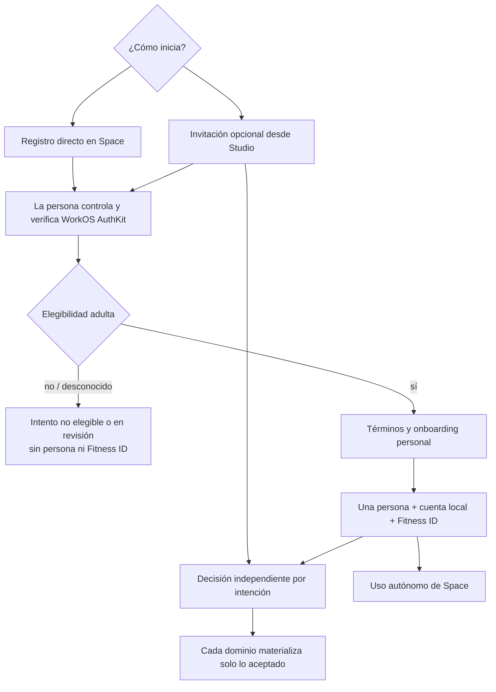

#### Registro directo en Space

1. La propia persona inicia y controla su autenticación.
2. El backend resuelve elegibilidad antes de crear datos de dominio.
3. La persona acepta términos y completa onboarding.
4. Identidad activa una única persona, cuenta local y Fitness ID.
5. No se crean invitación, organización, membresía, relación, asignación o grant.

#### Invitación para una persona nueva

1. Studio crea una invitación con destino mínimo e intenciones tipadas.
2. La invitación existe sin cuenta y sin persona provisional.
3. El destinatario completa personalmente autenticación, elegibilidad y onboarding.
4. Identidad crea la misma clase de persona, cuenta y Fitness ID que en el registro directo.
5. El destinatario decide cada intención por separado.
6. Los dominios destino materializan únicamente intenciones aceptadas cuyas dependencias se cumplen.

#### Invitación para una persona ya registrada

1. La persona inicia sesión con su cuenta existente.
2. El backend valida token, contacto, vigencia e idempotencia.
3. La invitación se vincula al `person_id` existente.
4. No se crea otra cuenta, persona, perfil o Fitness ID.
5. Cada intención se decide y materializa con las mismas reglas del flujo anterior.

#### Intento no elegible

1. Puede existir temporalmente un sujeto externo en WorkOS AuthKit y un intento de onboarding.
2. No se crea persona local, perfil, Fitness ID, membresía, relación, asignación o grant.
3. Se bloquea el acceso operativo y se inicia la política corta de deshabilitación, eliminación y retención mínima.

### 3.9 Dependencias y contratos con otros dominios

| Dominio o sistema | Identidad entrega | Identidad recibe | Regla de frontera |
| --- | --- | --- | --- |
| WorkOS AuthKit | Contexto para onboarding y acciones coordinadas de cierre/bloqueo | `(issuer, subject)`, email verificado y estado de autenticación | Autenticado no significa persona elegible ni autorizada; un celular requiere prueba separada |
| Organizaciones | `person_id` y perfil profesional mínimo permitido | Organización/emisor válidos para invitaciones y membresías materializadas | Organización y membresía nunca se almacenan como atributos de persona |
| Relaciones | Referencias canónicas de persona y profesional | Inicio, vigencia y terminación de vínculos | Cliente/profesional son roles contextuales; la persona no se duplica |
| Privacidad | Sujeto, categorías y procedencia necesarias para evaluar acceso | Grants, scopes, niveles de acceso y revocaciones | Identidad no interpreta una invitación o relación como consentimiento global |
| Planificación | `person_id` canónico para asignaciones | Referencias a planificación incorporada al Fitness ID | No copia programas o asignaciones dentro de Identidad |
| Ejecución | `person_id` canónico y atributos autorizados | Referencias a historial, resultados y progreso | No copia sesiones o resultados dentro de Identidad |
| Disposición y auditoría | Categoría, sujeto, procedencia y eventos de identidad | Políticas versionadas, holds y confirmaciones de disposición | Cada categoría conserva finalidad, plazo y acceso restringido propios |

### 3.10 Invariantes de Identidad

1. Space y Studio referencian la misma persona canónica y nunca mantienen copias por producto.
2. Una persona puede registrarse y usar Space sin invitación, organización o relación profesional.
3. Studio nunca crea un usuario WorkOS o una persona en nombre del destinatario.
4. Una invitación pendiente no es una persona, cuenta, perfil, consentimiento, membresía, relación o asignación.
5. Una persona existente acepta invitaciones posteriores con el mismo `person_id` y Fitness ID.
6. WorkOS AuthKit autentica, pero `(issuer, subject)` no reemplaza la identidad de dominio.
7. Toda persona activa en V1 tiene evidencia versionada de elegibilidad de 18 años o más.
8. Ausencia, fallo o estado desconocido de elegibilidad nunca habilitan acceso.
9. V1 no crea menores, representantes, dependientes, cuentas familiares o perfiles tutelados.
10. Cliente, atleta, profesional y miembro organizacional son roles de la persona, no identidades separadas.
11. El perfil profesional pertenece a la persona y no desaparece al salir de una organización.
12. Una afirmación de perfil conserva procedencia, actor, método y tiempo; distintas procedencias pueden coexistir.
13. Una verificación cubre una afirmación concreta y nunca verifica globalmente a la persona o al perfil.
14. Notas privadas profesionales u organizacionales no entran automáticamente al Fitness ID.
15. Terminar una relación corta acceso en vivo y escritura, congela en `T` la ventana histórica autorizada y no elimina la persona, cuenta o Fitness ID.
16. Cerrar una cuenta no borra automáticamente hechos que otro dominio deba disponer bajo una política propia.

### 3.11 Escenarios que debe superar Identidad

| Escenario | Resultado obligatorio |
| --- | --- |
| Persona adulta se registra directamente en Space | Se crea una persona/cuenta/Fitness ID sin invitación ni entidades profesionales |
| Studio invita a un email que aún no tiene cuenta | Existe invitación, pero no persona provisional ni acceso operativo |
| Persona nueva acepta parcialmente una invitación | Se crea una sola identidad y solo se materializan intenciones aceptadas con dependencias satisfechas |
| Persona de Space acepta después una invitación de Studio | Se reutiliza la identidad existente sin duplicados |
| Persona actúa como atleta y profesional | Mantiene una sola persona/cuenta y perfiles o roles diferenciados |
| Profesional cambia o suma organizaciones | Conserva identidad y perfil profesional; cambian membresías en Organizaciones |
| Persona tiene dos profesionales de organizaciones distintas | Ambos vínculos apuntan al mismo `person_id`; el acceso se resuelve por relación y grants independientes |
| Invitado resulta no elegible por edad | No se crea persona, perfil, Fitness ID ni intención materializada |
| Termina una relación profesional | Identidad permanece; la organización pierde acceso operativo mediante Relaciones/Privacidad |
| Persona cierra su cuenta | Se revoca autenticación y cada categoría inicia su disposición sin dejar el Fitness ID navegable |
| Declaración, observación e inferencia difieren | Coexisten con procedencia; la proyección actual no sobrescribe sus fuentes |

### 3.12 Decisiones diferidas al modelo lógico

Estas decisiones no cambian el ownership y se resolverán en fases posteriores:

- si el identificador público del Fitness ID comparte o no valor físico con `person_id`;
- nombres definitivos de schemas, tablas, columnas, estados y comandos;
- separación física exacta de PII, contactos, afirmaciones y verificaciones;
- estrategia de deduplicación y fusión excepcional de personas;
- materialización o cálculo de las proyecciones actuales del perfil;
- índices, constraints, particionamiento, RLS y políticas operativas detalladas.

Ninguna de estas decisiones puede permitir identidades por producto, perfiles abiertos en JSON, acceso organizacional implícito o creación de personas antes de resolver elegibilidad.

## 4. Dominio de Organizaciones

### 4.1 Responsabilidad

Organizaciones mantiene las fronteras operativas bajo las cuales equipos y profesionales utilizan Allfit Studio. Conserva la identidad estable de cada organización, su tipo principal de operación, estado, sedes básicas, membresías internas, roles y capacidades organizacionales.

El dominio usa una sola raíz para prácticas profesionales, gimnasios y estudios. Academias y clínicas permanecen como tipos gobernados pero inactivos hasta que exista un caso real V1 aprobado. El tamaño actual del equipo no define el tipo de organización ni crea otro modelo raíz.

### 4.2 Qué pertenece a Organizaciones

- una organización canónica con identificador y ciclo de vida estables;
- el tipo principal de operación y su historial de cambios explícitos;
- la modalidad y procedencia de creación, incluido `solo_professional`;
- datos operativos, presentación privada y configuración básica de la organización;
- sedes físicas básicas, dirección operativa, zona horaria y estado;
- membresías internas aceptadas entre personas y organizaciones;
- roles internos de owner, admin, staff y profesional;
- capacidades organizacionales explícitas que habilitan acciones dentro de Studio;
- historial efectivo de altas, suspensiones, cambios de rol y terminaciones;
- activos estrictamente organizacionales y su autoría, cuando el dominio propietario los referencia.

### 4.3 Qué no pertenece a Organizaciones

| Concepto excluido | Dominio responsable | Motivo |
| --- | --- | --- |
| Persona, cuenta y perfil profesional global | Identidad | Una organización vincula personas existentes; no crea otra identidad ni se apropia de su perfil |
| Invitación pendiente de staff | Identidad | La invitación precede a la membresía y puede existir sin persona |
| Relación profesional-persona | Relaciones | Ser miembro de una organización no convierte a nadie en cliente ni profesional asignado |
| Asignación de un profesional a una relación de servicio | Relaciones | Determina quién atiende a la persona y su vigencia; no es un rol interno general |
| Consentimiento, grant, scope o parte responsable aceptada | Privacidad | La organización es contexto operativo, pero no obtiene acceso por existir o por figurar en una membresía |
| Perfil, historial, sesiones o resultados de una persona | Identidad o Ejecución, según el hecho | Estar relacionada con la organización no transfiere ownership del Fitness ID |
| Programa, plantilla o asignación de entrenamiento | Planificación | Pueden tener organización de origen, pero su contenido y versiones viven en Planificación |
| Membresía comercial de cliente, suscripción o entitlement | Dominio futuro de comercio/operación | Está diferida y no se representa mediante membresía interna de staff |
| Clase, reserva, salón, recurso, capacidad o asistencia | Dominio futuro de booking | Una sede V1 no habilita anticipadamente la operación de reservas |
| Oferta pública, listing, review o marketplace | Dominio futuro | Publicación y descubrimiento están diferidos en V1 |

### 4.4 Organización operativa y persona responsable

Una organización es siempre una **frontera operativa** para acciones profesionales, permisos, auditoría y procedencia. Puede coincidir con una persona jurídica, representar la práctica de una persona natural o agrupar un equipo sin persona jurídica distinta.

Por tanto:

- `organization_kind` describe la actividad principal, no demuestra personalidad jurídica;
- una `professional_practice` unipersonal no exige por sí sola razón social, registro tributario o datos de empresa;
- la parte natural o jurídica responsable de una relación se identifica explícitamente en el consentimiento y no se infiere solo desde la organización;
- cada acción profesional registra tanto la persona que actuó como la organización bajo la cual actuó;
- los datos legales o tributarios solo se incorporan cuando una finalidad V1 real y validada los requiera.

### 4.5 Práctica inicialmente unipersonal

`solo_professional` es una modalidad de onboarding y procedencia de creación. No es un tipo permanente ni una regla de autorización.

El onboarding crea de forma transaccional e idempotente:

1. una organización estable con `organization_kind = professional_practice`;
2. una única membresía propietaria inicial para la persona;
3. el contexto organizacional desde el cual podrá operar profesionalmente en Studio.

Después, esa misma organización puede incorporar staff y profesionales sin cambiar su identificador ni migrar relaciones, programas, auditoría o activos. La condición unipersonal se deriva de las membresías activas; no se guarda como `is_independent`.

Una persona puede mantener su práctica y pertenecer simultáneamente a otras organizaciones. Cada comando profesional debe declarar el contexto organizacional y no elegirlo de manera implícita.

### 4.6 Entidades conceptuales

| Concepto | Definición conceptual | Fuente de verdad |
| --- | --- | --- |
| Organización | Frontera estable de operación, configuración, autoría y permisos organizacionales | Organizaciones |
| Tipo de organización | Clasificación gobernada de la actividad principal, como práctica profesional, gimnasio, estudio, academia o clínica | Organizaciones y catálogo controlado de plataforma |
| Procedencia de organización | Evidencia de cómo nació o cambió la organización, incluido onboarding `solo_professional` | Organizaciones |
| Estado organizacional | Condición efectiva que determina si la organización puede operar: borrador, pendiente, activa, suspendida, cerrada o archivada | Organizaciones |
| Sede | Unidad física básica perteneciente a una organización, con dirección operativa, zona horaria y estado | Organizaciones |
| Membresía organizacional | Vínculo bilateral aceptado entre una persona y una organización para operar internamente | Organizaciones |
| Rol organizacional | Agrupación gobernada de responsabilidades internas asignable a una membresía | Organizaciones dentro de límites de plataforma |
| Capacidad organizacional | Acción explícita que una membresía puede ejercer dentro de la organización | Organizaciones y política de autorización de plataforma |
| Historial de membresía y rol | Eventos efectivos de alta, cambio, suspensión y terminación con actor y motivo | Organizaciones |

Los espacios, recursos reservables y horarios de clases no forman parte de “Sede” en V1. Tampoco se crea una entidad organizacional de “cliente”: una persona atendida se vincula mediante Relaciones.

### 4.7 Matriz de ownership operativo

| Concepto | Dueño lógico | Quién crea | Quién modifica | Quién consulta |
| --- | --- | --- | --- | --- |
| Organización | La propia organización controla sus datos operativos; Allfit custodia la entidad canónica | Fundador o representante autorizado mediante onboarding; Allfit solo mediante flujo administrativo auditado | Miembros con capacidad compatible; estado o restricciones también pueden cambiar por flujos de plataforma autorizados | Miembros según rol/capacidad; otros dominios reciben solo identidad y estado necesarios; no expone por sí sola datos personales |
| Tipo de organización | La organización respecto de su clasificación; Allfit gobierna valores y transiciones válidas | Se selecciona o deriva durante onboarding según operación real | Cambio explícito, motivado y auditado; añadir miembros nunca lo cambia | Miembros y consumidores que necesiten adaptar reglas o presentación, sin inferir tamaño o personalidad jurídica |
| Procedencia de organización | La organización es sujeto; Allfit custodia evidencia del flujo | Onboarding o comando administrativo que crea/cambia la organización | Append-only; una nueva transición no reescribe el origen anterior | Organización, soporte autorizado y auditoría según finalidad |
| Estado organizacional | La organización es sujeto; Organizaciones es fuente canónica | Nace con la organización | Miembro autorizado solicita transiciones permitidas; plataforma puede suspender/cerrar mediante flujo auditado | Todos los dominios que deban fallar cerrado antes de aceptar una operación organizacional |
| Sede | La organización | Miembro con capacidad de gestión o proceso administrativo autorizado | Miembros autorizados; cierres y reaperturas conservan historial | Miembros según rol; otros dominios solo cuando la sede sea contexto legítimo de un hecho |
| Membresía organizacional | Registro bilateral: la organización administra el vínculo y la persona acepta participar | Onboarding del fundador o materialización idempotente de una intención de invitación aceptada | Organización cambia roles/estado dentro de sus facultades; la persona puede salir; suspensiones y terminaciones son auditadas | La persona miembro, administradores autorizados y servicios que validan permisos; no habilita lectura del Fitness ID |
| Rol organizacional | La organización administra asignación; Allfit define límites de seguridad | Política de plataforma o configuración autorizada de la organización según lo permitido en V1 | Solo actores con capacidad de administrar roles; cambios efectivos conservan before/after | Miembros de la organización según necesidad y motor de autorización |
| Capacidad organizacional | La organización asigna facultades internas dentro de límites de plataforma | Catálogo/política de plataforma; asignación mediante rol o concesión explícita permitida | Solo flujo autorizado, versionado y auditable; ausencia o fallo cierran el acceso | Motor de autorización y miembros que administran permisos; no sustituye scope, grant o asignación profesional |
| Historial de membresía y rol | Bilateral para la membresía; organización para su política interna | Todo comando válido de alta, cambio, suspensión o terminación | Append-only o revisión equivalente; nunca se edita para ocultar una asignación anterior | Miembro afectado, administradores autorizados, seguridad y auditoría restringida |

### 4.8 Matriz de ciclo de vida y disposición

| Concepto | Al terminar una membresía o relación profesional | Qué se conserva | Qué inicia disposición | Resultado esperado / suspensión válida |
| --- | --- | --- | --- | --- |
| Organización | Terminar una membresía no la elimina; terminar una relación con un cliente corta operación/escritura y congela el acceso histórico derivado de esa relación | Identidad estable, activos propios, configuración e historial requerido por finalidad | Cierre de organización, fin de finalidad, solicitud válida aplicable o vencimiento de retención | Archivar, eliminar o anonimizar por categoría; obligaciones y holds documentados pueden conservar evidencia mínima restringida |
| Tipo y procedencia | Permanecen como historia de la organización | Valores anterior/nuevo, actor, motivo y fecha de transiciones materiales | Disposición de la organización y vencimiento de finalidad | Conservar con la organización o restringir/anonimizar según política; no se reescriben para simular otro origen |
| Estado organizacional | Al cerrar, bloquea nuevas operaciones y activa cierres coordinados en otros dominios | Historia mínima de estados y decisiones | Suspensión, cierre o archivo | Fallar cerrado; otros dominios disponen sus entidades con políticas propias. Un hold no reactiva capacidad operativa |
| Sede | Una membresía terminada pierde gestión; una relación terminada no borra la sede | Identidad y zona horaria necesarias para interpretar hechos históricos | Cierre de sede, cierre de organización o fin de finalidad | Archivar y retirar de operación; sesiones o registros históricos mantienen referencia segura a la sede original |
| Membresía organizacional | Terminarla revoca inmediatamente roles y capacidades de esa organización; no elimina persona ni perfil profesional | Fechas, roles históricos, aceptación y evidencia mínima de cambios | Salida voluntaria, revocación, suspensión, cierre organizacional o vencimiento aplicable | Terminar acceso y disponer datos no necesarios; evidencia bilateral/restringida puede conservarse por plazo o hold acotado |
| Rol y capacidad asignados | Dejan de ser efectivos al terminar/suspender la membresía | Historial necesario para explicar acciones y autorizaciones pasadas | Revocación, cambio de rol, terminación o versión retirada | Invalidar efectividad sin borrar auditoría; un hold conserva evidencia, no permiso |
| Historial de membresía y rol | No habilita acceso posterior | Actor, motivo, before/after y vigencia mínimos | Vencimiento de finalidad o política de auditoría | Eliminar, anonimizar o retener restringido; nunca aparece como permiso vigente |

Cerrar una organización no elimina automáticamente personas, perfiles profesionales, Fitness IDs, relaciones, programas asignados o ejecuciones. Cada dominio aplica su propio flujo de terminación y disposición, preservando la persona y la evidencia bilateral mínima cuando corresponda.

La suspensión operativa/comercial de una organización se representa como una causa separada. Levantarla cierra solo esa causa y cada dominio recalcula desde sus fuentes vigentes: no reactiva membresías, relaciones, grants, asignaciones, suscripciones o sesiones que cambiaron mientras estuvo suspendida, ni neutraliza otro bloqueo abierto.

### 4.9 Flujos organizacionales

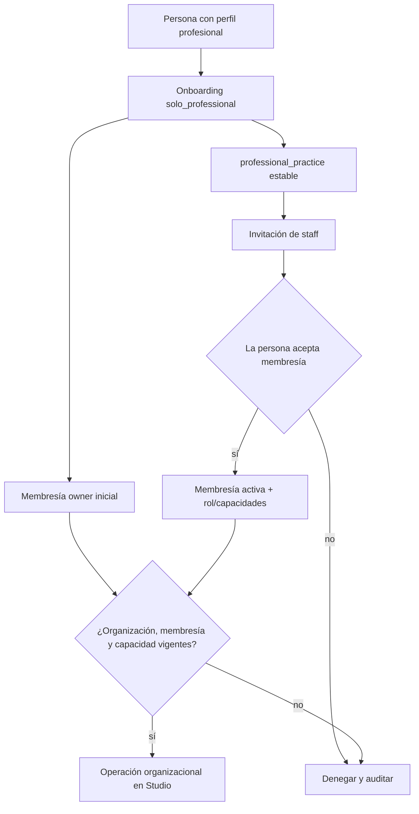

#### Alta de práctica profesional

1. Una persona elegible mantiene primero su identidad y perfil profesional personal.
2. Al elegir operar por cuenta propia en Studio, inicia `solo_professional`.
3. El backend crea una sola `professional_practice` y una sola membresía owner ante reintentos.
4. El perfil profesional permanece en Identidad y la organización solo lo referencia.
5. Las acciones posteriores registran persona actora y organización de contexto.

#### Incorporación de staff o profesionales

1. Un miembro autorizado crea desde Studio una invitación con intención `organization_membership` y rol propuesto válido.
2. La invitación permanece en Identidad y todavía no es una membresía.
3. La persona se registra o usa su cuenta existente y acepta o rechaza esa intención.
4. Solo la aceptación materializa una membresía idempotente.
5. Incorporar el primer miembro adicional no cambia `organization_id`, `organization_kind` ni ownership previo.
6. La nueva membresía no concede acceso retroactivo o automático al Fitness ID de clientes.

#### Profesional en varias organizaciones

1. Una misma persona conserva un único perfil profesional.
2. Cada organización mantiene una membresía, rol, capacidades y vigencia independientes.
3. Cada comando de Studio exige seleccionar explícitamente la organización de actuación.
4. Relaciones, programas y auditoría conservan organización y actor de origen.
5. Salir de una organización no afecta las otras membresías ni el perfil global.

#### Cambio real de actividad principal

1. Añadir o retirar integrantes no cambia el tipo.
2. Una transición real de actividad se ejecuta mediante comando explícito.
3. La transición debe estar activa en `organizations.organization_type_transitions`; inicialmente solo se admiten `professional_practice → gym` y `professional_practice → studio`.
4. Se conservan valor anterior/nuevo, actor, motivo y fecha efectiva.
5. El `PATCH` de autoservicio solo modifica `display_name`, `legal_name` y `type_code`; datos de la parte responsable, identidad, estado y timestamps son inmutables por esa vía.
6. El cambio no crea otra organización ni migra su identidad.

#### Transferencia de propiedad

1. Solo el owner vigente inicia la transferencia a otra membresía activa de la misma organización.
2. Organizaciones bloquea el agregado, ambas membresías y sus roles owner; cierra el anterior y abre el destino en una transacción.
3. El constraint diferible confirma exactamente un owner activo al commit.
4. El owner anterior conserva membresía y roles no-owner; no recibe un rol residual implícito.

#### Cierre de organización

1. El estado deja de permitir nuevas operaciones.
2. `organizations.close_organization(...)` coordina una sola transacción y llama contratos públicos estrechos de Relaciones, Privacidad, Planificación, Ejecución y Nutrición.
3. Las relaciones se terminan en Relaciones; Privacidad aplica grants y disposición; Planificación desacopla asignaciones; Ejecución cancela propuestas de corrección pendientes y Nutrición cancela propuestas nutricionales pendientes. Ningún dominio escribe tablas ajenas.
4. La organización conserva activos propios y evidencia mínima permitida, pero no acceso ordinario al Fitness ID.
5. Cada categoría inicia su disposición y cualquier hold permanece acotado, documentado y sin reactivar permisos.

### 4.10 Dependencias y contratos con otros dominios

| Dominio o sistema | Organizaciones entrega | Organizaciones recibe | Regla de frontera |
| --- | --- | --- | --- |
| Identidad | Organización, membresía y contexto operativo de la persona | `person_id`, estado elegible y perfil profesional mínimo permitido | No duplica persona, cuenta o perfil; una invitación pendiente no es membresía |
| Relaciones | Organización activa y profesionales con membresía/capacidad vigentes | Relaciones y asignaciones profesionales que requieren contexto organizacional | Membresía no crea relación; la asignación a un cliente vive en Relaciones |
| Privacidad | Organización operativa y actor real para evaluar acceso | Grants, parte responsable aceptada, scope, propósito y vigencia | Organización o rol por sí solos nunca conceden acceso al Fitness ID |
| Planificación | Organización y actor de origen válidos | Referencias a programas, plantillas y asignaciones de la organización | Organizaciones no copia contenido ni versiones de entrenamiento |
| Ejecución | Contexto organizacional y membresía/capacidad efectivas | Autoría/contexto de capturas profesionales y cancelación de propuestas al cierre | Capacidad no permite sobrescribir datos ni evita las reglas de procedencia; Organizaciones no escribe propuestas |
| Nutrición | Contexto organizacional y autoridad de guía | Propuestas nutricionales que deben cancelarse al cierre | Nutrición conserva ownership de metas, propuestas y decisiones |
| Autorización y auditoría | Estado, membresía, roles, capacidades y vigencia | Eventos de acceso y decisiones de seguridad | Permisos sensibles fallan cerrados y registran persona actora, no solo organización |
| Disposición | Categoría, sujeto organizacional y eventos de cierre | Políticas, plazos, holds y confirmaciones | Un hold conserva evidencia acotada, nunca capacidad operativa |

Para `OP-ORG-008`, Organizaciones llama
`relationships.end_assignments_for_membership(...)` solo al retirar `coach`;
retirar `admin` o `staff` preserva asignaciones si `coach` sigue vigente. Para
`OP-ORG-009/010` la llamada es incondicional. Para `OP-ORG-012`, el
coordinador llama `relationships.terminate_for_organization(...)`,
`privacy.apply_organization_closure(...)`,
`planning.detach_for_organization_closure(...)`,
`execution.cancel_proposals_for_organization_closure(...)` y
`nutrition.cancel_proposals_for_organization_closure(...)` con un instante
efectivo y command ID comunes. Son contratos públicos de dominio, no permiso
para DML cross-schema. Si cualquiera falla, PostgreSQL revierte también los
efectos ya aplicados por los contratos anteriores.

As built, neither `planning.detach_for_organization_closure` nor
`execution.cancel_proposals_for_organization_closure` exists. `terminate_for_organization`
runs `relationships.close_relationship` for every relationship, and that detaches program
assignments (STUDIO-39/40) and, since migration
`20261112090000_a_coach_proposes_a_correction_and_she_decides.sql` (STUDIO-52), cancels
pending correction proposals through `execution.cancel_relationship_correction_proposals`.
`T-ORG-CLOSURE-INT-20` holds the decision for every Execution table.

Cada contrato destino es `SECURITY DEFINER`, pertenece al schema/owner lógico
de ese dominio, fija `search_path = pg_catalog` y califica objetos. `PUBLIC` y
`allfit_api` no reciben `EXECUTE`; solo el coordinador `organizations.*`, que
corre como `allfit_owner`, puede invocarlo. Organizaciones y API mantienen cero
DML directo sobre tablas de Relaciones, Privacidad, Planificación, Ejecución o
Nutrición.

### 4.11 Fórmula de acceso profesional

Una operación profesional sobre datos de una persona requiere simultáneamente:

```text
organización activa
+ membresía organizacional activa
+ capacidad compatible
+ relación de servicio vigente
+ asignación profesional efectiva
+ grant y scope vigentes
+ propósito y acción compatibles
= acceso permitido
```

Organizaciones solo responde las tres primeras dimensiones. Relaciones y Privacidad deben confirmar las demás. Un owner, admin o profesional sin asignación y grant no puede consultar el Fitness ID.

### 4.12 Invariantes de Organizaciones

1. Toda operación profesional en Studio ocurre dentro de una organización activa.
2. Tener perfil profesional no concede acceso a Studio, clientes o datos personales.
3. Práctica profesional, gimnasio, estudio, academia y clínica comparten una raíz organizacional.
4. `organization_kind` describe actividad principal, no tamaño ni personalidad jurídica.
5. `solo_professional` es procedencia de onboarding, no tipo permanente o permiso.
6. La práctica unipersonal crea exactamente una membresía owner inicial, incluso ante reintentos concurrentes.
7. Incorporar personas no cambia el identificador ni el tipo de la organización.
8. El número de integrantes se deriva de membresías activas y no gobierna ownership.
9. Una persona puede pertenecer a varias organizaciones sin duplicar identidad o perfil profesional.
10. Una membresía pendiente no existe: antes de aceptar solo hay invitación e intención.
11. Membresía interna de staff y membresía comercial de cliente son conceptos diferentes; la segunda está fuera de V1.
12. Roles y capacidades son organizacionales; grants y scopes son de Privacidad y no se sustituyen entre sí.
13. Una membresía, rol owner/admin o capacidad general no concede acceso al Fitness ID.
14. Cada acción profesional registra persona actora y organización de contexto.
15. Cambios de tipo, rol, capacidad y estado conservan actor, motivo, before/after y vigencia.
16. Terminar una membresía revoca sus capacidades sin eliminar persona, perfil profesional u otras membresías.
17. Cerrar una sede preserva las referencias históricas necesarias y no elimina hechos ocurridos allí.
18. Cerrar una organización no transfiere ownership del historial personal ni permite conservarlo como copia navegable.

### 4.13 Escenarios que debe superar Organizaciones

| Escenario | Resultado obligatorio |
| --- | --- |
| Coach completa `solo_professional` | Se crea una `professional_practice` y una membresía owner, sin duplicar su identidad |
| El onboarding se reintenta de forma concurrente | Continúan existiendo como máximo una organización y una membresía inicial para ese flujo |
| Práctica invita al primer integrante | Conserva `organization_id`, tipo, activos y relaciones; solo añade una membresía aceptada |
| Profesional pertenece a práctica propia y gimnasio | Usa el mismo perfil, con membresías y permisos independientes por organización |
| Admin invita a un profesional | La invitación no crea membresía hasta la aceptación personal |
| Invitado acepta membresía y rechaza relación/programa | Solo se materializa la membresía; no obtiene clientes, grants o asignaciones |
| Admin sin asignación intenta ver un cliente | Se deniega aunque tenga rol administrativo |
| Profesional de la organización no asignado intenta usar un grant | Se deniega porque membresía y capacidad no sustituyen asignación efectiva |
| Profesional cambia de rol | El cambio es efectivo y auditable; no reescribe acciones históricas |
| Profesional sale del gimnasio | Pierde capacidades del gimnasio, conserva perfil global y su práctica propia |
| Práctica crece a equipo | No cambia de tipo por tamaño ni migra datos |
| Organización cambia realmente de actividad | Conserva identidad y registra transición explícita con motivo |
| Organización digital no tiene sedes | Puede operar sin una sede ficticia |
| Sede cierra | Sale de operación y los hechos históricos conservan la referencia necesaria |
| Organización cierra | Se bloquean operaciones y accesos; personas e historial siguen sus dominios y políticas propias |

### 4.14 Decisiones cerradas y extensiones futuras

La baseline cierra nombres físicos, roles/capacidades V1, owner único,
transferencia, transiciones iniciales, versionado optimista y coordinación de
cierre. Continúan como extensiones futuras, sin modelo especulativo:

- jerarquía, alcance por sede o delegación de roles, si existe un caso V1 real;
- políticas exactas de cierre, restauración, retención y anonimización por categoría;
- nuevos tipos o transiciones organizacionales distintos de los aprobados.

No se pueden resolver creando raíces distintas para coach y gimnasio, una bandera permanente de independencia, clientes como staff, permisos implícitos por rol o placeholders para booking, commerce o marketplace.

## 5. Dominio de Relaciones

### 5.1 Responsabilidad

Relaciones mantiene el vínculo de servicio aceptado entre una persona atendida y una organización, su propósito, vigencia, parte responsable presentada y profesionales asignados efectivamente.

El dominio responde **quién atiende a quién, bajo qué organización, para qué servicio y durante qué periodo**. No responde por sí solo qué categorías del Fitness ID pueden consultarse ni qué acciones pueden ejecutarse sobre ellas.

### 5.2 Qué pertenece a Relaciones

- una relación de servicio canónica y aceptada;
- la persona atendida y la organización operativa de contexto;
- la referencia a la parte natural o jurídica presentada como responsable;
- el propósito o tipo de servicio y su vigencia;
- el estado efectivo de la relación y su historial de transiciones;
- uno o varios profesionales asignados explícitamente, con rol en la atención y periodo efectivo;
- reasignaciones, reemplazos y finalizaciones de asignaciones profesionales;
- procedencia de creación, incluida la intención de invitación que la originó cuando exista;
- evento y fecha efectiva de pausa, terminación o revocación;
- coordinación de salida que invalida autoridad operativa y notifica a otros dominios.

### 5.3 Qué no pertenece a Relaciones

| Concepto excluido | Dominio responsable | Motivo |
| --- | --- | --- |
| Invitación o relación propuesta todavía no aceptada | Identidad | La propuesta vive como intención; todavía no existe vínculo materializado |
| Persona, cuenta o perfil profesional | Identidad | La relación referencia identidades canónicas y no crea copias por cliente u organización |
| Organización, membresía, rol o capacidad interna | Organizaciones | Son prerrequisitos operativos independientes de la relación de servicio |
| Consentimiento, grant, scope, access level o evidencia de aceptación de datos | Privacidad | Aceptar el vínculo no concede acceso implícito a ninguna categoría |
| Exclusión de una sesión autónoma para una relación | Privacidad | Es una denegación que reduce un grant; no cambia la relación ni la sesión |
| Programa, versión, asignación o sesión planificada | Planificación | Pueden originarse en una relación, pero conservan ownership y ciclo propios |
| Sesión ejecutada, resultado u observación profesional | Ejecución | Conservan `relationship_id` como contexto/procedencia, no como ubicación del dato |
| Membresía comercial, contrato, orden o pago | Dominio futuro de comercio | No se simulan dentro del vínculo profesional V1 |
| Notas privadas generales de la organización | Organizaciones o dominio funcional propietario | Referirse a la persona no las convierte en atributos de la relación o del Fitness ID |

### 5.4 Una relación no es autorización de datos

Una relación puede existir aunque la persona rechace `relationship_training` u otros scopes. En ese caso permanecen activas únicamente las funciones que no requieren consultar o contribuir datos no autorizados.

El acceso profesional efectivo requiere simultáneamente:

```text
relación activa
+ asignación profesional efectiva
+ organización activa
+ membresía organizacional activa
+ capacidad compatible
+ grant vigente para la finalidad y scope
+ access_level y acción compatibles
+ ausencia de una denegación más específica
= acceso permitido
```

Relaciones controla las dos primeras condiciones. Organizaciones controla las tres siguientes relacionadas con contexto y capacidad; Privacidad controla grant, scope, nivel de acceso y denegaciones. La ausencia o fallo de cualquiera produce denegación.

### 5.5 Organización y parte responsable

Cada relación V1 identifica una sola organización operativa y la parte responsable que se presenta a la persona para ese servicio.

- En una práctica unipersonal, la parte responsable puede ser el coach como persona natural y la organización operativa su `professional_practice`.
- En un gimnasio o empresa, la parte responsable puede ser la persona jurídica o parte contractual identificada y la organización operativa el gimnasio.
- En un equipo sin persona jurídica distinta, se presenta la persona natural o parte contractual definida y se opera mediante la `professional_practice` compartida.

La relación conserva una referencia estructurada a ese contexto. Privacidad congela en la evidencia de consentimiento el nombre presentado, texto, versión, finalidad y demás datos que la persona aceptó.

Cambiar de organización o de parte responsable no es una reasignación interna: exige una nueva relación y nuevos grants. Cambiar finalidad o ampliar scopes exige, como mínimo, otra aceptación en Privacidad y nunca se aplica silenciosamente sobre evidencia anterior.

### 5.6 Profesionales asignados

Ser miembro, owner, admin o profesional de una organización no convierte a la persona en actor autorizado de todas sus relaciones. Cada profesional que atiende debe tener una asignación efectiva dentro de la relación.

Una asignación profesional conserva:

- relación, organización y `professional_person_id`;
- rol en la atención;
- inicio y fin efectivos;
- actor que asignó, motivo y procedencia;
- estado e historial de cambios;
- evidencia before/after para reasignaciones.

Puede haber más de un profesional concurrente solo si cada uno está asignado explícitamente y cumple membresía, capacidad y grants. El acceso y la auditoría siempre identifican al actor humano real.

Cuando cambia el profesional dentro de la misma organización y se mantienen parte responsable, finalidad y scopes:

1. termina la asignación anterior en su fecha efectiva;
2. el profesional anterior pierde acceso inmediatamente;
3. comienza la nueva asignación sin duplicar la relación o el grant;
4. se registra actor, motivo, before/after y tiempo efectivo;
5. la persona recibe una notificación clara.

Si un coach abandona una organización y continúa el servicio desde otra, se crea otra relación y Privacidad exige nuevos grants. La organización anterior no transfiere autoridad ni historial operativo navegable.

### 5.7 Entidades conceptuales

| Concepto | Definición conceptual | Fuente de verdad |
| --- | --- | --- |
| Relación de servicio | Vínculo aceptado entre persona atendida y organización para un propósito y periodo definidos | Relaciones |
| Contexto responsable | Referencia a la parte responsable y organización presentada para el servicio | Relaciones para el contexto vigente; Privacidad para el snapshot aceptado |
| Asignación profesional | Vínculo efectivo entre un profesional y una relación, con rol y vigencia | Relaciones |
| Evento de relación | Transición append-only o historial equivalente de activación, pausa, reanudación, terminación o revocación | Relaciones |
| Evento de asignación profesional | Alta, reemplazo, suspensión o fin de autoridad de un profesional dentro de una relación | Relaciones |
| Terminación efectiva | Decisión programada o inmediata que corta autoridad en un instante de negocio determinado | Relaciones |
| Evidencia bilateral mínima | Registro restringido necesario para demostrar existencia, participantes, propósito, vigencia y terminación | Relaciones bajo política de disposición |

“Propuesta” no es un estado operativo suficiente para consultar clientes: antes de la aceptación permanece como intención de invitación. Los nombres físicos y estados exactos se cerrarán en el modelo lógico.

### 5.8 Matriz de ownership operativo

| Concepto | Dueño lógico | Quién crea | Quién modifica | Quién consulta |
| --- | --- | --- | --- | --- |
| Relación de servicio | Registro bilateral entre persona y organización; no transfiere ownership de datos fitness | Relaciones la materializa después de aceptación autenticada y dependencias válidas | Persona u organización mediante comandos autorizados de pausa/terminación; sistema aplica fechas efectivas. No se cambia organización o responsable en sitio | Persona; profesionales asignados y miembros administrativos solo para operación legítima; metadatos de relación no implican acceso a datos fitness |
| Contexto responsable | La relación conserva su contexto; la parte presentada conserva su naturaleza y la persona conoce a quién acepta | Se fija al materializar la relación | Un cambio material crea nueva relación o nueva aceptación según la dimensión; no se reescribe evidencia histórica | Partes de la relación, Privacidad y auditoría según finalidad |
| Asignación profesional | Registro operativo administrado por la organización dentro de la relación y visible para la persona | Miembro autorizado de la organización o flujo inicial aceptado | Reasignaciones y terminaciones mediante eventos efectivos; el profesional no prolonga por sí solo su autoridad | Persona, profesionales afectados, administradores autorizados y motor de acceso |
| Evento de relación | Bilateral; Relaciones custodia la historia canónica | Todo comando válido de ciclo de vida | Append-only o corrección auditada equivalente; no se altera para ocultar periodos previos | Partes, seguridad, auditoría y soporte restringido |
| Evento de asignación | Organización administra; profesional y persona son sujetos afectados | Todo comando válido de asignación o reemplazo | Append-only; una corrección conserva before/after, actor y motivo | Persona, organización y auditoría según finalidad |
| Terminación efectiva | Bilateral respecto de sus efectos; Relaciones es fuente del instante de corte | Persona, organización o proceso autorizado conforme al flujo aplicable | Puede programarse o cancelarse antes del corte si la política lo permite; una vez efectiva no se mueve para acomodar el worker | Partes y dominios que deben cortar operación, congelar grants, pausar gestión o iniciar disposición |
| Evidencia bilateral mínima | Persona y organización son partes; Allfit custodia la retención restringida | Se deriva de eventos válidos de la relación | No se usa como registro mutable operativo | Solo rol restringido con propósito permitido y auditoría; nunca endpoints ordinarios de clientes |

La autoridad exacta para pausar, programar o cancelar una terminación se cerrará en la matriz de operaciones de Fase 3. Ningún flujo puede crear una relación activa sin aceptación o base verificable, ni mantener acceso después del instante efectivo.

### 5.9 Matriz de ciclo de vida y disposición

| Concepto | Al pausar o terminar | Qué se conserva | Qué inicia disposición | Resultado esperado / suspensión válida |
| --- | --- | --- | --- | --- |
| Relación de servicio | Pausada no se trata como activa; terminada pierde toda autoridad operativa y fija el corte histórico `T` | Participantes, organización, propósito, inicio/fin, estado y evidencia bilateral mínima | Terminación, revocación, fin de finalidad, cierre de organización o vencimiento de retención | Retener restringida, anonimizar o eliminar por categoría/plazo; un hold acotado no reactiva la relación |
| Contexto responsable | Se congela como contexto histórico sin otorgar capacidad operativa | Identidad de la parte presentada y organización necesaria para aplicar la ventana `frozen` y conservar evidencia | Disposición de la relación o vencimiento de finalidad | Reducir o anonimizar conforme a política; nunca mantener a la persona en directorios de clientes activos |
| Asignación profesional | En pausa queda inefectiva; al terminar se cierra en el instante efectivo | Profesional, rol, periodo, actor y motivo mínimos | Fin de asignación, membresía/capacidad inválida, terminación de relación o disposición de evidencia | Revocar acceso; conservar historia restringida y luego disponer según política |
| Eventos de relación/asignación | Permanecen como historia, pero no habilitan operación | Before/after, actor, motivo y tiempo efectivos | Vencimiento de política de auditoría o finalidad | Eliminar, anonimizar o retener restringido; hold solo sobre eventos identificados |
| Terminación efectiva | Coordina el corte de todos los actores de la relación | Instante de negocio, causa, actor/proceso y resultado de coordinación | Ejecución efectiva del comando | Evento idempotente; el retraso del worker no extiende autoridad |
| Evidencia bilateral mínima | Sale de endpoints y listados ordinarios | Solo campos necesarios para finalidad operativa, disputa, seguridad o cumplimiento | Vencimiento de `retention_until`, liberación de hold o fin de finalidad | Eliminar o anonimizar; acceso excepcional siempre registra actor, propósito, timestamp y alcance |

La terminación de una relación no elimina la persona, su Fitness ID, programas maestros de la organización, sesiones ejecutadas o resultados. Retira acceso en vivo, gestión y escritura; los grants pasan a `frozen` y cada dominio conserva y dispone sus hechos conforme a ownership, finalidad y plazo propios.

### 5.10 Flujo de creación y acceso

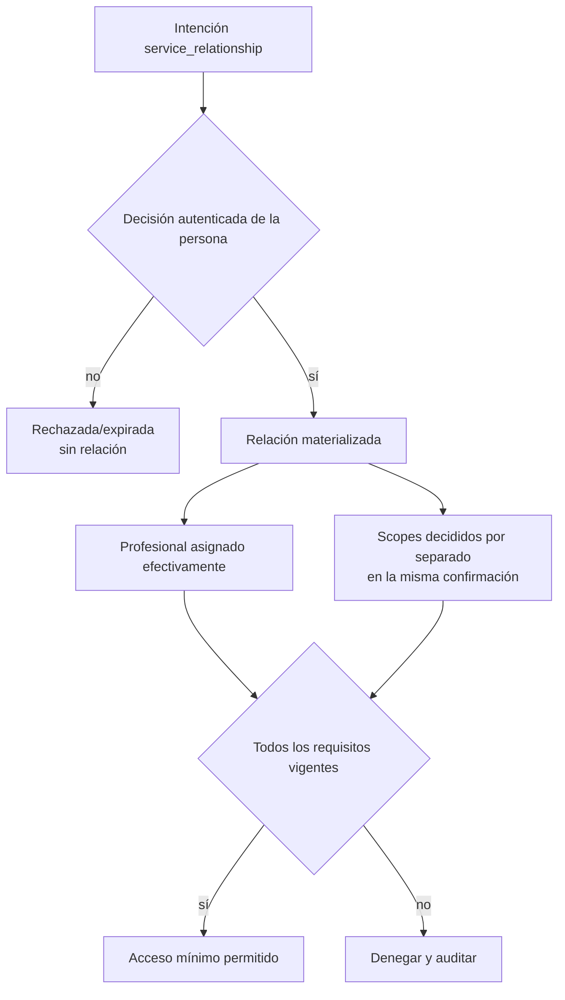

#### Creación desde invitación

1. La organización propone `service_relationship` con profesional responsable, servicio y fecha tentativa.
2. Identidad conserva la intención sin crear una relación provisional.
3. La persona elegible decide la intención de forma autenticada.
4. Relaciones materializa como máximo un vínculo por intención aceptada y válida.
5. La persona decide el vínculo, el programa y cada scope por separado dentro de la misma confirmación; aceptar el vínculo no acepta automáticamente ninguno de los demás.
6. Una intención de programa solo puede materializarse si su relación dependiente fue aceptada.

#### Relación sin grants de entrenamiento

1. La relación puede permanecer vigente como contexto de servicio.
2. Operaciones que no requieren datos compartidos pueden continuar según su contrato.
3. Consulta, contribución o seguimiento de resultados permanecen bloqueados hasta que exista el grant correspondiente.
4. La UI debe explicar la limitación sin presentar la relación como acceso total.

#### Reasignación interna

1. La organización valida que el nuevo profesional tenga membresía y capacidades vigentes.
2. Relaciones termina la asignación anterior antes de iniciar la nueva.
3. Privacidad conserva el grant solo si no cambian organización, parte responsable, finalidad o scope.
4. Se invalida el acceso del actor anterior y se habilita al nuevo desde tiempos efectivos no superpuestos salvo asignación concurrente explícita.
5. La persona recibe notificación y el evento queda auditado.

#### Pérdida de membresía del profesional

1. La asignación deja de ser ejercible inmediatamente porque falla la membresía, aunque la relación siga vigente.
2. El profesional pierde acceso y no puede capturar, anotar o corregir.
3. La organización debe asignar otro profesional válido o pausar/terminar el servicio según el flujo aplicable.
4. La relación y el grant no se trasladan a la práctica personal del profesional saliente.

### 5.11 Terminación coordinada

Cuando llega `effective_at`, Relaciones inicia una transición idempotente que debe producir el mismo resultado aunque existan reintentos o workers tardíos:

1. marca la relación como terminada desde el instante efectivo;
2. finaliza todas las asignaciones profesionales vigentes;
3. ordena a Privacidad revocar o expirar los grants vinculados;
4. retira a la persona de listados y flujos operativos normales de la organización;
5. ordena a Planificación desacoplar cada asignación `active_managed` en `detached_pending_choice`;
6. bloquea nuevas capturas, notas, propuestas y correcciones operativas;
7. invalida cachés, proyecciones y derivados autorizados por la relación;
8. calcula políticas de retención y disposición para la evidencia bilateral.

El tiempo efectivo de negocio gobierna el acceso, no la hora de procesamiento técnico.

#### Efectos sobre planificación y ejecución

- La persona conserva la misma asignación, versión, snapshot, revisiones y atribución histórica.
- Las sesiones completadas o iniciadas permanecen en su historial.
- Las sesiones futuras quedan visibles para la persona, pero pausadas.
- Solo la persona decide continuar la misma asignación personalmente o terminarla.
- No responder mantiene la asignación pausada sin sesiones nuevas, recordatorios o penalización de adherencia.
- La organización anterior no edita, reprograma, genera, anota o sigue la asignación después del corte.
- Una sesión iniciada puede ser terminada por la persona; el profesional anterior no puede contribuir después de `effective_at`.
- Una organización nueva no hereda gestión, grants, observaciones o notas privadas.

#### Efectos sobre retención

- La persona conserva perfil e historial personal en su Fitness ID.
- La organización conserva activos propios como programas maestros y metodología.
- Solo se retiene evidencia bilateral mínima con finalidad, plazo y acceso restringido.
- No quedan visibles sesiones autónomas, actividad futura o datos producidos en otras relaciones.
- Retención no permite marketing, IA, analítica identificable o navegación operativa.

### 5.12 Dependencias y contratos con otros dominios

| Dominio o sistema | Relaciones entrega | Relaciones recibe | Regla de frontera |
| --- | --- | --- | --- |
| Identidad | Contexto de rol de cliente/profesional sin duplicar persona | `person_id`, profesional canónico e intención aceptada | Propuesta pendiente no es relación; terminar no elimina identidades |
| Organizaciones | Relaciones y asignaciones que operan bajo la organización | Estado organizacional, membresía y capacidad efectivas | Membresía no crea relación; perder membresía invalida al actor, no transfiere el vínculo |
| Privacidad | `relationship_id`, organización, parte responsable, propósito, vigencia y profesionales asignados | Grants, scopes, access levels, revocaciones y denegaciones | Relación y asignación son necesarias pero nunca suficientes para acceder |
| Planificación | Relación y profesional gestor de origen; evento de terminación | Asignaciones/programas vinculados y confirmación de desacoplamiento | Relaciones no copia planes; terminar cambia gestión, no ownership ni versión |
| Ejecución | Contexto y vigencia para captura profesional | Referencias a sesiones/resultados producidos bajo la relación | Terminar corta contribución futura, pero no borra ejecuciones históricas |
| Auditoría y disposición | Eventos, actores, finalidad y fecha efectiva | Políticas, holds y confirmaciones de tareas coordinadas | Evidencia retenida queda fuera de operación ordinaria |

### 5.13 Invariantes de Relaciones

1. Una propuesta pendiente no es una relación materializada.
2. Ninguna relación activa nace sin decisión autenticada o base verificable de la persona.
3. Una relación referencia personas y organización canónicas; no crea copias de cliente o coach.
4. La relación define contexto y vigencia, pero no transfiere ownership del Fitness ID.
5. Aceptar una relación no acepta programa, contrato, pago, términos o grants.
6. La relación puede existir sin scopes, pero toda función que requiera datos permanece bloqueada.
7. Todo acceso profesional identifica una asignación efectiva y al actor humano real.
8. Membresía o rol administrativo sin asignación profesional no permiten ejercer la relación.
9. Reasignar dentro de la misma organización no duplica relación o grant cuando responsable, finalidad y scopes permanecen.
10. El profesional anterior pierde acceso antes o en el mismo instante en que comienza el nuevo.
11. Cambiar organización o parte responsable exige nueva relación y nuevos grants.
12. Cambiar finalidad o scope nunca hereda aceptación anterior de forma implícita.
13. Perder membresía o capacidad hace inefectiva la asignación aunque la relación continúe.
14. Una relación pausada o terminada nunca satisface la condición de relación vigente.
15. La fecha efectiva, no la ejecución tardía de un worker, determina el corte de autoridad.
16. Terminar cambia grants `active` a `frozen`, cierra asignaciones profesionales, retira accesos operativos y desacopla planificación administrada.
17. La persona conserva historial, atribución y snapshots válidos después de terminar.
18. La organización anterior no recibe datos creados después del corte ni actividad de otras relaciones.
19. Retener evidencia no mantiene permisos ni acceso cotidiano.
20. Reintentos de creación, reasignación o terminación no duplican relaciones, actores, eventos o desacoplamientos.

### 5.14 Escenarios que debe superar Relaciones

| Escenario | Resultado obligatorio |
| --- | --- |
| Persona rechaza una intención de relación | No se crea vínculo ni acceso operativo |
| Persona acepta relación y rechaza programa | Se crea solo la relación; no hay asignación de programa |
| Persona acepta relación pero rechaza scopes | La relación existe y las funciones basadas en datos quedan bloqueadas |
| Persona tiene dos profesionales de organizaciones distintas | Existen relaciones/grants independientes sobre el mismo `person_id` |
| Dos profesionales atienden concurrentemente dentro de una organización | Ambos requieren asignación explícita, membresía, capacidad y grant; cada acceso audita al actor real |
| Admin sin asignación consulta el Fitness ID | Se deniega aunque pueda administrar la relación |
| Reasignación dentro de la misma parte responsable | Termina el actor anterior, inicia el nuevo, conserva un grant válido y notifica a la persona |
| Coach sale del gimnasio y continúa desde su práctica | Se requiere nueva relación y nuevos grants; no se trasladan los anteriores |
| Profesional pierde membresía mientras la relación sigue | Pierde acceso inmediatamente y la organización debe reasignar o pausar/terminar |
| Persona oculta una sesión autónoma para una relación | La relación sigue activa; Privacidad reduce únicamente su conjunto autorizado |
| Relación termina en una fecha futura | El acceso continúa solo hasta el instante efectivo y no hasta el procesamiento del worker |
| Relación termina con asignación activa | La asignación se desacopla una vez, conserva snapshot y queda pausada para decisión personal |
| Persona continúa el plan personalmente | Reutiliza la misma asignación sin devolver autoridad a la organización |
| Persona termina el plan desacoplado | Se cancelan solo sesiones futuras no iniciadas; el historial permanece |
| Organización anterior consulta actividad posterior | Se deniega sin revelar datos, conteos o derivados |
| Existe una disputa posterior | Solo evidencia mínima restringida puede consultarse con propósito y auditoría |

### 5.15 Decisiones diferidas al modelo lógico y Fase 3

Estas decisiones deben cerrarse sin alterar ownership o privacidad:

- estados físicos exactos y transiciones válidas de relación y asignación profesional;
- si una reactivación crea siempre otra relación o un nuevo periodo dentro de la misma identidad;
- quién puede pausar, reanudar, programar, cancelar o ejecutar cada tipo de terminación;
- reglas de unicidad y concurrencia para múltiples relaciones entre la misma persona y organización;
- roles de atención y condiciones para profesionales concurrentes;
- representación tipada e íntegra de la parte natural o jurídica responsable;
- notificaciones, periodos de aviso y motivos de terminación visibles para cada parte;
- transacción local, outbox y reconciliación entre revocación, listados, desacoplamiento e invalidación;
- tratamiento exacto de propuestas de corrección pendientes al terminar;
- políticas y plazos concretos de evidencia bilateral por finalidad y jurisdicción;
- nombres de schemas/tablas, constraints, índices, RLS y comandos idempotentes.

No se pueden resolver con un booleano `is_client`, grants por coach duplicados, una relación provisional antes de aceptar, borrado del Fitness ID o transferencia automática de gestión a otra organización.

## 6. Dominio de Privacidad

### 6.1 Responsabilidad

Privacidad mantiene las decisiones explícitas mediante las cuales una persona comparte categorías concretas de su Fitness ID para una finalidad, destinatario y periodo definidos. También gobierna clasificación, contratos versionados de scope, grants efectivos, denegaciones más específicas, casos excepcionales de lectura histórica, evidencia de acceso y disposición final por categoría.

El dominio responde:

- **qué datos** pueden tratarse mediante el scope y su versión;
- **para qué** mediante el propósito aceptado;
- **por quién y en qué contexto** mediante relación, organización responsable y actores asignados;
- **qué acciones máximas** mediante `access_level`, capacidades y procedencia;
- **hasta cuándo** mediante vigencia, revocación y terminación;
- **qué ocurre después** mediante políticas de retención y disposición.

En V1 solo la propia persona adulta concede o rechaza permisos sobre su Fitness ID. No existen representantes, consentimientos parentales ni cuentas que decidan por otra persona.

### 6.2 Qué pertenece a Privacidad

- definiciones publicadas, inmutables y versionadas de scopes;
- clasificación de categorías, recursos, campos y derivados;
- opciones de scope presentadas con la intención de relación y decisiones explícitas de consentimiento;
- evidencia append-only de concesión, rechazo, revocación, expiración o reemplazo;
- grants efectivos vinculados a persona, relación, organización, propósito y versión exacta de scope;
- niveles de acceso separados del scope y de las capacidades organizacionales;
- snapshots de la parte responsable, organización, texto y finalidad presentados;
- denegaciones por relación que reducen un grant, incluida ocultación de sesiones autónomas;
- casos temporales y acotados que autorizan a una membresía exacta a intentar lectura histórica;
- evaluación efectiva y denegación por defecto;
- auditoría de accesos sensibles con actor humano real;
- políticas versionadas de retención y disposición;
- solicitudes de supresión, holds acotados y eventos de disposición;
- coordinación de invalidación en cachés, índices, read models, storage, réplicas y backups.

### 6.3 Qué no pertenece a Privacidad

| Concepto excluido | Dominio responsable | Motivo |
| --- | --- | --- |
| Persona, cuenta, perfil o dato fitness original | Identidad, Planificación o Ejecución | Privacidad decide acceso y disposición; no se convierte en fuente del dato protegido |
| Organización, membresía, rol o capacidad | Organizaciones | Son condiciones de actor y operación, no consentimiento |
| Relación y asignación profesional | Relaciones | Definen contexto y actores; no conceden categorías de datos |
| Invitación o aceptación de una intención | Identidad | Identidad transporta y coordina la confirmación; cada scope sigue siendo una decisión independiente cuya evidencia y grant pertenecen a Privacidad |
| Programa, sesión o resultado | Planificación o Ejecución | El grant referencia categorías y recursos sin copiarlos |
| Términos generales, política de privacidad o aceptación contractual | Dominio legal/compliance correspondiente | Tienen texto, finalidad y evidencia propias; no son grants de coaching |
| Contrato, orden, factura, pago o membresía comercial | Dominio futuro de comercio | Su base y retención no se modelan como consentimiento de Fitness ID |
| Permiso de publicación, marketing, IA, investigación o entrenamiento de modelos | Dominios futuros | Ninguno se hereda de los siete scopes V1 |
| Credencial, token o sesión de autenticación | WorkOS AuthKit / seguridad | Autenticación identifica al actor, pero no autoriza tratamiento de datos |

### 6.4 Consentimiento, evento y grant

Estos conceptos no son intercambiables:

- **Opción de scope presentada:** propuesta versionada ligada a una intención de relación; no concede acceso y no existe como solicitud posterior sobre una relación activa.
- **Evento de consentimiento:** evidencia inmutable de qué decidió la persona, sobre qué texto, definición, finalidad, destinatario, canal y momento.
- **Grant:** autorización efectiva derivada de una concesión válida; puede vencer, revocarse o ser reemplazada.
- **Evaluación de acceso:** decisión en tiempo de ejecución que combina el grant con relación, asignación, organización, membresía, capacidad, procedencia y denegaciones.

Un rechazo conserva evidencia, pero no produce un grant. Después de rechazar o revocar, volver a compartir exige una relación nueva y otra aceptación completa; nunca se reabre la decisión anterior ni se crea una solicitud posterior desde Studio.

La evidencia de consentimiento identifica:

- persona titular;
- relación de servicio;
- organización grantee y parte responsable presentada;
- scope y versión exacta de definición;
- finalidad y `access_level`;
- texto y versión mostrados;
- efecto de negar o revocar;
- vigencia;
- canal, actor y timestamp.

El grant se materializa sobre la organización de la relación, pero no habilita a todos sus miembros. Los profesionales son actores autorizados dinámicamente por asignación, membresía y capacidad efectivas.

### 6.5 Definiciones de scope versionadas

Un scope es un contrato publicado que enumera finalidad, recursos, campos, exclusiones y acciones máximas compatibles. Se identifica por `scope_code + definition_version`.

Reglas:

1. una versión publicada es inmutable;
2. todo grant congela la versión exacta aceptada;
3. añadir recursos, campos, finalidades o acciones máximas crea otra versión y exige nueva aceptación;
4. un grant antiguo no hereda campos de una definición nueva;
5. retirar exposición por seguridad puede aplicarse inmediatamente porque reduce acceso;
6. el frontend no interpreta ni redacta por su cuenta el contrato;
7. RLS limita filas y tablas/vistas/proyecciones autorizadas limitan campos;
8. conteos, errores, `NULL`, paginación y derivados tampoco pueden revelar datos excluidos.

### 6.6 Scopes V1

| Scope | Finalidad | Incluye | Excluye de forma destacada | Acciones V1 máximas |
| --- | --- | --- | --- | --- |
| `relationship_training` | Planificar, acompañar y evaluar entrenamiento producido dentro de la relación | Prescripción y snapshots, sesiones planificadas, intentos, ejecuciones, resultados y adherencia de esa relación | Sesiones autónomas/previas, cuerpo, salud, biometría, GPS, wearables, nutrición y notas internas | `read`, `contribute`, `annotate`, `propose_correction`, siempre sujetos a capacidad y procedencia |
| `prior_training_history` | Comprender experiencia ejecutada fuera de la relación actual | Sesiones anteriores/autónomas elegibles, resultados tipados, récords y procedencia general | Programas/notas privadas anteriores, cuerpo, salud, biometría, GPS/raw y comercio | `read` y `propose_correction`; nunca contribución o modificación directa |
| `body_progress` | Evaluar evolución corporal compartida voluntariamente | Peso, altura usada en cálculos, composición, perímetros, tendencias y fotos seleccionadas | Salud, EXIF/geolocalización, galería no seleccionada, biometría continua y entrenamientos | `read`; `contribute` solo si se acepta explícitamente y conserva procedencia |
| `health_context` | Adaptar entrenamiento con contexto de salud fitness minimizado | Dolor, lesión/limitación declarados, restricciones, recuperación, fatiga, sueño/readiness y observaciones separadas | Historia clínica completa, diagnósticos innecesarios, medicamentos, laboratorios, documentos, biometría/raw e inferencias médicas | `read`; `contribute` explícito para observaciones y propuestas, nunca overwrite de declaraciones |
| `nutrition_intake` | Compartir registro alimentario manual y sus resúmenes | Comidas, ítems, cantidades y seis nutrientes V1 | Fotos, guía, clínica, catálogo externo e inferencias | `read`; nunca escritura profesional |
| `nutrition_guidance` | Proponer y revisar objetivos nutricionales no clínicos | Versiones, targets, racional, autoría y decisiones | Comidas, fotos, menús y prescripción terapéutica | `read`; `contribute` solo con capability y credencial verificadas |
| `nutrition_media` | Compartir una foto elegida por comida | `media_ref` saneado; Space entrega URL firmada temporal a la persona y Studio un enlace a proxy autenticado | Galería, URL de storage en Studio, EXIF, geolocalización e inferencias | `read`, efectivo solo junto con `nutrition_intake/read` |

Reglas transversales:

- `relationship_training` no incluye una sesión autónoma aunque ocurra durante la relación;
- `prior_training_history` no expone identidad, IP o notas privadas anteriores cuando no sean necesarias;
- la carga usada en un ejercicio pertenece a entrenamiento; el peso corporal pertenece a `body_progress`;
- dolor capturado dentro de una sesión continúa bajo `health_context`;
- una fotografía de progreso requiere `body_progress` y selección explícita;
- frecuencia cardiaca, ECG, GPS/ruta, raw de wearables y biometría permanecen fuera de V1 aunque estén asociados a una sesión visible;
- los tres scopes nutricionales son independientes de entrenamiento; `ai_context`, `public_sharing`, marketing y `research_or_model_training` requieren contratos futuros y no producen placeholders en la baseline.

### 6.7 Scope, nivel de acceso, capacidad y procedencia

Estas dimensiones se evalúan por separado:

| Dimensión | Pregunta que responde | Ejemplo |
| --- | --- | --- |
| Scope + versión | ¿Qué datos y campos están incluidos? | `body_progress/v1` incluye peso y fotos elegidas |
| Propósito | ¿Para qué pueden usarse? | evaluar evolución corporal dentro del servicio |
| `access_level` | ¿Qué clase de interacción aceptó la persona? | leer o contribuir, según contrato |
| Capacidad organizacional | ¿Qué acción está habilitado para ejecutar el actor? | `execution.annotate` |
| Procedencia/ownership | ¿Puede modificar directamente ese valor? | un profesional revisa captura propia, pero propone corrección sobre dato personal |
| Denegación específica | ¿Existe una restricción más estrecha? | sesión autónoma oculta para esa relación |

Ninguna dimensión amplía otra. Por ejemplo, `contribute` no permite sobrescribir declaraciones personales, un scope no crea una capacidad y una capacidad no vuelve visible un campo fuera del scope.

### 6.8 Denegación de sesiones autónomas por relación

La persona puede ocultar una sesión autónoma, espontánea, importada o anterior para una relación concreta. Esta regla solo **reduce** el conjunto permitido por `prior_training_history`.

La denegación:

- pertenece a la persona y se aplica a toda la organización responsable de esa relación;
- sigue vigente aunque cambie el profesional asignado;
- no se hereda por otra relación, aunque sea con la misma organización o profesional;
- puede ocultar una sesión en una relación y compartirla en otra;
- prevalece sobre permitir y no crea acceso cuando falta el grant;
- bloquea también campos y derivados que otro scope pudiera exponer desde esa sesión dentro de la misma relación;
- no cambia la sesión, su procedencia o su ownership;
- no permite reclasificar una ejecución originada dentro de la relación como autónoma.

Una sesión oculta no aparece ni se infiere mediante:

- detalle, búsqueda, exportación o listados;
- conteos, rangos de fecha, paginación o errores;
- récords, tendencias, volumen, adherencia o recomendaciones;
- cachés, índices, read models o contexto de IA;
- placeholders o mensajes que revelen cuántas sesiones fueron ocultadas.

Ocultar después de compartir invalida proyecciones futuras, pero no borra el dato personal ni garantiza que un tercero olvide conocimiento obtenido legítimamente antes.

### 6.9 Entidades conceptuales

| Concepto | Definición conceptual | Fuente de verdad |
| --- | --- | --- |
| Definición de scope | Contrato publicado e inmutable de finalidad, recursos, campos, exclusiones y acciones máximas | Privacidad bajo gobernanza de plataforma |
| Clasificación de dato | Categoría y sensibilidad aplicables a un recurso/campo y sus derivados | Privacidad junto al dominio propietario del dato |
| Evento de consentimiento | Evidencia append-only de presentación y decisión de la persona | Privacidad |
| Grant de datos | Autorización efectiva para una persona, relación, organización, propósito y definición exacta | Privacidad |
| Denegación por relación | Restricción personal y específica que reduce el conjunto de un grant | Privacidad |
| Caso de acceso histórico | Autorización excepcional, temporal y auditable para que una membresía elegible consulte una relación terminada por una finalidad cerrada | Privacidad |
| Evento de acceso | Evidencia de actor humano, organización, relación, scope, propósito y recurso sensible consultado | Privacidad / auditoría de seguridad |
| Política de retención | Regla versionada por categoría, finalidad, jurisdicción y trigger con acción final | Privacidad bajo gobernanza y validación jurídica |
| Solicitud de supresión | Petición trazable cuyo alcance se resuelve por categoría y política | Privacidad |
| Hold | Suspensión acotada de disposición con motivo, actor, alcance, revisión, vigencia y liberación | Privacidad / compliance autorizado |
| Evento de disposición | Evidencia del comando idempotente que eliminó, anonimizó o restringió un target | Privacidad |

El catálogo de clasificación no sustituye estructuras tipadas, RLS o autorización. Tampoco autoriza un arreglo libre de scopes o un JSON de permisos.

### 6.10 Matriz de ownership operativo

| Concepto | Dueño lógico | Quién crea | Quién modifica | Quién consulta |
| --- | --- | --- | --- | --- |
| Definición de scope | Allfit gobierna el contrato; no adquiere ownership de los datos incluidos | Flujo de gobernanza de producto, privacidad, arquitectura y validación jurídica | El borrador puede cambiar; publicada es inmutable y solo se reemplaza con otra versión | Persona antes de decidir, sistemas de autorización, auditores y equipos autorizados |
| Clasificación de dato | El dominio propietario conserva el dato; Allfit gobierna su clasificación | Gobernanza conjunta con el dominio propietario | Cambio versionado y revisado; no reclasifica silenciosamente grants históricos para ampliar acceso | Autorización, API, RLS, disposición y pruebas |
| Evento de consentimiento | La persona controla su decisión; Allfit custodia evidencia bilateral | La persona autenticada decide; el sistema registra texto, contexto y tiempo | Append-only; una nueva decisión crea otro evento | Persona, parte responsable dentro de finalidad y roles restringidos de auditoría/compliance |
| Grant de datos | La persona controla el acceso a sus datos | Privacidad lo materializa desde una concesión válida | Solo eventos autorizados cambian vigencia/estado; revocar o volver a conceder no reescribe historia | Persona y motor de autorización; organización solo conoce grants de sus relaciones según necesidad |
| Denegación por relación | La persona | Persona autenticada o soporte restringido por solicitud verificable | Ocultar/volver a compartir genera historial efectivo; la organización nunca la cambia | Persona y motor de autorización; el tercero no conoce existencia o cantidad de exclusiones |
| Caso de acceso histórico | No transfiere ownership ni crea un grant; solo habilita el ejercicio acotado de los grants `frozen` de una relación | Owner/admin con `manage_historical_access`, para sí o para el antiguo titular elegible | Puede cerrarse; expira en máximo 24 horas; revocar cualquier grant congelado de la relación cierra sus casos | Solo la membresía exacta autorizada y owner/admin para administrar el caso; la persona ve los eventos resultantes |
| Evento de acceso | La persona es sujeto del dato accedido; Allfit custodia seguridad y trazabilidad | Sistema al ejecutar accesos sensibles | Append-only; correcciones administrativas no eliminan el evento original | Persona cuando aplique, seguridad, auditoría y compliance restringidos |
| Política de retención | Configuración de plataforma; no cambia ownership del dato | Gobernanza de datos con validación jurídica por jurisdicción | Versionada; cambiarla no reescribe ejecuciones históricas ni libera holds automáticamente | Dominios propietarios, workers de disposición, auditoría y compliance |
| Solicitud de supresión | La persona es solicitante/sujeto; Allfit resuelve obligaciones por categoría | Persona o flujo autorizado verificable | Avanza por estados y decisiones trazables; no se reduce a un booleano global | Persona, soporte/compliance restringidos y dominios encargados de ejecutar |
| Hold | No transfiere ownership; compliance autorizado custodia su justificación | Actor restringido con base, alcance y vigencia documentados | Revisar, extender o liberar deja eventos; no existe hold global indefinido por defecto | Solo roles restringidos y workers que deban suspender targets concretos |
| Evento de disposición | El sujeto/propietario del target no cambia; Allfit custodia prueba de ejecución | Worker o comando autorizado e idempotente | Append-only; reintentar converge al mismo resultado | Auditoría, compliance y soporte restringido; nunca actores operativos ordinarios |

### 6.11 Matriz de ciclo de vida y disposición

| Concepto | Ciclo / evento de corte | Qué se conserva | Qué inicia disposición | Resultado esperado / suspensión válida |
| --- | --- | --- | --- | --- |
| Definición de scope | Borrador → publicada → reemplazada/retirada | Versiones exactas referenciadas por evidencia y grants históricos | Fin de finalidad normativa o política del catálogo | Archivar sin permitir nuevas concesiones; no alterar el significado histórico |
| Evento de consentimiento | Presentado → concedido/rechazado → revocado/expirado/reemplazado mediante nuevos eventos | Texto/versión, decisión, destinatario, finalidad, canal y tiempo mínimos | Vencimiento de retención de evidencia o disposición válida | `retain_restricted` por plazo aplicable; hold solo sobre evidencia concreta |
| Grant | Activo desde vigencia → `frozen` por terminación o `revoked` por revocación explícita; también puede expirar o ser reemplazado | Referencia a evidencia, alcance, versión, periodo efectivo y `frozen_at` cuando aplique | Revocación personal, expiración, terminación de relación o cambio material | `frozen` corta operación y limita lectura a `<= T`; `revoked` bloquea todo acceso; el dato personal no se elimina por esta causa |
| Denegación por relación | Oculta o vuelve a compartir mediante eventos efectivos | Decisión, relación, sesión, actor y tiempo mínimos, incluido el corte histórico si aplica | Cambio personal o vencimiento de evidencia | En lectura `frozen`, una denegación vigente en `T` o posterior sigue reduciendo; restaurar después de `T` nunca amplía la ventana |
| Caso de acceso histórico | Abierto → cerrado o expirado, con máximo 24 horas | Relación, organización, membresía autorizada, propósito, creador y vigencia | Cierre explícito, expiración, revocación de cualquier grant congelado de la relación o disposición del sujeto | No sobrevive como permiso: conservar solo evidencia restringida según política |
| Evento de acceso | Se produce en cada operación sensible definida | Actor, organización, relación, scope, propósito, recurso y tiempo mínimos | Vencimiento de política de seguridad/auditoría | Retener restringido y luego eliminar/anonimizar; nunca usar para marketing o IA ordinaria |
| Política de retención | Borrador → publicada/versionada → reemplazada/retirada | Versión aplicada a cada decisión de disposición | Sustitución o retiro gobernado | Conservar trazabilidad; no liberar datos o holds por reinterpretación retroactiva |
| Solicitud de supresión | Recibida → verificada → resuelta por categoría → ejecutada/cerrada | Solicitud, decisiones, excepciones y confirmaciones mínimas | Solicitud válida, cierre de cuenta o fin de finalidad | Cada categoría ejecuta `delete`, `anonymize` o `retain_restricted`; no respuesta global opaca |
| Hold | Activo → revisión/expiración → liberado | Motivo, base, alcance, actor, vigencia y liberación | Controversia, obligación o seguridad documentadas | Suspende solo targets incluidos; liberar reanuda disposición idempotente y no habilita acceso |
| Evento de disposición | Pendiente → ejecutado/fallido/reintentado | Política, target, acción, resultado, actor/job y tiempos | `retention_until`, solicitud válida, desconexión o fin de finalidad | Convergencia idempotente en sistemas activos/derivados y reaplicación tras restauraciones |

### 6.12 Evaluación de acceso efectiva

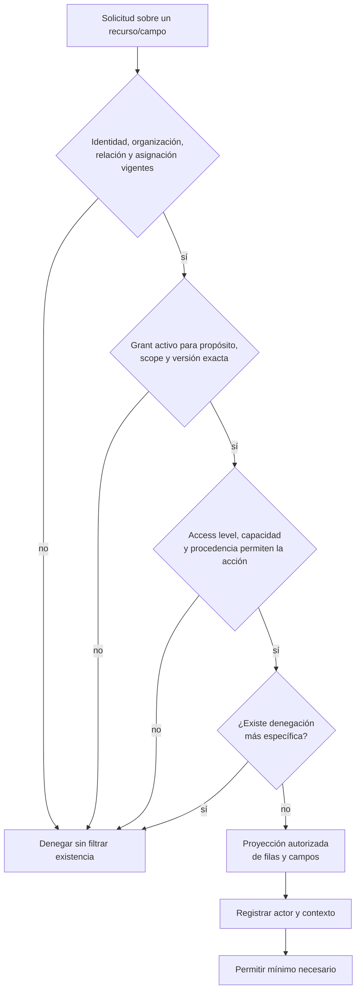

#### Reglas de evaluación

1. Todo parte de denegación por defecto.
2. El backend autoritativo evalúa estado actual; cachés o read models atrasados nunca conceden permisos.
3. La versión del scope determina exactamente los campos elegibles.
4. La proyección elimina categorías no concedidas antes de formar respuesta, agregado o error.
5. Un derivado hereda la clasificación más restrictiva de todos sus inputs.
6. La acción se restringe además por ownership y procedencia del dato.
7. Cada acceso sensible registra al profesional real, no solo a la organización.
8. Un fallo de autorización, consentimiento o capacidad falla cerrado.

### 6.13 Concesión, reasignación y revocación

#### Concesión

1. La UI presenta parte responsable, organización, propósito, scope, versión, campos materiales, nivel de acceso, vigencia y efecto de negar/revocar.
2. No existen casillas premarcadas, inactividad como aceptación ni `accept_all`.
3. La persona decide cada scope independientemente.
4. La relación y todos sus scopes se confirman en una sola acción autenticada; Privacidad registra un evento por opción y materializa únicamente grants concedidos.
5. Aceptar uno no concede los demás ni usos secundarios.
6. Studio no puede iniciar otra solicitud de permisos para una relación ya activa.

#### Reasignación profesional interna

El grant se conserva si continúan la misma relación, organización, parte responsable, finalidad, scope y versión aceptada. Relaciones cambia los actores asignados; el profesional anterior pierde acceso antes de habilitar al nuevo. No se crean grants por coach.

Si cambia organización o parte responsable, se requiere nueva relación y nuevos grants. Si cambia finalidad, scope, versión con contenido ampliado o `access_level`, se requiere otra aceptación explícita.

#### Revocación o expiración

1. El grant deja de ser efectivo inmediatamente desde el tiempo aplicable.
2. Se bloquean todos los profesionales que lo ejercían.
3. Se invalidan cachés, proyecciones, exportaciones pendientes y derivados autorizados.
4. La revocación no borra su evidencia ni el dato que la persona conserva en el Fitness ID.
5. Terminar la relación cambia todos sus grants `active` a `frozen` en la misma transición coordinada; no equivale a revocarlos.
6. Volver a compartir exige otra decisión; no restaura silenciosamente el grant anterior.

### 6.14 Retención, supresión y disposición

Cada categoría y finalidad usa una política versionada con trigger, jurisdicción, plazo y una acción final:

- `delete`: eliminación física coordinada de sistemas activos cuando termina la finalidad o procede supresión;
- `anonymize`: ruptura irreversible de identificadores directos, indirectos y llaves de enlace;
- `retain_restricted`: conservación temporal mínima por obligación, evidencia bilateral, seguridad, fraude, controversia o hold.

Reglas:

- revocar un grant retira todo acceso del tercero; terminar una relación retira acceso en vivo y escritura, y conserva solo la ventana `frozen`; ninguno elimina por sí solo el dato personal;
- una solicitud de supresión se resuelve por categoría, no con una respuesta global;
- `deleted_at`, cifrado, hash, UUID sustituto o seudonimización no equivalen a eliminación o anonimización;
- datos restringidos salen de endpoints, listados, marketing, IA y analítica identificable;
- un hold suspende solo los targets incluidos y nunca mantiene acceso operativo;
- liberar un hold reanuda la disposición pendiente;
- la eliminación se propaga a PostgreSQL, cachés, índices, storage, réplicas y sistemas derivados;
- backups convergen por expiración y una restauración reaplica eventos de disposición antes de recibir tráfico;
- puede quedar un tombstone técnico sin PII solo cuando una referencia histórica legítima lo requiera.

#### Disposición inicial por categoría

| Categoría o evento | Resultado V1 |
| --- | --- |
| PII privada, preferencias y perfil al cerrar Fitness ID | `delete`, salvo mínimo bajo obligación o hold |
| Historial fitness, fotos, medidas y salud ante supresión válida | `delete`; ninguna organización conserva copia completa |
| Revocación de scope | Revocar todo acceso; el dato sigue la política personal propia |
| Terminación de relación | Congelar en `T`: sin operación/escritura ni datos posteriores; el dato sigue la política personal propia |
| Invitación vencida/rechazada/completada | Invalidar token y eliminar contacto/payload tras ventana mínima |
| Borrador, carga temporal o onboarding abandonado | `delete` al vencer finalidad breve |
| Analítica sin necesidad de identidad | `anonymize` irreversiblemente antes de conservar |
| Consentimientos, revocaciones, auditoría y seguridad | `retain_restricted`, append-only, con finalidad y plazo |
| Evidencia bilateral de relación/servicio | `retain_restricted` mínima; nunca Fitness ID completo |
| Activo propio de organización | Archivar/conservar con autoría; no se borra por cerrar cuenta de un cliente |
| Target bajo hold | `retain_restricted` solo hasta liberar el alcance documentado |

Los plazos concretos y textos de consentimiento requieren validación jurídica por categoría y jurisdicción antes de producción.

### 6.15 Dependencias y contratos con otros dominios

| Dominio o sistema | Privacidad entrega | Privacidad recibe | Regla de frontera |
| --- | --- | --- | --- |
| Identidad | Decisiones/grants de la persona y órdenes de disposición | Persona elegible, cuenta autenticada, categorías y procedencia de perfil | Identidad no interpreta términos o invitaciones como grants |
| Organizaciones | Si una organización tiene grants en relaciones concretas, nunca acceso general | Estado, membresía, capacidades y actor humano real | Owner/admin no accede sin relación, asignación, grant y acción compatible |
| Relaciones | Grants, revocaciones y denegaciones de cada vínculo | Relación, organización, parte responsable, propósito, vigencia y asignaciones | Reasignar actores no duplica grants; cambiar responsable/organización exige nueva aceptación |
| Catálogo | Clasificación aplicable a definiciones y derivados | Recursos/tipos gobernados que pueden aparecer en contratos | Un nuevo tipo no entra en scopes publicados sin revisión de definición |
| Planificación | Proyecciones autorizadas de prescripción y órdenes de desacoplamiento relacionadas con acceso | Programa/asignación/planificación tipados y contexto de origen | Compartir snapshot no comparte programa maestro o notas privadas |
| Ejecución | Proyecciones de filas/campos y acciones permitidas | Sesiones, resultados, procedencia, completitud y derivados | Una fila visible puede contener campos ocultos; procedencia limita modificación |
| API/RLS/auditoría | Decisión efectiva, filtros, campos y contexto a registrar | Actor autenticado, recurso, acción y propósito | Frontend y caché nunca son frontera de privacidad |
| Storage/índices/backups | Órdenes de invalidación y disposición | Confirmaciones, fallos y referencias de targets | Sistemas derivados no pueden reexponer ni resucitar datos dispuestos |

### 6.16 Invariantes de Privacidad

1. Aceptar una invitación, membresía, relación o programa no concede automáticamente ningún scope; cada scope se decide explícitamente en la misma confirmación de la relación.
2. Cada scope se decide independientemente y la denegación es el estado por defecto.
3. No existe `all_data`, casilla premarcada, consentimiento por inactividad o `accept_all`.
4. Todo grant de servicio referencia persona, relación, organización, propósito y definición exacta de scope.
5. La evidencia identifica la parte responsable y lo que la persona vio y decidió.
6. Un profesional asignado es actor autorizado, no destinatario independiente del grant.
7. Una membresía, rol o capacidad no sustituye relación, asignación o grant.
8. Scope, propósito, `access_level`, capacidad, ownership y procedencia son dimensiones independientes.
9. Una versión publicada de scope es inmutable y los grants antiguos no heredan campos nuevos.
10. Conceder un scope no concede otro, una finalidad nueva o un uso secundario.
11. `relationship_training` no incluye sesiones autónomas, body progress o health context.
12. `prior_training_history` no incluye IP/notas privadas anteriores ni campos de otros scopes.
13. Frecuencia cardiaca, GPS, biometría y wearables no entran por asociación con una sesión visible.
14. Una denegación específica solo reduce acceso y prevalece sobre permitir.
15. Ocultar una sesión para una relación no cambia ni elimina la sesión personal.
16. Conteos, errores, `NULL`, paginación, derivados y cachés no filtran categorías denegadas.
17. Todo derivado hereda la clasificación más restrictiva de sus inputs.
18. Procedencia y verificación nunca amplían acceso o autoridad de corrección.
19. Reasignar dentro de la misma parte responsable cambia actores, no duplica el grant.
20. Cambiar organización, parte responsable, finalidad, scope ampliado o nivel aceptado exige nueva decisión.
21. Revocar bloquea acceso inmediatamente sin borrar evidencia ni el dato personal.
22. Terminar una relación congela todos sus grants activos, bloquea operación/escritura y datos futuros, y preserva solo la lectura histórica `<= T`.
23. Ningún rol ejerce por sí solo un grant `frozen`: la lectura exige caso vigente, membresía exacta elegible, MFA, propósito cerrado y `access_control.can_read_frozen`.
24. Owner/admin administran casos mediante `manage_historical_access`, pero esa capacidad no concede lectura sin ser la membresía autorizada del caso.
25. Cada intento de lectura `frozen`, permitido o denegado, registra `ACCESS_EVENT`; si la auditoría falla, la lectura falla.
26. Las denegaciones son monótonas después de `T` y una revocación explícita transforma `frozen → revoked`, cierra casos e invalida derivados.
27. Cada acceso sensible identifica al actor humano, organización, relación, scope y propósito.
28. Toda categoría personal tiene política versionada, trigger y disposición final explícita.
29. Retener no concede acceso operativo ni habilita marketing, IA o analítica identificable.
30. Un hold es acotado, revisable y temporal; liberarlo reanuda disposición.
31. Anonimizar rompe de forma irreversible identificadores y vías razonables de enlace.
32. La disposición alcanza sistemas activos y derivados; restaurar backups no resucita datos.

### 6.17 Escenarios que debe superar Privacidad

| Escenario | Resultado obligatorio |
| --- | --- |
| Persona acepta relación pero rechaza todos los scopes | La relación existe; las funciones dependientes de datos permanecen bloqueadas |
| Concede solo `relationship_training` | Se ven prescripción/resultados de esa relación, no historial autónomo, peso o dolor |
| Concede `body_progress` | No se concede `health_context`, historial previo, EXIF o galería no seleccionada |
| Dolor aparece dentro de una sesión visible | Permanece oculto sin `health_context` |
| Sesión incluye frecuencia cardiaca y GPS | Esos campos permanecen fuera de los siete scopes V1 |
| Grant `read` y profesional con capacidad de contribuir | Se permite leer, no contribuir porque falta el nivel aceptado |
| Grant `contribute` sobre dato personal | El profesional conserva autoría de su aporte o propone corrección; no sobrescribe la declaración |
| Se publica scope v2 con un campo nuevo | Los grants v1 no cambian y el campo continúa oculto |
| Persona oculta una sesión autónoma | Desaparece de detalle, conteos, récords, derivados y cachés de esa relación |
| La misma sesión se comparte con otra relación | Cada relación evalúa su propia denegación y grant |
| Se reasigna coach dentro de la misma organización/responsable | El grant se conserva, cambia el actor efectivo y la exclusión sigue vigente |
| Coach pasa a otra organización | Se exige otra relación y nuevos grants |
| Persona revoca `body_progress` | La organización deja de verlo; las medidas permanecen en el Fitness ID personal |
| Termina la relación | Sus grants `active` pasan a `frozen`: dejan de ser efectivos para operación/escritura y no exponen datos futuros |
| Owner/admin intenta leer por rol | Se deniega: primero debe abrir un caso exacto y ser la membresía autorizada; administrar no equivale a leer |
| Antiguo titular consulta con caso vigente | Se permite solo con membresía aún activa, MFA, finalidad cerrada, field-set histórico y `ACCESS_EVENT` |
| Caso expira o la persona revoca el grant `frozen` | Toda lectura posterior se deniega; se cierran casos, se invalidan derivados y no se restaura acceso por caché |
| Se solicita supresión | Cada categoría produce una decisión y acción trazables |
| Un target está bajo hold y otro no | Solo el primero se conserva; el segundo ejecuta su disposición vencida |
| Se libera un hold | La disposición pendiente se reanuda idempotentemente |
| Se conserva analítica | No contiene identificadores ni llaves razonables de reidentificación |
| Se restaura un backup anterior | Se reaplican disposiciones antes de habilitar tráfico |
| Rol operativo consulta `retain_restricted` | Se deniega; solo acceso excepcional con propósito y auditoría |

### 6.18 Decisiones diferidas al modelo lógico y Fase 3

Estas decisiones deben cerrarse sin reducir las garantías anteriores:

- diccionario exhaustivo y tipado de recursos/campos por versión de scope;
- catálogo exacto de `access_level`, acciones y su combinación con capacidades;
- comandos, estados e idempotencia para conceder, rechazar, revocar, expirar y reemplazar grants;
- reglas de renovación, recordatorio, expiración y cambio de finalidad;
- textos, UX, evidencia y validación jurídica por jurisdicción;
- representación íntegra de parte responsable natural/jurídica;
- RLS, vistas/proyecciones, contratos HTTP y errores seguros por recurso;
- clasificación de todos los campos y algoritmos derivados de V1;
- alcance de auditoría de lectura/escritura y plazos de `access_events`;
- SLAs e invalidación de cachés/read models tras revocación u ocultación;
- flujo de solicitudes de supresión, verificación, excepciones y comunicaciones;
- plazos exactos de retención por categoría, finalidad y jurisdicción;
- gobernanza, revisión y autorización de holds;
- prueba técnica de anonimización y riesgo de reidentificación;
- propagación de disposición a storage, índices, réplicas y backups;
- nombres físicos, constraints, índices, particionamiento, workers y reconciliación.

No se pueden resolver mediante un booleano `consented`, scopes como arrays libres, grants por coach, redacción solo en frontend, `deleted_at` universal, holds globales o seudonimización presentada como anonimización.

## 7. Dominio de Catálogo

### 7.1 Responsabilidad

Catálogo mantiene el lenguaje estructurado y reutilizable con el que Planificación y Ejecución describen actividades multidisciplina. Gobierna disciplinas, tipos de actividad, movimientos opcionales, aliases, variantes, equipamiento, unidades físicas y contratos versionados de resultados.

El dominio responde **qué significa una actividad y qué estructuras son válidas para describirla**, pero no contiene la prescripción de una persona ni los resultados que esta ejecutó.

### 7.2 Qué pertenece a Catálogo

- disciplinas globales con códigos y significado estables;
- tipos de actividad vinculados a una disciplina;
- compatibilidad semántica entre tipos de actividad, targets y resultados;
- movimientos reutilizables y opcionales;
- aliases, traducciones, variantes y relaciones curatoriales entre movimientos;
- definiciones básicas de equipamiento cuando una modalidad las requiera;
- dimensiones y unidades físicas gobernadas para valores tipados;
- contratos de resultados publicados, inmutables y versionados;
- asociación efectiva entre tipo de actividad y contratos permitidos/default;
- niveles de completitud y reglas de certificación de resultados;
- procedencia, autoría, visibilidad y licencias de definiciones globales o privadas;
- estados de borrador, publicación, deprecación, reemplazo, fusión y archivo;
- fixtures y casos de validación que demuestran semántica multidisciplina.

### 7.3 Qué no pertenece a Catálogo

| Concepto excluido | Dominio responsable | Motivo |
| --- | --- | --- |
| Programa, versión, plantilla, paso o target de una prescripción | Planificación | Catálogo define vocabulario; Planificación compone contenido ejecutable y versionado |
| Asignación o sesión planificada para una persona | Planificación | Son hechos personales con calendario y gestión, no definiciones reutilizables |
| Sesión ejecutada, segmento, set, lap, resultado o muestra | Ejecución | La ejecución usa contratos del catálogo y conserva los hechos observados |
| Resultado derivado concreto, récord o tendencia personal | Ejecución | Catálogo puede definir semántica/unidad; el valor pertenece al historial de la persona |
| Perfil, preferencia o disciplina practicada por una persona | Identidad | Referenciar una disciplina no mueve el atributo personal al catálogo |
| Scope, clasificación de sensibilidad o grant | Privacidad | Catálogo aporta recursos/campos; Privacidad decide acceso y finalidad |
| Listing, precio, publicación, review o descubrimiento | Dominio futuro de marketplace/comercio | Una definición privada o global no es automáticamente una oferta publicable |
| Clase programada, reserva, capacidad o asistencia | Dominio futuro de booking | Un tipo llamado “clase” describe actividad, no crea operación de reservas |
| Conector, credencial, webhook o raw stream de wearable | Dominio futuro de integraciones | `sensor_enriched` valida extensibilidad sin incorporar integración productiva |

### 7.4 Catálogo global y contenido privado

Catálogo admite dos alcances conceptuales sin convertirlos en marketplace:

| Alcance | Dueño lógico | Visibilidad | Regla |
| --- | --- | --- | --- |
| Global | Allfit | Consumidores del producto según estado/contrato | Códigos gobernados, semántica estable y uso transversal |
| Organizacional privado | Organización y autor | Solo organización y contextos autorizados | No es descubrible ni publicable automáticamente |
| Personal privado | Persona autora | Persona y contextos que autorice | No se vuelve global por ser usado en una sesión o asignación |

Las disciplinas y el catálogo base de tipos de actividad son globales. Los movimientos pueden tener alcance global, organizacional o personal. Una extensión privada de tipo o taxonomía requiere namespace, ownership y compatibilidad explícitos; solo entra en V1 si resuelve un flujo real y cuenta con contrato, pruebas y autorización aplicables.

“Contenido privado de entrenamiento” no significa que Catálogo absorba programas o plantillas. Catálogo conserva definiciones atómicas reutilizables; Planificación conserva composiciones, versiones y prescripciones.

Marketplace, publicación comercial, listings, búsqueda pública, ratings y reviews permanecen fuera de V1. Guardar título, autor o medios de una definición no autoriza esos flujos.

### 7.5 Disciplina y tipo de actividad

Una **disciplina** es una familia amplia de práctica y semántica, por ejemplo:

- `strength`;
- `running`;
- `cycling`;
- `swimming`;
- `hybrid`;
- `cross_training`;
- `calisthenics`;
- `mobility`;
- `yoga`;
- `pilates`;
- `recovery`;
- `custom` gobernado.

No se representa con columnas booleanas ni exige una tabla universal distinta por modalidad.

Un **tipo de actividad** define una práctica concreta dentro de una disciplina y determina semántica, targets compatibles y contratos de resultados permitidos. Ejemplos: `strength_workout`, `easy_run`, `interval_run`, `pool_swim`, `yoga_practice`, `mobility_session`, `amrap` o `emom`.

Reglas:

- toda ejecución declara disciplina y tipo de actividad compatibles;
- la disciplina sola no selecciona el contrato de resultados;
- un tipo de actividad no es una plantilla, sesión o nombre libre de organización;
- deprecar un código no cambia el significado de referencias históricas;
- `custom` no permite resultados sin tipo, contrato o estructura gobernada;
- una nueva disciplina no debe ensanchar la sesión universal con columnas incompatibles.

### 7.6 Movimiento, variante y equipamiento

Un movimiento es una acción o técnica reutilizable y opcional. En fuerza puede mostrarse como “ejercicio”; también puede representar una postura de yoga, drill de movilidad o técnica de natación.

No toda actividad usa movimientos. Una carrera continua puede describirse mediante duración, distancia e intensidad sin fingir que “correr” es un ejercicio de fuerza.

Se distinguen:

- definición canónica o privada del movimiento;
- nombre principal y aliases/traducciones;
- variante con relación explícita a otro movimiento;
- disciplina y capacidades/equipamiento compatibles;
- instrucciones y medios con autoría/licencia;
- procedencia, alcance y estado;
- sucesor, fusión o deprecación sin romper referencias históricas.

Un paso planificado puede referenciar un movimiento, pero orden, cantidad, carga, duración, distancia, intensidad o descanso pertenecen a Planificación. Un set o resultado observado pertenece a Ejecución.

### 7.7 Unidades y valores físicos

Catálogo gobierna dimensiones y unidades físicas necesarias para valores tipados:

- distancia;
- duración;
- masa;
- velocidad;
- potencia;
- frecuencia;
- energía;
- otras dimensiones incorporadas por un contrato aprobado.

Reglas:

- se almacena valor numérico y unidad, no texto como `"5 km"`;
- los cálculos usan una unidad canónica y conservan la unidad original cuando proviene de captura/importación;
- cero es un valor observado y `NULL` significa no capturado;
- precisión y tipo numérico dependen de la dimensión y el contrato;
- dinero no comparte este catálogo de unidades físicas;
- añadir una unidad no autoriza capturar una nueva categoría sensible.

### 7.8 Contratos de resultados

Cada tipo de actividad admite uno o más contratos publicados y versionados. El contrato define el mínimo necesario para certificar resultados sin convertir fuerza en modelo universal ni usar un JSON libre.

Toda ejecución conserva:

- contrato y versión exactos;
- nivel de completitud alcanzado;
- estado y evidencia de validación;
- estructuras tipadas por modalidad;
- procedencia de los valores.

#### Niveles de completitud

| Nivel | Significado |
| --- | --- |
| `partial` | Estado de ingesta incompleta; todavía no certifica el mínimo histórico |
| `summary` | Mínimo suficiente para conservar una actividad válida en el historial básico |
| `detailed` | Detalle suficiente para contrastar ejecución con pasos/targets y alimentar progresión compatible |
| `sensor_enriched` | `detailed` válido más mediciones de sensores compatibles con el contrato |

`partial` no es un nivel certificado. El estado de la sesión y la completitud son dimensiones diferentes: `completed` no implica `detailed` ni `sensor_enriched`.

#### Familias mínimas V1

| Familia | Mínimo `summary` | Mínimo `detailed` |
| --- | --- | --- |
| Fuerza/calistenia | Duración efectiva y cantidad de esfuerzos o sets completados | Al menos un set con movimiento/paso, orden, estado y cantidad lograda entre repeticiones, duración o distancia |
| Running | Duración y distancia efectivas | Laps o intervalos ordenados con duración y distancia; vínculo al paso cuando exista |
| Yoga/movilidad | Duración efectiva y estado de realización | Secuencia ordenada con postura/movimiento, lado cuando aplique, estado y cantidad observada compatible |
| Híbrido | Al menos dos segmentos de familias distintas, ordenados y delimitados; cada uno cumple `summary` | Cada segmento cumple `detailed` de su propio tipo y conserva transiciones explícitas |

Carga, RPE, RIR, tempo, frecuencia cardiaca, calorías, GPS, segmentos o movimientos no son universales. Un contrato concreto puede exigir un dato cuando sea esencial para su semántica, pero no lo convierte en obligatorio para todas las actividades.

`sensor_enriched` se define y prueba con fixtures controlados. No habilita conectores, credenciales, raw stores, GPS preciso o biometría continua en V1.

### 7.9 Entidades conceptuales

| Concepto | Definición conceptual | Fuente de verdad |
| --- | --- | --- |
| Disciplina | Familia global con código estable y semántica multidisciplina | Catálogo global de Allfit |
| Tipo de actividad | Clasificación concreta dentro de una disciplina con contratos compatibles | Catálogo global o extensión privada gobernada |
| Movimiento | Acción/técnica reutilizable y opcional con procedencia y alcance | Allfit, organización o persona según alcance |
| Alias/traducción | Nombre alternativo que no crea otra identidad semántica | Catálogo del movimiento/tipo correspondiente |
| Variante/relación curatorial | Relación explícita entre definiciones, sin sobrescribir la original | Catálogo y autor autorizado |
| Equipamiento | Definición reutilizable de recurso físico requerido/compatible | Catálogo global o privado según alcance |
| Unidad física | Código y conversión gobernados dentro de una dimensión | Catálogo global de Allfit |
| Contrato de resultados | Regla publicada, inmutable y versionada de envelope, mínimos y estructuras válidas | Catálogo global de Allfit |
| Asociación tipo-contrato | Vigencia y contrato permitido/default para un tipo de actividad | Catálogo global de Allfit |
| Fixture contractual | Ejemplo tipado que debe validar o fallar bajo una versión de contrato | Catálogo / suite contractual |

Los resultados reales, su validación concreta y su nivel alcanzado viven en Ejecución. Catálogo solo conserva la definición que permite interpretarlos.

### 7.10 Matriz de ownership operativo

| Concepto | Dueño lógico | Quién crea | Quién modifica | Quién consulta |
| --- | --- | --- | --- | --- |
| Disciplina global | Allfit | Curadores/gobernanza de producto y dominio | Códigos activos no cambian de significado; se deprecian, fusionan o suceden mediante transición explícita | Planificación, Ejecución, UI y analítica; puede existir sin autenticación |
| Tipo de actividad global | Allfit | Curadores con contrato y casos de uso válidos | Borrador mutable; publicado conserva semántica y evoluciona mediante sucesor/deprecación | Consumidores de planificación/ejecución y contratos |
| Extensión privada de tipo/taxonomía | Organización o persona autora | Actor autorizado dentro de namespace y reglas V1 | Autor/owner mientras sea borrador; referencias publicadas no cambian de significado incompatible | Owner y contextos privados autorizados; no aparece en descubrimiento público |
| Movimiento global | Allfit; autor/licenciante conserva derechos aplicables | Curador autorizado | Metadata compatible puede corregirse; cambio semántico usa versión/sucesor/fusión auditable | Consumidores del producto según estado |
| Movimiento privado | Persona u organización; actor conserva autoría | Persona o profesional/organización autorizados | Owner/autor según política; uso histórico impide borrar o reinterpretar referencias sin tratamiento | Owner y contextos autorizados; compartir una sesión no publica el movimiento |
| Alias, traducción o variante | Mismo owner de la definición o curador autorizado | Curador/autor | Cambios auditados; una fusión conserva alias y procedencia | Mismos consumidores autorizados de la definición principal |
| Equipamiento | Allfit para global; organización/persona para privado | Curador o actor autorizado | Según alcance y estado; deprecación preserva referencias | Planificación y perfiles autorizados; no crea inventario/reserva |
| Unidad física | Allfit | Gobernanza técnica/dominio | Código y factor usados no se reinterpretan; nuevas unidades/versiones se agregan | Todos los dominios que almacenan cantidades tipadas |
| Contrato de resultados | Allfit | Gobernanza de dominio con fixtures y pruebas | Solo borrador; publicado es inmutable y otra regla crea nueva versión | Planificación, Ejecución, validación y pruebas |
| Asociación tipo-contrato | Allfit | Flujo de publicación autorizado | Se versiona por vigencia; no reinterpreta ejecuciones previas | Resolución de contrato para nuevas plantillas/sesiones/ejecuciones |
| Fixture contractual | Allfit / equipo de dominio | Autor de contrato y suite | Cambia junto a borrador o nueva versión; nunca para hacer pasar silenciosamente historia inválida | CI, validadores y revisión de arquitectura |

### 7.11 Matriz de ciclo de vida y disposición

| Concepto | Ciclo / evento de corte | Qué se conserva | Qué inicia disposición | Resultado esperado / suspensión válida |
| --- | --- | --- | --- | --- |
| Disciplina/tipo global | Propuesta/borrador → activo → deprecado/alias/fusionado | Código, significado y mapeos necesarios para historial | Retiro de uso nuevo o fusión gobernada | No se elimina una referencia histórica; queda inactiva para nuevas selecciones y resoluble para lectura |
| Definición privada | Borrador → publicada/usable → deprecada/archivada | Identidad, autoría, licencia y snapshot/referencia necesarios para hechos existentes | Archivo del owner, cierre de organización/cuenta, supresión aplicable o fin de licencia | Eliminar datos no referenciados; archivar/restringir mínimo referenciado. Hold solo sobre targets concretos |
| Movimiento/alias/variante | Borrador → publicado → deprecado/fusionado/archivado | Semántica y mapeos históricos | Fusión, retiro, fin de licencia o disposición del owner | Redirigir nuevas selecciones sin reescribir prescripciones/ejecuciones pasadas |
| Equipamiento/unidad | Activo → deprecado | Código y conversión/semántica usadas históricamente | Sustitución o error de definición | Conservar interpretación histórica; no cambiar factores retroactivamente |
| Contrato de resultados | Borrador → publicado/inmutable → retirado para nuevas ejecuciones | Versión completa y fixtures referenciados por historia | Reemplazo, vulnerabilidad o retiro gobernado | Bloquear nuevas selecciones si corresponde; ejecuciones conservan contrato congelado |
| Asociación tipo-contrato | Programada/activa → finalizada/reemplazada | Periodo efectivo y default aplicado | Nueva versión o fin de vigencia | Nuevas ejecuciones resuelven otra asociación; las anteriores no cambian |
| Medios/licencias | Activo → vencido/retirado | Autoría, licencia y evidencia mínima | Vencimiento, reclamación o disposición del owner | Retirar exposición y disponer archivo según licencia/política sin romper significado textual histórico |

Cerrar una cuenta u organización no permite reinterpretar o dejar ilegible el historial personal. Cuando una definición privada referenciada deba disponerse, Planificación/Ejecución conservan el snapshot o mínimo semántico legítimo necesario; no conservan una copia publicable del activo completo sin finalidad.

### 7.12 Flujo de publicación y uso

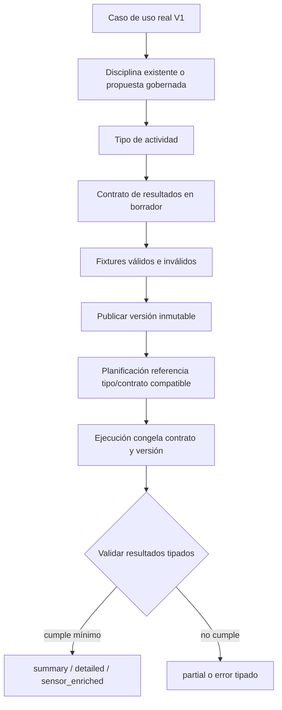

#### Alta de disciplina o tipo de actividad

1. Existe un caso de uso y vocabulario de dominio concreto.
2. Se reutiliza una disciplina existente o se propone una nueva con significado estable.
3. El tipo de actividad define targets y resultados compatibles.
4. Se publica al menos un contrato de resultados con fixtures y pruebas.
5. Solo entonces puede certificar resultados en nuevas ejecuciones.
6. No se crean columnas universales, EAV o JSON abierto para evitar el contrato.

#### Uso desde Planificación

1. Una plantilla/versión selecciona disciplina y tipo compatibles.
2. Sus pasos pueden referenciar movimientos, equipamiento y unidades.
3. El contenido planificado conserva versiones/snapshots propios.
4. Actualizar un alias o deprecar un movimiento no cambia la prescripción histórica.

#### Uso desde Ejecución

1. La sesión declara disciplina, tipo de actividad y contrato/version congelados.
2. `finalize_execution` valida envelope, unidades, mínimos y estructuras tipadas.
3. Si no alcanza `summary`, permanece `partial` y no alimenta progresión precisa.
4. Una nueva versión de contrato no revalida o modifica sesiones anteriores.
5. Corregir una observación base invalida/recalcula derivados, pero no cambia el contrato aplicado.

### 7.13 Resultados derivados y algoritmos

Ritmo, velocidad, volumen, récords, adherencia y otros valores calculables no se capturan como una segunda verdad cuando se derivan de observaciones base.

Si se materializan, Ejecución conserva:

- código y versión de algoritmo;
- inputs y revisiones utilizados;
- timestamp y estado de vigencia;
- clasificación de privacidad más restrictiva de los inputs;
- capacidad de invalidación y recálculo.

Catálogo puede gobernar códigos, dimensiones y semántica del derivado. El valor, ownership personal y ciclo de recálculo pertenecen a Ejecución.

### 7.14 Reglas de estructuras y extensibilidad

- Los resultados operativos frecuentes usan tablas/estructuras, valores y unidades tipados.
- No existe una tabla universal `results(type, value, metadata)` para todas las modalidades.
- JSONB puede conservar metadata versionada, reglas publicadas, payload original temporal o extensiones experimentales.
- Todo JSONB de dominio tiene `schema_version`.
- Distancia, duración, carga, repeticiones, targets, relaciones, filtros, progreso o RLS no dependen solo de claves JSON.
- Una clave experimental que se vuelve operativa se promueve a estructura tipada.
- Una modalidad nueva requiere contrato, fixtures, pruebas, privacidad y estructuras propias antes de certificarse.
- Una disciplina no obtiene automáticamente schema, tabla o base independiente.

### 7.15 Dependencias y contratos con otros dominios

| Dominio o sistema | Catálogo entrega | Catálogo recibe | Regla de frontera |
| --- | --- | --- | --- |
| Identidad | Disciplinas/movimientos/equipamiento referenciables por perfiles | Autor/owner canónico de definiciones privadas | Practicar una disciplina es atributo del perfil, no ownership del catálogo global |
| Organizaciones | Namespace, definiciones privadas y procedencia de activos | Organización activa y actor autorizado | Contenido privado no se publica o descubre automáticamente |
| Privacidad | Recursos/campos estables que pueden clasificarse en scopes | Clasificación, restricciones y reglas para derivados/medios | Añadir catálogo no amplía grants ni habilita datos sensibles |
| Planificación | Disciplinas, tipos, movimientos, unidades y contratos compatibles | Referencias a versiones/definiciones usadas en contenido | Catálogo no contiene orden, targets, programa o calendario personal |
| Ejecución | Contrato/version, unidades y semántica para validar | Evidencia de compatibilidad, errores y necesidades de nuevas modalidades | Catálogo no almacena resultados personales ni reinterpreta historia |
| CI/fixtures | Contratos y casos válidos/inválidos | Resultados reproducibles de validación | No se publica una modalidad certificable sin fixtures y pruebas |
| Marketplace futuro | En el futuro podría ofrecer definiciones elegibles | ADR, ownership, licencias, privacidad y modelo propios | V1 no expone búsqueda, listing, review ni publicación comercial |

### 7.16 Invariantes de Catálogo

1. Disciplina, tipo de actividad, movimiento, plantilla, sesión y resultado son conceptos distintos.
2. “Ejercicio” y “rutina” son términos de interfaz para fuerza, no raíces universales.
3. Toda ejecución declara disciplina y tipo de actividad compatibles.
4. El contrato operativo se selecciona por tipo de actividad, no solo por disciplina.
5. No toda actividad requiere movimiento, set, repetición, sensor o segmento.
6. Añadir una disciplina no exige columnas incompatibles en la sesión universal.
7. Los códigos globales usados históricamente no cambian de significado.
8. Deprecar, fusionar o reemplazar conserva aliases y referencias históricas.
9. Catálogo global, organizacional privado y personal privado conservan ownership y visibilidad separados.
10. Usar contenido privado no lo vuelve público, descubrible o comercializable.
11. Plantillas y programas no viven en Catálogo aunque referencien sus definiciones.
12. Movimientos son opcionales y no contienen prescripción o resultados observados.
13. Unidades físicas son tipadas; dinero no comparte su catálogo.
14. `NULL` no se convierte en cero ni una unidad cambia factores retroactivamente.
15. Todo contrato publicado es inmutable y cada ejecución congela su versión.
16. `completed`, `partial`, `summary`, `detailed` y `sensor_enriched` no son sinónimos.
17. `partial` no certifica el mínimo histórico ni alimenta progresión precisa.
18. Un nivel superior cumple los mínimos del inferior.
19. Targets planificados y resultados ejecutados permanecen separados.
20. Una modalidad no certifica resultados hasta tener contrato, fixtures y pruebas.
21. Los resultados usados operacionalmente no dependen únicamente de JSON/EAV.
22. Un derivado conserva algoritmo/versión y la clasificación más restrictiva de sus inputs.
23. `sensor_enriched` no habilita conectores, credenciales, raw streams, GPS o biometría productivos.
24. V1 no crea DDL, permisos o endpoints de marketplace, booking, commerce o integraciones por existir entradas de catálogo.

### 7.17 Escenarios que debe superar Catálogo

| Escenario | Resultado obligatorio |
| --- | --- |
| Sesión de fuerza | Usa tipo/contrato de fuerza y resultados tipados sin imponerlos a otras disciplinas |
| Carrera continua | Registra duración/distancia sin movimiento o repeticiones ficticias |
| Running por intervalos detallado | Conserva laps ordenados y contrato exacto del tipo |
| Práctica de yoga summary | Se valida por duración/estado sin wearable o sets |
| Yoga/movilidad detailed | Valida secuencia, lado y cantidad cuando corresponda |
| Sesión híbrida | Usa segmentos de familias diferentes y valida cada contrato compatible |
| Movimiento privado de una organización | Solo aparece en contextos autorizados y no en búsquedas públicas |
| Persona usa movimiento propio en autoentrenamiento | Mantiene ownership personal sin crear código global |
| Movimiento global se depreca | Nuevas selecciones usan sucesor; sesiones/plantillas históricas siguen interpretables |
| Alias cambia de presentación | No crea otra identidad ni reescribe resultados históricos |
| Publicación de contrato v2 | Nuevas ejecuciones pueden seleccionarlo; las anteriores conservan v1 |
| Sesión completada con detalle insuficiente | Puede quedar `summary` o `partial`; no se finge `detailed` |
| `sensor_enriched` sin `detailed` válido | No se certifica como nivel enriquecido |
| Importación incompleta | Permanece `partial` y no fuerza datos dentro de otro contrato |
| Corrección de dato base | Recalcula derivados con algoritmo versionado sin cambiar el contrato histórico |
| Se añade una disciplina nueva | No se agregan columnas universales falsas ni base separada por disciplina |
| Se agrega un tipo llamado “clase” | No aparecen reservas, cupos o asistencia en V1 |
| Fixture usa sensor controlado | Valida extensibilidad sin crear conector o raw store productivo |

### 7.18 Decisiones diferidas al modelo lógico y Fase 3

Estas decisiones deben cerrarse manteniendo las fronteras anteriores:

- catálogo global exacto de disciplinas y tipos requeridos por fixtures V1;
- política y necesidad real de extensiones privadas de tipos de actividad;
- jerarquía, tags y taxonomías gobernadas por disciplina;
- modelo de aliases, traducciones, variantes, fusiones y sucesores;
- ownership, licencia, moderación y disposición de medios;
- catálogo inicial de equipamiento y su relación con movimientos/perfiles;
- dimensiones, unidades canónicas, conversiones, precisión y reglas de rango;
- contratos tipados de targets compatibles con cada tipo de actividad;
- representación ejecutable y versionada de reglas de contratos de resultados;
- selección del contrato default por vigencia y compatibilidad;
- comandos y autoridad para publicar, deprecar, fusionar o archivar;
- snapshots mínimos necesarios cuando se dispone una definición privada referenciada;
- estructuras tipadas exactas por modalidad y promoción de campos experimentales;
- nombres físicos, constraints, índices, búsquedas privadas y RLS;
- fixtures contractuales y criterios de certificación en CI.

No se pueden resolver con enums rígidos difíciles de retirar, columnas booleanas por disciplina, un JSON/EAV universal, códigos libres sin namespace, movimientos obligatorios, reinterpretación retroactiva o tablas de marketplace “por si acaso”.

## 8. Dominio de Planificación

### 8.1 Responsabilidad

Planificación mantiene el contenido prescriptivo versionado y el trabajo que una persona debía realizar: plantillas, programas, composiciones, asignaciones, revisiones personales y sesiones planificadas.

El dominio responde **qué estaba previsto, qué versión exacta se entregó, quién lo prescribió, bajo qué contexto se gestiona y qué ocurrencia representa el cumplimiento**. Nunca sobrescribe la prescripción con lo que realmente ocurrió.

### 8.2 Qué pertenece a Planificación

- identidad estable, ownership y procedencia de plantillas de sesión;
- borradores y versiones publicadas de plantillas;
- pasos ordenados, bloques, instrucciones y targets tipados;
- identidad estable, ownership y procedencia de programas;
- borradores y versiones publicadas de programas;
- composición exacta de versiones de plantilla dentro de cada versión de programa;
- asignación de una versión exacta de programa a una persona;
- origen inmutable y contexto efectivo de gestión de la asignación;
- snapshots y revisiones auditables de prescripción personal;
- calendario básico y sesiones planificadas;
- vínculo numerado entre sesiones planificadas y ejecuciones usadas como intentos;
- selección primaria para cumplimiento y progresión del plan;
- estados de cumplimiento, omisión, cancelación y pausa de lo planificado;
- desacoplamiento de asignaciones al terminar una relación;
- decisión personal de continuar o terminar una asignación desacoplada;
- atribución y límites de uso del contenido entregado.

### 8.3 Qué no pertenece a Planificación

| Concepto excluido | Dominio responsable | Motivo |
| --- | --- | --- |
| Disciplina, tipo de actividad, movimiento, equipamiento o unidad | Catálogo | Planificación referencia definiciones gobernadas, no las redefine por plantilla |
| Contrato de resultados | Catálogo | La prescripción selecciona compatibilidad; el contrato publicado conserva autoridad semántica |
| Sesión ejecutada, segmento, set, lap, métrica o resultado observado | Ejecución | Lo real es un hecho distinto y nunca reemplaza targets o pasos |
| Estado real, procedencia o corrección de una ejecución | Ejecución | Planificación solo conserva el vínculo de intento y cuál cuenta para el plan |
| Persona, perfil o Fitness ID | Identidad | Las asignaciones referencian una persona canónica y forman parte de su historial |
| Organización, membresía o capacidad | Organizaciones | Son requisitos para que el actor gestione contenido bajo un contexto |
| Relación y profesional asignado | Relaciones | Planificación registra referencias de origen/gestión sin ser fuente del vínculo de servicio |
| Consentimiento, grant o scope | Privacidad | Una asignación o programa aceptado no concede acceso a datos |
| Intención de programa todavía no aceptada | Identidad | La propuesta vive en la invitación hasta materializarse |
| Compra, precio, licencia comercial o membresía | Dominio futuro de comercio | Comprar y asignar son hechos distintos; comercio está fuera de V1 |
| Clase ofertada, reserva, recurso o asistencia | Dominio futuro de booking | Una sesión personal planificada no es una clase comercial |
| Listing, publicación o marketplace | Dominio futuro | Contenido privado/versionado no es automáticamente descubrible o vendible |

### 8.4 Separación entre identidad estable, versión y uso personal

Planificación distingue tres niveles:

| Nivel | Propósito | Mutabilidad |
| --- | --- | --- |
| Identidad estable | Conserva ownership, procedencia y ciclo general de plantilla/programa | Metadatos compatibles y estado general; no contiene el contenido histórico ejecutable |
| Versión publicada | Congela contenido completo y referencias exactas | Inmutable; una corrección o progresión crea otra versión |
| Uso personal | Asignación, snapshot, revisión y sesiones de una persona | Evoluciona mediante comandos/eventos auditables sin editar el master |

Publicar una nueva versión de plantilla no cambia programas existentes. Publicar una nueva versión de programa no cambia asignaciones anteriores. Adaptar para una persona no modifica plantilla o programa master.

### 8.5 Plantilla y versión de plantilla

Una **plantilla de sesión** es la identidad reutilizable de una unidad de entrenamiento. En producto puede llamarse rutina, entrenamiento, secuencia, práctica o workout según la disciplina.

La plantilla estable conserva:

- owner y organización de origen cuando aplique;
- autor humano o de sistema;
- procedencia y estado general;
- relaciones de derivación y licencias aplicables.

La **versión de plantilla** congela:

- nombre presentado;
- disciplina y tipo de actividad;
- instrucciones y duración estimada;
- pasos, orden, bloques y relaciones entre pasos;
- targets tipados y unidades;
- medios esenciales necesarios para interpretar lo prescrito;
- contrato/compatibilidad necesaria para planificar y contrastar ejecución;
- actor, fecha de publicación, `content_hash` y versión de origen.

#### Ciclo de publicación

```text
borrador mutable → publicación explícita → versión inmutable → retirada para nuevos usos
       ↑                                        │
       └──────── nuevo borrador derivado ───────┘
```

Reglas:

- no se crea una versión por cada autosave;
- el borrador usa control de concurrencia;
- publicar valida estructura, referencias, targets, unidades y compatibilidad;
- el número es entero y consecutivo por plantilla, no SemVer;
- reintentos concurrentes no producen dos versiones equivalentes o el mismo número;
- `derived_from_version_id` conserva procedencia de adaptaciones reutilizables;
- una versión publicada puede retirarse para nuevos usos, pero no editarse o eliminarse si está referenciada.

### 8.6 Paso y target planificados

Un paso es una instrucción o bloque ordenado dentro de una versión de plantilla. Puede expresar:

- movimiento o instrucción opcional;
- posición, bloque, superset, ronda o secuencia;
- repeticiones, duración o distancia objetivo;
- intensidad, zona, carga o rango objetivo;
- recuperación y descanso;
- lado, técnica u otra semántica compatible con la modalidad.

Los targets de fuerza, endurance, intervalos, rondas y movilidad usan estructuras tipadas. JSONB solo se admite para extensiones versionadas poco consultadas; no sustituye targets, relaciones o valores usados en validación, filtros, progreso o RLS.

Un paso planificado nunca contiene el resultado real. “Correr 400 m en zona 4” es prescripción; “corrió 397 m en 1:42” pertenece a Ejecución.

### 8.7 Programa y versión de programa

Un **programa** es la identidad lógica de un plan a lo largo del tiempo. Puede combinar fases, semanas, varias disciplinas, plantillas y reglas de progresión.

La **versión de programa** es una composición publicada e inmutable que congela:

- posición y orden de cada unidad;
- fase, semana o desplazamiento temporal;
- `session_template_version_id` exacto;
- reglas de calendario/progresión incluidas en V1;
- nombre y contexto que deben permanecer en el historial;
- actor, organización, procedencia y publicación.

Un programa borrador solo puede seleccionar versiones publicadas y elegibles de plantilla. Adoptar una nueva versión de plantilla requiere un nuevo borrador y otra versión de programa; nunca se resuelve “la última” durante una consulta histórica.

### 8.8 Asignación y contexto de gestión

Una asignación entrega a una persona una versión exacta de programa con fecha, propósito y contexto. Forma parte de su historial, pero no le transfiere ownership del programa master.

Conserva dos contextos separados:

- **origen inmutable:** versión, organización/profesional autor, relación de origen, fecha y procedencia;
- **gestión efectiva:** actor o relación que actualmente puede programar, adaptar o dar seguimiento.

Una asignación puede originarse:

- personalmente para autoentrenamiento;
- por profesional con relación, membresía, capacidad y permisos vigentes;
- desde una intención `program_assignment` aceptada, solo si su relación dependiente también fue aceptada;
- por automatización de sistema dentro de un flujo V1 explícitamente autorizado.

Una invitación no crea la asignación. La aceptación de programa no acepta scopes, pagos o términos. Si una operación profesional sobre la asignación requiere datos de la persona, también debe existir `relationship_training` y las demás condiciones de acceso.

Estados conceptuales mínimos:

```text
propuesta externa en Identidad
        ↓ aceptación válida
active_managed | active_personal
        ↓
paused | completed | ended
        ↓ fin de relación gestora
detached_pending_choice
        ├── continue_personally → active_personal
        └── end_assignment      → ended
```

Los estados físicos y transiciones completas se cerrarán después. No existe cambio silencioso de versión o gestor.

### 8.9 Revisión y snapshot de prescripción personal

Una adaptación específica para una persona no crea un override opaco ni edita la biblioteca. Genera una revisión auditable de prescripción vinculada a la asignación o sesión planificada.

Cada revisión conserva:

- versión/snapshot anterior;
- cambio tipado y resultado aplicable;
- actor, organización y relación cuando existan;
- motivo y timestamp;
- vigencia o sesión afectada;
- procedencia y autorización;
- vínculo con la versión de plantilla/programa de origen.

Las revisiones permiten modificar fecha, targets o instrucciones personales dentro de la autoridad vigente, pero no cambian lo que otros usuarios recibieron ni el contenido publicado. Una revisión futura tampoco reescribe ejecuciones ya realizadas.

### 8.10 Sesión planificada y calendario

Una sesión planificada es una ocurrencia concreta de trabajo previsto para una persona, en una fecha o ventana determinada. Puede derivarse de una asignación o crearse independientemente para autoentrenamiento.

Conserva:

- persona titular;
- asignación y versión de programa cuando apliquen;
- versión exacta de plantilla;
- revisión/snapshot de prescripción aplicable;
- fecha/ventana y zona horaria relevantes;
- organización, relación y actor de origen cuando apliquen;
- estado del plan separado de cualquier ejecución;
- historial de reprogramación, omisión, cancelación y pausa.

La agenda básica V1 no incluye clases, cupos, reservas, recursos, recurrencia comercial o asistencia. Generar ocurrencias desde una asignación es planificación personal, no booking.

### 8.11 Intentos y ejecución primaria

Una sesión planificada admite cero o múltiples ejecuciones vinculadas como intentos. Planificación conserva el vínculo; Ejecución conserva cada sesión real.

El vínculo de intento registra:

- sesión planificada y sesión ejecutada;
- número monotónico dentro de la planificada;
- rol del intento;
- actor/origen del vínculo;
- tiempo de vinculación;
- invalidación y motivo cuando apliquen;
- si es la primaria para cumplimiento/progresión.

Reglas:

1. una ejecución pertenece como máximo a una sesión planificada;
2. reanudar un intento `in_progress` o `paused` no crea otro;
3. iniciar otro intento mientras existe uno activo exige abandonar/cerrar el anterior o una excepción explícita;
4. como máximo una ejecución completada, válida y de la misma persona es primaria;
5. el primer intento completado se selecciona inicialmente como primario;
6. completar otro intento no reemplaza automáticamente al primario;
7. cambiar o invalidar la primaria conserva actor, motivo e historial;
8. invalidar la primaria no promueve silenciosamente otra;
9. adherencia cuenta como máximo un cumplimiento por sesión planificada;
10. actividad real puede contar todos los intentos válidos;
11. el cumplimiento dividido entre varias ejecuciones queda fuera de V1.

Estado operativo derivable de la sesión planificada:

| Condición | Estado |
| --- | --- |
| Sin intentos y dentro del calendario | `scheduled` |
| Existe un intento activo | `in_progress` |
| Solo existen intentos abandonados | `attempted` |
| Existe una primaria completada y válida | `completed` |
| Cancelada antes de ejecutar | `cancelled` |
| Marcada como no realizada | `skipped` |

Si se materializa este estado por rendimiento, debe reconciliarse con los intentos; un `completed_at` aislado no demuestra qué ejecución cumplió la prescripción.

### 8.12 Entidades conceptuales

| Concepto | Definición conceptual | Fuente de verdad |
| --- | --- | --- |
| Plantilla de sesión | Identidad estable de contenido reutilizable con owner y procedencia | Planificación |
| Borrador de plantilla | Área mutable de trabajo antes de publicación | Planificación |
| Versión de plantilla | Contenido ejecutable publicado, completo e inmutable | Planificación |
| Paso/target planificado | Instrucción y objetivo tipados que pertenecen a una versión | Planificación |
| Programa | Identidad estable de un plan estructurado | Planificación |
| Borrador de programa | Composición mutable previa a publicación | Planificación |
| Versión de programa | Composición publicada e inmutable de versiones exactas de plantilla | Planificación |
| Asignación | Entrega de una versión exacta a una persona con origen y gestión | Planificación; la persona es dueña lógica de su historial |
| Revisión de prescripción | Cambio personal tipado y auditable sin editar masters | Planificación |
| Sesión planificada | Ocurrencia personal de trabajo previsto y su snapshot aplicable | Planificación |
| Vínculo de intento | Relación numerada entre plan y ejecución, incluida selección primaria | Planificación para cumplimiento; Ejecución para el hecho real |
| Evento de planificación | Publicación, asignación, reprogramación, pausa, cancelación, desacoplamiento o decisión personal | Planificación |

### 8.13 Matriz de ownership operativo

| Concepto | Dueño lógico | Quién crea | Quién modifica | Quién consulta |
| --- | --- | --- | --- | --- |
| Plantilla/programa estable | Autor, persona u organización bajo cuyo contexto se creó, según reglas contractuales | Persona, profesional/organización o proceso autorizado con procedencia | Owner/actor autorizado cambia borrador/metadatos compatibles y archiva; no edita contenido publicado | Owner y actores autorizados; asignar no vuelve público el master |
| Borrador | Mismo owner del master | Autor o sistema autorizado | Colaboradores autorizados con control de concurrencia | Solo contexto privado autorizado; nunca persona asignada por el hecho de recibir otra versión |
| Versión publicada | Mismo owner intelectual/operativo del master | Operación explícita de publicación por actor autorizado | Inmutable; solo puede retirarse para nuevos usos o sucederse con otra versión | Owner y consumidores autorizados; personas asignadas ven el contenido/snapshot que recibieron |
| Paso/target | Mismo owner de la versión que lo contiene | Autor del borrador | Mutable solo antes de publicar; después cambia mediante otra versión | Mismos consumidores de la versión, según grants/visibilidad |
| Asignación | La persona respecto de su historial; master conserva owner y autoría original | Persona o profesional/sistema autorizado; intención aceptada cuando aplique | Gestor vigente mediante revisiones; la persona controla continuidad tras desacoplar | Persona; profesional asignado con relación/grant/capacidad; organización conserva evidencia mínima, no acceso universal |
| Revisión de prescripción | La persona respecto de su plan; autor conserva autoría del cambio | Persona o profesional autorizado dentro del contexto vigente | Append-only o nueva revisión; no se sobreescribe para ocultar el original | Persona y actores que puedan gestionar/consultar esa asignación bajo autorización vigente |
| Sesión planificada | La persona | Generador de calendario, persona o profesional autorizado | Persona/gestor vigente reprograman, pausan, omiten o cancelan mediante eventos; targets no se sustituyen por resultados | Persona; profesional autorizado según relación y scope |
| Vínculo de intento/primaria | La persona respecto de cumplimiento; Planificación custodia selección | Comando de inicio/vinculación autorizado | Cambiar/inactivar primaria exige comando explícito, validación y auditoría | Persona; gestor autorizado; analítica usa proyecciones compatibles |
| Evento de planificación | Sujeto/owner del recurso afectado; Allfit custodia trazabilidad | Todo comando válido | Append-only o corrección equivalente con before/after | Persona, owners, auditoría y actores autorizados según finalidad |

### 8.14 Matriz de ciclo de vida y disposición

| Concepto | Ciclo / evento de corte | Qué se conserva | Qué inicia disposición | Resultado esperado / suspensión válida |
| --- | --- | --- | --- | --- |
| Plantilla/programa estable | Activo → archivado/retirado | Identidad, owner, autoría y procedencia; versiones referenciadas | Archivo del owner, cierre, fin de licencia o disposición aplicable | Archivar sin romper referencias; eliminar contenido no referenciado según política |
| Borrador | Creado → editado → publicado o descartado | Solo mientras tenga finalidad de edición/auditoría breve | Descarte, abandono, publicación o vencimiento | `delete` tras ventana aplicable; hold solo sobre target concreto |
| Versión publicada | Publicada → retirada para nuevos usos | Contenido exacto, hash, actor y referencias necesarias | Retiro, fin de licencia o disposición del owner | Inmutable y resoluble mientras esté referenciada; no habilita nuevos usos si está retirada |
| Asignación | Propuesta externa → activa gestionada/personal → pausada/completada/terminada | Versión, snapshot, revisiones, origen, gestión y decisiones | Fin personal, terminación de relación, cierre de cuenta o política propia | Permanece en historial; terminar relación desacopla, no borra. Supresión sigue categoría/política personal |
| Revisión de prescripción | Creada → vigente/sucedida/invalidada | Original, cambio, actor, motivo y vigencia | Disposición de asignación o vencimiento de política | Conservar para explicar historial; restringir/eliminar por política sin reescribir ejecuciones |
| Sesión planificada | Programada → activa/intentada → completada/omitida/cancelada/pausada | Prescripción, fecha, origen, intentos e historial material | Cancelación, fin de asignación, cierre o supresión válida | Futuras no iniciadas pueden cancelarse; iniciadas/completadas e intentos permanecen según política |
| Vínculo de intento | Creado → primario/no primario → invalidado o reemplazado como selección | Todos los intentos reales y eventos de selección | Disposición de sesión/ejecución según políticas coordinadas | No borrar retries para simular un solo intento; historial mantiene fuente de adherencia |
| Evento de planificación | Append-only durante vida del recurso | Actor, motivo, before/after y tiempo | Vencimiento de auditoría/finalidad | Eliminar, anonimizar o retener restringido por categoría; nunca conserva permiso operativo |

Los masters propios de una organización no se borran por cerrar la cuenta de una persona asignada. Del mismo modo, conservar un master no permite a la organización seguir navegando la agenda o ejecuciones personales después de terminar la relación.

### 8.15 Flujo de publicación y asignación

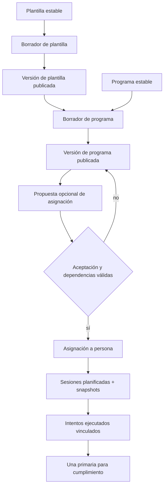

#### Publicación de plantilla

1. El autor edita un borrador.
2. La publicación valida referencias de Catálogo, targets, unidades y estructura.
3. La transacción asigna número consecutivo y `content_hash`.
4. Pasos/targets quedan congelados bajo la versión.
5. Un cambio posterior crea otro borrador y otra versión.

#### Publicación de programa

1. El borrador compone versiones exactas y publicadas de plantilla.
2. La publicación congela posición, calendario relativo y referencias.
3. Una plantilla v2 posterior no modifica el programa publicado con v1.
4. Adoptar v2 exige otra versión de programa.

#### Asignación profesional

1. El backend valida persona, organización, relación, profesional, membresía y capacidad.
2. Si viene de invitación, valida aceptación independiente del programa y su relación dependiente.
3. Se referencia una versión exacta de programa y se congela origen/gestión.
4. Se genera calendario básico con sesiones que preservan versión y snapshot.
5. Cualquier acceso o seguimiento de datos personales aplica grants/scopes por separado.

### 8.16 Inicio, reanudación y concurrencia de intentos

El comando de inicio debe bloquear o serializar la sesión planificada, evaluar intentos activos y usar idempotency key:

1. si existe un intento `in_progress` o `paused`, devuelve ese intento para reanudar;
2. si no existe, crea una ejecución en Ejecución y el siguiente vínculo numerado en una transacción coordinada;
3. doble clic, retry de red o sincronización offline con la misma intención no crean otro intento;
4. dos transacciones no pueden asignar el mismo número o dos primarias;
5. vincular después una sesión autónoma requiere confirmación explícita de la persona y no puede evadir una denegación de Privacidad.

La ejecución mantiene su propio estado y resultados. Planificación no modifica esos hechos para resolver inconsistencias; usa comandos explícitos de vínculo, selección o invalidación con auditoría.

### 8.17 Terminación de relación y continuidad

Cuando Relaciones alcanza su `effective_at`, cada asignación `active_managed` originada y administrada por esa relación pasa exactamente una vez a `detached_pending_choice`.

La transición:

- conserva `program_version_id`, snapshot, revisiones, origen y atribución;
- elimina autoridad profesional de edición, reprogramación, generación, anotación y seguimiento;
- pausa generación de sesiones, recordatorios y cálculo de incumplimiento;
- conserva sesiones completadas/iniciadas y sus intentos;
- mantiene sesiones futuras materializadas visibles para la persona, pero pausadas;
- no copia la asignación ni cambia su versión;
- no interpreta silencio como continuidad personal.

Solo la persona decide:

| Decisión | Resultado |
| --- | --- |
| Sin decisión | Permanece `detached_pending_choice`; no genera sesiones ni penaliza adherencia |
| `continue_personally` | La misma asignación pasa a `active_personal` y reanuda calendario bajo control personal |
| `end_assignment` | Pasa a `ended` y cancela únicamente sesiones futuras no iniciadas |

Una sesión iniciada puede ser terminada por la persona, pero el profesional anterior no puede contribuir después del corte. Cancelar nunca elimina ejecuciones, intentos o resultados existentes.

Continuar concede uso personal del contenido exacto asignado, pero no:

- ownership del programa master;
- acceso a borradores, nuevas versiones o metodología privada;
- derecho de publicación, venta o redistribución;
- acceso a notas privadas de la organización.

Otra organización no hereda gestión ni grants. Adoptar profesionalmente el plan requiere nueva relación/grants y acciones explícitas de la persona y el nuevo profesional.

### 8.18 Dependencias y contratos con otros dominios

| Dominio o sistema | Planificación entrega | Planificación recibe | Regla de frontera |
| --- | --- | --- | --- |
| Identidad | Asignaciones, agenda y contenido exacto incorporado al Fitness ID | Persona canónica y actor/owner de contenido privado | Una propuesta no crea asignación antes del registro/aceptación |
| Organizaciones | Masters y acciones con organización/actor de origen | Organización, membresía y capacidades vigentes | Organización conserva masters propios, no ownership de agenda/historial personal |
| Relaciones | Contexto de gestión y asignaciones vinculadas; confirmación de desacoplamiento | Relación, profesionales asignados y evento efectivo de terminación | Relación terminada no gestiona planes; una nueva no hereda gestión |
| Privacidad | Recursos/fields de prescripción sujetos a proyección autorizada | Grants, scopes, access levels, revocaciones y denegaciones | Aceptar programa no concede datos; `relationship_training` limita operación profesional |
| Catálogo | Referencias exactas usadas por plantillas/pasos | Disciplinas, tipos, movimientos, unidades y contratos compatibles | Planificación no redefine catálogo ni selecciona “latest” históricamente |
| Ejecución | Prescripción, planned session y selección primaria para contraste | Sesiones ejecutadas, estado, validez y referencias de intentos | Targets no se sobrescriben con resultados; ejecución puede ser autónoma |
| Notificaciones/jobs | Estado efectivo para calendario, recordatorios y adherencia | Confirmaciones idempotentes de generación/pausa/cancelación | `detached_pending_choice` y sesiones pausadas no generan efectos automáticos |
| Disposición/auditoría | Categoría, owner, referencias y eventos | Políticas, holds y confirmaciones | Retener versión/master no mantiene acceso operativo a persona |

### 8.19 Invariantes de Planificación

1. Plantilla estable, versión de plantilla, programa, versión, asignación y sesión planificada son entidades diferentes.
2. Solo los borradores son mutables; toda versión publicada es inmutable.
3. Pasos, targets e instrucciones pertenecen a una versión exacta de plantilla.
4. Una versión de programa referencia versiones exactas y publicadas de plantilla.
5. Ninguna consulta histórica resuelve “la última versión”.
6. Publicar una plantilla nueva no actualiza programas, asignaciones o sesiones existentes.
7. Publicar un programa nuevo no actualiza asignaciones existentes.
8. Una adaptación reutilizable crea versión derivada; una adaptación personal crea revisión/snapshot.
9. Una versión referenciada puede retirarse para nuevos usos, pero no editarse o eliminarse físicamente.
10. Una asignación siempre referencia una versión exacta de programa.
11. Propuesta de programa y asignación materializada son hechos distintos.
12. Una asignación de invitación requiere aceptación propia y relación dependiente válida.
13. Aceptar una asignación no concede scopes, pagos, términos o usos secundarios.
14. La asignación separa origen inmutable y gestión efectiva.
15. La persona no puede consultar o ejecutar una asignación ajena.
16. Una sesión planificada preserva la prescripción aplicable y no contiene resultados reales.
17. Una sesión ejecutada se vincula a máximo una planificada; una planificada admite varios intentos.
18. Reanudar no crea intento; números de intento son únicos y monotónicos.
19. Solo una ejecución completada, válida y de la misma persona puede ser primaria.
20. Completar otro intento no cambia la primaria automáticamente.
21. Invalidar la primaria no promueve otra silenciosamente.
22. Adherencia cuenta máximo un cumplimiento; actividad real puede contar múltiples intentos.
23. V1 no combina varias ejecuciones como cumplimiento parcial de una prescripción.
24. Lo planificado y lo ejecutado nunca se sobrescriben entre sí.
25. Terminar una relación desacopla una vez cada asignación gestionada y corta autoridad profesional.
26. Desacoplar no cambia versión, snapshot, origen o atribución.
27. `detached_pending_choice` no genera sesiones, recordatorios o incumplimiento.
28. Solo la persona continúa o termina una asignación desacoplada.
29. Continuar reutiliza la misma asignación; no crea copia divergente.
30. Terminar cancela solo sesiones futuras no iniciadas y conserva historia.
31. Otra organización no hereda gestión, grants, notas o acceso a nuevas versiones.
32. Contenido privado/versionado no implica producto, compra, booking o marketplace.

### 8.20 Escenarios que debe superar Planificación

| Escenario | Resultado obligatorio |
| --- | --- |
| Se publica plantilla v1 y luego se edita | La edición produce otro borrador/v2; v1 permanece inmutable |
| Programa publicado usa plantilla v1 y aparece v2 | El programa y sus asignaciones continúan apuntando a v1 |
| Se retira una versión referenciada | No se selecciona para nuevos usos, pero el historial sigue resoluble |
| Persona recibe una adaptación | Se crea revisión/snapshot personal sin editar master ni afectar a otros |
| Profesional publica bajo una organización | Se conservan owner, organización y actor de origen |
| Persona crea plan privado | Mantiene ownership personal y no lo publica en marketplace |
| Invitación propone relación y programa; persona rechaza programa | Se crea la relación aceptada, no la asignación |
| Persona acepta programa sin relación dependiente válida | No se materializa y se informa la dependencia fallida |
| Profesional intenta asignar sin membresía/capacidad | Se deniega sin crear asignación parcial |
| Se genera calendario | Cada sesión conserva versión exacta y snapshot aplicable |
| Persona reprograma una sesión | Se conserva evento/fecha anterior; no se cambia la plantilla publicada |
| Doble inicio con misma idempotency key | Devuelve el mismo intento |
| Persona pausa y reanuda | Reutiliza la misma ejecución y no incrementa intento |
| Abandona intento 1 y completa intento 2 | Intento 2 queda primario; ambos permanecen en historial |
| Completa intento 3 | No reemplaza automáticamente al intento 2 |
| Se invalida la primaria | No se promueve otra sin decisión explícita |
| Dos inicios concurrentes | No producen mismo número ni dos intentos activos implícitos |
| Sesión espontánea | Existe en Ejecución sin sesión planificada |
| Termina relación con asignación activa | La misma asignación queda `detached_pending_choice`, sin efectos automáticos |
| Persona no decide continuidad | Futuras siguen pausadas y no afectan adherencia |
| Persona continúa personalmente | Reanuda la misma asignación/snapshot sin acceso profesional anterior |
| Persona termina la asignación | Cancela futuras no iniciadas y conserva sesiones/intentos existentes |
| Nueva organización quiere adoptar el plan | Requiere acción explícita, nueva relación/grants y no recibe master/notas privadas |

### 8.21 Decisiones diferidas al modelo lógico y Fase 3

Estas decisiones deben cerrarse manteniendo versionado, ownership y continuidad:

- colaboración, locking y estados exactos de borradores;
- comandos, permisos y validaciones de publicación/retiro;
- numeración, hashes, detección de publicaciones equivalentes y concurrencia;
- estructuras tipadas exactas de pasos/targets por modalidad;
- modelo de fases, semanas, reglas de progresión y calendario relativo de programa;
- estados/transiciones completos de programa, versión, asignación y sesión planificada;
- alcance y autoridad de revisiones de prescripción personales;
- reglas de generación, reprogramación, timezone y materialización de calendario;
- límites de asignaciones simultáneas y conflictos de agenda;
- comandos de inicio/reanudación/abandono, locks e idempotencia de intentos;
- autoridad y UX para cambiar o resolver una primaria inválida;
- cálculo/versionado de adherencia y progresión desde la primaria;
- coordinación transaccional/outbox entre terminación, pausa, jobs y notificaciones;
- adopción explícita de una asignación por otra relación;
- snapshots mínimos, licencias y disposición de contenido referenciado;
- RLS, contratos HTTP, índices, constraints y reconciliación de estados materializados.

No se pueden resolver editando versiones publicadas, usando referencias a “latest”, guardando overrides personales en JSON opaco, copiando asignaciones al cambiar gestión, sobrescribiendo targets con resultados o cancelando historial al terminar una relación.

## 9. Dominio de Ejecución

### 9.1 Responsabilidad

Ejecución mantiene los hechos reales del entrenamiento de una persona: sesiones iniciadas o realizadas, segmentos, resultados observados, procedencia, validación, revisiones y métricas derivadas.

El dominio responde **qué ocurrió realmente, quién o qué lo capturó, con qué nivel de detalle, bajo qué contrato se validó y cómo evolucionó su interpretación sin destruir el original**.

La persona es dueña lógica de su historial. Un profesional, dispositivo, importación o sistema puede aportar datos y conservar autoría/procedencia, pero no obtiene ownership sobre la ejecución completa.

### 9.2 Qué pertenece a Ejecución

- sesión ejecutada canónica y su envelope universal;
- estado real de la actividad y timestamps efectivos;
- procedencia, actor, dispositivo o proceso de captura;
- vínculo contextual opcional con relación, organización y planificación;
- segmentos ordenados o temporales de una sesión;
- resultados tipados por modalidad;
- observaciones personales, profesionales o de dispositivo asociadas a la ejecución;
- contrato y versión exactos aplicados a la ejecución;
- completitud alcanzada y estado/evidencia de validación;
- eventos de finalización y validación;
- propuestas de corrección sobre datos que el profesional no controla;
- revisiones append-only de capturas u observaciones;
- invalidaciones y exclusiones de análisis auditadas;
- resultados derivados, récords y tendencias con algoritmo/version;
- recálculo o invalidación de derivados cuando cambian inputs;
- historial de datos originales, revisiones y proyección canónica actual.

### 9.3 Qué no pertenece a Ejecución

| Concepto excluido | Dominio responsable | Motivo |
| --- | --- | --- |
| Plantilla, programa, paso o target previsto | Planificación | La prescripción se conserva separada de lo observado |
| Asignación, sesión planificada o selección primaria | Planificación | Ejecución conserva la sesión real; Planificación decide qué intento cuenta para el plan |
| Disciplina, tipo de actividad, movimiento, unidad o contrato publicado | Catálogo | Ejecución referencia definiciones y congela la versión aplicada |
| Persona, perfil o Fitness ID | Identidad | La ejecución pertenece a una persona canónica, pero no redefine su identidad |
| Organización, membresía, rol o capacidad | Organizaciones | Son condiciones del actor, no atributos de ownership de la sesión |
| Relación o asignación profesional efectiva | Relaciones | La sesión conserva contexto histórico sin convertirse en fuente del vínculo |
| Scope, grant, denegación o regla de visibilidad | Privacidad | Acceso y redacción no cambian el hecho ejecutado |
| Programa master o metodología privada | Planificación | Ejecutar o compartir resultados no publica propiedad intelectual de origen |
| Reserva, clase, pago, listing o integración productiva | Dominios futuros | V1 no crea esas capacidades alrededor de una sesión |

### 9.4 Ownership, autoría y procedencia

Toda captura conserva al menos:

```text
subject_person_id
recorded_by_person_id o actor de sistema/dispositivo
source
relationship_id opcional
organization_id opcional
recorded_at
```

Fuentes semánticas iniciales:

| Fuente | Significado | Autoridad de revisión |
| --- | --- | --- |
| `person_reported` | La persona registra o declara un valor propio | La persona; terceros proponen cambios |
| `professional_entry` | Un profesional captura un valor factual durante el servicio | El profesional autor revisa su captura bajo reglas auditadas |
| `professional_observation` | Evaluación u observación propia del profesional | Solo su autor la versiona/invalida directamente |
| `device_observation` | Dispositivo/importación aporta una medición | Raw inmutable; normalización o exclusión se registra aparte |
| `system_derived` | Algoritmo calcula un valor desde otros hechos | Sistema recalcula con algoritmo/version; nadie lo edita manualmente |

`recorded_by` identifica quién digitó o materializó el dato; no cambia su origen semántico. Si un profesional transcribe “la persona reporta RPE 8”, la fuente continúa siendo personal y el profesional queda como actor capturador.

Autoría y procedencia determinan qué correcciones son posibles, pero no conceden acceso. Privacidad sigue evaluando relación, scope, nivel y propósito.

### 9.5 Sesión ejecutada y envelope universal

Una sesión ejecutada es el hecho histórico de que una persona inició o realizó una actividad en un intervalo real. Puede ser:

- autónoma o espontánea;
- iniciada desde una sesión planificada;
- repetición o retry de una prescripción;
- capturada por la persona;
- registrada por un profesional autorizado;
- observada por dispositivo o importación controlada.

Toda sesión canónica conserva como mínimo:

- persona titular;
- disciplina y tipo de actividad compatibles;
- `started_at`, `ended_at` o duración efectiva consistente;
- zona horaria original;
- estado real de ejecución;
- fuente, procedencia y actor/dispositivo;
- vínculo opcional con planificación, relación y organización;
- contrato y versión de resultados aplicados;
- completitud y validación alcanzadas.

Una importación sin persona vinculada permanece fuera del historial canónico hasta que su titular la autorice. En V1 no existe una ejecución canónica sin persona activa.

El contexto de organización o relación conserva procedencia histórica; no transfiere ownership ni mantiene acceso después de terminar el vínculo.

### 9.6 Estado, completitud y validación

Son dimensiones diferentes:

| Dimensión | Pregunta | Ejemplos conceptuales |
| --- | --- | --- |
| Estado de ejecución | ¿Qué ocurrió con la actividad? | `in_progress`, `paused`, `completed`, `abandoned`, `invalidated` |
| Completitud de resultados | ¿Cuánto detalle válido se capturó? | `partial`, `summary`, `detailed`, `sensor_enriched` |
| Validación | ¿Los datos cumplen el contrato y reglas aplicables? | pendiente, válida, rechazada/inválida según modelo lógico |
| Vínculo de intento | ¿Cómo se relaciona con una prescripción? | sin vínculo, intento numerado, primaria/no primaria |

Reglas:

- `completed` no implica `detailed` o `sensor_enriched`;
- una captura puede permanecer `partial` aunque la actividad haya terminado;
- `partial` no certifica el mínimo histórico ni alimenta adherencia/progresión precisa;
- un nivel superior cumple los mínimos del inferior;
- invalidar no elimina la sesión ni sus resultados originales;
- cambiar estado final, vínculo o primaria requiere comando explícito y auditable;
- `NULL` significa no capturado; cero representa un cero observado.

### 9.7 Segmentos de sesión

Un segmento es una parte ordenada o temporal de una ejecución. Permite representar:

- calentamiento y enfriamiento;
- bloque de fuerza;
- intervalo y recuperación;
- ronda;
- secuencia de movilidad/yoga;
- transición entre modalidades;
- partes de una sesión híbrida.

Cada segmento pertenece a una sola sesión, conserva orden/límites y puede declarar su propio tipo de actividad compatible. No se mueve entre sesiones y no es una plantilla o paso planificado, aunque pueda referenciar uno para contraste.

### 9.8 Resultados tipados por modalidad

“Resultado” es un concepto común, no una tabla universal polimórfica. Las estructuras consultadas, validadas o usadas para progreso permanecen tipadas.

| Familia | Resultados candidatos |
| --- | --- |
| Fuerza/calistenia | Sets, movimiento/paso, orden, repeticiones, carga, duración/distancia, RPE, RIR, tempo y estado |
| Running/endurance | Laps/intervalos, duración, distancia, ritmo/velocidad derivados, elevación, potencia o cadencia cuando el contrato lo permita |
| Yoga/movilidad | Secuencia, postura/movimiento, lado, duración, repeticiones, rango y dificultad percibida |
| Cross-training | Rondas, intervalos, time cap, repeticiones, carga y transiciones |
| Híbrido | Segmentos de familias diferentes con resultados propios y transiciones explícitas |
| Sensor controlado | Muestras temporales con tipo, tiempo, valor, unidad, fuente y calidad bajo contrato compatible |

Toda observación especializada conserva:

- sesión y, cuando aplique, segmento, paso o movimiento;
- orden o intervalo temporal;
- valor y unidad canónica;
- unidad original cuando corresponda;
- fuente, actor y momento;
- validez, calidad y revisiones.

Frecuencia cardiaca, GPS, ruta, ECG, biometría continua y raw de wearables no se vuelven productivos por existir una estructura de muestras. `sensor_enriched` solo se valida con fixtures controlados en V1.

### 9.9 Contrato y finalización de ejecución

Catálogo publica el contrato; Ejecución congela y aplica una versión exacta. Una versión futura no reinterpreta sesiones históricas.

El comando idempotente `finalize_execution` debe:

1. validar persona, sesión, actor y autoridad actual;
2. resolver o confirmar disciplina, tipo de actividad y contrato/version compatibles;
3. validar timestamps y envelope universal;
4. validar unidades, rangos y estructuras tipadas;
5. comprobar mínimos del nivel solicitado;
6. validar integridad entre sesión, segmentos, pasos, movimientos y detalles;
7. certificar el nivel realmente alcanzado o devolver errores tipados;
8. registrar evento de validación y estado final en una transacción;
9. emitir efectos idempotentes para Planificación y derivados;
10. no duplicar detalles o eventos ante reintentos.

Checks y FKs protegen reglas locales. Las reglas que cruzan tablas se validan dentro del comando, no mediante `CHECK` que consulte otras filas.

Si no alcanza `summary`, permanece `partial`. El sistema no completa métricas faltantes con cero ni certifica otro contrato para evitar el rechazo.

### 9.10 Ejecución autónoma e intento planificado

Una ejecución puede existir sin planificación. Si se origina desde una sesión planificada, Planificación crea o conserva el vínculo de intento numerado.

Desde Ejecución se exige:

- una sesión real se vincula como máximo a una planificada;
- el sujeto de ambas debe ser la misma persona;
- reanudar reutiliza la sesión real activa;
- abandonar y volver a empezar crea otra ejecución, no sobrescribe la anterior;
- todos los intentos reales válidos permanecen en el Fitness ID;
- completar un retry no cambia por sí solo la primaria;
- invalidar una sesión informa a Planificación, que deja la selección pendiente si era primaria;
- una sesión autónoma vinculada posteriormente requiere confirmación personal y conserva su procedencia;
- V1 no fusiona varias ejecuciones para simular cumplimiento dividido.

Ejecución no decide cuál intento cuenta para adherencia. Entrega estado y validez; Planificación custodia la primaria y la métrica de cumplimiento.

### 9.11 Correcciones según ownership y procedencia

No existe una capacidad genérica `manage_execution` ni un patch destructivo del historial.

| Categoría | Acción profesional permitida |
| --- | --- |
| Prescripción futura | Crear revisión en Planificación; no modificar ejecución pasada |
| Captura propia durante sesión activa | Crear/corregir con procedencia profesional |
| Captura propia después de completar | Revisión append-only, conserva original y notifica a la persona |
| Observación/nota profesional propia | Versionar o invalidar conservando historial |
| Valor declarado por la persona | Proponer corrección; requiere aceptación de la persona |
| RPE, dolor, sensación u otro dato subjetivo personal | No editar; comentar o solicitar actualización |
| Raw de dispositivo/importación | No modificar; reportar, excluir de análisis o normalizar aparte |
| Estado final, vínculo de intento o primaria | Propuesta o soporte restringido; nunca cambio silencioso |
| Récord o métrica derivada | Recalcular mediante algoritmo versionado; no editar manualmente |

Un profesional solo actúa si coinciden relación, grant, asignación profesional, membresía, capacidad, `access_level`, scope y procedencia.

#### Propuesta de corrección

Una propuesta conserva:

- target tipado;
- valor propuesto;
- motivo;
- actor, organización y relación;
- estado `pending`, `accepted`, `rejected`, `withdrawn` o `expired`;
- persona que decidió y timestamps.

Aceptar ejecuta un comando tipado que crea un evento de revisión y actualiza la proyección canónica. Rechazar, retirar o expirar no modifica el valor.

#### Evento de revisión

Toda revisión conserva original, before/after, actor, motivo, procedencia, relación y timestamp. La proyección actual puede cambiar; la evidencia histórica no desaparece.

El raw permanece inmutable. Una anomalía puede crear `excluded_from_analysis`, un dato normalizado separado y recálculo de derivados, nunca modificación del payload fuente.

### 9.12 Resultados derivados y progreso

Ritmo, velocidad, volumen, récords, adherencia compatible, tendencias y demás derivados no se guardan como segunda verdad manual cuando pueden calcularse desde observaciones base.

Si se materializan, conservan:

- código y versión de algoritmo;
- inputs exactos y revisiones usados;
- timestamp de cálculo;
- resultado y unidad;
- estado de vigencia;
- clasificación más restrictiva de los inputs;
- relación/scope de proyección cuando corresponda;
- capacidad de invalidación y recálculo.

Una revisión de input invalida o recalcula los derivados afectados. Un resultado `partial` no alimenta progreso que exija `summary` o `detailed`. Para planificación, adherencia utiliza únicamente la ejecución primaria válida.

Récords personales pueden considerar todos los intentos válidos según regla versionada, aunque cumplimiento del plan cuente solo uno.

### 9.13 Entidades conceptuales

| Concepto | Definición conceptual | Fuente de verdad |
| --- | --- | --- |
| Sesión ejecutada | Hecho real universal de actividad de una persona | Ejecución |
| Segmento | Parte ordenada/temporal de una sesión real | Ejecución |
| Resultado tipado | Observación factual especializada por modalidad | Ejecución; la persona es dueña lógica |
| Observación profesional | Evaluación propia y versionable de un profesional autorizado | Ejecución con autoría profesional |
| Medición de dispositivo | Observación con dispositivo, unidad, calidad y raw inmutable cuando exista | Ejecución para dato normalizado; fuente externa para raw |
| Evento de validación | Evidencia de contrato, nivel solicitado/alcanzado, errores y actor/job | Ejecución |
| Propuesta de corrección | Solicitud tipada sobre un dato que el profesional no controla directamente | Ejecución |
| Evento de revisión | Cambio auditable que conserva before/after y original | Ejecución |
| Derivado | Resultado calculado y versionado desde inputs canónicos | Ejecución / motor de cálculo autorizado |
| Proyección canónica | Valor vigente reproducible desde originales, revisiones y reglas | Ejecución; no sustituye la evidencia |

El vínculo numerado de intento y la selección primaria viven en Planificación, aunque referencien sesiones de Ejecución.

### 9.14 Matriz de ownership operativo

| Concepto | Dueño lógico | Quién crea | Quién modifica | Quién consulta |
| --- | --- | --- | --- | --- |
| Sesión ejecutada | La persona que realizó la actividad | Persona; profesional autorizado; dispositivo/importación controlados; sistema dentro de flujo válido | Estados y vínculos cambian solo por comandos; correcciones crean revisiones, no overwrite | Persona; profesionales únicamente por relación, grant, scope, asignación y capacidad vigentes |
| Segmento | La persona; actor/dispositivo conserva procedencia | Actor que captura la ejecución | Durante actividad según autoría; después mediante revisión/invalidation auditable | Mismos actores autorizados para la sesión y campos correspondientes |
| Resultado personal | La persona | Persona o actor que transcribe su declaración | Persona revisa su dato; profesional propone cambio | Persona y terceros según scope/categoría; subjetivos siguen autoridad personal |
| Captura/observación profesional | La persona respecto del historial; profesional conserva autoría | Profesional con autorización completa | Autor corrige durante captura o revisa append-only después; otros no editan | Persona y actores autorizados; nota privada no se comparte automáticamente |
| Medición de dispositivo | La persona respecto del dato personal; fuente conserva procedencia | Integración/importación controlada | Raw inmutable; normalización, calidad o exclusión generan registros separados | Persona y terceros solo si categoría/scope lo permiten; V1 no expone wearable productivo |
| Evento de validación | La persona es sujeto; Ejecución custodia evidencia | `finalize_execution` o validador autorizado | Append-only; reintento idempotente no duplica | Persona, sistemas de progreso y soporte/auditoría según necesidad |
| Propuesta de corrección | La persona controla la decisión; profesional conserva autoría de propuesta | Profesional autorizado | Proponente retira; persona acepta/rechaza; expiración por sistema | Persona, proponente mientras relación vigente y soporte restringido |
| Evento de revisión | La persona es sujeto; autor del cambio conserva autoría | Comando tipado autorizado | Append-only; otra revisión no elimina la anterior | Persona y actores autorizados conforme a categoría/scope |
| Derivado | La persona; sistema conserva autoría algorítmica | Motor de cálculo autorizado | Solo invalidar/recalcular con versión; no edición manual | Persona y terceros según clasificación heredada y scopes |

### 9.15 Matriz de ciclo de vida y disposición

| Concepto | Ciclo / evento de corte | Qué se conserva | Qué inicia disposición | Resultado esperado / suspensión válida |
| --- | --- | --- | --- | --- |
| Sesión ejecutada | Iniciada/pausada → completada o abandonada → revisada/invalidada | Envelope, resultados, procedencia, estados y revisiones materiales | Cierre/supresión válida, fin de finalidad o política personal | `delete`, anonimizar o retener mínimo según categoría; terminar relación corta operación y limita la lectura histórica a `<= T` |
| Segmento/resultado | Capturado → validado → revisado/invalidado | Original, unidad, fuente, calidad y revisiones | Disposición de sesión/categoría o solicitud válida | Seguir política de la categoría más sensible; no conservar copia navegable por organización |
| Raw controlado | Capturado/importado → normalizado/excluido → expira | Solo ventana diagnóstica y evidencia mínima necesaria | Normalización, desconexión, fin de ventana o supresión | `delete`; el normalizado sigue política personal. Hold acotado si existe base documentada |
| Evento de validación/revisión | Append-only | Contrato/version, actor, resultado, errores o before/after | Vencimiento de auditoría/finalidad | Eliminar, anonimizar o retener restringido; no habilita acceso ordinario |
| Propuesta de corrección | Pendiente → aceptada/rechazada/retirada/expirada/bloqueada | Target, propuesta, decisión y actores mínimos | Decisión, expiración o terminación de relación | Cerrar sin cambiar dato salvo aceptación; disponer por política y no mantener flujo operativo |
| Derivado | Vigente → invalidado/recalculado | Algoritmo/version, inputs y resultado histórico cuando sea material | Cambio de input, regla, supresión o fin de finalidad | Recalcular o eliminar; no conservar derivado que reconstruya inputs dispuestos |
| Proyección canónica | Se actualiza desde eventos válidos | Solo mientras existan fuentes/finalidad | Revisión, invalidación o disposición de inputs | Reproducible; nunca vía para resucitar o esconder el original |

Terminar una relación no elimina la ejecución. Corta el acceso profesional en vivo, bloquea nuevas contribuciones y deja los datos con la persona. La organización puede conservar la ejecución previamente autorizada dentro de la ventana `frozen <= T`, además de la evidencia bilateral sujeta a su política.

### 9.16 Flujo de captura y finalización

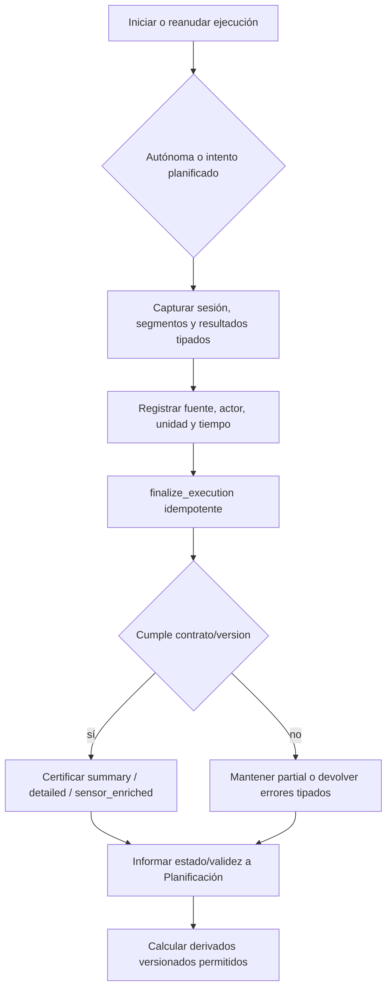

#### Captura personal autónoma

1. La persona inicia una sesión sin asignación o relación obligatorias.
2. Ejecución crea el hecho bajo su Fitness ID.
3. No existe vínculo de intento salvo confirmación posterior válida.
4. Compartirla requiere `prior_training_history` y puede reducirse por denegación específica.

#### Captura profesional

1. El backend valida relación, asignación profesional, organización, membresía, capacidad, grant, scope y `access_level`.
2. La sesión conserva persona, profesional, organización, relación y fuente.
3. El profesional captura/corrige directamente solo valores propios durante la sesión activa.
4. Declaraciones personales y categorías no concedidas permanecen fuera de su autoridad.

#### Captura controlada de dispositivo/importación

1. El dato externo se vincula inequívocamente con una persona antes de entrar al historial.
2. Conserva identificador externo para deduplicación, dispositivo/fuente, unidad y calidad.
3. Un payload incompleto puede quedar `partial`.
4. Raw permanece inmutable y se elimina tras su ventana; normalizaciones son registros separados.
5. Esto no habilita conectores productivos, credenciales o scopes de wearable en V1.

### 9.17 Corrección, invalidación y recálculo

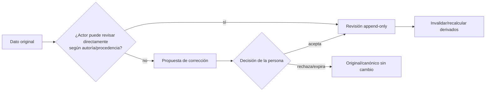

Los comandos son tipados e idempotentes. No se permite JSON Patch arbitrario, eliminación para ocultar errores o modificación manual de récords.

### 9.18 Privacidad y fin de relación

Una misma sesión puede contener categorías con permisos distintos:

- prescripción y resultados de la relación requieren `relationship_training`;
- sesión autónoma/anterior requiere `prior_training_history`;
- peso, composición o fotos requieren `body_progress`;
- dolor, limitaciones o recuperación requieren `health_context`;
- frecuencia cardiaca, GPS, biometría y raw de wearables permanecen fuera de los siete scopes V1.

La autorización se aplica por fila y campo/proyección. Que una sesión sea visible no hace visibles todas sus observaciones.

Cuando la persona oculta una sesión autónoma para una relación, Ejecución conserva el dato sin un `is_hidden` global. Privacidad bloquea detalle, conteos, derivados, cachés y cualquier inferencia para esa relación.

Al terminar la relación:

- el profesional deja de capturar, anotar, proponer o revisar operativamente;
- propuestas pendientes expiran o se bloquean según política;
- revisiones aceptadas permanecen en el historial;
- sesiones iniciadas pueden finalizarse por la persona;
- datos futuros nunca son visibles para la organización anterior;
- disputas posteriores usan soporte restringido y auditado, no endpoints ordinarios.

### 9.19 Dependencias y contratos con otros dominios

| Dominio o sistema | Ejecución entrega | Ejecución recibe | Regla de frontera |
| --- | --- | --- | --- |
| Identidad | Historial, resultados y progreso que componen el Fitness ID | Persona canónica, actor y procedencia de perfil cuando aplique | No existe ejecución canónica de sujeto no vinculado en V1 |
| Organizaciones | Autoría/contexto de capturas profesionales | Organización, membresía y capacidad efectivas | Contexto organizacional no transfiere ownership ni acceso perpetuo |
| Relaciones | Sesiones/observaciones originadas bajo el vínculo | Relación, profesionales asignados y terminación efectiva | Terminar bloquea nuevas acciones, no borra hechos |
| Privacidad | Recursos, campos, procedencia y derivados para proyecciones seguras | Grants, scopes, niveles, denegaciones y revocaciones | Una sesión visible puede tener campos ocultos; derivados heredan máxima restricción |
| Catálogo | Evidencia de uso/validación de modalidades | Disciplina, tipo, movimiento, unidad y contrato/version publicados | Ejecución no modifica contratos ni fuerza modalidad en estructura ajena |
| Planificación | Estado/validez de ejecuciones para intentos y contraste | Sesión planificada, snapshot, vínculo de intento y primaria | Resultados no sobrescriben targets; Ejecución no selecciona primaria |
| Jobs/analítica | Eventos base y derivados autorizados | Algoritmos/versiones y órdenes de recálculo | No se calcula con datos ocultos/dispuestos ni se edita un derivado manualmente |
| Disposición/storage | Categorías, targets y referencias de derivados | Políticas, holds e instrucciones de borrado/anonimización | Raw, normalizados, proyecciones y derivados convergen sin resucitar datos |

### 9.20 Invariantes de Ejecución

1. Toda ejecución canónica V1 pertenece a una persona registrada.
2. La persona es dueña lógica de sesión y resultados; autoría/procedencia no transfieren ownership.
3. Toda sesión declara disciplina, tipo de actividad, timestamps, zona horaria, fuente y contrato/version aplicados.
4. Una sesión puede ser autónoma o planificada; planificación no es obligatoria para entrenar.
5. Lo ejecutado nunca sobrescribe targets, plantillas o programas.
6. Un segmento pertenece a una sola sesión y admite modalidades diferentes en sesiones híbridas.
7. No toda modalidad requiere movimiento, set, repetición, sensor o resultado subjetivo.
8. Resultados operativos frecuentes usan estructuras y unidades tipadas, no JSON/EAV universal.
9. Estado de sesión, completitud, validación y rol de intento son dimensiones separadas.
10. `partial` no equivale a nivel certificado ni alimenta progreso preciso.
11. `completed` no implica `detailed` o `sensor_enriched`.
12. `sensor_enriched` exige `detailed` válido y no se obtiene por muestras huérfanas.
13. Toda ejecución histórica conserva el contrato/version exactos; una versión nueva no la reinterpreta.
14. `finalize_execution` es transaccional, idempotente y valida estructuras cruzadas.
15. `NULL` significa no capturado y nunca se reemplaza implícitamente por cero.
16. Una ejecución se vincula como máximo a una sesión planificada y siempre de la misma persona.
17. Reanudar conserva la ejecución; abandonar/repetir crea otro hecho real.
18. Completar o invalidar una ejecución no cambia silenciosamente la primaria.
19. V1 no fusiona ejecuciones para cumplimiento dividido.
20. Un profesional solo captura o revisa con relación, grant, asignación, membresía, capacidad y acción compatibles.
21. Un profesional solo revisa directamente capturas/observaciones propias.
22. Cambiar datos personales o subjetivos requiere propuesta aceptada; no hay overwrite.
23. Raw de dispositivo/importación es inmutable; normalización y exclusión son registros separados.
24. Toda revisión conserva original, before/after, actor, motivo, procedencia y timestamp.
25. Estado final, vínculo y primaria nunca cambian silenciosamente ni mediante permiso genérico.
26. No existe `manage_execution` o JSON Patch destructivo.
27. Derivados conservan algoritmo/version, inputs, vigencia y clasificación heredada.
28. Cambiar un input invalida o recalcula derivados afectados.
29. Ocultar/revocar acceso no modifica o elimina la sesión personal.
30. Terminar una relación bloquea nuevas correcciones/capturas y datos futuros para la organización anterior.
31. Retener evidencia no permite navegación operativa del historial.
32. V1 valida fuerza, running, yoga/movilidad e híbrido sin activar conectores o raw stores productivos.

### 9.21 Escenarios que debe superar Ejecución

| Escenario | Resultado obligatorio |
| --- | --- |
| Persona inicia sesión autónoma | Se crea en su Fitness ID sin relación, asignación o planificación |
| Persona inicia desde sesión planificada | Se crea una ejecución y Planificación la vincula como intento único/idempotente |
| Persona pausa y reanuda | Continúa la misma ejecución, sin otro intento |
| Persona abandona y reintenta | Se conservan dos ejecuciones reales con procedencia/estado distintos |
| Fuerza `summary` sin carga/RPE | Puede certificarse como historial básico, no como progreso detallado por movimiento |
| Fuerza `detailed` sin movimiento/paso o cantidad lograda | Se rechaza el nivel detallado con error tipado |
| Running `summary` | Exige duración/distancia; ritmo se deriva y no se duplica como verdad manual |
| Running por intervalos | Conserva laps ordenados, duración, distancia y vínculo opcional a paso |
| Yoga `summary` | No exige wearable o detalle de cada postura |
| Yoga/movilidad `detailed` | Valida secuencia, lado y cantidad observada cuando apliquen |
| Sesión híbrida | Conserva segmentos de familias distintas y valida cada contrato compatible |
| `sensor_enriched` sin `detailed` válido | No se certifica |
| Importación incompleta | Permanece `partial` y no alimenta adherencia/progresión precisa |
| Doble `finalize_execution` | Converge al mismo estado sin duplicar detalles/eventos |
| Se publica contrato v2 | Las sesiones v1 conservan su interpretación y no se revalidan automáticamente |
| Profesional captura valor propio durante sesión activa | Puede corregirlo dentro de su autoridad y conserva procedencia |
| Profesional revisa captura propia completada | Crea revisión append-only y notifica a la persona |
| Profesional propone cambiar dato personal | El canónico no cambia hasta aceptación de la persona |
| Persona rechaza/ignora propuesta | El dato permanece y la propuesta termina sin efecto |
| Profesional intenta editar RPE/dolor personal | Se deniega; solo comentario/propuesta según scope |
| Raw de dispositivo tiene anomalía | Se conserva raw, se registra exclusión/normalización y se recalculan derivados |
| Cambia un resultado base | Derivados afectados se invalidan/recalculan con algoritmo versionado |
| Profesional intenta cambiar primaria | Debe proponer/usar flujo restringido; no puede modificarla directamente |
| Persona oculta sesión autónoma para relación A | Ejecución no cambia; A no recibe detalle, conteos o derivados y otra relación evalúa aparte |
| Termina relación durante sesión iniciada | Persona puede finalizar; profesional anterior no contribuye después del corte |
| Organización anterior consulta sesión posterior | Se deniega sin filtrar existencia o metadata |
| Cierre/supresión válida | Sesión, resultados, proyecciones y derivados siguen disposición por categoría |

### 9.22 Decisiones diferidas al modelo lógico y Fase 3

Estas decisiones deben cerrarse sin alterar ownership, procedencia o integridad:

- estados y transiciones exactos de sesión, segmento, validación e invalidación;
- comandos para iniciar, pausar, reanudar, abandonar, completar e invalidar;
- locks, idempotency keys y reconciliación offline;
- envelope físico, constraints temporales y zona horaria;
- estructuras tipadas exactas para fuerza, endurance, yoga/movilidad, rondas e híbrido;
- modelo controlado de muestras temporales usado solo por fixtures V1;
- selección/resolución de contrato y mensajes de validación por modalidad;
- estados y autoridad de propuestas, revisiones y soporte restringido;
- proyección canónica y reglas ante revisiones concurrentes;
- notificaciones a la persona por revisiones profesionales;
- algoritmos/versiones de ritmo, volumen, récords, adherencia y tendencias;
- consistencia entre ejecución, intento, primaria e invalidación;
- clasificación por campo y proyecciones autorizadas para scopes V1;
- tratamiento de propuestas pendientes al terminar relación;
- ventanas y disposición de staging/raw/importaciones controladas;
- RLS, contratos HTTP, índices, particionamiento futuro y eventos/outbox;
- políticas exactas de retención/supresión por resultado y derivado.

No se pueden resolver con una tabla universal de resultados, JSONB sin contrato, overwrite de datos ajenos, edición manual de derivados, valores faltantes convertidos en cero, permisos `manage_execution` o borrado de intentos para simplificar el historial.

## 10. Dominio de Soporte de plataforma

### 10.1 Responsabilidad

Soporte permite diagnosticar incidencias sin convertir al personal interno de Allfit en superusuarios. Su camino ordinario usa únicamente metadatos operativos sin nombres, contactos ni contenido. El acceso excepcional a datos de una persona existe solo dentro de un expediente break-glass aprobado, acotado y auditable.

Soporte responde por:

- el rol base que permite iniciar sesión y las asignaciones temporales de deber;
- la solicitud y justificación del acceso excepcional;
- la separación entre solicitante y aprobador;
- el alcance por persona, categoría, propósito y tiempo;
- cada ejercicio real de la ventana;
- el cierre, expiración y auditoría del expediente.

No es dueño de la identidad, la relación, el grant ni el dato fitness consultado.

### 10.2 Actores y autoridad

| Actor | Deber de plataforma | Puede | No puede |
| --- | --- | --- | --- |
| `A10` soporte solicitante | `diagnose_support_metadata`, `request_break_glass` | Consultar metadatos, solicitar, ejercer su propia ventana aprobada y cerrarla | Aprobar, ejercer ventanas ajenas o escribir datos personales |
| `A12` seguridad/privacidad | `approve_break_glass`, `audit_break_glass` | Aportar quorum a solicitudes ajenas o revisar posteriormente casos que no aprobó | Solicitar, ejercer, aprobar dos veces, revisar su aprobación o escribir datos personales |
| Persona afectada | Sujeto del dato | Consultar los `ACCESS_EVENT` que la afectan | Administrar el expediente interno |

Estos deberes no son roles organizacionales ni capacidades de una membresía de gimnasio. La plataforma los provisiona por un control interno confiable y el backend los materializa como contexto transaccional; nunca acepta un deber declarado por el cliente.

### 10.3 Entidades conceptuales y ownership

| Concepto | Fuente de verdad | Quién crea o decide | Ciclo | Quién consulta |
| --- | --- | --- | --- | --- |
| Rol base de plataforma | Soporte | `A12/manage_platform_access` distinto del destinatario | Activo → revocado; historial inmutable | Seguridad/privacidad |
| Asignación de deber | Soporte | `A12/manage_platform_access` distinto del destinatario | Programada/activa → suspendida, vencida o revocada; máximo 90 días | Seguridad/privacidad y motor de autorización |
| Solicitud break-glass | Soporte | `A10` con AAL2/deber vigente | Pending `<=30 min` → quorum/rechazo → ventana 30/15 min → cierre/expiración → revisión | Solicitante y A12; la persona ve ejercicios, no expediente |
| Aprobación break-glass | Soporte | Uno o dos `A12` distintos según sensibilidad | Append-only; rechazo terminal; quorum abre | Seguridad/privacidad y auditor independiente |
| Ejercicio break-glass | Soporte + Privacidad para `ACCESS_EVENT` | Solo el `A10` solicitante con ventana/quorum vigentes | Append-only allowed/denied por lectura | A12 revisor y persona afectada mediante historial |
| Vista de metadatos | Cada dominio proyecta; Soporte consume | Sistema | Derivada, sin autoridad propia | `A10` con deber de diagnóstico |

`PLATFORM_ROLE_ASSIGNMENT`, `PLATFORM_DUTY_ASSIGNMENT`, `BREAK_GLASS_REQUEST`, `BREAK_GLASS_APPROVAL` y `BREAK_GLASS_EVENT` corresponden a las cinco tablas del schema `support`. Break-glass queda trazado a `OP-SUP-001..006`; roles y deberes a `OP-SUP-007..011`.

### 10.4 Invariantes

1. `allfit_admin` sólo permite entrar; cada operación exige un deber vigente resuelto dentro de la transacción.
2. El camino ordinario de soporte nunca devuelve nombres, contactos completos o contenido personal.
3. `A10` no aprueba; los `A12` no ejercen y quien aprueba no revisa su caso.
4. Solicitante, sujeto, aprobadores y revisor satisfacen separación/conflictos de ADR-026.
5. Sujeto, categorías, propósito/caso y duración quedan inmutables al solicitar.
6. Solo el solicitante exacto ejerce o cierra una ventana aprobada y vigente.
7. Cada lectura produce `ACCESS_EVENT` o falla cerrada.
8. Break-glass nunca concede escritura, exportación masiva o acceso futuro.
9. Cerrar o expirar no elimina la evidencia y retenerla no reactiva autoridad.
10. `nutrition_guidance` es estándar con un A12 y máximo 30 minutos; `nutrition_intake` es restringida con dos A12 distintos y máximo 15 minutos; una solicitud mixta hereda el nivel restringido.
11. `nutrition_media` no es una categoría aprobable ni persistible y break-glass nunca accede a `OP-NUT-013`, storage, `media_ref`, URLs o bytes.

## 11. Estado del mapa y próximo paso

Los nueve dominios V1 tienen definición de límites, ownership, fuentes de verdad, acceso y ciclo de vida:

1. Identidad;
2. Organizaciones;
3. Relaciones;
4. Privacidad;
5. Catálogo;
6. Planificación;
7. Ejecución;
8. Soporte de plataforma;
9. Nutrición.

El 28 de julio de 2026 este mapa fue recertificado después de incorporar `staff`, titular/suplente, soporte con separación de deberes, acceso histórico `frozen` y Nutrición no clínica. Los escenarios transversales conservan los recorridos originales y añaden comprobaciones específicas para los conceptos incorporados después.

El entregable complementario [`V1_CONCEPTUAL_ERD.md`](./V1_CONCEPTUAL_ERD.md) representa los mismos sujetos, hechos y cardinalidades. Ambos documentos quedan aprobados como gate recertificado de Fase 2.

## 12. Validación transversal de escenarios

### 12.1 Estado de validación

| Escenario | Estado | Resultado actual |
| --- | --- | --- |
| 1. Space-only: registro directo → Fitness ID → perfil → sesión autónoma → historial | Recertificado | Representable sin organización, relación, asignación, invitación o grant |
| 2. Studio pendiente: invitación sin persona provisional | Recertificado | La invitación y sus intenciones existen sin cuenta, persona, Fitness ID ni entidades destino |
| 3. Ecosistema vinculado y aceptación parcial | Recertificado | Valida relación sin programa y rama completa con grant parcial, asignación, ejecución y consulta autorizada |
| 4. Persona Space preexistente acepta invitación | Recertificado | Reutiliza cuenta, `person_id` y Fitness ID; crea relación y asignación aceptadas sin compartir historial autónomo |
| 5. Práctica unipersonal crece a equipo | Recertificado | Añade membresía y reasigna explícitamente un cliente sin cambiar organización, tipo, ownership o historial |
| 6. Privacidad, scopes y ocultación sin filtraciones | Recertificado | Dos relaciones evalúan grants propios; una denegación oculta la sesión completa antes de proyectar o agregar |
| 7. Fin de relación y continuidad personal | Recertificado | Corta autoridad en `effective_at`, desacopla la asignación y conserva historial/snapshot para decisión personal |
| 8. Disposición sin resurrección | Recertificado | Resuelve por categoría, propaga a sistemas activos/derivados y reaplica eventos antes de restaurar tráfico |
| 9. Núcleo multidisciplina | Recertificado | Sesión híbrida con fuerza, running y movilidad valida contratos tipados y conserva plan/ejecución separados |
| 10. Capacidades diferidas sin modelo especulativo | Recertificado | V1 funciona sin DDL, permisos o contratos de booking, commerce, marketplace, integrations o intelligence |

### 12.2 Recertificación de conceptos incorporados después de Fase 2

| Recorrido adicional | Resultado obligatorio |
| --- | --- |
| Reasignación y suplencia | Existe un titular efectivo; una propuesta de suplencia no concede acceso, la aceptación personal la activa y el vencimiento la corta sin depender del job |
| Terminación | Cierra titular y suplencias en el mismo `T`, congela grants, desacopla gestión y no deja acceso implícito por rol o membresía |
| Soporte break-glass | A10 ejerce solo su ventana; uno/dos A12 aprueban por sensibilidad y otro revisa; cada allowed/denied es visible |
| Retención y recuperación | Evidencia de asignación, aprobación y acceso se conserva restringida; restaurar no revive suplencias, ventanas, grants ni casos cerrados |
| Histórico `frozen` | Usa `HISTORICAL_ACCESS_CASE` de Privacidad, no break-glass ni endpoints operativos; ninguna superficie amplía la autoridad de otra |

### 12.3 Escenario 1 — Persona Space-only que entrena sola

#### Objetivo

Demostrar que una persona adulta puede registrarse directamente en Allfit Space, activar un único Fitness ID, mantener su perfil, ejecutar una actividad autónoma y consultar su historial sin invitación ni dependencia de Allfit Studio.

#### Precondiciones

- La persona no tiene usuario WorkOS ni `person_id` previo.
- No existe invitación de Studio.
- No existe organización, membresía, relación profesional, asignación o grant.
- La persona declara cumplir la política global de elegibilidad de 18 años o más.
- Existen en Catálogo una disciplina, tipo de actividad y contrato de resultados publicados compatibles con la actividad que registrará.

#### Resultado esperado

Al finalizar existe una sola persona canónica vinculada a una sola cuenta local y un solo Fitness ID. La persona conserva una sesión autónoma con resultados tipados en su historial. No se crea ninguna entidad profesional u organizacional y Studio no mantiene una copia de los datos.

#### Recorrido de extremo a extremo

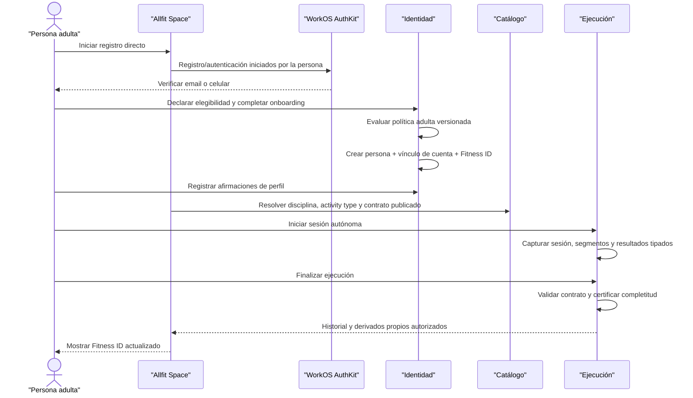

Space coordina la experiencia, pero no es fuente de verdad ni owner de las entidades. Cada comando llega a la API autoritativa y a su dominio correspondiente.

#### Paso 1 — Autenticación controlada por la persona

La persona inicia el registro o login desde Space. WorkOS AuthKit crea el usuario externo y verifica control del email. Verificar un celular requiere el contrato separado definido por ADR-002/`DB-P5-019`.

En este momento:

- puede existir un sujeto temporal en WorkOS AuthKit;
- todavía no existe `identity.people` ni Fitness ID;
- autenticación no demuestra elegibilidad adulta;
- Space no asigna rol de negocio desde claims de WorkOS AuthKit;
- no existe cuenta local activa hasta completar el onboarding elegible.

Si se repite el flujo con el mismo sujeto externo, el vínculo local debe converger mediante la unicidad de `(provider, issuer, subject)` y la idempotencia del onboarding.

#### Paso 2 — Elegibilidad y onboarding

Después de verificar control de autenticación y antes de recopilar datos fitness, Identidad aplica la política adulta versionada.

La evidencia mínima conserva:

- política y versión aplicadas;
- resultado;
- método;
- procedencia `person_declared`;
- actor/sujeto declarante;
- timestamp.

No se necesita conservar fecha de nacimiento completa si no existe otra finalidad.

Si el resultado es `ineligible_age`, desconocido, falla o requiere revisión:

- no se crea persona, cuenta local, perfil o Fitness ID;
- no se recopilan datos corporales, de salud o entrenamiento;
- el usuario WorkOS no obtiene endpoints operativos;
- comienza su flujo corto de restricción, deshabilitación y disposición.

Solo el resultado elegible permite continuar con términos, onboarding y creación canónica.

#### Paso 3 — Creación de identidad de dominio

Identidad crea o vincula transaccionalmente:

- una persona canónica;
- una cuenta local asociada al usuario WorkOS;
- el Fitness ID longitudinal de esa persona;
- evidencia de onboarding y elegibilidad;
- el perfil inicial o su capacidad de recibir afirmaciones.

No crea:

- invitación o intención;
- organización o sede;
- membresía organizacional;
- perfil profesional por defecto;
- relación profesional-persona;
- consentimiento o grant de servicio;
- programa, asignación o sesión planificada.

Fitness ID es el agregado personal y no una copia de datos para Space. El modelo lógico decidirá si su identificador público comparte o no valor físico con `person_id`, pero conceptualmente existe uno por persona activa.

#### Paso 4 — Perfil fitness personal

La persona registra afirmaciones tipadas sobre objetivos, disciplinas, experiencia, preferencias, disponibilidad o equipamiento.

Reglas:

- el perfil pertenece a la persona;
- cada valor conserva procedencia, actor y tiempo;
- las declaraciones personales usan `person_declared`;
- una actualización crea revisión y no destruye historial material;
- Catálogo aporta referencias a disciplinas, movimientos o equipamiento, pero no se apropia del perfil;
- no existe una organización que pueda consultar o administrar el perfil;
- no se necesita un grant para que la persona acceda a sus propios datos;
- Privacidad continúa clasificando las categorías y aplicando su disposición aunque no exista compartición con terceros.

El perfil no almacena sesiones, resultados, historia clínica o un JSON abierto de datos arbitrarios.

#### Paso 5 — Selección del contrato de actividad

Antes de iniciar la actividad, Space consulta mediante la API las definiciones publicadas necesarias:

- disciplina;
- tipo de actividad;
- movimientos/unidades cuando apliquen;
- contrato y versión de resultados compatibles.

Catálogo es fuente de verdad de esas definiciones. La persona no crea copias de disciplina o contrato dentro de su perfil o sesión. Ejecución congela las referencias necesarias para que el historial no cambie cuando aparezca otra versión.

Una definición global puede consultarse sin crear ownership personal. Si se utiliza un movimiento privado de la persona, conserva su ownership y visibilidad privada sin volverse publicable.

#### Paso 6 — Inicio de sesión autónoma

La persona inicia una sesión directamente en Ejecución.

La sesión:

- pertenece a su `person_id`;
- no requiere organización o relación;
- no requiere programa, asignación o sesión planificada;
- no crea vínculo de intento;
- declara disciplina y tipo de actividad compatibles;
- conserva timestamps reales, zona horaria, fuente y actor;
- congela contrato/version aplicados;
- comienza con estado y completitud independientes.

Planificación no recibe una entidad ficticia. Si la persona solamente decide entrenar ahora, la ejecución es autónoma. Crear una sesión personal planificada sería un flujo opcional distinto, no una precondición.

#### Paso 7 — Captura de resultados

La persona registra segmentos y resultados tipados conforme a la modalidad.

Ejemplos válidos:

- fuerza: sets, repeticiones, carga, RPE o duración según contrato;
- running: duración, distancia y laps/intervalos;
- yoga/movilidad: duración, secuencia y lado cuando aplique;
- híbrido: segmentos de familias diferentes.

Cada resultado conserva unidad, fuente, actor y tiempo. `NULL` significa no capturado; cero es un valor observado. Los targets no existen en este recorrido salvo que la persona hubiese iniciado desde planificación, por lo que no se inventa una prescripción retrospectiva.

Datos corporales o de salud capturados durante la experiencia mantienen sus categorías `body_progress` o `health_context`; no se convierten en resultados universales de entrenamiento.

#### Paso 8 — Finalización y validación

La persona ejecuta `finalize_execution` mediante la API.

El comando:

1. verifica que la sesión pertenece a la persona autenticada;
2. confirma disciplina, tipo y contrato/version;
3. valida envelope, timestamps, unidades, rangos y estructuras tipadas;
4. calcula el nivel realmente alcanzado;
5. registra estado y evento de validación de forma transaccional;
6. emite efectos idempotentes para derivados;
7. no crea detalles o eventos duplicados ante reintentos.

Si la captura no cumple `summary`, permanece `partial`; no se rellena información faltante ni se finge detalle. Una sesión puede estar `completed` y conservar una completitud menor que `detailed`.

Como no existe sesión planificada:

- no se crea vínculo de intento;
- no existe ejecución primaria para adherencia;
- la sesión sigue siendo válida como actividad real e historial personal;
- puede alimentar progreso solo cuando su completitud satisface la regla versionada correspondiente.

#### Paso 9 — Historial y progreso personal

Space consulta el historial mediante la API usando el contexto de la persona autenticada.

La respuesta puede incluir:

- sesión y segmentos propios;
- resultados tipados;
- procedencia y completitud;
- derivados vigentes cuyo nivel de datos sea suficiente;
- perfil y progreso personal compuesto desde fuentes canónicas.

No se necesita `data_grant` para que la persona consulte su propio Fitness ID. El backend y RLS deben verificar `subject_person_id = current_person_id` o la regla equivalente; una persona no puede consultar la sesión de otra.

Space no persiste una copia autoritativa del historial. Studio tampoco recibe o sincroniza otra copia. Si en el futuro la persona acepta una relación, esa organización accede a los mismos hechos canónicos únicamente mediante grants y proyecciones autorizadas.

#### Entidades y dominios involucrados

| Concepto | Dominio/fuente | Se crea en el escenario | Owner o sujeto |
| --- | --- | --- | --- |
| Sujeto autenticado | WorkOS AuthKit | Sí | La persona controla la cuenta; WorkOS AuthKit autentica |
| Intento de onboarding | Identidad | Sí | Persona como sujeto; Allfit custodia seguridad |
| Evidencia de elegibilidad | Identidad | Sí, solo evidencia mínima | Persona como sujeto; Identidad aplica política |
| Persona canónica | Identidad | Sí | Persona |
| Cuenta local | Identidad | Sí | Persona; Allfit administra vínculo técnico |
| Fitness ID | Identidad como raíz/agregado | Sí, conceptualmente | Persona |
| Afirmaciones de perfil | Identidad | Sí | Persona |
| Disciplina/tipo/contrato | Catálogo | No se duplican; se referencian | Allfit para catálogo global |
| Sesión ejecutada | Ejecución | Sí | Persona |
| Segmentos/resultados | Ejecución | Según modalidad | Persona; actor conserva procedencia |
| Evento de validación | Ejecución | Sí al finalizar | Persona como sujeto; Ejecución custodia evidencia |
| Derivados/progreso | Ejecución | Cuando apliquen | Persona; sistema conserva algoritmo/version |
| Organización/membresía | Organizaciones | No | No aplica |
| Relación/asignación profesional | Relaciones | No | No aplica |
| Grant/consentimiento de servicio | Privacidad | No | No aplica |
| Programa/asignación/sesión planificada | Planificación | No | No aplica |

#### Matriz de autorización

| Operación | Actor | Condiciones obligatorias | Condiciones que no aplican |
| --- | --- | --- | --- |
| Completar onboarding | Persona autenticada | Contacto controlado, elegibilidad adulta, términos y comando idempotente | Invitación, organización, relación o grant |
| Actualizar perfil | Persona | Cuenta/persona activas; revisión con procedencia | Membresía o permiso profesional |
| Consultar catálogo global | Persona/Space mediante API | Definición publicada y visible | Grant de Fitness ID |
| Iniciar ejecución autónoma | Persona | Sesión para su propio `person_id`; contrato compatible | Planificación, relación o organización |
| Capturar resultados | Persona | Sesión propia activa y estructuras válidas | Capacidad profesional o grant |
| Finalizar ejecución | Persona | Ownership, idempotencia y validación contractual | Profesional asignado |
| Consultar historial | Persona | Contexto autenticado y filtro de sujeto propio | Scope compartido con terceros |

#### Fallos y concurrencia que debe resolver

| Caso | Resultado obligatorio |
| --- | --- |
| Falla o ausencia de elegibilidad | No crea persona, perfil, Fitness ID o datos fitness |
| Retry concurrente de onboarding | Crea como máximo una persona y un vínculo de cuenta |
| Token WorkOS AuthKit válido sin cuenta local | Solo accede al onboarding, no al Fitness ID |
| Persona intenta usar `person_id` ajeno | Backend/RLS deniegan sin filtrar datos |
| Doble inicio con misma intención idempotente | Reutiliza la misma sesión cuando corresponda; no duplica actividad por transporte |
| Doble finalización | Converge al mismo estado y no duplica resultados/eventos |
| Resultados incompatibles con contrato | Rechaza el nivel o conserva `partial`; no cambia de modalidad silenciosamente |
| Nueva versión de contrato | No reinterpreta la sesión histórica |
| Error al calcular un derivado | La sesión base permanece; el derivado queda pendiente/fallido sin inventar valor |

#### Ciclo de vida y disposición

| Evento | Efecto |
| --- | --- |
| Cierre de sesión/login | Revoca tokens/sesión técnica; no elimina Fitness ID |
| Cierre de cuenta/Fitness ID | Revoca WorkOS AuthKit y vínculo local; cada categoría inicia su política de disposición |
| Supresión válida de historial | Elimina sesiones/resultados/derivados incluidos, salvo mínimo afectado por obligación o hold |
| Conservación estadística legítima | Solo mediante anonimización irreversible antes de conservar |
| Hold documentado | Suspende únicamente los targets incluidos; no habilita acceso operativo |
| Restauración de backup | Reaplica disposiciones posteriores al snapshot antes de habilitar tráfico |

Como no existe organización o relación, no hay evidencia bilateral profesional que conservar ni acceso de terceros que revocar.

#### Comprobación de duplicaciones

| Riesgo | Resultado del recorrido |
| --- | --- |
| Persona distinta por producto | No ocurre: Space referencia la persona canónica de Identidad |
| Fitness ID como copia de Space | No ocurre: es agregado común centrado en `person_id` |
| Perfil duplicado dentro de Ejecución | No ocurre: la sesión referencia a la persona y no copia el perfil completo |
| Catálogo copiado por persona | No ocurre: sesión/perfil referencian códigos/versiones gobernados |
| Sesión planificada ficticia para entrenar | No ocurre: Ejecución admite actividad autónoma |
| Resultado guardado dentro de planificación | No ocurre: targets y hechos permanecen separados |
| Historial duplicado para Studio | No ocurre: Studio solo podrá consultar los mismos hechos mediante autorización futura |
| Grant para acceso propio | No ocurre: grants modelan acceso de terceros dentro de relaciones |

#### Resultado de la validación

**Estado:** recertificado — recorrido completo.<br>
**Resultado:** el escenario es representable con Identidad, Catálogo, Ejecución y políticas transversales de Privacidad. No requiere entidades de Organizaciones, Relaciones o Planificación.<br>
**Duplicaciones detectadas:** ninguna.<br>
**Contradicciones detectadas:** ninguna.<br>
**Ajustes requeridos a los límites de dominio:** ninguno.

La futura invitación de Studio para esta misma persona deberá reutilizar su `person_id`, cuenta y Fitness ID. Esa convergencia se validará en el escenario 4.

### 12.4 Escenario 2 — Invitación pendiente de Studio sin persona provisional

#### Objetivo

Demostrar que una organización puede emitir desde Allfit Studio una propuesta dirigida a un email o celular sin registrar al destinatario, descubrir si ya usa Allfit ni crear por anticipado cuenta, persona, Fitness ID, membresía, relación, asignación o grant.

#### Precondiciones

- La organización emisora existe y está activa.
- El actor emisor es una persona autenticada con membresía y capacidad organizacional vigentes para invitar.
- El destino es un email o celular normalizado que Studio puede usar únicamente para entregar la invitación.
- El escenario no presupone si el destinatario tiene una cuenta Allfit; el emisor no recibe esa información.
- Para una invitación de cliente, el profesional responsable y la versión exacta de programa opcional ya existen y son proponibles en el contexto de la organización.
- El destinatario todavía no ha completado una decisión autenticada sobre ninguna intención.

#### Resultado esperado

Existe un único sobre de invitación pendiente con destino protegido, token hasheado, organización, emisor, propósito, vencimiento e intenciones tipadas. No existe ninguna entidad de dominio que represente al destinatario y la invitación no permite consultar un Fitness ID ni operar como si hubiera una relación.

#### Recorrido de extremo a extremo

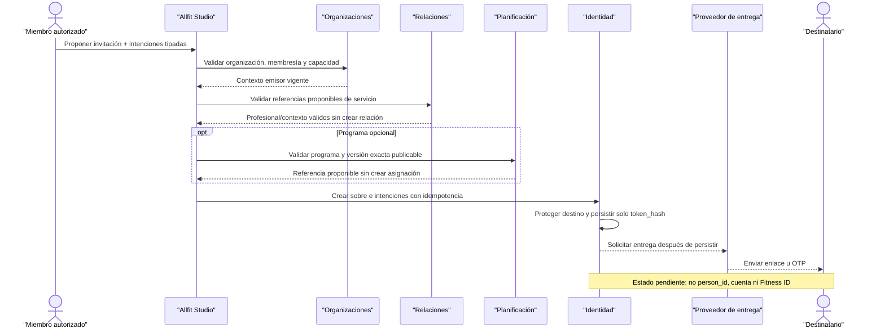

La validación al emitir confirma únicamente que la propuesta está bien formada y que el emisor puede realizarla. Las dependencias ligadas al destinatario se vuelven a evaluar cuando este se autentica y decide; una referencia válida al emitir no reserva ni garantiza su futura materialización.

#### Paso 1 — Autorización del emisor

Studio recibe un comando organizacional autenticado e idempotente. Antes de crear la invitación, el backend verifica:

- organización activa;
- membresía efectiva del actor;
- rol/capacidad para emitir ese propósito de invitación;
- profesional responsable válido cuando se propone una relación;
- rol organizacional asignable cuando se propone una membresía;
- programa y versión exacta proponibles cuando existe una intención de asignación;
- compatibilidad entre propósito e intenciones.

Un administrador técnico de Studio sin membresía de negocio no puede invitar por una organización. Una membresía válida tampoco permite proponer recursos de otra organización.

#### Paso 2 — Creación del sobre temporal

Identidad crea la invitación con:

- `invitation_id` propio;
- `organization_id` e `invited_by_person_id` del emisor;
- propósito `staff_invitation` o `client_invitation`;
- canal y destino normalizado protegido;
- `token_hash`, nunca token plano;
- versión del contenido presentado;
- estado, vencimiento y timestamps de entrega;
- clave idempotente o referencia equivalente del comando.

El token plano solo existe durante su generación y entrega. No debe aparecer en base de datos, logs, eventos, trazas, analítica o soporte.

El destino se conserva por su finalidad de entrega y comprobación posterior. No se transforma en `person_id`, no actualiza contactos de una persona y no autoriza una búsqueda de cuentas por parte del emisor.

#### Paso 3 — Creación independiente de intenciones

En la misma operación lógica se crean filas tipadas según el propósito:

| Propósito | Intención permitida | Referencias mínimas | Entidad que todavía no existe |
| --- | --- | --- | --- |
| `staff_invitation` | `organization_membership` | Organización y rol propuesto | Membresía organizacional |
| `client_invitation` | `service_relationship` | Organización, profesional responsable, servicio y fecha tentativa | Relación de servicio |
| `client_invitation` | `program_assignment` opcional | Programa, versión exacta, fecha tentativa e intención de relación dependiente | Asignación de programa |

Cada intención comienza como `proposed` y mantiene identidad, tipo, estado, dependencias y referencias vinculantes propias. El mensaje libre puede ser metadata de presentación, pero no reemplaza columnas o referencias tipadas.

No se incluyen como intenciones:

- términos o política de privacidad;
- grants o scopes de datos;
- contratos, compras o pagos;
- marketing, publicación o IA;
- biometría, wearables o entrenamiento de modelos.

Estas decisiones requieren evidencia separada y nunca nacen por entregar, abrir o completar el sobre.

#### Paso 4 — Entrega sin registro implícito

Después de persistir la invitación, el sistema solicita el envío del enlace u OTP. El proveedor puede producir eventos de envío, entrega o fallo, pero ninguno crea datos del destinatario.

Mientras la invitación permanece pendiente:

- Studio muestra al emisor solo estado operativo y destino enmascarado;
- el emisor puede revocarla conforme a su autoridad;
- el sistema puede expirar o bloquear el sobre;
- un reenvío no cambia el propósito ni amplía las intenciones;
- abrir el enlace no equivale a aceptar;
- poseer el token no concede endpoints del Fitness ID;
- no existe relación, membresía, asignación, grant o acceso profesional.

Si la entrega falla, la invitación puede conservar su estado y evidencia operativa conforme a la política de reintentos. El fallo no justifica crear una cuenta para “asegurar” la entrega.

#### Paso 5 — Frontera con autenticación y onboarding

Este escenario termina antes de cualquier decisión. Si el destinatario continúa después:

1. inicia personalmente el registro o autenticación mediante AuthKit;
2. verifica control del mismo contacto normalizado;
3. acredita elegibilidad adulta y completa términos/onboarding;
4. Identidad crea o reutiliza la persona, cuenta local y Fitness ID;
5. decide cada intención por separado.

Puede existir temporalmente un usuario WorkOS después de iniciar el enlace y seguir sin existir una persona de dominio. Autenticarse no materializa la invitación: faltan elegibilidad, onboarding y decisiones explícitas.

Si el contacto ya correspondía a una persona de Space, la invitación sigue naciendo sin `person_id` visible o inferido para la organización. La asociación con esa persona se realiza únicamente después de autenticación y coincidencia del contacto verificado; esa convergencia se valida en el escenario 4.

#### Matriz de entidades y ownership

| Concepto | Dominio/fuente | Se crea en el escenario | Owner, responsable o sujeto |
| --- | --- | --- | --- |
| Organización emisora | Organizaciones | No; ya existe | Organización |
| Membresía/capacidad del emisor | Organizaciones | No; solo se valida | Organización; persona como miembro |
| Profesional responsable propuesto | Identidad/Organizaciones | No; ya existe y opera bajo membresía válida | Persona profesional y organización en su contexto |
| Programa/versión propuestos | Planificación | No; solo se referencian | Owner definido por Planificación |
| Invitación | Identidad | Sí | Organización responsable de la propuesta; destinatario titular del contacto; Allfit custodia seguridad |
| Destino protegido | Identidad | Sí, como dato mínimo de invitación | Destinatario como sujeto; organización solo para finalidad de entrega |
| Token hasheado | Identidad/seguridad | Sí | Allfit custodia seguridad; no es dato de perfil |
| Intenciones tipadas | Identidad | Sí | Organización sobre la propuesta; destinatario sobre la decisión futura |
| Eventos de entrega | Identidad/infraestructura de notificación | Cuando ocurran | Allfit custodia evidencia operativa mínima |
| Usuario WorkOS del destinatario | WorkOS AuthKit | No en el recorrido pendiente base | No aplica |
| Persona/cuenta/Fitness ID del destinatario | Identidad | No | No aplica |
| Membresía del destinatario | Organizaciones | No | No aplica |
| Relación de servicio | Relaciones | No | No aplica |
| Grant/consentimiento | Privacidad | No | No aplica |
| Asignación de programa | Planificación | No | No aplica |

Las referencias a organización, profesional, rol o programa identifican el contenido de la propuesta; no son una relación indirecta con una persona destinataria inexistente.

#### Matriz de autorización y exposición

| Operación | Actor | Condiciones obligatorias | Resultado permitido |
| --- | --- | --- | --- |
| Crear invitación | Miembro organizacional autenticado | Organización, membresía, capacidad, propósito e intenciones válidos | Crear un sobre temporal y sus propuestas |
| Consultar invitación desde Studio | Emisor o miembro administrativo autorizado | Mismo contexto organizacional y finalidad operativa | Estado, propósito, intenciones y destino enmascarado |
| Revocar invitación pendiente | Actor organizacional autorizado | Sobre revocable y misma organización | Bloquear decisiones futuras aún pendientes |
| Procesar entrega | Servicio técnico | Comando/evento válido y secreto de proveedor aislado | Enviar al destino; no consultar Fitness ID |
| Abrir enlace | Poseedor del token | Token íntegro, vigente y sujeto a controles de abuso | Presentación mínima; ningún acceso de dominio personal |
| Aceptar/rechazar intención | Nadie en este escenario | Requiere titular autenticado, contacto coincidente, elegibilidad y onboarding | Permanece bloqueado mientras falte cualquier requisito |
| Consultar datos del destinatario | Organización/emisor | Una invitación no satisface relación, grant ni scope | Siempre denegado |

Ni la existencia ni el estado de la invitación deben revelar al emisor si el contacto ya tiene cuenta, Fitness ID o relaciones con terceros.

#### Fallos y concurrencia que debe resolver

| Caso | Resultado obligatorio |
| --- | --- |
| Actor sin membresía o capacidad | No crea invitación ni intenciones |
| Organización suspendida o cerrada | Falla cerrado y no entrega el mensaje |
| Propósito e intenciones incompatibles | Rechaza todo el comando; no deja sobre parcial |
| Programa, versión, profesional o rol no proponible | Rechaza antes de enviar; no sustituye otra referencia silenciosamente |
| Retry con la misma clave idempotente | Devuelve la misma invitación y no duplica intenciones o mensajes lógicos |
| Dos comandos concurrentes distintos al mismo contacto | No crean personas; la política posterior de deduplicación de invitaciones no puede fusionar decisiones |
| Fallo entre persistencia y proveedor de entrega | La invitación durable permanece recuperable; el retry de entrega no duplica entidades de negocio |
| Proveedor reporta rebote o timeout | Registra solo evidencia operativa necesaria; no altera perfiles ni crea cuenta |
| Token robado, manipulado o expirado | No revela contenido sensible ni permite autenticación, decisión o acceso |
| Invitación revocada mientras se abre | La comprobación autoritativa deniega toda decisión posterior |
| Contacto pertenece a una cuenta existente | Studio no lo descubre; no se enlaza `person_id` antes de autenticación del titular |
| Destinatario resulta menor o no elegible después | No crea persona ni materializa intenciones; inicia disposición corta del intento |

La política exacta para consolidar invitaciones equivalentes se difiere al modelo lógico. Cualquier decisión posterior debe preservar historial, emisor, propósito, versiones presentadas e idempotencia, sin convertir coincidencia de contacto en deduplicación de personas.

#### Ciclo de vida y disposición

| Evento | Efecto sobre el sobre | Efecto sobre las intenciones | Efecto sobre entidades destino |
| --- | --- | --- | --- |
| Envío/entrega/apertura | Actualiza evidencia operativa mínima | Permanecen `proposed` | Ninguno |
| Expiración | Impide nuevas decisiones y activa disposición del token/destino | Pendientes pasan a `expired` | Ninguno |
| Revocación | Impide nuevas decisiones desde el instante efectivo | Pendientes pasan a `revoked` | Ninguno en este escenario |
| Bloqueo por abuso o seguridad | Falla cerrado y restringe consulta | No pueden decidirse | Ninguno |
| Rebote permanente | Detiene reintentos conforme a política y reduce retención del destino | No se materializan | Ninguno |
| No elegibilidad posterior | Bloquea onboarding y completa el flujo restrictivo | Expiran o quedan no materializables | Ninguno |
| Vencimiento de retención | Elimina/protege destino, token y metadata transitoria | Elimina datos transitorios; conserva solo evidencia mínima justificada | Ninguno |

Un hold de seguridad documentado puede suspender la disposición de targets concretos, pero no reactiva la invitación, habilita decisiones ni permite navegar el contacto.

#### Comprobación de duplicaciones

| Riesgo | Resultado del recorrido |
| --- | --- |
| Contacto tratado como persona | No ocurre: el destino pertenece al sobre y no recibe `person_id` |
| Usuario WorkOS creado por Studio | No ocurre: solo el titular puede iniciar autenticación |
| Cliente provisional en Relaciones | No ocurre: la intención permanece en Identidad hasta ser aceptada |
| Membresía provisional en Organizaciones | No ocurre: el rol propuesto no es un miembro efectivo |
| Asignación provisional en Planificación | No ocurre: se referencia programa/versión sin crear asignación |
| Grant implícito en Privacidad | No ocurre: la invitación contiene opciones de scope, pero solo la decisión autenticada de cada una produce evidencia y, si se concede, un grant |
| Lead CRM confundido con Fitness ID | No ocurre: un lead eventual conserva identidad y finalidad de CRM separadas |
| Persona duplicada si el contacto ya existe | No ocurre en el estado pendiente; el enlace futuro exige autenticación y reutilización canónica |

#### Resultado de la validación

**Estado:** recertificado — recorrido completo.<br>
**Resultado:** el escenario es representable con Identidad como custodio del sobre y Organizaciones como autoridad del emisor; Relaciones y Planificación solo validan/referencian propuestas. No se crea ninguna entidad del destinatario.<br>
**Duplicaciones detectadas:** ninguna.<br>
**Contradicciones detectadas:** ninguna.<br>
**Ajustes requeridos a los límites de dominio:** ninguno.

El siguiente escenario validará la materialización transaccional y la aceptación parcial de una invitación por una persona nueva elegible.

### 12.5 Escenario 3 — Persona nueva acepta la relación y rechaza el programa

#### Objetivo

Demostrar que una persona adulta nueva puede completar personalmente su registro desde una invitación de cliente, aceptar la intención `service_relationship` y rechazar la intención dependiente `program_assignment`, produciendo una única identidad y únicamente la entidad expresamente aceptada.

#### Precondiciones

- Existe una invitación `client_invitation` vigente dirigida al contacto de la persona.
- La invitación contiene una intención `service_relationship`, sus opciones de scope y una intención opcional `program_assignment` dependiente de la primera y del scope mínimo requerido.
- La organización, el profesional responsable, su membresía y su capacidad siguen vigentes.
- El programa y la versión exacta presentados permanecen identificables; rechazarlos no requiere crear una copia o asignación.
- La persona todavía no tiene cuenta local, `person_id` o Fitness ID.
- La persona controla el contacto invitado y resulta elegible bajo la política adulta V1.
- No existe grant, consentimiento de servicio, contrato comercial, compra o pago asociado.

#### Decisiones de la persona

| Elemento presentado | Decisión | Consecuencia |
| --- | --- | --- |
| Términos de plataforma y política de privacidad | Aceptados mediante evidencia propia de onboarding | Permiten completar el registro; no son una intención de invitación |
| `service_relationship` | Aceptada | Relaciones crea el vínculo y la asignación del profesional responsable |
| `program_assignment` | Rechazada | Planificación no crea asignación, calendario, sesiones ni snapshot |
| Opciones de scope presentadas | Todas rechazadas individualmente | Se registra cada rechazo y no se crea ningún grant |
| Contrato, compra, pago, marketing, publicación o IA | No presentados | No se crea evidencia ni autorización implícita |

#### Resultado esperado

Al finalizar existen una persona canónica, una cuenta local, un Fitness ID y una relación de servicio con su profesional responsable. La invitación queda `completed` porque todas sus intenciones y opciones fueron decididas, aunque no todas fueron aceptadas. La intención de programa queda `rejected`, no existe asignación y los rechazos de scope dejan bloqueado el acceso a perfil, planificación, sesiones o resultados.

#### Recorrido de extremo a extremo

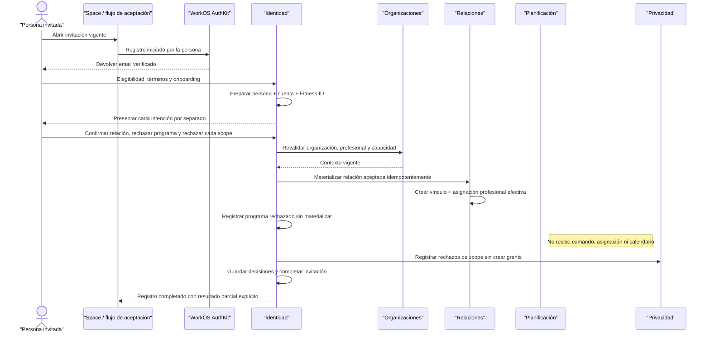

La secuencia describe responsabilidades conceptuales. Como los dominios comparten PostgreSQL detrás de una única API, el modelo lógico debe permitir que la decisión y la materialización aceptada converjan atómicamente, con auditoría/outbox posteriores al commit.

#### Paso 1 — Prueba de control del destinatario

La persona inicia personalmente SignUp desde el enlace. El backend valida:

- access token de AuthKit, incluidos firma mediante JWKS, `iss`, `exp`, `iat`, `sub`, `sid` y `client_id` de la WorkOS Application esperada;
- contacto verificado;
- coincidencia exacta entre el contacto normalizado y el destino de la invitación;
- token de invitación, estado, expiración y no revocación;
- controles de rate limiting, abuso e idempotencia.

Conocer el token sin controlar el contacto no permite continuar. WorkOS AuthKit autentica al sujeto externo, pero todavía no sustituye elegibilidad, onboarding ni autorización de dominio.

#### Paso 2 — Elegibilidad y onboarding propios

La persona declara y acredita lo necesario para aplicar la política adulta versionada. Solo un resultado elegible permite registrar por separado:

- evidencia mínima de elegibilidad;
- aceptación de términos de plataforma y política de privacidad;
- finalización del onboarding;
- vínculo entre el usuario WorkOS y la cuenta local.

La organización no completa ninguno de estos pasos ni recibe los datos privados usados para resolverlos. Los términos no se marcan como aceptados por abrir el enlace o por aceptar una relación.

Si la persona resulta no elegible, no se crean persona, cuenta local, Fitness ID, relación o asignación. La invitación y el intento siguen su flujo restrictivo y de disposición corta.

#### Paso 3 — Creación de una identidad canónica

Identidad crea transaccional e idempotentemente:

- una persona canónica;
- una cuenta local vinculada a `(provider, issuer, subject)`;
- un único Fitness ID;
- evidencias de elegibilidad, términos y onboarding;
- el perfil inicial mínimo o su capacidad de recibir afirmaciones.

La identidad resultante es igual a la de un registro directo en Space. No se crea una variante “cliente de Studio”, y el contacto de la invitación no se copia como una persona provisional.

Aunque todas las intenciones fueran rechazadas, esta identidad personal no pertenecería a la organización ni debería eliminarse por ese motivo. La invitación es opcional respecto de la existencia de la persona.

#### Paso 4 — Presentación y decisión independiente

La UI presenta cada intención con su identidad y versión de contenido, sin casilla global ni selección premarcada.

Para `service_relationship`, la persona ve al menos:

- organización y parte responsable presentadas;
- profesional responsable;
- tipo/finalidad de servicio;
- fecha tentativa y texto versionado aplicable.

Para `program_assignment`, ve al menos:

- programa y versión exacta;
- autor/origen presentado;
- fecha tentativa;
- dependencia explícita respecto de la relación.

La persona acepta la primera y rechaza la segunda. Identidad conserva dos decisiones diferentes con actor, tiempo, versión presentada y resultado. No existe una propiedad `accepted_all` ni se infiere aceptación del programa a partir de la relación.

#### Paso 5 — Revalidación antes de materializar

En el instante de confirmar, el backend vuelve a comprobar:

- invitación todavía vigente y destinada a la persona autenticada;
- organización activa;
- profesional con membresía y capacidad efectivas;
- referencias y propósito sin cambios incompatibles;
- intención de relación aún `proposed`;
- intención de programa aún `proposed` y ligada a la relación presentada;
- ausencia de una materialización previa para las mismas intenciones.

La decisión usa las referencias exactas presentadas. Si cambió la organización, responsable, finalidad, programa o versión de forma material, el backend no sustituye silenciosamente el contenido: falla cerrado y exige una nueva propuesta cuando corresponda.

#### Paso 6 — Materialización de la relación aceptada

Relaciones crea como máximo una vez:

- una relación de servicio entre el nuevo `person_id` y la organización;
- el snapshot del contexto responsable y finalidad presentados;
- una asignación efectiva al profesional responsable validado;
- eventos iniciales de relación y asignación con actor, origen e instante efectivo;
- la referencia de vuelta a la intención que justificó la creación.

La organización puede operar los metadatos mínimos de esa relación. Sin embargo, ni el administrador ni el profesional obtienen acceso al perfil fitness, sesiones, resultados, historial previo o datos corporales porque no existe grant.

#### Paso 7 — No materialización del programa rechazado

La intención `program_assignment` cambia a `rejected` y conserva evidencia mínima de lo presentado y decidido. Planificación no crea:

- asignación de programa;
- snapshot personal de prescripción;
- calendario o sesiones planificadas;
- recordatorios, adherencia o tareas derivadas;
- referencia falsa desde el Fitness ID.

La relación aceptada no se revierte. Para proponer el programa nuevamente se necesita otra intención que presente explícitamente la versión aplicable; la intención rechazada no puede reutilizarse o mutarse a `accepted`.

#### Paso 8 — Finalización parcial de la invitación

Cuando todas las intenciones quedaron decididas:

- la invitación cambia a `completed`;
- `completed_by_person_id` referencia a la persona canónica;
- la intención de relación queda `accepted` y referencia lo materializado;
- la intención de programa queda `rejected` sin entidad destino;
- auditoría registra actor, decisiones, referencias, tiempos y resultado;
- el outbox publica únicamente hechos confirmados después del commit.

`completed` significa “la persona decidió todo lo presentado”, no “aceptó todo”. El resumen de respuesta diferencia de forma explícita qué se creó, qué se rechazó y qué continúa requiriendo autorización.

#### Matriz de entidades y ownership

| Concepto | Dominio/fuente | Resultado | Owner, responsable o sujeto |
| --- | --- | --- | --- |
| Sujeto autenticado | WorkOS AuthKit | Creado y verificado por la persona | Persona controla la cuenta; WorkOS AuthKit autentica |
| Persona canónica | Identidad | Creada una vez | Persona |
| Cuenta local | Identidad | Vinculada al usuario WorkOS | Persona; Allfit administra vínculo técnico |
| Fitness ID | Identidad como raíz/agregado | Activado una vez | Persona |
| Evidencias de elegibilidad/onboarding/términos | Identidad | Creadas separadamente | Persona como sujeto; Allfit custodia evidencia |
| Invitación | Identidad | Pasa a `completed` | Organización responsable de la propuesta; persona completa el sobre |
| Intención de relación | Identidad | `accepted` y vinculada a la relación | Organización propone; persona decide |
| Intención de programa | Identidad | `rejected`, sin materialización | Organización propone; persona decide |
| Relación de servicio | Relaciones | Creada una vez | Persona y organización como partes; Relaciones custodia historia |
| Asignación profesional | Relaciones | Creada para el responsable presentado | Organización administra; persona y profesional son sujetos afectados |
| Programa/versión | Planificación | El master preexistente no cambia | Owner original definido por Planificación |
| Asignación de programa | Planificación | No creada | No aplica |
| Grants/eventos de consentimiento | Privacidad | Un evento de rechazo por opción; ningún grant | Persona decide; Privacidad custodia evidencia |
| Compra/pago/contrato comercial | Dominio futuro | No creados | No aplica |

#### Matriz de autorización resultante

| Operación después del flujo | Persona | Profesional asignado | Organización |
| --- | --- | --- | --- |
| Consultar su propia identidad/Fitness ID | Permitido | Denegado por la relación sola | Denegado por la relación sola |
| Consultar metadatos de la relación | Permitido | Permitido según asignación/capacidad | Permitido para operación legítima |
| Consultar perfil o historial fitness | Permitido | Denegado sin grant/scope | Denegado sin grant/scope |
| Crear o gestionar programa personal | Permitido en sus flujos propios | No mediante esta invitación | No mediante esta invitación |
| Consultar programa master preexistente | Solo si otra autorización lo permite | Según ownership/capacidad previa | Según ownership organizacional previo |
| Ver una asignación derivada de la invitación | No existe | No existe | No existe |
| Capturar observaciones o resultados | Solo sobre sus datos propios | Denegado sin grant y acción compatible | Denegado |
| Cobrar, comprar o usar datos para marketing/IA | No autorizado por este flujo | No autorizado | No autorizado |

La relación aporta contexto de servicio y profesional responsable, pero no sustituye grants, scopes, niveles de acceso, capacidades ni procedencia.

#### Unidad transaccional e idempotencia

La confirmación debe converger a un único resultado observable:

1. bloquea o controla la versión de la invitación e intenciones;
2. valida identidad, contacto, vigencia y dependencias;
3. crea o vincula la identidad canónica cuando corresponde;
4. registra las decisiones separadas;
5. materializa la relación aceptada con su asignación profesional;
6. no materializa la intención rechazada;
7. marca el sobre como completado;
8. registra auditoría y outbox vinculados al mismo resultado.

Un retry con la misma clave devuelve las mismas referencias y estados. No crea otra persona, cuenta, relación, asignación profesional o evento lógico. Los side effects externos consumen outbox idempotente y no deciden el estado de negocio.

#### Fallos y concurrencia que debe resolver

| Caso | Resultado obligatorio |
| --- | --- |
| Email verificado por WorkOS distinto al destino | No vincula invitación ni materializa intenciones |
| Token expirado, revocado o ya completado por otra persona | Falla cerrado; no crea entidades destino |
| Retry después del commit con respuesta perdida | Devuelve persona, relación y decisiones existentes |
| Dos confirmaciones concurrentes de la misma persona | Una materialización; ambas convergen al mismo resultado |
| Dos sujetos intentan completar el mismo sobre | Solo el contacto verificado correcto puede decidir; como máximo un `completed_by_person_id` |
| Organización se suspende antes de confirmar | No materializa la relación; nunca conserva una aceptación contra contexto inválido |
| Profesional pierde membresía/capacidad antes de confirmar | No sustituye otro profesional; bloquea la intención aceptada y exige resolución explícita |
| Programa cambia después de presentarse | El rechazo conserva la referencia presentada; no toca el master ni crea asignación |
| Falla al crear la relación | No marca su intención `accepted` ni completa el sobre con una entidad faltante |
| Falla de auditoría/outbox transaccional | Revierte el resultado de negocio; no deja materialización sin trazabilidad |
| Falla una notificación posterior al commit | No revierte persona o relación; el envío se reintenta idempotentemente |
| Se intenta convertir después el rechazo en aceptación | Se deniega; requiere nueva invitación/intención |

Si el onboarding personal ya quedó completado mediante una operación independiente antes de una falla de materialización, la persona, cuenta y Fitness ID permanecen. Las propuestas pueden fallar o revocarse sin deshacer una identidad que la persona controla.

#### Ciclo de vida y disposición

| Concepto | Evento futuro | Resultado |
| --- | --- | --- |
| Persona/cuenta/Fitness ID | Cierre o solicitud válida | Cada categoría sigue su política; terminar/revocar la relación no elimina identidad |
| Invitación completada | Vencimiento de retención | Se dispone destino/token/metadata transitoria y queda solo evidencia mínima justificada |
| Intención de relación aceptada | Terminación de la relación | La entidad materializada sigue el ciclo de Relaciones; la decisión no la mantiene activa |
| Intención de programa rechazada | Vencimiento de evidencia | Se elimina metadata transitoria y conserva solo evidencia mínima cuando exista finalidad |
| Relación/asignación profesional | Pausa o terminación efectiva | Se corta autoridad, se retiene evidencia bilateral mínima y se inicia disposición aplicable |
| Programa master referenciado en rechazo | Retiro o nueva versión | No cambia la decisión histórica ni crea derechos sobre el master |
| Grants inexistentes | Cualquier cambio de la relación | Nada que revocar; para compartir datos se requiere una relación nueva con otra aceptación de scopes |

Revocar posteriormente el sobre completado no deshace la relación materializada. Esa relación tiene su propio ciclo bilateral y debe pausarse o terminarse mediante Relaciones. La intención rechazada nunca llega a ese ciclo porque no produjo entidad.

#### Comprobación de duplicaciones y filtraciones

| Riesgo | Resultado del recorrido |
| --- | --- |
| Persona “cliente” separada de la persona canónica | No ocurre: la relación referencia el único `person_id` creado por Identidad |
| Cuenta o Fitness ID perteneciente a la organización | No ocurre: ambos permanecen bajo control personal |
| Relación guardada dentro de la invitación | No ocurre: la intención conserva referencia, pero Relaciones es fuente de verdad |
| Asignación creada por relación aceptada | No ocurre: la decisión de programa es independiente y fue rechazada |
| Programa copiado al Fitness ID por haber sido presentado | No ocurre: no hay asignación ni snapshot personal |
| Grant inferido desde la relación | No ocurre: Privacidad permanece en denegación por defecto |
| Profesional viendo datos por ser responsable | No ocurre: asignación profesional sin grant no abre recursos personales |
| Rechazo que elimina la relación aceptada | No ocurre: cada intención conserva resultado y ciclo propios |
| Invitación completada interpretada como `accept_all` | No ocurre: `completed` solo indica que todas las decisiones terminaron |

#### Rama complementaria — Ecosistema vinculado de extremo a extremo

El recorrido anterior prueba que una sola confirmación puede aceptar la relación y rechazar programa y scopes sin crear grants. El flujo vertical obligatorio también exige comprobar la rama complementaria en la que esa misma confirmación acepta relación y programa, concede solo el scope necesario, ejecuta una sesión y permite una consulta profesional autorizada.

Esta rama parte de otra invitación/persona de prueba con decisiones independientes:

| Decisión | Resultado |
| --- | --- |
| `service_relationship` | Aceptada; crea relación y profesional responsable |
| `program_assignment` | Aceptada; crea asignación sobre versión exacta y calendario básico |
| `relationship_training/v1` | Concedido con nivel compatible para acompañamiento |
| `prior_training_history/v1` | Rechazado |
| `body_progress/v1` | Rechazado |
| `health_context/v1` | Rechazado |
| Pagos, IA, publicación y otros usos | No presentados/no autorizados |

La aceptación es parcial porque solo se comparte el entrenamiento producido dentro de la relación; historial anterior, cuerpo y salud continúan denegados.

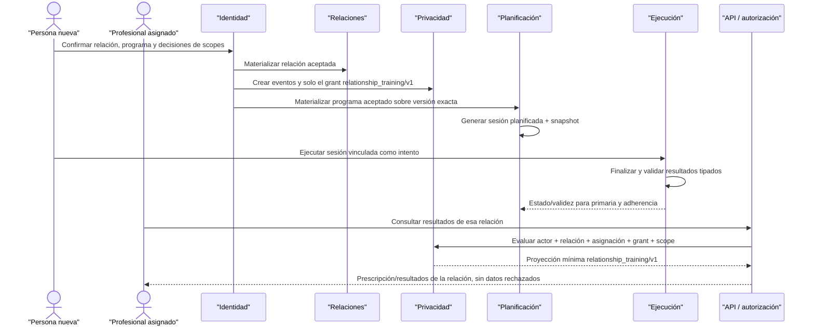

Para que la consulta final sea permitida deben coincidir:

```text
organización activa
+ membresía/capacidad del coach
+ relación vigente
+ asignación profesional efectiva
+ grant relationship_training/v1 vigente
+ access_level, propósito y acción compatibles
+ ejecución originada dentro de esa relación
= proyección mínima permitida
```

La consulta no expone sesiones autónomas, historial anterior, body progress, dolor/health context, biometría, GPS, wearables, notas privadas, pagos o usos secundarios. Si falta cualquiera de las condiciones, falla cerrado sin degradar a una respuesta más amplia.

La materialización conserva fuentes separadas:

- Identidad mantiene persona, cuenta, invitación e intenciones;
- Relaciones mantiene vínculo y profesional responsable;
- Privacidad mantiene eventos/grant y decisiones rechazadas;
- Planificación mantiene programa, versión, asignación, snapshot, sesión planificada e intento/primaria;
- Ejecución mantiene la sesión real y resultados tipados.

Los reintentos crean como máximo una entidad por intención, un grant por concesión efectiva, una asignación, un vínculo de intento y una ejecución por comando idempotente. El profesional consulta la misma ejecución canónica; Studio no recibe una copia de resultados.

#### Resultado de la validación

**Estado:** recertificado — recorrido completo.<br>
**Resultado:** el escenario cubre ambas ramas de aceptación parcial. Rechazar programa crea solo la relación sin grants; aceptar relación/programa y conceder únicamente `relationship_training/v1` completa asignación, ejecución y consulta profesional mínima sin exponer categorías rechazadas.<br>
**Duplicaciones detectadas:** ninguna.<br>
**Filtraciones de autorización detectadas:** ninguna.<br>
**Contradicciones detectadas:** ninguna.<br>
**Ajustes requeridos a los límites de dominio:** ninguno.

El siguiente escenario comprobará que una persona ya registrada directamente en Space acepta una invitación posterior reutilizando su misma cuenta, `person_id` y Fitness ID.

### 12.6 Escenario 4 — Persona de Space acepta después una invitación de Studio

#### Objetivo

Demostrar que una persona registrada directamente en Space puede aceptar posteriormente una invitación de cliente emitida desde Studio sin crear otra cuenta, persona, perfil o Fitness ID, y sin transferir a la organización su historial autónomo anterior.

#### Precondiciones

- La persona adulta completó el escenario Space-only y conserva una cuenta local activa, un `person_id`, un Fitness ID, perfil y al menos una sesión autónoma.
- Su cuenta local está vinculada a un usuario WorkOS mediante `(provider, issuer, subject)`.
- La invitación `client_invitation` está vigente y su destino coincide con un contacto verificado controlado por esa cuenta.
- La invitación contiene `service_relationship` y `program_assignment` con una versión exacta de programa dependiente de la relación.
- La organización, el profesional responsable, su membresía/capacidad y la versión propuesta continúan vigentes.
- No existe todavía una relación entre esa persona y la organización emisora.
- No se presentan grants ni scopes en la misma decisión.

#### Decisiones de la persona

| Elemento | Decisión | Consecuencia |
| --- | --- | --- |
| Cuenta, identidad y Fitness ID existentes | Reutilizados | No se ejecuta registro ni onboarding nuevos |
| `service_relationship` | Aceptada | Se crea la relación y la asignación del profesional responsable |
| `program_assignment` | Aceptada | Se crea una asignación personal ligada a la versión exacta presentada |
| Grants/scopes de datos | No presentados | Continúan denegados por defecto |
| Historial autónomo previo | No forma parte de la invitación | Permanece exclusivamente personal |

#### Resultado esperado

La invitación queda completada por el `person_id` existente. Relaciones crea el vínculo aceptado y Planificación incorpora la versión exacta del programa al mismo Fitness ID mediante una asignación personal y su calendario básico. Identidad no crea ni modifica otra persona, cuenta, perfil o Fitness ID. La sesión autónoma previa permanece intacta y fuera del alcance de la organización y del profesional.

#### Recorrido de extremo a extremo

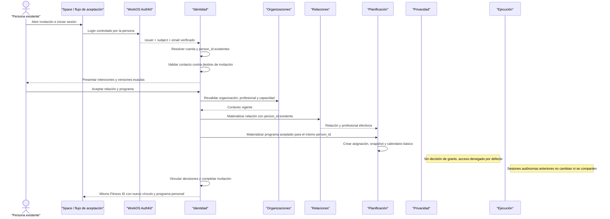

El flujo añade contextos al agregado longitudinal, pero no mueve los hechos entre dominios. El Fitness ID compone referencias a la relación y asignación nuevas junto al perfil e historial ya existentes.

#### Paso 1 — Autenticación con la cuenta existente

La persona inicia login, no SignUp administrativo ni creación de usuario desde Studio. WorkOS AuthKit autentica al sujeto y el backend resuelve primero la restricción única `(provider, issuer, subject)` hacia la cuenta local y el `person_id` existentes.

Esta resolución debe devolver exactamente:

- la misma cuenta local;
- la misma persona canónica;
- el mismo Fitness ID;
- la evidencia de elegibilidad/onboarding ya vigente;
- los mismos perfiles y afirmaciones existentes.

La invitación no es una segunda vía de creación. Si la política adulta o los términos requieren una revisión vigente, se procesa como evidencia personal separada; nunca se infiere desde la invitación ni se crea otra identidad.

#### Paso 2 — Reclamación segura de la invitación

Después de resolver la cuenta, Identidad verifica:

- token hasheado, vigencia, estado y no revocación del sobre;
- coincidencia del destino normalizado con un contacto verificado del sujeto autenticado;
- organización y propósito esperados;
- que la invitación no tenga otro `completed_by_person_id`;
- idempotencia de la reclamación.

El orden es deliberado: primero se conoce a la persona por su sujeto autenticado y luego se prueba que puede reclamar la invitación. No se busca ni se fusiona una persona por coincidencia de email o celular.

Studio continúa sin recibir una respuesta del tipo “este contacto ya estaba registrado”. Solo después de la decisión puede conocer que la relación aceptada referencia una persona canónica, dentro del acceso mínimo que esa relación permite.

#### Paso 3 — Conservación íntegra del estado previo

Antes de materializar propuestas, el sistema mantiene sin cambios:

- `person_id` e identificador público del Fitness ID;
- vínculo de usuario WorkOS;
- perfil, afirmaciones, procedencia y revisiones;
- sesiones autónomas, segmentos, resultados y derivados;
- objetivos, preferencias y demás datos personales;
- fechas originales de creación y auditoría.

No se cambia procedencia `person_declared` a `professional_observed`, no se asigna organización a datos previos y no se reescriben sesiones autónomas como ejecuciones de una relación.

#### Paso 4 — Decisiones independientes

La persona recibe las mismas garantías del escenario anterior:

- cada intención se presenta por separado;
- organización, parte responsable, profesional y finalidad son explícitos;
- el programa apunta a una versión exacta e inmutable;
- la dependencia del programa respecto de la relación es visible;
- no existe `accept_all` ni selección premarcada;
- términos, pagos y usos secundarios quedan fuera; los scopes de la relación se presentan como decisiones independientes en la misma confirmación.

En este recorrido la persona acepta ambas intenciones y rechaza todas las opciones de scope en la misma confirmación. Aceptar el programa no convierte la relación en un grant y aceptar la relación no comparte automáticamente lo que ya existía en el Fitness ID.

#### Paso 5 — Materialización de la relación

Relaciones crea idempotentemente para el `person_id` existente:

- una relación de servicio con la organización;
- el snapshot del contexto responsable y finalidad presentados;
- la asignación efectiva del profesional responsable;
- eventos iniciales de relación y asignación;
- referencia a la intención aceptada como origen.

La relación no crea una fila “cliente” paralela. “Cliente” es el rol contextual de la misma persona dentro de ese vínculo.

Sin grants, el profesional y la organización pueden operar únicamente metadatos mínimos de la relación. No pueden leer perfil fitness, historial previo, sesiones autónomas, resultados, progreso corporal o contexto de salud.

#### Paso 6 — Materialización del programa aceptado

Una vez válida la relación dependiente, Planificación crea como máximo una vez:

- una asignación para el mismo `person_id`;
- referencia a la versión exacta de programa presentada;
- snapshot personal de la prescripción aplicable;
- origen organizacional y profesional inmutables;
- gestión efectiva ligada a la relación;
- calendario básico y sesiones futuras conforme a la versión/snapshot.

El programa master conserva su owner original. La asignación y sus sesiones planificadas forman parte del historial personal; no son una copia del perfil ni transfieren ownership del Fitness ID.

La aceptación autoriza recibir esa prescripción concreta. No autoriza por sí sola al profesional a consultar ejecuciones, métricas o calendario personal más allá de la evidencia mínima de materialización. Las operaciones de seguimiento o contribución que consuman datos requieren relación, asignación, capacidad, grant/scope y acción compatibles.

#### Paso 7 — Ausencia de compartición retroactiva

Privacidad mantiene denegación porque la persona rechazó todos los scopes presentados. En particular:

- `relationship_training` no existe;
- `prior_training_history` no existe;
- la sesión autónoma previa no aparece en listados, conteos, récords, derivados o analítica de la relación;
- perfil y objetivos previos no se exponen;
- frecuencia cardiaca, GPS, biometría y wearables continúan fuera;
- Studio no puede precargar el nuevo vínculo con datos personales históricos.

Para compartir en el futuro se requiere una relación nueva y otra aceptación. Aunque entonces conceda `relationship_training`, ese scope no incorpora automáticamente sesiones autónomas o historial previo: cada categoría y finalidad conserva su definición y versión exactas.

#### Paso 8 — Completitud e integración del Fitness ID

Después de materializar ambas intenciones:

- la invitación queda `completed` por el `person_id` existente;
- cada intención queda `accepted` con referencia a su entidad destino;
- la relación y asignación apuntan a la misma persona canónica;
- Space muestra el programa nuevo dentro del Fitness ID existente;
- Studio muestra únicamente el contexto autorizado de relación/propuesta;
- auditoría y outbox registran un solo resultado idempotente.

No se “migra” la persona de Space a Studio. Ambos productos consultan mediante la API los mismos registros canónicos y aplican proyecciones diferentes según actor, relación y permisos.

#### Matriz de entidades y cambios

| Concepto | Dominio/fuente | Antes | Después |
| --- | --- | --- | --- |
| Usuario WorkOS | WorkOS AuthKit | Existente | El mismo |
| Cuenta local | Identidad | Existente y activa | La misma; no se crea otra |
| Persona canónica | Identidad | Existente | Mismo `person_id` |
| Fitness ID | Identidad como raíz/agregado | Existente con perfil e historial | El mismo; compone nuevas referencias |
| Perfil/afirmaciones | Identidad | Existentes | Sin cambios por aceptar |
| Sesión autónoma/resultados | Ejecución | Existentes | Sin cambios y no compartidos |
| Invitación | Identidad | Pendiente y sin `person_id` enlazado | `completed` por la persona existente |
| Intención de relación | Identidad | `proposed` | `accepted` y vinculada a Relaciones |
| Intención de programa | Identidad | `proposed` | `accepted` y vinculada a Planificación |
| Relación/asignación profesional | Relaciones | Inexistentes | Creadas para el `person_id` existente |
| Programa master/versión | Planificación | Existentes | Sin modificación |
| Asignación/snapshot/calendario | Planificación | Inexistentes | Creados para el mismo `person_id` |
| Grants/eventos de consentimiento | Privacidad | Inexistentes | Continúan inexistentes |

#### Matriz de acceso resultante

| Recurso/operación | Persona | Profesional/organización | Motivo |
| --- | --- | --- | --- |
| Identidad y perfil personal | Acceso propio | Denegado | Relación/programa no son grants |
| Sesión autónoma anterior | Acceso propio | Denegado | No fue creada ni compartida bajo la relación |
| Relación y profesional responsable | Visible | Metadatos operativos mínimos | Es el vínculo bilateral aceptado |
| Contenido prescrito recibido | Visible | Evidencia del master/versión y materialización propia | La persona aceptó esa asignación concreta |
| Calendario personal derivado | Visible | Restringido sin grant aplicable | Es planificación personal, no directorio organizacional |
| Ejecuciones futuras de sesiones asignadas | Acceso propio | Denegadas hasta cumplir acceso efectivo | La asignación no concede lectura de resultados |
| Body progress, health context o wearables | Acceso propio | Denegado | Requieren scopes separados explícitos |
| Gestión o contribución profesional | Según decisiones personales | Denegada mientras falte grant/acción compatible | Capacidad y asignación no sustituyen privacidad |

#### Unidad transaccional e idempotencia

La confirmación controla concurrentemente la invitación y sus intenciones, revalida dependencias y produce un único resultado:

1. resuelve la identidad existente por el sujeto autenticado;
2. verifica el contacto y reclama el sobre para ese `person_id`;
3. registra decisiones independientes;
4. materializa la relación aceptada;
5. materializa el programa únicamente después de la relación;
6. completa la invitación con referencias a ambas entidades;
7. registra auditoría/outbox sin duplicar efectos externos.

Un retry nunca vuelve a ejecutar onboarding ni crea un segundo Fitness ID. Las restricciones lógicas deben asegurar como máximo una relación y una asignación por intención materializada.

#### Fallos y concurrencia que debe resolver

| Caso | Resultado obligatorio |
| --- | --- |
| Persona autenticada con contacto distinto | No reclama el sobre ni revela datos del destinatario esperado |
| Persona intenta SignUp aunque ya tiene cuenta | El flujo orienta a login/recuperación; Studio no crea otra cuenta |
| Otro usuario WorkOS presenta un email verificado coincidente | No fusiona personas automáticamente; bloquea y deriva a recuperación/revisión segura |
| Evidencia de elegibilidad vigente falta o está restringida | Falla cerrado y resuelve el requisito personal sin crear otra identidad |
| Retry con respuesta perdida | Devuelve mismo `person_id`, relación, asignación e invitación completada |
| Dos confirmaciones concurrentes | Una sola materialización por intención y un solo `completed_by_person_id` |
| Relación ya apareció por otro flujo concurrente | No duplica vínculo; aplica la regla idempotente/conflicto explícita del modelo lógico |
| Organización o profesional pierden vigencia | No materializa contra contexto inválido ni sustituye actores silenciosamente |
| Versión de programa fue retirada para nuevos usos | No selecciona `latest`; bloquea esa intención y conserva presentación histórica |
| Relación se crea pero falla dependencia de programa | No inventa otra versión; informa el resultado por intención sin borrar identidad |
| Invitación revocada durante confirmación | La comprobación autoritativa impide nuevas materializaciones |
| Dos organizaciones invitan a la misma persona | Reutilizan el mismo `person_id`, pero crean relaciones y permisos independientes |
| UI o caché mezcla historial autónomo con Studio | Backend/RLS filtran por relación, grants, scopes y procedencia; la UI no es frontera |

La política exacta ante una relación equivalente preexistente se cerrará en el modelo lógico. Ninguna resolución podrá crear otra persona, apropiarse de una relación de otra organización o enlazar por contacto sin autenticación.

#### Ciclo de vida y continuidad

| Evento futuro | Identidad/Fitness ID | Relación/programa | Historial autónomo |
| --- | --- | --- | --- |
| Vence la retención del sobre completado | Sin cambio | Entidades materializadas siguen su ciclo propio | Sin cambio |
| Persona revoca un grant futuro | Sin cambio | Relación puede seguir, funciones basadas en datos se bloquean | Permanece personal |
| Relación termina | Sin cambio | Asignación queda `detached_pending_choice`; gestión profesional se corta | Permanece personal e intacto |
| Persona decide continuar el plan personalmente | Mismo Fitness ID | Conserva asignación/snapshot sin acceso de la organización anterior | Convive con el plan personal |
| Persona elimina una sesión autónoma válidamente | Identidad no se duplica | No afecta evidencia de relación/programa | Ejecución aplica su disposición por categoría |
| Persona cierra cuenta | Revoca acceso e inicia disposición coordinada | Cada dominio aplica política y evidencia mínima | Sigue su política de disposición propia |

Aceptar una invitación no reinicia el ciclo de vida personal ni cambia las fechas de retención de datos previos. Cada categoría conserva su finalidad y trigger originales.

#### Comprobación de duplicaciones y filtraciones

| Riesgo | Resultado del recorrido |
| --- | --- |
| Segunda persona para “cliente Studio” | No ocurre: se usa el `person_id` resuelto desde la cuenta existente |
| Segundo Fitness ID al entrar a una organización | No ocurre: la relación y asignación se incorporan al agregado existente |
| Fusión por email/celular | No ocurre: el contacto solo prueba control del sobre después de autenticar |
| Perfil copiado a Studio | No ocurre: Studio consulta proyecciones autorizadas de Identidad |
| Historial autónomo reasignado al profesional | No ocurre: Ejecución conserva origen y Privacidad deniega exposición |
| Programa master copiado como propiedad personal | No ocurre: la asignación referencia versión/snapshot y conserva autoría/owner |
| Asignación guardada dentro de Identidad | No ocurre: la intención referencia la entidad cuya fuente es Planificación |
| Grant inferido de programa o relación | No ocurre: no se crea evento de consentimiento ni grant |
| Invitaciones de varias organizaciones mezcladas | No ocurre: cada sobre, relación, asignación y eventual grant conserva contexto propio |

#### Resultado de la validación

**Estado:** recertificado — recorrido completo.<br>
**Resultado:** el escenario converge sobre la identidad creada en Space. La invitación materializa relación y programa para el mismo `person_id` y Fitness ID, sin duplicar perfiles o historia y sin conceder acceso retroactivo o implícito.<br>
**Duplicaciones detectadas:** ninguna.<br>
**Filtraciones de autorización detectadas:** ninguna.<br>
**Contradicciones detectadas:** ninguna.<br>
**Ajustes requeridos a los límites de dominio:** ninguno.

El siguiente escenario validará que una práctica unipersonal incorpore miembros y se convierta en equipo sin crear otra organización, migrar relaciones o cambiar ownership.

### 12.7 Escenario 5 — Práctica unipersonal incorpora su primer profesional

#### Objetivo

Demostrar que una práctica creada mediante onboarding `solo_professional` puede incorporar un segundo profesional y operar como equipo conservando la misma organización, tipo, clientes, relaciones, programas, grants, auditoría y ownership.

El escenario también prueba que la membresía nueva no concede acceso automático a clientes y que una reasignación posterior cambia al actor efectivo sin reemplazar la relación ni reescribir la historia del profesional anterior.

#### Precondiciones

- Existe una organización activa con `organization_kind = professional_practice` y procedencia inicial `solo_professional`.
- La organización tiene una única membresía activa con rol owner perteneciente al profesional fundador.
- El fundador conserva su persona y perfil profesional en Identidad; la organización solo los referencia.
- Existen programas master de la organización y al menos una relación de servicio con el fundador como profesional asignado.
- Para probar la reasignación, esa relación tiene un grant vigente cuya parte responsable, organización, finalidad y scope no cambiarán.
- El segundo profesional ya tiene persona, cuenta, elegibilidad y perfil profesional propios.
- No existe todavía una membresía entre el segundo profesional y la práctica.

#### Resultado esperado

Después de aceptar una invitación `staff_invitation`, la práctica conserva el mismo `organization_id`, `organization_kind`, procedencia, owner, relaciones y activos; solo añade una membresía profesional activa. La condición de equipo se deriva de dos membresías activas y no se persiste como cambio de tipo o bandera.

La nueva persona no accede a clientes por incorporarse. Cuando el owner reasigna explícitamente una relación, Relaciones termina la asignación anterior e inicia la nueva con tiempos efectivos. El grant puede seguir siendo el mismo porque no cambian organización, parte responsable, finalidad ni scope, pero solo el profesional actualmente asignado puede ejercerlo.

#### Recorrido de extremo a extremo

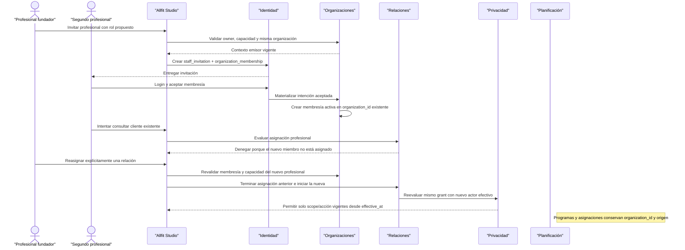

La incorporación y la reasignación son comandos distintos. Aceptar la membresía nunca ejecuta implícitamente el segundo.

#### Paso 1 — Estado unipersonal derivado

Antes de invitar, la práctica tiene:

- una organización canónica estable;
- tipo principal `professional_practice`;
- procedencia `solo_professional`;
- una membresía owner activa;
- cero membresías adicionales activas;
- relaciones, grants y activos asociados al mismo `organization_id`.

“Unipersonal” es una lectura derivada de las membresías efectivas en un instante. No existe `is_independent`, `solo_mode`, `coach_organization` ni otra raíz que deba convertirse o migrarse.

La procedencia `solo_professional` permanece como hecho histórico aunque después haya dos, diez o más integrantes.

#### Paso 2 — Invitación de staff separada

El owner emite desde Studio una invitación con:

- propósito `staff_invitation`;
- una única intención `organization_membership`;
- la misma organización estable;
- rol profesional propuesto;
- versión del contenido presentado y vigencia;
- destino protegido y token hasheado.

La invitación no puede mezclar `service_relationship` o `program_assignment`, porque el segundo profesional se incorpora como integrante interno y no como cliente.

Antes de aceptar:

- no existe membresía pendiente en Organizaciones;
- Identidad conserva únicamente el sobre y la intención;
- el profesional invitado no aparece como integrante efectivo;
- la cantidad derivada de miembros activos continúa siendo uno;
- no cambia ningún permiso, cliente, relación, grant o programa.

#### Paso 3 — Aceptación y materialización de la membresía

El segundo profesional inicia sesión con su cuenta, reclama la invitación mediante el contacto verificado y acepta personalmente el rol presentado. Identidad no crea otro perfil profesional ni copia sus credenciales dentro de la organización.

Organizaciones revalida:

- organización activa;
- autoridad del emisor;
- rol todavía asignable;
- compatibilidad de capacidades;
- invitación/intención vigentes;
- ausencia de otra membresía activa equivalente;
- idempotencia del comando.

Después materializa una membresía con:

- `organization_id` original;
- `person_id` del segundo profesional;
- rol y capacidades efectivas;
- origen en la intención aceptada;
- inicio efectivo;
- eventos de alta y rol con actor y tiempo.

La invitación queda completada. El conteo derivado pasa de una a dos membresías activas, pero no existe una transición de `solo` a `team` almacenada como tipo de negocio.

#### Paso 4 — Continuidad organizacional sin migración

La incorporación no modifica:

- `organization_id`;
- `organization_kind = professional_practice`;
- procedencia `solo_professional`;
- membresía owner del fundador;
- sedes, configuración o estado organizacional;
- relaciones de servicio existentes;
- profesionales asignados a esas relaciones;
- grants y evidencias de consentimiento;
- owner, autoría o versiones de programas master;
- asignaciones, sesiones planificadas o ejecuciones;
- suscripción o referencias comerciales existentes;
- eventos de auditoría anteriores.

No se copian filas a una “organización de equipo”, no se cambian FKs masivamente y no se emiten eventos falsos de transferencia de ownership.

#### Paso 5 — Autorización inicial del nuevo integrante

La membresía permite únicamente las operaciones organizacionales compatibles con su rol/capacidades. No concede por sí sola:

- acceso a clientes o Fitness IDs;
- asignación a relaciones de servicio;
- uso de grants existentes;
- lectura de programas personales o calendarios;
- consulta de sesiones, resultados, progreso o salud;
- edición de programas master sin capacidad específica;
- administración de membresías, roles o sedes.

Cuando el nuevo integrante intenta abrir un cliente existente, la fórmula de acceso falla porque no tiene asignación profesional efectiva. Backend/RLS deniegan sin revelar perfil, historial, existencia de grants o detalles sensibles de la relación.

El rol `owner`, `admin`, `staff` o `coach` no reemplaza ninguna dimensión restante de autorización.

#### Paso 6 — Reasignación explícita de un cliente

Para que el segundo profesional atienda una relación concreta, un actor autorizado ejecuta otro comando con fecha efectiva. El backend valida simultáneamente:

- organización y relación activas;
- nuevo profesional con membresía y capacidad vigentes;
- autoridad del actor que solicita el cambio;
- compatibilidad del servicio;
- ausencia de solapamiento no autorizado;
- grant, finalidad, scope y acción aplicables.

Relaciones conserva el mismo `relationship_id` y:

1. finaliza la asignación del fundador en `effective_at`;
2. crea una nueva asignación para el segundo profesional desde ese instante;
3. registra before/after, actor, motivo y tiempos efectivos;
4. invalida el acceso del profesional anterior;
5. habilita al nuevo solo cuando toda la fórmula de acceso es verdadera;
6. notifica a la persona atendida conforme al flujo aplicable.

No se crea otra relación para simular el cambio de coach. La organización sigue siendo la misma parte operativa y la persona conserva su Fitness ID.

#### Paso 7 — Continuidad condicionada del grant

Privacidad no crea un grant por profesional. El grant existente puede conservarse porque permanecen:

- la misma persona;
- la misma relación;
- la misma organización y parte responsable;
- la misma finalidad;
- el mismo scope, versión y nivel de acceso.

Lo que cambia es el actor humano que puede ejercerlo. El fundador deja de cumplir la asignación efectiva desde `effective_at`; el segundo profesional comienza a cumplirla desde ese mismo punto, siempre que su membresía, capacidad y acción también sean válidas.

Si cambia organización, parte responsable, finalidad, scope o nivel aceptado, el grant anterior no se reutiliza y se requiere otra decisión explícita de la persona.

#### Paso 8 — Preservación de autoría y activos

El crecimiento no vuelve colectivos retroactivamente los aportes personales. Se conserva:

- autoría del fundador sobre observaciones y capturas propias;
- autoría del nuevo profesional sobre contribuciones futuras;
- organización de contexto de cada acción;
- periodos efectivos de responsabilidad;
- owner y autoría de programas master;
- origen y snapshot de asignaciones personales;
- procedencia de resultados y correcciones;
- auditoría de quién actuó realmente.

Un programa creado por el fundador bajo la organización puede seguir siendo activo organizacional conforme a su ownership registrado, pero incorporar un miembro no le atribuye coautoría ni permiso de edición automático.

#### Matriz antes/después

| Concepto | Antes | Después de aceptar membresía | Después de reasignar una relación |
| --- | --- | --- | --- |
| `organization_id` | Práctica original | El mismo | El mismo |
| `organization_kind` | `professional_practice` | Sin cambio | Sin cambio |
| Procedencia | `solo_professional` | Se conserva | Se conserva |
| Membresías activas | Una: fundador owner | Dos: owner + profesional | Las mismas dos |
| Condición unipersonal | Derivada como verdadera | Derivada como falsa | Derivada como falsa |
| Persona/perfil del invitado | Existen fuera de la práctica | Se referencian, no se copian | Sin cambio |
| Relaciones de clientes | Existentes | Sin cambio | Misma relación; cambia asignación efectiva en una |
| Grants | Existentes por relación | Sin cambio | Mismo grant cuando no cambian sus dimensiones |
| Programas master | Owner/origen existentes | Sin cambio | Sin cambio |
| Asignaciones personales | Referencian organización/origen | Sin cambio | Gestión cambia solo si el comando específico lo requiere |
| Auditoría | Historia previa | Añade aceptación/alta | Añade evento efectivo de reasignación |

#### Matriz de acceso

| Actor/estado | Membresía | Asignación en relación | Grant compatible | Resultado |
| --- | --- | --- | --- | --- |
| Fundador antes de reasignar | Activa | Activa | Vigente | Puede ejercer acciones incluidas |
| Nuevo profesional recién incorporado | Activa | Inexistente | Existe para la relación, no para cualquier actor | Denegado |
| Nuevo profesional después de reasignar | Activa | Activa desde `effective_at` | Vigente y misma parte/finalidad/scope | Puede ejercer solo acciones incluidas |
| Fundador después de reasignar | Activa | Terminada | Grant sigue ligado a relación | Denegado para esa relación |
| Admin nunca asignado | Activa | Inexistente | Puede existir | Denegado |
| Profesional con membresía suspendida | Suspendida | Puede constar históricamente | Puede existir | Denegado inmediatamente |

#### Fallos y concurrencia que debe resolver

| Caso | Resultado obligatorio |
| --- | --- |
| Retry del onboarding `solo_professional` original | No crea otra práctica ni otra membresía owner |
| Retry de la invitación con misma idempotency key | Devuelve el mismo sobre e intención |
| Retry concurrente de aceptación | Crea como máximo una membresía activa para persona/organización |
| La persona ya es miembro activo | No duplica membresía ni reinicia su fecha efectiva silenciosamente |
| Invitación propone rol ya no asignable | No materializa otra capacidad; exige propuesta válida |
| Organización se suspende durante aceptación | Falla cerrado; no activa membresía |
| Nuevo miembro consulta clientes antes de asignación | Deniega y no filtra datos ni existencia de grants |
| Dos reasignaciones concurrentes | Serializa/conflicta; no deja periodos activos incompatibles |
| Nuevo profesional pierde membresía durante reasignación | No comienza asignación ejercible y el acceso permanece bloqueado |
| Worker procesa tarde la reasignación | `effective_at` gobierna autoridad; el retraso no extiende acceso anterior |
| Cambio de plan SaaS por segundo asiento | Puede limitar la operación comercial, pero nunca crea otra organización o migra datos |
| Miembro pertenece también a un gimnasio | Usa el mismo `person_id`/perfil con membresías, clientes y permisos separados |
| Conteo vuelve a una sola membresía | La práctica sigue siendo la misma; no reactiva un modo o tipo “independiente” |

La cardinalidad está resuelta: toda organización activa tiene exactamente una membresía activa con rol `owner`, y la gestión genérica no puede otorgarlo, retirarlo ni terminar esa membresía. El autoservicio owner-only transfiere la propiedad a una membresía activa bajo locks y mantiene exactamente uno al confirmar; tamaño, plan SaaS o rol nunca se convierten en identidad organizacional.

#### Ciclo de vida y disposición

| Evento | Organización | Membresía/permiso | Relaciones y datos personales |
| --- | --- | --- | --- |
| Nuevo integrante acepta | Sin cambio de identidad/tipo | Nace membresía efectiva | Ningún acceso automático a clientes |
| Cambia rol/capacidad | Sin cambio | Evento efectivo con before/after | Se reevalúan operaciones; no se amplían grants |
| Se suspende membresía | Continúa | Capacidades dejan de ser efectivas | Asignaciones no son ejercibles y acceso se bloquea |
| Integrante sale | Continúa | Membresía termina y conserva evidencia mínima | Debe reasignarse o pausarse cada relación afectada |
| Vuelve a quedar un solo integrante | Continúa igual | Conteo derivado vuelve a uno | No migra ni cambia ownership |
| Cierra la práctica | Estado organizacional cierra | Todas las capacidades terminan | Relaciones/grants se coordinan; Fitness IDs permanecen personales |

Terminar la membresía del segundo profesional no elimina su persona o perfil profesional, ni afecta sus membresías en otras organizaciones. Tampoco borra sus aportes históricos: estos se conservan o disponen por categoría, finalidad y plazo sin mantener acceso operativo.

#### Comprobación de duplicaciones y transferencias indebidas

| Riesgo | Resultado del recorrido |
| --- | --- |
| Nueva organización al contratar | No ocurre: se conserva la raíz original |
| Cambio de `professional_practice` a un tipo “team” | No ocurre: tamaño y actividad principal son dimensiones diferentes |
| Bandera `is_independent` desactualizada | No ocurre: la condición se deriva de membresías activas |
| Perfil profesional copiado dentro de la práctica | No ocurre: la membresía referencia la persona de Identidad |
| Clientes convertidos en membresías organizacionales | No ocurre: permanecen en Relaciones |
| Acceso retroactivo por nuevo rol | No ocurre: falta asignación y evaluación de grant/acción |
| Relación duplicada al cambiar profesional | No ocurre: cambia la asignación efectiva de la misma relación |
| Grant duplicado por coach | No ocurre: el grant sigue ligado a persona/relación/organización/finalidad |
| Programas migrados o reatribuidos | No ocurre: conservan owner, organización y autoría originales |
| Historial anterior reescrito | No ocurre: eventos y contribuciones conservan actor y tiempos efectivos |

#### Resultado de la validación

**Estado:** recertificado — recorrido completo.<br>
**Resultado:** una práctica deja de ser fácticamente unipersonal al añadir una membresía, no mediante conversión de tipo o migración. La reasignación explícita permite operar como equipo preservando organización, relaciones, grants, activos, autoría y auditoría.<br>
**Duplicaciones detectadas:** ninguna.<br>
**Transferencias indebidas de ownership detectadas:** ninguna.<br>
**Filtraciones de autorización detectadas:** ninguna.<br>
**Contradicciones detectadas:** ninguna.<br>
**Ajustes requeridos a los límites de dominio:** ninguno.

El siguiente escenario validará scopes independientes y ocultación de una sesión autónoma para una relación sin filtrarla mediante conteos, récords, derivados o cachés.

### 12.8 Escenario 6 — Scopes independientes y sesión oculta por relación

#### Objetivo

Demostrar que una misma sesión autónoma puede compartirse con una relación y ocultarse para otra, aunque ambas tengan grants de historial previo y la segunda posea scopes adicionales. La exclusión debe aplicarse antes de seleccionar campos, calcular agregados o formar respuestas para que la sesión tampoco se infiera indirectamente.

#### Precondiciones

- Una persona adulta conserva un único Fitness ID y dos relaciones activas e independientes: relación A con organización A y relación B con organización B.
- Cada relación tiene un profesional asignado con organización, membresía y capacidad vigentes.
- La persona concedió `prior_training_history/v1` con `access_level = read` por separado a ambas relaciones.
- La relación A no tiene `health_context`.
- La relación B tiene además `health_context/v1` con lectura, mediante otra decisión explícita.
- Ninguna relación tiene `body_progress`, scopes futuros, publicación, marketing, IA o entrenamiento de modelos.
- La persona registra una sesión autónoma S fuera de ambas relaciones.
- La sesión S contiene resultados de entrenamiento, una declaración de dolor `person_reported` asociada y fixtures controlados de frecuencia cardiaca/GPS para comprobar redacción; estos últimos no habilitan una capacidad productiva V1.
- La persona crea una denegación específica que oculta S únicamente para la relación B.

#### Resultado esperado

La relación A puede consultar S solo mediante la proyección de `prior_training_history/v1`: ve resultados tipados y procedencia general, pero no dolor, frecuencia cardiaca o GPS. La relación B no ve ningún campo, presencia, conteo o derivado de S, aunque sus grants combinados pudieran cubrir resultados y dolor. La persona continúa viendo la sesión completa según sus permisos propios y Ejecución no modifica ni duplica el hecho original.

#### Estado de autorización por relación

| Dimensión | Relación A | Relación B |
| --- | --- | --- |
| `relationship_training/v1` | Irrelevante para S autónoma | Irrelevante para S autónoma |
| `prior_training_history/v1` | Concedido, `read` | Concedido, `read` |
| `body_progress/v1` | No concedido | No concedido |
| `health_context/v1` | No concedido | Concedido, `read` |
| Denegación específica sobre S | No existe | Activa |
| Resultado de entrenamiento de S | Visible según proyección v1 | Oculto |
| Dolor asociado a S | Oculto | Oculto por denegación más específica |
| Frecuencia cardiaca/GPS raw | Fuera de V1 | Fuera de V1 |

#### Recorrido de extremo a extremo

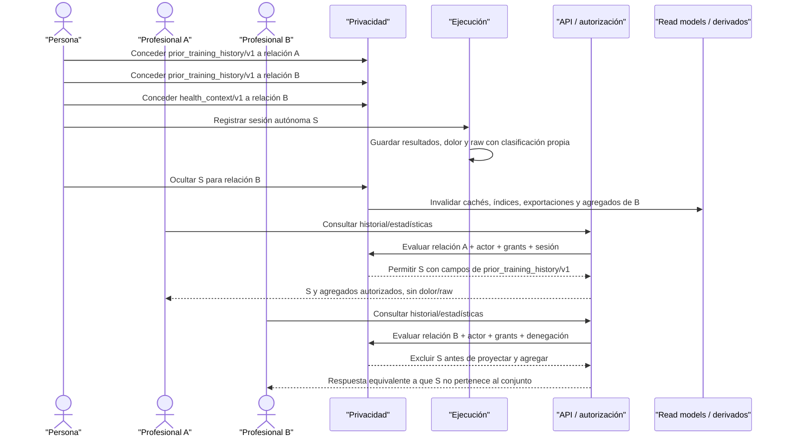

La regla decisiva es **filtrar antes de proyectar y agregar**. No es suficiente ocultar una tarjeta en Studio después de obtener datos o restar una fila al final.

#### Paso 1 — Consentimientos separados por relación

La persona recibe solicitudes distintas que identifican:

- organización y parte responsable;
- `relationship_id`;
- scope, definición y versión exacta;
- finalidad;
- `access_level`;
- vigencia;
- texto presentado y efecto de negar/revocar.

Privacidad registra un evento por decisión y materializa un grant por relación/scope concedido. No existe un grant “global para el coach”, ni la concesión a A se hereda por B aunque las organizaciones, profesionales o finalidades se parezcan.

La concesión de `health_context/v1` para B no amplía `prior_training_history/v1`, no añade acciones de contribución y no afecta a A.

#### Paso 2 — Clasificación de la sesión y sus campos

Ejecución conserva una sola sesión S con `person_id` de la persona y origen autónomo. Sus elementos se clasifican por categoría:

| Elemento de S | Dominio fuente | Clasificación/contrato aplicable | Regla |
| --- | --- | --- | --- |
| Disciplina, fecha, duración y estado | Ejecución/Catálogo | Historial de entrenamiento | Elegibles para `prior_training_history/v1` |
| Segmentos y resultados tipados | Ejecución | Historial de entrenamiento | Elegibles según campos exactos de v1 |
| Récord derivado de un resultado | Ejecución/derivados | Hereda clasificación del resultado y de todos sus inputs | Solo visible si S y todos los inputs son autorizados |
| Dolor declarado durante S | Ejecución, con fuente `person_reported` | `health_context` | No entra en historial por estar dentro de una sesión |
| Frecuencia cardiaca raw | Ejecución/dispositivo | Wearables/biometría fuera de V1 | Ningún scope V1 la expone |
| GPS/ruta raw | Ejecución/dispositivo | Ubicación/wearables fuera de V1 | Ningún scope V1 la expone |

Que los campos compartan `session_id` no los coloca bajo el mismo scope. La API no devuelve una fila ancha y espera que el frontend elimine columnas sensibles.

#### Paso 3 — Visibilidad inicial por scope

Antes de crear la denegación específica, la evaluación para cada relación comienza desde cero y exige:

```text
persona correcta
+ organización activa
+ relación vigente
+ profesional asignado
+ membresía y capacidad vigentes
+ grant de relación/scope/versión/finalidad activo
+ access_level y acción compatibles
+ campo incluido por definición
+ ausencia de denegación más específica
= acceso al mínimo proyectado
```

Para A, `prior_training_history/v1` vuelve elegibles los campos de entrenamiento de S. Dolor permanece oculto porque A no tiene `health_context`; raw cardiaco y GPS permanecen fuera de V1.

Para B, la combinación de `prior_training_history/v1` y `health_context/v1` puede volver elegibles resultados y dolor bajo sus finalidades respectivas, pero nunca raw cardiaco/GPS ni acciones superiores a `read`.

#### Paso 4 — Ocultación específica para la relación B

La persona emite un comando autenticado e idempotente que referencia exactamente:

- su `person_id`;
- relación B;
- sesión S;
- acción `hide`;
- instante efectivo;
- actor, motivo opcional y contexto mínimo de auditoría.

Privacidad comprueba que la sesión pertenece a la persona y que la relación también la tiene como sujeto. La denegación se aplica a toda la organización responsable de B y a cualquier profesional que ejerza esa relación.

No cambia:

- sesión, resultados o procedencia en Ejecución;
- visibilidad personal;
- grants de B;
- visibilidad de S en A;
- otras sesiones de la persona;
- relación o asignación profesional.

La denegación solo reduce el conjunto efectivo de B y prevalece sobre todos los permisos que pudieran exponer campos derivados de S dentro de esa relación.

#### Paso 5 — Proyección autorizada para A

Cuando el profesional A consulta, el backend evalúa el contexto actual y devuelve únicamente:

- identidad pública/referencia mínima de la sesión según contrato;
- fecha, disciplina, duración y estado elegibles;
- segmentos/resultados incluidos en `prior_training_history/v1`;
- récords o derivados cuyos inputs sean completamente autorizados;
- procedencia general necesaria para interpretar el dato.

No devuelve dolor, health context, frecuencia cardiaca, GPS, datos de dispositivo, notas privadas, programas anteriores o campos introducidos por una versión de scope posterior.

Si se publica `prior_training_history/v2` con un campo nuevo, el grant v1 de A continúa fijado a v1 y ese campo permanece oculto hasta otra aceptación.

#### Paso 6 — Exclusión completa para B

Para toda operación bajo la relación B, S se elimina del conjunto autorizado antes de ejecutar:

- listados y detalle;
- búsqueda y filtros;
- conteos y totales de paginación;
- rangos de fechas o “última actividad”;
- récords personales;
- tendencias, volumen, carga, rachas y progreso;
- adherencia o recomendaciones;
- comparaciones y percentiles;
- exportaciones o reportes;
- índices, read models y materializaciones;
- notificaciones y reglas automáticas;
- contexto de IA o features de modelos.

La respuesta no contiene placeholder, `NULL` especial, hueco de secuencia, motivo de exclusión ni mensaje “hay una sesión oculta”. Tampoco cambia de error de una manera que permita distinguir S de una sesión inexistente o no autorizada.

El grant `health_context/v1` de B no vence la denegación. El dolor asociado a S queda excluido junto con cualquier derivado que lo utilice, aunque otras declaraciones de salud autorizadas y no vinculadas a S sigan visibles.

#### Paso 7 — Agregación segura

Toda consulta agregada aplica el siguiente orden:

1. construir el contexto de actor, organización, relación, propósito y acción;
2. resolver grants y versiones exactas;
3. filtrar filas/recursos por pertenencia y origen;
4. aplicar denegaciones específicas;
5. proyectar campos permitidos;
6. descartar derivados con algún input no autorizado;
7. calcular conteos, récords, tendencias y paginación sobre el conjunto restante;
8. auditar el acceso sensible permitido.

Un agregado global calculado sobre todas las sesiones no puede filtrarse de manera segura restando S después. Debe recalcularse sobre inputs autorizados o servirse desde una proyección particionada por contexto que invalide correctamente.

Para B, un récord cuyo único origen sea S no existe en la proyección. Si otro récord autorizado produce el mismo valor, solo se muestra con su procedencia permitida y sin indicar que hubo una fuente oculta.

#### Paso 8 — Invalidación coordinada

Desde el instante efectivo de ocultación, Privacidad coordina la invalidación de:

- cachés de API y frontend bajo control de plataforma;
- índices de búsqueda;
- read models y vistas materializadas;
- agregados, récords y recomendaciones;
- exportaciones pendientes;
- jobs, notificaciones y colas aún no ejecutadas;
- contexto temporal de IA y features identificables, aunque ningún scope V1 autorice IA;
- URLs o artefactos temporales controlados por Allfit.

Un componente atrasado nunca puede tratar su caché como autoridad. Ante duda, error o falta de confirmación de versión, falla cerrado y consulta el estado autoritativo.

La ocultación impide accesos futuros, pero no puede garantizar que una persona olvide información vista legítimamente antes. Los eventos de acceso permiten determinar qué actor consultó S antes de `effective_at`; eso no justifica mantener copias operativas posteriores.

#### Paso 9 — Volver a compartir

Si la persona decide volver a compartir S con B:

- crea un nuevo evento efectivo `unhide` o equivalente;
- no elimina ni reescribe la denegación histórica;
- el grant correspondiente debe seguir activo y cubrir el recurso/campo;
- se recalculan proyecciones y derivados desde inputs nuevamente autorizados;
- la visibilidad comienza desde el nuevo instante y no altera eventos previos.

Quitar una denegación no crea un grant. Si `prior_training_history` fue revocado o expiró, S sigue sin ser visible.

#### Matriz de entidades y ownership

| Concepto | Fuente de verdad | Owner/sujeto | Efecto del escenario |
| --- | --- | --- | --- |
| Sesión S, segmentos y resultados | Ejecución | Persona; autores conservan procedencia | Una sola copia, sin modificación |
| Dolor declarado | Ejecución, con fuente `person_reported` | Persona; autor conserva procedencia | Sigue en su categoría, no se reclasifica |
| Raw cardiaco/GPS | Ejecución/dispositivo | Persona como sujeto; fuente técnica conserva procedencia | Fuera de todos los scopes V1 |
| Definiciones de scope v1 | Privacidad | Allfit gobierna contrato, no los datos | Inmutables y exactas |
| Grants de A | Privacidad | Persona controla acceso; organización A es grantee contextual | Solo afectan relación A |
| Grants de B | Privacidad | Persona controla acceso; organización B es grantee contextual | Solo afectan relación B |
| Denegación S/B | Privacidad | Persona | Reduce B, no A ni el dato original |
| Relación/asignación A | Relaciones | Partes y organización A | Condición de acceso independiente |
| Relación/asignación B | Relaciones | Partes y organización B | Condición de acceso independiente |
| Derivados autorizados | Dominio que los calcula | Persona; algoritmo conserva versión | Heredan la clasificación más restrictiva |
| Eventos de acceso | Privacidad/auditoría | Persona es sujeto; Allfit custodia seguridad | Registran actor y contexto sin conceder acceso |

#### Matriz de resultados de consulta

| Consulta | Persona | Relación A | Relación B |
| --- | --- | --- | --- |
| Detalle de S | Completo según acceso propio | Campos de historial v1 | Como inexistente/no autorizada |
| Resultado tipado de S | Visible | Visible | Oculto |
| Dolor de S | Visible | Oculto sin `health_context` | Oculto por denegación S/B |
| Frecuencia cardiaca/GPS | Visible según producto/política personal | Oculto | Oculto |
| Conteo de sesiones | Incluye S | Incluye S | Excluye S sin indicar diferencia |
| Récord derivado solo de S | Visible | Visible si todos sus inputs están en v1 | Inexistente en la proyección |
| Campo añadido en scope v2 | Visible según acceso propio | Oculto bajo grant v1 | Oculto bajo grant v1 y denegación |
| Otras sesiones autorizadas | Visibles | Según grants/denegaciones de A | Según grants/denegaciones de B |

#### Fallos, concurrencia y canales laterales

| Caso | Resultado obligatorio |
| --- | --- |
| Retry del mismo comando `hide` | Devuelve la misma decisión efectiva; no duplica eventos lógicos |
| `hide` y `unhide` concurrentes | Se serializan/versionan; gana una transición explícita y auditable, no el último write ciego |
| Consulta concurrente con ocultación | Desde `effective_at`, ninguna nueva evaluación autoritativa incluye S |
| Caché conserva una respuesta anterior | Se invalida; si no confirma versión/estado, no se sirve |
| Read model o índice está atrasado | No concede acceso; cae a fuente autoritativa o deniega |
| Exportación todavía no se generó | Se cancela o regenera sin S |
| Exportación ya descargada legítimamente | Se registra el acceso previo; la plataforma corta futuras descargas sin prometer olvido externo |
| Agregado precomputado incluye S | Se invalida y recalcula antes de exponerse a B |
| Paginación cambia al ocultar S | Totales y cursores se calculan sobre el conjunto autorizado sin revelar huecos |
| B consulta por `session_id` conocido | Respuesta segura no confirma si existe, fue eliminada u ocultada |
| Profesional de B es reasignado | La exclusión persiste porque pertenece a relación/organización, no al coach |
| Profesional A también trabaja para B | Debe declarar contexto; ve S bajo A y no bajo B |
| Grant B se amplía a otro scope | La denegación sigue prevaleciendo para campos/derivados de S |
| Scope v2 añade un campo | Grants v1 no lo heredan y no cambia la denegación |
| Falla el motor de autorización | Falla cerrado; nunca devuelve una proyección amplia por defecto |

La mitigación técnica exacta de timing, cardinalidad, cursores, invalidación y consistencia se cerrará en Fase 3. El contrato obligatorio es que ninguna diferencia observable revele S fuera del conjunto autorizado.

#### Ciclo de vida y disposición

| Evento | Grants | Denegación S/B | Sesión S |
| --- | --- | --- | --- |
| Ocultar S para B | Permanecen activos | Nace transición efectiva | Permanece intacta y personal |
| Volver a compartir S | Deben seguir vigentes | Nueva transición, historia anterior se conserva | Permanece intacta |
| Revocar `prior_training_history` de B | Grant deja de ser efectivo | Puede conservarse durante finalidad/evidencia | Permanece personal |
| Reasignar coach dentro de B | Mismos grants si dimensiones no cambian | Continúa aplicando | Sin cambio |
| Terminar relación B | Grants B pasan a `frozen` en `T` | Una denegación vigente en `T` o posterior reduce `access_control.can_read_frozen`; restaurar después de `T` no amplía la ventana | Sin cambio |
| Terminar relación A | Grants A pasan a `frozen` en `T` | No afecta decisión de B | Sin cambio |
| Suprimir válidamente S | Se invalidan proyecciones afectadas | Pierde target y sigue disposición de evidencia | Ejecución elimina según política aplicable |
| Vencer retención de evidencia | Se conserva/elimina mínimo según política | Se elimina o retiene restringida sin revelar S | Sigue su ciclo personal |

Ocultar no equivale a borrar y revocar no equivale a disponer el dato personal. Cada operación tiene efecto, evidencia y trigger propios.

#### Comprobación de duplicaciones y filtraciones

| Riesgo | Resultado del recorrido |
| --- | --- |
| Copia de S por organización | No ocurre: ambas relaciones consultan la misma sesión canónica mediante proyecciones |
| Grant global o por coach | No ocurre: cada grant referencia persona, relación, organización, finalidad y versión |
| Scope `all_data` | No ocurre: resultados, salud, cuerpo y futuros usos permanecen separados |
| Dolor expuesto por estar dentro de una sesión | No ocurre: conserva `health_context` |
| Raw cardiaco/GPS expuesto por scope de entrenamiento | No ocurre: permanece fuera de V1 |
| Denegación que borra o reclasifica S | No ocurre: solo reduce el conjunto de B |
| Denegación heredada por A | No ocurre: cada relación evalúa sus propias restricciones |
| Más scopes vencen la exclusión | No ocurre: la regla específica siempre reduce y prevalece |
| Conteo o récord revela S | No ocurre: se filtra antes de agregar |
| Caché, índice, exportación o IA reexpone S | No ocurre bajo el contrato; se invalida o falla cerrado |
| Scope v2 amplía grants v1 | No ocurre: versiones publicadas y grants históricos son inmutables |

#### Resultado de la validación

**Estado:** recertificado — recorrido completo.<br>
**Resultado:** los scopes se evalúan por relación y versión exacta. La denegación de S para B prevalece sobre sus grants y se aplica antes de campos, agregados y derivados, mientras A conserva su proyección autorizada y Ejecución mantiene una sola sesión canónica.<br>
**Duplicaciones detectadas:** ninguna.<br>
**Filtraciones directas detectadas:** ninguna.<br>
**Filtraciones indirectas detectadas:** ninguna bajo el contrato definido.<br>
**Contradicciones detectadas:** ninguna.<br>
**Ajustes requeridos a los límites de dominio:** ninguno.

El siguiente escenario validará la terminación de una relación: corte efectivo de acceso, continuidad personal del Fitness ID y decisión de la persona sobre una asignación previamente gestionada.

### 12.9 Escenario 7 — Termina una relación y la persona conserva continuidad

#### Objetivo

Demostrar que terminar una relación profesional corta toda autoridad operativa desde el instante efectivo, sin borrar la persona, su Fitness ID, el programa incorporado, las sesiones planificadas o las ejecuciones históricas. La asignación deja de estar gestionada y queda pausada hasta que la persona decida continuarla personalmente o terminarla.

#### Precondiciones

- Existe una persona adulta con Fitness ID activo.
- Existe una relación de servicio activa con una organización y un profesional responsable efectivamente asignado.
- La organización, membresía y capacidad del profesional están vigentes antes del corte.
- La relación tiene grants vigentes, incluido `relationship_training`, y puede tener otros scopes concedidos por separado.
- Planificación conserva una asignación `active_managed` ligada a una versión exacta de programa, snapshot y revisiones personales.
- La asignación tiene una sesión completada, una ejecución iniciada por la persona y sesiones futuras no iniciadas.
- La organización conserva el programa master y su versión publicada como activos propios.
- Un comando autorizado programa o ejecuta la terminación para el instante T (`effective_at`).

#### Resultado esperado

Antes de T, el acceso continúa únicamente mientras todas las condiciones sean válidas. Desde T, la relación y las asignaciones profesionales dejan de autorizar, los grants quedan revocados/expirados, la persona sale de listados operativos y el programa personal pasa una sola vez a `detached_pending_choice`.

La persona conserva historial, versión, snapshot, revisiones, sesión completada y ejecución iniciada. Las sesiones futuras quedan visibles pero pausadas. Puede continuar la misma asignación como `active_personal` o terminarla como `ended`; ninguna opción devuelve acceso a la organización anterior.

#### Línea de tiempo

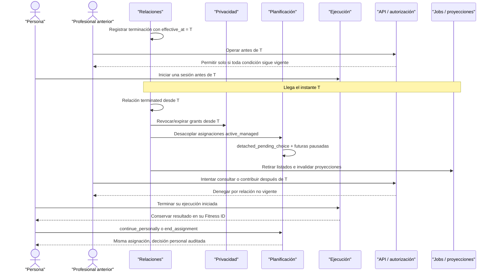

El tiempo de negocio T gobierna autorización aunque un worker de limpieza o notificación se ejecute después.

#### Paso 1 — Programación y autoridad de la terminación

La terminación se solicita mediante un comando autenticado, idempotente y auditable. La matriz exacta de quién puede iniciar, programar o cancelar se cerrará en Fase 3, pero cualquier actor debe tener autoridad verificable y el comando conserva:

- `relationship_id`;
- estado anterior y transición solicitada;
- `effective_at` en una zona temporal inequívoca;
- actor/persona y organización de contexto;
- causa o motivo tipado;
- instante de solicitud;
- clave idempotente;
- referencias de auditoría/outbox.

Si T es futuro, la relación puede seguir operativa hasta T solo mientras organización, membresía, asignación, grants y demás condiciones continúen vigentes. Programar el fin no prolonga permisos que hayan perdido otra condición antes.

Una cancelación autorizada antes de T genera otro evento; no elimina la solicitud original. Una vez alcanzado T, la relación no se reactiva moviendo retroactivamente la fecha.

#### Paso 2 — Corte autoritativo en `effective_at`

Desde T, toda evaluación debe considerar la relación no vigente aunque el proceso de coordinación esté pendiente. La API no confía exclusivamente en un booleano actualizado por un worker: evalúa estado y tiempo efectivo autoritativos.

El corte produce o coordina idempotentemente:

1. estado `terminated` de la relación desde T;
2. fin de todas sus asignaciones profesionales efectivas;
3. transición de todos los grants `active` ligados a la relación hacia `frozen`, con `frozen_at = T`;
4. salida de listados, CRM operativo y búsquedas ordinarias de clientes;
5. bloqueo de nuevas capturas, notas, anotaciones y propuestas profesionales;
6. desacoplamiento de asignaciones planificadas gestionadas;
7. invalidación de cachés, índices, read models, exportaciones y derivados autorizados;
8. cálculo de retención/disposición por categoría;
9. auditoría de resultados y fallos de coordinación.

El profesional anterior deja de cumplir simultáneamente relación y asignación efectivas. Que su membresía organizacional permanezca activa no restablece acceso en vivo ni escritura. Solo puede intentar lectura histórica si era el titular de esa relación al llegar `T`, su membresía sigue activa, un owner/admin lo autoriza en un `historical_access_case` vigente y satisface MFA y `access_control.can_read_frozen`.

#### Paso 3 — Efecto sobre grants y privacidad

Privacidad conserva los eventos de consentimiento y cambia cada grant `active` a `frozen` con el mismo `frozen_at = T`. El grant deja de ser efectivo para acceso en vivo y escritura, pero conserva la ventana histórica previamente autorizada.

Desde `T`, la organización anterior:

- puede consultar, únicamente por la superficie histórica restringida de ADR-023, las filas ya autorizadas cuyo instante de negocio sea `<= T`;
- no puede contribuir, corregir, observar, asignar, reprogramar ni generar actividad;
- no recibe actividad creada después del corte;
- no recibe datos de otras relaciones;
- no amplía scopes, field-sets, niveles o finalidades;
- no puede usar la ventana para marketing, IA o analítica identificable.

Congelar el acceso no elimina esos datos del Fitness ID. La persona conserva sus hechos; cada categoría inicia disposición solo cuando su propia finalidad, solicitud o plazo lo determine. Un estado `revoked`, en cambio, no habilita lectura histórica.

Las denegaciones son monótonas desde `T`: una denegación vigente al corte o creada después sigue reduciendo el conjunto, mientras volver a compartir después de `T` nunca lo amplía. La persona puede revocar explícitamente un grant `frozen`; la transición a `revoked` cierra todos los casos históricos abiertos de la relación, invalida los derivados del scope revocado y corta toda lectura posterior de ese grant. La pertenencia administrativa nunca basta para leer.

#### Paso 4 — Desacoplamiento de la asignación

Planificación transforma una sola vez la misma asignación:

```text
active_managed
    ↓ termina relación gestora en T
detached_pending_choice
    ├── continue_personally → active_personal
    └── end_assignment      → ended
```

No crea una copia de la asignación ni selecciona otra versión. Conserva:

- `assignment_id`;
- persona titular;
- versión exacta de programa;
- snapshot de prescripción;
- revisiones anteriores;
- organización, relación y profesional de origen;
- autoría y procedencia;
- sesiones planificadas e intentos históricos;
- eventos de gestión y desacoplamiento.

El origen histórico no implica gestión actual. La organización anterior permanece atribuida donde corresponda y no puede editar ni reprogramar después de `T`; cualquier consulta histórica de la asignación queda limitada a la ventana `frozen`, el field-set histórico y `access_control.can_read_frozen`.

#### Paso 5 — Sesiones completadas, iniciadas y futuras

| Estado al llegar T | Resultado |
| --- | --- |
| Sesión completada | Permanece en historial con resultados, primaria, procedencia y atribución originales |
| Ejecución iniciada por la persona | La persona puede pausarla/reanudarla/finalizarla; el profesional no puede contribuir después de T |
| Sesión futura no iniciada | Permanece visible para la persona, pero pausada y sin inicio/recordatorio automático |
| Intento abandonado previo | Permanece como hecho histórico; no se elimina ni se vuelve cumplimiento |
| Revisión profesional previa | Conserva autor, organización y vigencia histórica; no puede editarse después del corte |
| Nueva sesión autónoma posterior | Pertenece a la persona y nunca aparece para la organización anterior |

Las sesiones futuras pausadas no reducen adherencia, generan mora, notifican al coach anterior ni producen penalizaciones por inactividad mientras la persona no decida.

#### Paso 6 — Rama A: la persona todavía no decide

Si la persona no responde:

- la asignación permanece `detached_pending_choice`;
- no se generan nuevas sesiones desde reglas de calendario;
- las existentes futuras siguen pausadas;
- no se envían recordatorios profesionales;
- no se calcula incumplimiento sobre ese periodo;
- ningún actor organizacional recupera gestión por inactividad;
- la persona puede consultar el snapshot y entender sus opciones.

No decidir no equivale a aceptar continuidad, terminar el plan o conceder una nueva relación.

#### Paso 7 — Rama B: continuar personalmente

Si la persona elige `continue_personally`, Planificación:

- reutiliza el mismo `assignment_id`;
- cambia gestión efectiva a personal;
- conserva versión, snapshot, revisiones y origen;
- reactiva/reprograma sesiones futuras conforme a una decisión explícita de la persona;
- registra actor, instante y transición;
- no crea relación, grant o profesional gestor ficticio.

La asignación pasa a `active_personal`. Las ejecuciones futuras continúan en el mismo Fitness ID, pero no se envían a la organización anterior ni se consideran prestación posterior de esa organización.

La persona puede adaptar únicamente lo que sus capacidades personales permitan; no obtiene derecho para modificar o redistribuir el programa master de la organización.

#### Paso 8 — Rama C: terminar la asignación

Si la persona elige `end_assignment`, Planificación:

- cambia la misma asignación a `ended`;
- cancela o termina únicamente sesiones futuras no iniciadas;
- conserva sesiones completadas, intentos, resultados y vínculos primarios;
- conserva versión/snapshot como historia personal legítima;
- detiene recordatorios, generación y adherencia futura;
- registra decisión y tiempo efectivos.

Terminar el plan no elimina ejecuciones ni borra la evidencia de que fue asignado. Una solicitud de supresión posterior se resuelve por categorías y políticas diferentes.

#### Paso 9 — Adopción por otra organización

Una organización nueva no puede tomar la asignación desacoplada por coincidencia de profesional, email o versión. Para intervenir requiere:

- nueva relación aceptada;
- organización/parte responsable explícitas;
- profesional asignado con membresía/capacidad;
- nuevos grants y scopes;
- acción personal explícita para adoptar o recibir una prescripción compatible.

La nueva organización no recibe notas privadas, grants, observaciones o gestión de la anterior. La política exacta para adoptar una asignación existente se cerrará en Fase 3; nunca será herencia automática.

#### Matriz de efectos por dominio

| Dominio | Antes de T | Desde T | Qué conserva |
| --- | --- | --- | --- |
| Identidad | Persona/Fitness ID activos | Sin cambio de identidad | Persona, cuenta, perfiles y agregado personal |
| Organizaciones | Profesional miembro y organización activa | Membresía puede continuar, pero no autoriza esta relación | Organización, activos y membresías propias |
| Relaciones | Relación/asignación profesional activas | Relación terminada y actores finalizados | Historia bilateral, tiempos y evidencia mínima |
| Privacidad | Grants `active` efectivos según scopes | Grants `frozen`: sin acceso en vivo/escritura, solo ventana histórica `<= T` | Scope/field-set congelados, eventos y evidencia según plazo |
| Planificación | Asignación `active_managed` | `detached_pending_choice` hasta decisión | Misma versión, snapshot, revisiones y agenda histórica |
| Ejecución | Sesiones/resultados visibles según grant | Persona conserva; organización pierde contribución y solo puede usar la lectura histórica definida | Hechos, procedencia, autores y validación |
| Catálogo | Definiciones/versiones referenciadas | Sin cambio | Contratos y taxonomías históricas |
| Jobs/read models | Proyecciones operativas activas | Se invalidan desde `T`; la superficie histórica se calcula con el corte autoritativo | Evidencia técnica mínima y proyección histórica autorizada |

#### Matriz de autorización después de T

| Operación | Persona | Organización anterior | Resultado |
| --- | --- | --- | --- |
| Consultar Fitness ID propio | Permitido | No aplica | Ownership personal no depende de relación |
| Consultar relación histórica ordinaria | Visible para la persona según producto | Fuera de listados operativos | Solo evidencia restringida cuando exista finalidad |
| Ver sesiones/resultados previamente autorizados `<= T` | Permitido | Solo la membresía exacta autorizada en un caso vigente, con MFA y propósito permitido | El grant `frozen` usa `access_control.can_read_frozen`, no el predicado profesional en vivo |
| Ver actividad posterior | Permitido | Denegado sin confirmar existencia | Relación histórica nunca cubre futuro |
| Terminar ejecución iniciada | Permitido para la persona | Denegado para contribuir/anotar | Autoridad personal continúa |
| Editar/reprogramar asignación | Tras decisión personal compatible | Denegado | Gestión profesional terminó |
| Consultar programa master | Solo snapshot recibido, no master salvo otro derecho | Organización conserva su master | Ownership del master no cambia |
| Acceso excepcional a evidencia | Según derechos personales aplicables | Solo rol restringido, propósito y auditoría | No usa endpoints ordinarios |
| Marketing, IA o analítica identificable | No autorizado por terminación | Denegado | Retención no crea finalidad nueva |

#### Fallos y concurrencia

| Caso | Resultado obligatorio |
| --- | --- |
| Retry del comando de terminación | Misma relación, evento efectivo, congelaciones y desacoplamiento; sin duplicados |
| Worker se ejecuta después de T | API ya deniega por tiempo efectivo; el worker converge limpieza sin extender autoridad |
| Profesional consulta exactamente en T | Se deniega desde T según reloj/semántica autoritativa definida |
| Escritura profesional iniciada antes y confirmada después de T | Revalida al commit; no persiste contribución posterior al corte |
| Persona inicia ejecución antes de T | Puede terminarla personalmente; no nace otro intento por el corte |
| Profesional intenta terminar esa ejecución después de T | Se deniega aunque la haya prescrito o iniciado anteriormente |
| Se programa y cancela antes de T | Eventos conservan ambas decisiones; acceso sigue solo si cancelación fue válida |
| Se intenta cancelar después de T | No reactiva; exige un nuevo vínculo si las partes desean continuar |
| Dos decisiones personales concurrentes sobre el plan | Serializan/versionan; una transición válida gana sin duplicar asignación |
| Job genera una sesión futura después de T | Se rechaza/inactiva por estado desacoplado y no afecta adherencia |
| Caché/listado conserva al cliente | Se invalida; si no confirma estado actual, falla cerrado |
| Grant parece activo por proyección atrasada | La relación terminada basta para denegar el acceso en vivo; la lectura histórica relee `status='frozen'` y `frozen_at` de la fuente autoritativa |
| Nueva organización intenta adoptar automáticamente | Se deniega; exige relación, grants y acción personal nuevos |
| Restauración trae estado previo a T | Reaplica terminación/congelación/desacoplamiento antes de servir tráfico |

La definición precisa de reloj, aislamiento, orden de locks y SLA de coordinación pertenece a Fase 3. La garantía de dominio es que ninguna demora técnica mueve T o amplía acceso.

#### Retención y disposición

| Categoría | Persona | Organización anterior | Resultado final esperado |
| --- | --- | --- | --- |
| Perfil e historial fitness | Conserva según política personal | Sin acceso operativo; ventana histórica solo `<= T` | Eliminar/disponer por solicitud/finalidad personal, no por terminar relación |
| Sesiones autónomas y futuras | Conserva | Nunca accesibles | Permanecen personales o siguen su disposición propia |
| Versión/snapshot asignados | Conserva en historial | Evidencia mínima de lo entregado | Master sigue siendo de la organización |
| Ejecuciones/resultados de la relación | Conserva hechos válidos | Lectura histórica autorizada `<= T`, sin copia ni contribución | Retener y luego eliminar/anonimizar según política |
| Notas/evaluaciones profesionales | Acceso personal según contrato/política | Solo las notas bilaterales materializadas `<= T` cuyo scope exacto tenga `historical_readable`; no incluye notas privadas ni `health_context` | No reutilizar operativamente después del corte |
| Consentimientos/revocaciones/access events | Evidencia visible/reclamable según derechos | Acceso restringido por finalidad | `retain_restricted` y disposición al vencer plazo |
| Contratos/pagos futuros | Dominio separado | Retención legal/operativa aplicable | No conceden Fitness ID ni se borran como sesiones |
| Analítica | No afecta identidad personal | Solo si es irreversiblemente anónima | Sin llaves de enlace o reidentificación razonable |

Un hold documentado puede suspender la disposición de targets concretos, pero no reactiva la relación, listados, acceso en vivo o escritura ni amplía una ventana `frozen`.

#### Comprobación de duplicaciones y continuidad

| Riesgo | Resultado del recorrido |
| --- | --- |
| Borrar persona/Fitness ID al terminar | No ocurre: Identidad continúa intacta |
| Copiar historial para la organización | No ocurre: solo retiene evidencia bilateral mínima restringida |
| Nueva asignación para continuar personalmente | No ocurre: cambia gestión de la misma asignación |
| Cambiar silenciosamente versión o snapshot | No ocurre: ambos permanecen exactos e históricos |
| Perder sesiones completadas o intentos | No ocurre: Ejecución/Planificación conservan los hechos |
| Profesional conserva acceso por membresía | No ocurre: fallan relación y asignación efectivas |
| Grant histórico concede acceso operativo | No ocurre: la relación terminada lo hace inefectivo para la fórmula en vivo; solo `access_control.can_read_frozen` puede habilitar lectura histórica restringida |
| Actividad posterior aparece a la organización | No ocurre: no hay relación/grant vigente y se invalidan derivados |
| Organización nueva hereda plan o notas | No ocurre: necesita contexto y decisiones nuevos |
| Programa master cambia de owner | No ocurre: la organización conserva su activo; persona conserva snapshot recibido |
| Retención se interpreta como acceso operativo | No ocurre: los datos salen de operación ordinaria; la ventana `frozen` es una autorización histórica separada y acotada |

#### Resultado de la validación

**Estado:** recertificado — recorrido completo.<br>
**Resultado:** la terminación corta autoridad operativa y escritura desde `effective_at`, transiciona los grants a `frozen` y coordina Relaciones, Privacidad y Planificación sin borrar Identidad o Ejecución. La persona conserva la misma asignación/snapshot y elige entre continuidad personal o terminación; la organización anterior conserva activos propios, evidencia bilateral y la ventana histórica `<= T`, ejercible únicamente mediante la superficie y el predicado de ADR-023.<br>
**Duplicaciones detectadas:** ninguna.<br>
**Pérdidas indebidas de continuidad detectadas:** ninguna.<br>
**Accesos posteriores al corte permitidos:** ninguna operación, escritura ni dato con instante `> T`; solo lectura histórica `<= T` por `historical_access_case` vigente, actor exacto elegible, MFA, propósito cerrado, field-set histórico, denegaciones monótonas y auditoría obligatoria.<br>
**Contradicciones detectadas:** ninguna.<br>
**Ajustes requeridos a los límites de dominio:** ninguno.

El siguiente escenario validará disposición completa por categoría: eliminación, anonimización o retención restringida sin resurrección desde cachés, derivados o backups.

### 12.10 Escenario 8 — Disposición por categoría sin resurrección

#### Objetivo

Demostrar que el cierre de una cuenta y una solicitud válida de supresión producen decisiones trazables por categoría —`delete`, `anonymize` o `retain_restricted`— y convergen en PostgreSQL, storage, cachés, índices, réplicas, derivados y backups sin dejar el Fitness ID navegable ni permitir que una restauración reintroduzca datos dispuestos.

#### Precondiciones

- Existe una persona con usuario WorkOS, cuenta local, Fitness ID, perfil, preferencias, sesiones, resultados, medidas, una fotografía de progreso y datos de salud.
- La persona tuvo una relación profesional ya terminada, con consentimientos, revocaciones, eventos de acceso y evidencia bilateral.
- Existen eventos de consentimiento, acceso y seguridad; un target concreto de evidencia bilateral/seguridad está bajo un hold vigente y documentado.
- La organización conserva un programa master propio que fue usado para una asignación de la persona.
- Existen derivados de progreso, cachés, un índice de búsqueda, una réplica, objetos en storage y un backup anterior a la solicitud.
- Una métrica estadística agregada tiene finalidad legítima de conservación solo si puede anonimizarse irreversiblemente.
- La persona cierra su cuenta y presenta una solicitud verificable cuyo alcance incluye PII, perfil e historial fitness personal.

#### Resultado esperado

El acceso se revoca de inmediato y cada categoría recibe una resolución explícita. PII, perfil, sesiones, resultados, medidas, salud, fotografía, raw y derivados personales se eliminan de sistemas activos. La métrica estadística solo permanece si supera una prueba de anonimización irreversible. Evidencia bilateral, consentimientos, auditoría y seguridad se reducen al mínimo y quedan `retain_restricted` hasta su plazo; el hold suspende únicamente su target.

El programa master de la organización permanece con su owner y autoría. Puede subsistir un tombstone técnico sin PII cuando una referencia histórica legítima lo exija. Ningún endpoint, listado, marketing, IA o analítica identificable puede reconstruir o navegar a la persona. Si se restaura el backup anterior, las disposiciones posteriores al snapshot se reaplican antes de habilitar tráfico, jobs o integraciones.

#### Matriz de resolución inicial

| Categoría/target | Decisión | Motivo/condición | Resultado |
| --- | --- | --- | --- |
| Sesiones WorkOS AuthKit y tokens | Revocar + `delete` | Cierre de cuenta | Sin autenticación o sesión reutilizable |
| Cuenta local y vínculo externo | Desvincular/eliminar según integridad | Fin de acceso | No permite login ni resolución operativa del Fitness ID |
| Nombre, email, celular y PII privada | `delete` | Solicitud válida/cierre | Eliminación física; no quedan en tombstone |
| Perfil, preferencias y afirmaciones personales | `delete` | Alcance de supresión | Se eliminan fuentes y proyecciones |
| Sesiones, resultados, medidas, salud y fotos | `delete` | Alcance de supresión | Se eliminan hechos y objetos personales incluidos |
| Raw temporal/importaciones | `delete` | Fin de finalidad/solicitud | Se eliminan payloads, credenciales y staging |
| Derivados, récords y recomendaciones | `delete` o recalcular sin inputs | Inputs dispuestos | No pueden reconstruir datos eliminados |
| Métrica estadística legítima | `anonymize` | Solo si supera prueba irreversible | Sin PII, llaves de enlace o combinación razonablemente reidentificable |
| Consentimientos, revocaciones y auditoría | `retain_restricted` | Evidencia y seguridad con plazo | Mínimo append-only fuera de operación ordinaria |
| Evidencia bilateral de relación/asignación | `retain_restricted` | Finalidad documentada y plazo | No conserva Fitness ID completo ni historial navegable |
| Evento de consentimiento/acceso sin hold | `retain_restricted` hasta `retention_until` | Evidencia/seguridad con finalidad aplicable | Al vencer ejecuta su acción final |
| Target bilateral/de seguridad bajo hold | `retain_restricted`; acción final suspendida | Hold acotado, vigente y revisable | Solo ese target espera liberación |
| Programa master organizacional | Conservar/archivar | Activo propio de la organización | No se borra por la solicitud del cliente |
| Tombstone técnico mínimo | Conservar bajo política propia si es necesario | Integridad/no reimportación/no contacto | Sin nombre, contacto ni llave ordinaria de reidentificación |

#### Recorrido de extremo a extremo

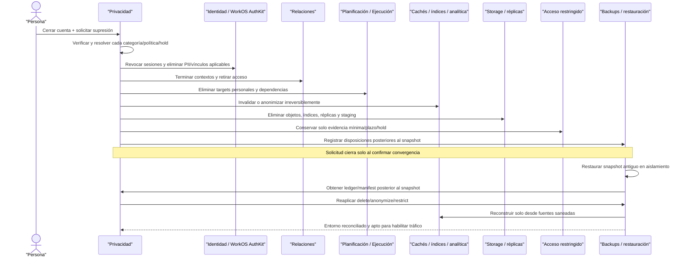

#### Paso 1 — Revocación inmediata de acceso

El cierre no espera a que terminen todos los jobs de disposición para bloquear operación. La transición coordinada:

- revoca sesiones y refresh tokens;
- deshabilita/elimina acceso WorkOS AuthKit conforme al flujo aplicable;
- bloquea la cuenta local y el Fitness ID para endpoints ordinarios;
- termina relaciones activas y congela sus grants en el mismo `T`; la disposición posterior elimina o anonimiza el acceso identificable;
- cancela exportaciones, notificaciones e integraciones pendientes;
- impide nuevas escrituras, importaciones o recolección de datos;
- registra el instante efectivo y la solicitud origen.

Revocar acceso no prueba que los datos fueron eliminados. La solicitud continúa abierta hasta resolver y ejecutar cada categoría.

#### Paso 2 — Resolución transparente por categoría

Privacidad verifica la identidad/autoridad de la solicitud y genera decisiones independientes que conservan:

- categoría y targets tipados;
- finalidad y jurisdicción aplicables;
- política y versión exacta;
- trigger y fecha efectiva;
- acción final;
- `retention_until` cuando corresponda;
- excepción u obligación concreta;
- hold aplicable y alcance;
- estado, resultado y motivo;
- actor/job y timestamps.

No existe una respuesta booleana “cuenta borrada” que oculte excepciones. La persona recibe un resultado comprensible por categorías conforme al flujo legal/productivo, sin exponer detalles de seguridad que creen riesgo.

Una política publicada después no reinterpreta silenciosamente decisiones ya ejecutadas. Cualquier reevaluación necesaria genera otra decisión trazable.

#### Paso 3 — Eliminación física coordinada

Para cada target con `delete`, el worker emite un comando tipado e idempotente al dominio propietario. La eliminación alcanza:

- filas canónicas en PostgreSQL;
- tablas hijas, revisiones y adjuntos incluidos;
- proyecciones materializadas;
- objetos, thumbnails y metadata en storage;
- cachés de API y aplicación;
- índices de búsqueda;
- réplicas y read models;
- staging, cargas temporales y DLQ con payload personal;
- exportaciones no entregadas y enlaces temporales;
- contexto temporal de IA bajo control de plataforma;
- features, récords, recomendaciones y derivados;
- jobs o mensajes pendientes que pudieran volver a escribir el target.

Un `deleted_at`, cifrado, hash, UUID sustituto o retirada del frontend no satisface `delete`. Si una FK legítima necesita continuidad, apunta a un tombstone técnico sin PII, no a una copia oculta de la persona.

#### Paso 4 — Eliminación de derivados sin reconstrucción

Al disponer un input, todo derivado afectado debe:

- eliminarse si ya no tiene finalidad;
- recalcularse únicamente desde inputs restantes y autorizados;
- perder referencias al target;
- conservar algoritmo/versión solo en evidencia mínima cuando proceda;
- impedir que una cola o evento atrasado lo regenere.

Los consumidores comparan la generación/versión de disposición o un mecanismo equivalente antes de materializar. Un evento de entrenamiento anterior a la supresión que llegue tarde no puede volver a crear récords, tendencias, índices o notificaciones.

Un modelo estadístico o artefacto que memorice o permita extraer datos personales no se considera anónimo. Su conservación exige una evaluación propia y queda fuera de cualquier autorización implícita de entrenamiento de modelos.

#### Paso 5 — Anonimización irreversible

La métrica estadística solo se conserva si el proceso elimina o generaliza, según el riesgo:

- identificadores directos;
- `person_id`, `relationship_id`, `organization_id` u otras llaves enlazables cuando permitan volver al sujeto;
- email, celular, nombres, handles y device IDs;
- fechas/horas exactas innecesarias;
- ubicación, rutas y atributos raros;
- texto libre y metadata con PII;
- combinaciones singulares o cohortes demasiado pequeñas;
- tablas de correspondencia, secretos o mappings reversibles.

La salida se somete a una prueba documentada de riesgo de reidentificación. Si no supera el umbral o la finalidad no justifica conservarla, se elimina. No se guarda una llave para “reidentificar si hace falta”; eso sería seudonimización, no anonimización.

La analítica anonimizada no alimenta marketing individual, perfiles, decisiones sobre la persona, IA identificable o reconstrucción del Fitness ID.

#### Paso 6 — Retención restringida mínima

Los targets `retain_restricted` salen de:

- endpoints de Space y Studio;
- listados de clientes y búsquedas operativas;
- APIs de entrenamiento;
- exports ordinarios;
- segmentación y marketing;
- soporte general sin propósito;
- analítica identificable;
- contexto de IA y entrenamiento de modelos.

El acceso excepcional exige simultáneamente rol restringido, propósito permitido, target/categoría dentro del alcance y evento de auditoría con actor, tiempo y motivo. La organización no conserva una copia navegable del Fitness ID para resolver disputas.

Cada registro mantiene `retention_until` o regla equivalente y una acción posterior explícita. “Retenido” nunca significa indefinido.

#### Paso 7 — Hold acotado y liberación

El hold del escenario referencia una evidencia bilateral/de seguridad concreta, no la persona completa ni todas sus categorías. Conserva:

- motivo/base documentada;
- actor autorizado;
- target tipado y alcance;
- inicio, revisión y vigencia;
- estado y liberación;
- auditoría de accesos excepcionales.

Mientras está activo:

- suspende solo la disposición final de ese target;
- no impide eliminar PII, sesiones, fotos u otros registros fuera de alcance;
- no reactiva cuenta, relación o grants;
- no habilita consulta operativa;
- no amplía la finalidad original.

Al liberarlo, el worker recalcula la política vigente aplicable al target y reanuda idempotentemente la disposición pendiente. No necesita otra solicitud de la persona y no borra el historial del hold.

#### Paso 8 — Activos de terceros y tombstones

La solicitud no elimina el programa master de la organización, sus versiones publicadas o metodología porque son activos con owner y finalidad propios. Sí elimina, cuando la resolución lo ordena, la asignación personal, snapshots personales, calendario y referencias navegables del Fitness ID.

La autoría histórica puede representarse mediante evidencia mínima o tombstone cuando eliminar toda referencia rompería un registro legítimo. Ese tombstone:

- no contiene nombre, email, celular o perfil;
- no permite login o navegación;
- no conserva una llave accesible para reconstruir PII;
- no aparece en búsquedas o listados;
- tiene categoría, finalidad y política propias;
- no se reutiliza para marketing o nuevas relaciones.

Un marcador mínimo de no contacto/no reimportación, si es necesario, continúa siendo dato protegido `retain_restricted`; no se presenta como anónimo.

#### Paso 9 — Cierre verificable de la solicitud

La solicitud solo llega a `closed` cuando:

1. todas las categorías tienen una decisión;
2. cada target ejecutable confirma `delete`, `anonymize` o `retain_restricted`;
3. los fallos quedan reintentados o explícitamente pendientes, no ocultos;
4. cachés, índices, storage, réplicas y derivados confirman convergencia;
5. holds se registran como suspensiones acotadas;
6. backups tienen una estrategia/fecha de expiración documentada;
7. el ledger de disposición conserva evidencia mínima suficiente;
8. una verificación posterior no encuentra rutas operativas hacia el Fitness ID.

El evento de disposición registra la acción y su resultado, no el contenido eliminado. Los reintentos convergen y no crean múltiples eliminaciones semánticas o plazos distintos.

#### Paso 10 — Backups y restauración segura

Los backups inmutables no se editan necesariamente en sitio; convergen mediante expiración documentada y controles de restauración. Para recuperar un snapshot anterior a la solicitud:

1. se restaura en un entorno aislado, sin tráfico, login, jobs salientes, integraciones ni notificaciones;
2. se obtiene desde un ledger/manifest autoritativo y durable el conjunto de disposiciones posteriores al snapshot;
3. se reaplican revocaciones, terminaciones, `delete`, `anonymize`, `retain_restricted` y holds vigentes;
4. se eliminan sesiones/tokens restaurados y se bloquean cuentas cerradas;
5. se purgan o reconstruyen índices, cachés, read models y derivados desde fuentes ya saneadas;
6. se verifica integridad referencial y ausencia de rutas operativas al target;
7. se registra evidencia de replay y reconciliación;
8. solo entonces se habilita tráfico.

El ledger necesario para replay no puede depender exclusivamente del mismo snapshot que se está restaurando. Su diseño físico, RPO/RTO y custodia se cerrarán en fases posteriores, pero la capacidad de reaplicar eventos posteriores es obligatoria.

Un backup que no pueda demostrar esta reconciliación no se considera apto para volver a producción.

#### Matriz de propagación

| Sistema/copia | Acción | Evidencia de convergencia | Regla de seguridad |
| --- | --- | --- | --- |
| PostgreSQL primario | Borrar/anonimizar/restringir por target | Evento y confirmación de dominio | Transacción e idempotencia |
| Réplicas/read models | Propagar o reconstruir | Offset/generación reconciliados | No servir estado anterior |
| Cachés | Invalidar claves y namespaces afectados | Confirmación/versión | Ante duda, miss/deny |
| Índices de búsqueda | Eliminar documento y reconstruir derivados | Confirmación de índice | No permitir búsqueda residual |
| Object storage/CDN | Eliminar objeto, versiones y URLs temporales según política | Confirmación por object key/version | No mantener thumbnail o metadata |
| Colas/DLQ | Purgar/redactar payloads y bloquear replay obsoleto | Offset/message target registrado | Evento antiguo no recrea datos |
| Exportaciones | Cancelar/purgar artefactos controlados | Estado final y expiración | No regenerar desde snapshot viejo |
| Analítica | Eliminar o anonimizar irreversiblemente | Prueba de riesgo y lineage | Sin llaves de reidentificación |
| IA/contexto temporal | Eliminar inputs/artefactos identificables | Confirmación por run/target | Sin entrenamiento por defecto |
| Backups | Expirar y reaplicar al restaurar | Catálogo de snapshots + replay verificado | Nunca abrir tráfico antes de sanear |

#### Matriz de acceso posterior

| Actor/canal | PII/historial eliminado | Evidencia `retain_restricted` | Analítica anonimizada | Programa master organizacional |
| --- | --- | --- | --- | --- |
| Persona con cuenta cerrada | No navegable | Según derechos/proceso verificable | No enlazable a la persona | Solo si existiera otro derecho independiente |
| Coach/staff operativo | Denegado | Denegado | Solo agregados legítimos no identificables | Según rol/ownership organizacional |
| Admin de organización | Denegado | Denegado por rol ordinario | No identificable | Según capacidad organizacional |
| Soporte general | Denegado | Denegado sin propósito/rol restringido | No identifica sujetos | Solo metadata técnica necesaria |
| Compliance restringido | No puede recuperar lo eliminado | Mínimo permitido, con propósito y auditoría | Sin vía de reidentificación | Solo si entra en su finalidad |
| Jobs/IA/marketing | No disponible | Excluida | Solo uso estadístico legítimo | No usar para perfilar al cliente eliminado |

#### Fallos, concurrencia y reintentos

| Caso | Resultado obligatorio |
| --- | --- |
| Dos solicitudes equivalentes concurrentes | Se consolidan o coordinan sin ejecutar políticas incompatibles ni perder auditoría |
| Retry de un comando `delete` ya completado | Devuelve éxito idempotente y no cambia el resultado |
| Un dominio falla durante la ejecución | Solicitud permanece parcial/pendiente y reintenta; nunca se marca completa |
| Nueva escritura después del cierre | Se deniega por estado de cuenta/Fitness ID y no crea otro ciclo de datos |
| Evento antiguo llega desde una cola | Se descarta/redacta al comparar disposición/generación del target |
| Réplica atrasada vuelve a aplicar un insert | Reconciliación vuelve a disponer antes de permitir lectura |
| Derivado se recalcula con input borrado | Se invalida/falla; no usa copias o payloads retenidos |
| Hold cubre un target, pero no otro | Solo el primero se suspende; el segundo termina su disposición |
| Hold se libera dos veces | Una transición efectiva; retries convergen al mismo resultado |
| Política cambia mientras corre el job | Cada decisión conserva versión; no mezcla acciones silenciosamente |
| Anonimización falla prueba de riesgo | No se conserva la salida; se elimina o queda bloqueada para revisión |
| Storage confirma fila pero falla thumbnail | Target sigue pendiente hasta eliminar todas las variantes incluidas |
| Backup anterior se restaura | Permanece aislado hasta reaplicar todas las disposiciones posteriores |
| Ledger de replay no está disponible | No se abre tráfico; la restauración falla cerrado |
| Reimportación intenta recrear a la persona | Marcador protegido/política de no reimportación bloquea el flujo sin exponer PII |

#### Ciclo del hold y la retención

| Evento | Target bajo hold | Otros targets | Acceso operativo |
| --- | --- | --- | --- |
| Se recibe solicitud | Se resuelve como suspendido/restringido | Ejecutan acción propia | Bloqueado desde el cierre |
| Hold continúa vigente | Conserva mínimo dentro del alcance | No se detienen | Siempre denegado |
| Llega `retention_until` bajo hold | Acción queda pendiente | Ejecutan disposición vencida | Siempre denegado |
| Hold se libera | Reanuda acción final idempotente | Sin cambio | No se reactiva |
| Retención restringida vence | Ejecuta `delete`/`anonymize` definido | Según cada política | No se vuelve visible |
| Se restaura un backup | Hold vigente se reaplica junto a disposiciones | Targets eliminados vuelven a eliminarse | Tráfico sigue bloqueado hasta reconciliar |

#### Comprobación de resurrección y conservación indebida

| Riesgo | Resultado del recorrido |
| --- | --- |
| `deleted_at` como falsa eliminación | No ocurre: `delete` alcanza datos físicos y derivados incluidos |
| Hash/UUID tratado como anónimo | No ocurre: la prueba elimina vías de enlace y combinaciones reidentificables |
| Hold global para conservar todo | No ocurre: referencia targets concretos y tiene vigencia/revisión |
| Evidencia retenida visible en Studio | No ocurre: queda fuera de endpoints/listados operativos |
| Programa master borrado con el cliente | No ocurre: conserva owner/finalidad organizacional independiente |
| Tombstone contiene PII recuperable | No ocurre: solo preserva integridad mínima bajo política propia |
| Caché o índice reexpone PII | No ocurre: la solicitud no cierra hasta confirmar invalidación |
| Evento atrasado recrea derivados | No ocurre: consumidores verifican disposición/generación |
| Analítica permite volver al sujeto | No ocurre: si no supera prueba irreversible, se elimina |
| Backup restaura cuenta o Fitness ID navegable | No ocurre: replay obligatorio precede login, jobs y tráfico |
| Retención se vuelve indefinida | No ocurre: toda categoría tiene plazo/trigger/acción o hold revisable |
| Organización conserva copia del historial | No ocurre: solo activos propios y evidencia bilateral mínima restringida |

#### Resultado de la validación

**Estado:** recertificado — recorrido completo.<br>
**Resultado:** la disposición se resuelve por categoría y converge sobre fuentes, copias y derivados. `delete` elimina, `anonymize` rompe irreversiblemente el enlace y `retain_restricted` conserva solo mínimos temporales. Holds y backups no reactivan acceso ni permiten resurrección.<br>
**Targets resucitados:** ninguno.<br>
**Copias operativas residuales permitidas:** ninguna.<br>
**Retenciones sin finalidad/plazo permitidas:** ninguna.<br>
**Contradicciones detectadas:** ninguna.<br>
**Ajustes requeridos a los límites de dominio:** ninguno.

El siguiente escenario validará el núcleo multidisciplina con una sesión híbrida, contratos tipados de resultados y separación estricta entre prescripción y ejecución.

### 12.11 Escenario 9 — Sesión híbrida con resultados tipados

#### Objetivo

Demostrar que el núcleo representa naturalmente una sesión híbrida de fuerza, running por intervalos y movilidad sin convertir sets/repeticiones en estructura universal, sin guardar resultados operativos en JSON libre y sin mezclar targets planificados con observaciones ejecutadas.

El escenario también valida contratos/versiones congelados, un intento abandonado seguido por otro completado, selección de una sola primaria y derivados reproducibles.

#### Precondiciones

- Catálogo publica las disciplinas `hybrid`, `strength`, `running` y `mobility` con códigos estables.
- Existen tipos de actividad compatibles para sesión híbrida, bloque de fuerza, running por intervalos y secuencia de movilidad.
- Catálogo publica contratos v1 de resultados para híbrido, fuerza detallada, running detallado y movilidad detallada.
- Existen movimientos reutilizables para sentadilla y posturas/movimientos de movilidad; running por intervalos no requiere fingir un movimiento.
- Planificación publica una versión inmutable de plantilla híbrida compuesta por tres bloques ordenados.
- Un programa referencia esa versión exacta, fue asignado a una persona y generó una sesión planificada con snapshot.
- La relación, profesional y `relationship_training` están vigentes para las acciones profesionales del escenario.
- No se habilitan conectores, GPS, frecuencia cardiaca ni raw stores productivos.

#### Prescripción congelada

| Bloque planificado | Tipo/contrato | Targets principales | Estructura especializada |
| --- | --- | --- | --- |
| 1. Fuerza | `strength_workout` + contrato fuerza v1 | 3 sets de sentadilla, 5 repeticiones objetivo, descanso e intensidad | Paso/target de fuerza con movimiento |
| 2. Intervalos | `interval_run` + contrato running v1 | 4 × 400 m, recuperación y rango de ritmo objetivo | Pasos de trabajo/recuperación endurance |
| 3. Movilidad | `mobility_session` + contrato movilidad v1 | Secuencia de dos movimientos, lado y duración objetivo | Pasos de secuencia/movilidad |

Los nombres de códigos físicos se cerrarán en el modelo lógico. Lo obligatorio es que cada bloque declare un tipo compatible y un contrato publicado; no se infiere la semántica desde texto libre.

#### Resultado esperado

El primer intento conserva una ejecución real abandonada y `partial` porque solo completó parte del bloque de fuerza y no satisface el mínimo híbrido. El segundo intento conserva tres segmentos de familias diferentes, cada uno con resultados tipados que cumplen `detailed`; la sesión completa se certifica `detailed`, queda `completed` y se selecciona como primaria inicial.

La sesión planificada conserva sus targets originales. Las observaciones reales viven únicamente en Ejecución y se contrastan mediante referencias. Publicar otra plantilla o contrato después no reinterpreta este historial.

#### Recorrido de extremo a extremo

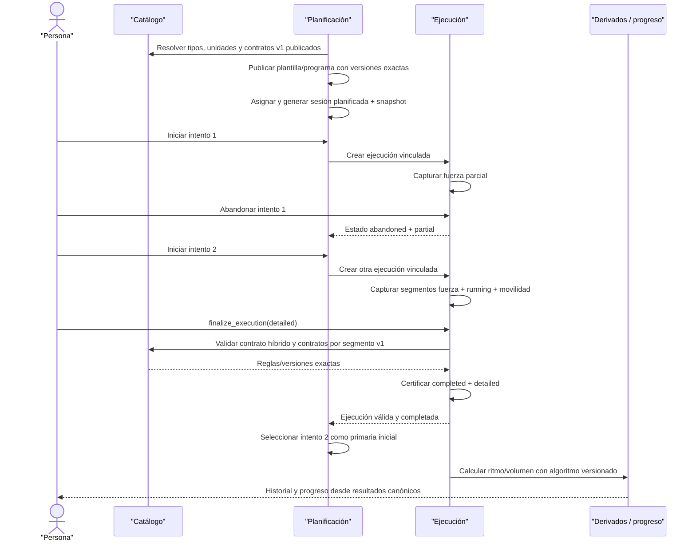

Planificación decide cuál ejecución cuenta para cumplimiento; Ejecución certifica estado, completitud y validez, pero no se autoproclama primaria.

#### Paso 1 — Catálogo multidisciplina gobernado

Catálogo conserva por separado:

- disciplina amplia;
- tipo de actividad;
- movimiento opcional;
- dimensiones/unidades;
- compatibilidades de targets/resultados;
- contrato de resultados y versión;
- estado de publicación y vigencia.

`hybrid` describe la familia de la sesión envelope. Cada segmento declara además la familia/tipo que gobierna sus resultados. Running puede registrar distancia y duración sin una fila ficticia de “ejercicio correr”; fuerza y movilidad sí pueden referenciar movimientos porque son semánticamente útiles.

Los contratos v1 publicados son inmutables. Catálogo no conoce la persona, sus targets concretos o resultados; únicamente entrega definiciones autoritativas para que Planificación y Ejecución validen.

#### Paso 2 — Plantilla y programa versionados

Planificación crea una plantilla estable con borrador mutable. Al publicar v1 congela:

- disciplina/tipo híbridos;
- orden de bloques y pasos;
- activity type de cada bloque;
- versiones exactas de contrato compatibles;
- movimientos opcionales;
- targets y unidades canónicas;
- descansos, instrucciones y transiciones;
- autor, organización y procedencia.

La versión de programa referencia plantilla v1, no “la última”. La asignación y la sesión planificada congelan versión/snapshot aplicables. Editar el borrador o publicar v2 no modifica la prescripción entregada.

#### Paso 3 — Targets planificados tipados

Los targets frecuentes permanecen en estructuras tipadas, no como claves arbitrarias:

| Modalidad | Targets tipados del ejemplo | Lo que no se fuerza |
| --- | --- | --- |
| Fuerza | movimiento, orden, sets/reps objetivo, descanso, carga/intensidad opcionales | Distancia, lap o ruta |
| Running | intervalos ordenados, distancia/duración objetivo, recuperación, zona/ritmo opcionales | Movimiento, set de fuerza o repeticiones universales |
| Movilidad | secuencia, movimiento/postura, lado, duración/repeticiones/rango objetivo | Carga o pace obligatorios |
| Híbrido | orden, límites/transiciones y referencia a bloques compatibles | Una tabla ancha con todas las columnas nullable |

JSONB puede conservar metadata versionada o una extensión experimental, pero ningún target usado en ejecución, adherencia, filtros o RLS depende exclusivamente de una clave libre.

#### Paso 4 — Intento 1 abandonado

La persona inicia la sesión planificada. Planificación crea el vínculo de intento número 1 y Ejecución una sesión real con:

- misma persona que la sesión planificada;
- envelope universal;
- origen planificado;
- contrato híbrido v1;
- un segmento de fuerza;
- resultados parciales con fuente, actor, unidad y tiempo.

La persona abandona después de dos sets. La ejecución conserva `state = abandoned` y `result_completeness = partial` porque no existen al menos dos familias ni se cumple el contrato `summary` híbrido.

El intento no se borra, no se fusiona con el siguiente y no alimenta adherencia/progresión que exija nivel certificado. Planificación conserva que fue el intento 1, pero no lo selecciona como primaria.

#### Paso 5 — Intento 2 y segmentos ejecutados

Al reintentar después de cerrar el intento anterior, Planificación crea el intento número 2 y Ejecución otro hecho real. Reanudar el intento 1 habría reutilizado su sesión; abandonarlo y volver a empezar sí justifica una ejecución nueva.

El intento 2 registra segmentos ordenados con límites o transiciones explícitos:

| Segmento ejecutado | Observaciones base | Ejemplo de diferencia frente al target |
| --- | --- | --- |
| Fuerza | 3 sets con movimiento/paso, orden, estado, reps logradas, carga y RPE opcionales | Último set logra 4 reps, no sobrescribe target de 5 |
| Running | 4 laps con orden, duración y distancia logradas, vínculo opcional a cada paso | Un lap mide 395 m; el target continúa siendo 400 m |
| Movilidad | Secuencia ordenada con movimiento, lado, estado y duración lograda | Lado izquierdo dura menos; el target no cambia |

Cada observación conserva valor numérico, unidad canónica, unidad original cuando corresponda, fuente, actor, momento, validez y procedencia. `NULL` significa no capturado; una cantidad cero solo existe cuando fue realmente observada.

#### Paso 6 — Validación contractual por niveles

`finalize_execution` valida transaccionalmente:

1. persona, sesión, actor y autorización;
2. envelope universal y timestamps;
3. contrato híbrido/version congelados;
4. al menos dos segmentos de familias diferentes y ordenados;
5. límites/transiciones coherentes;
6. contrato/version de cada segmento;
7. unidades, rangos, FKs y compatibilidad;
8. mínimos del nivel solicitado;
9. integridad entre segmentos, pasos, movimientos y resultados;
10. estado y evento de validación idempotente.

Para certificar `detailed` en este caso:

- fuerza tiene al menos un set válido con movimiento/paso, orden, estado y cantidad lograda;
- running tiene laps ordenados con duración y distancia logradas;
- movilidad tiene secuencia, movimiento/postura, lado cuando aplica, estado y cantidad observada;
- los tres segmentos satisfacen sus contratos detallados;
- el contrato híbrido confirma familias distintas y transiciones explícitas.

No se exige frecuencia cardiaca, GPS, wearable, carga o RPE de forma universal. Tener una muestra de sensor tampoco convierte una sesión inválida en `sensor_enriched`; primero debe cumplir `detailed`.

#### Paso 7 — Estado, completitud y validación separados

| Dimensión | Intento 1 | Intento 2 |
| --- | --- | --- |
| Estado real | `abandoned` | `completed` |
| Completitud | `partial` | `detailed` certificado |
| Validación | No alcanza mínimo híbrido certificado | Válida contra contratos v1 |
| Número de intento | 1 | 2 |
| Primaria | No | Sí, selección inicial de Planificación |
| Efecto en adherencia | Ninguno como cumplimiento | Un cumplimiento máximo |
| Efecto en historial real | Permanece como actividad parcial/abandonada | Permanece como actividad completada |

`completed`, `detailed`, “válida” y “primaria” no se representan con un único booleano.

#### Paso 8 — Separación entre prescripción y ejecución

| Concepto | Planificación | Ejecución |
| --- | --- | --- |
| Sets/reps objetivo | Fuente canónica del target | Solo referencia para contraste |
| Reps/carga logradas | No las almacena como target actualizado | Fuente canónica del resultado |
| Distancia/duración objetivo | Prescripción/snapshot | Solo referencia opcional |
| Distancia/duración logradas | No sobrescriben pasos | Laps/resultados tipados |
| Secuencia/duración objetivo | Plantilla/snapshot | Referencia al paso aplicable |
| Secuencia/duración realizada | No edita plantilla | Resultado de movilidad |
| Intento/primaria | Vínculo numerado y selección | Estado/validez de cada hecho real |
| Contrato aplicado | Congela compatibilidad de prescripción | Congela y certifica versión de resultados |

Una comparación puede calcular `target = 5`, `actual = 4` y su diferencia, pero no muta ninguno de los dos hechos.

#### Paso 9 — Selección primaria y cumplimiento

Al recibir que el intento 2 está completado, válido y pertenece a la misma persona, Planificación puede seleccionarlo como primaria inicial porque no existe otra primaria válida.

Reglas:

- la sesión planificada conserva ambos vínculos de intento;
- adherencia cuenta máximo un cumplimiento;
- historial de actividad puede contar ambos hechos según regla;
- completar un intento 3 futuro no sustituye automáticamente al 2;
- invalidar el intento 2 no promueve silenciosamente otro;
- cambiar primaria requiere comando explícito, actor, motivo y auditoría;
- V1 no fusiona segmentos de intentos distintos para fabricar cumplimiento dividido.

#### Paso 10 — Derivados reproducibles

Ritmo, velocidad, volumen de fuerza, récords y otros derivados se calculan desde observaciones base:

- pace/velocidad desde distancia y duración reales;
- volumen desde reps y carga capturadas cuando existan;
- adherencia desde la primaria y targets planificados;
- métricas transversales solo desde dimensiones realmente compatibles.

Si se materializan, conservan algoritmo/version, inputs/revisiones, timestamp, unidad, vigencia y clasificación. Una corrección aceptada sobre un lap o set invalida/recalcula únicamente los derivados afectados.

No se guarda pace manual como segunda verdad si puede derivarse, ni se suma carga de fuerza con distancia de running en una métrica sin contrato semántico.

#### Paso 11 — Evolución sin reinterpretación histórica

Después de completar el escenario pueden publicarse:

- plantilla híbrida v2;
- programa v2;
- contrato híbrido v2;
- nuevos contratos por segmento;
- otra versión del algoritmo de pace/volumen.

El intento 2 continúa apuntando a contratos v1 y la asignación a plantilla/programa v1. No se revalida automáticamente, no se selecciona “latest” en lectura y no cambia su nivel certificado.

Los nuevos algoritmos pueden producir otra revisión de derivado con versión explícita, sin editar observaciones base ni ocultar el resultado anterior cuando deba conservarse.

#### Matriz de entidades y ownership

| Concepto | Dominio fuente | Owner/sujeto | Resultado del escenario |
| --- | --- | --- | --- |
| Disciplina/tipo/movimiento/unidad | Catálogo | Allfit gobierna definición | Referencias estables, sin persona |
| Contratos v1 | Catálogo | Allfit gobierna reglas | Publicados e inmutables |
| Plantilla/programa master y versiones | Planificación | Organización/autor según origen | V1 exacta, sin modificación por ejecutar |
| Asignación/snapshot/sesión planificada | Planificación | Persona respecto de historial; master conserva owner | Prescripción exacta y personal |
| Vínculos intento 1/2 y primaria | Planificación | Persona respecto de cumplimiento | Dos vínculos; solo intento 2 primario |
| Sesiones ejecutadas | Ejecución | Persona | Dos hechos reales separados |
| Segmentos/resultados tipados | Ejecución | Persona; actores conservan procedencia | Fuerza, running y movilidad en estructuras propias |
| Eventos de validación | Ejecución | Persona como sujeto; sistema custodia evidencia | Uno lógico por finalización idempotente |
| Derivados | Ejecución/motor autorizado | Persona; sistema conserva algoritmo/version | Reproducibles desde inputs exactos |
| Grants/scopes | Privacidad | Persona controla acceso | Autorizan proyecciones; no modifican resultados |

#### Fallos y concurrencia

| Caso | Resultado obligatorio |
| --- | --- |
| Plantilla usa tipo/contrato incompatible | No publica la versión |
| Sesión híbrida solo tiene fuerza | No certifica `summary`; permanece `partial` o devuelve errores tipados |
| Segmento de fuerza detallado sin movimiento/paso o cantidad | No certifica `detailed` para ese segmento |
| Running summary sin duración o distancia | No certifica `summary` |
| Laps duplican orden o tienen unidades inválidas | Finalización falla con error tipado |
| Movilidad omite lado cuando el movimiento lo exige | No certifica detalle aplicable |
| Segmento referencia paso de otra persona/sesión | Se deniega por integridad/ownership |
| Resultado llega solo dentro de JSONB | No satisface contrato operativo tipado |
| `NULL` en reps se convierte a cero | Prohibido; permanece no capturado y puede reducir completitud |
| Sensor existe pero segmento detallado falla | No certifica `sensor_enriched` |
| Retry de inicio con misma idempotency key | Devuelve la misma ejecución/intento |
| Reanudar intento activo | Reutiliza la ejecución; no crea intento 2 |
| Retry de `finalize_execution` | Mismo estado/nivel/evento lógico; no duplica resultados |
| Dos finalizaciones concurrentes | Serializan/convergen sin estados incompatibles |
| Intento 2 completa mientras se procesa intento 1 | Cada hecho conserva estado; Planificación elige primaria bajo lock/regla |
| Se publica contrato v2 durante captura | La ejecución mantiene v1 congelado |
| Resultado actual intenta actualizar target | Se deniega; solo crea observación/revisión en Ejecución |
| Corrección cambia un input derivado | Invalida/recalcula con algoritmo/version; no edita el derivado manualmente |

#### Pruebas de generalidad

| Pregunta | Resultado |
| --- | --- |
| ¿Toda actividad necesita movimiento? | No; running continuo/intervalos puede operar sin movimiento |
| ¿Toda actividad necesita sets/reps? | No; son especialización de fuerza/calistenia |
| ¿Toda actividad necesita distancia? | No; fuerza o yoga summary pueden no usarla |
| ¿Toda actividad necesita sensores? | No; ningún contrato universal los exige |
| ¿Una sesión puede mezclar familias? | Sí; segmentos ordenados y contratos compatibles lo representan |
| ¿Agregar disciplina exige columnas nuevas en sesión universal? | No, salvo atributo verdaderamente común; resultados nuevos usan contrato/extensión tipada |
| ¿Puede una modalidad sin contrato certificarse? | No; permanece `partial` hasta gobernar contrato, fixtures y pruebas |
| ¿JSONB reemplaza tablas operativas? | No; solo metadata/extensiones versionadas no operativas |
| ¿“Ejercicio” y “rutina” siguen siendo útiles? | Sí, como vocabulario UI de fuerza, no como entidades universales |

#### Ciclo de vida y disposición

| Evento | Prescripción | Ejecuciones/resultados | Derivados |
| --- | --- | --- | --- |
| Publicar plantilla/contrato v2 | V1 histórica no cambia | Contratos v1 permanecen congelados | Pueden coexistir algoritmos versionados |
| Retirar v1 para nuevos usos | No admite nuevas asignaciones según política | Historial v1 sigue interpretable | Conserva versión usada |
| Terminar relación | Asignación se desacopla según escenario 7 | Persona conserva intentos/resultados | Organización pierde proyecciones autorizadas |
| Corregir input válido | Target no cambia | Nueva revisión conserva original | Se invalida/recalcula lo afectado |
| Suprimir sesión válidamente | Plan no finge resultado | Ejecución dispone sesión/segmentos/resultados | Elimina/recalcula sin input |
| Archivar programa master | Asignaciones históricas conservan versión/snapshot | Sin cambio en hechos reales | Sin reinterpretación |

#### Comprobación de deformaciones y duplicaciones

| Riesgo | Resultado del recorrido |
| --- | --- |
| Fuerza como modelo universal | No ocurre: running/movilidad usan estructuras propias |
| Tabla universal con columnas incompatibles | No ocurre: envelope común + segmentos/resultados tipados |
| Base o persona por disciplina | No ocurre: mismo Fitness ID e historial longitudinal |
| Resultados EAV/JSON libre | No ocurre: contratos y valores operativos tipados |
| Targets sobrescritos con resultados | No ocurre: Planificación y Ejecución conservan hechos separados |
| Intentos fusionados | No ocurre: cada ejecución real permanece independiente |
| Dos primarias/cumplimientos | No ocurre: Planificación impone máximo uno |
| Pace/volumen capturados y derivados como dos verdades | No ocurre: observaciones base son canónicas y derivados versionados |
| Contrato nuevo reinterpreta historia | No ocurre: cada ejecución congela versión exacta |
| Sensor vuelve inválida una modalidad manual | No ocurre: sensores no son requisito universal |

#### Resultado de la validación

**Estado:** recertificado — recorrido completo.<br>
**Resultado:** el núcleo representa fuerza, running y movilidad dentro de una sesión híbrida mediante envelope/segmentos comunes y resultados tipados. Los contratos v1 certifican completitud por modalidad, los intentos permanecen separados y Planificación conserva targets/primaria sin absorber resultados.<br>
**Deformaciones hacia un modelo de fuerza detectadas:** ninguna.<br>
**Duplicaciones de hechos detectadas:** ninguna.<br>
**Reinterpretaciones históricas permitidas:** ninguna.<br>
**Contradicciones detectadas:** ninguna.<br>
**Ajustes requeridos a los límites de dominio:** ninguno.

El último escenario validará que capacidades diferidas —wearables productivos, booking, commerce, marketplace, IA y otras— permanezcan fuera de V1 sin placeholders, tablas especulativas o JSON comodín.

### 12.12 Escenario 10 — Capacidades diferidas sin modelo especulativo

#### Objetivo

Demostrar que la baseline V1 puede completar todos sus flujos verticales sin schemas, tablas, columnas, estados, roles, scopes, endpoints, jobs o payloads creados para capacidades futuras. La extensibilidad proviene de fundamentos que V1 ya necesita, no de placeholders.

Esta validación es conceptual en Fase 2. La reconstrucción física del esquema, el inventario de objetos y los controles de pipeline deberán convertirla en una prueba ejecutable durante las fases de modelo lógico, migraciones y validación.

#### Precondiciones

- Los escenarios 1–9 son representables mediante Identidad, Organizaciones, Relaciones, Privacidad, Catálogo, Planificación y Ejecución.
- V1 incluye calendario personal básico, pero no oferta/reserva de clases.
- V1 incluye membresías internas de staff, pero no membresías comerciales de clientes.
- V1 incluye contenido privado y catálogo global mínimo, pero no publicación/marketplace.
- V1 incluye resultados tipados y fixtures controlados de `sensor_enriched`, pero no conectores o raw streams productivos.
- V1 incluye derivados determinísticos/versionados, pero no IA contextual, agentes o entrenamiento de modelos.
- V1 admite `health_context` minimizado y un dominio de nutrición no clínica separado; no admite historia clínica.
- V1 rechaza menores antes de crear persona y no modela representantes/cuentas familiares.

#### Resultado esperado

Los flujos de registro, organización, invitación, relación, consentimiento, planificación, ejecución, privacidad, terminación y disposición funcionan sin depender de entidades diferidas. Una solicitud hacia una capacidad fuera de V1 no degrada a una tabla genérica ni escribe metadata “temporal”: se rechaza o no se ofrece.

Una futura capacidad solo entra como rebanada vertical aprobada con alcance, lenguaje, ownership, privacidad, ADR, modelo, migraciones, RLS, contratos, pruebas, observabilidad y disposición propios. Debe reutilizar la persona, organización e historial canónicos existentes.

#### Inventario de capacidades diferidas

| Grupo | Capacidades diferidas | Lo que V1 sí conserva | Lo que V1 no crea |
| --- | --- | --- | --- |
| Booking | Clases, oferta, reservas, recursos, cupos, recurrencia, asistencia, waitlists | Sesión planificada personal y sede básica | Clases ofertadas, reservas, slots, rooms, capacity ledgers o asistencia |
| Commerce | Productos, precios, órdenes, cobros, pagos manuales/externos, reembolsos, facturación, conciliación | Relación y asignación sin requisito de compra | Products, prices, orders, payments, invoices, refunds o payment statuses |
| Membresías comerciales | Suscripciones de clientes y entitlements | Membresías organizacionales de staff | Plan comercial, entitlement o “cliente miembro” dentro de staff |
| Marketplace | Perfiles públicos, listings, descubrimiento, publicación, ratings y reviews | Catálogo global gobernado y contenido privado | Listing/publication state, review, search index público o perfil comercial |
| Wearables | Conectores, credenciales, webhooks, sincronización y raw stores generales | Contrato/fixture tipado `sensor_enriched` | Connector, credential, device authorization, webhook o raw stream productivo |
| Biometría/ubicación | ECG, biometría continua y GPS/rutas precisas | Clasificación que mantiene esos campos fuera de scopes V1 | Scopes, permisos o almacenamiento productivo de esas categorías |
| Nutrición avanzada | Clínica/terapéutica, suplementos, catálogos/proveedores, recetas, menús, códigos de barras e IA | Registro manual y guía no clínica del dominio Nutrición V1 | Campos clínicos dentro de perfil/health JSON o tablas anticipadas |
| IA | Contexto, agentes, recomendaciones automáticas y entrenamiento de modelos | Derivados determinísticos con algoritmo/version | Prompt/context store, run, agent, model grant o training dataset |
| Comunidad | Mensajería, social, grupos y eventos | Notificaciones técnicas estrictamente necesarias para V1 | Conversation, message, post, event o social graph |
| Menores/familia | Representantes, tutela, dependientes y consentimiento parental | Elegibilidad adulta previa a persona | Guardian, dependent, household, parental consent o account sharing |
| Deportes futuros | Especialización completa de natación, ciclismo, pilates, etc. | Catálogo extensible y contratos V1 gobernados | Tablas vacías por deporte o resultados certificados sin contrato/fixtures |
| Infraestructura | Separación física por producto y escritura durante caída total compartida | Límites de dominio, API propia y aislamiento operativo | Personas/bases duplicadas por producto o sincronización especulativa |

#### Recorrido de prueba negativa

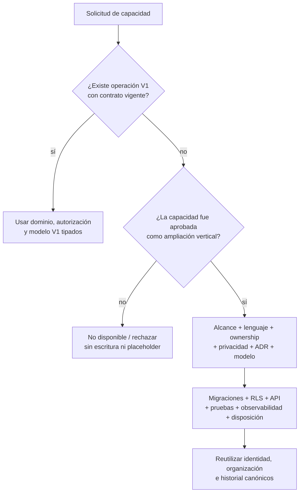

Una feature flag puede controlar presentación o despliegue de una capacidad ya modelada, pero nunca sustituye las puertas anteriores ni actúa como permiso, consentimiento o modelo de datos.

#### Prueba 1 — Booking no se esconde en planificación

Una sesión planificada V1 pertenece a una persona y representa trabajo previsto. No representa:

- una clase ofertada a múltiples personas;
- inventario de cupos;
- reserva o waitlist;
- salón/equipo reservable;
- recurrencia comercial;
- check-in o asistencia.

Una sede V1 aporta ubicación operativa y zona horaria; no se convierte por eso en room/resource reservable. Si Studio intenta “crear clase” usando una sesión personal con `capacity` en metadata, el comando se rechaza: faltan actores, ownership, estados, concurrencia de cupos, cancelaciones y autorización propios de booking.

#### Prueba 2 — Commerce no se esconde en relaciones

La persona puede aceptar una relación y recibir un programa sin orden o pago. V1 no registra que el coach cobró por fuera, no crea una orden con total cero y no reutiliza la invitación como comprobante comercial.

Se mantienen separados:

- membresía organizacional de staff;
- relación de servicio con una persona;
- futura membresía comercial/entitlement;
- futura compra/orden/pago.

Una solicitud `record_manual_payment` no escribe notas, JSON de relación, eventos de auditoría genéricos ni estados `paid/unpaid` en una asignación. La API no ofrece esa operación hasta incorporar commerce verticalmente.

La corrección del escenario 8 confirma esta frontera: su hold usa evidencia bilateral/seguridad V1, no una factura creada por una capacidad diferida.

#### Prueba 3 — Contenido privado no se vuelve marketplace

Catálogo global y contenido privado satisfacen planificación/ejecución sin:

- perfil profesional público;
- listing comercial;
- estado `published_to_marketplace`;
- búsqueda pública o ranking;
- precio/licencia de venta;
- review/rating;
- moderación o reportes.

“Versión publicada” significa inmutable y utilizable dentro de su contexto autorizado, no pública en internet ni descubrible. Título, autor, imagen o descripción tampoco conceden publicación.

Un intento de listar un programa privado falla sin crear una fila placeholder, un booleano nullable o un documento en un índice público.

#### Prueba 4 — `sensor_enriched` no habilita wearables

El contrato `sensor_enriched` prueba que el envelope y las extensiones tipadas pueden representar muestras controladas. En V1:

- el fixture se inyecta por un harness técnico controlado;
- conserva tipo, tiempo, valor, unidad, fuente y calidad;
- exige `detailed` válido antes de certificarse;
- no crea OAuth/credenciales de dispositivos;
- no recibe webhooks productivos;
- no mantiene sincronización, catálogo de conectores o raw lake general;
- no concede scopes de wearables, biometría o GPS.

Un fixture demuestra compatibilidad estructural, no disponibilidad de producto. Añadir datos de ejemplo o habilitar una flag no crea autorización ni convierte el pipeline de prueba en integración.

#### Prueba 5 — Derivados no se convierten en IA

Ritmo, volumen, récords y progreso básico son cálculos determinísticos/reproducibles con inputs y algoritmo/version explícitos. No justifican:

- prompt o context store;
- embeddings/vector store identificable;
- agent/run/tool permissions;
- recomendación automática opaca;
- entrenamiento de modelos;
- reutilización de eventos retenidos;
- scope genérico `ai_context`.

Una solicitud de recomendación IA falla/no está disponible. No se guarda el prompt dentro de notas, no se envía todo el Fitness ID a un proveedor y no se infiere autorización desde scopes de entrenamiento.

#### Prueba 6 — `health_context` no absorbe nutrición o medicina

`health_context` cubre únicamente dolor, limitaciones, recuperación y demás contexto fitness minimizado definido en su versión. No permite guardar comidas, planes nutricionales, macros, laboratorios, diagnósticos o historia clínica completa.

Un payload nutricional no se almacena como afirmación genérica, observación libre o JSON de salud. Incorporar nutrición exige términos, ownership, profesionales competentes, scopes, contratos, estructuras y retención propios.

#### Prueba 7 — Elegibilidad no crea modelo de menores

La política adulta permite rechazar antes de crear persona o recopilar datos fitness. No anticipa:

- representante/guardian;
- dependencia familiar;
- consentimiento parental;
- cuenta compartida;
- rol de tutor;
- transición automática al cumplir mayoría de edad.

Un menor no entra mediante `age_status = pending_guardian` ni una persona provisional. La ampliación futura deberá resolver identidad, autoridad, evidencia, acceso y disposición como dominio real.

#### Prueba 8 — Extensibilidad de disciplinas sin tablas vacías

Catálogo usa códigos estables y contratos publicados porque fuerza, running, movilidad e híbrido ya los necesitan. Esto permite añadir una disciplina futura, pero no certifica resultados por nombrarla.

Para una modalidad todavía no gobernada:

- puede documentarse en roadmap;
- no obtiene tabla especializada vacía;
- no se fuerza dentro de sets/reps;
- no se guarda como EAV/JSON operativo;
- no certifica `summary/detailed`;
- solo entra con contrato, estructuras tipadas, fixtures y pruebas.

Una ingesta técnica incompleta puede permanecer `partial` únicamente dentro de un flujo controlado ya autorizado; no convierte cualquier deporte futuro en soporte V1.

#### Fundamentos V1 permitidos

| Fundamento | Por qué existe hoy | Cómo ayuda después sin especular |
| --- | --- | --- |
| IDs canónicos estables | Evitar duplicación entre Space/Studio/organizaciones | Capacidades futuras referencian las mismas raíces |
| Límites de dominio/API | Separar ownership y autorización actuales | Permiten añadir contratos sin copiar datos |
| Versionado inmutable | Scopes, plantillas y resultados V1 cambian | Futuras versiones no reescriben historia |
| Outbox/inbox e idempotencia | Invitaciones, terminación y jobs V1 | Facilitan integraciones futuras con efectos confiables |
| Clasificación/procedencia | Privacidad y correcciones V1 | Nuevas categorías entran deliberadamente |
| Retención/disposición | Cierre y supresión V1 | Cada expansión debe declarar su ciclo |
| Migraciones aditivas | Evolución segura del esquema actual | La capacidad agrega DDL cuando existe contrato |
| Códigos de catálogo usados | Multidisciplina V1 | Nuevos códigos se gobiernan sin cambiar identidad |

Ningún fundamento anterior justifica una abstracción que no tenga operación, owner o prueba V1.

#### Manifest conceptual permitido/prohibido

| Capa | Permitido en baseline | Prohibido por anticipación |
| --- | --- | --- |
| Dominios/schemas | Identidad, organizaciones, relaciones, privacidad, catálogo, planificación, ejecución, nutrición y soporte técnico real | `booking`, `commerce`, `marketplace`, `integrations`, `intelligence` vacíos |
| Roles/capacidades | Acciones de organización/entrenamiento usadas y auditables | `manage_payments`, `manage_bookings`, `run_ai` sin operación |
| Scopes | Siete scopes V1 versionados, incluidos los tres nutricionales | wearable, biometric, precise_location, IA, publishing |
| Estados/columnas | Transiciones necesarias en flujos 1–9 | `is_public`, `is_paid`, `reservation_status`, `ai_status` “por si acaso” |
| JSONB | Metadata/extensión actual con `schema_version` y límites | `future_data`, EAV o payload universal |
| API/jobs | Comandos y consumers del flujo V1 | Endpoints/webhooks/workers sin consumidor aprobado |
| FKs | Relaciones entre entidades presentes | Referencia nullable a producto, reserva, pago, listing o connector inexistente |
| Seeds/fixtures | Catálogo/contratos V1 y sensor controlado | Seeds que simulan capacidades productivas futuras |

Los nombres físicos finales pueden variar. El modelo lógico debe mantener una allowlist/manifest equivalente basada en finalidad y dependencia, no solo buscar palabras prohibidas.

#### Gate físico que deberán ejecutar fases posteriores

| Prueba | Resultado obligatorio |
| --- | --- |
| Reconstrucción limpia desde cero | Completa todos los objetos V1 sin schemas o migraciones diferidas |
| Inventario `information_schema`/catálogo PostgreSQL | Solo contiene tablas/columnas con operación V1 documentada |
| Grafo de FKs/dependencias | Ninguna entidad V1 depende de una raíz futura |
| Inventario de enums/estados | Cada valor aparece en un comando/transición/prueba V1 |
| Seeds de roles/capacidades/scopes | Coinciden con allowlist aprobada y contratos vigentes |
| Contrato OpenAPI/rutas | No expone products, bookings, payments, listings, connectors o AI runs |
| Inventario de jobs/eventos/webhooks | Cada productor tiene consumidor y finalidad V1 |
| Revisión de JSONB | Cada uso tiene schema/version/owner y no sustituye campos operativos |
| Fixtures `sensor_enriched` | Funcionan sin secretos, proveedores, webhooks o raw store general |
| Prueba del flujo vertical | Relación/asignación/ejecución completan sin compra/reserva/publicación/integración |
| Pipeline de migraciones | Rechaza DDL/dependencias fuera del manifest salvo ampliación aprobada |

Estas son condiciones para aprobar la baseline física, no evidencia de que las migraciones ya existan en Fase 2.

#### Puerta de entrada para una ampliación futura

Una capacidad diferida debe completar, en orden:

1. alcance, actores, happy paths y contraejemplos;
2. glosario y distinción frente a conceptos V1;
3. ownership, procedencia y fuente de verdad;
4. categorías sensibles, finalidades, scopes y `access_level`;
5. operaciones, autorización, estados y transacciones;
6. ADR y ERD/modelo lógico aprobados;
7. migraciones aditivas, RLS y contratos HTTP/eventos;
8. idempotencia, observabilidad, degradación y seguridad;
9. fixtures/pruebas positivas, negativas y de concurrencia;
10. retención, supresión, anonimización y criterios de salida.

Solo entonces el DDL entra a la historia única de migraciones. La capacidad referencia las mismas personas, organizaciones, relaciones o ejecuciones cuando semánticamente corresponda; no crea bases o identidades paralelas por comodidad.

#### Fallos y controles

| Caso | Resultado obligatorio |
| --- | --- |
| Frontend envía `reservation` dentro de metadata de sesión | API rechaza; no persiste placeholder |
| Coach intenta registrar pago manual en nota | No existe operación; la nota no se usa como ledger comercial |
| Programa privado recibe `is_public = true` desconocido | Contrato rechaza el campo; no crea listing |
| Fixture incluye `connector_id` inventado | No crea FK/connector; el fixture controlado conserva solo procedencia permitida |
| Scope de entrenamiento intenta incluir nutrición/GPS/IA | Publicación de scope falla; requiere ampliación independiente |
| Feature flag activa UI de capacidad no modelada | Backend continúa sin endpoint/permisos y falla cerrado |
| Migración añade tabla vacía futura | Pipeline/arquitectura la rechaza fuera de ampliación aprobada |
| JSONB comienza a usarse en filtros/progreso/RLS | Debe promoverse a estructura tipada dentro de alcance; no sigue como comodín |
| Nueva disciplina no tiene contrato | No certifica resultados ni deforma otra modalidad |
| Capacidad futura propone otro `person_id` por producto | Se rechaza; reutiliza Identidad canónica |
| Caída de PostgreSQL compartido | No se inventa base local writable no reconciliada; tolerancia física sigue diferida |
| Término futuro aparece en documentación | No autoriza DDL, permiso, endpoint o seed por sí solo |

#### Comprobación de modelo especulativo

| Riesgo | Resultado del recorrido |
| --- | --- |
| Tabla/schema vacío “para después” | No permitido |
| Columna nullable o enum sin operación V1 | No permitido |
| JSON/EAV `future_data` | No permitido |
| Rol/scope/feature flag como falsa autorización | No permitido |
| Endpoint/job/webhook sin consumidor V1 | No permitido |
| FK a entidad futura | No permitido |
| Booking confundido con calendario personal | No ocurre |
| Commerce confundido con relación/asignación | No ocurre |
| Membresía comercial confundida con staff | No ocurre |
| Marketplace inferido desde contenido publicado | No ocurre |
| Wearable inferido desde `sensor_enriched` | No ocurre |
| IA inferida desde derivados versionados | No ocurre |
| Nutrición absorbida por `health_context` | No ocurre |
| Menor representado como adulto incompleto | No ocurre |
| Persona/base duplicada para una ampliación | No permitido |

#### Resultado de la validación

**Estado:** recertificado — recorrido conceptual completo.<br>
**Resultado:** los dominios V1 cubren los flujos obligatorios, incluida nutrición no clínica, sin entidades de booking, commerce, marketplace, integrations o intelligence. Las extensiones permitidas tienen uso actual; toda capacidad diferida permanece sin contrato operativo y deberá entrar como rebanada vertical propia.<br>
**Placeholders conceptuales necesarios:** ninguno.<br>
**Dependencias de capacidades diferidas necesarias:** ninguna.<br>
**Duplicaciones futuras justificadas:** ninguna.<br>
**Contradicciones detectadas:** una referencia financiera impropia en el escenario 8, corregida antes del cierre.<br>
**Brechas de cobertura detectadas:** la rama vinculada completa del escenario 3, incorporada antes del cierre.<br>
**Ajustes requeridos a los límites de dominio:** ninguno.

La validación física queda pendiente del modelo lógico, migraciones y pipeline. No debe marcarse como ejecutada durante esta fase documental.

### 12.13 Cierre de la validación transversal

Los diez escenarios obligatorios y los cinco recorridos de recertificación quedaron aprobados conjuntamente. La validación original detectó una referencia fuera de alcance y una rama incompleta; la recertificación incorporó Soporte como octavo dominio y mantuvo sin cambios los límites de los otros siete.

Resultados consolidados:

- una sola persona/Fitness ID entre Space y Studio;
- invitaciones sin personas provisionales;
- intenciones y scopes con decisiones independientes;
- organización estable al crecer de práctica individual a equipo;
- relaciones, grants y asignaciones con ciclos separados;
- privacidad por fila/campo/relación sin filtraciones indirectas;
- continuidad personal después de terminar relaciones;
- disposición por categoría sin resurrección;
- entrenamiento multidisciplina sin deformación hacia fuerza;
- nutrición personal separada de salud y guía profesional bajo consentimiento;
- ausencia conceptual de modelo físico para capacidades diferidas.

No se detectaron duplicaciones necesarias de personas, asignaciones, ejecuciones, nutrición o historial. [`V1_CONCEPTUAL_ERD.md`](./V1_CONCEPTUAL_ERD.md) conserva estos recorridos en entidades y cardinalidades conceptuales. Fase 2 queda recertificada el 28 de julio de 2026; los riesgos físicos permanecen en los gates posteriores.

## 13. Dominio de Nutrición

### 13.1 Responsabilidad

Nutrición conserva el registro manual de ingestas, sus componentes y nutrientes, una foto opcional saneada, resúmenes calculados y la línea versionada de objetivos de cada persona. No absorbe perfil, `health_context`, entrenamiento, archivos genéricos ni clínica.

### 13.2 Ownership y fuente de verdad

| Concepto | Dueño lógico | Fuente de verdad | Escritura | Acceso profesional |
| --- | --- | --- | --- | --- |
| Comida e ítems | Persona | Nutrición | Solo la persona; offline converge por `Command-Id` | Solo lectura con `nutrition_intake` |
| Valores nutricionales | Persona | Nutrición y catálogo cerrado de nutrientes | Persona dentro de la transacción de comida | Solo lectura; unidades canónicas |
| Foto de comida | Persona | Nutrición + almacenamiento privado | Persona; servidor sanea antes de fijar `media_ref` | Requiere intersección intake/media |
| Resumen diario | Persona | Proyección reproducible de comidas visibles | No tiene escritura propia | Se calcula después de autorización |
| Línea de objetivos | Persona | Nutrición | Persona activa metas propias | El profesional solo propone |
| Versión profesional | Persona, con autoría profesional preservada | Nutrición | Función cerrada con contexto profesional completo | Lectura/contribución según grant |
| Decisión | Persona | Nutrición append-only | Solo la persona del objetivo | Visible bajo `nutrition_guidance` |

Space y Studio consumen el mismo dominio. No existen comidas “de Studio”, duplicados organizacionales, snapshots para histórico ni copias por relación.

### 13.3 Autoridad profesional

El predicado profesional es:

```text
same_route_organization
AND active_membership
AND active_relationship
AND effective_assignment
AND has_capability('guide_nutrition')
AND verified_credential('nutrition_professional')
AND effective_grant(scope, level)
```

Cada condición se evalúa por separado y falla cerrado. El rol `coach` permite ser asignable, pero no sustituye capability, credencial o consentimiento. La verificación vencida/revocada impide nuevas lecturas en vivo y propuestas; no borra la evidencia histórica de una versión ya emitida.

### 13.4 Ciclo de objetivos

Una persona tiene un `GOAL_SET` estable. Las versiones propias nacen `active`; las profesionales nacen `proposed`. Aceptar una propuesta crea una decisión, activa esa versión y supersede la anterior dentro de una transacción. Rechazar conserva la versión como evidencia sin cambiar la activa. Solo existe una pendiente por relación; otra propuesta de la misma relación la supersede. Terminar la relación cancela pendientes.

### 13.5 Acceso live, revocado y frozen

- `active`: ingestas y guía se proyectan según scopes, capacidad y credencial vigentes.
- `revoked`: cero filas, conteos, cursores, resúmenes, targets o medios desde el mismo commit.
- `frozen`: solo un caso histórico válido puede proyectar versiones profesionales originadas en esa relación, sus targets y decisiones con instante `<= T`.
- En `frozen` nunca aparecen comidas, nutrientes, fotos, resúmenes, metas personales o datos posteriores.

### 13.6 Dependencias y contratos

- Identidad aporta `person_id`, perfil profesional y verificación de credencial.
- Organizaciones aporta membresía y `guide_nutrition`.
- Relaciones aporta relación y asignación profesional efectivas.
- Privacidad aporta clasificación `nutrition`, scopes, grants, acceso histórico, auditoría y disposición.
- Catálogo aporta unidades canónicas; Nutrición es dueña del catálogo cerrado de nutrientes.
- Sistema aporta idempotencia, outbox y jobs de disposición.

### 13.7 Greenfield

Factory Fitness no es fuente de datos ni de compatibilidad. No se importan personas, comidas, metas, archivos, IDs o consentimientos; no se crean tablas de staging, mapeos legacy, endpoints de reconciliación o dobles escrituras.
