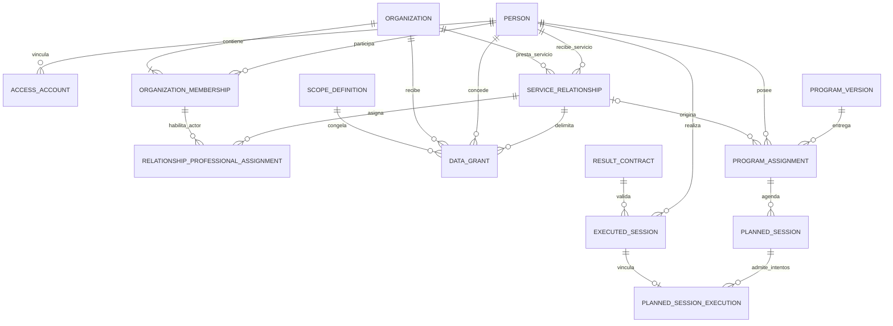
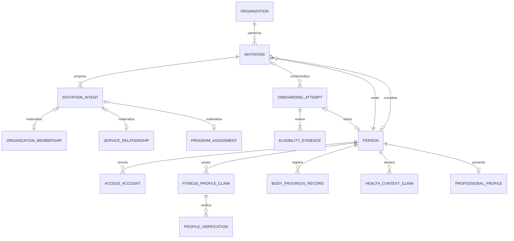
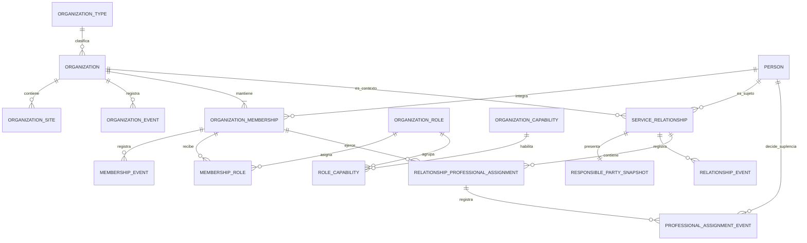
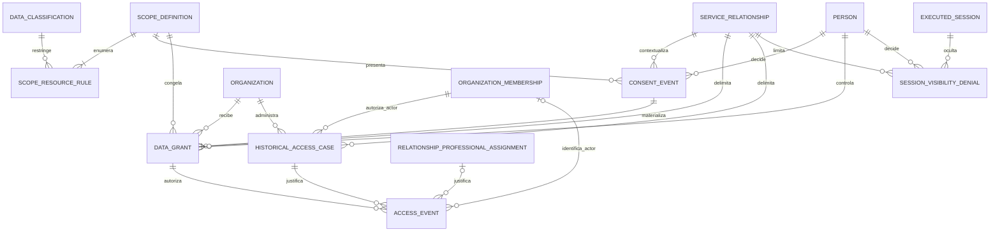
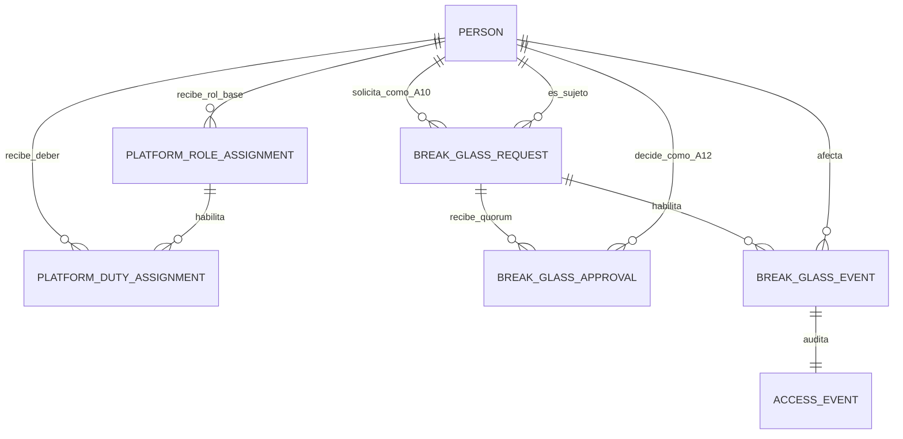
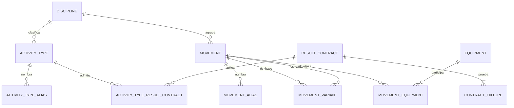
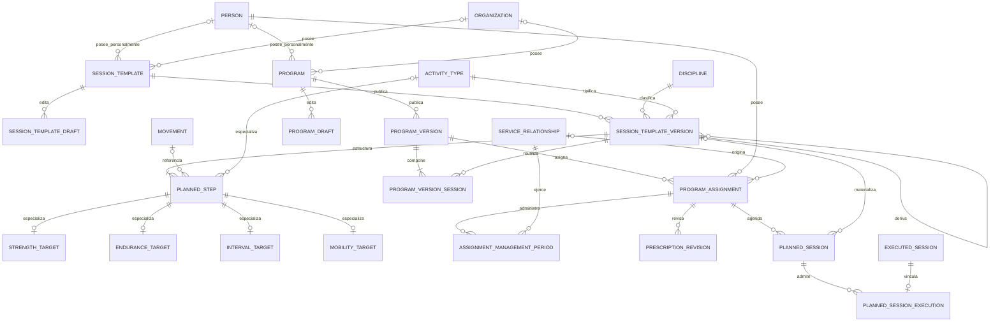
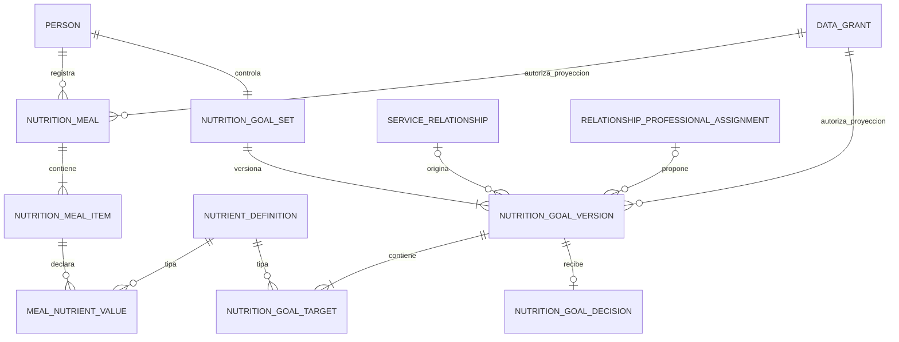
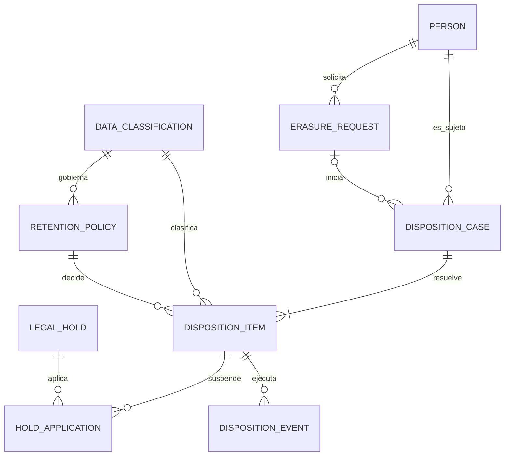

# ERD conceptual V1 — Allfit OS + Allfit Space

**Estado:** aprobado y recertificado<br>
**Fecha de consolidación:** 21 de julio de 2026<br>
**Recertificación:** 28 de julio de 2026 — incorpora Nutrición V1<br>
**Fase:** entregable de Fase 2 — dominios, ownership y flujo de datos<br>
**Fuentes normativas internas:** [`ALLFIT_ARCHITECTURE_DECISIONS.md`](../02_ARCHITECTURE_DECISIONS/ALLFIT_ARCHITECTURE_DECISIONS.md), [`ALLFIT_DOMAIN_GLOSSARY.md`](./ALLFIT_DOMAIN_GLOSSARY.md), [`V1_DATABASE_SCOPE.md`](./V1_DATABASE_SCOPE.md), [`DOMAIN_OWNERSHIP_MAP.md`](./DOMAIN_OWNERSHIP_MAP.md) y [`DATABASE_REFACTOR_PHASES.md`](../04_EXECUTION/DATABASE_REFACTOR_PHASES.md).

## 1. Propósito

Este documento representa las entidades conceptuales, sus fronteras de ownership y las cardinalidades necesarias para la baseline V1 compartida por Allfit Space y Allfit OS.

El ERD debe permitir:

- una sola identidad humana entre ambos productos;
- operación profesional siempre dentro de una organización;
- relaciones, consentimientos, grants y asignaciones con ciclos independientes;
- planificación versionada e inmutable;
- múltiples intentos por sesión planificada y una sola ejecución primaria;
- ejecuciones multidisciplina con resultados tipados;
- nutrición personal no clínica y guía profesional bajo consentimiento;
- continuidad personal y disposición de datos sin duplicación ni resurrección.

## 2. Nivel del modelo

Este es un **modelo conceptual**, no el modelo lógico ni una especificación SQL.

- Los nombres en `UPPER_SNAKE_CASE` identifican conceptos, no confirman nombres finales de tablas o schemas.
- Las líneas expresan cardinalidades de negocio; las FKs, constraints, índices, RLS y transacciones se cierran en fases posteriores.
- Los atributos solo se describen cuando son necesarios para entender identidad, ownership, vigencia o versionado.
- Los conceptos “afirmación”, “target”, “resultado” y “evento” no autorizan tablas EAV, JSON abierto ni referencias polimórficas sin integridad.
- Las estructuras tipadas pueden dividirse en varias tablas físicas aunque aparezcan agrupadas conceptualmente.
- Fitness ID es un agregado longitudinal en torno a `PERSON`; no es una segunda persona ni una entidad duplicada.
- Space y OS son consumidores de los mismos dominios; no aparecen como propietarios de datos.

### 2.1 Leyenda de cardinalidad

| Símbolo | Significado |
| --- | --- |
| <code>&#124;&#124;</code> | exactamente uno |
| <code>o&#124;</code> | cero o uno |
| <code>&#124;{</code> | uno o muchos |
| <code>o{</code> | cero o muchos |

## 3. Fronteras de dominio

| Dominio | Raíces conceptuales | Fuente de verdad |
| --- | --- | --- |
| Identidad | `PERSON`, cuentas, onboarding, perfil, invitaciones | Identidad; Cognito solo autentica |
| Organizaciones | `ORGANIZATION`, sedes, membresías, roles y capacidades | Organizaciones |
| Relaciones | `SERVICE_RELATIONSHIP`, profesionales asignados y vigencia | Relaciones |
| Privacidad | scopes, consentimiento, grants, denegaciones y disposición | Privacidad |
| Catálogo | disciplinas, actividades, movimientos, unidades y contratos | Catálogo |
| Planificación | plantillas, programas, versiones, asignaciones y agenda | Planificación |
| Ejecución | sesiones reales, segmentos, resultados, revisiones y derivados | Ejecución |
| Soporte de plataforma | solicitudes, aprobaciones y ejercicios break-glass | Soporte; nunca ownership del dato consultado |

Las referencias entre dominios no transfieren ownership. Por ejemplo, Planificación referencia una persona, pero no administra su identidad; una organización recibe un grant, pero no se vuelve dueña de los datos fitness.

## 4. Columna vertebral V1



### 4.1 Lectura de la columna vertebral

1. `PERSON` es la raíz canónica compartida por Space y OS.
2. Una persona puede operar en varias organizaciones mediante membresías distintas.
3. Una relación siempre une a una persona con una organización y no concede acceso por sí sola.
4. Un profesional actúa mediante una membresía organizacional y una asignación efectiva dentro de la relación.
5. Cada grant pertenece a la persona, relación, organización y versión exacta de scope.
6. Una asignación de programa pertenece al historial personal y puede tener una relación de origen.
7. Una sesión planificada admite varios intentos; una ejecución real pertenece como máximo a un intento.
8. Una ejecución espontánea existe sin planificación, relación u organización.
9. Al terminar una relación en `T`, sus grants `active` pasan a `frozen`: dejan de habilitar operación/escritura y solo pueden sustentar la lectura histórica `<= T` mediante un caso vigente y el predicado separado `auth.can_read_frozen` definido por ADR-023.

## 5. Identidad, onboarding e invitaciones



### 5.1 Entidades y reglas

| Entidad conceptual | Papel en V1 | Regla estructural |
| --- | --- | --- |
| `PERSON` | Ser humano canónico y raíz del Fitness ID | Se crea solo después de control personal, elegibilidad adulta y onboarding válido |
| `ACCESS_ACCOUNT` | Vínculo local con `(provider, issuer, subject)` de Cognito | Una cuenta externa no equivale a persona ni concede acceso de dominio |
| `ONBOARDING_ATTEMPT` | Flujo previo a activar una persona | Puede terminar sin crear `PERSON` |
| `ELIGIBILITY_EVIDENCE` | Aplicación versionada de la política adulta | Ausencia, fallo o `review_required` no significan elegibilidad |
| `FITNESS_PROFILE_CLAIM` | Afirmación tipada, con autor, procedencia y vigencia | El modelo lógico la separará por estructura y sensibilidad; no será EAV universal |
| `BODY_PROGRESS_RECORD` | Medición, tendencia o foto corporal elegida por la persona | Se estructura aparte de entrenamiento y elimina EXIF/geolocalización no necesarios |
| `HEALTH_CONTEXT_CLAIM` | Dolor, limitación, recuperación u otro contexto fitness minimizado | No representa historia clínica, diagnósticos, laboratorios o nutrición |
| `PROFILE_VERIFICATION` | Verificación de una afirmación concreta | No convierte el resto del perfil en verificado ni amplía scopes |
| `PROFESSIONAL_PROFILE` | Presentación profesional personal | Existe fuera de una organización; operar exige membresía organizacional |
| `INVITATION` | Sobre temporal de entrega y seguridad | No necesita `person_id` y nunca crea una persona provisional |
| `INVITATION_INTENT` | Propuesta tipada decidida de forma independiente | Materializa como máximo un destino compatible con su tipo |

Una intención de membresía, relación o programa se materializa únicamente después de aceptación autenticada y validación de dependencias. Las tres asociaciones opcionales del diagrama son un **XOR**: una misma intención no crea más de un tipo de entidad.

Las afirmaciones de perfil, body progress y health context conservan procedencia `person_declared`, `professional_observation`, `device_observed`, `system_inferred` o `authority_verified` cuando corresponda. La procedencia no sustituye ownership, clasificación, scope o capacidad.

## 6. Organizaciones y relaciones profesionales



### 6.1 Entidades y reglas

| Entidad conceptual | Papel en V1 | Regla estructural |
| --- | --- | --- |
| `ORGANIZATION` | Frontera estable de operación, autoría y permisos | Una práctica unipersonal conserva el mismo ID cuando incorpora equipo |
| `ORGANIZATION_TYPE` | Clasificación gobernada de la actividad principal | Añadir miembros no cambia automáticamente el tipo |
| `ORGANIZATION_SITE` | Sede física básica | No representa recursos reservables, clases ni inventario |
| `ORGANIZATION_MEMBERSHIP` | Vínculo bilateral de una persona con una organización | No concede acceso al Fitness ID |
| `MEMBERSHIP_ROLE` | Asignación efectiva de rol a una membresía | Conserva vigencia e historial; no es consentimiento |
| `ROLE_CAPABILITY` | Asociación gobernada entre rol y capacidad | Solo habilita acciones organizacionales explícitas |
| `SERVICE_RELATIONSHIP` | Vínculo aceptado de servicio entre persona y organización | No cambia de organización en sitio y no concede datos por sí mismo |
| `RESPONSIBLE_PARTY_SNAPSHOT` | Parte responsable, organización presentada, propósito y texto conocidos al aceptar | No presume que la organización técnica sea una persona jurídica |
| `RELATIONSHIP_PROFESSIONAL_ASSIGNMENT` | Profesional titular o suplente autorizado dentro de una relación y una vigencia | `holder` admite un solo efectivo; `substitute` exige fin obligatorio y decisión personal aceptada antes de acceder |
| `PROFESSIONAL_ASSIGNMENT_EVENT` | Historia de propuesta, aceptación/rechazo, activación, terminación y vencimiento | La decisión de suplencia identifica a la persona y no puede ser sustituida por un admin |
| Eventos organizacionales, de membresía y de relación | Historia efectiva de altas, cambios, pausas y terminaciones | Append-only o revisión equivalente con before/after |

La representación lógica de la parte responsable deberá distinguir con integridad una persona natural de una parte jurídica. No se resolverá con un UUID polimórfico sin constraints.

`coach` es el nombre canónico del rol organizacional profesional. `Titular` y `suplente` son clases contextuales de `RELATIONSHIP_PROFESSIONAL_ASSIGNMENT`, no roles adicionales ni sinónimos de `professional`.

## 7. Privacidad y autorización efectiva



### 7.1 Fórmula de acceso en vivo

Un profesional puede consultar o actuar sobre datos fitness únicamente cuando todas estas condiciones son verdaderas:

```text
cuenta válida
∧ persona profesional activa
∧ membresía organizacional vigente
∧ capacidad organizacional compatible
∧ relación de servicio vigente
∧ asignación profesional efectiva
∧ grant vigente para esa relación y organización
∧ versión de scope + access level + propósito compatibles
∧ ausencia de denegación aplicable
∧ clasificación/procedencia permitidas
```

### 7.2 Fórmula de lectura histórica

Un grant `frozen` no satisface la fórmula anterior. `HISTORICAL_ACCESS_CASE` autoriza durante máximo 24 horas a una membresía activa exacta y nunca por rol implícito. La lectura exige MFA, propósito cerrado, relación terminada, grant `frozen`, instante `<= frozen_at`, campo `historical_readable`, ausencia de denegación histórica y `ACCESS_EVENT` en la misma transacción.

`owner` y `admin` administran casos sin obtener lectura automática. El antiguo titular pierde su acceso en `T` y solo puede ser autorizado mediante un caso mientras conserve membresía activa. `staff` nunca es elegible.

### 7.3 Reglas estructurales

- Las definiciones iniciales son `relationship_training`, `prior_training_history`, `body_progress` y `health_context`; ninguna contiene implícitamente a otra.
- `SCOPE_DEFINITION` es una versión publicada e inmutable; ampliar campos o finalidad crea otra versión.
- `SCOPE_RESOURCE_RULE` enumera recursos, campos, exclusiones, acciones máximas y si el campo admite lectura histórica; no sustituye autorización server-side ni RLS.
- `CONSENT_EVENT` conserva la decisión y el snapshot presentado, incluso cuando no crea un grant.
- `DATA_GRANT` identifica obligatoriamente persona, relación, organización receptora, scope exacto, nivel, propósito y vigencia.
- `SESSION_VISIBILITY_DENIAL` reduce acceso para una relación concreta y nunca amplía un grant.
- Después del corte, una denegación puede reducir la ventana `frozen`, pero una restauración no puede ampliarla.
- `HISTORICAL_ACCESS_CASE` fija relación, organización, membresía, propósito y expiración; no sustituye ninguna otra condición de ADR-023.
- Una denegación de sesión aplica solo a actividad autónoma o previa elegible; no permite ocultar o reclasificar actividad producida dentro de la relación.
- `ACCESS_EVENT` identifica al actor humano real; registrar solo la organización es insuficiente.
- La reasignación profesional dentro de la misma parte responsable reutiliza el grant, pero cambia quién puede ejercerlo.

## 8. Soporte de plataforma y break-glass



### 8.1 Entidades, actores y reglas

| Concepto | Papel en V1 | Regla estructural |
| --- | --- | --- |
| `PLATFORM_ROLE_ASSIGNMENT` | Habilitación base para iniciar sesión en Backoffice | No concede operaciones; sin autoasignación; nunca cero administradores activos |
| `PLATFORM_DUTY_ASSIGNMENT` | Autoridad temporal para una función concreta A10/A11/A12 | Catálogo cerrado, AAL2, máximo 90 días, otorgante distinto y sin autoridad por caché/header |
| `BREAK_GLASS_REQUEST` | Expediente A10 para sujeto, propósito/caso, categorías, tier, quorum y duración | Alcance inmutable; pending 30 min; ventana 30/15 min; solo solicitante ejerce |
| `BREAK_GLASS_APPROVAL` | Decisión append-only de A12 | Uno estándar o dos distintos restringido; rechazo terminal; A12 no ejerce |
| `BREAK_GLASS_EVENT` | Evidencia append-only de cada ejercicio/cierre | Identifica solicitud, solicitante, sujeto, categoría, resultado, recurso y tiempo |
| `ACCESS_EVENT` | Evidencia de la lectura sensible visible para la persona | Se escribe en la misma transacción o la lectura falla |

`A10`, `A11` y `A12` son modos derivados del deber ejercido. No son `ORGANIZATION_ROLE`, no requieren `ORGANIZATION_MEMBERSHIP` y el rol base no los concede. El camino ordinario de `A10` usa una vista de metadatos sin contenido; la ventana aprobada es de solo lectura y nunca admite exportación masiva.

## 9. Catálogo multidisciplina



### 9.1 Entidades y reglas

| Entidad conceptual | Papel en V1 | Regla estructural |
| --- | --- | --- |
| `DISCIPLINE` | Familia global con código estable | No se modela con booleanos o un enum rígido por producto |
| `ACTIVITY_TYPE` | Clase concreta de actividad, global o privada gobernada | Determina contratos y estructuras compatibles y conserva owner/procedencia |
| `ACTIVITY_TYPE_ALIAS` | Nombre alternativo o traducción de una actividad | No crea otro tipo de actividad |
| `MOVEMENT` | Acción o técnica reutilizable y opcional | Conserva alcance global/personal/organizacional, owner y procedencia |
| `MOVEMENT_ALIAS` | Nombre alternativo o traducción | No crea identidad semántica duplicada |
| `MOVEMENT_VARIANT` | Relación curatorial entre definiciones | Conserva base, variante y procedencia sin sobrescribir |
| `EQUIPMENT` | Recurso físico compatible o requerido | Conserva alcance/owner y no representa inventario ni reservas |
| `UNIT` | Código y conversión dentro de una dimensión | Todo valor físico conserva unidad canónica y, cuando aplique, original |
| `RESULT_CONTRACT` | Contrato publicado/versionado de envelope, mínimos y detalle | Una versión futura no reinterpreta ejecuciones previas |
| `ACTIVITY_TYPE_RESULT_CONTRACT` | Asociación vigente/default entre actividad y contrato | Congela compatibilidad sin codificarla en el frontend |
| `CONTRACT_FIXTURE` | Caso válido o inválido de la suite contractual | `sensor_enriched` usa fixtures controlados, no conectores productivos |

`UNIT` es consumida por targets y resultados tipados, pero no se dibuja una asociación universal que sugiera un único contenedor de valores.

## 10. Planificación, versionado e intentos



### 10.1 Reglas de versión y composición

- `SESSION_TEMPLATE` y `PROGRAM` son identidades estables; borradores y versiones no se mezclan.
- Cada plantilla y programa tiene exactamente un contexto de ownership personal u organizacional; autoría y procedencia permanecen separadas. Las asociaciones opcionales del diagrama forman un XOR.
- Una versión publicada es completa e inmutable.
- Cada versión declara disciplina y tipo de actividad; un paso puede declarar un tipo más específico compatible para sesiones híbridas.
- Cada `PLANNED_STEP` y target pertenece a una versión exacta de plantilla.
- La especialización de target es compatible con el tipo de actividad y no se guarda solo en JSONB.
- `PROGRAM_VERSION_SESSION` referencia una versión exacta de plantilla; nunca resuelve “la última”.
- Adoptar otra versión de plantilla requiere una nueva publicación de programa.

### 10.2 Asignación y continuidad

- `PROGRAM_ASSIGNMENT` pertenece al historial de la persona y referencia una versión exacta.
- La relación de origen es inmutable; una asignación personal puede no tenerla.
- `ASSIGNMENT_MANAGEMENT_PERIOD` separa la gestión efectiva de la procedencia. Solo puede existir un periodo gestor vigente a la vez.
- Terminar una relación cierra el periodo de gestión y deja la misma asignación como `detached_pending_choice`.
- Continuar personalmente reutiliza la asignación; terminarla cancela solo sesiones futuras no iniciadas.
- Una organización posterior no hereda gestión, grants o acceso de la anterior.

### 10.3 Sesiones planificadas e intentos

- Una sesión planificada admite cero o muchos `PLANNED_SESSION_EXECUTION`.
- Cada vínculo tiene un número de intento único y monotónico dentro de la sesión planificada.
- Una ejecución aparece en cero o un vínculo; cero significa sesión espontánea.
- Solo una ejecución completada, válida y de la misma persona puede ser primaria.
- Existe como máximo una primaria por sesión planificada.
- Reanudar reutiliza el intento activo; doble clic, reintento de red u offline no crean otro.
- Invalidar la primaria no promueve otra ejecución de forma silenciosa.

## 11. Ejecución y resultados tipados

```mermaid
erDiagram
    PERSON ||--o{ EXECUTED_SESSION : realiza
    DISCIPLINE ||--o{ EXECUTED_SESSION : clasifica
    ACTIVITY_TYPE ||--o{ EXECUTED_SESSION : tipifica
    RESULT_CONTRACT ||--o{ EXECUTED_SESSION : congela
    SERVICE_RELATIONSHIP o|--o{ EXECUTED_SESSION : contextualiza
    ORGANIZATION o|--o{ EXECUTED_SESSION : contextualiza

    EXECUTED_SESSION ||--o{ SESSION_SEGMENT : divide
    ACTIVITY_TYPE o|--o{ SESSION_SEGMENT : tipifica
    PLANNED_STEP o|--o{ SESSION_SEGMENT : contrasta

    EXECUTED_SESSION ||--o{ STRENGTH_SET : registra
    SESSION_SEGMENT o|--o{ STRENGTH_SET : ubica
    MOVEMENT o|--o{ STRENGTH_SET : referencia

    EXECUTED_SESSION ||--o{ ENDURANCE_LAP : registra
    SESSION_SEGMENT o|--o{ ENDURANCE_LAP : ubica

    EXECUTED_SESSION ||--o{ INTERVAL_RESULT : registra
    SESSION_SEGMENT o|--o{ INTERVAL_RESULT : ubica

    EXECUTED_SESSION ||--o{ ROUND_RESULT : registra
    SESSION_SEGMENT o|--o{ ROUND_RESULT : ubica

    EXECUTED_SESSION ||--o{ MOBILITY_RESULT : registra
    SESSION_SEGMENT o|--o{ MOBILITY_RESULT : ubica
    MOVEMENT o|--o{ MOBILITY_RESULT : referencia

    EXECUTED_SESSION ||--o{ METRIC_SAMPLE : registra
    SESSION_SEGMENT o|--o{ METRIC_SAMPLE : ubica

    EXECUTED_SESSION ||--o{ PROFESSIONAL_OBSERVATION : contiene
    RELATIONSHIP_PROFESSIONAL_ASSIGNMENT ||--o{ PROFESSIONAL_OBSERVATION : autoria

    EXECUTED_SESSION ||--o{ CORRECTION_PROPOSAL : recibe
    RELATIONSHIP_PROFESSIONAL_ASSIGNMENT ||--o{ CORRECTION_PROPOSAL : propone
    EXECUTED_SESSION ||--o{ REVISION_EVENT : conserva
    EXECUTED_SESSION ||--o{ RESULT_VALIDATION_EVENT : valida
    RESULT_CONTRACT ||--o{ RESULT_VALIDATION_EVENT : aplica
    EXECUTED_SESSION ||--o{ DERIVED_RESULT : calcula
```



### 11.1 Envelope universal

Cada `EXECUTED_SESSION` conserva conceptualmente:

- persona;
- disciplina y tipo de actividad;
- inicio, fin y zona horaria original;
- estado de ejecución;
- fuente, procedencia y actor/dispositivo de captura;
- contexto opcional de relación y organización;
- contrato y versión congelados;
- nivel solicitado y alcanzado;
- estado de validación independiente del estado y la completitud.

### 11.2 Resultados especializados

| Familia V1 | Entidades conceptuales | Mínimo cubierto |
| --- | --- | --- |
| Fuerza/calistenia | `STRENGTH_SET` | esfuerzo/serie con orden, movimiento o paso y cantidad lograda |
| Running/endurance | `ENDURANCE_LAP`, `INTERVAL_RESULT` | duración y distancia; detalle ordenado cuando aplique |
| Yoga/movilidad | `MOBILITY_RESULT` | secuencia, postura/movimiento, lado y cantidad observada |
| Híbrido/cross-training | `SESSION_SEGMENT`, `ROUND_RESULT`, `INTERVAL_RESULT` | familias diferentes y transiciones explícitas |
| Sensor controlado | `METRIC_SAMPLE` | fixture tipado con unidad, fuente y calidad; sin integración productiva |

No existe una entidad física universal `RESULT(type, value, metadata)`. Cada resultado especializado pertenece a una sesión y puede pertenecer a un segmento. El modelo lógico cerrará los vínculos opcionales con pasos, movimientos y unidades mediante FKs tipadas.

### 11.3 Correcciones, validación y derivados

- Un profesional revisa directamente solo `PROFESSIONAL_OBSERVATION` propia.
- Para un dato declarado por la persona crea `CORRECTION_PROPOSAL`; la persona acepta o rechaza.
- `REVISION_EVENT` conserva original, before/after, actor, motivo, procedencia y tiempo.
- El target exacto de una propuesta o revisión deberá resolverse con integridad tipada en el modelo lógico; no mediante un UUID polimórfico libre.
- `RESULT_VALIDATION_EVENT` conserva contrato, nivel solicitado/alcanzado y errores tipados.
- `DERIVED_RESULT` conserva algoritmo, versión, inputs, revisiones usadas y vigencia; nunca sustituye observaciones base.
- Corregir o invalidar inputs invalida o recalcula derivados de manera idempotente.

## 11A. Nutrición personal y guía profesional



### 11A.1 Entidades y ownership

| Entidad conceptual | Papel | Regla estructural |
| --- | --- | --- |
| `NUTRIENT_DEFINITION` | Catálogo cerrado inicial de energía, proteína, carbohidratos, grasa, fibra y agua | Cada código fija unidad canónica; ampliarlo exige nueva versión del scope |
| `NUTRITION_MEAL` | Ingesta manual de una persona | Solo la persona escribe; una foto opcional saneada |
| `NUTRITION_MEAL_ITEM` | Componente ordenado de la comida | Hereda sujeto y ciclo del padre |
| `MEAL_NUTRIENT_VALUE` | Valor canónico de un nutriente por ítem | Único por ítem/nutriente y no negativo |
| `NUTRITION_GOAL_SET` | Línea longitudinal única de metas | Exactamente uno por persona |
| `NUTRITION_GOAL_VERSION` | Snapshot inmutable personal o profesional | Como máximo una activa; propuesta profesional congela contexto |
| `NUTRITION_GOAL_TARGET` | Mínimo, máximo, rango o valor exacto | Nutriente y unidad compatibles |
| `NUTRITION_GOAL_DECISION` | Aceptación/rechazo append-only | Solo la persona y una vez por versión profesional |

### 11A.2 Reglas de acceso y ciclo

- La persona accede a toda su nutrición sin convertir un rol organizacional en ownership.
- OS solo consume proyecciones cerradas con relación, asignación, membresía, `guide_nutrition`, credencial verificada y grant.
- `nutrition_media` requiere también `nutrition_intake`; aislado no revela la comida.
- Un profesional propone objetivos, pero no modifica comidas ni activa versiones.
- `frozen` proyecta únicamente guía profesional originada en la relación y registrada `<= T`; ingestas, medios, resúmenes y metas personales quedan fuera.
- Resúmenes diarios son derivados reproducibles sin entidad persistente propia.

## 12. Retención, supresión y disposición



### 12.1 Lectura del modelo

- `DISPOSITION_CASE` agrupa una resolución iniciada por solicitud, fin de finalidad, vencimiento, cierre o desconexión.
- `DISPOSITION_ITEM` decide por categoría y target si corresponde eliminar, anonimizar o retener de forma restringida.
- El vínculo al target real será tipado en el modelo lógico; no habrá un `target_uuid` universal sin integridad.
- `RETENTION_POLICY` queda congelada por versión, finalidad, jurisdicción y trigger.
- `LEGAL_HOLD` no cambia ownership y solo suspende items concretos mediante `HOLD_APPLICATION` con vigencia y revisión.
- `DISPOSITION_EVENT` es append-only e idempotente y registra acción, resultado, actor/job y tiempo.
- La disposición alcanza originales, derivados, cachés y read models; los backups convergen por expiración y no resucitan datos.

## 13. Registro de cardinalidades críticas

| Asociación | Cardinalidad V1 | Invariante |
| --- | --- | --- |
| Persona → cuenta | `1 : 0..N` | Una cuenta externa se vincula como máximo a una persona canónica |
| Onboarding → persona | `1 : 0..1` | Los intentos no elegibles no dejan personas parciales |
| Invitación → intención | `1 : 1..N` | No existe aceptación global de todas las intenciones |
| Persona ↔ organización | `N : M` mediante membresía | Un rol en una organización no se propaga a otra |
| Persona + organización → relación | Cada relación tiene exactamente una de cada una | Cambiar organización exige una relación nueva |
| Relación → titular | `1 : 0..N` históricos; máximo uno efectivo | Solo el `holder` vigente habilita al titular |
| Relación → suplente | `1 : 0..N` históricos | Exige fin obligatorio y aceptación personal antes de ser efectivo |
| Suplencia → decisión personal | `1 : 0..1` decisión final | Sin aceptación no existe acceso; rechazo y terminación conservan historia |
| Relación → grant | `1 : 0..N` | Relación activa sin grant es válida y no comparte datos |
| Consentimiento → grant | `1 : 0..1` | Rechazar o revocar conserva evidencia sin grant activo |
| Scope → grant | `1 : 0..N` | Cada grant congela una versión exacta |
| Programa → versión | `1 : 0..N` | Una identidad estable puede existir antes de publicar |
| Versión de programa → composición | `1 : 1..N` al publicar | Cada posición referencia una versión exacta de plantilla |
| Persona → asignación | `1 : 0..N` | La asignación pertenece al historial personal |
| Asignación → periodo de gestión | `1 : 0..N` | Como máximo uno está vigente; puede quedar sin gestor |
| Sesión planificada → intento | `1 : 0..N` | `attempt_number` es único y monotónico por plan |
| Ejecución → vínculo de intento | `1 : 0..1` | Una ejecución espontánea no necesita plan |
| Sesión planificada → primaria | `1 : 0..1` | Solo ejecución completada, válida y de la misma persona |
| Ejecución → segmento | `1 : 0..N` | Híbrido exige al menos dos segmentos de familias distintas |
| Ejecución → resultado tipado | `1 : 0..N` por familia | `NULL` no se convierte en cero ni otra modalidad |
| Sesión + relación → denegación | Una fila efectiva por par | Denegar prevalece y no altera la sesión personal |
| Solicitud break-glass → aprobación | `1 : 0..N` | Uno/dos A12 distintos; unique por aprobador, rechazo terminal y quorum calculado |
| Solicitud break-glass → ejercicio | `1 : 0..N` | Solo el `A10` solicitante y durante la ventana aprobada |
| Ejercicio break-glass → evento de acceso | `1 : 1` | No se sirve contenido si la auditoría falla |

## 14. Invariantes transversales

1. No existe una persona por producto, organización o relación.
2. El Fitness ID se compone desde hechos de dominios; no replica sus filas en un agregado mutable.
3. Una invitación pendiente no crea cuenta, persona, perfil, relación, grant o asignación.
4. Membresía, rol, capacidad, relación, asignación profesional y grant son condiciones distintas.
5. La organización de una relación y del grant deben coincidir.
6. El profesional asignado debe operar mediante una membresía vigente en esa organización.
7. Scope, access level, propósito y procedencia se evalúan por separado.
8. Una denegación por relación solo reduce acceso y se evalúa antes de proyectar o agregar.
9. Versiones publicadas de scopes, plantillas, programas y contratos son inmutables.
10. Una asignación conserva versión, snapshot, origen y autoría al desacoplarse.
11. Planificación expresa intención; Ejecución conserva hechos reales y nunca sobrescribe targets.
12. Cada ejecución congela un contrato compatible y conserva sus resultados tipados.
13. Los eventos y revisiones materiales son append-only o preservan before/after equivalente.
14. Toda disposición se resuelve por categoría y no reutiliza datos retenidos para operación ordinaria.
15. `staff` nunca accede a datos fitness y `coach` es el único nombre de rol profesional organizacional.
16. Una suplencia propuesta, rechazada, terminada o vencida nunca satisface la fórmula de acceso.
17. `A10` solicita/ejerce solo su ventana; uno/dos A12 aprueban y otro A12 revisa sin ejercer.
18. Break-glass e histórico `frozen` son superficies distintas y ninguna amplía a la otra.
19. V1 no crea entidades de booking, commerce, marketplace, integrations, intelligence, nutrición clínica o menores.
20. Nutrición no se almacena en `HEALTH_CONTEXT_CLAIM`, perfil genérico o ejecución.
21. Una versión profesional no se activa sin una decisión personal append-only.

## 15. Validación contra los escenarios de Fase 2

| Escenario | Camino principal en el ERD | Resultado |
| --- | --- | --- |
| 1. Persona Space-only | `ONBOARDING_ATTEMPT → PERSON → EXECUTED_SESSION` | No requiere organización, relación, grant, programa o invitación |
| 2. Invitación OS pendiente | `ORGANIZATION → INVITATION → INVITATION_INTENT` | No existe `PERSON` provisional ni entidad destino |
| 3. Aceptación parcial | Intención aceptada → `SERVICE_RELATIONSHIP`; intención rechazada → sin `PROGRAM_ASSIGNMENT` | Las decisiones no se acoplan ni conceden scopes implícitos |
| 4. Persona Space preexistente | `ACCESS_ACCOUNT → PERSON` existente + invitación reclamada | Reutiliza la identidad y conserva historial autónomo privado |
| 5. Práctica crece a equipo | Misma `ORGANIZATION` + nueva `ORGANIZATION_MEMBERSHIP` | No migra organización, autoría, relaciones ni activos |
| 6. Dos relaciones y sesión oculta | Grants separados + `SESSION_VISIBILITY_DENIAL` por relación | Una relación puede ver y otra no, sin filtrar conteos o derivados |
| 7. Fin de relación | Cierre de relación/grants + cierre de `ASSIGNMENT_MANAGEMENT_PERIOD` | La misma asignación queda pendiente de decisión personal |
| 8. Disposición | `DISPOSITION_CASE → DISPOSITION_ITEM → DISPOSITION_EVENT` | Elimina, anonimiza o restringe por categoría; holds son acotados |
| 9. Sesión híbrida | Versión exacta → plan → intentos → sesión → segmentos/resultados tipados | Fuerza, endurance y movilidad conviven sin tabla universal |
| 10. Capacidades diferidas | Ausencia de raíces y relaciones futuras | El modelo funciona sin placeholders especulativos |
| 11. Suplencia | Relación → asignación `substitute` → decisión personal | Propuesta sin aceptar no accede; aceptación activa y vencimiento corta |
| 12. Soporte | `BREAK_GLASS_REQUEST → APPROVAL[1..2] → EVENT → ACCESS_EVENT → REVIEW` | AAL2, conflictos, quorum, solo lectura y trazabilidad visible |
| 13. Terminación recertificada | Relación → cierre de titular/suplentes + grants `frozen` | Un mismo `T`, sin autoridad residual ni datos posteriores |
| 14. Retención recertificada | Cierre/expiración → evidencia restringida | Retener no revive asignación, ventana o acceso |
| 15. Histórico restringido | Caso histórico autorizado → proyección `frozen` → `ACCESS_EVENT` | No abre endpoints operativos ni se convierte en break-glass |
| 16. Nutrición Space | `PERSON → NUTRITION_MEAL → ITEM → NUTRIENT_VALUE` | Captura offline idempotente y foto diferida sin duplicar la comida |
| 17. Guía nutricional | Relación/asignación/grant → `GOAL_VERSION proposed → GOAL_DECISION` | Profesional verificado propone; solo la persona activa |
| 18. Nutrición frozen | Grant/caso histórico → versiones profesionales `<= T` | Excluye ingestas, medios, resúmenes, metas personales y post-corte |

**Resultado de la validación:** los recorridos originales y los incorporados por ADR-022/023/027 se representan sin duplicar personas, asignaciones, ejecuciones, nutrición o historial entre Space y OS. Nutrición queda como noveno dominio y se traduce a ocho tablas físicas propias.

## 16. Decisiones reservadas para el modelo lógico

El siguiente nivel deberá resolver, sin cambiar las invariantes anteriores:

- schemas, nombres físicos, PKs, FKs y tipos de identificador;
- tablas tipadas para afirmaciones de perfil y categorías sensibles;
- representación con integridad de la parte responsable natural o jurídica;
- estrategia física de borradores, eventos, snapshots y proyecciones actuales;
- catálogos/estados exactos y constraints de transición;
- targets y resultados especializados por familia;
- referencias tipadas para correcciones, revisiones y disposición;
- constraints diferidos o comandos transaccionales para reglas entre tablas;
- claves de idempotencia, outbox/inbox y control de concurrencia;
- RLS, contexto de sesión, roles de PostgreSQL y matriz de operaciones;
- índices, particionamiento, observabilidad y políticas físicas de retención.

Estas decisiones no deben introducir entidades fuera de alcance ni reinterpretar cardinalidades para facilitar una implementación concreta.

## 17. Estado de salida de Fase 2

El mapa de dominios y este ERD conceptual cubren los entregables documentales definidos para la Fase 2 y quedaron **aprobados y recertificados el 28 de julio de 2026**.

La recertificación confirmó que:

1. las entidades representan el lenguaje acordado;
2. las cardinalidades críticas son correctas;
3. los diez escenarios originales, los cinco de recertificación y los tres nutricionales continúan sin duplicaciones o filtraciones;
4. no hay conceptos diferidos escondidos en entidades V1;
5. el ERD alimenta la matriz de operaciones, seguridad y contratos de Fase 3 sin decisiones conceptuales contradictorias;
6. `staff`, suplencia, soporte break-glass, acceso histórico y nutrición tienen dominio, ownership, cardinalidad y escenarios explícitos.
