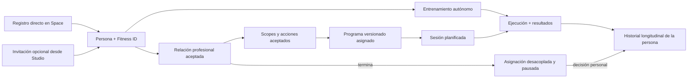

# Alcance de base de datos V1 — Allfit One

**Estado:** aprobado; acceso Backoffice recertificado por ADR-028 y topología por ADR-029<br>
**Fecha de consolidación:** 20 de julio de 2026<br>
**Recertificaciones:** 3 de agosto de 2026 · Backoffice; 5 de agosto de 2026 · monorepo; 17 de agosto de 2026 · alcance BETA Studio 86/86<br>
**Fase:** entregable de Fase 1 — lenguaje y alcance<br>
**Fuentes normativas internas:** `ALLFIT_ARCHITECTURE_DECISIONS.md`, `ALLFIT_DOMAIN_GLOSSARY.md` y `DATABASE_REFACTOR_PHASES.md`.

## 1. Propósito

Este documento define la frontera funcional y de datos de la primera baseline de base de datos para el ecosistema Allfit One, consumida por Studio, Space y Backoffice.

Las 86 HU de Studio están incluidas en el alcance BETA comprometido para el 31
de agosto de 2026. Esta inclusión no afirma implementación: una HU se completa
solo con BACK y FRONT verificados y fusionados en `main`; el despliegue no forma
parte del compromiso.

Responde:

- qué actores y flujos debe soportar V1;
- qué conceptos y datos forman parte del núcleo;
- qué reglas de ownership, privacidad y ciclo de vida son obligatorias;
- qué capacidades quedan explícitamente diferidas;
- qué debe demostrarse antes de considerar terminada la baseline.

No es un modelo lógico, un diccionario de tablas ni una especificación SQL. Los nombres físicos se definen en fases posteriores. Si un diseño físico contradice este alcance o los ADR, debe corregirse el diseño, no reinterpretarse silenciosamente el alcance.

### Cómo interpretar la frontera

- **Incluido en V1:** la baseline debe representarlo, autorizarlo, protegerlo y probarlo de extremo a extremo.
- **Diferido:** puede documentarse como dominio futuro, pero no genera schemas, tablas, columnas, JSON genérico, roles, scopes, endpoints o jobs en V1.
- **Fuera de producto V1:** el flujo debe rechazarse o no estar disponible; no se simula con soporte manual.

## 2. Resultado de producto que habilita V1

V1 permite que:

1. una persona adulta se registre directamente en Space y mantenga un Fitness ID autónomo;
2. una organización invite desde Studio sin crear identidad en nombre del destinatario;
3. una persona acepte por separado una membresía organizacional, una relación profesional o una asignación propuesta;
4. un profesional opere siempre dentro de una organización;
5. una persona y un profesional autorizado compartan planificación, ejecución y resultados bajo consentimientos explícitos;
6. la persona conserve continuidad de su historial al cambiar o terminar relaciones;
7. Space y Studio trabajen sobre la misma persona y los mismos hechos, sin sincronizar copias por producto.



## 3. Productos y frontera técnica

| Elemento | Decisión V1 |
| --- | --- |
| Allfit Space | Producto personal; permite registro directo, perfil, agenda, entrenamiento autónomo e historial propio |
| Allfit Studio | Producto profesional; invita, gestiona organizaciones, relaciones, planificación y datos autorizados |
| Autenticación | WorkOS AuthKit es la única fuente de autenticación |
| Identidad de dominio | La persona/Fitness ID es independiente del `sub` de WorkOS AuthKit |
| Persistencia | Un PostgreSQL administrado por Supabase compartido por ambiente |
| Acceso | Space y Studio usan una API propia; ningún cliente accede directamente a PostgreSQL/PostgREST |
| Autorización | Backend, privilegios mínimos y RLS con contexto transaccional |
| Independencia | Funcional y operativa; WorkOS AuthKit, API autoritativa y PostgreSQL continúan como dependencias físicas compartidas |
| Implementación | Un monorepo `allfitone` con cinco deployables independientes y paquetes compartidos |
| Migraciones | `allfitone/packages/db` y un solo pipeline son autoridad del esquema |

Una caída total de WorkOS AuthKit o PostgreSQL puede afectar ambos productos. V1 no promete tolerancia física separada. Los fallos locales deben contenerse mediante límites de recursos, timeouts, colas, idempotencia, circuit breakers y observabilidad por producto/dominio.

## 4. Actores incluidos

| Actor | Puede hacer en V1 | No obtiene automáticamente |
| --- | --- | --- |
| Persona | Registrarse, mantener perfil/Fitness ID, entrenar, aceptar vínculos, compartir/revocar datos y decidir continuidad | Organización, relación profesional o publicación pública |
| Profesional | Mantener perfil profesional personal y operar servicios dentro de una organización | Acceso a clientes por ser profesional |
| Propietario/admin organizacional | Gestionar organización, sede básica, staff, roles e invitaciones | Acceso al Fitness ID por su rol administrativo |
| Staff organizacional | Enviar invitaciones y consultar el directorio de su organización | Acceso al Fitness ID, entrenamientos, progreso corporal, salud o permisos profesionales |
| Profesional asignado | Planificar, consultar o contribuir según relación, asignación, capacidad y grant vigentes. Es el **titular**: hay uno efectivo por relación en cada instante | Acceso universal o posibilidad de sobrescribir datos ajenos |
| Profesional suplente | Actuar dentro de una relación durante una vigencia acotada, **previa aceptación de la persona**, ejerciendo los grants ya vigentes | Ampliar scopes, prorrogarse solo o sustituir al titular |
| Verificador de credenciales `A11` | Verificar credenciales profesionales mediante registro oficial o confirmación del emisor, con `verify_professional_credentials`, AAL2 y deber vigente | Verificar edad, identidad civil, salud, dispositivos, afiliación o el perfil completo |
| Soporte solicitante `A10` | Diagnosticar sobre metadatos, solicitar y ejercer únicamente su propia ventana break-glass aprobada | Aprobar, usar ventanas ajenas o escribir datos personales |
| Seguridad/privacidad `A12` | Aprobar/rechazar solicitudes ajenas y auditar sus ejercicios | Solicitar en ese flujo, ejercer ventanas o asumir un rol del gimnasio |
| Organización | Conservar activos propios y operar relaciones/servicios | Ownership sobre el historial completo de la persona |
| Allfit/plataforma | Custodiar identidad de dominio, autorización, auditoría y operaciones técnicas | Reutilización secundaria de datos sin finalidad y autorización propias |
| WorkOS AuthKit | Autenticar y verificar el email de acceso | Rol de persona, cliente, profesional o miembro organizacional; control de celular |

V1 solo admite personas de **18 años o más**. No existen actores representantes, guardianes o dependientes.

Para `A10`, `A11` y `A12`, `allfit_admin` es sólo el rol base de entrada. La autoridad de cada operación proviene de un deber temporal en `support.platform_duty_assignments`, comprobado con AAL2 dentro de la transacción. Ningún deber nace de WorkOS AuthKit, de una organización o del cliente.

## 5. Flujos de identidad y onboarding incluidos

### 5.1 Registro directo en Space

La persona puede:

1. iniciar personalmente el registro o autenticación mediante AuthKit;
2. verificar su email o celular;
3. acreditar elegibilidad adulta;
4. aceptar términos y completar onboarding;
5. activar una única persona/Fitness ID y su cuenta local.

El registro directo no crea invitación, organización, membresía, relación profesional, asignación o grant de servicio.

### 5.2 Invitación opcional desde Studio

Studio puede crear una invitación por email o celular con intenciones tipadas:

- membresía organizacional;
- relación profesional;
- asignación de programa, dependiente de una relación aceptada.

Cada intención se acepta o rechaza de forma independiente. La aceptación parcial es válida. Términos, políticas, contratos, scopes, pagos y usos secundarios no se aceptan implícitamente mediante la invitación.

Cuando la invitación contiene una intención `service_relationship`, presenta también sus opciones de scope. La persona decide la relación y cada scope de forma independiente en una sola confirmación autenticada. En V1 no existe una solicitud posterior de permisos iniciada por Studio: un scope rechazado o revocado permanece denegado y volver a compartir exige una nueva relación y una nueva aceptación.

Una persona ya registrada en Space acepta la invitación con su cuenta y `person_id` existentes. Nunca se crea otro Fitness ID por entrar a una organización o relación.

### 5.3 Elegibilidad adulta

La elegibilidad se resuelve antes de crear/activar la persona, recopilar datos fitness o materializar intenciones.

**Decisión ratificada el 23 de julio de 2026:** V1 permanece limitada a personas de 18 años o más. La propuesta de admitir desde los 14 años como usuarios autónomos queda fuera de esta baseline. Atender adolescentes en una fase futura requerirá representación y salvaguardas propias; no se implementará reduciendo únicamente el valor de edad mínima.

- V1 usa edad mínima global de 18 años.
- Una declaración versionada de mayoría de edad puede satisfacer el control V1 sin guardar fecha de nacimiento completa solo para esa finalidad.
- `unknown`, fallo o ausencia de evidencia nunca equivalen a elegible.
- Un usuario WorkOS temporal no elegible no obtiene acceso de dominio y converge a deshabilitación/eliminación.
- Descubrir posteriormente que la persona es menor restringe la cuenta, revoca accesos e inicia disposición.

## 6. Organización y operación profesional incluidas

### 6.1 Perfil profesional

El perfil profesional pertenece a la persona y puede existir sin organización. No constituye otra identidad.

V1 normaliza cuatro piezas distintas:

- `professional_profiles` conserva titular profesional, biografía y año de inicio de práctica;
- `professional_profile_specialties` referencia un catálogo global de especialidades profesionales;
- `professional_credentials` conserva cada credencial declarada con identidad y ciclo de vida propios;
- `professional_credential_verifications` conserva decisiones append-only sobre una versión exacta de una credencial.

Los años de experiencia se derivan del año de inicio. Una credencial declarada no se presenta como verificada; el perfil completo nunca recibe un estado global de verificación. Editar materialmente una credencial verificada crea una revisión y exige una nueva decisión competente.

Para prestar servicios, gestionar clientes, asignar programas o realizar cualquier operación profesional mediante Studio, la persona debe actuar dentro de una organización activa.

### 6.2 Tipos operativos iniciales

V1 usa una raíz organizacional común y mantiene activos inicialmente estos tipos:

- `professional_practice`, presentado como “Profesional independiente”;
- `gym`, presentado como “Gimnasio”;
- `studio`, presentado como “Estudio”.

`academy` y `clinic` permanecen gobernados pero inactivos hasta que exista un caso real V1 aprobado. El catálogo de onboarding no los devuelve y la creación de organizaciones los rechaza mientras permanezcan inactivos.

El tipo describe la actividad principal, no el tamaño.
Las transiciones explícitas viven en `organizations.organization_type_transitions`.
El catálogo inicial permite únicamente `professional_practice → gym` y
`professional_practice → studio`; incorporar equipo nunca cambia `type_code`.

### 6.3 Práctica inicialmente unipersonal

El onboarding `solo_professional` crea una organización `professional_practice` y la membresía propietaria inicial.

- La organización puede incorporar staff y otros profesionales sin cambiar de identidad.
- El número de integrantes se deriva de membresías activas.
- Toda organización activa tiene exactamente una membresía activa con rol `owner`; esa membresía puede acumular otros roles compatibles.
- `owner` no se concede ni se revoca mediante la gestión genérica de roles. La transferencia V1 es owner-only, exige una membresía destino activa y cambia ambas vigencias bajo locks en una transacción que confirma exactamente un owner.
- El owner anterior conserva su membresía y roles no `owner`; no recibe un rol residual implícito y puede renunciar después mediante el flujo propio.
- No existe un tipo permanente `independent_professional` ni un `is_independent` que gobierne permisos.
- Una organización operativa no implica por sí sola una persona jurídica.

### 6.4 Elementos organizacionales V1

Incluidos:

- organización y estado;
- sede básica;
- membresías internas de owner/admin/staff/profesional;
- roles y capacidades explícitas, con catálogo cerrado de cuatro roles y sin roles personalizados;
- asignación efectiva de profesionales a relaciones;
- suplencias acotadas en el tiempo y aceptadas por la persona;
- historial de reasignaciones.

El cierre de una organización es un comando coordinado en una sola transacción
PostgreSQL. Organizaciones llama contratos públicos estrechos de Relaciones,
Privacidad, Planificación, Ejecución y Nutrición; Ejecución cancela propuestas
de corrección pendientes y Nutrición cancela propuestas nutricionales
pendientes. Cada dominio escribe solo sus tablas y cualquier fallo revierte el
cierre completo.

Las membresías comerciales de clientes no forman parte de V1.

## 7. Relación profesional y consentimiento

### 7.1 Relación de servicio

La relación conecta:

- persona atendida;
- organización operativa;
- parte responsable presentada;
- profesionales asignados con vigencia;
- propósito, inicio, fin y estado.

La relación no concede acceso por sí sola. El acceso efectivo exige simultáneamente:

- relación vigente;
- grant vigente para la categoría y finalidad;
- profesional asignado;
- membresía organizacional activa;
- capacidad y acción compatibles.

Un admin sin asignación no puede consultar el Fitness ID.

### 7.2 Destinatario del consentimiento

El consentimiento de servicio identifica a la parte responsable y se materializa operacionalmente sobre la organización de la relación. Los profesionales asignados son actores autorizados, no destinatarios independientes.

Una reasignación interna conserva el grant si no cambian organización, parte responsable, finalidad o scope. Cambiar cualquiera de esas dimensiones exige nueva aceptación.

### 7.3 Scopes V1

| Scope | Incluye | Excluye de forma destacada |
| --- | --- | --- |
| `relationship_training` | Prescripción, versiones, sesiones, intentos y resultados producidos dentro de la relación | Sesiones autónomas/previas, cuerpo, salud, biometría, GPS y wearables |
| `prior_training_history` | Sesiones anteriores o autónomas, resultados tipados, récords y procedencia general | Programas maestros/notas privadas anteriores, cuerpo, salud, biometría, GPS/raw y comercio |
| `body_progress` | Peso, altura usada en cálculos, composición, perímetros, tendencias y fotos elegidas | Salud, EXIF/geolocalización, galería no seleccionada y biometría continua |
| `health_context` | Dolor, lesión/limitación declarados, restricciones, recuperación, fatiga, sueño/readiness y observaciones separadas | Historia clínica, diagnósticos innecesarios, documentos médicos completos, biometría/raw e inferencias médicas |
| `nutrition_intake` | Comidas manuales, ítems, cantidades, energía, macros, fibra, agua y resúmenes diarios | Fotos, guía, nutrición clínica, catálogo externo, suplementos e inferencias |
| `nutrition_guidance` | Objetivos versionados, targets, racional profesional, autoría mínima (`kind`, `person_id`) y decisiones personales | Nombres, contexto interno de membresía/asignación/verificación, ingestas, fotos, menús, prescripción clínica y activación unilateral |
| `nutrition_media` | Una foto elegida por comida, sin EXIF/geolocalización | Galería, medios no seleccionados e inferencias por imagen |

Cada scope:

- es un contrato publicado, inmutable y versionado de finalidad, recursos y campos;
- se acepta, rechaza, revoca o vence independientemente;
- no incorpora columnas o finalidades nuevas sin otra versión/aceptación;
- se combina con un `access_level` y capacidades separados;
- no concede marketing, publicación, IA, investigación o entrenamiento de modelos.

`nutrition_media` es independiente para consentimiento y revocación, pero no constituye una superficie navegable: una proyección Studio exige además `nutrition_intake/read`. Conceder media sin ingesta produce cero filas, conteos, cursores, enlaces o bytes. Studio recibe únicamente un enlace a proxy autenticado que reevalúa ambos scopes por GET; la URL firmada de storage queda reservada para la persona en Space.

### 7.4 Sesiones autónomas

`prior_training_history` define qué sesiones autónomas son elegibles, pero la persona puede ocultar una sesión concreta para una relación.

- La denegación reduce el grant y siempre prevalece.
- Se aplica a toda la organización responsable, no solo al coach actual.
- La misma sesión puede compartirse con una relación y ocultarse para otra.
- Detalle, conteos, paginación, récords y derivados no deben revelar la sesión.
- Ocultar no elimina el dato personal ni revierte conocimiento obtenido antes legítimamente.
- Una sesión originada dentro de la relación no se reclasifica como autónoma para evadir `relationship_training`.

## 8. Perfil y progreso incluidos

### 8.1 Perfil fitness

Incluye contexto actual necesario para personalizar entrenamiento:

- objetivos;
- disciplinas y experiencia;
- preferencias y disponibilidad;
- equipamiento;
- condiciones relevantes dentro de scopes autorizados.

No es historial de sesiones, historia clínica, perfil público o contenedor JSON general.

### 8.2 Procedencia del perfil

V1 diferencia:

| Procedencia | Significado |
| --- | --- |
| `person_declared` | La persona afirma el valor, aunque un profesional lo transcriba |
| `professional_observation` | Evaluación propia de un profesional autorizado |
| `device_observed` | Medición con dispositivo/integración, unidad y calidad |
| `system_inferred` | Resultado con algoritmo, versión, inputs, confianza y vigencia |
| `authority_verified` | Afirmación concreta contrastada por un flujo competente |

Procedencia, actor capturador, método y verificación son dimensiones separadas. Varias afirmaciones pueden coexistir. Una proyección actual usa reglas explícitas/versionadas y no sobrescribe valores alternativos.

Una verificación cubre una afirmación concreta; no existe un estado global que convierta todo el perfil en “verificado”. Las notas privadas profesionales u organizacionales permanecen fuera del Fitness ID.

### 8.3 Progreso básico

V1 puede representar progreso derivado de:

- ejecuciones y resultados válidos;
- adherencia a sesiones planificadas;
- récords y tendencias tipados;
- body progress cuando la persona lo registra/autoriza.

Todo derivado conserva algoritmo/versión, procedencia y la clasificación más restrictiva de sus inputs.

## 9. Núcleo de entrenamiento incluido

### 9.1 Lenguaje universal

El núcleo usa:

- disciplina;
- tipo de actividad;
- movimiento opcional;
- plantilla y versión de plantilla;
- paso y target planificados;
- programa y versión de programa;
- asignación;
- sesión planificada;
- sesión ejecutada;
- segmento;
- resultado tipado.

“Ejercicio” y “rutina” son términos de interfaz para fuerza; no son entidades universales.

### 9.2 Catálogo V1

Incluye:

- códigos globales mínimos gobernados por Allfit;
- disciplinas/tipos necesarios para los fixtures V1;
- movimientos, variantes y equipamiento cuando la modalidad los requiera;
- contenido privado de entrenamiento de personas u organizaciones.

El contenido privado no es publicable ni descubrible automáticamente. Marketplace y publicación comercial están diferidos.

### 9.3 Versionado de contenido

- Una plantilla tiene identidad estable y versiones publicadas inmutables.
- Solo un borrador es mutable.
- Un programa publicado referencia versiones exactas de plantilla.
- Publicar una nueva plantilla no actualiza programas existentes.
- Una asignación referencia una versión exacta de programa.
- Las adaptaciones personales son revisiones de prescripción auditables, no cambios al contenido publicado.

### 9.4 Planificación y asignación

Una asignación entrega a una persona una versión exacta de programa, con origen, fecha y contexto de gestión.

- Lo planificado está separado de lo ejecutado.
- Las sesiones planificadas conservan la prescripción aplicable.
- La persona no puede ejecutar una asignación ajena.
- Un programa propuesto mediante invitación solo se materializa si la relación necesaria y la intención fueron aceptadas.

### 9.5 Ejecución e intentos

Una sesión ejecutada representa un hecho real y puede ser:

- autónoma/espontánea;
- originada en una sesión planificada;
- capturada por la persona;
- registrada por un profesional autorizado;
- observada por dispositivo o importación controlada.

Una sesión planificada admite varios intentos históricos, pero:

- reanudar el mismo intento no crea otro;
- solo una ejecución completada y válida es primaria;
- adherencia/progresión cuentan máximo un cumplimiento;
- cambiar la primaria es explícito y auditable;
- el cumplimiento dividido entre varias ejecuciones queda fuera de V1.

### 9.6 Contratos de resultados

Cada tipo de actividad congela un contrato publicado/versionado. Los niveles son:

| Nivel | Significado |
| --- | --- |
| `partial` | Ingesta incompleta; no certifica el mínimo histórico |
| `summary` | Mínimo suficiente para historial básico |
| `detailed` | Detalle suficiente para comparar con prescripción y progresión |
| `sensor_enriched` | `detailed` válido más muestras de sensores compatibles |

V1 valida al menos:

- fuerza/calistenia;
- running/endurance;
- yoga/movilidad;
- sesión híbrida.

`sensor_enriched` demuestra extensibilidad del núcleo, pero no incorpora conectores, credenciales, GPS preciso o raw stores productivos.

### 9.7 Correcciones

- Un profesional revisa directamente solo capturas/observaciones propias.
- Sobre datos declarados por la persona presenta una propuesta que esta acepta o rechaza.
- El raw de dispositivo/importación es inmutable.
- Corregir o invalidar conserva original, before/after, actor, motivo, procedencia y timestamp.
- No existe un permiso genérico `manage_execution` ni patch destructivo del historial.

## 9A. Nutrición personal y guía profesional incluidas

### 9A.1 Registro personal

La persona puede registrar manualmente comidas con instante, zona horaria, tipo, nota, componentes, cantidades y valores canónicos de `energy`, `protein`, `carbohydrates`, `fat`, `fiber` y `water`.

- Una comida admite una sola foto opcional.
- Los datos estructurados pueden originarse offline con `Command-Id`; la foto se adjunta después mediante revisión idempotente.
- El servidor elimina EXIF y geolocalización antes de persistir `media_ref`.
- Los resúmenes diarios se calculan desde las filas visibles; no son snapshots ni tablas materializadas.
- El profesional nunca crea, modifica o elimina comidas de la persona.

### 9A.2 Objetivos

Cada persona tiene una sola línea longitudinal de objetivos:

- una versión personal se activa inmediatamente y reemplaza la activa anterior;
- una versión profesional exige un `rationale` no vacío de hasta 2000 caracteres y permanece `proposed` hasta aceptación o rechazo explícitos;
- aceptar activa esa versión y marca la anterior `superseded`;
- una propuesta nueva de la misma relación sustituye su pendiente anterior;
- relaciones diferentes pueden mantener propuestas pendientes separadas;
- terminar la relación cancela sus propuestas pendientes.

### 9A.3 Autoridad profesional

Leer nutrición o proponer objetivos exige simultáneamente relación activa, asignación efectiva, membresía vigente, capability `guide_nutrition`, credencial `nutrition_professional` verificada y vigente, grant exacto y organización de ruta coincidente. `owner`, `admin`, `coach` o `staff` no conceden acceso por sí solos y no se crea un rol `nutritionist`.

### 9A.4 Frontera no clínica y greenfield

Quedan fuera nutrición clínica/terapéutica, diagnósticos, medicamentos, laboratorios, prescripción médica, suplementos, catálogo global de alimentos, recetas, menús, códigos de barras, proveedores externos e IA nutricional.

Allfit V1 nace greenfield: no importa personas, comidas, objetivos, archivos, IDs, contratos o consentimientos de Factory Fitness; no existen ETL, backfill, reconciliación, compatibilidad o endpoints legacy.

## 10. Fin de la relación y continuidad

Al alcanzar la fecha efectiva de terminación:

- se cortan accesos en vivo, escrituras y capacidades operativas de la organización anterior;
- los grants `active` pasan a `frozen` con el mismo instante `T`, preservando únicamente la ventana histórica autorizada `<= T`;
- la persona sale de listados operativos normales;
- no se accede a datos futuros o producidos fuera de la relación;
- se conserva el Fitness ID y el historial personal;
- la organización conserva activos propios, su ventana histórica congelada y evidencia bilateral según finalidad/plazo.

### 10.1 Acceso a la ventana `frozen`

- Ningún rol organizacional obtiene lectura automática.
- `owner`/`admin` pueden abrir un `historical_access_case`, pero `manage_historical_access` no concede acceso a datos.
- El caso autoriza durante máximo 24 horas a una membresía activa exacta: owner/admin o antiguo titular; nunca `staff`.
- La lectura exige MFA, propósito cerrado, relación exacta, grant `frozen`, campo `historical_readable`, fila `<= T`, retención vigente y ausencia de denegación.
- Usa `/historical-relationships`, nunca `/clients`, y no admite escrituras, búsqueda de antiguos clientes o exportación masiva.
- Cada lectura escribe `ACCESS_EVENT`; si la auditoría falla, no se sirve el dato.
- La persona puede reducir después de `T` mediante denegación o `frozen → revoked`; nunca puede ampliarse la ventana congelada.

### 10.2 Asignaciones activas

Una asignación `active_managed` pasa a `detached_pending_choice`:

- conserva versión, snapshot, revisiones y origen;
- pierde gestión profesional;
- pausa sesiones futuras, generación, recordatorios e incumplimiento;
- no se copia ni cambia de versión.

Solo la persona decide:

- `continue_personally`: la misma asignación pasa a `active_personal`;
- `end_assignment`: termina y cancela únicamente sesiones futuras no iniciadas.

Una nueva organización no hereda gestión o grants. Adoptar/compartir requiere acciones y consentimientos nuevos.

## 11. Retención, eliminación y anonimización

Cada categoría tiene una política versionada con finalidad, trigger, plazo, jurisdicción y disposición:

- `delete`: eliminación física coordinada de sistemas activos;
- `anonymize`: ruptura irreversible de identificadores y vías de enlace;
- `retain_restricted`: mínimo temporal fuera del acceso operativo ordinario.

Reglas obligatorias:

- revocar un scope elimina acceso del tercero, no el dato conservado por la persona;
- `deleted_at`, cifrado, hash o UUID sustituto no equivalen a eliminación/anonimización;
- un hold tiene motivo, alcance, actor, vigencia y liberación;
- backups y restauraciones no resucitan datos ya dispuestos;
- datos retenidos no se usan para marketing, IA o analítica identificable;
- la organización no conserva una copia navegable del historial completo después de la relación.

## 12. Capacidades explícitamente diferidas

### 12.1 Operación y comercio

- clases grupales y agenda de oferta;
- reservas, recursos, recurrencia, capacidad, asistencia y waitlists;
- productos, precios, órdenes, pagos internos/externos/manuales y reembolsos;
- facturación y conciliación;
- membresías comerciales, suscripciones de cliente y entitlements;
- billing SaaS persistido en esta baseline;
- marketplace, listings, perfiles comerciales públicos, búsqueda y reviews;
- **personalización visual de la organización**: colores, logo, tipografía, dominio propio o cualquier forma de marca blanca. La interfaz de ambos productos usa el Design System de Allfit One sin excepción.

### 12.2 Datos y extensiones

- conectores productivos de wearables;
- credenciales, webhooks y raw streams generales;
- biometría continua, ECG y GPS/rutas precisas;
- nutrición clínica/terapéutica, suplementos, catálogos/proveedores de alimentos, recetas, menús, códigos de barras e IA nutricional;
- recuperación avanzada más allá del contexto declarado V1;
- IA contextual, agentes, recomendaciones automáticas y entrenamiento de modelos;
- publicación pública, investigación y usos secundarios;
- mensajería, comunidad, eventos y social;
- taxonomía/especialización completa de todos los deportes.

### 12.3 Identidad e infraestructura

- menores, representantes y cuentas familiares;
- separación física de identidad/base/servicios por producto;
- tolerancia de escritura de un producto durante caída total de la fuente compartida.

Cada capacidad diferida requiere una rebanada vertical propia: alcance, lenguaje, ownership, privacidad, ADR, modelo lógico, migraciones, RLS, contratos, pruebas y observabilidad.

## 13. Reglas contra modelado especulativo

La baseline V1 no debe contener por una capacidad diferida:

- schema o tabla vacíos;
- columna nullable o estado sin operación V1;
- JSONB/EAV genérico;
- rol, capacidad, scope o feature flag sin contrato vigente;
- endpoint, webhook, job o evento sin consumidor V1;
- FK a una entidad futura;
- duplicación de persona, organización o historial por producto.

Sí puede conservar fundamentos ya requeridos por V1: IDs estables, límites de dominio, outbox/inbox, idempotencia, versionado, clasificación, procedencia, retención y migraciones aditivas.

## 14. Flujos verticales obligatorios

La baseline debe demostrar como mínimo:

1. **Space-only:** registro directo adulto → Fitness ID → perfil → sesión autónoma → resultados/historial.
2. **Studio pendiente:** organización emite invitación → no existe persona provisional → expira/revoca sin crear vínculos.
3. **Ecosistema vinculado:** invitación → login/registro personal → aceptación parcial → relación + grant → asignación → ejecución → consulta profesional autorizada.
4. **Persona preexistente:** usuario Space acepta invitación posterior sin duplicar identidad.
5. **Práctica profesional:** onboarding unipersonal → organización → incorporación de staff sin cambiar `organization_id`.
6. **Privacidad:** scopes independientes, field-sets versionados, denegación por defecto y ocultación de sesión autónoma sin filtraciones.
7. **Fin de relación:** grants `active → frozen` en `T` → asignación desacoplada → continuidad o terminación decidida por la persona.
8. **Disposición:** cierre/revocación/retención → eliminación, anonimización o conservación restringida sin resurrección.
9. **Multidisciplina:** fuerza, running, yoga/movilidad e híbrido cumplen contratos tipados sin columnas universales ficticias.
10. **Capacidad diferida:** la baseline se reconstruye sin DDL ni permisos de booking, commerce, marketplace, integrations o intelligence.
11. **Nutrición Space:** comida offline → sincronización estructurada → foto saneada diferida → resumen diario personal.
12. **Nutrición vinculada:** grants independientes → lectura Studio autorizada → propuesta profesional verificada → decisión personal.
13. **Nutrición al terminar:** cancelación de propuestas → grants `frozen` → caso histórico que solo expone guía profesional emitida `<= T`.

## 15. Criterios de aceptación de la baseline

### Identidad e integridad

- Existe una sola persona/Fitness ID por sujeto, independientemente de producto u organización.
- WorkOS AuthKit autentica, pero sus Organizations, roles y permissions no son autoridad de negocio para Allfit.
- Registro directo e invitación posterior convergen al mismo `person_id`.
- Constraints/FKs impiden referencias cruzadas inválidas.

### Seguridad y privacidad

- Ningún cliente accede directamente a PostgreSQL.
- RLS tiene pruebas positivas y negativas.
- No existe acceso por pertenencia organizacional aislada.
- Scopes, access levels y capacidades se evalúan por separado.
- Campos/filas/derivados no filtran categorías denegadas.
- Terminación y revocación producen efecto en el tiempo definido.

### Entrenamiento

- Versiones publicadas e historial no se sobrescriben.
- Planificación, ejecución e intentos están separados.
- Resultados y unidades están tipados por modalidad.
- Los cuatro grupos de fixtures multidisciplina pasan contratos y casos negativos.
- Correcciones conservan procedencia y evidencia.

### Nutrición

- Comidas, ítems y nutrientes pertenecen a una sola persona y no se mezclan con `health_context`.
- Existe como máximo una versión activa de objetivos y toda propuesta profesional requiere decisión personal.
- `nutrition_media` sin `nutrition_intake` no revela existencia, conteos, agregados, enlaces ni bytes; el proxy Studio responde `404` sin redirect cuando cualquier autorización deja de ser efectiva.
- Revocación y borrado invalidan detalle, paginación, resúmenes, cachés, derivados y almacenamiento.
- El histórico `frozen` excluye ingestas, fotos, resúmenes y metas personales.

### Operación

- Las mutaciones sensibles son transaccionales e idempotentes.
- Outbox/inbox evita efectos duplicados.
- El esquema se reconstruye desde cero en CI/staging.
- Consultas y policies tienen índices justificados.
- Space y Studio tienen contratos de degradación/observabilidad diferenciados.
- No existe DDL o contrato operativo de capacidades diferidas.

### Documentación

- ADR, glosario, alcance, ERD, diccionario y SQL coinciden.
- No quedan decisiones de negocio implícitas en nombres de columnas.
- Toda ampliación material vuelve a Fase 1 y crea/actualiza ADR antes del DDL.

## 16. Planes de pago (DT-017)

Incorporado el 30 de julio de 2026. Es la única capacidad de comercio dentro de
V1; el resto sigue diferido por §12.

### 16.1 Qué entra

- **Plan comercial** publicado por una organización, con identidad estable y **versiones publicadas inmutables**: una suscripción congela la versión exacta —precio, moneda y periodo— bajo la que se aceptó.
- Periodo **mensual o anual**. No existen paquetes de un solo pago ni compras de un solo uso.
- **Suscripción** de una persona a una versión exacta de plan de una organización, con estados `active`, `suspended` y `ended`.
- **Conexión de pasarela** de la organización, sin secretos en claro y sin datos de tarjeta.
- **Registro de cobros** reportados por la pasarela, con su resultado y referencia externa.
- Suspensión y reactivación, automáticas por resultado de cobro o manuales por la organización.

### 16.2 Qué no entra

- Allfit **no recibe, no gira, no concilia y no retiene** dinero. No es intermediario financiero.
- No se almacenan datos de tarjeta bajo ninguna forma: solo la referencia opaca del proveedor.
- Sin facturación electrónica, sin impuestos, sin reembolsos, sin notas crédito.
- Sin cobro de Allfit a las organizaciones: el plan SaaS se maneja fuera de la plataforma.
- Sin marketplace, reservas, clases, comunidad, mensajería ni membresía digital con QR.
- Sin comisiones ni *split* de pagos, que exigirían que la plata pasara por Allfit.

### 16.3 La regla que gobierna el dominio

> **La falta de pago suspende de forma indefinida. Nada se termina automáticamente, nunca.**

Terminar una relación congela grants, desacopla el programa y obliga a pedir
consentimientos nuevos desde cero. Ninguno de esos efectos puede dispararse por
un cobro fallido. La terminación sigue siendo una decisión humana: la persona
(`OP-REL-007`) o la organización (`OP-REL-008`).

Durante la suspensión:

| Sujeto | Conserva | Pierde |
| --- | --- | --- |
| Persona | Todo su Fitness ID: historial, entrenamiento autónomo y registro nutricional | Las sesiones **futuras** del programa que le asignó esa organización quedan pausadas |
| Coach | La **lectura** de lo que la persona le autorizó | Toda **escritura**: asignar, reprogramar, revisar prescripción, observar y proponer correcciones |
| Grants | Intactos, en estado `active` | Nada. Suspender el servicio **no** es retirar el consentimiento |
| Asignación | Su versión, revisiones y origen | Nada. **No** pasa a `detached_pending_choice` |

Al confirmarse el pago se cierra únicamente el bloqueo de esa suscripción y se
recalculan escritura y agenda con el estado vigente. No se restaura un snapshot:
un grant revocado, una relación terminada, una asignación o membresía cambiada y
una sesión cancelada, iniciada o pasada no reviven. No hace falta repetir una
aceptación que siga vigente; si otro bloqueo continúa abierto, su efecto permanece.

### 16.4 Frontera con la terminación

`suspended` y `ended` son estados distintos y no convergen solos. Una suscripción
suspendida puede quedarse así indefinidamente. Solo un acto humano la termina, y
terminar la **suscripción** tampoco termina la **relación**: son dos vínculos
separados y cada uno tiene su propio ciclo.

---

## 17. Allfit Premium (DT-018)

### 17.1 Qué entra

- **Plan de plataforma** publicado por Allfit, con versiones inmutables de precio y periodo, igual que un plan de organización.
- **Catálogo de funciones** con su límite por versión de plan: `NULL` significa sin límite.
- **Suscripción de la persona a Allfit**, con los mismos estados `active`, `suspended` y `ended`.
- **Habilitación de una organización** para otorgar Premium a sus clientes activos.
- **Resolución del derecho efectivo**, calculada, nunca almacenada como bandera.

### 17.2 Qué no entra

- **No entra la facturación de Allfit a las organizaciones.** La habilitación se registra; el cobro se acuerda y factura por fuera.
- Sin pruebas gratuitas, cupones, descuentos ni precios promocionales.
- Sin planes por país ni por moneda distinta a la del plan publicado.

### 17.3 La frontera gratis/Premium **no está decidida, y es a propósito**

Qué queda en la capa gratuita y qué en Premium **todavía no se ha resuelto**, y
el modelo está construido para que resolverlo más tarde no cueste nada.

Lo que sí está fijo son dos invariantes:

**1. Nunca se cobra por controlar los propios datos.** Privacidad, permisos,
registro de accesos, ocultaciones, portabilidad y supresión son gratuitos
siempre. Cobrar por ellas contradice el Fitness ID y el marco legal colombiano.
El catálogo de funciones limitables **no puede contenerlas** y publicar un plan
que lo intente se rechaza.

**2. Un límite nunca destruye datos.** Quien baja a gratis conserva todo su
historial y lo sigue viendo; lo único que pierde es capacidad.

Todo lo demás es **configuración**. La frontera vive en
`payments.platform_plan_features`: cada versión de plan declara qué funciones
habilita y con qué límite. Cambiarla es publicar otra versión.

| Si mañana se decide… | Cómo se aplica |
| --- | --- |
| Quitar toda la nutrición del plan gratuito | `enabled = false` para esas funciones en la versión nueva del plan gratuito |
| Dejar una sola comida al día en gratuito | `limit_value = 1` |
| Abrir el historial completo a todos | `limit_value = NULL` en el plan gratuito |
| Cobrar por algo que hoy es gratis | Publicar otra versión; **quien ya está suscrito conserva la suya** |

Ese último punto importa: como las versiones son inmutables y la suscripción
congela una exacta, endurecer la capa gratuita **no le quita nada a quien ya
estaba pagando** bajo condiciones anteriores.

Las funciones candidatas a limitar —volumen de registro nutricional, antigüedad
del historial, cantidad de contenido propio, sincronización con apps de salud—
son las que el catálogo debe contemplar. **Sus valores concretos son una decisión
de producto pendiente**, registrada en `product/PENDING_PROPOSALS.md`.

### 17.4 Cómo se resuelve el derecho

```text
plan_efectivo(persona) =
   SI existe suscripción de plataforma ACTIVA          → su versión de plan
   SI NO, existe suscripción de organización ACTIVA
          con organización habilitada                  → la versión de plan premium vigente
   SI NO                                               → la versión publicada del plan GRATUITO

limite(persona, función) = el declarado por esa versión de plan
```

`suspended` **no** cuenta como activa en ninguno de los dos lados. El derecho se
calcula en cada evaluación; no existe una columna booleana que pueda quedar
desincronizada.

**El plan gratuito es una versión de plan como cualquier otra.** No es un caso
especial del código: tiene sus funciones y sus límites declarados como datos.
Cambiar qué incluye la capa gratuita —quitarle la nutrición entera, dejarla en
una comida al día, o abrirla del todo— se hace **publicando otra versión del
plan gratuito**, sin tocar una línea de código ni desplegar nada.

---

## 18. Trazabilidad de decisiones

| ADR | Regla incorporada al alcance |
| --- | --- |
| ADR-001 | Registro directo en Space e invitación opcional desde Studio |
| ADR-002 | WorkOS AuthKit autentica; Supabase se usa solo como PostgreSQL |
| ADR-003 | Núcleo multidisciplina y separación planificación/ejecución |
| ADR-004 | Toda operación profesional ocurre dentro de organización |
| ADR-005 | Fin de relación corta operación/escritura, congela la ventana histórica en `T` y limita datos futuros |
| ADR-006 | Práctica unipersonal puede crecer sin cambiar de organización |
| ADR-007 | Siete categorías de consentimiento explícito V1 |
| ADR-008 | Intenciones tipadas y aceptación parcial de invitaciones |
| ADR-009 | Versiones inmutables de plantillas |
| ADR-010 | Múltiples intentos y una ejecución primaria |
| ADR-011 | Correcciones sin sobrescribir datos ajenos |
| ADR-012 | Disposición por categoría: eliminar, anonimizar o retener restringido |
| ADR-013 | Contratos versionados de resultados por tipo de actividad |
| ADR-014 | Independencia funcional con dependencias físicas compartidas |
| ADR-015 | Grant a parte responsable; acceso por profesionales asignados |
| ADR-016 | Field-sets exactos y versionados por scope |
| ADR-017 | V1 exclusiva para adultos |
| ADR-018 | Procedencia y coexistencia de afirmaciones del perfil |
| ADR-019 | Asignaciones desacopladas/pausadas al terminar relación |
| ADR-020 | Ocultación de sesiones autónomas por relación |
| ADR-021 | Capacidades diferidas sin modelado físico especulativo |
| ADR-022 | Roles cerrados, suplencias aceptadas y soporte con separación `A10` solicitante/ejecutor y `A12` aprobador/auditor; recertificado en Fase 2 |
| ADR-023 | Lectura `frozen` mediante caso histórico, MFA, propósito cerrado, field-set minimizado y auditoría |
| ADR-026 | Verificación limitada a credenciales profesionales por `A11`; break-glass con `A10` solicitante/ejecutor, quorum `A12`, AAL2, `nutrition_guidance` estándar (un A12/30 min), `nutrition_intake` restringida (dos A12/15 min), `nutrition_media` prohibida, revisión independiente y respuesta ante abuso |
| ADR-027 | Nutrición personal no clínica, guía profesional verificada, tres scopes, ocho tablas y primera rebanada ampliada |

## 19. Estado para continuar

No quedan preguntas de alcance identificadas. El contenido y la Fase 1 están **aprobados**.

Si aparece un nuevo actor, dato, operación o excepción que no pueda ubicarse inequívocamente en este documento, debe tratarse como cambio de alcance: se detiene el diseño derivado, se resuelve la decisión y se actualizan ADR, glosario y este documento antes de continuar.
