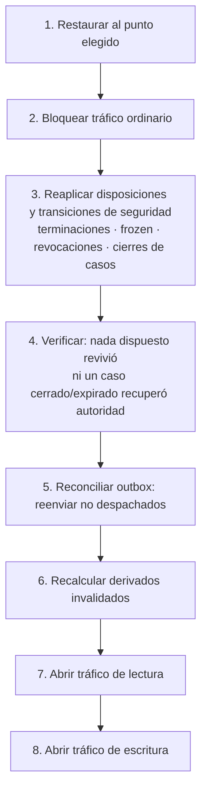

# Matriz de degradación y recuperación V1

**Versión de revisión:** 3
**Fecha:** 28 de julio de 2026
**Fase:** 3 — Definir operaciones, seguridad y contratos
**Estado:** aprobado y recertificado con Nutrición V1
**Deriva de:** [ADR-014](../02_ARCHITECTURE_DECISIONS/ALLFIT_ARCHITECTURE_DECISIONS.md), [`V1_OPERATIONS_MATRIX.md`](./V1_OPERATIONS_MATRIX.md), [`V1_SPACE_STUDIO_API_CONTRACTS.md`](./V1_SPACE_STUDIO_API_CONTRACTS.md), [`V1_RLS_PHYSICAL_TRACEABILITY_MATRIX.md`](./V1_RLS_PHYSICAL_TRACEABILITY_MATRIX.md), [`V1_PHYSICAL_OBJECT_CATALOG.md`](./V1_PHYSICAL_OBJECT_CATALOG.md), [`V1_VERIFICATION_AND_BREAK_GLASS_GOVERNANCE.md`](./V1_VERIFICATION_AND_BREAK_GLASS_GOVERNANCE.md)

> **Nota de estado.** Los valores numéricos de límites, timeouts y SLO de este documento son una **propuesta pendiente de aprobación**. Se redactaron sin conocer compromisos de disponibilidad ya adquiridos con clientes o inversionistas; si existen, los SLO deben derivarse de ellos y no de esta propuesta. El proveedor de hosting tampoco está decidido, de modo que las garantías se expresan como requisitos exigibles y se instancian en la Fase 5.

## 1. Propósito

Define qué ocurre cuando algo falla: qué queda aislado, qué degrada, qué falla cerrado, qué puede continuar offline, con qué límites de recursos se contiene un producto respecto del otro, y cómo se recupera el sistema sin resucitar datos dispuestos.

El plan de fases exige "métricas, alertas y SLO/RTO/RPO diferenciados" y ADR-014 exige que se acuerden **antes de producción** y no se infieran de la topología. Este documento los propone; la aprobación es un paso aparte.

## 2. Qué significa independencia en V1

ADR-014 ya lo decidió y aquí solo se opera: **independencia funcional, no tolerancia física separada.**

| Sí significa | No significa |
| --- | --- |
| Valor propio de cada producto | Que Space sobreviva a la caída de PostgreSQL |
| Frontends y WorkOS Applications separadas | Bases de datos separadas |
| Contratos HTTP separados | Despliegues de backend obligatoriamente separados |
| Despliegue de frontend independiente | Que un producto pueda escribir mientras el otro está caído |
| Aislamiento por cuotas, pools, colas y timeouts | Aislamiento de fallo de la fuente de verdad |

El ecosistema mantiene **por ambiente** un WorkOS environment y un PostgreSQL compartidos. Su indisponibilidad total degrada ambos productos y es un riesgo **explícitamente aceptado** para V1.

## 3. Dependencias y su clase

| Dependencia | Clase | Compartida | Efecto de su caída total |
| --- | --- | --- | --- |
| PostgreSQL (Supabase) | Fuente de verdad | Sí | Ambos productos pierden toda operación autoritativa |
| WorkOS AuthKit | Autenticación | Sí | Login y refresh fallan; los tokens vigentes siguen siendo verificables |
| Registro interno de deberes | Autoridad temporal de `A10/A11/A12` | No para operación ordinaria; sí para verificación/break-glass | Esas capacidades fallan cerradas; no se confía en claims ni caché |
| API Allfit | Cómputo | Sí en V1 | Ambos productos, salvo lo cacheado de solo lectura |
| Outbox + workers | Asíncrono | Por dominio | Se retrasa lo asíncrono; lo síncrono continúa |
| Email (Amazon SES, ADR-049) | Proveedor externo | No | Invitaciones y avisos se retrasan; nada se pierde |
| Push (Expo/FCM/APNs) | Proveedor externo | No | Recordatorios se retrasan; la app los ve al abrir |
| Almacenamiento de imágenes | Proveedor externo | No | Fotos de progreso/nutrición no suben ni se sirven; el resto opera |
| Frontend Space | Cliente | No | Studio continúa |
| Frontend Studio | Cliente | No | Space continúa |

## 4. Matriz de fallos

| Fallo | Space | Studio | Workers | Degradación permitida |
| --- | --- | --- | --- | --- |
| Frontend de Space | Caído | **Sin efecto** | Sin efecto | — |
| Frontend de Studio | **Sin efecto** | Caído | Sin efecto | — |
| PostgreSQL | Sin confirmaciones | Sin confirmaciones | En espera | Space conserva borradores locales; Studio **no confirma nada** |
| WorkOS AuthKit | Login y refresh fallan; token vigente sigue operando hasta expirar | Igual | Sin efecto | Ninguna: no se acepta un token no verificable |
| API completa | Solo caché de lectura | Solo caché de lectura | Sin efecto | Space registra en local |
| Módulo de un producto | Ese contrato degrada | El otro continúa | Sin efecto | El prefijo de ruta aísla |
| Worker de outbox | Notificaciones se retrasan | Igual | Acumula | Lo síncrono no se bloquea |
| Worker de disposición | Sin efecto operativo | Sin efecto operativo | Acumula | **Los plazos legales siguen corriendo**: alerta desde el primer ciclo perdido |
| Email caído | Invitación se retrasa | Igual | Breaker abierto | La invitación existe y es válida; el envío reintenta |
| Push caído | Recordatorios se retrasan | — | Breaker abierto | La app muestra el estado al abrir |
| Almacenamiento caído | No sube ni ve fotos | No ve fotos | Breaker abierto | `body_progress` y nutrición estructurada operan; un PATCH que incluye foto falla sin mutación parcial |
| Caché o read model atrasado | — | — | — | **Ninguna.** Nunca concede permisos, grants, asignaciones ni confirmaciones |
| Worker saturado | Sin efecto | Sin efecto | Cuota propia | No consume el presupuesto de requests síncronos |

## 5. Clasificación de operaciones ante fallo

Toda operación de la matriz cae en una de cuatro clases. La clase es parte del contrato, no una decisión de implementación.

### 5.1 Fallan cerradas — sin excepción

Autorización, consentimiento, capacidad y —cuando entre en alcance— dinero.

| Operaciones | Por qué |
| --- | --- |
| `OP-IDN-009` decidir scopes de la invitación, `OP-PRV-005` revocar | Un consentimiento confirmado desde caché es un consentimiento inventado |
| `OP-REL-002/003/007/008` asignaciones y terminaciones | Determinan quién lee datos de quién |
| `OP-ORG-007/008/009/010/011/012` roles, membresías, ownership y cierre | Cambian permisos o revocan de forma coordinada acceso y propuestas |
| `OP-ORG-013` proyección organizacional | Exige contexto y `ACCESS_EVENT` en la misma transacción; si auditar falla no retorna contenido |
| `OP-REL-005` decidir suplencia | Habilita un actor nuevo |
| `OP-IDN-003` activar persona | Crea la raíz de identidad |
| `OP-IDN-009` decidir intenciones | Materializa vínculos |
| Toda lectura de Studio bajo grant | Sin evaluar la fórmula íntegra, no se devuelve nada |
| `OP-PRV-018/019/020` abrir/cerrar caso y leer histórico | El caso, MFA, propósito, corte, denegaciones y auditoría se evalúan autoritativamente en cada intento |
| `OP-NUT-008/009/010/011/012` decisión, lecturas y propuesta profesional | Requieren estado, grants, capability, credencial y auditoría actuales; nunca caché |

Ante duda, error o dependencia caída: `503 service-degraded`. **Nunca** una respuesta parcial ni una lectura desde read model atrasado.

### 5.2 Admiten borrador local — solo Space

| Operaciones | Estados | Sincronización |
| --- | --- | --- |
| `OP-EXE-001/002/003/004/005/006` registro y finalización | `draft_local` → `pending_sync` → `confirmed` \| `failed` | `Command-Id` al crear la intención; `Idempotency-Key` por operación HTTP |
| `OP-IDN-004/005/006/008` declaraciones/revisión de perfil | Igual | Igual |
| `OP-NUT-001/003/004/007` comidas, revisiones, borrado y meta personal | `draft_local` → `pending_sync` → `confirmed` \| `failed`; la foto se adjunta en otro `PATCH` | `Command-Id` por intención, `If-Match` en revisión y key HTTP por comando |

Reglas:

1. `Command-Id` se genera **en el dispositivo al crear la intención**. La key HTTP no sustituye esa identidad durable.
2. Cada operación HTTP del draft tiene su propia `Idempotency-Key`; crear, guardar y finalizar nunca comparten key.
3. Un borrador local se sincroniza **una sola vez**, aunque el cliente reintente N veces o hayan vencido las 24 h de replay.
4. Un update envía la revisión base/`If-Match`; un draft obsoleto falla con conflicto y no pisa estado confirmado.
5. La UI distingue los cuatro estados y **nunca** presenta `pending_sync` como confirmación del servidor.
6. Un borrador rechazado por el servidor (`failed`) conserva el contenido para que la persona lo corrija; no se descarta en silencio.
7. Si el contrato de resultados cambió mientras el borrador estaba local, se valida contra el **congelado al iniciar**, no contra el vigente al sincronizar.
8. Una foto nutricional pendiente permanece solo en el dispositivo hasta que su PATCH sea confirmado; nunca se presenta como medio disponible en el servidor.

### 5.3 Se sirven de caché

| Operaciones | Caché | Invalidación |
| --- | --- | --- |
| `OP-CAT-007` a `OP-CAT-012` catálogo global | `ETag`, revalidación diferida | Al publicar o deprecar |
| `OP-PRV-012` definiciones de scope | Inmutable, caché larga | Nunca: una versión publicada no cambia |
| `OP-PLN-021` versión publicada asignada | Inmutable | Nunca |
| `OP-PLN-016` agenda | Precarga de ventana en el dispositivo | Al reprogramar, cancelar o desacoplar |

Ninguna caché participa en una decisión de autorización. Se cachea **contenido inmutable**, no permisos. Un `historical_access_case`, su vigencia y el resultado de `access_control.can_read_frozen` nunca se cachean como autorización reutilizable.

### 5.4 Degradan con aviso explícito

Notificaciones, imágenes y procesos asíncronos. La operación de negocio se confirma; el efecto secundario se retrasa y la UI lo dice.

La única excepción es `OP-REL-003` (reasignación de profesional): la notificación a la persona forma parte de la transacción. Si no puede encolarse, la reasignación no se confirma. Cambiar quién accede a los datos de alguien sin poder avisarle no es un efecto secundario.

## 6. Aislamiento de recursos

Valores **propuestos**. El objetivo no es el número exacto sino que exista un límite por producto y por dominio, y que ningún consumidor pueda agotar el presupuesto del otro.

### 6.1 Rate limits

| Ámbito | Sostenido | Ráfaga | Respuesta al exceder |
| --- | --- | --- | --- |
| Space, por persona | 120 req/min | 300 | `429` con `Retry-After` |
| Space, escrituras de ejecución | 60 req/min | 120 | `429` |
| Space, WorkOS Application global | 20 000 req/min | — | `429` |
| Studio, por membresía | 300 req/min | 600 | `429` |
| Studio, lecturas de datos de clientes | 120 req/min | 240 | `429`; además se registra como patrón anómalo |
| Studio, WorkOS Application global | 10 000 req/min | — | `429` |
| Catálogo | 600 req/min por actor | 1 200 | `429` |
| Soporte y break-glass | 30 req/min | 60 | `429` y alerta |

Los presupuestos de Space y Studio son **independientes**: agotar el de Studio no reduce el de Space.

### 6.2 Conexiones y timeouts

| Recurso | Propuesta | Regla |
| --- | --- | --- |
| Pool Space | 40% del total, con mínimo garantizado | Nunca por debajo del mínimo, aunque Studio esté saturado |
| Pool Studio | 40%, con mínimo garantizado | Igual |
| Pool workers | 20%, dividido por dominio | Un worker no toma del pool síncrono |
| `statement_timeout` lecturas | 3 s | Cancelable |
| `statement_timeout` comandos | 10 s | |
| `statement_timeout` `finalize_execution` | 15 s | Valida contra el contrato |
| `statement_timeout` workers | 60 s | Lotes acotados |
| `idle_in_transaction_session_timeout` | 30 s | Evita retener locks |
| Timeout HTTP de cliente | 10 s | Space reintenta con la misma clave |
| Timeout a proveedor externo | 5 s | Luego breaker |

### 6.3 Colas y DLQ

Una cola por dominio, no una global. Un atasco en notificaciones no puede retrasar la disposición de datos personales.

| Cola | Reintentos | Backoff | DLQ | Alerta |
| --- | --- | --- | --- | --- |
| `outbox.dispatch` | 8 | Exponencial con jitter, máx 5 min | Sí | Profundidad > 1 000 o antigüedad > 15 min |
| `notifications.email` | 5 | Exponencial, máx 30 min | Sí | Breaker abierto > 5 min |
| `notifications.push` | 3 | Igual | Sí | Igual |
| `privacy.disposition` | 10 | Exponencial, máx 1 h | Sí | **Cualquier ítem vencido sin ejecutar** |
| `maintenance.expiry` | 5 | Fijo 5 min | Sí | Ciclo perdido |
| `maintenance.derived` | 5 | Exponencial | Sí | Derivados invalidados > 1 h |

`privacy.disposition` tiene el umbral de alerta más estricto del sistema: es la única cola cuyo retraso tiene consecuencias legales.

### 6.4 Circuit breakers

| Proveedor | Abre | Permanece | Half-open | Fallback |
| --- | --- | --- | --- | --- |
| Email | 50% de error en ventana de 30 s, mín. 20 peticiones | 60 s | 3 pruebas | Cola; la invitación sigue válida |
| Push | Igual | 60 s | 3 | La app muestra el estado al abrir |
| Almacenamiento | 30% en 30 s | 120 s | 3 | La subida de foto falla explícitamente; el resto de `body_progress` opera |

Ningún breaker abierto bloquea una operación de negocio que no dependa de ese proveedor.

## 7. Observabilidad

El requisito de ADR-014 es que las métricas permitan distinguir **impacto de Space, de Studio, de dominio y de dependencia compartida**. Una métrica agregada de "errores de la API" no cumple: no responde a quién se le rompió.

### 7.1 Dimensiones obligatorias

Toda métrica y todo log llevan: `surface` (space \| studio \| catalog), `domain` (identity \| organizations \| relationships \| privacy \| catalog \| planning \| execution \| system \| support), `operation` (el `OP-*`), `outcome`, `request_id`.

### 7.2 Indicadores

| SLI | Medición | Por qué |
| --- | --- | --- |
| Disponibilidad por superficie | % de peticiones no `5xx`, por `surface` | Distingue si el daño es de un producto o común |
| Latencia de lectura | p50/p95/p99 por `operation` | La fórmula de acceso es el coste dominante |
| Latencia de comando | p95/p99 por `operation` | `finalize_execution` y `terminate_relationship` son las críticas |
| Coste de la fórmula | Tiempo de evaluación de `access_control.can_access` | Detecta un índice perdido antes de que se note |
| Coste de lectura histórica | Tiempo de evaluación de `access_control.can_read_frozen`, por propósito y resultado | Detecta degradación o sondeo de la superficie restringida |
| Profundidad y antigüedad de cola | Por cola | Detecta degradación asíncrona |
| Ítems de disposición vencidos | Conteo absoluto | **Debe ser cero** |
| Fallos de escritura de `ACCESS_EVENT` | Conteo | Cada uno es una lectura que debió fallar |
| Denegaciones por scope | Tasa por organización | Un pico puede indicar mal diseño de UX o un intento de sondeo |
| Ejercicios de break-glass | Conteo absoluto | Debe ser bajo y explicable |
| Denegaciones/abuso break-glass | Por actor, categoría y reason code | Categoría prohibida, escritura o ventana ajena exige suspensión/incidente |
| Revisiones break-glass vencidas | Conteo y edad | El 100% debe revisarse dentro de las 24 horas corridas siguientes al primer ejercicio |
| Sincronizaciones de borrador rechazadas | Tasa | Salud del modo offline |
| Reutilización de clave de idempotencia | Tasa | Salud del reintento tras recuperación |

### 7.3 Alertas

| Alerta | Umbral propuesto | Severidad |
| --- | --- | --- |
| Disponibilidad de una superficie < 99% en 15 min | — | Alta |
| p99 de comando > 3 s en 10 min | — | Media |
| Ítem de disposición vencido sin ejecutar | ≥ 1 | **Alta** |
| Cola de outbox > 1 000 o > 15 min de antigüedad | — | Media |
| Breaker abierto > 5 min | — | Media |
| Fallo de escritura de `ACCESS_EVENT` | ≥ 1 | **Alta** |
| Break-glass ejercido | ≥ 1 | Informativa con revisión obligatoria |
| Abuso break-glass crítico | ≥ 1 | **Crítica**; cerrar ventanas y suspender deber |
| Revisión break-glass fuera de plazo | ≥ 1 | **Alta** |
| Pool de un producto al 90% > 5 min | — | Media |
| Derivados invalidados sin recalcular > 1 h | — | Baja |

## 8. SLO, RTO y RPO propuestos

**Pendientes de aprobación.** ADR-014 exige acordarlos antes de producción y no inferirlos de la topología. Estos valores son un punto de partida coherente con una baseline sobre PostgreSQL administrado y un equipo pequeño; si existe un compromiso ya adquirido con un cliente, prevalece.

| Objetivo | Space | Studio | Nota |
| --- | --- | --- | --- |
| Disponibilidad mensual | 99.5% | 99.5% | ~3,6 h/mes. Limitada por la ventana del proveedor de PostgreSQL |
| Latencia de lectura p95 | 400 ms | 600 ms | Studio paga la fórmula de acceso |
| Latencia de lectura p99 | 1 s | 1,5 s | |
| Latencia de comando p95 | 800 ms | 1 s | |
| `finalize_execution` p95 | 1,5 s | — | Incluye validación contra contrato |
| **RTO** | 4 h | 4 h | Tiempo hasta restaurar servicio autoritativo |
| **RPO** | 15 min | 15 min | Con PITR del proveedor |
| Ventana de mantenimiento | Anunciada, fuera de horario pico local | Igual | |

Restricciones que deben quedar escritas junto a los números:

1. La disponibilidad de Space **no puede ser mayor** que la de PostgreSQL y WorkOS AuthKit combinados. Prometer más sería prometer lo que la topología no da.
2. El RPO de 15 minutos **no aplica a disposiciones ni transiciones de seguridad**: una restauración reaplica los `DISPOSITION_EVENT`, terminaciones, congelaciones, revocaciones, cierres de casos históricos y cierres/expiraciones break-glass posteriores al snapshot antes de devolver tráfico. Un dato eliminado no reaparece, una relación terminada no vuelve a verse como activa y una ventana cerrada o expirada no recupera autoridad.
3. El modo offline de Space **no** mejora su SLO: mejora la experiencia durante una caída, no la disponibilidad del servicio.

## 9. Recuperación

### 9.1 Procedimiento tras restaurar PostgreSQL

El paso 3 **no es opcional y no se puede posponer**. Mientras existan disposiciones o transiciones de seguridad pendientes de reaplicar, el sistema no acepta tráfico ordinario: un dato eliminado no puede revivir, un grant `revoked` no puede volver a ser legible, una relación terminada debe regresar a `frozen` con su `frozen_at` original y un caso cerrado, expirado o invalidado no puede volver a autorizar lectura.

### 9.2 Reconciliación de clientes

| Situación | Comportamiento |
| --- | --- |
| Space con borradores locales | Sincroniza con la clave original; los duplicados convergen a una sola ejecución |
| Space con borrador cuyo contrato cambió | Valida contra el contrato **congelado al iniciar** |
| Space con borrador de una asignación desacoplada | La sincronización se acepta si la sesión ya había comenzado; si no, se rechaza con motivo |
| Studio con formulario sin enviar | Reenvía; nada se confirmó, nada se duplica |
| Studio con vista cacheada de grants | Se descarta: los permisos se releen siempre |
| Studio con caso histórico conservado en UI | El identificador puede reenviarse, pero servidor relee estado, vigencia, actor, MFA, grant y denegaciones; nunca confía en el estado local |
| Token vigente durante la caída | Sigue siendo válido hasta expirar; la autorización de dominio se reevalúa entera |

### 9.3 Backups

| Elemento | Propuesta |
| --- | --- |
| PITR del proveedor | Habilitado en todos los ambientes con datos reales |
| Retención de PITR | 7 días en staging, 30 en producción |
| Prueba de restauración | **Trimestral**, con cronómetro contra el RTO acordado |
| Prueba de reaplicación de disposiciones | En la misma prueba trimestral, obligatoria |
| Almacenamiento de imágenes | Versionado y borrado propagado desde `OP-SYS-007` |

Una prueba de restauración que no incluya el paso de reaplicación **no cuenta como prueba**: valida que los datos vuelven, no que los eliminados siguen eliminados.

## 10. Pruebas obligatorias de degradación

Alimentan la suite de la Fase 6. Los diez primeros son los escenarios exigidos por ADR-014.

| # | Prueba | Resultado esperado |
| --- | --- | --- |
| `D-01` | Cae el frontend de Space | Studio opera con normalidad |
| `D-02` | Cae el frontend de Studio | Space opera con normalidad |
| `D-03` | Worker de Studio saturado | No consume el presupuesto reservado de requests de Space |
| `D-04` | Proveedor externo degradado | El breaker abre sin bloquear operaciones independientes |
| `D-05` | PostgreSQL no disponible | Ambos productos impiden confirmaciones sensibles y muestran degradación **explícita** |
| `D-06` | Space crea borrador durante la caída | Se sincroniza **una sola vez** al recuperarse |
| `D-07` | Studio con read model atrasado | No confirma grants, asignaciones ni cambios de sesión |
| `D-08` | Métricas durante un incidente | Permiten distinguir Space, Studio, dominio y dependencia común |
| `D-09` | Ejercicio de restauración | Cumple el RTO y el RPO acordados |
| `D-10` | Propuesta de extracción de un dominio | Identifica fuente de verdad y consistencia; se rechaza si solo duplica tablas por producto |
| `D-11` | Reintentos posteriores a recuperación | Idempotentes: no duplican ejecuciones, asignaciones ni invitaciones |
| `D-12` | Restauración con disposiciones posteriores | Se reaplican **antes** de abrir tráfico; nada revive |
| `D-13` | WorkOS AuthKit caído | Un token vigente sigue operando; uno no verificable se rechaza |
| `D-14` | Revocación durante degradación | Se aplica o falla cerrada; nunca queda "revocado pero legible" |
| `D-15` | Cola de disposición atascada | Alerta desde el primer ítem vencido |
| `D-16` | Rate limit alcanzado en un producto | El otro conserva su presupuesto íntegro |
| `D-17` | Escrituras concurrentes sobre una ejecución | No la corrompen |
| `D-18` | Fallo al escribir `ACCESS_EVENT` | La lectura falla; no se sirve el dato sin auditoría |
| `D-19` | Reasignación con notificación fallida | La reasignación no se confirma |
| `D-20` | Almacenamiento caído | `body_progress` opera salvo imágenes, con aviso explícito |
| `D-21` | Restauración anterior a una terminación | Antes de abrir tráfico se reaplican relación terminada y grants `frozen` con el mismo `T`; no vuelve la escritura ni aparece actividad posterior |
| `D-22` | Lectura histórica con caso expirado, cerrado o actor distinto | Falla cerrada, no confirma existencia y registra `ACCESS_EVENT` denegado |
| `D-23` | Restauración anterior al cierre de un caso o revocación `frozen` | Se reaplican cierre y revocación antes de abrir tráfico; ni caché ni read model recuperan la lectura |
| `D-24` | A10 intenta aprobar; A12 ejercer; actor escribir, pedir categoría prohibida o usar ventana ajena | Falla cerrada; cierra ventanas, suspende deber y abre incidente cuando ADR-026 lo clasifica crítico |
| `D-25` | No existe quorum o revisor A12 independiente | La solicitud/capacidad permanece cerrada; nunca se reduce quorum ni se habilita autoaprobación. **Superseded by ADR-046 for the quorum:** a window is self-approved with 0 approvals, so no quorum can be missing. Without an independent reviewer the window still opens, and its review stays owed until someone other than the requester and the subject records it |
| `D-26` | Restauración anterior al cierre/expiración break-glass | Se reaplica el cierre antes de abrir tráfico; solo el `A10` solicitante podría ejercer una ventana todavía vigente |
| `D-27` | Escritura viola `IX-01..45` o un guardián diferido falla al `COMMIT` | Se revierte comando, outbox y auditoría; no se degrada a validación de API |
| `D-28` | Base restaurada sin una clave, FK o trigger de la matriz de integridad | El verificador de catálogo bloquea apertura de tráfico hasta que `IX-01..45` estén completos |
| `D-29` | Una policy, vista o función restaurada referencia una columna inexistente o pierde un join de `PR-01..29` | El verificador `T-PHY-01` bloquea migración y apertura de tráfico; nunca se desactiva RLS para recuperar servicio |
| `D-30` | Falta un índice de autorización declarado por `PR-01..29` | El verificador `T-PHY-07` bloquea el release; no se acepta el riesgo de convertir una policy en scan horizontal bajo carga |
| `D-31` | Inventario, nombre físico o contrato JSONB difiere del catálogo P0-07 | `T-SCHEMA-01..04` bloquea migración/release; no se acepta el payload relajando el check |
| `D-32` | Faltan menos de 30 días de particiones futuras o una hija no replica índices | Alerta crítica y release bloqueado; la escritura falla cerrada si alcanza un mes inexistente |
| `D-33` | Un caller intenta forjar UUID/tiempo para insertar el mismo evento en otro mes | Entrada directa revocada y check UUIDv7/tiempo rechaza; `T-SCHEMA-05` prueba que no hay doble identidad |
| `D-34` | Request concurrente con la misma identidad sigue en curso | Espera acotada; después `409 idempotency-in-progress` + `Retry-After`; nunca ejecuta en paralelo |
| `D-35` | Proceso muere antes del commit idempotente | PostgreSQL revierte receipt, dominio, auditoría y outbox; no queda `processing` huérfano |
| `D-36` | Retry posterior a 24 h o a disposición | El tombstone impide reejecutar; replay durable mínimo o `410 command-effect-disposed` |
| `D-37` | Registro interno de deberes no disponible o asignación no confirmable | Verificación y break-glass fallan cerrados; la operación ordinaria continúa sin elevar autoridad |
| `D-NUT-01` | Space crea comida offline y repite sincronización tras recuperar DB/API | Una comida, hijos y outbox; el borrador pasa a confirmado una vez |
| `D-NUT-02` | Almacenamiento falla al adjuntar foto | El PATCH falla sin cambiar revisión ni `media_ref`; la comida estructurada sigue disponible |
| `D-NUT-03` | Credencial/capability no pueden verificarse | Lecturas y propuestas Studio fallan cerradas; Space personal continúa |
| `D-NUT-04` | Revocación durante consulta/agregación | La operación completa falla/reintenta; nunca sirve detalle o resumen previo |
| `D-NUT-05` | Restauración anterior a borrado o revocación nutricional | Disposición/revocación se reaplica antes de abrir tráfico; foto, resumen y guía no reviven |
| `D-NUT-06` | Firma Space o almacenamiento detrás del proxy Studio no disponibles | No se expone `media_ref` ni URL de storage; OP-NUT-013 devuelve degradación explícita sin redirect y las comidas/resúmenes sin media continúan |

## 11. Decisiones que este documento deja abiertas

| Decisión | Bloqueada por |
| --- | --- |
| Aprobación de los SLO, RTO y RPO propuestos | **Respuesta sobre compromisos de disponibilidad ya adquiridos** |
| Instanciación de límites, pools y colas | Decisión de hosting, pendiente |
| Herramienta concreta de métricas y alertas | Fase 5; el diseño solo exige las dimensiones de §7.1 |
| Política de retención de logs operativos | Fase 4, junto a la de `ACCESS_EVENT` |
| Umbral de latencia aceptable para la fórmula de acceso | Medición real en Fase 5 |
| Ventana de mantenimiento acordada | Antes de producción |

## 12. Estado de salida

Cuarto y último entregable documental de la Fase 3. Se considera completo cuando la revisión confirme que:

1. cada dependencia declara su clase, su efecto y su degradación permitida;
2. cada operación pertenece a una de las cuatro clases de comportamiento ante fallo;
3. autorización, consentimiento y capacidad fallan cerradas sin excepción;
4. existen límites por producto y por dominio que impiden que uno agote al otro;
5. ninguna caché o read model participa en una decisión de autorización;
6. los SLO, RTO y RPO están **acordados**, no inferidos, y la recuperación los prueba;
7. la recuperación reaplica disposiciones, terminaciones, congelaciones, revocaciones, cierres de casos históricos y cierres/expiraciones break-glass antes de abrir tráfico.

Con este documento, los cuatro entregables de la Fase 3 están redactados. El cierre de la fase exige además incorporar al ADR, al glosario y al alcance V1 las decisiones nuevas registradas en [`V1_OPERATIONS_MATRIX.md` §11](./V1_OPERATIONS_MATRIX.md).
