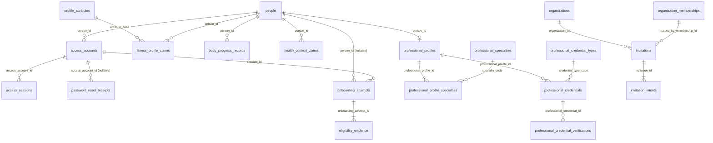
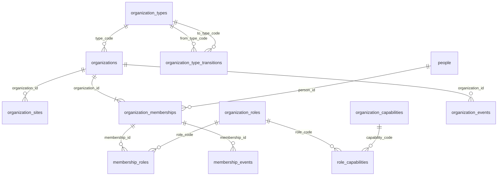
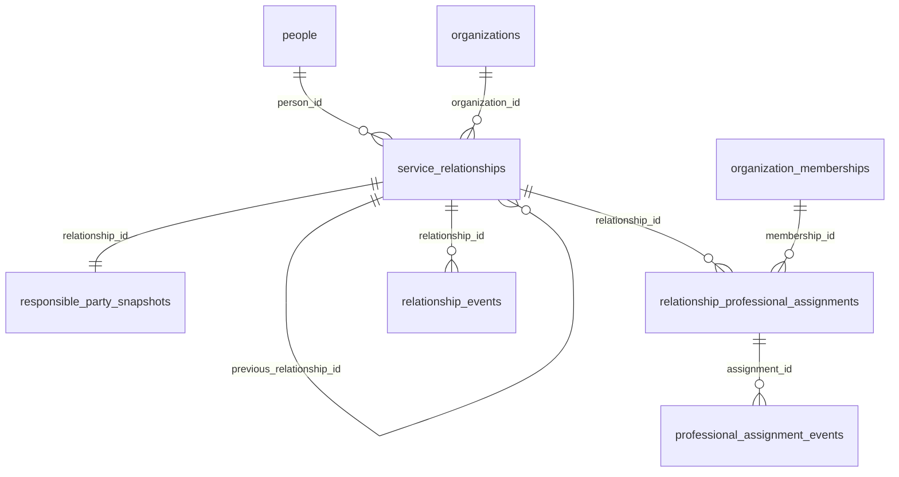
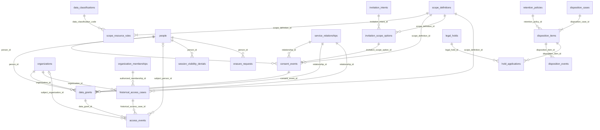
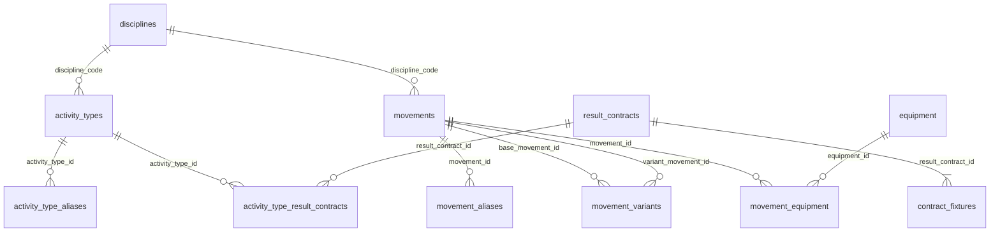
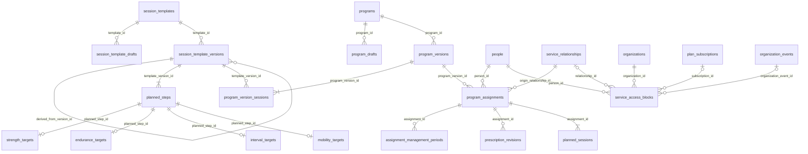
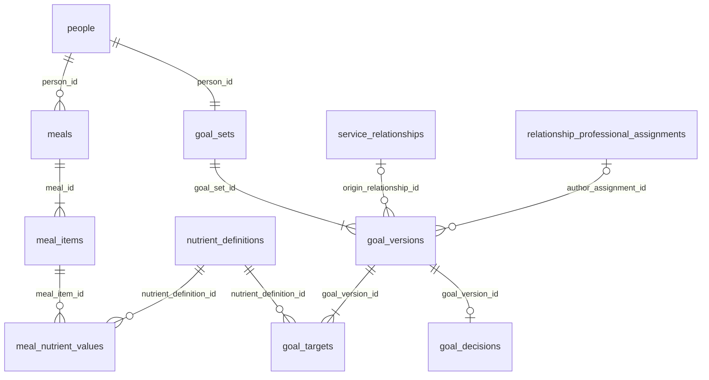
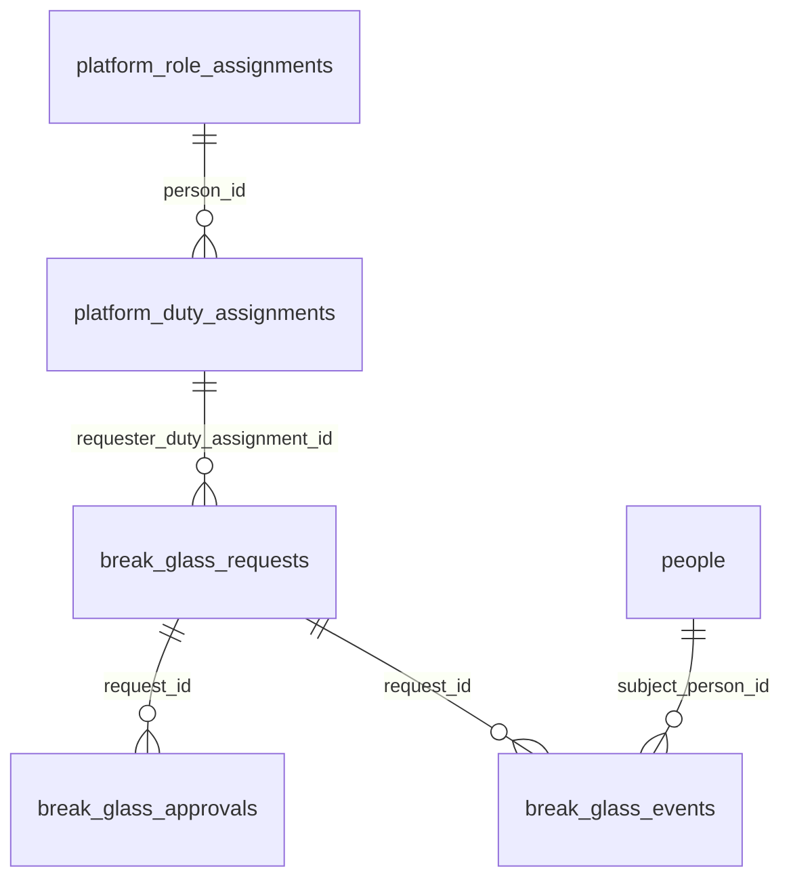

# ERD lógico V1 — modelo físico de PostgreSQL

**Versión de revisión:** 6
**Fecha:** 17 de agosto de 2026
**Fase:** 4 — Modelo lógico y diccionario de datos
**Estado:** Backoffice opción B recertificada; resto de P0 pendiente
**Deriva de:** [`V1_CONCEPTUAL_ERD.md`](./V1_CONCEPTUAL_ERD.md), [`POSTGRES_MODELING_STANDARD.md`](./POSTGRES_MODELING_STANDARD.md), [`V1_PHYSICAL_OBJECT_CATALOG.md`](./V1_PHYSICAL_OBJECT_CATALOG.md), [`V1_IDEMPOTENCY_CONTRACT.md`](./V1_IDEMPOTENCY_CONTRACT.md), [`V1_RLS_MATRIX.md`](./V1_RLS_MATRIX.md), [`V1_CROSS_TABLE_INTEGRITY_MATRIX.md`](./V1_CROSS_TABLE_INTEGRITY_MATRIX.md), [`V1_RLS_PHYSICAL_TRACEABILITY_MATRIX.md`](./V1_RLS_PHYSICAL_TRACEABILITY_MATRIX.md), [`V1_VERIFICATION_AND_BREAK_GLASS_GOVERNANCE.md`](./V1_VERIFICATION_AND_BREAK_GLASS_GOVERNANCE.md)

## 1. Propósito

Traduce el ERD conceptual de Fase 2 a tablas físicas de PostgreSQL: schemas, nombres reales, claves, cardinalidades y las relaciones entre dominios. No detalla columna por columna —eso es [`V1_DATA_DICTIONARY.md`](./V1_DATA_DICTIONARY.md)— sino que fija el mapa de tablas y sus vínculos, para que el diccionario tenga una estructura que rellenar y no una que inventar.

Cada tabla aplica las convenciones de [`POSTGRES_MODELING_STANDARD.md`](./POSTGRES_MODELING_STANDARD.md): PK `id uuid` con UUIDv7, schema por dominio, FK con borrado explícito, referencias polimórficas tipadas y estados imposibles bloqueados por constraint.

## 2. Del concepto a la tabla

El ERD conceptual tiene ~85 entidades. El modelo físico las expande a **127 tablas de dominio** en once schemas. El inventario vigente incluye las tres tablas AAL2, `organizations.organization_type_transitions` y `system.invitation_rate_windows`, que ya tenía ficha individual pero estaba omitida del resumen. Enums, vistas, funciones y particiones hijas no cuentan como tablas adicionales.

| Entidad conceptual | Tablas físicas | Por qué se expande |
| --- | --- | --- |
| `FITNESS_PROFILE_CLAIM` | `fitness_profile_claims` + `profile_attributes` | El atributo es un catálogo referenciado |
| `SCOPE_DEFINITION` | `scope_definitions` + `scope_resource_rules` | La versión enumera reglas de recurso/campo |
| Targets planificados | `strength_targets`, `endurance_targets`, `interval_targets`, `mobility_targets` | Una tabla tipada por familia, sin JSON universal |
| Resultados ejecutados | `strength_sets`, `endurance_laps`, `interval_results`, `round_results`, `mobility_results` | Igual: tipados por modalidad |
| Asignación profesional | `relationship_professional_assignments` (titular y suplencia por `kind`) + `professional_assignment_events` | Una sola tabla con tipo; eventos conservan propuesta y decisión personal |
| Disposición | `disposition_cases`, `disposition_items`, `disposition_events` | Caso, resolución por ítem y ejecución append-only |

## 3. Inventario de tablas por schema

| Schema | Tablas | Nº |
| --- | --- | --- |
| `identity` | `people`, `access_accounts`, `access_sessions`, `access_account_mfa_factors`, `backoffice_authentication_attempts`, `mfa_factor_recovery_events`, `password_reset_receipts`, `onboarding_attempts`, `eligibility_evidence`, `profile_attributes`, `fitness_profile_claims`, `body_progress_records`, `health_context_claims`, `professional_profiles`, `professional_profile_specialties`, `professional_credentials`, `professional_credential_verifications`, `invitations`, `invitation_intents`, `notification_preferences` | 20 |
| `organizations` | `organizations`, `organization_types`, `organization_type_transitions`, `organization_sites`, `organization_memberships`, `organization_roles`, `organization_capabilities`, `role_capabilities`, `membership_roles`, `organization_events`, `membership_events` | 11 |
| `relationships` | `service_relationships`, `responsible_party_snapshots`, `relationship_professional_assignments`, `professional_assignment_events`, `relationship_events`, `relationship_termination_requests` | 6 |
| `privacy` | `data_classifications`, `scope_definitions`, `scope_resource_rules`, `consent_events`, `invitation_scope_options`, `data_grants`, `session_visibility_denials`, `historical_access_cases`, `access_events`, `retention_policies`, `erasure_requests`, `disposition_cases`, `disposition_items`, `disposition_events`, `legal_holds`, `hold_applications` | 16 |
| `catalog` | `disciplines`, `activity_types`, `activity_type_aliases`, `movements`, `movement_aliases`, `movement_variants`, `equipment`, `movement_equipment`, `units`, `result_contracts`, `activity_type_result_contracts`, `contract_fixtures`, `professional_specialties`, `professional_credential_types` | 14 |
| `planning` | `session_templates`, `session_template_drafts`, `session_template_versions`, `planned_steps`, `strength_targets`, `endurance_targets`, `interval_targets`, `mobility_targets`, `programs`, `program_drafts`, `program_versions`, `program_version_sessions`, `program_assignments`, `assignment_management_periods`, `prescription_revisions`, `planned_sessions`, `service_access_blocks` | 17 |
| `execution` | `executed_sessions`, `planned_session_executions`, `session_segments`, `strength_sets`, `endurance_laps`, `interval_results`, `round_results`, `mobility_results`, `metric_samples`, `professional_observations`, `correction_proposals`, `revision_events`, `result_validation_events`, `derived_results` | 14 |
| `nutrition` | `nutrient_definitions`, `meals`, `meal_items`, `meal_nutrient_values`, `goal_sets`, `goal_versions`, `goal_targets`, `goal_decisions` | 8 |
| `payments` | `gateway_connections`, `organization_plans`, `plan_versions`, `plan_subscriptions`, `payment_records`, `subscription_events`, `platform_plans`, `platform_plan_versions`, `platform_features`, `platform_plan_features`, `platform_subscriptions`, `organization_premium_entitlements` | 12 |
| `system` | `outbox_events`, `idempotency_keys`, `job_runs`, `invitation_rate_windows` | 4 |
| `support` | `platform_role_assignments`, `platform_duty_assignments`, `break_glass_requests`, `break_glass_approvals`, `break_glass_events` | 5 |
| **Total** | | **127** |

Nota: el total anterior del ERD era 122. La recertificación incorpora las tres tablas AAL2 que ya estaban en el diccionario, el catálogo de transiciones de AFO-39 y `system.invitation_rate_windows`, cuya ficha ya existía pero faltaba en el inventario resumido. No se introducen modelos para capacidades diferidas ni se convierten vistas, funciones o tipos enumerados en tablas.

## 4. Tipos enumerados nativos

Estados de máquina y clasificaciones cerradas y estables. Se declaran una vez y solo se amplían con `ADD VALUE`.

| Tipo | Schema | Valores V1 |
| --- | --- | --- |
| `actor_kind` | `identity` | `anonymous`, `account`, `person`, `professional`, `worker`, `support` |
| `access_session_surface` | `identity` | `studio` |
| `password_reset_receipt_result` | `identity` | `processed`, `account_absent` |
| `provenance` | `identity` | `person_declared`, `professional_observation`, `device_observed`, `system_inferred`, `authority_verified` |
| `onboarding_status` | `identity` | `open`, `activated`, `expired`, `abandoned` |
| `eligibility_result` | `identity` | `pass`, `fail`, `review_required`, `unknown` |
| `invitation_status` | `identity` | `pending`, `claimed`, `revoked`, `expired` |
| `intent_kind` | `identity` | `membership`, `service_relationship`, `program_assignment` |
| `intent_status` | `identity` | `pending`, `accepted`, `rejected`, `expired` |
| `membership_status` | `organizations` | `active`, `suspended`, `terminated` |
| `relationship_status` | `relationships` | `active`, `terminated` |
| `assignment_kind` | `relationships` | `holder`, `substitute` |
| `assignment_status` | `relationships` | `proposed`, `active`, `ended`, `expired` |
| `access_level` | `privacy` | `read`, `contribute` |
| `grant_status` | `privacy` | `active`, `frozen`, `revoked` |
| `consent_decision` | `privacy` | `granted`, `rejected`, `revoked` |
| `historical_access_purpose` | `privacy` | `service_dispute`, `legal_or_regulatory_obligation`, `customer_support_request`, `security_investigation`, `authorized_quality_review` |
| `historical_case_status` | `privacy` | `open`, `closed`, `expired` |
| `access_mode` | `privacy` | `live`, `frozen`, `break_glass`, `organization_operational` |
| `disposition_action` | `privacy` | `delete`, `anonymize`, `retain_restricted` |
| `disposition_status` | `privacy` | `pending`, `executed`, `suspended` |
| `content_scope` | `catalog` | `global`, `organization`, `person` |
| `catalog.publication_status` | `catalog` (compartido) | `draft`, `published`, `deprecated`, `archived`; privacidad y planificación referencian este mismo tipo, no copias por schema |
| `completeness_level` | `catalog` | `partial`, `summary`, `detailed`, `sensor_enriched` |
| `assignment_lifecycle` | `planning` | `active`, `detached_pending_choice`, `personal`, `ended` |
| `execution_status` | `execution` | `in_progress`, `paused`, `completed`, `abandoned` |
| `validation_status` | `execution` | `pending`, `valid`, `invalid`, `annulled` |
| `subscription_status` | `payments` | `active`, `suspended`, `ended` |
| `proposal_status` | `execution` | `pending`, `accepted`, `rejected`, `expired`, `cancelled` |
| `meal_type` | `nutrition` | `breakfast`, `lunch`, `dinner`, `snack`, `other` |
| `goal_origin` | `nutrition` | `self`, `professional` |
| `goal_status` | `nutrition` | `proposed`, `active`, `rejected`, `superseded`, `cancelled` |
| `goal_target_mode` | `nutrition` | `minimum`, `maximum`, `range`, `exact` |
| `goal_decision` | `nutrition` | `accepted`, `rejected` |
| `command_surface` | `system` | `space`, `studio`, `system` |
| `idempotency_status` | `system` | `processing`, `succeeded`, `rejected_final` |

## 5. Identidad

| Tabla | PK | Claves e invariantes notables |
| --- | --- | --- |
| `people` | `id` | Raíz del Fitness ID. Creada solo por `activate_person` |
| `access_accounts` | `id` | `UNIQUE (provider, issuer, subject)`; `person_id` nullable hasta activar |
| `access_sessions` | `id` | hash SHA-256 de cookie; tokens cifrados; `UNIQUE (surface, provider_session_id)`; rotación compare-and-swap |
| `password_reset_receipts` | `id` | `UNIQUE (provider, issuer, provider_event_id)`; sin payload, email ni subject; resultado y revocaciones atómicos |
| `onboarding_attempts` | `id` | `account_id` NOT NULL; `person_id` nullable; `status onboarding_status` |
| `eligibility_evidence` | `id` | `onboarding_attempt_id`; `result eligibility_result`; snapshot de la política aplicada |
| `profile_attributes` | `id` | `UNIQUE code`; catálogo cerrado de atributos de perfil V1 |
| `fitness_profile_claims` | `id` | `person_id`, `attribute_code`, `provenance`; coexisten; `UPDATE` revocado |
| `body_progress_records` | `id` | `person_id`; valor+unidad; imagen sin EXIF por referencia |
| `health_context_claims` | `id` | `person_id`; categoría más restrictiva |
| `professional_profiles` | `id` | `UNIQUE person_id`; titular, biografía y año de inicio; pertenece a la persona |
| `professional_profile_specialties` | `(professional_profile_id, specialty_code)` | Solo especialidades publicadas; al menos una al completar el perfil |
| `professional_credentials` | `id` | Tipo gobernado por `professional_credential_types`; revisión por `supersedes_credential_id`; campos materiales inmutables |
| `professional_credential_verifications` | `id` | `professional_credential_id`, verificador, política, registro/emisor, fingerprint, resultado y vigencia `<=12 meses`; append-only |
| `invitations` | `id` | `UNIQUE (token_hash)`; membresía emisora restringida contra `organization_id`; sin `person_id` destino (`IX-24`) |
| `invitation_intents` | `id` | `invitation_id`, `kind intent_kind`, `status intent_status`; materializa ≤1 destino |

## 6. Organizaciones

| Tabla | PK | Claves e invariantes notables |
| --- | --- | --- |
| `organizations` | `id` | `type_code`, `revision_number`; identidad estable al crecer a equipo; ETag optimista |
| `organization_types` | `id` | `UNIQUE code`; catálogo gobernado |
| `organization_type_transitions` | `(from_type_code,to_type_code)` | catálogo gobernado; inicialmente práctica → gimnasio/estudio |
| `organization_sites` | `id` | `organization_id`, `revision_number`; informativa, no delimita permisos |
| `organization_memberships` | `id` | `organization_id`, `person_id`, `status`; no da acceso al Fitness ID |
| `organization_roles` | `id` | `UNIQUE code`; catálogo cerrado: owner/admin/coach/staff |
| `organization_capabilities` | `id` | `UNIQUE code`; catálogo de capacidades |
| `role_capabilities` | `id` | `UNIQUE (role_code, capability_code)`; N:M gobernada |
| `membership_roles` | `id` | `membership_id`, `role_code`, vigencia; constraint trigger diferible exige exactamente un `owner` activo por organización activa y el flujo genérico no puede alterarlo |
| `organization_events` | `id` | actor membership, cuando existe, pertenece a la organización por FK compuesta; append-only (`IX-25`) |
| `membership_events` | `id` | append-only |

## 7. Relaciones

| Tabla | PK | Claves e invariantes notables |
| --- | --- | --- |
| `service_relationships` | `id` | `person_id`, `organization_id`, `status`; claves portadoras compuestas; `previous_relationship_id` solo enlaza una relación de la misma persona/organización (`IX-01`) |
| `responsible_party_snapshots` | `id` | `UNIQUE relationship_id`; parte responsable natural o jurídica presentada |
| `relationship_professional_assignments` | `id` | `relationship_id`, `person_id`, `organization_id`, `membership_id`; FKs compuestas impiden mezcla de tenant; trigger de elegibilidad; un titular efectivo; suplencia con `ends_on` NOT NULL (`IX-02/03`) |
| `professional_assignment_events` | `id` | append-only |
| `relationship_events` | `id` | append-only; motivo de terminación visible solo para quien lo declaró |

## 8. Privacidad

| Tabla | PK | Claves e invariantes notables |
| --- | --- | --- |
| `data_classifications` | `id` | `UNIQUE code`; clasificación de sensibilidad |
| `scope_definitions` | `id` | `UNIQUE (scope_code, version_number)`; portadora `UNIQUE (id, scope_code)`; inmutable |
| `scope_resource_rules` | `id` | `scope_definition_id`, `data_classification_code`; recursos/campos/acciones máximas |
| `consent_events` | `id` | FKs con relación y opción exacta presentada; snapshot en `jsonb`; portadora de persona/organización/scope/versión; append-only (`IX-05`) |
| `invitation_scope_options` | `id` | Solo cuelga de una intención `service_relationship`; definición/scope exactos, una opción por scope e inmutabilidad después de decidir (`IX-06`) |
| `data_grants` | `id` | FKs compuestas con relación, definición y consentimiento prueban persona, organización, scope y versión exacta; único no revocado por `(relationship_id,scope_code)`; estado/cortes gobernados por trigger (`IX-07`) |
| `session_visibility_denials` | `id` | ejecución y relación pertenecen a `person_id`; `UNIQUE (executed_session_id, relationship_id)` (`IX-08`) |
| `historical_access_cases` | `id` | relación y membresías de la organización exacta por FK; elegibilidad temporal por trigger; `expires_at <= opened_at + 24h` (`IX-09/10`) |
| `access_events` | `(id, occurred_at)` | **particionada por rango mensual**; XOR persona/organización sujeto; actor humano obligatorio; organización exige membership activo y contexto operacional cerrado; entrada única `privacy.log_access_event`; `v_my_access_events` conserva solo sujeto persona; retención 24 meses (`IX-23`) |
| `retention_policies` | `id` | `UNIQUE (data_classification_code, jurisdiction, version_number)`; congelada |
| `erasure_requests` | `id` | `person_id`, alcance |
| `disposition_cases` | `id` | `subject_person_id`; solicitud opcional del mismo sujeto por FK compuesta (`IX-26`) |
| `disposition_items` | `id` | caso y target tipado del mismo sujeto por FK/trigger; `CHECK num_nonnulls = 1` (`IX-26`) |
| `disposition_events` | `(id, executed_at)` | particionada; FK dura al ítem; append-only e idempotente (`IX-26`) |
| `legal_holds` | `id` | alcance, motivo, vigencia — todos NOT NULL |
| `hold_applications` | `id` | `legal_hold_id`, `disposition_item_id`, vigencia |

## 9. Catálogo

| Tabla | PK | Claves e invariantes notables |
| --- | --- | --- |
| `disciplines` | `id` | `UNIQUE code`; global, solo plataforma |
| `activity_types` | `id` | `discipline_code`, `content_scope`, owner; global o privado gobernado |
| `activity_type_aliases` | `id` | `activity_type_id`; traducción, no nuevo tipo |
| `movements` | `id` | `discipline_code`, `content_scope`, owner; `successor_movement_id` nullable, sin uso en V1 |
| `movement_aliases` | `id` | `movement_id` |
| `movement_variants` | `id` | `base_movement_id`, `variant_movement_id`; relación curatorial |
| `equipment` | `id` | `content_scope`, owner; compatibilidad, no inventario |
| `movement_equipment` | `id` | `UNIQUE (movement_id, equipment_id)` |
| `units` | `id` | `UNIQUE code`; dimensión y conversión canónica |
| `result_contracts` | `id` | `UNIQUE (contract_code, version_number)`; inmutable; niveles de completitud |
| `activity_type_result_contracts` | `id` | `activity_type_id`, `result_contract_id`, vigencia, default |
| `contract_fixtures` | `id` | `result_contract_id`; caso válido e inválido obligatorios |

## 10. Planificación

| Tabla | PK | Claves e invariantes notables |
| --- | --- | --- |
| `session_templates` | `id` | `CHECK` exactamente un owner (persona xor organización) |
| `session_template_drafts` | `id` | `template_id`; nunca referenciable por programa |
| `session_template_versions` | `id` | `UNIQUE (template_id, version_number)`; inmutable; `derived_from_version_id` nullable |
| `planned_steps` | `id` | `template_version_id`, `movement_id` nullable, orden |
| `strength_targets` | `id` | `UNIQUE planned_step_id`; sets/reps/load/RPE tipados; familia `strength` por `IX-22` |
| `endurance_targets` | `id` | `UNIQUE planned_step_id`; distancia/duración/ritmo con unidades; familia `endurance` por `IX-22` |
| `interval_targets` | `id` | `UNIQUE planned_step_id`; rondas y trabajo/descanso positivos; familia `interval` por `IX-22` |
| `mobility_targets` | `id` | `UNIQUE planned_step_id`; secuencia, lado y duración/repeticiones; familia `mobility` por `IX-22` |
| `programs` | `id` | `CHECK` un solo owner |
| `program_drafts` | `id` | `program_id` |
| `program_versions` | `id` | `UNIQUE (program_id, version_number)`; inmutable |
| `program_version_sessions` | `id` | `program_version_id`, `template_version_id` **exacta**; nunca "la última" |
| `program_assignments` | `id` | `person_id`; FK compuesta prueba que `origin_relationship_id` nullable pertenece al sujeto (`IX-11`) |
| `assignment_management_periods` | `id` | `person_id` restringido contra asignación y relación; un periodo vigente por asignación (`IX-12`) |
| `prescription_revisions` | `id` | `person_id` restringido contra asignación y autor profesional; override tipado (`IX-13`) |
| `planned_sessions` | `id` | `person_id` restringido contra la asignación; clave portadora para intentos (`IX-15`) |
| `service_access_blocks` | `id` | Causa tipada y una sola fila abierta por fuente; cerrar quita solo ese bloqueo y nunca restaura estado de otros dominios (`IX-40`) |

## 11. Ejecución

```mermaid
erDiagram
    people ||--o{ executed_sessions : "person_id"
    activity_types ||--o{ executed_sessions : "activity_type_id"
    result_contracts ||--o{ executed_sessions : "result_contract_id"
    service_relationships ||--o{ executed_sessions : "context_relationship_id"
    planned_sessions ||--o{ planned_session_executions : "planned_session_id"
    executed_sessions ||--o| planned_session_executions : "executed_session_id"
    executed_sessions ||--o{ session_segments : "executed_session_id"
    executed_sessions ||--o{ strength_sets : "executed_session_id"
    executed_sessions ||--o{ endurance_laps : "executed_session_id"
    executed_sessions ||--o{ interval_results : "executed_session_id"
    executed_sessions ||--o{ round_results : "executed_session_id"
    executed_sessions ||--o{ mobility_results : "executed_session_id"
    executed_sessions ||--o{ metric_samples : "executed_session_id"
    executed_sessions ||--o{ professional_observations : "executed_session_id"
    relationship_professional_assignments ||--o{ professional_observations : "author_assignment_id"
    executed_sessions ||--o{ correction_proposals : "executed_session_id"
    executed_sessions ||--o{ revision_events : "executed_session_id"
    executed_sessions ||--o{ result_validation_events : "executed_session_id"
    executed_sessions ||--o{ derived_results : "executed_session_id"
```

| Tabla | PK | Claves e invariantes notables |
| --- | --- | --- |
| `executed_sessions` | `id` | create offline usa `id=Command-Id`; `revision_number` protege `If-Match`; contexto `MATCH SIMPLE` y autonomía (`IX-14`) |
| `planned_session_executions` | `id` | FKs compuestas prueban misma persona; trigger valida primaria completada/válida; uniques de intento y primaria (`IX-16/17`) |
| `session_segments` | `id` | clave portadora `(id, executed_session_id)`; `activity_type_id` nullable; híbrido ≥2 familias |
| `strength_sets` | `id` | orden, repeticiones, load/RPE; segmento de la misma ejecución (`IX-18`) |
| `endurance_laps` | `id` | lap, distancia, duración y elevación tipadas; HR nunca entra en scopes V1 (`IX-18`) |
| `interval_results` | `id` | intervalo, trabajo/descanso y medidas opcionales; segmento coherente (`IX-18`) |
| `round_results` | `id` | ronda híbrida, familia y al menos una medida tipada (`IX-18`) |
| `mobility_results` | `id` | secuencia, movimiento, lado y duración/repeticiones (`IX-18`) |
| `metric_samples` | `id` | `executed_session_id`; fuera de los siete scopes; inmutable |
| `professional_observations` | `id` | ejecución, sujeto y autor unidos por FKs compuestas; coexiste con lo declarado (`IX-19`) |
| `correction_proposals` | `id` | target tipado + trigger de sujeto y FK compuesta del proponente (`IX-20`) |
| `revision_events` | `id` | append-only; target, sujeto y ejecución coherentes por trigger (`IX-21`) |
| `result_validation_events` | `id` | append-only; contrato, versión, nivel solicitado/alcanzado |
| `derived_results` | `id` | algoritmo, versión, inputs, clasificación heredada; escrito solo por worker |

## 11A. Nutrición

| Tabla | PK | Claves e invariantes notables |
| --- | --- | --- |
| `nutrient_definitions` | `id` | código único, unidad canónica y publicación inmutable |
| `meals` | `id` | `id=Command-Id` en create; `(id,person_id)` portadora; `revision_number`; una foto opcional saneada |
| `meal_items` | `id` | `(id,meal_id)` portadora; posición única por comida; hereda sujeto |
| `meal_nutrient_values` | `id` | único `(meal_item_id,nutrient_definition_id)`; valor no negativo y unidad compatible |
| `goal_sets` | `id` | `UNIQUE(person_id)` y portadora `(id,person_id)` |
| `goal_versions` | `id` | versión única por set; activos y pendientes protegidos por índices parciales; contexto profesional compuesto |
| `goal_targets` | `id` | único `(goal_version_id,nutrient_definition_id)`; forma exacta por `goal_target_mode` |
| `goal_decisions` | `id` | único `(goal_version_id)`; append-only y sujeto coherente |

Las vistas `v_my_*`, `v_client_*_live` y `v_client_guidance_frozen` no cuentan como tablas. Tampoco existe tabla de resumen diario: se agrega desde comidas autorizadas.

## 12. Sistema y soporte

| Tabla | PK | Claves e invariantes notables |
| --- | --- | --- |
| `outbox_events` | `id` | tipo, agregado, payload `jsonb` sin datos sensibles; orden por agregado |
| `idempotency_keys` | `id` | unique de transporte y `Command-Id` scoped; response 24 h + tombstone durable; `processing` no puede confirmar |
| `job_runs` | `id` | worker, ciclo, resultado; idempotencia de jobs |
| `invitation_rate_windows` | `(scope,scope_hash)` | ventanas durables por actor, organización y destinatario hasheado; nunca email/IP en claro |
| `platform_role_assignments` | `id` | rol base de entrada; no concede deber; sin autoasignación ni último admin revocado |
| `platform_duty_assignments` | `id` | persona/deber/vigencia/AAL; máximo 90 días; historial sin `DELETE`; autoridad transaccional |
| `break_glass_requests` | `id` | `A10`, sujeto, categorías, propósito/caso, tier, quorum y duración inmutables; pendiente 30 min, ventana 30/15 min |
| `break_glass_approvals` | `id` | `UNIQUE (request_id,approver_person_id)`; un rechazo cierra y el quorum abre; conflictos por trigger |
| `break_glass_events` | `id` | FK compuesta fija solicitud/A10/sujeto; categoría y resultado allowed/denied; visible y reflejado en `access_events` (`IX-27`) |

## 13. Referencias entre dominios

Las FKs que cruzan schemas son deliberadas y pocas. Cruzar un schema no transfiere ownership: es una referencia, no una absorción.

| Origen | Destino | Sentido |
| --- | --- | --- |
| `organizations.organization_memberships.person_id` | `identity.people.id` | Una persona participa en una organización |
| `relationships.service_relationships.person_id` | `identity.people.id` | Sujeto de la relación |
| `relationships.service_relationships.organization_id` | `organizations.organizations.id` | Contexto de la relación |
| `relationships.relationship_professional_assignments.membership_id` | `organizations.organization_memberships.id` | El actor opera por su membresía |
| `privacy.data_grants.relationship_id` | `relationships.service_relationships.id` | El grant se delimita por relación |
| `privacy.data_grants.organization_id` | `organizations.organizations.id` | Organización receptora |
| `privacy.session_visibility_denials.executed_session_id` | `execution.executed_sessions.id` | Denegación sobre una ejecución |
| `planning.program_assignments.person_id` | `identity.people.id` | La asignación es del historial personal |
| `planning.program_assignments.origin_relationship_id` | `relationships.service_relationships.id` | Origen inmutable, nullable |
| `planning.program_version_sessions.template_version_id` | `planning.session_template_versions.id` | Versión exacta |
| `execution.executed_sessions.activity_type_id` | `catalog.activity_types.id` | Tipifica la ejecución |
| `execution.executed_sessions.result_contract_id` | `catalog.result_contracts.id` | Contrato congelado |
| `execution.professional_observations.author_assignment_id` | `relationships.relationship_professional_assignments.id` | Autoría trazable |
| `nutrition.meals.person_id` | `identity.people.id` | La ingesta pertenece a una persona |
| `nutrition.goal_sets.person_id` | `identity.people.id` | Línea única personal |
| `nutrition.goal_versions.origin_relationship_id` | `relationships.service_relationships.id` | Origen de una propuesta profesional |
| `nutrition.goal_versions.author_assignment_id` | `relationships.relationship_professional_assignments.id` | Autor profesional verificable |
| `nutrition.meal_nutrient_values.nutrient_definition_id` | `nutrition.nutrient_definitions.id` | Unidad/código canónicos |
| `privacy.disposition_items.target_*_id` | varios schemas | Targets tipados de disposición |

La regla estructural: `identity.people` y las raíces de autenticación no dependen de otro dominio. Un hecho de Identidad sí puede conservar autoría profesional mediante una FK de solo integridad; eso no transfiere ownership ni permite que Relaciones escriba la fila. **Ningún dominio escribe en las tablas de otro.** Una FK cross-schema simple no basta cuando la fila transporta más de un componente del contexto: en ese caso rige la tupla exacta de [`V1_CROSS_TABLE_INTEGRITY_MATRIX.md`](./V1_CROSS_TABLE_INTEGRITY_MATRIX.md).

## 14. Registro de cardinalidades críticas

| Relación física | Cardinalidad | Invariante que la impone |
| --- | --- | --- |
| `people` → `access_accounts` | `1 : 0..N` | `UNIQUE (provider,issuer,subject)`; una cuenta a una persona |
| `access_accounts` → `access_sessions` | `1 : 0..N` | cookie opaca por sesión; `UNIQUE (surface, provider_session_id)` |
| `access_accounts` → `password_reset_receipts` | `1 : 0..N` | FK nullable para cuenta ausente; evento único por `provider + issuer + provider_event_id` |
| `onboarding_attempts` → `people` | `1 : 0..1` | intento no elegible no crea persona |
| `service_relationships` activa por par | `≤ 1` | `UNIQUE parcial WHERE status='active'` |
| `relationship_professional_assignments` titular efectivo | `≤ 1` | `UNIQUE parcial` de titular vigente |
| `consent_events` → `data_grants` | `1 : 0..1` | rechazo/revocación conserva evento sin grant |
| `scope_definitions` versión | inmutable | `UNIQUE (scope_code, version_number)` + sin `UPDATE` |
| `program_version_sessions` → `session_template_versions` | versión exacta | FK a la versión, nunca resuelta a "la última" |
| `assignment_management_periods` vigente | `≤ 1` por asignación | `UNIQUE parcial` |
| `planned_session_executions` intento | `attempt_number` único | `UNIQUE (planned_session_id, attempt_number)` |
| `planned_session_executions` primaria | `≤ 1` por sesión | `UNIQUE parcial WHERE is_primary` |
| `session_visibility_denials` | `1` fila por par | `UNIQUE (executed_session_id, relationship_id)` |
| `disposition_items` target | exactamente 1 | `CHECK num_nonnulls(target_*) = 1` |
| `goal_sets` por persona | exactamente 1 | `UNIQUE(person_id)` |
| `goal_versions` activa | `≤1` por goal set | `UNIQUE parcial WHERE status='active'` |
| `goal_versions` pendiente | `≤1` por goal set/relación | `UNIQUE parcial WHERE status='proposed' AND origin='professional'` |
| `goal_decisions` por propuesta | `≤1` | `UNIQUE(goal_version_id)` |

### 14.1 Integridad de identidad y tenant

Los 45 invariantes `IX-01..45` cierran los cruces entre persona, organización, membresía, relación, planificación, ejecución, privacidad, nutrición, pagos y soporte. Se materializan con las claves portadoras necesarias, FKs compuestas, constraint triggers y entradas cerradas de auditoría. El DDL no puede degradarlos a validaciones de API o RLS.

Cada invariante tiene una prueba negativa `T-INT-*` ejecutada con `BYPASSRLS`; por tanto, el éxito de la suite demuestra integridad estructural y no solo el comportamiento de una policy.

## 15. Validación contra los escenarios de Fase 2

| Escenario | Camino físico | Constraint que lo protege |
| --- | --- | --- |
| 1. Space-only | `onboarding_attempts → people → executed_sessions` sin relación | FKs nullable de contexto |
| 2. Invitación pendiente | `invitations → invitation_intents` sin destino | intents sin materializar |
| 3. Aceptación parcial | intents decididos por separado | `intent_status` por fila |
| 4. Persona preexistente acepta | reutiliza `people.id` | `UNIQUE (provider,issuer,subject)` |
| 5. Práctica crece a equipo | misma `organizations.id` + nueva membresía | sin cambio de PK |
| 6. Dos relaciones, sesión oculta | dos `data_grants` + `session_visibility_denials` | `UNIQUE` de denegación |
| 7. Fin de relación | `service_relationships.status` + `assignment_lifecycle='detached_pending_choice'` | periodo de gestión cerrado |
| 8. Disposición | `disposition_cases → items → events` | targets tipados |
| 9. Multidisciplina | `session_segments` + resultados tipados por familia | tablas separadas por modalidad |
| 10. Capacidades diferidas | ausencia de schemas booking/commerce/… | no existen |
| 16. Nutrición Space | `meals → meal_items → meal_nutrient_values` | FKs portadoras, uniques y `Command-Id` |
| 17. Guía nutricional | `goal_sets → goal_versions → targets/decision` | únicos parciales, FK de contexto y guardianes |
| 18. Nutrición frozen | proyección sobre versiones profesionales | origen/tiempo + grant/caso; sin join a meals |

## 16. Resolución física

Columnas, nullability, índices, retención y eventos están en las 127 fichas individuales. Nombres, enums compartidos, JSONB y las dos tablas particionadas están cerrados en `V1_PHYSICAL_OBJECT_CATALOG.md`; ninguna de esas decisiones se reserva al DDL.

## 17. Estado de salida

Segundo entregable de la Fase 4. Se considera completo cuando la revisión confirme que:

1. cada entidad conceptual de Fase 2 tiene una o más tablas físicas;
2. no existe una tabla que el diccionario no pueda fichar;
3. las cardinalidades críticas están protegidas por constraint, no por convención;
4. ninguna referencia polimórfica usa un uuid libre;
5. no existe ninguna tabla de capacidades diferidas.

**Siguiente entregable:** [`V1_DATA_DICTIONARY.md`](./V1_DATA_DICTIONARY.md).
