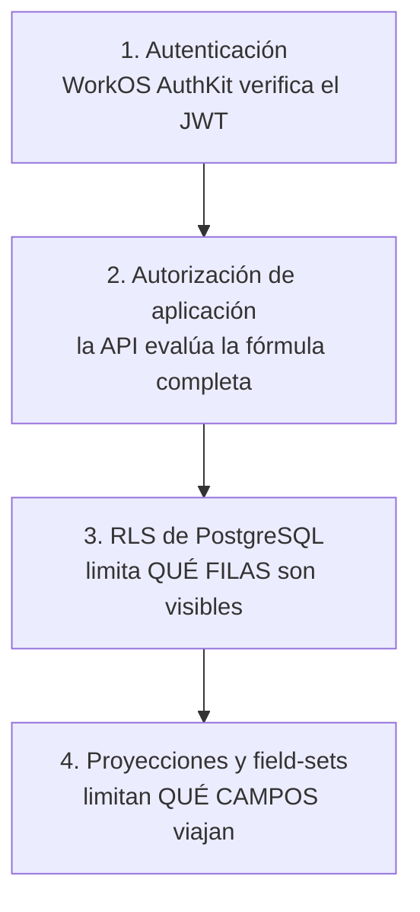

# Matriz de seguridad y RLS V1

**Versión de revisión:** 6
**Fecha:** 17 de agosto de 2026
**Fase:** 3 — Definir operaciones, seguridad y contratos
**Estado:** AFO-39 recertifica Organización y equipo; implementación física pendiente
**Deriva de:** [`V1_OPERATIONS_MATRIX.md`](./V1_OPERATIONS_MATRIX.md), [`V1_VERIFICATION_AND_BREAK_GLASS_GOVERNANCE.md`](./V1_VERIFICATION_AND_BREAK_GLASS_GOVERNANCE.md) y [`V1_RLS_PHYSICAL_TRACEABILITY_MATRIX.md`](./V1_RLS_PHYSICAL_TRACEABILITY_MATRIX.md)

## 1. Propósito

Para cada recurso conceptual de V1, este documento especifica qué puede hacer cada actor, cuál es la condición de fila que lo permite, qué contexto transaccional debe existir, qué grants mínimos de PostgreSQL se conceden, qué índice necesita la policy para no degradar, y cuáles son las pruebas positiva y negativa que la Fase 6 debe ejecutar.

El plan de fases prohíbe explícitamente políticas genéricas del tipo *"si pertenece al workspace puede verlo todo"*. Ninguna ficha de este documento las contiene: cada condición nombra la persona, la relación, la organización, la asignación y el grant concretos.

## 2. Modelo de defensa en capas

La autorización de Allfit no vive en un solo lugar. Vive en cuatro, y cada capa protege contra un fallo distinto de la anterior.



| Capa | Contra qué protege | Qué **no** hace |
| --- | --- | --- |
| WorkOS AuthKit | Suplantación de cuenta | No es autoridad sobre personas de dominio, organizaciones Allfit ni consentimientos |
| Autorización de aplicación | Lógica de negocio incorrecta, operaciones no permitidas | No es suficiente sola: un `WHERE` olvidado la evade |
| RLS | Un `WHERE` olvidado, un join mal escrito, un endpoint nuevo sin revisar | **No** filtra columnas: una fila visible es visible entera |
| Proyecciones y field-sets | Que un campo de otra categoría viaje dentro de una fila legítima | No sustituye a RLS: no restringe qué filas se leen |

La integridad de la fila es ortogonal a estas cuatro capas. RLS puede denegar una fila, pero no puede demostrar que dos IDs válidos pertenezcan a la misma persona u organización. Las escrituras se someten además a las FKs compuestas y guardianes `IX-01..45` de [`V1_CROSS_TABLE_INTEGRITY_MATRIX.md`](./V1_CROSS_TABLE_INTEGRITY_MATRIX.md), incluso cuando el actor de prueba usa `BYPASSRLS`.

Las dos reglas que se derivan de esta separación y que atraviesan todo el documento:

> **RLS limita filas; las proyecciones limitan campos.** El frontend nunca redacta seguridad.

> RLS es defensa en profundidad, **no** la implementación de la lógica de negocio. Si la aplicación no filtra, RLS debe salvar la situación; pero una operación no se diseña delegando su autorización a la policy.

### 2.1 Por qué las columnas no se resuelven con RLS

Una sesión ejecutada es una sola fila que contiene entrenamiento (`relationship_training`), puede contener dolor (`health_context`) y puede referenciar peso corporal (`body_progress`). Tres categorías independientes en una fila.

RLS decide si esa fila se ve. **No** puede decidir que se vea sin la columna de dolor. Por eso ninguna lectura profesional consulta la tabla base: consulta una **proyección autorizada** construida a partir del `SCOPE_RESOURCE_RULE` de la versión congelada en el grant. La tabla base no tiene `GRANT SELECT` para el rol de lectura profesional.

## 3. Roles de PostgreSQL

Ningún proceso se conecta como superusuario ni con `BYPASSRLS`. La propiedad de los objetos está separada del uso en runtime.

| Rol | Uso | RLS | Grants |
| --- | --- | --- | --- |
| `allfit_owner` | Propietario de los objetos. **Solo** migraciones, nunca runtime | Exento por ser owner | DDL |
| `allfit_api` | Único rol de la API en runtime | **`FORCE ROW LEVEL SECURITY`** | Privilegios mínimos por tabla; agregados protegidos usan `SELECT` RLS y `EXECUTE` cerrado, sin DML directo |
| `allfit_worker_privacy` | Workers de disposición, retención y supresión | Forzada | Solo las tablas de Privacidad y los targets que dispone |
| `allfit_worker_outbox` | Despachador y notificaciones | Forzada | `SELECT`/`UPDATE` sobre outbox; `SELECT` de identificadores de contacto |
| `allfit_worker_maintenance` | Expiraciones y recálculo de derivados | Forzada | Las tablas de su alcance, nada más |
| `allfit_support` | Diagnóstico de plataforma | Forzada | `SELECT` **solo** sobre vistas de metadatos operativos |
| `allfit_readonly_analytics` | Reservado | Forzada | Sin acceso a datos identificables en V1 |

`FORCE ROW LEVEL SECURITY` es obligatorio: sin él, el propietario de la tabla evade sus propias policies y una migración mal escrita abriría todo.

Cada worker tiene credencial propia. **No existe un rol universal de jobs**: el worker de expiraciones no puede leer ejecuciones, y el de outbox no puede leer resultados.

## 4. Contexto transaccional

El backend establece el contexto **local a la transacción**, nunca de sesión. Un pool reutiliza conexiones; un contexto de sesión que sobrevive al request es una brecha de autorización directa.

```sql
BEGIN;
  SELECT set_config('app.actor_kind',      $1, true);  -- true = LOCAL
  SELECT set_config('app.actor_account_id',$2, true);
  SELECT set_config('app.actor_person_id', $3, true);
  SELECT set_config('app.actor_org_id',    $4, true);
  SELECT set_config('app.request_id',      $5, true);
  SELECT set_config('app.purpose',         $6, true);
  -- ... la operación ...
COMMIT;
```

| Variable | Contenido | Obligatoria |
| --- | --- | --- |
| `app.actor_kind` | `anonymous`, `account`, `person`, `professional`, `worker`, `support` | Siempre |
| `app.actor_account_id` | `ACCESS_ACCOUNT` derivado de `(issuer, subject)` del JWT | Salvo `worker` |
| `app.actor_person_id` | `PERSON` vinculada, si existe | Salvo `anonymous`, `account`, `worker` |
| `app.actor_org_id` | Organización de la ruta `/organizations/{orgId}` | Solo `professional` y `support` |
| `app.actor_membership_id` | Membresía activa resuelta para `actor_org_id` | Operación organizacional |
| `app.authn_assurance` | `aal1` o `aal2`, derivado de la autenticación validada | Siempre; `aal2` para frozen |
| `app.request_id` | Correlación con logs y `ACCESS_EVENT` | Siempre |
| `app.purpose` | Propósito declarado de la operación | Lecturas bajo grant y break-glass |
| `app.platform_role` | Rol de plataforma vigente, resuelto en la transacción contra `support.platform_role_assignments` | Actores de plataforma; **nunca** aceptado desde el cliente, ni desde un grupo de autenticación, ni desde caché |
| `app.historical_access_case_id` | Caso histórico abierto y verificado | Solo lectura `frozen` |

**Reglas de contexto:**

1. Un contexto ausente **no** significa acceso amplio: significa `anonymous`, y `anonymous` no lee ninguna tabla de dominio.
2. `app.actor_org_id` nunca se deriva de una preferencia guardada ni del token: viene de la ruta y se valida contra una membresía vigente en la misma transacción.
3. Ninguna variable de contexto se establece a partir de un valor enviado por el cliente sin verificación. `actor_person_id` se resuelve **en la base**, desde `actor_account_id`.
4. Un worker nunca porta `actor_person_id`: opera sobre filas por criterio, no en nombre de alguien.

## 5. Predicados reutilizables

Las condiciones RLS se escriben sobre un conjunto pequeño de funciones `STABLE`, para que la policy sea legible y auditable. Cada una es `SECURITY INVOKER` salvo las tres marcadas, que son `SECURITY DEFINER` con `search_path` fijado explícitamente y sin parámetros que puedan alterar su plan.

Todos estos helpers pertenecen al schema privado `access_control`. Este nombre distingue la autorización de dominio de Allfit del schema `auth` reservado y administrado por Supabase. Ningún helper se crea en `auth`, y esta separación no cambia que WorkOS AuthKit autentica mientras PostgreSQL autoriza.

| Predicado | Devuelve | Notas |
| --- | --- | --- |
| `access_control.actor_kind()` | El tipo de actor del contexto | — |
| `access_control.person()` | `PERSON` del contexto, o `NULL` | — |
| `access_control.membership()` | Membresía organizacional activa del contexto, o `NULL` | Se deriva, no se confía en input libre |
| `access_control.is_self(person_id)` | La fila pertenece al actor | Base de casi toda la superficie Space |
| `access_control.org()` | `ORGANIZATION` del contexto, o `NULL` | Solo si hay membresía vigente |
| `access_control.has_membership(org_id)` | Membresía vigente del actor en esa organización | `SECURITY DEFINER` |
| `access_control.has_capability(org_id, capability)` | Capacidad efectiva vía rol vigente | `SECURITY DEFINER` |
| `access_control.effective_assignment(relationship_id)` | Asignación profesional efectiva del actor: titular **o** suplencia aceptada y vigente | `SECURITY DEFINER` |
| `access_control.grant_of(relationship_id, scope_code)` | Grant `active` único con versión, nivel y propósito, o conjunto vacío | Nunca acepta `frozen`/`revoked` |
| `access_control.frozen_grant_of(relationship_id, scope_code)` | Grant `frozen` único con versión, propósito y `frozen_at`, o conjunto vacío | Nunca acepta `active`/`revoked` |
| `access_control.can_access(person_id, scope_code, level)` | La **fórmula completa** de diez condiciones | Compuesta por las anteriores |
| `access_control.has_verified_credential(person_id, credential_type)` | Verificación profesional vigente y no revocada | `SECURITY DEFINER`; nunca amplía scopes |
| `access_control.can_guide_nutrition(person_id, level)` | Fórmula live + `guide_nutrition` + credencial `nutrition_professional` | Solo para proyecciones/comandos nutricionales Studio |
| `access_control.can_read_frozen(relationship_id, scope_code, resource, field, occurred_at)` | Caso histórico, grant `frozen`, corte, field-set histórico, denegación y retención válidos | Predicado separado de ADR-023 |
| `access_control.session_denied(session_id, relationship_id)` | Existe denegación aplicable | Se evalúa **antes** de proyectar y de contar |
| `access_control.has_platform_role(role)` | Asignación vigente en `support.platform_role_assignments`; falla cerrado si no puede resolverse | — |

### 5.1 La fórmula, escrita

`access_control.can_access` implementa las diez condiciones del [ERD §7.1](./V1_CONCEPTUAL_ERD.md). Ninguna se omite, ninguna se cachea y todas se evalúan dentro de la transacción de la operación:

```text
access_control.actor_kind() = 'professional'
∧ la persona profesional está activa
∧ access_control.has_membership(org)                              -- membresía vigente
∧ access_control.has_capability(org, capability_requerida)        -- capacidad compatible
∧ la relación (person, org) está vigente
∧ access_control.effective_assignment(relationship)               -- titular o suplente vigente
∧ EXISTS (SELECT 1 FROM access_control.grant_of(relationship, scope)) -- una fila: grant active de esa relación y org
∧ el access_level del grant cubre el nivel pedido
∧ NOT access_control.session_denied(...)                          -- denegación prevalece
∧ la clasificación del campo está en el field-set de la VERSIÓN congelada
```

La última condición no la resuelve RLS: la resuelve la proyección. Las nueve primeras sí.

Esta fórmula cubre exclusivamente acceso profesional **en vivo** con relación y asignación efectivas. Un grant `frozen` nunca satisface `access_control.can_access`.

### 5.2 La fórmula `frozen`, escrita

```text
access_control.actor_kind() = 'professional'
∧ app.authn_assurance = 'aal2'
∧ access_control.has_membership(org)
∧ access_control.membership() = historical_access_case.authorized_membership_id
∧ el caso está open, no vencido y coincide con org, relación y propósito
∧ el actor es owner/admin o el antiguo titular exacto; nunca staff
∧ la relación está terminated
∧ EXISTS (SELECT 1 FROM access_control.frozen_grant_of(relationship, scope))
∧ occurred_at <= grant.frozen_at
∧ la versión congelada permite resource/field
∧ scope_resource_rule.historical_readable = true
∧ NOT access_control.frozen_session_denied(...)
∧ la retención aplicable no venció
```

El caso no reemplaza ninguna condición y `manage_historical_access` no aparece en la lectura: sirve para abrir/cerrar casos, no para ejercerlos. La asignación profesional efectiva tampoco aparece; el antiguo titular necesita un caso igual que cualquier otro actor elegible.

### 5.3 Antipatrón prohibido en los predicados

Ninguna función `SECURITY DEFINER` acepta como parámetro el identificador del actor. Si lo aceptara, cualquier llamada podría suplantar a cualquiera. El actor siempre sale del contexto transaccional, nunca de un argumento.

### 5.4 Contrato físico de grants

Las dos funciones de lookup son `STABLE SECURITY DEFINER`, fijan `search_path = pg_catalog`, califican todos los objetos y no aceptan actor, persona u organización como parámetros:

```text
access_control.grant_of(
  p_relationship_id uuid,
  p_scope_code text
) RETURNS TABLE (
  grant_id uuid,
  person_id uuid,
  organization_id uuid,
  scope_definition_id uuid,
  access_level privacy.access_level,
  purpose text
)

access_control.frozen_grant_of(
  p_relationship_id uuid,
  p_scope_code text
) RETURNS TABLE (
  grant_id uuid,
  person_id uuid,
  organization_id uuid,
  scope_definition_id uuid,
  access_level privacy.access_level,
  purpose text,
  frozen_at timestamptz
)
```

La primera filtra `status='active'`; la segunda `status='frozen'`. El índice único parcial por `(relationship_id, scope_code) WHERE status IN ('active','frozen')` hace que cada función devuelva cero o una fila. `access_control.can_access` consume solo `grant_of`; `access_control.can_read_frozen` consume solo `frozen_grant_of`.

## 6. Cómo se lee una ficha de recurso

Cada recurso tiene una ficha con esta estructura:

| Sección | Contenido |
| --- | --- |
| **Matriz de actores** | Qué puede hacer cada actor: `—` nada, `R` leer, `W` escribir, `R*` leer proyectado por field-set |
| **Condición RLS** | El predicado de fila por operación |
| **Contexto requerido** | Variables que deben existir |
| **Grants mínimos** | Privilegios de PostgreSQL por rol |
| **Proyección** | Si el acceso externo pasa por una vista en lugar de la tabla base |
| **Índice para la policy** | El índice sin el cual la condición degrada a scan |
| **Prueba positiva** | Un caso que **debe** permitirse |
| **Prueba negativa** | Un caso que **debe** denegarse |

Los actores son los del [catálogo de operaciones §3](./V1_OPERATIONS_MATRIX.md): `A0` anónimo, `A1` cuenta sin persona, `A2` persona, `A3` coach, `A4` admin, `A5` owner, `A6` staff, `A7` suplente, `A9` worker, `A10` soporte solicitante, `A11` curaduría y `A12` aprobador de seguridad/privacidad.

Las pruebas se identifican como `T-<RECURSO>-<n>` y alimentan directamente la suite pgTAP de la Fase 6.

## 7. Matriz por recurso

### 7.1 Identidad

#### `PERSON`

| Actor | SELECT | INSERT | UPDATE | DELETE |
| --- | --- | --- | --- | --- |
| `A0`, `A1` | — | — | — | — |
| `A2` | Propia | — | Propia | — |
| `A3`, `A7` | `R*` vía proyección de cliente | — | — | — |
| `A4`, `A5`, `A6` | `R*` solo identidad de directorio | — | — | — |
| `A9` privacy | Por criterio de disposición | — | Anonimización | Solo `delete` decidido |
| `A10` | — salvo break-glass | — | — | — |

- **Condición RLS** — `SELECT`: `access_control.is_self(id)` **OR** existe relación vigente entre `id` y `access_control.org()` con `access_control.effective_assignment(...)`. `INSERT`: exclusivo de la función transaccional que crea el Fitness ID pendiente (`OP-IDN-043`); ninguna policy permite un `INSERT` directo desde la API. La transición a `active` (`OP-IDN-003`) es un `UPDATE` gobernado, no un segundo `INSERT`. `UPDATE`: `access_control.is_self(id)`.
- **Contexto requerido** — `actor_kind`, `actor_person_id`; `actor_org_id` para el acceso profesional.
- **Grants mínimos** — `allfit_api`: `SELECT`, `UPDATE(campos propios)`. Sin `DELETE`. `allfit_worker_privacy`: `SELECT`, `UPDATE`, `DELETE`.
- **Proyección** — El acceso profesional **nunca** consulta la tabla: usa `identity.v_client_identity`, que expone únicamente nombre de presentación e identificador de relación.
- **Índice para la policy** — sobre `person_id` en `SERVICE_RELATIONSHIP` y sobre `(relationship_id, status)` en `RELATIONSHIP_PROFESSIONAL_ASSIGNMENT`.
- **`T-PERSON-1` (positiva)** — Una persona lee y actualiza su propia fila.
- **`T-PERSON-2` (negativa)** — Una persona no puede leer la fila de otra, ni siquiera conociendo su identificador.
- **`T-PERSON-3` (negativa)** — Un coach con membresía y rol pero **sin** asignación efectiva no obtiene ninguna fila de cliente.
- **`T-PERSON-4` (negativa)** — Un `INSERT` directo con el rol `allfit_api` falla: solo la función de activación crea personas.

#### `ACCESS_ACCOUNT`

| Actor | SELECT | INSERT | UPDATE | DELETE |
| --- | --- | --- | --- | --- |
| `A1` | Propia por `(issuer, subject)` | Propia | — | — |
| `A2` | Propias | — | — | — |
| Resto | — | — | — | — |

- **Condición RLS** — La fila coincide con `app.actor_account_id`, o su `person_id` coincide con `access_control.person()`.
- **Grants mínimos** — `allfit_api`: `SELECT`, `INSERT`, `UPDATE(person_id)` únicamente desde la función de activación.
- **Índice para la policy** — único sobre `(provider, issuer, subject)`; índice sobre `person_id`.
- **`T-ACCOUNT-1` (positiva)** — Una cuenta recién autenticada lee su propia fila sin persona vinculada.
- **`T-ACCOUNT-2` (negativa)** — Ninguna organización, en ningún rol, lee `ACCESS_ACCOUNT` de nadie. El `sub` de WorkOS AuthKit no es visible fuera de Identidad.

#### `ACCESS_SESSION`

| Actor | SELECT | INSERT | UPDATE | DELETE |
| --- | --- | --- | --- | --- |
| `A0`–`A12`, incluido `allfit_api` directo | — | — | — | — |

- **Condición RLS** — `FORCE ROW LEVEL SECURITY` y ninguna policy de runtime. El acceso existe solo mediante funciones `SECURITY DEFINER` con `search_path = pg_catalog`, parámetros tipados y `EXECUTE` revocado a `PUBLIC`.
- **Contexto requerido** — La carga exige hash SHA-256 y superficie exacta. La resolución posterior de cuenta/persona fija `app.actor_kind`, `app.actor_account_id` y `app.actor_person_id` con `set_config(..., true)` dentro de la transacción.
- **Grants mínimos** — `allfit_api` no recibe privilegios de tabla; solo `EXECUTE` sobre resolver/crear cuenta, crear/reemplazar, cargar, rotar compare-and-swap y revocar sesión.
- **Índice para la policy** — No aplica a RLS directa; los lookups cerrados usan los uniques de `token_hash` y `(surface, provider_session_id)`.
- **`T-SESSION-1` (positiva)** — Las funciones concedidas crean y cargan la sesión correcta por hash y superficie sin exponer la cookie original.
- **`T-SESSION-2` (negativa)** — `allfit_api` no puede seleccionar la tabla ni leer ciphertext directamente.
- **`T-SESSION-3` (negativa)** — `PUBLIC` no ejecuta ninguna función de sesión.
- **`T-SESSION-4` (concurrencia)** — Solo la versión esperada rota el refresh token; el compare-and-swap perdedor no sobrescribe la versión ganadora.
- **`T-SESSION-5` (revocación)** — Una sesión revocada deja de cargar inmediatamente.
- **`T-SESSION-6` (superficie)** — Una sesión Studio conserva AAL1 compatible y nunca carga en Backoffice; una fila Backoffice no puede existir sin AAL2, `password_totp`, evidencia y vencimientos.
- **`T-SESSION-7` (tiempo)** — Quince minutos sin actividad u ocho horas absolutas cierran la sesión aunque el token WorkOS continúe vigente.

#### `ACCESS_ACCOUNT_MFA_FACTOR` · `BACKOFFICE_AUTHENTICATION_ATTEMPT` · `MFA_FACTOR_RECOVERY_EVENT`

| Actor | SELECT | INSERT | UPDATE | DELETE |
| --- | --- | --- | --- | --- |
| `A0`–`A12`, incluido `allfit_api` directo | — | — | — | — |
| `allfit_migrator` en ceremonia protegida | Mediante función | Mediante función | Mediante función | — |

- **Condición RLS** — `FORCE ROW LEVEL SECURITY` y policy únicamente para `allfit_owner`. No se conceden privilegios de tabla a `allfit_api`, worker o `PUBLIC`.
- **Contexto requerido** — Las funciones de login reciben hashes y contexto calculado por servidor. Las de recuperación exigen dos personas distintas del sujeto con `manage_platform_access` vigente y autoridad `allfit_migrator`.
- **Grants mínimos** — `allfit_api` sólo ejecuta resolver, iniciar/cargar/bind/fallar/completar/expirar mediante funciones cerradas. El worker sólo prepara limpieza por event ID y nunca lee ciphertext, factor ID o `sid` desde la cola.
- **Índice para la policy** — No hay acceso RLS directo; los lookups usan factor actual por cuenta, token hash único, intento abierto por cuenta y expiración `(expires_at,id)`.
- **`T-AAL2-1` (negativa)** — Password correcto no crea `ACCESS_SESSION`; sólo un challenge TOTP confirmado puede completar el intento.
- **`T-AAL2-2` (negativa)** — Persona inactiva, rol ausente/revocado, factor terminal u otra superficie fallan con la misma ausencia de sesión.
- **`T-AAL2-3` (códigos)** — Los primeros cuatro códigos inválidos conservan el intento; el quinto lo termina y elimina el secreto cifrado.
- **`T-AAL2-4` (idempotencia)** — Un command se vincula antes de consumir el challenge externo; replay legítimo converge y headers distintos no crean una segunda sesión.
- **`T-AAL2-5` (concurrencia)** — Completar TOTP y revocar rol/factor serializan cuenta, intento, factor, rol y sesión; sólo la primera transacción confirmada puede ganar.
- **`T-AAL2-6` (recuperación)** — Dos aprobadores distintos del sujeto revocan factor, sesiones e intentos y escriben evidencia inmutable; runtime y autoaprobación fallan.

#### `PASSWORD_RESET_RECEIPT`

| Actor | SELECT | INSERT | UPDATE | DELETE |
| --- | --- | --- | --- | --- |
| `A0`–`A12`, incluido `allfit_api` directo | — | — | — | — |

- **Condición RLS** — `FORCE ROW LEVEL SECURITY`; solo `allfit_owner` tiene policy. El runtime no recibe privilegios de tabla.
- **Contexto requerido** — ninguno aceptado desde el cliente. La función recibe únicamente la proyección firmada `provider + issuer + event_id + subject + occurred_at` después de la verificación del body crudo.
- **Grants mínimos** — `allfit_api` solo ejecuta `identity.process_password_reset_succeeded`; `PUBLIC` no la ejecuta. La función es la única escritura permitida sobre receipts y la única revocación masiva por reset.
- **Índice para la policy** — no aplica a lectura directa; la función usa el unique `(provider, issuer, provider_event_id)` y la cuenta se resuelve por `(provider, issuer, subject)`.
- **`T-PASSWORD-RESET-1` (positiva)** — revoca todas las sesiones activas creadas hasta `occurred_at` y `load_access_session` deja de devolverlas.
- **`T-PASSWORD-RESET-2` (temporal)** — conserva una sesión creada después del evento.
- **`T-PASSWORD-RESET-3` (tenant)** — el mismo subject bajo otro issuer no se modifica.
- **`T-PASSWORD-RESET-4` (idempotencia)** — replay secuencial o concurrente produce un receipt y devuelve el resultado durable.
- **`T-PASSWORD-RESET-5` (negativa)** — una cuenta inexistente converge a `account_absent`; DML directo sobre receipts o sesiones permanece denegado.

#### `ONBOARDING_ATTEMPT` · `ELIGIBILITY_EVIDENCE`

| Actor | SELECT | INSERT | UPDATE | DELETE |
| --- | --- | --- | --- | --- |
| `A1` | Propio | Vía función gobernada | Vía función gobernada | — |
| `A2` | Propios históricos | — | — | — |
| `A9` privacy | Por disposición | — | — | Sí |
| Resto | — | — | — | — |

- **Condición RLS** — `account_id = app.actor_account_id`. La evidencia hereda la condición de su intento.
- **Grants mínimos** — `allfit_api`: `SELECT` sobre intentos y evidencia; `EXECUTE` sobre inicio, registro de evidencia y activación. Sin DML directo de runtime.
- **Índice para la policy** — sobre `account_id`; parcial sobre intentos abiertos.
- **`T-ONBOARD-1` (positiva)** — Una cuenta lee y avanza su propio intento.
- **`T-ONBOARD-2` (negativa)** — Un intento sin evidencia `pass` vigente para la política V1 no puede transicionar a `activated`: lo impide un constraint, no solo la aplicación.
- **`T-ONBOARD-3` (negativa)** — Ninguna organización lee evidencia de elegibilidad de nadie. La declaración y el snapshot de política nunca salen de Identidad.

#### `FITNESS_PROFILE_CLAIM`

| Actor | SELECT | INSERT | UPDATE | DELETE |
| --- | --- | --- | --- | --- |
| `A2` | Propias, todas | Propias | Vía revisión | — |
| `A3`, `A7` | `R*` con `relationship_training` | `W` observación, con `contribute` | Solo revisión de la **propia** | — |
| `A4`, `A5`, `A6` | — | — | — | — |
| `A9` privacy | Por disposición | — | Anonimización | Sí |

- **Condición RLS** — `SELECT`: `access_control.is_self(person_id)` **OR** `access_control.can_access(person_id, 'relationship_training', 'read')`. `INSERT`: `access_control.is_self(person_id)` con procedencia `person_declared`, **o** `access_control.can_access(person_id, 'relationship_training', 'contribute')` con procedencia `professional_observation` y autoría en la asignación. `UPDATE`: prohibido; toda corrección es un `REVISION_EVENT`.
- **Contexto requerido** — Completo, incluido `app.purpose` para el acceso profesional.
- **Grants mínimos** — `allfit_api`: `SELECT`, `INSERT`. **Sin `UPDATE` ni `DELETE`**: la inmutabilidad se garantiza con privilegios, no solo con disciplina.
- **Proyección** — `identity.v_client_profile`, que aplica el `SCOPE_RESOURCE_RULE` de la **versión congelada en el grant**. Un grant v1 no recibe atributos añadidos en v2 aunque la fila los tenga.
- **Índice para la policy** — sobre `(person_id, attribute_code, valid_from DESC)`. Además, único parcial de miembro vigente para los atributos multivaluados; hoy solo `focus_areas`. No participa en la policy: protege la forma del conjunto.
- **`T-CLAIM-1` (positiva)** — Un coach con `relationship_training` v1 lee los atributos del field-set v1.
- **`T-CLAIM-2` (negativa)** — Publicada la v2 con atributos nuevos, ese mismo grant v1 **no** los recibe.
- **`T-CLAIM-3` (negativa)** — Un grant `read` intenta insertar una observación: denegado.
- **`T-CLAIM-4` (positiva)** — Declaración de la persona, observación profesional e inferencia del sistema sobre el mismo atributo coexisten; ninguna sobrescribe a otra.
- **`T-CLAIM-5` (negativa)** — Un profesional intenta revisar una afirmación con procedencia `person_declared`: denegado. Solo puede proponer.
- **`T-CLAIM-6` (positiva)** — Varias afirmaciones vigentes del **mismo** atributo multivaluado y la **misma** procedencia coexisten, una por miembro del conjunto. Es lo que distingue un atributo multivaluado de uno singular, y sin esta prueba la diferencia solo vive en el cuerpo de la función.
- **`T-CLAIM-7` (negativa)** — El mismo miembro dos veces vigente para la misma persona: rechazado por el único parcial, no por el comando.

#### `BODY_PROGRESS_RECORD`

| Actor | SELECT | INSERT | UPDATE | DELETE |
| --- | --- | --- | --- | --- |
| `A2` | Propios | Propios | Vía revisión | Propios |
| `A3`, `A7` | `R*` con `body_progress` | — | — | — |
| Resto | — | — | — | — |

- **Condición RLS** — `access_control.is_self(person_id)` **OR** `access_control.can_access(person_id, 'body_progress', 'read')`. **`relationship_training` no alcanza**, aunque la medición esté asociada a una sesión visible.
- **Grants mínimos** — `allfit_api`: `SELECT`, `INSERT`, `DELETE` propio. `allfit_worker_privacy`: todos.
- **Proyección** — `identity.v_client_body_progress`. Las imágenes se sirven por URL firmada de vigencia corta, emitida **por petición** tras reevaluar el grant; nunca se devuelve una ruta estable.
- **Índice para la policy** — sobre `(person_id, measured_on DESC)`.
- **`T-BODY-1` (positiva)** — Con `body_progress` vigente, el coach lee las mediciones seleccionadas.
- **`T-BODY-2` (negativa)** — Con `relationship_training` pero **sin** `body_progress`, el peso corporal permanece oculto aunque la carga de ejercicio de la sesión sí sea visible.
- **`T-BODY-3` (negativa)** — La proyección no expone EXIF, geolocalización ni ninguna imagen no seleccionada explícitamente.
- **`T-BODY-4` (positiva)** — Revocar `body_progress` bloquea al profesional **sin** borrar el dato de la persona.

#### `HEALTH_CONTEXT_CLAIM`

| Actor | SELECT | INSERT | UPDATE | DELETE |
| --- | --- | --- | --- | --- |
| `A2` | Propias | Propias | Vía revisión | Propias |
| `A3`, `A7` | `R*` con `health_context` | `W` con `contribute` | Propia, vía revisión | — |
| Resto | — | — | — | — |

- **Condición RLS** — `access_control.is_self(person_id)` **OR** `access_control.can_access(person_id, 'health_context', 'read')`. Es la categoría más restrictiva de V1.
- **Grants mínimos** — `allfit_api`: `SELECT`, `INSERT`. Sin `UPDATE`.
- **Proyección** — `identity.v_client_health_context`, minimizada: nunca historia clínica, diagnósticos, laboratorios ni documentos.
- **Índice para la policy** — sobre `(person_id, valid_from DESC)`.
- **`T-HEALTH-1` (negativa)** — Un dolor registrado **dentro** de una sesión visible permanece oculto sin `health_context`. La visibilidad de la sesión no arrastra la del dolor.
- **`T-HEALTH-2` (negativa)** — `health_context` no expone biometría continua, raw de dispositivos ni inferencias médicas: no existen en V1.

#### `PROFESSIONAL_PROFILE`

| Actor | SELECT | INSERT | UPDATE | DELETE |
| --- | --- | --- | --- | --- |
| `A2` | Propio | Propio | Propio | — |
| `A3`–`A6` | De los miembros de la misma organización | — | — | — |
| Resto | — | — | — | — |

- **Condición RLS** — La tabla base exige `access_control.is_self(person_id)`. La lectura organizacional ocurre exclusivamente mediante una proyección cerrada que comprueba membresía vigente compartida en `access_control.org()` y omite evidencia interna.
- **Índice para la policy** — sobre `person_id` en `ORGANIZATION_MEMBERSHIP` con `(organization_id, status)`.
- **`T-PROF-1` (negativa)** — El perfil profesional **no** es público: no existe una lectura anónima ni entre organizaciones. Perfiles públicos y marketplace están diferidos.
- **`T-PROF-2` (negativa)** — Una organización compartida puede consumir la presentación autorizada, pero no editarla ni convertirla en una copia organizacional.

#### `PROFESSIONAL_PROFILE_SPECIALTY`

| Actor | SELECT | INSERT | UPDATE | DELETE |
| --- | --- | --- | --- | --- |
| `A2` | Propias | Vía `OP-IDN-010` | — | Vía `OP-IDN-010` |
| `A3`–`A6` | Proyección de miembros de la misma organización | — | — | — |
| Resto | — | — | — | — |

- **Condición RLS** — Hereda el perfil mediante `professional_profile_id`; el comando resuelve el perfil de `access_control.person()` y solo acepta códigos publicados.
- **Grants mínimos** — Sin DML directo de runtime; `OP-IDN-010` reemplaza el conjunto dentro de una transacción.
- **`T-PROF-3` (negativa)** — Un código libre, inexistente o no publicado no puede declararse como especialidad.

#### `PROFESSIONAL_CREDENTIAL`

| Actor | SELECT | INSERT | UPDATE | DELETE |
| --- | --- | --- | --- | --- |
| `A2` | Propias | Vía `OP-IDN-029` | Solo retiro vía `OP-IDN-031` | — |
| `A3`–`A6` | Proyección de miembros de la misma organización | — | — | — |
| `A11/verify_professional_credentials` | Solo la credencial asignada a su solicitud | — | — | — |
| Resto | — | — | — | — |

- **Condición RLS** — Ownership transitivo desde `professional_profile_id`; la revisión `OP-IDN-030` crea una nueva credencial y retira la anterior en la misma transacción. No existe `UPDATE` material ni `DELETE` de runtime.
- **Proyección** — Expone identificación profesional, emisor, vigencia declarada y estado de verificación de esa versión; nunca fingerprint, referencia interna ni datos de otra credencial.
- **`T-CRED-1` (positiva)** — La persona declara, revisa y retira únicamente sus credenciales.
- **`T-CRED-2` (negativa)** — Revisar una credencial no traslada la verificación de la versión reemplazada.

#### `PROFESSIONAL_CREDENTIAL_VERIFICATION`

| Actor | SELECT | INSERT | UPDATE | DELETE |
| --- | --- | --- | --- | --- |
| `A2` | Estado propio mediante proyección | — | — | — |
| `A3`–`A7` | Estado autorizado mediante proyección | — | — | — |
| `A11/verify_professional_credentials` | Las asignadas o emitidas, por función cerrada | Vía `OP-IDN-011` | Revocación append-only mediante función | — |
| Resto | — | — | — | — |

- **Condición RLS** — `OP-IDN-011` restringe a `actor_kind='support'`, deber `verify_professional_credentials`, AAL2, asignación vigente, versión exacta, método/fuente permitidos y ausencia de conflicto según ADR-026.
- **Grants mínimos** — Sin DML directo de runtime sobre la tabla. Las funciones cerradas insertan decisiones append-only; las proyecciones separan estado público autorizado de evidencia interna.
- **`T-VERIF-1` (negativa)** — Verificar una credencial **no** marca otras versiones, otras credenciales ni el perfil completo como verificados.
- **`T-VERIF-2` (negativa)** — Vencer o revocar una verificación no altera la declaración ni comparte automáticamente la evidencia.
- **`T-VG-01..06`** — Deber separado, métodos cerrados, exclusiones, conflictos, vigencia y ciclo append-only según [`V1_VERIFICATION_AND_BREAK_GLASS_GOVERNANCE.md`](./V1_VERIFICATION_AND_BREAK_GLASS_GOVERNANCE.md).

#### `INVITATION` · `INVITATION_INTENT`

| Actor | SELECT | INSERT | UPDATE | DELETE |
| --- | --- | --- | --- | --- |
| `A0` | — | — | — | — |
| `A1`, `A2` | — | — | — | — |
| `A3`–`A6` | — | — | — | — |
| `A9` maintenance | — | — | — | — |

- **Condición RLS** — `FORCE ROW LEVEL SECURITY`; solo `allfit_owner` tiene policy física. Ningún actor runtime recibe DML directo.
- **Contexto requerido** — `resolve_staff_invitation` exige actor anónimo y token hasheado; `decide_staff_invitation` exige persona activa y `app.actor_verified_email`; listar/revocar exigen capacidad `invite`; expirar exige actor worker.
- **Grants mínimos** — `allfit_api` recibe únicamente `EXECUTE` sobre las funciones cerradas de emitir, limitar, resolver, decidir, listar, revocar y expirar. El token no se expone a SQL en claro.
- **Índices para funciones** — único sobre `token_hash`; propuesta pendiente; `(organization_id, status, expires_at DESC)`; listado `(organization_id, created_at DESC, id DESC)`.
- **`T-INV-1` (positiva)** — El actor anónimo resuelve una invitación de staff pendiente y ve organización, responsable, rol y vencimiento, nunca contacto.
- **`T-INV-2` (negativa)** — Inválida, vencida, revocada y completada producen la misma proyección vacía/`404`.
- **`T-INV-3` (negativa)** — Un email ausente, no verificado o distinto no puede decidir la invitación.
- **`T-INV-4` (negativa)** — Aceptar staff no crea perfil de cliente, relación, grant, scope ni asignación.
- **`T-INV-5` (positiva)** — Aceptar crea o reutiliza una sola membresía activa, conserva `joined_at` y añade el rol faltante una vez.
- **`T-INV-6` (positiva)** — Aceptación y revocación concurrentes confirman un único efecto terminal.
- **`T-INV-7` (positiva)** — La expiración por lotes usa bloqueo con `SKIP LOCKED` y emite una sola evidencia por invitación.
- **`T-INV-8` (negativa)** — Los límites persisten solo hashes SHA-256, nunca email o IP en claro.

### 7.2 Organizaciones

#### `ORGANIZATION` · `ORGANIZATION_TYPE` · `ORGANIZATION_TYPE_TRANSITION` · `ORGANIZATION_SITE`

| Actor | SELECT | INSERT | UPDATE | DELETE |
| --- | --- | --- | --- | --- |
| `A2` | — | Vía `organizations.create_organization` | — | — |
| `A3`, `A6` | Vía `organizations.read_organization` | — | — | — |
| `A4` | Vía `organizations.read_organization` | Vía función cerrada | Vía función cerrada | — |
| `A5` | Vía `organizations.read_organization` | Vía función cerrada | Vía función cerrada, transferencia y cierre | — |

- **Condición RLS** — `access_control.has_membership(id)`. Las sedes heredan por `organization_id`. `ORGANIZATION_TYPE` y `ORGANIZATION_TYPE_TRANSITION` son catálogos globales de lectura autenticada, sin DML de runtime.
- **Grants mínimos** — `allfit_api` no recibe `SELECT` ni DML sobre `organizations.organizations`; solo `EXECUTE` sobre `organizations.create_organization`, `organizations.update_organization`, `organizations.create_site`, `organizations.update_site`, `organizations.read_organization`, `organizations.transfer_ownership` y `organizations.close_organization`. Los catálogos globales conservan grants de columnas seguras explícitos; sede/membresía/rol necesarios para esta proyección se leen dentro de la función. `responsible_party` nunca es seleccionable por runtime.
- **Entrada cerrada** — Las funciones de escritura son `SECURITY DEFINER`, fijan `search_path = pg_catalog`, califican todos los objetos, toman actor/persona/membresía del contexto transaccional y revocan `EXECUTE` a `PUBLIC`.
- **Índice para la policy** — sobre `(person_id, organization_id, status)` en `ORGANIZATION_MEMBERSHIP`.
- **`T-ORG-1` (negativa)** — Una organización no lee ni referencia datos privados de otra. Se prueba con dos organizaciones independientes.
- **`T-ORG-2` (positiva)** — Una práctica unipersonal incorpora integrantes **sin** cambiar `organization_id` y sin perder clientes, programas ni auditoría.
- **`T-ORG-3` (negativa)** — Un `PATCH` con campo fuera de `display_name`, `legal_name` y `type_code`, transición no publicada, `If-Match` ausente u obsoleto no muta la organización.
- **`T-ORG-4` (positiva)** — Las dos transiciones publicadas incrementan `revision_number`, devuelven ETag fuerte y escriben before/after; incorporar equipo no cambia `type_code`.
- **`T-ORG-5` (negativa)** — `allfit_api` no puede ejecutar DML directo sobre organización, sede, membresía, rol o eventos, aun con contexto owner; no puede fabricar estado, owner ni snapshots.
- **`T-ORG-6` (positiva/negativa)** — Cada función cerrada permite el actor/campo/tenant documentado y deniega actor, tenant, campo inmutable, transición o ETag inválido.
- **`T-ORG-7` (auditoría)** — `OP-ORG-013` devuelve la proyección cerrada y registra `ACCESS_EVENT` en la misma transacción; si el registro falla no retorna contenido, y otro tenant recibe el mismo `404` que una organización inexistente.
- **`T-ORG-8` (interdominio)** — Cada contrato destino permite la llamada del coordinador owner para el mismo tenant y deniega tenant ajeno; un fallo inyectado en Relaciones, Privacidad, Planificación, Ejecución o Nutrición revierte todos los efectos previos.
- **`T-ORG-9` (concurrencia/idempotencia)** — Cierre y bajas concurrentes serializan, conservan un solo receipt por `Command-Id` y nunca dejan roles, asignaciones, grants o propuestas en estado parcial.
- **`T-ORG-10` (PII de sede)** — Dirección domiciliaria solo aparece en la proyección del tenant autorizado con `no-store`; el `ACCESS_EVENT` registra únicamente el recurso cerrado y la disposición aplica la política `identity_pii` sin copiar la dirección.

#### `ORGANIZATION_MEMBERSHIP` · `MEMBERSHIP_ROLE`

| Actor | SELECT | INSERT | UPDATE | DELETE |
| --- | --- | --- | --- | --- |
| `A2` | Las propias | — | Vía `organizations.resign_membership` | — |
| `A3` | Las de su organización | — | — | — |
| `A6` | Las de su organización | — | — | — |
| `A4`, `A5` | Las de su organización | Vía función cerrada | Vía función cerrada | — |

- **Condición RLS** — `organization_id = access_control.org()` con membresía vigente, **OR** `person_id = access_control.person()`. Las operaciones genéricas solo admiten `admin`, `coach` y `staff` y rechazan `owner`; esa regla vive dentro de las entradas cerradas, no en un grant DML.
- **Grants mínimos** — `allfit_api` recibe `SELECT` RLS y solo `EXECUTE` sobre `organizations.grant_membership_role`, `organizations.revoke_membership_role`, `organizations.terminate_membership`, `organizations.resign_membership` y `organizations.transfer_ownership`. Sin DML directo sobre membresías o roles.
- **Contratos destino** — `relationships.end_assignments_for_membership` y los cinco contratos de cierre son `SECURITY DEFINER` del dominio destino, con `PUBLIC/allfit_api` sin `EXECUTE`; solo el coordinador Organization ejecutado como owner los llama. Ningún grant autoriza DML cross-schema.
- **Índice para la policy** — sobre `(organization_id, status)` y sobre `(person_id, status)`.
- **`T-MEMB-1` (negativa)** — Una membresía, en cualquier rol, **no** concede acceso a datos fitness de ningún cliente. Un `admin` sin asignación ni grant no lee nada del Fitness ID.
- **`T-MEMB-2` (negativa)** — Un rol de una organización no se propaga a otra, aunque la persona sea miembro de ambas.
- **`T-MEMB-3` (negativa)** — Cerrar el rol o la membresía `owner` y confirmar con cero owners es imposible: lo impide `organizations.enforce_exactly_one_active_owner_ct`.
- **`T-MEMB-4` (positiva)** — Terminar una membresía deja inefectivas sus asignaciones profesionales **en la misma transacción**; el grant sobrevive, el actor deja de poder ejercerlo.
- **`T-MEMB-5` (negativa)** — `A6` (staff) ve nombre y estado del directorio, y ninguna columna de perfil, ejecución, medida corporal o salud.
- **`T-MEMB-6` (negativa)** — Crear un segundo rol `owner` activo y confirmar con dos owners es imposible: lo impide el mismo constraint diferible.
- **`T-MEMB-7` (positiva)** — `organizations.transfer_ownership(...)` ejecutada por el owner a una membresía activa del mismo tenant confirma un owner, conserva la membresía y roles no-owner anteriores y registra `organization.ownership_transferred.v1`.
- **`T-MEMB-8` (negativa)** — Admin, destino inactivo/ajeno o dos transferencias concurrentes no producen cero/dos owners ni cambios parciales; `allfit_api` no puede alterar `owner` fuera de la función cerrada.
- **`T-MEMB-9` (multirrol)** — Retirar `admin` o `staff` a una membresía que conserva `coach` no cierra asignaciones; retirar `coach`, terminar o renunciar sí las cierra en la misma transacción.
- **`T-MEMB-10` (self)** — La persona con membresía propia activa no-owner renuncia aunque no tenga roles vigentes; el owner vigente falla y no muta nada.

#### `ORGANIZATION_ROLE` · `ORGANIZATION_CAPABILITY` · `ROLE_CAPABILITY`

| Actor | SELECT | INSERT | UPDATE | DELETE |
| --- | --- | --- | --- | --- |
| Autenticado | Catálogo global | — | — | — |
| `A11` | Todo | Sí | Sí | — |

- **Condición RLS** — Lectura abierta a cualquier autenticado; escritura solo `actor_kind = 'support'`. En V1 el catálogo es **cerrado**: cuatro roles, sin personalización por organización.
- **`T-ROLE-1` (negativa)** — Una organización no puede crear un rol propio ni alterar el mapeo rol→capacidad.

#### Eventos organizacionales, de membresía y de relación

| Actor | SELECT | INSERT | UPDATE | DELETE |
| --- | --- | --- | --- | --- |
| `A2` | Los de sus propios vínculos | — | — | — |
| `A4`, `A5` | Los de su organización | — | — | — |
| `allfit_api` | — | Solo como efecto de función/trigger cerrado | — | — |

- **Condición RLS** — Heredan la condición de su agregado.
- **Grants mínimos** — Sin DML directo para `allfit_api` ni otro runtime. Las funciones cerradas y triggers propietarios insertan eventos append-only; `UPDATE` y `DELETE` permanecen revocados.
- **`T-EVENT-1` (negativa)** — Ningún rol de runtime puede insertar, modificar ni borrar un evento directamente.
- **`T-EVENT-2` (positiva/negativa)** — Cada función gobernada produce el snapshot contractual correspondiente y rechaza claves, tipos o combinación `event_type`/snapshot inválidos.

### 7.3 Relaciones

#### `SERVICE_RELATIONSHIP` · `RESPONSIBLE_PARTY_SNAPSHOT`

| Actor | SELECT | INSERT | UPDATE | DELETE |
| --- | --- | --- | --- | --- |
| `A2` | Las propias | — | Terminación | — |
| `A3`, `A7` | Aquellas con asignación efectiva | — | — | — |
| `A6` | Las de su organización, sin contenido | — | — | — |
| `A4`, `A5` | Las de su organización | Vía aceptación | Terminación | — |

- **Condición RLS** — `person_id = access_control.person()` **OR** (`organization_id = access_control.org()` **AND** (`access_control.has_capability(org,'manage_clients')` **OR** `access_control.effective_assignment(id)`)). `INSERT` exclusivo de la función de aceptación de invitación: ninguna policy permite crear una relación desde Studio.
- **Grants mínimos** — `allfit_api`: `SELECT`, `INSERT` restringido, `UPDATE(status, ended_at, ended_reason)`. Sin `DELETE`.
- **Índice para la policy** — sobre `(person_id, status)`, `(organization_id, status)` y `(relationship_id, status)` en la tabla de asignaciones.
- **`T-REL-1` (negativa)** — Un profesional **no** consulta relaciones ajenas: sin asignación efectiva, la colección viene vacía aunque tenga rol `coach`.
- **`T-REL-2` (negativa)** — No existe una relación provisional antes de la aceptación. Una invitación pendiente no produce ninguna fila aquí.
- **`T-REL-3` (positiva)** — Una persona con dos profesionales de organizaciones distintas tiene dos relaciones independientes; ninguna ve a la otra.
- **`T-REL-4` (negativa)** — Una persona no puede tener dos relaciones activas con la **misma** organización: lo impide un índice único parcial.
- **`T-REL-5` (positiva)** — Terminar la relación **congela** los grants (`frozen`, con `frozen_at`), desacopla las asignaciones y pausa las sesiones futuras en **una** transacción, con un único instante efectivo.
- **`T-REL-8` (positiva)** — Con caso exacto y `access_control.can_read_frozen`, la superficie histórica devuelve el conjunto autorizado **hasta la fecha de corte** y **ninguna** fila posterior. Se prueba creando una ejecución después del corte y verificando que no aparece ni en detalle ni en conteos.
- **`T-REL-9` (negativa)** — Un grant `frozen` **no** habilita ninguna escritura: ni observaciones, ni propuestas de corrección, ni asignaciones.
- **`T-REL-6` (negativa)** — Los datos creados después de la terminación no son visibles para la organización anterior.
- **`T-REL-7` (negativa)** — Una relación nueva con la misma organización no hereda gestión, grants, notas privadas ni acceso a la asignación desacoplada.

#### `RELATIONSHIP_PROFESSIONAL_ASSIGNMENT` · suplencias

| Actor | SELECT | INSERT | UPDATE | DELETE |
| --- | --- | --- | --- | --- |
| `A2` | Las de sus relaciones | — | Decidir y terminar suplencias | — |
| `A3` | Las suyas; proponer suplencia | Propuesta | Renuncia propia | — |
| `A7` | La suya | — | — | — |
| `A4`, `A5` | Las de su organización | Sí | Reasignación, cierre | — |

- **Condición RLS** — Vía la relación: la fila es visible si la relación lo es. `INSERT` exige `access_control.has_capability(org,'manage_assignments')` **y** que la membresía destino esté vigente **en la misma organización** con rol `coach`. La activación de una suplencia exige `person_id = access_control.person()`.
- **Contexto requerido** — Completo, con `actor_org_id`.
- **Grants mínimos** — `allfit_api`: `SELECT`, `INSERT`, `UPDATE(status, ended_at)`. Sin `DELETE`.
- **Índice para la policy** — sobre `(relationship_id, status, valid_from, valid_to)`; **único parcial** que garantiza un solo titular efectivo por relación.
- **`T-ASSIGN-1` (negativa)** — Una membresía de otra organización no puede asignarse, aunque la persona sea cliente de ambas.
- **`T-ASSIGN-2` (positiva)** — Reasignar dentro de la misma parte responsable **conserva** el grant, cambia el actor efectivo y queda auditado; el profesional anterior pierde acceso de inmediato.
- **`T-ASSIGN-3` (negativa)** — Reasignar **no** amplía permisos retroactivamente: el nuevo titular no ve más de lo que el grant permite.
- **`T-ASSIGN-4` (negativa)** — Un suplente **propuesto y no aceptado** no lee absolutamente nada.
- **`T-ASSIGN-5` (negativa)** — Un suplente con vigencia expirada es rechazado por la fórmula aunque el job de expiración no haya corrido.
- **`T-ASSIGN-6` (negativa)** — Cambiar de organización o de parte responsable **no** transfiere la asignación: exige relación y consentimiento nuevos.

#### `RELATIONSHIP_TERMINATION_REQUEST`

| Actor | SELECT | INSERT | UPDATE | DELETE |
| --- | --- | --- | --- | --- |
| `A2` | — | — | — | — |
| `A3` | Las que él mismo emitió | Sí, si **no** tiene capacidad de terminar | Retirar la suya | — |
| `A6` | — | — | — | — |
| `A4`, `A5` | Las de su organización | — | Resolver | — |

- **Condición RLS** — `access_control.has_membership(organization_id)` **AND** (`requested_by_membership_id = access_control.membership()` **OR** `access_control.has_capability(organization_id,'manage_relationships')`). La persona atendida **no** aparece como actor: la solicitud es deliberación interna de la organización y nunca se le expone.
- **Contexto requerido** — Completo, con `actor_org_id`.
- **Grants mínimos** — `allfit_api`: `SELECT`, `INSERT`, `UPDATE(status, resolution, resolved_by_membership_id, resolved_at)`. Sin `DELETE`.
- **Índice para la policy** — `(organization_id, status, created_at desc)`; **único parcial** `UNIQUE (relationship_id) WHERE status = 'pending'`.
- **`T-TERMREQ-1` (negativa)** — Un coach que además es `admin` u `owner` **no** puede insertar: tiene poder de terminación y debe usar `OP-REL-008`.
- **`T-TERMREQ-2` (negativa)** — Dos solicitudes pendientes sobre la misma relación son imposibles: lo impide el unique parcial, no el código de la aplicación.
- **`T-TERMREQ-3` (negativa)** — La persona atendida no lee ninguna fila de esta tabla por ninguna vía.
- **`T-TERMREQ-4` (negativa)** — Crear la solicitud **no** cambia el estado de la relación, no congela grants y no desacopla asignaciones.
- **`T-TERMREQ-5` (positiva)** — Resolver la solicitud exige capacidad de gestión de relaciones y deja `resolved_by_membership_id` y `resolved_at`.

### 7.4 Privacidad

Es el dominio donde una policy mal escrita produce una fuga real. Todas sus fichas comparten tres invariantes:

1. Ningún grant se evalúa fuera de la transacción que lo usa.
2. Ninguna denegación puede deducirse por diferencia de conteos, huecos de paginación o mensajes de error.
3. Ninguna versión publicada se modifica.

#### `SCOPE_DEFINITION` · `SCOPE_RESOURCE_RULE` · `DATA_CLASSIFICATION`

| Actor | SELECT | INSERT | UPDATE | DELETE |
| --- | --- | --- | --- | --- |
| Autenticado | Versiones publicadas | — | — | — |
| `A11` | Todo | Sí | — | — |

- **Condición RLS** — `SELECT`: `status = 'published'`. `INSERT`: `actor_kind = 'support'`.
- **Grants mínimos** — `allfit_api`: `SELECT`, `INSERT` restringido. **Sin `UPDATE` ni `DELETE` para nadie en runtime**: la inmutabilidad de una versión publicada se impone con privilegios.
- **`T-SCOPE-1` (negativa)** — Una versión publicada no puede modificarse por ninguna vía.
- **`T-SCOPE-2` (negativa)** — No existe ningún scope, vista, RPC ni endpoint equivalente a `all_data`. Se verifica enumerando el catálogo y comprobando que solo hay siete. El estado de pago **no es un scope** y no se expone por ninguno de ellos.
- **`T-SCOPE-3` (positiva)** — Cada campo expuesto por una regla tiene una `DATA_CLASSIFICATION` asignada; publicar una regla con un campo sin clasificar falla.

#### `CONSENT_EVENT` · opciones de scope de la invitación

| Actor | SELECT | INSERT | UPDATE | DELETE |
| --- | --- | --- | --- | --- |
| `A2` | Los propios | Solo mediante decisión de invitación | — | — |
| `A3`–`A5` | Los de sus relaciones, sin contenido | — | — | — |
| Resto | — | — | — | — |

- **Condición RLS** — En `consent_events`: `person_id = access_control.person()` **OR** (`organization_id = access_control.org()` **AND** existe `service_relationships(id=relationship_id, organization_id=access_control.org())`). `invitation_scope_options` hereda el acceso de `identity.invitation_intents`/`invitations` y no admite DML directo. La organización ve **estado**, nunca contenido amparado.
- **Grants mínimos** — `allfit_api`: `SELECT`; `INSERT` solo mediante `identity.decide_invitation_intent`. Sin `UPDATE` ni `DELETE`: el evento de consentimiento es evidencia inmutable.
- **Índice para la policy** — `consent_events`: `(person_id, decided_at DESC)`, `(relationship_id, scope_code, decided_at DESC)`, `(organization_id, decided_at DESC)`; `invitation_scope_options`: único `(invitation_intent_id,scope_code)`.
- **`T-CONSENT-1` (positiva)** — Rechazar o revocar conserva la evidencia sin dejar grant activo.
- **`T-CONSENT-2` (positiva)** — El evento conserva el **snapshot exacto** que se presentó a la persona, aunque después se publique otra versión del scope.
- **`T-CONSENT-3` (negativa)** — Ningún endpoint Studio crea opciones para una relación activa; un scope rechazado o revocado no reaparece como pendiente.
- **`T-CONSENT-4` (positiva)** — Una confirmación puede aceptar la relación y cualquier subconjunto de scopes; produce un evento por opción y grants solo para las concedidas.

#### `DATA_GRANT`

El recurso más sensible del modelo: es el que convierte una relación en acceso.

| Actor | SELECT | INSERT | UPDATE | DELETE |
| --- | --- | --- | --- | --- |
| `A2` | Los propios | Vía consentimiento | Revocación | — |
| `A3`, `A7` | Los de sus relaciones asignadas | — | — | — |
| `A4`, `A5` | Los de su organización | — | — | — |
| `A9` privacy | Por disposición | — | Cierre | — |

- **Condición RLS** — `person_id = access_control.person()` **OR** (`organization_id = access_control.org()` **AND** existe `service_relationships(id=relationship_id, organization_id=access_control.org())`). `INSERT` exclusivo de `identity.decide_invitation_intent`, que exige sujeto, invitación, relación recién materializada y opción exactos. `UPDATE` solo mediante `privacy.revoke_grant` o `relationships.terminate_relationship`; el trigger de transición valida columnas y dirección.
- **Contexto requerido** — Completo.
- **Grants mínimos** — `allfit_api`: `SELECT`, `INSERT` restringido y `UPDATE(status, frozen_at, revoked_at, last_reviewed_at)`. **Sin `DELETE`**. Policies + trigger solo permiten: consentimiento `INSERT`; persona `active/frozen → revoked`; terminación `active → frozen`; mantenimiento de `last_reviewed_at` sin cambiar autoridad.
- **Índice para la policy** — **crítico**: único parcial `(relationship_id, scope_code) WHERE status IN ('active','frozen')`, `(person_id, status)`, `(organization_id, status)` y parcial `(relationship_id, scope_code, frozen_at) WHERE status='frozen'`.
- **`T-GRANT-1` (positiva)** — Un grant identifica relación, organización y parte responsable presentada.
- **`T-GRANT-2` (negativa)** — Conceder un scope **no** concede los demás: se verifican los cuatro por separado.
- **`T-GRANT-3` (negativa)** — Ninguna relación hereda grants de una anterior, ni siquiera con la misma organización.
- **`T-GRANT-4` (negativa)** — Un grant v1 **no** hereda campos ni finalidades publicados en v2.
- **`T-GRANT-5` (negativa)** — Membresía o rol `admin` sin asignación ni capacidad **no** permiten ejercer el grant.
- **`T-GRANT-6` (positiva)** — Revocar corta el acceso en la misma transacción: una lectura inmediatamente posterior devuelve vacío, sin ventana de caché.
- **`T-GRANT-9` (positiva)** — Revocar un grant `frozen` lo cambia a `revoked`, cierra todos los casos abiertos de su relación e impide la siguiente lectura de ese scope.
- **`T-GRANT-7` (negativa)** — Un grant `read` no habilita ninguna escritura; un `contribute` conserva procedencia y no sobrescribe.
- **`T-GRANT-8` (negativa)** — Cambiar organización, parte responsable, finalidad o scope exige nueva aceptación: el grant anterior no se reutiliza.

#### `SESSION_VISIBILITY_DENIAL`

| Actor | SELECT | INSERT | UPDATE | DELETE |
| --- | --- | --- | --- | --- |
| `A2` | Las propias | Propias | Propias | Propias |
| Resto | **—** | — | — | — |

- **Condición RLS** — `person_id = access_control.person()`, y **solo eso**. Ninguna organización, en ningún rol, lee esta tabla: saber que existe una denegación ya revela que hay algo oculto.
- **Grants mínimos** — `allfit_api`: `SELECT`, `INSERT`, `UPDATE`, `DELETE` **solo** para el dueño.
- **Proyección** — La denegación se aplica **dentro** de las proyecciones de ejecución, antes de proyectar y antes de agregar. No es un filtro posterior.
- **Índice para la policy** — sobre `(executed_session_id, relationship_id)` único, y `(relationship_id, status)` para la evaluación en lote.
- **`T-DENY-1` (positiva)** — Una sesión autónoma es visible para una relación y oculta para otra, simultáneamente.
- **`T-DENY-2` (negativa)** — La sesión oculta **no** aparece en conteos, totales, récords ni agregados de esa relación.
- **`T-DENY-3` (negativa)** — La paginación no deja hueco: los cursores se calculan sobre el conjunto ya filtrado.
- **`T-DENY-4` (negativa)** — Ningún otro scope reexpone la sesión oculta dentro de la misma relación.
- **`T-DENY-5` (positiva)** — La denegación sobrevive a la reasignación del coach y se aplica a toda la organización responsable.
- **`T-DENY-6` (negativa)** — Una organización no puede cambiar la visibilidad ni vincular a su planificación una sesión autónoma oculta.
- **`T-DENY-7` (negativa)** — No se puede ocultar actividad producida **dentro** de la propia relación.
- **`T-DENY-8` (positiva)** — Una denegación efectiva en `T` o creada después fija `frozen_denied_at` y excluye la sesión de la superficie histórica.
- **`T-DENY-9` (negativa)** — Restaurar después de `T` no limpia `frozen_denied_at` ni amplía detalle, conteos o derivados.

#### `HISTORICAL_ACCESS_CASE`

| Actor | SELECT | INSERT | UPDATE | DELETE |
| --- | --- | --- | --- | --- |
| `A4`, `A5` con `manage_historical_access` | Los de su organización | Vía `OP-PRV-018` | Cierre | — |
| Membresía autorizada | Solo el caso exacto necesario para ejercer | — | — | — |
| `A6` | — | — | — | — |
| Resto | — | — | — | — |

- **Condición RLS** — gestión: organización de `access_control.org()` + capacidad `manage_historical_access`; ejercicio: `authorized_membership_id = access_control.membership()` + `status='open'` + `expires_at > statement_timestamp()` + propósito/contexto coincidentes.
- **Contexto requerido** — organización, membresía, `aal2`, propósito, `historical_access_case_id` y `request_id`.
- **Grants mínimos** — `allfit_api`: `SELECT`, `INSERT` restringido y `UPDATE(status, closed_at)`. Sin `DELETE`.
- **Índices para la policy** — `(authorized_membership_id, status, expires_at)` y `(organization_id, relationship_id, status)`.
- **`T-HIST-1` (negativa)** — `owner` o `admin` sin caso no obtiene una sola fila fitness.
- **`T-HIST-2` (negativa)** — Un caso no puede ser ejercido por otra membresía, organización, relación o propósito.
- **`T-HIST-3` (negativa)** — `staff`, miembro terminado, suplente vencido o coach sin titularidad histórica no puede ser autorizado.
- **`T-HIST-4` (negativa)** — Caso cerrado, expirado, mayor a 24 horas o petición sin `aal2` falla.
- **`T-HIST-5` (positiva)** — El antiguo titular con membresía activa y caso exacto lee solo el field-set histórico hasta `T`.
- **`T-HIST-6` (negativa)** — `health_context`, fotos, EXIF, perfil actual y filas posteriores a `T` permanecen ausentes.
- **`T-HIST-7` (negativa)** — Ninguna policy histórica concede `INSERT`, `UPDATE`, `DELETE` o exportación masiva.

#### `ACCESS_EVENT`

| Actor | SELECT | INSERT | UPDATE | DELETE |
| --- | --- | --- | --- | --- |
| `A2` | Los que la tienen como sujeto | — | — | — |
| `A10` | Los eventos de acceso de plataforma, vía `OP-SUP-009` | — | — | — |
| `allfit_api` | — | Solo vía `privacy.log_access_event` | — | — |
| `A9` privacy | —; inspecciona catálogo de particiones | — | — | Particiones vencidas mediante mantenimiento, no filas |

- **Condición RLS** — `subject_person_id = access_control.person()` para la persona. La rama `subject_organization_id` nunca es visible por RLS a miembros: **ninguna organización lee esta tabla**. `privacy.v_my_access_events` filtra exclusivamente sujeto persona.
- **Grants mínimos** — Tabla base: `allfit_api` sin `INSERT` directo; `EXECUTE` sobre `privacy.log_access_event`. `SELECT` solo para la proyección personal bajo RLS. `A10` recibe `EXECUTE` sobre la función de lectura de eventos de plataforma. **Sin `UPDATE` ni `DELETE`**; privacidad elimina particiones vencidas.
- **Índice para la policy** — `(subject_person_id, occurred_at DESC)` y `(subject_organization_id, occurred_at DESC)` por partición. Particionamiento mensual por tiempo.
- **`T-ACCESS-1` (positiva)** — Toda lectura en vivo escribe un evento con **actor humano real**, membresía, asignación, relación, scope, versión y propósito.
- **`T-ACCESS-2` (negativa)** — Un evento que registra solo la organización, sin actor humano, se considera defecto: la columna es obligatoria.
- **`T-ACCESS-3` (positiva)** — Si el evento no puede escribirse, la lectura falla. Se prueba forzando el fallo de la inserción.
- **`T-ACCESS-4` (positiva)** — Los accesos de un suplente y los de break-glass aparecen distinguidos y son visibles para la persona.
- **`T-ACCESS-5` (positiva)** — Toda lectura `frozen`, permitida o denegada, registra caso, modo, recurso, propósito, `request_id` y resultado; la persona puede verla.
- **`T-ACCESS-6` (negativa)** — `A10` y `A12` no pueden hacer `SELECT` directo sobre `privacy.access_events`.
- **`T-ACCESS-7` (positiva)** — `A12/audit_break_glass` obtiene solo metadatos `access_mode='break_glass'`; `A10` ve únicamente sus eventos de soporte y la persona ve los eventos cuyo sujeto es ella.
- **`T-ACCESS-8` (organización)** — `OP-ORG-013` registra sujeto organización, modo `organization_operational`, recurso cerrado, actor/persona/membresía/request/purpose de contexto y todos los campos de relación/grant/caso/scope nulos antes de devolver contenido.
- **`T-ACCESS-9` (negativa)** — Rechaza cero/dos sujetos, membership inactivo, de otro tenant o de otra persona, recurso distinto y cualquier contexto personal en la rama organización; el fallo revierte la lectura.
- **`T-ACCESS-10` (proyección)** — `privacy.v_my_access_events` devuelve solo filas `subject_person_id = access_control.person()` y nunca eventos cuyo sujeto es organización.

#### `ERASURE_REQUEST` · `RETENTION_POLICY` · `DISPOSITION_CASE` · `DISPOSITION_ITEM` · `DISPOSITION_EVENT`

| Actor | SELECT | INSERT | UPDATE | DELETE |
| --- | --- | --- | --- | --- |
| `A2` | Los propios | Solicitudes propias | — | — |
| `A9` privacy | Todos | Casos e ítems | Resolución | — |
| `A10` | Estado, sin contenido | — | — | — |
| `A11` | `RETENTION_POLICY` | Versiones | — | — |

- **Condición RLS** — `subject_person_id = access_control.person()` para la persona; `actor_kind = 'worker'` con rol `allfit_worker_privacy` para la ejecución. `RETENTION_POLICY` es catálogo de lectura autenticada y escritura de plataforma.
- **Grants mínimos** — `allfit_api`: `SELECT`, `INSERT` de solicitudes. `allfit_worker_privacy`: lo necesario para disponer, incluido `DELETE` sobre los targets decididos.
- **Índice para la policy** — sobre `(subject_person_id, status)`, `(status, due_at)` para el barrido del worker, y sobre el target tipado.
- **`T-DISP-1` (positiva)** — Una solicitud de supresión resuelve **cada categoría** mediante su política versionada, no con una regla global.
- **`T-DISP-2` (negativa)** — Seudonimización, cifrado o `deleted_at` **no** cuentan como anonimización irreversible: la prueba verifica que no quedan identificadores directos, indirectos ni llaves de enlace.
- **`T-DISP-3` (positiva)** — El vencimiento de retención elimina o anonimiza salvo hold documentado.
- **`T-DISP-4` (positiva)** — Los jobs de disposición son idempotentes y dejan un evento auditable; reejecutarlos no duplica eventos.
- **`T-DISP-5` (negativa)** — Los datos retenidos quedan fuera de endpoints operativos, marketing, IA y analítica identificable.
- **`T-DISP-6` (positiva)** — Una restauración reaplica las disposiciones posteriores al snapshot y **no** resucita datos eliminados.
- **`T-DISP-7` (positiva)** — Cerrar una cuenta elimina la PII, conserva un tombstone técnico **sin** PII y deja la evidencia bilateral en acceso restringido.
- **`T-DISP-8` (negativa)** — Todo acceso excepcional a datos retenidos exige propósito, rol restringido y auditoría.

#### `LEGAL_HOLD` · `HOLD_APPLICATION`

| Actor | SELECT | INSERT | UPDATE | DELETE |
| --- | --- | --- | --- | --- |
| `A2` | Que un ítem suyo está suspendido | — | — | — |
| `A10` | Todo | Sí | Liberación | — |
| `A9` privacy | Vigencia | — | — | — |

- **Condición RLS** — `actor_kind = 'support'` para gestión; la persona ve el **hecho** de la suspensión sobre sus propios ítems, no el expediente.
- **Grants mínimos** — `allfit_api`: `SELECT`, `INSERT` restringido a soporte, `UPDATE(released_at)`.
- **Índice para la policy** — sobre `(disposition_item_id, status)` y `(legal_hold_id, status)`.
- **`T-HOLD-1` (positiva)** — Un hold suspende **solo** los ítems dentro de su alcance; los demás siguen disponiéndose.
- **`T-HOLD-2` (negativa)** — Un hold **no** mantiene ni concede acceso operativo a los datos suspendidos.
- **`T-HOLD-3` (negativa)** — No existe un hold sin alcance, sin motivo o sin vigencia: lo impiden constraints `NOT NULL`.
- **`T-HOLD-4` (positiva)** — Liberar el hold reanuda la disposición de sus ítems.

### 7.5 Catálogo

El catálogo es el único dominio con lectura amplia. Su riesgo no es la fuga de datos personales, sino la fuga de **contenido privado entre organizaciones**.

#### `DISCIPLINE` · `ACTIVITY_TYPE` · `UNIT` · `EQUIPMENT` global · `MUSCLE` · alias

| Actor | SELECT | INSERT | UPDATE | DELETE |
| --- | --- | --- | --- | --- |
| Autenticado | Publicado | — | — | — |
| `A11` | Todo | Sí | Estado | — |

- **Condición RLS** — Por tabla: `disciplines.status='published'`; `activity_types.content_scope='global' AND status='published'` o contenido de `owner_organization_id=access_control.org()`; `units` tiene lectura autenticada completa; `equipment.content_scope='global'` o `owner_organization_id=access_control.org()`; `muscles.status='published'`, que es global y no tiene alcance de organización porque el vocabulario muscular es uno solo para todos. Alias y `movement_muscles` heredan mediante su FK al padre.
- **Grants mínimos** — `allfit_api`: `SELECT`, más `INSERT`/`UPDATE` restringidos a soporte.
- **Índice para la policy** — `disciplines(code)` único y `(status)`; `activity_types(content_scope, owner_organization_id, status)`; `units(code)` único; `equipment(content_scope, owner_organization_id)`; `muscles(status, display_order, code)` y `movement_muscles(muscle_id)` para el filtro inverso; cada alias indexa su FK padre.
- **`T-CAT-1` (negativa)** — Una organización no puede crear ni alterar disciplinas ni tipos de actividad globales.
- **`T-CAT-2` (negativa)** — Un código retirado no se reutiliza: lo impide un único sobre el código, incluidos los archivados.
- **`T-CAT-3` (negativa)** — El rol de runtime del producto no puede escribir `muscles` ni `movement_muscles`: el catálogo global lo publica solo Allfit, y una etiqueta muscular escrita desde Space sería contenido curatorial sin curaduría.

#### `MOVEMENT` y su contenido privado · alias · variantes · instrucciones

| Actor | SELECT | INSERT | UPDATE | DELETE |
| --- | --- | --- | --- | --- |
| `A2` | Globales | Personales propios | Propios | — |
| `A3` | Globales + privados de su organización | Privados de su organización | Los de su organización | — |
| `A4`, `A5` | Igual | Igual | Igual, más archivar | — |
| `A11` | Todo | Globales | Globales | — |

- **Condición RLS** — `content_scope = 'global'` **OR** (`content_scope = 'organization'` **AND** `owner_organization_id = access_control.org()` **AND** `access_control.has_membership(owner_organization_id)`) **OR** (`content_scope = 'person'` **AND** `owner_person_id = access_control.person()`).
- **Hijas del movimiento** — `movement_aliases`, `movement_instructions`, `movement_muscles` y `movement_media` heredan con `EXISTS` sobre `movement_id`; `movement_variants` exige visibilidad de **ambos** extremos y no amplía la de ninguno. `allfit_api` tiene `SELECT` y nada más sobre las cinco: el catálogo global lo publica solo Allfit.
- **`T-MOV-4` (negativa)** — El rol de runtime no puede escribir una instrucción. Es contenido curado y revisado; escribirlo desde el producto sería saltarse la revisión que lo hace seguro.
- **`T-MOV-5` (negativa)** — El rol de runtime no puede escribir `movement_media`. La fila dice qué bytes se revisaron; escribirla desde el producto permitiría cambiar la demostración de un movimiento sin pasar por la revisión del cambio.
- **Grants mínimos** — `allfit_api`: `SELECT`, `INSERT`, `UPDATE`. **Sin `DELETE`**: un movimiento referenciado por una versión publicada o una ejecución nunca se borra; se archiva.
- **Índice para la policy** — `(content_scope, owner_organization_id, status)`, `(content_scope, discipline_code, status)` y textual sobre `normalized_name`.
- **`T-MOV-1` (negativa)** — Una organización **no** ve los movimientos privados de otra, ni por búsqueda, ni por identificador directo, ni por conteo de resultados.
- **`T-MOV-2` (positiva)** — Promover un movimiento a global crea uno nuevo enlazado como sucesor y **no** reescribe las referencias históricas.
- **`T-MOV-3` (positiva)** — Archivar lo retira de la búsqueda sin romper las versiones publicadas ni las ejecuciones que lo referencian.

#### `RESULT_CONTRACT` · `ACTIVITY_TYPE_RESULT_CONTRACT` · `CONTRACT_FIXTURE`

| Actor | SELECT | INSERT | UPDATE | DELETE |
| --- | --- | --- | --- | --- |
| Autenticado | Publicados y vigentes | — | — | — |
| `A11` | Todo | Sí | Deprecación | — |

- **Condición RLS** — `SELECT`: `status IN ('published','deprecated')`. Escritura solo soporte.
- **Grants mínimos** — `allfit_api`: `SELECT`. **Sin `UPDATE` sobre contratos publicados para ningún rol de runtime.**
- **`T-CONTRACT-1` (negativa)** — Una versión publicada de contrato no puede modificarse.
- **`T-CONTRACT-2` (positiva)** — Publicar v2 no altera las ejecuciones que congelaron v1.
- **`T-CONTRACT-3` (positiva)** — Cada contrato tiene al menos una fixture válida y una inválida; publicar sin ambas falla.

### 7.6 Planificación

La regla estructural de este dominio: **el contenido pertenece a quien lo creó; la asignación pertenece a la persona.** Una organización que pierde la relación conserva su contenido y pierde la gestión.

#### `SESSION_TEMPLATE` · `SESSION_TEMPLATE_DRAFT` · `PROGRAM` · `PROGRAM_DRAFT` · `PROGRAM_COVER_PHOTO`

| Actor | SELECT | INSERT | UPDATE | DELETE |
| --- | --- | --- | --- | --- |
| `A2` | Los personales propios **y todo el catálogo `global` publicado** | Propios | Propios | — |
| `A3` | Los de su organización, más el `global` | Sí | Sí | — |
| `A4`, `A5` | Los de su organización, más el `global` | Sí | Sí, más deprecar | — |
| `A6` | — | — | — | — |
| Personas ajenas | — | — | — | — |
| Curaduría de plataforma | El `global` | El `global` | El `global` | — |

- **Condición RLS** — `content_scope = 'global'` **OR** (`content_scope = 'organization'` **AND** `owner_organization_id = access_control.org()` **AND** `access_control.has_membership(owner_organization_id)`) **OR** (`content_scope = 'person'` **AND** `owner_person_id = access_control.person()`). Es literalmente la condición que §7.x ya usa para `catalog.movements`, y un constraint garantiza que el owner corresponde al scope: `global` no tiene ninguno.
- **Portadas del catálogo** — `PROGRAM_COVER_PHOTO` hereda con `EXISTS` sobre `program_id`, como las hijas del movimiento en §7.5: lo que se ve de la portada es exactamente lo que se ve del programa, y para el catálogo eso significa **cualquier persona autenticada**. Las dos filas de un programa —un juego por sexo— son visibles para todo el mundo por igual: la política no mira quién pregunta, porque **cuál de las dos se sirve no lo decide una policy sino la proyección**, con `planning.cover_for`. Esconder por RLS el juego que no le toca a alguien no protegería nada —son fotografías curadas y públicas, idénticas para todos— y convertiría una decisión de presentación en una regla de acceso, que es donde luego se rompe. Elegir una portada **no escribe ni registra nada**: no hay fila por persona que aislar, y por eso este recurso no aporta ninguna prueba de aislamiento entre vecinos.
- **Grants mínimos** — `allfit_api`: `SELECT`, `INSERT`, `UPDATE`. Sin `DELETE`. El contenido `global` **no** se escribe desde el runtime: lo publica la curaduría de plataforma. Sobre `PROGRAM_COVER_PHOTO` el runtime tiene **`SELECT` y nada más**, igual que sobre `movement_media`: la fila dice qué bytes se revisaron, y poder escribirla desde el producto permitiría cambiar la cara del catálogo sin pasar por la revisión del cambio.
- **Índice para la policy** — sobre `(content_scope, owner_organization_id, status)` y `(content_scope, owner_person_id, status)`; en las portadas basta la clave primaria `(program_id, audience)`, que es también el camino del `EXISTS`.
- **`T-TPL-1` (negativa)** — Un borrador **nunca** es referenciable por un programa ni por una asignación.
- **`T-TPL-2` (negativa)** — Los programas maestros de una organización **no** son visibles bajo `prior_training_history` de otra.
- **`T-TPL-3` (positiva)** — Una persona sin organización lee el catálogo `global` completo.
- **`T-TPL-4` (negativa)** — Leer el catálogo `global` **no** abre nada de ninguna organización: el vecino sigue sin ver el contenido privado del otro.
- **`T-TPL-5` (negativa)** — El borrador de una persona no lo lee otra por `OP-PLN-023`: ajeno e inexistente responden igual, de modo que la respuesta no revela cuál de las dos cosas es.
- **`T-TPL-6` (positiva)** — `OP-PLN-028` **sí descarta una plantilla con versión publicada**, y en la misma transacción republica sin ella cada programa propio que la componía, mudando la asignación a la versión nueva. La versión anterior de cada programa queda intacta, porque es lo que alguien entrenó. La negativa que esta prueba afirmaba hasta entonces dejó de ser cierta cuando se reescribió el descarte de rutinas.
- **`T-TPL-7` (positiva)** — Descartar lleva la plantilla a `archived` y retira su borrador **sin borrar ninguna fila**: el grant de arriba no tiene `DELETE` y el descarte no lo necesita.
- **`T-TPL-8` (negativa)** — `OP-PLN-029` no descarta un programa con versión publicada. Hay asignaciones que la referencian y sesiones materializadas contra ella.
- **`T-TPL-9` (positiva)** — Descartar un programa lo lleva a `archived` y retira su borrador, y lo saca de lo que la persona puede retomar. Mismo grant, misma ausencia de `DELETE`.
- **`T-TPL-10` (negativa)** — `OP-PLN-030` no devuelve el borrador de otra persona ni uno archivado: retomar lo propio no puede convertirse en enumerar lo ajeno.
- **`T-TPL-13` (negativa)** — Un vecino **no elimina ni duplica** el programa de otra persona: ni `OP-PLN-034` ni `OP-PLN-035` alcanzan una sola fila bajo la política, y ajeno e inexistente responden igual para no hacer enumerable la biblioteca del otro.
- **`T-TPL-14` (positiva)** — `OP-PLN-034` lleva a `archived` un programa **con versión publicada**, que es justo lo que `T-TPL-8` niega a `OP-PLN-029`, y con la petición de llevarse las rutinas archiva **sólo las que ningún otro programa no archivado de la persona use**: una rutina compartida se queda, y el programa que la comparte sigue teniendo todas sus sesiones.
- **`T-TPL-15` (positiva)** — `OP-PLN-035` crea un programa y su borrador propios y **no acuña ninguna versión ni ninguna asignación**; la copia no inserta, edita ni archiva ninguna plantilla, porque apunta a las mismas versiones inmutables que el original.
- **`T-TPL-16` (negativa)** — El rol de runtime no puede escribir `PROGRAM_COVER_PHOTO`, ni siquiera para corregir una dirección: la portada del catálogo es contenido curado y su `checksum` es lo que hace reproducible la revisión.
- **`T-TPL-17` (positiva)** — Cualquier persona autenticada lee **las dos** filas de portada de un programa `global`, declare el sexo que declare o no lo declare, y pedir su portada **no inserta ni actualiza ninguna fila en ninguna tabla**: la elección ocurre al proyectar y no deja rastro de quién vio cuál.
- **`T-TPL-11` y `T-TPL-12` — retiradas.** Cubrían la fotografía personal de portada, que la segunda revisión de `ADR-031` retiró junto con su tabla. La portada de clase `foto` es ahora una imagen del catálogo, pública e idéntica para todo el mundo: no hay nada que aislar por persona. La tercera revisión mudó además el estilo de portada a `planning.programs`, que ya está cubierta por la política de fila del programa: vestir un programa no alcanza a ninguna tabla nueva.

#### `SESSION_TEMPLATE_VERSION` · `PLANNED_STEP` · `PLANNED_SET` · targets · `PROGRAM_VERSION` · `PROGRAM_VERSION_SESSION`

| Actor | SELECT | INSERT | UPDATE | DELETE |
| --- | --- | --- | --- | --- |
| Owner del contenido | Sí | Vía publicación | **—** | — |
| `A2` destinataria | La versión que le fue **asignada** | — | — | — |
| Resto | — | — | — | — |

- **Condición RLS** — Contenido `global`, **OR** owner del contenido, **OR** existe una `PROGRAM_ASSIGNMENT` de `access_control.person()` que referencia esa versión. Los pasos, sus series y los targets heredan de su versión, y la segmentación (`PROGRAM_VERSION_GOAL`, `..._LEVEL`, `..._EMPHASIS`) también: es parte de la versión y es inmutable con ella.
- **Grants mínimos** — `allfit_api`: `SELECT`, `INSERT`. **Sin `UPDATE` ni `DELETE` para ningún rol de runtime**: es la garantía de inmutabilidad de las versiones publicadas.
- **Índice para la policy** — sobre `(template_id, version_number)` único, y sobre `program_version_id` en la asignación.
- **`T-VER-1` (negativa)** — Ninguna vía permite editar una versión publicada.
- **`T-VER-6` (negativa)** — Una serie planificada no se inserta, edita ni borra fuera de la publicación atómica: `PLANNED_SET` lleva las mismas tres protecciones que sus hermanas, o sería la única grieta en la inmutabilidad de la versión.
- **`T-VER-2` (positiva)** — Publicar o retirar una versión de plantilla **no** altera programas ni asignaciones históricas.
- **`T-VER-3` (positiva)** — Un programa v1 fijado a plantilla v1 sigue en v1 aunque exista v2.
- **`T-VER-4` (positiva)** — La persona lee íntegramente la versión que le fue asignada, y **solo** esa: el resto del catálogo de la organización permanece invisible.
- **`T-VER-5` (negativa)** — Ninguna consulta histórica resuelve "la última versión": las referencias son exactas.

#### `PROGRAM_ASSIGNMENT` · `ASSIGNMENT_MANAGEMENT_PERIOD` · `PRESCRIPTION_REVISION`

| Actor | SELECT | INSERT | UPDATE | DELETE |
| --- | --- | --- | --- | --- |
| `A2` | Las propias, todas | Personales | Continuidad | — |
| `A3`, `A7` | Las originadas por su relación, con grant | Sí, con grant | Revisiones, cancelación | — |
| `A4`, `A5` | Igual | — | Cancelación | — |
| `A6` | — | — | — | — |

- **Condición RLS** — `person_id = access_control.person()` **OR** (`origin_relationship_id` visible **AND** `access_control.can_access(person_id,'relationship_training','read')`). El `INSERT` profesional exige además `access_level = 'contribute'` y periodo de gestión abierto.
- **Contexto requerido** — Completo.
- **Grants mínimos** — `allfit_api`: `SELECT`, `INSERT`, `UPDATE(lifecycle)`. Sin `DELETE`.
- **Índice para la policy** — sobre `(person_id, lifecycle)`, `(origin_relationship_id, lifecycle)` y **único parcial** que garantiza un solo periodo de gestión vigente por asignación.
- **`T-ASG-1` (negativa)** — Una persona no puede ejecutar ni modificar una asignación ajena.
- **`T-ASG-2` (negativa)** — Una organización **no** ve las asignaciones personales de la persona ni las creadas por otra organización.
- **`T-ASG-3` (positiva)** — Terminar la relación desacopla la asignación, la deja en `detached_pending_choice` y detiene generación, recordatorios e incumplimiento.
- **`T-ASG-4` (positiva)** — Continuar personalmente **reutiliza la misma asignación y su snapshot**; no se copia ni se clona.
- **`T-ASG-5` (positiva)** — Terminarla cancela **solo** las sesiones futuras no iniciadas.
- **`T-ASG-6` (negativa)** — Una relación nueva no hereda la gestión de una asignación desacoplada.
- **`T-ASG-7` (positiva)** — Una adaptación personal crea una revisión de prescripción **sin** editar plantilla ni programa publicados.
- **`T-ASG-8` (positiva)** — Eliminar el programa propio (`OP-PLN-034`) deja su asignación personal en `ended` **sin borrar la fila**: el grant de arriba sigue sin `DELETE` y `UPDATE(lifecycle)` es todo lo que la operación necesita. Ninguna asignación de otra persona, ni ninguna originada por una relación, cambia de estado.
- **`T-ASG-9` (negativa)** — Un vecino no termina la asignación de otro eliminando un programa: la operación no ve el programa ajeno, así que tampoco ve la asignación que cuelga de él.

#### `PLANNED_SESSION` · `PLANNED_SESSION_EXECUTION`

| Actor | SELECT | INSERT | UPDATE | DELETE |
| --- | --- | --- | --- | --- |
| `A2` | Las de sus asignaciones | Vía intento | Estado | — |
| `A3`, `A7` | Las de asignaciones de su relación, con grant | Vía asignación | Reprogramación | — |
| Resto | — | — | — | — |

- **Condición RLS** — Heredan de la asignación. La reprogramación exige periodo de gestión **vigente** y que la sesión no tenga ejecución iniciada.
- **Grants mínimos** — `allfit_api`: `SELECT`, `INSERT`, `UPDATE(scheduled_at, status)`. **Sigue sin `DELETE`, y `OP-PLN-034` no lo cambia.** Eliminar un programa retira las sesiones que nadie entrenó, pero ese borrado no lo ejecuta el rol del runtime: lo ejecuta la función `security definer` que lleva la operación, como ya lo hacía `restate_assignment_onto` al re-plantear una asignación. Un privilegio que sólo hace falta dentro de una transacción escrita y revisada no se concede al rol que atiende peticiones. El límite último lo pone además la base: la clave foránea `RESTRICT` de `PLANNED_SESSION_EXECUTION` rechaza la transacción entera si una sola sesión con ejecución cae en el conjunto. `PLANNED_SESSION_EXECUTION` no se borra nunca, por nadie.
- **Índice para la policy** — sobre `(assignment_id, scheduled_at)` y **único** sobre `(planned_session_id, attempt_number)`.
- **`T-PLAN-1` (positiva)** — Una sesión planificada admite intentos numerados; el número es único y monotónico.
- **`T-PLAN-2` (negativa)** — La concurrencia no crea números de intento duplicados: dos peticiones simultáneas producen uno solo.
- **`T-PLAN-3` (negativa)** — Un coach no puede reprogramar una sesión de una asignación desacoplada: ya no hay gestor.
- **`T-PLAN-4` (positiva)** — Al asignar una versión **con fecha de fin**, todas sus sesiones quedan materializadas en la misma transacción y en la zona horaria de la persona.
- **`T-PLAN-5` (positiva)** — Al asignar una versión **sin fecha de fin** queda materializada la semana de la asignación, y la lectura de la agenda siembra la semana que va a enseñar: dos lecturas simultáneas de esa semana la siembran **una sola vez**, y repetir la lectura no duplica ninguna sesión. El `INSERT` que esa siembra necesita es el mismo que la ficha ya concede a `allfit_api`; no hace falta ningún grant nuevo para sembrar.
- **`T-PLAN-6` (positiva)** — Eliminar un programa (`OP-PLN-034`) retira sus sesiones planificadas **sin ejecución** y deja intactas las que tienen alguna: lo que la persona entrenó sobrevive al programa que lo pedía. El borrado ocurre dentro de la función de la operación y no por un privilegio de `allfit_api`, que sigue sin tenerlo. Una sesión con ejecución dentro del conjunto rechaza la transacción completa, y el programa no queda a medio eliminar.
- **`T-PLAN-7` (negativa)** — Ese borrado no alcanza la sesión de otra persona ni la de otra asignación de la misma: la operación parte del programa, que ya es suyo, y `allfit_api` no tiene con qué borrar una fila por su cuenta.
- **`T-PLAN-8` (positiva)** — La agenda responde por cada sesión **cómo fue la última vez** que se entrenó esa rutina, contada por plantilla y no por versión: publicar una versión nueva de la rutina no le borra el pasado. El tonelaje viene en kilogramos aunque las series se registraran en libras, porque la base multiplica por `catalog.units.to_canonical_factor` y no el cliente. Leerlo **no escribe nada**: lo único que la agenda escribe sigue siendo la siembra de la semana de `T-PLAN-5`.
- **`T-PLAN-9` (negativa)** — Esas cifras nunca son las de otra persona, y nunca son las de algo que no terminó: una ejecución anulada y un intento todavía abierto quedan fuera del cálculo. Una rutina que nadie entrenó responde nulo y no un cero, que afirmaría un entrenamiento sin trabajo.

### 7.7 Ejecución

Es el dominio donde convergen las tres decisiones difíciles: una fila puede contener campos de tres categorías distintas, la denegación por relación prevalece sobre el grant, y los derivados pueden convertirse en un canal lateral.

#### `EXECUTED_SESSION`

| Actor | SELECT | INSERT | UPDATE | DELETE |
| --- | --- | --- | --- | --- |
| `A2` | Propias, todas | Propias | Estado y vía revisión | — |
| `A3`, `A7` | `R*` proyectada, según origen y grant | — | **—** | — |
| `A4`, `A5`, `A6` | — | — | — | — |
| `A9` privacy | Por disposición | — | Anonimización | Solo `delete` decidido |

- **Condición RLS** — `SELECT`: `access_control.is_self(person_id)` **OR**

  ```text
  (   la sesión fue producida dentro de la relación
      ∧ access_control.can_access(person_id, 'relationship_training', 'read')  )
  OR
  (   la sesión es autónoma o previa
      ∧ access_control.can_access(person_id, 'prior_training_history', 'read')
      ∧ NOT access_control.session_denied(id, relationship_id)                 )
  ```

  `INSERT` y `UPDATE`: `access_control.is_self(person_id)` exclusivamente. **Ningún profesional escribe jamás en esta tabla.**
- **Contexto requerido** — Completo, con `app.purpose` para el acceso profesional.
- **Grants mínimos** — `allfit_api`: `SELECT`, `INSERT`, `UPDATE(execution_status, validation_status)`. **Sin `DELETE`.**
- **Proyección** — `execution.v_client_executions`, que aplica denegaciones **antes** de proyectar y de contar, y redacta cada campo según **su propia** clasificación.
- **Índice para la policy** — sobre `(person_id, started_at DESC)`, `(context_relationship_id, started_at DESC)` y el índice de `SESSION_VISIBILITY_DENIAL` sobre `(executed_session_id, relationship_id)`.
- **`T-EXEC-1` (negativa)** — Una persona no puede leer las ejecuciones de otra.
- **`T-EXEC-2` (negativa)** — Sin `prior_training_history`, el historial previo y las sesiones autónomas no son visibles.
- **`T-EXEC-3` (negativa)** — Una sesión denegada no aparece en detalle, conteos, récords ni derivados de esa relación.
- **`T-EXEC-4` (negativa)** — Ningún profesional puede escribir, corregir o borrar una ejecución ajena. No existe `manage_execution`.
- **`T-EXEC-5` (positiva)** — Una sesión espontánea existe sin plan, relación ni organización.

#### `SESSION_SEGMENT` · `SESSION_EXERCISE` · `STRENGTH_SET` · `ENDURANCE_LAP` · `INTERVAL_RESULT` · `ROUND_RESULT` · `MOBILITY_RESULT`

Comparten política porque comparten dueño y sensibilidad: heredan íntegramente de su `EXECUTED_SESSION`.

| Actor | SELECT | INSERT | UPDATE | DELETE |
| --- | --- | --- | --- | --- |
| `A2` | Propios | Propios | Vía revisión | Propios, antes de finalizar |
| `A3`, `A7` | `R*` si la sesión es visible | — | — | — |
| Resto | — | — | — | — |

- **Condición RLS** — La fila es visible si su `EXECUTED_SESSION` lo es. Se implementa con un `EXISTS` sobre la sesión, no duplicando la lógica de grants.
- **Grants mínimos** — `allfit_api`: `SELECT`, `INSERT`, `UPDATE`, `DELETE` **solo** mientras la sesión no esté finalizada.
- **Índice para la policy** — sobre `executed_session_id` en cada tabla de resultados. Sin él, cada lectura de detalle degrada.
- **`T-RESULT-1` (positiva)** — El mismo núcleo representa fuerza, running y yoga/movilidad sin columnas improvisadas.
- **`T-RESULT-2` (positiva)** — Una sesión híbrida admite segmentos de familias distintas.
- **`T-RESULT-3` (negativa)** — Un resultado de una familia incompatible con el tipo de actividad del segmento es rechazado por constraint.
- **`T-RESULT-4` (negativa)** — Un valor no capturado permanece `NULL` y **nunca** se sustituye por cero.
- **`T-RESULT-5` (positiva)** — La dueña lee y reemplaza los ejercicios de su sesión en curso (`ADR-034`).
- **`T-RESULT-6` (negativa)** — Otra persona no lee ni escribe los ejercicios de una sesión ajena.

#### `METRIC_SAMPLE`

| Actor | SELECT | INSERT | UPDATE | DELETE |
| --- | --- | --- | --- | --- |
| `A2` | Propias | Vía fixture controlada | — | — |
| `A3`, `A7` | **—** | — | — | — |

- **Condición RLS** — `access_control.is_self(person_id)` vía la sesión, y **nada más**. Frecuencia cardiaca, GPS y wearables permanecen **fuera de los siete scopes V1**: ninguna combinación de grants los expone.
- **Grants mínimos** — `allfit_api`: `SELECT`, `INSERT`. Sin `UPDATE` ni `DELETE`: el raw es inmutable.
- **`T-SAMPLE-1` (negativa)** — Ningún grant V1 expone muestras de sensor a una organización.
- **`T-SAMPLE-2` (positiva)** — `sensor_enriched` se valida con fixtures controladas, sin conectores, credenciales ni raw stores productivos.
- **`T-SAMPLE-3` (positiva)** — Un raw excluido del análisis conserva el payload intacto.

#### `PROFESSIONAL_OBSERVATION`

| Actor | SELECT | INSERT | UPDATE | DELETE |
| --- | --- | --- | --- | --- |
| `A2` | Las que la tienen como sujeto | — | — | — |
| `A3`, `A7` autor | Las propias | Con `contribute` | Vía revisión propia | — |
| `A3`, `A7` no autor | Las de su organización sobre esa relación | — | **—** | — |

- **Condición RLS** — `INSERT`: `access_control.can_access(person_id, scope_del_contenido, 'contribute')` con autoría en la asignación efectiva del actor. `UPDATE`: solo el autor, y solo mediante `REVISION_EVENT`.
- **Grants mínimos** — `allfit_api`: `SELECT`, `INSERT`. Sin `UPDATE` directo.
- **Índice para la policy** — sobre `(person_id, relationship_id, created_at DESC)` y sobre `author_assignment_id`.
- **`T-OBS-1` (negativa)** — Un grant `read` no permite crear observaciones.
- **`T-OBS-2` (negativa)** — Un profesional solo revisa **directamente** capturas y observaciones propias.
- **`T-OBS-3` (positiva)** — Una transcripción de lo que dijo la persona conserva procedencia `person_declared` y registra al profesional únicamente como **capturador**.
- **`T-OBS-4` (positiva)** — Declaración, observación profesional e inferencia divergentes sobre el mismo atributo coexisten sin overwrite, y la proyección explica su selección.
- **`T-OBS-5` (negativa)** — Terminar la relación bloquea nuevas observaciones y correcciones operativas.

#### `CORRECTION_PROPOSAL`

| Actor | SELECT | INSERT | UPDATE | DELETE |
| --- | --- | --- | --- | --- |
| `A2` sujeto | Las dirigidas a ella | — | Decisión | — |
| `A3`, `A7` proponente | Las que emitió | Con `contribute` | — | — |
| `A9` maintenance | Vencidas | — | Vencimiento | — |

- **Condición RLS** — `person_id = access_control.person()` **OR** proponente con asignación efectiva. La decisión exige `person_id = access_control.person()`.
- **Grants mínimos** — `allfit_api`: `SELECT`, `INSERT`, `UPDATE(status)`. Sin `DELETE`.
- **Índice para la policy** — sobre `(person_id, status, expires_at)` y `(proposer_assignment_id, status)`.
- **`T-PROP-1` (positiva)** — Proponer no modifica nada; aceptar crea una revisión que conserva el original.
- **`T-PROP-2` (negativa)** — Aceptar **no** convierte al profesional en autor del dato.
- **`T-PROP-3` (positiva)** — Una propuesta vencida o cancelada por terminación no puede aceptarse.
- **`T-PROP-4` (negativa)** — No existe un patch destructivo de resultados por ninguna vía.

#### `REVISION_EVENT` · `RESULT_VALIDATION_EVENT`

| Actor | SELECT | INSERT | UPDATE | DELETE |
| --- | --- | --- | --- | --- |
| `A2` | Los de sus datos | Vía comando | — | — |
| `A3`, `A7` | Los de datos visibles para su relación | Vía comando | — | — |
| Cualquiera | — | — | **—** | **—** |

- **Condición RLS** — Heredan del target revisado.
- **Grants mínimos** — `allfit_api`: `SELECT`, `INSERT`. **Sin `UPDATE` ni `DELETE` para ningún rol.**
- **`T-REV-1` (positiva)** — Toda revisión conserva before/after, actor, motivo, procedencia e instante.
- **`T-REV-2` (positiva)** — `RESULT_VALIDATION_EVENT` conserva contrato, versión, nivel solicitado, nivel alcanzado y errores tipados.

#### `DERIVED_RESULT`

| Actor | SELECT | INSERT | UPDATE | DELETE |
| --- | --- | --- | --- | --- |
| `A2` | Los propios | — | — | — |
| `A3`, `A7` | `R*` si **todos** sus inputs son visibles | — | — | — |
| `A9` maintenance | Por recálculo | Sí | Invalidación | — |

- **Condición RLS** — `access_control.is_self(person_id)` **OR** el actor puede acceder a **todas** las clasificaciones que el derivado hereda. Un derivado hereda la **más restrictiva** de sus inputs.
- **Grants mínimos** — `allfit_api`: `SELECT`. La escritura pertenece a `allfit_worker_maintenance`: **ningún actor humano escribe un derivado**.
- **Índice para la policy** — sobre `(person_id, metric_code, period)` y sobre la clasificación heredada.
- **`T-DERIV-1` (negativa)** — Un derivado calculado con peso corporal **no** es visible sin `body_progress`, aunque el entrenamiento sí lo sea.
- **`T-DERIV-2` (negativa)** — Ocultar una sesión invalida los récords y agregados que la incluían; ningún otro scope la reexpone.
- **`T-DERIV-3` (negativa)** — Derivados, conteos, errores y nullability **no** filtran categorías denegadas.
- **`T-DERIV-4` (positiva)** — Corregir un input invalida o recalcula el derivado registrando algoritmo y versión.
- **`T-DERIV-5` (negativa)** — Un derivado que no puede recalcularse sin inputs denegados no se devuelve: no se aproxima.

### 7.8 Nutrición

#### `NUTRIENT_DEFINITION`

| Actor | SELECT | INSERT | UPDATE | DELETE |
| --- | --- | --- | --- | --- |
| Autenticado | Publicados | — | — | — |
| Plataforma | Todos | Por migración/función gobernada | Publicación controlada | — |

- **Condición RLS** — runtime solo ve `status='published'`; ampliar el catálogo requiere nueva definición de `nutrition_intake`.
- **Grants mínimos** — `SELECT` autenticado; ningún runtime de producto escribe.
- **Índice** — único `(code)` y `(status,code)`.

#### `MEAL` · `MEAL_ITEM` · `MEAL_NUTRIENT_VALUE`

| Actor | SELECT | INSERT | UPDATE | DELETE |
| --- | --- | --- | --- | --- |
| `A2` | Propios | Mediante funciones cerradas | Mediante revisión cerrada | Mediante disposición |
| Profesional | Solo proyección live autorizada | — | — | — |
| Admin/owner/staff | — | — | — | — |
| `A10` break-glass | Solo proyección cerrada `nutrition_intake`, con ventana restringida vigente | — | — | — |

- **Condición RLS base** — `access_control.is_self(person_id)`. Las tablas hijas heredan mediante FK/`EXISTS` al `meal` propio.
- **Condición Studio** — sin `SELECT` a tablas base; `nutrition.v_client_meals_live` exige `access_control.can_guide_nutrition(person_id,'read')` y `nutrition_intake/read`.
- **Medios** — Space puede recibir una URL firmada para una comida propia. Studio solo recibe un enlace a `OP-NUT-013`, que reevalúa `access_control.can_guide_nutrition`, `nutrition_intake/read` y `nutrition_media/read` en cada GET, registra `ACCESS_EVENT`, transmite el objeto saneado y nunca redirige a storage; media aislada no produce una fila ni bytes. Break-glass jamás habilita `nutrition_media`, `OP-NUT-013`, storage, `media_ref`, URLs o bytes.
- **Grants mínimos** — `allfit_api` ejecuta funciones y vistas cerradas; `UPDATE/DELETE` directos revocados.
- **Índices** — meals `(person_id,occurred_at DESC,id DESC)`; hijos `(meal_id,position)`; valores único `(meal_item_id,nutrient_definition_id)`.

#### `GOAL_SET` · `GOAL_VERSION` · `GOAL_TARGET` · `GOAL_DECISION`

| Actor | SELECT | INSERT | UPDATE | DELETE |
| --- | --- | --- | --- | --- |
| `A2` | Línea propia | Meta propia/decisión por función | Solo transición cerrada | — |
| Profesional elegible | Proyección autorizada | Propuesta por función | — | — |
| Admin/owner/staff | — | — | — | — |
| `A10` break-glass | Solo proyección cerrada `nutrition_guidance`, con ventana estándar vigente | — | — | — |

- **Condición RLS base** — persona mediante `goal_sets.person_id`; hijos heredan por FK.
- **Propuesta profesional** — `access_control.can_guide_nutrition(person_id,'contribute')`, relación/asignación/contexto coincidentes y credencial vigente.
- **Frozen** — solo `nutrition.v_client_guidance_frozen`, `access_control.can_read_frozen(...,'nutrition_guidance',...)`, origen profesional de la relación y `goal_versions.created_at<=T`.
- **Grants mínimos** — contenido de versiones/targets inmutable; estados/decisiones solo por funciones cerradas.
- **Índices** — goal set único `(person_id)`; versiones `(goal_set_id,created_at DESC,id DESC)` y `(origin_relationship_id,created_at DESC,id DESC)`, activo único y pendiente único por relación; targets `(goal_version_id,nutrient_definition_id)`; decisión única `(goal_version_id)`.

#### Pruebas nutricionales

- **`T-NUT-RLS-01` (positiva)** — La persona crea una comida propia con ítems y nutrientes.
- **`T-NUT-RLS-02` (positiva)** — La persona lista, revisa y elimina únicamente sus comidas; sus resúmenes se calculan exclusivamente desde ingestas propias.
- **`T-NUT-RLS-03` (negativa)** — Otra persona no lee ni modifica una comida existente.
- **`T-NUT-RLS-04` (negativa)** — Admin, owner y staff no reciben filas por pertenencia.
- **`T-NUT-RLS-05` (negativa)** — Un profesional no modifica comida, ítem, nutriente o foto.
- **`T-NUT-RLS-06` (negativa)** — Profesional sin asignación efectiva recibe cero filas.
- **`T-NUT-RLS-07` (negativa)** — Profesional asignado sin `guide_nutrition` recibe cero filas.
- **`T-NUT-RLS-08` (negativa)** — Capability sin credencial verificada/vigente recibe cero filas.
- **`T-NUT-RLS-09` (negativa)** — Credencial y capability sin `nutrition_intake` no revelan filas, conteos o cursores.
- **`T-NUT-RLS-10` (positiva)** — Fórmula completa + `nutrition_intake/read` devuelve estructura autorizada.
- **`T-NUT-RLS-11` (negativa)** — Intake sin media redacta foto y nunca devuelve `media_ref`.
- **`T-NUT-RLS-12` (negativa)** — `nutrition_media` aislado no revela existencia de comida.
- **`T-NUT-RLS-13` (positiva)** — Intake + media exponen en Studio únicamente el enlace autenticado a `OP-NUT-013`; el GET revalidado devuelve el objeto saneado sin `media_ref`, URL firmada ni redirect de storage.
- **`T-NUT-RLS-14` (positiva)** — Resumen profesional agrega solo filas previamente autorizadas.
- **`T-NUT-RLS-15` (negativa)** — Revocar intake elimina detalle, total, cursor y resumen en el mismo commit.
- **`T-NUT-RLS-16` (negativa)** — Revocar intake o media hace que el mismo enlace Studio previamente emitido responda `404` sin bytes en la lectura inmediatamente posterior; revocar solo media no oculta la ingesta todavía autorizada.
- **`T-NUT-RLS-17` (positiva)** — La persona publica una meta propia y queda como única activa.
- **`T-NUT-RLS-18` (negativa)** — Un grant guidance `read` no permite proponer.
- **`T-NUT-RLS-19` (positiva)** — Profesional elegible con `contribute` crea propuesta inmutable.
- **`T-NUT-RLS-20` (negativa)** — La persona y un profesional con `nutrition_guidance/read` ven únicamente las propuestas autorizadas; ninguna se activa ni supersede la vigente antes de decisión.
- **`T-NUT-RLS-21` (positiva)** — La persona exacta acepta o rechaza una vez.
- **`T-NUT-RLS-22` (negativa)** — Otra persona, profesional o admin no decide una propuesta.
- **`T-NUT-RLS-23` (positiva)** — Caso frozen válido ve solo guía profesional de esa relación con `goal_versions.created_at<=T`, incluida una versión creada exactamente en `T`.
- **`T-NUT-RLS-24` (negativa)** — Frozen excluye comidas, medios, resúmenes, metas personales, otras relaciones y toda versión con `goal_versions.created_at>T`.

### 7.11 Pagos y planes

Este dominio tiene una particularidad: **el `coach` no aparece en ninguna fila**. El estado de pago de una persona no es un dato de entrenamiento y no se filtra por la fórmula de acceso, sino por la capacidad `manage_billing`.

#### `GATEWAY_CONNECTION`

| Actor | SELECT | INSERT | UPDATE | DELETE |
| --- | --- | --- | --- | --- |
| `A5` | La de su organización | Sí | Revocar | — |
| `A2`, `A3`, `A4`, `A6` | — | — | — | — |

- **Condición RLS** — `access_control.has_membership(organization_id)` **AND** `access_control.has_capability(organization_id,'manage_billing')`, capacidad asignada **solo a `owner`**.
- **Grants mínimos** — `allfit_api`: `SELECT`, `INSERT`, `UPDATE(status, revoked_at)`. Sin `DELETE`.
- **`T-PAY-1` (negativa)** — Un `admin` no lee ni escribe la conexión de pasarela.
- **`T-PAY-2` (negativa)** — `credential_secret_ref` nunca contiene el secreto: se prueba verificando que el valor no descifra nada por sí solo.

#### `ORGANIZATION_PLAN` · `PLAN_VERSION`

| Actor | SELECT | INSERT | UPDATE | DELETE |
| --- | --- | --- | --- | --- |
| `A3`–`A6` | Los de su organización | — | — | — |
| `A4`, `A5` | Igual | Sí | Solo deprecación | — |
| `A2` | **Solo versiones publicadas de organizaciones con las que tiene relación** | — | — | — |

- **Condición RLS** — Para la organización: `access_control.has_membership(organization_id)`. Para la persona: `status = 'published' AND deprecated_at IS NULL AND EXISTS (relación vigente entre access_control.person() y organization_id)`.
- **Grants mínimos** — `allfit_api`: `SELECT`, `INSERT`, `UPDATE(status, deprecated_at)`. **Sin `UPDATE` sobre monto, moneda ni periodo en runtime**: la inmutabilidad de la versión se impone con privilegios, no con disciplina.
- **Índice para la policy** — `(organization_id, status)` y `(plan_id, status)`.
- **`T-PAY-3` (negativa)** — Una persona sin relación con la organización no ve ningún plan suyo: no existe catálogo público.
- **`T-PAY-4` (negativa)** — Publicar una versión nueva **no** cambia el monto que ve una suscripción vigente.

#### `PLAN_SUBSCRIPTION` · `PAYMENT_RECORD` · `SUBSCRIPTION_EVENT` · `SERVICE_ACCESS_BLOCK`

| Actor | SELECT | INSERT | UPDATE | DELETE |
| --- | --- | --- | --- | --- |
| `A2` | Las propias | Suscribirse | Cancelar | — |
| `A4`, `A5` | Las de su organización | — | Suspender, reactivar, terminar | — |
| `A3`, `A6` | — | — | — | — |
| `A9` | Las alcanzadas por el webhook | `payment_records` | Solo `active` ↔ `suspended` | — |

- **Condición RLS** — `person_id = access_control.person()` **OR** (`organization_id = access_control.org()` **AND** `access_control.has_capability(organization_id,'manage_billing')`).
- **Bloqueo causal** — `planning.service_access_blocks` solo se crea/cierra mediante las funciones de suspensión/reactivación. La persona y `admin`/`owner` con capacidad pueden leer la fila; el coach solo consume el booleano efectivo en proyecciones de acceso y agenda, sin causa ni datos de pago.
- **Grants mínimos** — `allfit_api`: `SELECT`, `INSERT`, `UPDATE(status, suspended_at, ended_at, ended_by_kind, ended_by_membership_id, current_period_end)`. El rol del worker de pagos tiene `UPDATE` **restringido a `status`, `suspended_at` y `current_period_end`**: no puede escribir `ended_at` ni el actor humano.
- **Índice para la policy** — Suscripciones: `(person_id, status)`, `(organization_id, status)`. Bloqueos: `(person_id, ended_at)`, `(organization_id, ended_at)` y unique parcial por fuente abierta.
- **`T-PAY-5` (negativa)** — Un `coach` con la persona asignada y grant vigente **no** lee su suscripción ni sus pagos.
- **`T-PAY-6` (negativa)** — El worker de pagos **no puede** llevar una suscripción a `ended`: le falta el privilegio y le falta el actor humano que exige el `CHECK`.
- **`T-PAY-7` (negativa)** — Una transición a `suspended` que intente escribir en `privacy.data_grants` o `planning.assignment_management_periods` se revierte entera (`IX-40`).
- **`T-PAY-8` (positiva)** — Reactivar tras el pago cierra solo el bloqueo de esa suscripción. La escritura y las sesiones futuras elegibles vuelven sin repetir una aceptación únicamente cuando grant, relación, membresía y asignación siguen vigentes.
- **`T-PAY-9` (negativa)** — El reenvío del mismo webhook no crea un segundo `payment_record`: lo impide el unique, no el código.
- **`T-PAY-10` (negativa)** — Terminar la suscripción **no** cambia el estado de la relación de servicio ni congela ningún grant.
- **`T-PAY-11` (negativa)** — Revocar el grant, terminar la relación o cambiar membresía/asignación durante la suspensión permanece efectivo después del pago; la reactivación no actualiza ni inserta esas filas.
- **`T-PAY-12` (negativa)** — Cerrar el bloqueo de suscripción no cierra un bloqueo simultáneo de organización; la contribución y agenda siguen denegadas por la causa restante.
- **`T-PAY-13` (negativa)** — Una sesión cancelada, iniciada o pasada durante la suspensión no reaparece como futura disponible tras reactivar.
- **`T-PAY-14` (concurrencia)** — Reactivación concurrente con terminación, revocación, cambio de asignación u otro bloqueo serializa o falla para reintento; nunca restaura un snapshot anterior.

### 7.9 Soporte

#### `BREAK_GLASS_REQUEST` · eventos de break-glass · vistas de metadatos

| Actor | SELECT | INSERT | UPDATE | DELETE |
| --- | --- | --- | --- | --- |
| `A10` | Sus solicitudes/eventos y metadatos | Solicitudes | Cierre de su propia ventana | — |
| `A12` | Todos los expedientes/eventos | Aprobación/rechazo o revisión independiente | Registro de revisión por función | — |
| `A2` | Los ejercicios que la afectan | — | — | — |
| Resto | — | — | — | — |

- **Condición RLS** — toda ruta exige rol base `allfit_admin`, AAL2 y deber exacto resueltos en la transacción. `break_glass_requests`: `A10/request_break_glass` sin conflicto y `requester_person_id=access_control.person()`; `A12` sólo con deber de decidir/auditar. `nutrition_guidance` es estándar (un A12, máximo 30 minutos), `nutrition_intake` es restringida (dos A12 distintos, máximo 15 minutos), una mezcla hereda el nivel restringido y cualquier solicitud con `nutrition_media` se rechaza. `break_glass_approvals`: A12 distinto, solicitud ajena/pending, sin conflicto y `UNIQUE(request_id,approver_person_id)`; la ventana abre sólo al quorum calculado. `break_glass_events`: A10 solicitante exacto, rol/deber/quorum/ventana/alcance vigentes y categoría revalidada; `A12/audit_break_glass` no pudo solicitar ni aprobar el caso.
- **Grants mínimos** — `allfit_support`: `SELECT` solo sobre `support.v_support_metadata` y `EXECUTE` sobre proyecciones break-glass cerradas; `A12` ejecuta `support.list_break_glass_audit_events`; sin acceso a tablas de contenido, `privacy.access_events`, DML, exportación, `OP-NUT-013` ni storage.
- **Índice para la policy** — requests `(requester_person_id,status,request_expires_at)`, `(status,window_ends_at)` y `(subject_person_id)`; approvals `UNIQUE(request_id,approver_person_id)` más `(request_id,decision)`; events `(request_id)`, `(requester_person_id,exercised_at DESC)` y `(subject_person_id,exercised_at DESC)`.
- **`T-BG-1` (negativa)** — El solicitante no puede aprobar su propia ventana.
- **`T-BG-2` (negativa)** — No existe ventana sin fin ni alcance "toda la cuenta".
- **`T-BG-3` (positiva)** — Cada ejercicio escribe un `ACCESS_EVENT` marcado, **visible para la persona afectada**.
- **`T-BG-4` (negativa)** — Break-glass no habilita escritura sobre datos de la persona.
- **`T-BG-5` (negativa)** — `support.v_support_metadata` no devuelve nombres, contactos ni ningún campo de perfil, ejecución, medida o salud.
- **`T-BG-6` (positiva)** — Un A12 distinto decide una solicitud estándar; una restringida permanece cerrada hasta dos aprobadores distintos.
- **`T-BG-7` (negativa)** — `A10` no aprueba, `A12` no ejerce y otro `A10` no usa ni cierra una ventana ajena aunque conozca su ID.
- **`T-BGG-01..12`** — Quorum, plazos, AAL2, conflictos, categorías prohibidas, auditoría previa, revisión independiente y suspensión por abuso según el contrato de gobernanza.

### 7.12 Rol base y deberes de plataforma

Son controles independientes y acumulativos: el rol base permite iniciar sesión;
el deber autoriza una operación. Si cualquiera se corrompe o se acepta desde un
origen no confiable, **todo lo demás deja de valer**.

#### `PLATFORM_ROLE_ASSIGNMENT` · `PLATFORM_DUTY_ASSIGNMENT`

| Actor | SELECT | INSERT | UPDATE | DELETE |
| --- | --- | --- | --- | --- |
| `A12/manage_platform_access` | Todas | Asignar a otra persona | Suspender, recertificar o retirar | — |
| `A12/audit_platform_access` | Todas | — | — | — |
| Cualquier otro | — | — | — | — |

- **Condición RLS** — `access_control.has_platform_role('allfit_admin') AND access_control.has_platform_duty(<operación>) AND access_control.aal()>=2`, todo resuelto **dentro de la transacción** contra las tablas. Nunca desde WorkOS AuthKit, cabecera, payload o caché. El código de operación determina el deber; el caller no lo elige.
- **Grants mínimos** — tablas base sin DML directo; `allfit_api` sólo `EXECUTE` sobre funciones cerradas. **Sin `DELETE` para ningún rol runtime.**
- **Índice para la policy** — rol `(person_id,status)` y único parcial vigente; deber unique parcial `(person_id,duty_code)` más `(person_id,status,valid_to)` y `(duty_code,status,valid_to)`.
- **`T-ROLE-1` (negativa)** — Nadie se asigna su propio rol: lo impide un `CHECK`, no el código.
- **`T-ROLE-2` (negativa)** — No se puede retirar el último `allfit_admin` activo.
- **`T-ROLE-3` (negativa)** — Ni `allfit_admin` puede borrar o editar el historial de asignaciones: sin `DELETE` y con las columnas de alta inmutables. Es lo que impide que alguien se dé el rol, lea datos y borre la evidencia.
- **`T-ROLE-4` (negativa)** — Una persona con rol base pero sin deber vigente no ejecuta ninguna operación.
- **`T-ROLE-5` (negativa)** — Si la resolución de rol o deber no puede completarse, la operación falla cerrada.
- **`T-ROLE-6` (bootstrap/negativa)** — No existe autoaprovisionamiento runtime. Sólo `allfit_migrator`, en ceremonia auditada y una transacción con dos personas/asignaciones cruzadas, puede crear la autoridad inicial.
- **`T-DUTY-01..08`** — Autoasignación, catálogo/modo, AAL2, vigencia máxima, expiración inmediata, revocación de ventanas, origen no confiable y ausencia de `DELETE` según gobernanza.

### 7.13 Auditoría de accesos de plataforma

- Toda lectura de datos de una persona por parte de la plataforma escribe un `ACCESS_EVENT` **en la misma transacción**, con identidad real, deber, categoría, propósito y resultado.
- **Si el registro no puede escribirse, la lectura no ocurre.**
- **`T-AUDIT-1` (positiva)** — La persona ve los accesos de Allfit desde su propia aplicación, con nombre, categoría, momento y resultado.
- **`T-AUDIT-2` (negativa)** — El registro no admite `UPDATE` ni `DELETE` por ningún rol en runtime, incluido `allfit_admin`.

## 8. Índices exigidos por las policies

Un índice que solo existe para consultas de negocio no basta: la condición RLS se evalúa **en cada fila candidata**. Estos son los índices sin los cuales una policy degrada a scan secuencial y la fórmula de acceso se convierte en el cuello de botella del sistema.

| Tabla | Índice | Por qué |
| --- | --- | --- |
| `ACCESS_ACCOUNT` | único `(provider, issuer, subject)`; `(person_id)` | Resolución del actor en cada request |
| `ORGANIZATION_MEMBERSHIP` | `(person_id, status)`; `(organization_id, status)` | `access_control.has_membership` en cada operación de Studio |
| `MEMBERSHIP_ROLE` | `(membership_id, role_code, valid_from, valid_to)` | `access_control.has_capability` |
| `SERVICE_RELATIONSHIP` | `(person_id, status)`; `(organization_id, status)`; único parcial `(person_id, organization_id) WHERE status='active'` | Visibilidad y unicidad de relación activa |
| `RELATIONSHIP_PROFESSIONAL_ASSIGNMENT` | `(relationship_id, status, valid_from, valid_to)`; único parcial de titular efectivo | `access_control.effective_assignment` |
| `CONSENT_EVENT` | `(person_id, decided_at DESC)`; `(relationship_id, scope_code, decided_at DESC)`; `(organization_id, decided_at DESC)` | Estado para persona y organización |
| `INVITATION_SCOPE_OPTION` | `UNIQUE (invitation_intent_id, scope_code)` | Una opción exacta por scope dentro de la intención de relación |
| `DATA_GRANT` | único parcial `(relationship_id, scope_code) WHERE status IN ('active','frozen')`; `(person_id, status)`; `(organization_id, status)`; parcial frozen con corte | Lookup live/frozen y unicidad efectiva |
| `SESSION_VISIBILITY_DENIAL` | único `(executed_session_id, relationship_id)`; `(relationship_id, status)` | Denegación antes de proyectar y de agregar |
| `EXECUTED_SESSION` | `(person_id, started_at DESC)`; `(context_relationship_id, started_at DESC)` | Listados y evaluación de denegación en lote |
| Resultados tipados | `(executed_session_id)` en cada tabla | Herencia de política desde la sesión |
| `PROGRAM_ASSIGNMENT` | `(person_id, lifecycle)`; `(origin_relationship_id, lifecycle)` | Visibilidad de asignaciones |
| `ASSIGNMENT_MANAGEMENT_PERIOD` | único parcial de periodo vigente por asignación | Un solo gestor a la vez |
| `PLANNED_SESSION_EXECUTION` | único `(planned_session_id, attempt_number)` | Numeración de intentos bajo concurrencia |
| `ACCESS_EVENT` | `(subject_person_id, occurred_at DESC)` | Consulta de la persona; particionamiento en Fase 4 |
| `HISTORICAL_ACCESS_CASE` | `(authorized_membership_id, status, expires_at)`; `(organization_id, relationship_id, status)` | Predicado `access_control.can_read_frozen` |
| `DISPOSITION_ITEM` | `(status, due_at)`; sobre el target tipado | Barrido del worker de disposición |
| `MOVEMENT` | `(content_scope, owner_organization_id, status)` | Aislamiento de contenido privado |
| `NUTRITION_MEAL` | `(person_id, occurred_at DESC, id DESC)` | Self y listados live autorizados |
| `NUTRITION_MEAL_ITEM` | `(meal_id, position)` | Herencia eficiente desde la comida |
| `MEAL_NUTRIENT_VALUE` | único `(meal_item_id, nutrient_definition_id)` | Agregación y no duplicación |
| `NUTRITION_GOAL_SET` | único `(person_id)` | Una línea longitudinal |
| `NUTRITION_GOAL_VERSION` | `(goal_set_id,created_at DESC,id DESC)` + `(origin_relationship_id,created_at DESC,id DESC)` + únicos parciales activo/pendiente | Estado, orden estable y concurrencia |
| `NUTRITION_GOAL_TARGET` | único `(goal_version_id,nutrient_definition_id)` | Proyección de targets |

## 9. Catálogo de pruebas

Cada ficha aporta al menos una prueba positiva y una negativa, según exige el plan. El total actual es de **192 pruebas funcionales/RLS tipadas** distribuidas así:

| Dominio | Positivas | Negativas | Total |
| --- | --- | --- | --- |
| Identidad | 9 | 19 | 28 |
| Organizaciones | 2 | 7 | 9 |
| Relaciones | 4 | 11 | 15 |
| Privacidad | 22 | 27 | 49 |
| Catálogo | 4 | 4 | 8 |
| Planificación | 16 | 17 | 33 |
| Ejecución | 12 | 16 | 28 |
| Nutrición | 9 | 15 | 24 |
| Soporte | 2 | 5 | 7 |
| **Total** | **75** | **117** | **192** |

El conteo incluye únicamente los casos individuales marcados como `(positiva)` o `(negativa)` en esta matriz. Las series `T-VG-01..06` y `T-BGG-01..12` se referencian aquí, pero pertenecen al catálogo separado de 18 pruebas de gobernanza de verificación y break-glass definido en `V1_VERIFICATION_AND_BREAK_GLASS_GOVERNANCE.md`; no se suman de nuevo a las 192 pruebas funcionales/RLS.

La proporción no es casual: en un modelo de privacidad, lo que hay que demostrar sobre todo es lo que **no** debe ocurrir.

La suite pgTAP de la Fase 6 debe implementarlas todas. Una prueba negativa que pasa por accidente —porque la fila no existía en el fixture— no cuenta: cada negativa exige que el dato **exista** y aun así no sea accesible.

## 10. Antipatrones prohibidos

Se enumeran para que una revisión pueda rechazarlos por referencia, sin volver a discutirlos.

| Antipatrón | Por qué se rechaza |
| --- | --- |
| `USING (organization_id = current_org())` como policy general | Es la política genérica que el plan prohíbe: convierte pertenecer en poder verlo todo |
| Contexto de autorización en variables **de sesión** | Un pool reutiliza conexiones; el contexto sobrevive al request |
| `SECURITY DEFINER` que recibe el actor como parámetro | Permite suplantar a cualquiera |
| `SECURITY DEFINER` sin `search_path` fijado | Permite secuestrar la resolución de nombres |
| Tablas sin `FORCE ROW LEVEL SECURITY` | El propietario evade sus propias policies |
| Un rol único para todos los workers | Un job de expiraciones acabaría pudiendo leer ejecuciones |
| Redactar campos en el frontend | La respuesta ya viajó |
| `deleted_at` universal como política de privacidad | No distingue eliminar, anonimizar y retener |
| Filtrar denegaciones **después** de agregar | El conteo ya filtró la existencia de lo oculto |
| Cachear el resultado de la fórmula entre requests | Una revocación debe ser inmediata |
| Un scope que "incluye" a otro | Los siete son independientes; una proyección puede exigir intersección sin herencia |

## 11. Decisiones que esta matriz deja abiertas

| Decisión | Destino |
| --- | --- |
| Definición exacta de cada `SCOPE_RESOURCE_RULE` campo por campo | `V1_SPACE_STUDIO_API_CONTRACTS.md` y Fase 4 |
| Nombres físicos de tablas, vistas, funciones y policies | Fase 4 |
| Estrategia de particionamiento de `ACCESS_EVENT` | Fase 4 |
| Implementación exacta de las proyecciones: vistas, funciones o composición en la API | Fase 4, con medición de planes |
| Umbrales de latencia aceptables para la fórmula de acceso | `V1_DEGRADATION_AND_RECOVERY_MATRIX.md` |
| Gobernanza de verificación y break-glass | Cerrada por ADR-026: evidencia/actores cerrados, AAL2, conflictos, deberes de 90 días, quorum por sensibilidad, revisión independiente y abuso |
| Cadena física operación→policy→índice→prueba | Cerrada por `V1_RLS_PHYSICAL_TRACEABILITY_MATRIX.md` |

## 12. Estado de salida

Esta matriz cubre el segundo de los cuatro entregables de la Fase 3.

Se considera completa cuando la revisión confirme que:

1. cada recurso de V1 tiene condición de fila, contexto, grants, índice y pruebas;
2. ninguna policy concede acceso por pertenencia a una organización sin relación, asignación y grant;
3. ninguna categoría sensible es visible sin su scope propio;
4. ninguna denegación es deducible por conteo, hueco de paginación o error;
5. ningún rol de runtime puede alterar versiones publicadas, eventos ni revisiones;
6. cada prueba negativa se ejecuta sobre datos que **existen**.

**Siguiente entregable:** [`V1_SPACE_STUDIO_API_CONTRACTS.md`](./V1_SPACE_STUDIO_API_CONTRACTS.md).
