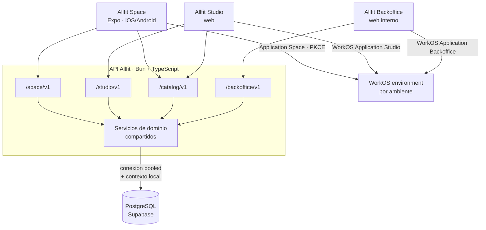

# Contratos de API de Space, Studio y Backoffice — V1

**Versión de revisión:** 8
**Fecha:** 17 de agosto de 2026
**Fase:** 3 — Definir operaciones, seguridad y contratos
**Estado:** contrato documental AFO-39 aprobado; OpenAPI, tipos generados e implementación pendientes del PR BACK
**Deriva de:** [`V1_OPERATIONS_MATRIX.md`](./V1_OPERATIONS_MATRIX.md), [`V1_RLS_MATRIX.md`](./V1_RLS_MATRIX.md), [`V1_RLS_PHYSICAL_TRACEABILITY_MATRIX.md`](./V1_RLS_PHYSICAL_TRACEABILITY_MATRIX.md), [`V1_OPENAPI_CONTRACT.md`](./V1_OPENAPI_CONTRACT.md) y [`V1_VERIFICATION_AND_BREAK_GLASS_GOVERNANCE.md`](./V1_VERIFICATION_AND_BREAK_GLASS_GOVERNANCE.md)

## 1. Propósito

Define qué expone la API a cada producto: superficies, convenciones, endpoints, el **field-set y la versión de scope** que cada proyección exige, las funciones SQL internas para comandos con varias escrituras atómicas, las vistas de contrato, los eventos del outbox y cómo se distribuyen los DTOs dentro del monorepo.

No define esquemas de columnas. La serialización ejecutable de la primera rebanada vertical está fijada antes del código en [`allfitone/packages/contracts/openapi/allfit-v1.openapi.yaml`](https://github.com/allfitone/allfitone/blob/main/packages/contracts/openapi/allfit-v1.openapi.yaml); este documento conserva el contexto funcional del contrato.

## 2. Arquitectura del contrato



### 2.1 Las cuatro superficies

| Superficie | Base | Sujeto | Documento OpenAPI |
| --- | --- | --- | --- |
| Space | `api.allfit.com/space/v1` | La persona autenticada | `allfit-v1.openapi.yaml` en la primera rebanada; `space-v1.yaml` al separar empaquetado |
| Studio | `api.allfit.com/studio/v1` | La organización en la que actúa el profesional | `allfit-v1.openapi.yaml` en la primera rebanada; `studio-v1.yaml` al separar empaquetado |
| Catálogo | `api.allfit.com/catalog/v1` | Ninguno: contenido global | Fuera de la primera rebanada; `catalog-v1.yaml` antes de su primer endpoint |
| Backoffice | `api.allfit.com/backoffice/v1` | Persona del equipo con rol base, AAL2 y deber temporal | Fuera de la primera rebanada; `backoffice-v1.yaml` antes de su primer endpoint |

La versión va **dentro** de cada superficie, no delante. Space, Studio y Backoffice son contratos separados que evolucionan por separado: Studio puede llegar a `v2` sin arrastrar a Space o Backoffice. Los cuatro documentos comparten `components` mediante referencias a un archivo común de esquemas.

Space y Studio **no** duplican endpoints. Comparten el 6% de su superficie —el catálogo— y ese 6% vive en su propio prefijo. El resto no coincide porque el sujeto es distinto:

| Concepto | Space | Studio |
| --- | --- | --- |
| Perfil | `GET /space/v1/profile` — el propio, completo | `GET /studio/v1/organizations/{orgId}/clients/{personId}/profile` — el de otra persona, proyectado por field-set |
| Ejecuciones | `GET /space/v1/executions` — las propias | `.../clients/{personId}/executions` — las autorizadas, con denegaciones aplicadas |
| Agenda | `GET /space/v1/agenda` — la propia | No existe: Studio consulta asignaciones, no agenda |

### 2.2 La organización viaja en la ruta

Toda operación de Studio que toque datos de una persona cuelga de `/organizations/{orgId}/`. Un profesional puede pertenecer a varias organizaciones y la fórmula de acceso exige evaluar membresía, relación, asignación y grant contra **una** organización concreta.

`{orgId}` no se resuelve desde el token ni desde una preferencia guardada. Está en la ruta, aparece en los logs y en el `ACCESS_EVENT`, y se valida contra una membresía vigente dentro de la transacción.

Las rutas personales `GET /studio/v1/me`, `GET /studio/v1/me/memberships` y `GET /studio/v1/entry-context`, el catálogo `GET /studio/v1/organization-types` y la activación propia mediante `/studio/v1/onboarding-attempts` no reciben una organización. `entry-context` y las rutas de onboarding aceptan una cuenta autenticada sin persona; el resto exige una persona activa.

## 3. Convenciones

### 3.1 Autenticación

- Space presenta `Authorization: Bearer <access_token>` de WorkOS AuthKit. Studio usa `cookieAuth` con una cookie de sesión opaca; sus rutas Organization/equipo nunca reciben el access token en el navegador. Backoffice usa su cookie AAL2 separada.
- La API verifica o refresca la credencial server-side y valida `iss`, `exp`, `iat`, `sub`, `sid` y **`client_id`**: una sesión o token emitidos para otra superficie no operan contra la ruta solicitada. Cambiar de producto exige la WorkOS Application correspondiente.
- El `sub` se resuelve a `ACCESS_ACCOUNT` y, si existe, a `PERSON`, **en la base**. Ningún identificador de dominio viaja en el token.
- Los claims `org_id`, `role` y `permissions` que WorkOS pueda transportar se ignoran para autorización de negocio. Organizaciones, roles, relaciones, consentimientos y deberes de plataforma viven en PostgreSQL (ADR-002 y ADR-028).
- Space usa Authorization Code con PKCE como cliente público y nunca contiene una API key o client secret de WorkOS.
- `auth_time` permite comprobar frescura de reautenticación, pero no basta para establecer AAL2. Sin evidencia verificable de MFA/step-up, cualquier operación AAL2 falla cerrada.

### 3.2 Formato

- JSON con nombres en **`snake_case`**, igual que el esquema. Un solo vocabulario desde la columna hasta la pantalla, sin capa de traducción donde se pierdan campos. El cliente TypeScript recibe tipos generados; el costo es que no es el idiomático de JS, y se acepta a cambio de que `body_progress_record` se llame igual en los cuatro lugares donde aparece.
- Instantes en RFC 3339 con offset (`2026-07-22T06:30:00-05:00`). Toda respuesta que represente un hecho incluye además `timezone` con la zona **de la persona** en ese momento.
- Fechas civiles sin hora en `YYYY-MM-DD`.
- Todo valor físico viaja como `{ "value": 82.5, "unit": "kg" }` con unidad canónica, más `original` cuando la captura usó otra. Nunca un número desnudo.
- `null` significa **no capturado**. Nunca se sustituye por `0`, y un campo redactado por falta de scope es indistinguible de uno no capturado.

### 3.3 Idempotencia

Todo `POST`, `PUT`, `PATCH` y `DELETE` exige:

```http
Idempotency-Key: <uuid-v4>
Command-Id: <uuid-v7>
```

`Idempotency-Key` identifica el replay de una operación HTTP. `Command-Id` identifica la intención de negocio y se genera al crear el borrador o acción, no al enviarla.

| Situación | Respuesta/efecto |
| --- | --- |
| Identidades nuevas | Se ejecuta una vez; outcome mínimo disponible 24 h |
| Key/command repetido, mismo hash | Replay mínimo; después de 24 h tampoco reejecuta |
| Key repetida, hash distinto | `409 idempotency-key-reuse` |
| Command repetido, hash distinto | `409 command-id-reuse` |
| Original aún ejecutándose | `409 idempotency-in-progress` + `Retry-After` |
| Efecto dispuesto | `410 command-effect-disposed` |
| Falta uno de los headers | `400 idempotency-key-required` o `400 command-id-required` |

Actor, WorkOS Application, superficie y operación se derivan en servidor. El contrato completo está en [`V1_IDEMPOTENCY_CONTRACT.md`](./V1_IDEMPOTENCY_CONTRACT.md).

### 3.4 Paginación

```http
GET /space/v1/executions?limit=25&cursor=eyJ2IjoxLCJzIjoi...
```

```json
{
  "data": [ ... ],
  "page": { "next_cursor": "eyJ2IjoyLCJzIjoi...", "has_more": true }
}
```

- Cursor opaco que codifica orden y filtros; cambiarlos invalida el cursor con `400` en lugar de devolver resultados incoherentes.
- `limit` por defecto 25, máximo 100.
- Orden siempre estable, con desempate por identificador.
- **No existe `total`** en colecciones sujetas a denegación de visibilidad: un contador es un canal lateral. Donde el total es seguro, se expone como `page.total`.

### 3.5 Errores

`application/problem+json` (RFC 9457).

```json
{
  "type": "https://errors.allfit.com/scope-required",
  "title": "El consentimiento requerido no está vigente",
  "status": 403,
  "detail": "Esta proyección requiere body_progress con nivel read.",
  "instance": "/studio/v1/organizations/8f2.../clients/a91.../body-progress",
  "request_id": "01J...",
  "required_scope": { "code": "body_progress", "level": "read" }
}
```

| Tipo | HTTP | Cuándo |
| --- | --- | --- |
| `unauthenticated` | 401 | Token ausente, inválido o expirado |
| `wrong-surface` | 403 | El `client_id` del token no corresponde a la superficie |
| `forbidden` | 403 | El actor no puede ejecutar la operación |
| `scope-required` | 403 | Falta un grant vigente. Declara **qué** scope y nivel hacen falta |
| `not-found` | 404 | El recurso no existe **o** no es visible para el actor |
| `precondition-required` | 428 | Falta el `If-Match` obligatorio para una escritura con revisión |
| `precondition-failed` | 412 | Estado incompatible: relación terminada, versión no publicada |
| `conflict` | 409 | Escritura concurrente perdida; versión optimista |
| `integrity-conflict` | 409 | Los IDs visibles o una transición gobernada no cumplen `IX-01..45`; nunca revela cuál ID ajeno existe |
| `idempotency-key-required` | 400 | Falta la identidad de replay en un comando HTTP |
| `command-id-required` | 400 | Falta la identidad durable en un comando HTTP |
| `idempotency-key-reuse` | 409 | Misma clave, cuerpo distinto |
| `command-id-reuse` | 409 | Mismo command ID, cuerpo distinto |
| `idempotency-in-progress` | 409 | El mismo comando continúa bajo otra transacción; incluye `Retry-After` |
| `stale-draft` | 409 | `If-Match`/revisión base quedó detrás del estado confirmado |
| `command-effect-disposed` | 410 | El comando ya se aplicó pero su efecto fue dispuesto; nunca se recrea |
| `validation-failed` | 422 | Cuerpo mal formado o inválido |
| `contract-validation-failed` | 422 | La ejecución no cumple el contrato de resultados. Incluye errores **tipados** por regla |
| `rate-limited` | 429 | Cuota del WorkOS Application, perímetro o dominio; siempre incluye `Retry-After` |
| `service-degraded` | 503 | Dependencia caída; la operación falla cerrada |

Tres reglas que no se negocian:

1. **`404` cubre a `403` cuando distinguirlos revelaría existencia.** Un coach que pide una persona con la que no tiene relación recibe `404`, no "existe pero no puedes". `scope-required` sí es explícito: el profesional necesita saber qué pedirle a la persona, y saberlo no revela que haya datos.
2. Un fallo de FK compuesta o trigger `IX-*` se registra internamente con constraint e ID de invariante, pero la respuesta pública usa `integrity-conflict` sin identificadores o detalles de otro tenant.
3. **`contract-validation-failed` sí es detallado.** La persona debe poder corregir su registro: "falta cantidad lograda en el set 3" es información suya sobre sus propios datos.

### 3.6 Versionado y deprecación

- Cambio incompatible → nueva versión de **esa** superficie.
- Añadir un campo opcional o un endpoint no rompe: no genera versión.
- Un endpoint deprecado responde `Deprecation` y `Sunset` durante al menos dos ciclos antes de retirarse.
- **Ampliar un field-set nunca es un cambio de versión de API**: es una nueva versión de `SCOPE_DEFINITION` que exige aceptación de cada persona. Son dos ejes distintos y no se mezclan.

### 3.7 Autoridad OpenAPI y gate de implementación

[`allfitone/packages/contracts/openapi/allfit-v1.openapi.yaml`](https://github.com/allfitone/allfitone/blob/main/packages/contracts/openapi/allfit-v1.openapi.yaml) es la fuente canónica de rutas, DTOs, ejemplos y caché para las operaciones HTTP implementadas de la primera rebanada vertical ampliada. [`V1_OPENAPI_CONTRACT.md`](./V1_OPENAPI_CONTRACT.md) registra su alcance y sus pruebas contractuales.

Un endpoint estable de producto listado más adelante pero ausente del YAML todavía es **diseño**, no una superficie implementable. Debe incorporarse contract-first con su `x-allfit-operation` antes de crear el handler.

Las únicas rutas que pueden existir fuera de `paths` son excepciones operacionales o provisionales declaradas en `x-allfit-contract-gate.exclusions`. No son contratos para Space, Studio ni Backoffice. El gate compara esa lista y las operaciones estables con `createApp().routes`: falla tanto por una ruta no declarada como por una exclusión cuya implementación desapareció. Las exclusiones vigentes son `GET /health`, de carácter operacional permanente, y el bootstrap provisional `GET /studio/v1/auth/start` + `GET /studio/v1/auth/callback`, que debe retirarse de exclusiones al definir el contrato real de sesión Studio.

## 4. Contrato de Space

Sujeto implícito: la persona autenticada. Ningún endpoint recibe un `person_id`.

### 4.1 Onboarding e identidad

| Método | Ruta | Operación | Notas |
| --- | --- | --- | --- |
| `POST` | `/onboarding-attempts` | `OP-IDN-001` | Actor sin persona todavía |
| `POST` | `/onboarding-attempts/{id}/eligibility-evidence` | `OP-IDN-002` | |
| `POST` | `/onboarding-attempts/{id}/completion` | `OP-IDN-003` | Único camino que crea una `PERSON` |
| `GET` | `/me` | `OP-IDN-012` | |
| `GET` | `/profile` | `OP-IDN-013` | Proyección propia, completa |
| `POST` | `/profile/claims` | `OP-IDN-004` | |
| `POST` | `/profile/claims/{id}/revisions` | `OP-IDN-005` | Append-only |
| `GET` | `/profile/attributes/{code}/claims` | `OP-IDN-014` | Afirmaciones coexistentes con procedencia |
| `GET` | `/body-progress` | `OP-IDN-015` | |
| `POST` | `/body-progress` | `OP-IDN-006` | Despoja EXIF en el servidor |
| `DELETE` | `/body-progress/{id}` | `OP-IDN-007` | Abre un caso de disposición |
| `POST` | `/health-context` | `OP-IDN-008` | |

### 4.2 Invitaciones y relaciones

| Método | Ruta | Operación | Notas |
| --- | --- | --- | --- |
| `POST` | `/invitations/resolve` | `OP-IDN-016` | Solo invitaciones de cliente; token en cuerpo, accesible sin persona |
| `POST` | `/invitations/decisions` | `OP-IDN-009` | Solo cliente; token y decisión **por intención** en cuerpo |
| `GET` | `/relationships` | `OP-REL-012` | Incluye cerradas y su enlace anterior |
| `GET` | `/relationships/{id}/events` | `OP-REL-014` | |
| `POST` | `/relationships/{id}/termination` | `OP-REL-007` | Efecto inmediato |
| `GET` | `/relationships/{relId}/substitutions` | `OP-REL-013` | |
| `POST` | `/relationships/{relId}/substitutions/{id}/decision` | `OP-REL-005` | Sin esto, el suplente no lee nada |
| `POST` | `/relationships/{relId}/substitutions/{id}/termination` | `OP-REL-006` | |

### 4.3 Consentimiento y privacidad

| Método | Ruta | Operación | Notas |
| --- | --- | --- | --- |
| `POST` | `/client-invitations/resolve` | `OP-REL-015` | Qué pide la invitación: cada scope con su finalidad, nivel y contrato. **No resuelve de forma anónima**, a diferencia de las de equipo: devuelve categorías de datos de salud, así que exige que el correo verificado sea el contacto invitado |
| `GET` | `/client-invitations` | `OP-IDN-056` | Las invitaciones pendientes y vigentes dirigidas a su correo verificado, con quién invita. Admite una cuenta que todavía se registra |
| `GET` | `/client-invitations/{invitationId}` | `OP-REL-015` | Lo mismo que `resolve`, por identificador y con la misma prueba del correo verificado |
| `POST` | `/client-invitations/decisions` | `OP-IDN-009` | Decide la relación y cada scope en una sola llamada. Un scope omitido cuenta como rechazado. Nombra la invitación por `token` o por `invitation_id`, exactamente uno |
| `GET` | `/consents` | `OP-PRV-013` | Panel de control del consentimiento: por relación y scope, su respuesta y, si aceptó, el estado del grant (`active`, `frozen` o `revoked`). Implementado en `TECH-29` |
| `POST` | `/consents/{id}/revocation` | `OP-PRV-005` | Solo ese grant, `active` o `frozen`; nunca se reabre. Implementado en `TECH-29`: no hay proyecciones ni cachés sobre grants que invalidar, y cada lector comprueba el estado en la misma sentencia |
| `GET` | `/visibility-denials` | `OP-PRV-017` | |
| `PUT` | `/executions/{id}/visibility` | `OP-PRV-006` | Ocultar por relación |
| `DELETE` | `/executions/{id}/visibility/{relId}` | `OP-PRV-007` | |
| `GET` | `/access-events` | `OP-PRV-015` | Quién leyó qué y cuándo |
| `POST` | `/erasure-requests` | `OP-PRV-008` | |
| `GET` | `/erasure-requests/{id}` | `OP-PRV-016` | Resolución por categoría |

### 4.4 Planificación y agenda

| Método | Ruta | Operación | Notas |
| --- | --- | --- | --- |
| `GET` | `/agenda?from=&to=` | `OP-PLN-016` | Zona horaria de la persona |
| `GET` | `/assignments` · `/assignments/{id}` | `OP-PLN-017` | |
| `GET` | `/assignments/{id}/program-version` | `OP-PLN-021` | La versión congelada |
| `POST` | `/assignments` | `OP-PLN-011` | Autoasignación |
| `POST` | `/assignments/{id}/continuation` | `OP-PLN-015` | Tras el desacople |
| `POST` | `/session-templates` · `PUT .../draft` · `POST .../versions` | `OP-PLN-001/002/003` | Contenido personal |
| `POST` | `/session-templates/{id}/versions/{v}/derivation` · `/deprecation` | `OP-PLN-004` · `OP-PLN-005` | Contenido personal |
| `GET` · `POST` | `/programs` | `OP-PLN-020` · `OP-PLN-006` | Programa personal; `planning.programs.owner_person_id` |
| `PUT` | `/programs/{id}/draft` | `OP-PLN-007` | |
| `POST` | `/programs/{id}/versions` · `/versions/{v}/deprecation` | `OP-PLN-008` · `OP-PLN-009` | Sin esto, `OP-PLN-011` no tiene contenido propio que asignar |
| `GET` | `/session-templates` | `OP-PLN-019` | Contenido propio, borradores y versiones |

### 4.5 Ejecución

| Método | Ruta | Operación | Notas |
| --- | --- | --- | --- |
| `POST` | `/planned-sessions/{id}/attempts` | `OP-EXE-001` | Numeración monotónica |
| `POST` | `/executions` | `OP-EXE-004` | Sesión espontánea |
| `POST` | `/executions/{id}/resumption` | `OP-EXE-002` | **No** crea otro intento |
| `POST` | `/executions/{id}/abandonment` | `OP-EXE-003` | |
| `PUT` | `/executions/{id}/results` | `OP-EXE-005` | Borrador incremental |
| `POST` | `/executions/{id}/finalize` | `OP-EXE-006` | Transaccional e idempotente |
| `POST` | `/executions/{id}/revisions` | `OP-EXE-007` | |
| `POST` | `/executions/{id}/invalidation` | `OP-EXE-009` | |
| `PUT` | `/planned-sessions/{id}/primary-execution` | `OP-EXE-008` | Solo la persona |
| `GET` | `/executions` · `/executions/{id}` | `OP-EXE-014/015` | |
| `GET` | `/progress` | `OP-EXE-016` | Derivados con algoritmo y versión |
| `GET` | `/correction-proposals` | `OP-EXE-020` | |
| `POST` | `/correction-proposals/{id}/decision` | `OP-EXE-013` | |

### 4.6 Nutrición

| Método | Ruta | Operación | Notas |
| --- | --- | --- | --- |
| `POST` · `GET` | `/nutrition/meals` | `OP-NUT-001/002` | Creación offline idempotente y listado personal |
| `PATCH` · `DELETE` | `/nutrition/meals/{mealId}` | `OP-NUT-003/004` | `If-Match`; foto saneada diferida; disposición |
| `GET` | `/nutrition/daily-summaries` | `OP-NUT-005` | Rango máximo 31 días; `NULL` no es cero |
| `GET` | `/nutrition/goals` | `OP-NUT-006` | Activa, pendientes y decisiones |
| `POST` | `/nutrition/goals/versions` | `OP-NUT-007` | Versión personal activa inmediatamente |
| `POST` | `/nutrition/goal-versions/{goalVersionId}/decision` | `OP-NUT-008` | Solo la persona; una decisión |

### 4.6 Planes y pagos

| Método | Ruta | Operación | Notas |
| --- | --- | --- | --- |
| `GET` | `/organizations/{orgId}/plans` | `OP-PAY-011` | Solo con relación vigente; no es catálogo público |
| `POST` | `/subscriptions` | `OP-PAY-012` | Los datos de tarjeta van directo a la pasarela de la organización |
| `GET` | `/subscriptions` | `OP-PAY-013` | Estado, versión congelada y próximo corte |
| `GET` | `/subscriptions/{id}/payments` | `OP-PAY-014` | |
| `POST` | `/subscriptions/{id}/cancellation` | `OP-PAY-015` | No termina la relación ni revoca permisos |

## 5. Contrato de Studio

Sujeto: la cuenta o persona autenticada en las rutas personales y de onboarding; la organización explícita de la ruta para toda operación organizacional.

### 5.1 Identidad profesional y organización

| Método | Ruta | Operación |
| --- | --- | --- |
| `POST` | `/onboarding-attempts` | `OP-IDN-001` |
| `POST` | `/onboarding-attempts/{id}/eligibility-evidence` | `OP-IDN-002` |
| `POST` | `/onboarding-attempts/{id}/completion` | `OP-IDN-003` |
| `GET` | `/me` | `OP-IDN-017` |
| `PUT` | `/me/professional-profile` | `OP-IDN-010` |
| `POST` | `/me/professional-credentials` | `OP-IDN-029` |
| `POST` | `/me/professional-credentials/{credentialId}/revisions` | `OP-IDN-030` |
| `POST` | `/me/professional-credentials/{credentialId}/retirement` | `OP-IDN-031` |
| `GET` | `/entry-context` | `OP-ORG-020` |
| `GET` | `/me/memberships` | `OP-ORG-014` |
| `GET` | `/organization-types` | `OP-ORG-019` |
| `POST` | `/organizations` | `OP-ORG-001` |
| `GET` · `PATCH` | `/organizations/{orgId}` | `OP-ORG-013` · `OP-ORG-002` |
| `POST` · `PATCH` | `/organizations/{orgId}/sites[/{siteId}]` | `OP-ORG-003` · `OP-ORG-004` |
| `POST` | `/organizations/{orgId}/closure` | `OP-ORG-012` |
| `GET` | `/organizations/{orgId}/roles` | `OP-ORG-017` |

`GET /studio/v1/entry-context` devuelve el siguiente contrato cerrado:

```ts
interface StudioEntryContext {
  authenticated: true
  registration_status: 'complete' | 'incomplete'
  identity: {
    name: string | null
    email: string | null
  }
  memberships: StudioMembership[]
}
```

Resuelve la sesión una sola vez. Para `complete`, consulta las membresías una sola
vez; para `incomplete`, devuelve `memberships: []`. Siempre responde
`Cache-Control: private, no-store`, no expone tokens ni identificadores internos
de cuenta o persona y conserva los errores `401`, `403` y `503` de las rutas de
sesión existentes.

### 5.2 Organización, staff y membresías

| Método | Ruta | Operación | Notas |
| --- | --- | --- | --- |
| `GET` · `PATCH` | `/organizations/{orgId}` | `OP-ORG-013` · `OP-ORG-002` | GET devuelve ETag; PATCH cerrado con `If-Match` |
| `POST` | `/organizations/{orgId}/sites` | `OP-ORG-003` | Devuelve ETag fuerte de sede |
| `PATCH` | `/organizations/{orgId}/sites/{siteId}` | `OP-ORG-004` | `If-Match`; editar o desactivar |
| `POST` | `/organizations/{orgId}/ownership-transfers` | `OP-ORG-011` | Solo owner; destino con membresía activa |
| `POST` | `/organizations/{orgId}/closure` | `OP-ORG-012` | Solo owner; cierre interdominio atómico |
| `POST` | `/invitations/resolve` | `OP-IDN-016` | Público; token solo en cuerpo; nunca devuelve el email |
| `POST` | `/invitations/decisions` | `OP-IDN-009` | Autenticado; email verificado exacto; headers de comando |
| `GET` | `/organizations/{orgId}/memberships` | `OP-ORG-015` |
| `POST` · `DELETE` | `/organizations/{orgId}/memberships/{id}/roles[/{roleCode}]` | `OP-ORG-007` · `OP-ORG-008` |
| `POST` | `/organizations/{orgId}/memberships/{id}/termination` | `OP-ORG-009` |
| `POST` | `/organizations/{orgId}/me/membership/resignation` | `OP-ORG-010` |
| `GET` · `POST` | `/organizations/{orgId}/invitations` | `OP-ORG-016` · `OP-ORG-005` | Listar y emitir exclusivamente invitaciones de equipo |
| `POST` | `/organizations/{orgId}/invitations/{id}/revocation` | `OP-ORG-006` | Idempotente; serializa contra aceptación |

Todo el gate de Organización/equipo usa exclusivamente `cookieAuth` de Studio.
Las mutaciones exigen `Cookie: allfit_studio_session=<opaque>`, `Origin` exacto,
`Idempotency-Key` y `Command-Id`; nunca aceptan bearer ni una identidad de actor
en body o headers libres. Un recurso de otra organización y uno inexistente
producen el mismo `404 not-found` sin confirmar IDs, membresías o roles.

`GET /organizations/{orgId}` incluye `revision_number` y devuelve el ETag fuerte
`"organization:{id}:r{revision}"`. Su `PATCH` acepta exclusivamente
`display_name`, `legal_name` y `type_code`; `responsible_party`, `id`, `status`,
timestamps, `purpose` y `responsible_party_schema_version` no son campos de
autoservicio. `type_code` solo cambia por una transición activa del catálogo
`organization_type_transitions`, inicialmente `professional_practice → gym` o
`professional_practice → studio`.

Toda respuesta de sede incluye `revision_number` y
`ETag: "organization-site:{id}:r{revision}"`. Tanto el `PATCH` de organización
como el de sede exigen ese ETag en `If-Match`: si falta responden
`428 precondition-required`; si quedó atrás, `409 stale-draft`. Un éxito
incrementa la revisión y devuelve el nuevo ETag.

#### Proyección de organización

`OP-ORG-013` devuelve únicamente este contrato cerrado, con
`Cache-Control: private, no-store`:

```json
{
  "id": "019a...",
  "display_name": "Studio Norte",
  "legal_name": "Studio Norte SAS",
  "type_code": "studio",
  "status": "active",
  "revision_number": 4,
  "sites": [
    {
      "id": "019d...",
      "name": "Sede Centro",
      "address": "Carrera 7 # 10-20",
      "status": "active",
      "revision_number": 2
    }
  ]
}
```

No serializa `responsible_party`, `purpose`, schema version, identificadores
legales ni contacto; `legal_name` y una `sites[].address` domiciliaria pueden
clasificarse como `identity_pii`. La API
resuelve la cuenta/persona, fija contexto transaccional, consulta la proyección y
registra `ACCESS_EVENT` con sujeto organización, modo `organization_operational`
y recurso `organizations.organization_context` antes de devolver contenido,
todo en una transacción. Si la auditoría falla, la lectura falla cerrada. La respuesta incluye el ETag fuerte
de la organización; otro tenant recibe el mismo `404` que un ID inexistente.

#### Gestión de roles y salida del equipo

Los requests y responses de `OP-ORG-007..010` son cerrados:

```http
POST /studio/v1/organizations/{orgId}/memberships/{membershipId}/roles
Cookie: allfit_studio_session=<opaque>
Origin: https://studio.allfit.one
Idempotency-Key: <uuid-v4>
Command-Id: <uuid-v7>
Content-Type: application/json

{ "role_code": "coach" }
```

```json
{ "membership_id": "019c...", "role_code": "coach", "valid_from": "2026-08-17T10:30:00-05:00" }
```

`role_code` admite solo `admin`, `coach` o `staff`. `OP-ORG-007` conserva un
receipt durable: repetir el command después de revocar el rol o expirar el TTL
devuelve el resultado original y nunca reabre la vigencia.

```http
DELETE /studio/v1/organizations/{orgId}/memberships/{membershipId}/roles/{roleCode}
Cookie: allfit_studio_session=<opaque>
Origin: https://studio.allfit.one
Idempotency-Key: <uuid-v4>
Command-Id: <uuid-v7>
```

```json
{ "membership_id": "019c...", "role_code": "coach", "valid_to": "2026-08-17T10:35:00-05:00" }
```

Solo retirar `coach` llama el contrato que cierra asignaciones; retirar `admin`
o `staff` preserva asignaciones si `coach` continúa vigente.

```http
POST /studio/v1/organizations/{orgId}/memberships/{membershipId}/termination
Cookie: allfit_studio_session=<opaque>
Origin: https://studio.allfit.one
Idempotency-Key: <uuid-v4>
Command-Id: <uuid-v7>
```

```json
{ "membership_id": "019c...", "ended_at": "2026-08-17T10:40:00-05:00" }
```

```http
POST /studio/v1/organizations/{orgId}/me/membership/resignation
Cookie: allfit_studio_session=<opaque>
Origin: https://studio.allfit.one
Idempotency-Key: <uuid-v4>
Command-Id: <uuid-v7>
```

```json
{ "membership_id": "019c...", "ended_at": "2026-08-17T10:45:00-05:00" }
```

Terminar o renunciar cierra asignaciones incondicionalmente. La renuncia está
disponible para cualquier membresía propia activa no-owner, aunque no conserve
roles. Además de los errores comunes: actor sin autoridad responde `403`, ID
ajeno/invisible `404`, `owner` o role code inválido `422`, y una carrera que
cambió el estado `409`; ninguna respuesta revela cuál ID ajeno existe.

#### Transferencia de propiedad

```http
POST /studio/v1/organizations/{orgId}/ownership-transfers
Cookie: allfit_studio_session=<opaque>
Origin: https://studio.allfit.one
Idempotency-Key: <uuid-v4>
Command-Id: <uuid-v7>
Content-Type: application/json
```

```json
{ "target_membership_id": "019c..." }
```

```json
{
  "organization_id": "019a...",
  "owner_membership_id": "019c...",
  "previous_owner_membership_id": "019b...",
  "transferred_at": "2026-08-17T10:30:00-05:00"
}
```

Solo la membresía `owner` vigente puede ejecutar el comando. El destino debe ser
otra membresía activa de la misma organización. La función bloquea organización,
ambas membresías y sus roles, intercambia el rol `owner` en una transacción y
emite `organization.ownership_transferred.v1`. El owner anterior conserva su
membresía y roles no `owner`; si no tiene otro rol, queda sin capacidades y no
recibe un rol implícito.

Además de los errores comunes, responde `403 forbidden` si el actor no es owner,
`404 not-found` si el destino no es visible en la organización, `409 conflict`
si una transferencia concurrente cambió el owner, y `422 validation-failed` si
el destino no está activo o coincide con el owner actual. Cualquier imposibilidad
de confirmar exactamente un owner revierte el comando completo.

Las cuatro rutas de invitaciones de equipo pertenecen a `/studio/v1`. Usan
CORS de origen exacto, `Cache-Control: no-store` y
`Referrer-Policy: no-referrer`. Inválida, vencida, revocada y consumida son el
mismo `404`. El token nunca aparece en path o query string. La emisión puede
cerrarse mediante gate sin retirar resolución, decisión, listado, revocación o
expiración.

### 5.3 Clientes, relaciones y consentimiento

| Método | Ruta | Operación | Scope exigido |
| --- | --- | --- | --- |
| `GET` | `/organizations/{orgId}/clients` | `OP-REL-010` | **Ninguno** — directorio sin datos fitness |
| `POST` | `/organizations/{orgId}/client-invitations` | `OP-REL-001` | Ninguno — ofrecer no es conceder |
| `GET` | `/organizations/{orgId}/relationships/{id}` | `OP-REL-011` | Ninguno — estado, no contenido |
| `GET` | `/organizations/{orgId}/relationships/{id}/events` | `OP-REL-014` | Ninguno |
| `POST` | `/organizations/{orgId}/relationships/{relId}/professional-assignments` | `OP-REL-002` | Ninguno |
| `POST` | `.../professional-assignments/reassignment` | `OP-REL-003` | Ninguno |
| `POST` | `.../substitutions` | `OP-REL-004` | Ninguno |
| `POST` | `/organizations/{orgId}/relationships/{id}/termination` | `OP-REL-008` | Ninguno |
| `POST` | `/organizations/{orgId}/relationships/{id}/termination-requests` | `OP-REL-009` | Ninguno |
| `GET` | `/organizations/{orgId}/grants` | `OP-PRV-014` | Ninguno — estado del consentimiento |
| `POST` | `/organizations/{orgId}/historical-access-cases` | `OP-PRV-018` | `manage_historical_access`; no concede lectura |
| `POST` | `/organizations/{orgId}/historical-access-cases/{caseId}/closure` | `OP-PRV-019` | `manage_historical_access`; no concede lectura |

Que ninguna de estas operaciones exija scope es deliberado: **gestionar la relación no es acceder a los datos.** Un `admin` administra clientes sin ver un solo registro fitness.

### 5.4 Datos de clientes

Todas exigen la fórmula completa y escriben `ACCESS_EVENT`.

| Método | Ruta | Operación | Scope · nivel |
| --- | --- | --- | --- |
| `GET` | `/organizations/{orgId}/clients/{personId}/profile` | `OP-IDN-018` | `relationship_training` · `read` |
| `GET` | `.../clients/{personId}/body-progress` | `OP-IDN-019` | `body_progress` · `read` |
| `GET` | `.../clients/{personId}/health-context` | `OP-IDN-020` | `health_context` · `read` |
| `GET` | `.../clients/{personId}/executions` | `OP-EXE-017` | `relationship_training` y/o `prior_training_history` · `read` |
| `GET` | `.../clients/{personId}/executions/{id}` | `OP-EXE-018` | Igual, evaluado por ejecución |
| `GET` | `.../clients/{personId}/progress` | `OP-EXE-019` | El más restrictivo de sus inputs |
| `POST` | `.../clients/{personId}/observations` | `OP-EXE-010` | Scope del contenido · `contribute` |
| `POST` | `.../observations/{id}/revisions` | `OP-EXE-011` | `contribute` + autoría propia |
| `POST` | `.../clients/{personId}/correction-proposals` | `OP-EXE-012` | `contribute` |
| `GET` | `/organizations/{orgId}/correction-proposals` | `OP-EXE-020` | `contribute` |

### 5.8 Planes y pagos

| Método | Ruta | Operación | Capacidad |
| --- | --- | --- | --- |
| `POST` | `/organizations/{orgId}/payment-gateway` | `OP-PAY-001` | `manage_billing`, solo `owner` |
| `POST` · `PUT` | `/organizations/{orgId}/plans[/{id}/draft]` | `OP-PAY-002` · `OP-PAY-003` | `manage_billing` |
| `POST` | `.../plans/{id}/versions` | `OP-PAY-004` | `manage_billing` |
| `POST` | `.../plans/{id}/versions/{v}/deprecation` | `OP-PAY-005` | `manage_billing` |
| `GET` | `/organizations/{orgId}/plans` | `OP-PAY-006` | Membresía vigente |
| `GET` | `/organizations/{orgId}/subscriptions` | `OP-PAY-007` | `manage_billing` |
| `POST` | `.../subscriptions/{id}/suspension` · `/reactivation` | `OP-PAY-008` · `OP-PAY-009` | `manage_billing` |
| `POST` | `.../subscriptions/{id}/termination` | `OP-PAY-010` | `manage_billing` |

Ninguna de estas rutas exige scope: **el estado de pago no es un dato fitness**.
Y ninguna la puede ejercer un `coach`: `manage_billing` se asigna solo a
`owner` y `admin`.

`/reactivation` cierra únicamente el `service_access_block` abierto cuya fuente
es esa suscripción. La respuesta se calcula después del lock con grants,
relación, membresía, asignación, sesiones y demás bloqueos vigentes; el comando
no acepta ni devuelve un snapshot que pueda restaurarse.

Si la suscripción terminó, no existe el bloqueo exacto o la transición compite
con un cambio incompatible, responde conflicto y el cliente debe releer. Un
éxito nunca implica que todo “volvió a como estaba”: solo confirma que esa causa
comercial dejó de bloquear.

### 5.5 Datos históricos restringidos

Estas rutas no forman parte del CRM operativo y nunca se mezclan con `/clients`.

| Método | Ruta | Operación | Requisitos |
| --- | --- | --- | --- |
| `GET` | `/organizations/{orgId}/historical-relationships/{relationshipId}` | `OP-PRV-020` | `X-Historical-Access-Case`, MFA/AAL2 y `access_control.can_read_frozen` |
| `GET` | `.../historical-relationships/{relationshipId}/executions` | `OP-PRV-020` | Igual; cursor sin total inseguro |
| `GET` | `.../historical-relationships/{relationshipId}/executions/{id}` | `OP-PRV-020` | Igual; field-set histórico por campo |
| `GET` | `.../historical-relationships/{relationshipId}/body-progress` | `OP-PRV-020` | Solo medidas estructuradas marcadas `historical_readable` |

`health-context`, perfil actual, fotos, archivos, EXIF, escritura y exportación masiva no tienen ruta histórica V1.

El header `X-Historical-Access-Case` contiene un UUID opaco. El backend lo valida contra la organización, relación, membresía humana, propósito y expiración; no confía en datos del cliente para establecer esos valores. Toda respuesta incluye:

```json
{
  "relationship_id": "uuid",
  "frozen_at": "2026-07-23T15:00:00Z",
  "case_id": "uuid",
  "purpose": "service_dispute",
  "applied_scopes": [
    { "code": "relationship_training", "version": 1 }
  ],
  "data": {}
}
```

`data` se construye desde proyecciones históricas por recurso. La ausencia de una fila o campo no distingue entre no capturado, denegado, no histórico, revocado o inexistente.

### 5.6 Contenido y asignación

| Método | Ruta | Operación |
| --- | --- | --- |
| `GET` · `POST` | `/organizations/{orgId}/session-templates` | `OP-PLN-019` · `OP-PLN-001` |
| `PUT` | `.../session-templates/{id}/draft` | `OP-PLN-002` |
| `POST` | `.../session-templates/{id}/versions` | `OP-PLN-003` |
| `POST` | `.../versions/{v}/derivation` · `/deprecation` | `OP-PLN-004` · `OP-PLN-005` |
| `GET` · `POST` | `/organizations/{orgId}/programs` | `OP-PLN-020` · `OP-PLN-006` |
| `PUT` | `.../programs/{id}/draft` | `OP-PLN-007` |
| `POST` | `.../programs/{id}/versions` · `/versions/{v}/deprecation` | `OP-PLN-008` · `OP-PLN-009` |
| `POST` | `.../relationships/{relId}/assignments` | `OP-PLN-010` |
| `GET` | `.../relationships/{relId}/assignments` | `OP-PLN-018` |
| `PATCH` | `/organizations/{orgId}/planned-sessions/{id}` | `OP-PLN-012` |
| `POST` | `/organizations/{orgId}/assignments/{id}/prescription-revisions` | `OP-PLN-013` |
| `POST` | `/organizations/{orgId}/assignments/{id}/cancellation` | `OP-PLN-014` |
| `POST` · `PATCH` | `/organizations/{orgId}/movements[/{id}]` | `OP-CAT-001` · `OP-CAT-002` |
| `POST` | `.../movements/{id}/archival` | `OP-CAT-003` |

### 5.7 Plataforma y soporte

| Método | Ruta | Operación |
| --- | --- | --- |
| `POST` | `/scope-definitions/{code}/versions` | `OP-PRV-011` |
| `POST` | `/result-contracts` · `/result-contracts/{id}/deprecation` | `OP-CAT-006` |
| `POST` | `/verifications` | `OP-IDN-011` |
| `POST` | `/platform/role-assignments[/{id}/revocation]` | `OP-SUP-007` |
| `GET` | `/platform/role-assignments` | `OP-SUP-008` |
| `GET` | `/platform/access-events` | `OP-SUP-009` |
| `POST` | `/legal-holds` · `/legal-holds/{id}/release` | `OP-PRV-009` · `OP-PRV-010` |

El backend resuelve deber, vigencia y AAL2 desde la autorización interna; el cliente no puede declararlos. `A11/verify_professional_credentials` solo verifica credenciales por registro oficial o confirmación del emisor. `A10/request_break_glass` crea, ejerce y cierra únicamente su expediente; `A12/approve_break_glass` aporta el quorum y `A12/audit_break_glass`, si no aprobó el caso, registra la revisión posterior.

El request break-glass declara propósito cerrado, `case_reference`, sujeto, categorías y duración. `relationship_training`/`prior_training_history`/`nutrition_guidance` son estándar: un A12 y máximo 30 minutos. `body_progress`/`health_context`/`nutrition_intake` son restringidas: dos A12 distintos y máximo 15 minutos. Una solicitud mixta con intake hereda el nivel restringido; `nutrition_media`, identidad, contacto, secretos, pagos, raw, documentos y notas privadas no son aprobables. El ejercicio usa proyecciones cerradas, revalida la categoría en cada lectura y registra `break_glass_event` y `ACCESS_EVENT` antes de devolver contenido. Nunca concede DML, exportación ni acceso a `OP-NUT-013`, storage, `media_ref`, URLs o bytes.

### 5.8 Nutrición

| Método | Ruta | Operación | Scope · nivel |
| --- | --- | --- | --- |
| `GET` | `/organizations/{orgId}/clients/{personId}/nutrition/meals` | `OP-NUT-009` | `nutrition_intake/read`; foto además `nutrition_media/read` |
| `GET` | `.../nutrition/meals/{mealId}/photo` | `OP-NUT-013` | `nutrition_intake/read` + `nutrition_media/read`, reevaluados por petición |
| `GET` | `.../nutrition/daily-summaries` | `OP-NUT-010` | `nutrition_intake/read` |
| `GET` | `.../nutrition/goals/versions` | `OP-NUT-011` | `nutrition_guidance/read`; soporta proyección frozen minimizada |
| `POST` | `.../nutrition/goals/versions` | `OP-NUT-012` | `nutrition_guidance/contribute` + `guide_nutrition` + credencial verificada |

Las cinco operaciones Studio exigen además relación/asignación/membresía efectivas y organización coincidente. Ninguna permite escribir comidas, decidir propuestas o devolver `media_ref`. OP-NUT-013 registra un `ACCESS_EVENT`, transmite el objeto saneado desde el backend, nunca redirige a storage y devuelve el mismo `404` sin bytes ante inexistencia o autorización no efectiva.

## 6. Contrato de Catálogo

| Método | Ruta | Operación | Cacheable |
| --- | --- | --- | --- |
| `GET` | `/disciplines` | `OP-CAT-007` | Sí, con `ETag` |
| `GET` | `/studio/v1/professional-specialties` | `OP-CAT-013` | Sí, con `ETag` |
| `GET` | `/studio/v1/professional-credential-types` | `OP-CAT-014` | Sí, con `ETag` |
| `GET` | `/activity-types` | `OP-CAT-008` | Sí |
| `GET` | `/activity-types/{id}/result-contracts` | `OP-CAT-012` | Sí |
| `GET` | `/movements?discipline=&q=` | `OP-CAT-009` | Solo el subconjunto global |
| `GET` | `/movements/{id}` | `OP-CAT-010` | Sí |
| `GET` | `/equipment` | `OP-CAT-011` | Sí |
| `GET` | `/scope-definitions` | `OP-PRV-012` | Sí, inmutable |

Space precarga disciplinas, tipos de actividad, contratos y el subconjunto global de movimientos: sin ellos no puede validar localmente un borrador antes de sincronizar. Los movimientos **privados** de una organización nunca se sirven desde `/catalog`; se piden a `/studio/v1/organizations/{orgId}/movements`.

## 7. Field-sets y versión de scope por proyección

Es el requisito central de la Fase 3: *"field-set y versión de scope requeridos por cada endpoint/proyección"*.

Cada proyección de Studio declara qué `SCOPE_DEFINITION` consume y en qué versión. **La versión que se aplica no es la última publicada: es la congelada en el grant de esa relación.** Dos coaches de organizaciones distintas pueden recibir field-sets distintos de la misma persona porque sus grants congelaron versiones distintas.

| Proyección | Scope · nivel | Field-set v1 | Excluido explícitamente |
| --- | --- | --- | --- |
| `identity.v_client_identity` | Ninguno | Nombre de presentación, identificador de relación, estado | Contacto, `sub` de WorkOS AuthKit, fecha de nacimiento, elegibilidad |
| `identity.v_client_profile` | `relationship_training` · `read` | Atributos de entrenamiento con procedencia, autor capturador, método y estado de verificación | Cualquier atributo clasificado como corporal o de salud |
| `identity.v_client_body_progress` | `body_progress` · `read` | Mediciones y composición seleccionadas, con unidad canónica y original; fotos **elegidas**, por URL firmada de vigencia corta | EXIF, geolocalización, galería no seleccionada, cualquier imagen no marcada por la persona |
| `identity.v_client_health_context` | `health_context` · `read` | Dolor, limitación y recuperación declarados, minimizados | Historia clínica, diagnósticos, laboratorios, documentos médicos, biometría continua, inferencias médicas |
| `execution.v_client_executions` | `relationship_training` para lo producido en la relación; `prior_training_history` para lo autónomo o previo | Envelope, segmentos, resultados tipados de la familia, contrato y versión congelados, nivel alcanzado | Campos de otras categorías dentro de la misma fila; sesiones con denegación aplicable; muestras de sensor |
| `execution.v_client_progress` | El más restrictivo de los inputs del derivado | Métrica, periodo, valor, algoritmo, versión, vigencia | Todo derivado cuyos inputs no sean íntegramente accesibles |
| `nutrition.v_client_meals_live` | `nutrition_intake` · `read`; foto requiere también `nutrition_media` · `read` | Comida, ítems, cantidades, seis nutrientes; enlace autenticado a OP-NUT-013 solo con intersección | `media_ref`, URL de storage, EXIF, galería, guía, clínica e inferencias |
| `nutrition.v_client_daily_summaries_live` | `nutrition_intake` · `read` | Fecha local y sumas de valores capturados, agregadas después de filtrar | Fotos, notas no autorizadas, `NULL` convertido en cero |
| `nutrition.v_client_guidance_live` | `nutrition_guidance` · `read` | Versiones, targets, origen, racional, autor mínimo (`kind`, `person_id`) y decisiones | Nombre del autor, membresía/asignación/verificación, ingestas, medios, clínica, activación por profesional |
| `nutrition.v_client_guidance_frozen` | `nutrition_guidance` frozen + caso/AAL2 | Solo versiones profesionales originadas en la relación, autor mínimo congelado y targets/decisiones `<=T` | Nombre/contexto interno del autor, comidas, fotos, resúmenes, metas personales, otras relaciones y post-corte |
| `support.v_support_metadata` | Ninguno; rol `allfit_support` | Identificadores, estados, marcas de tiempo, errores, contadores | Todo contenido: nombres, contactos, perfil, ejecuciones, medidas, salud |

Reglas de aplicación:

1. **Nunca se consulta la tabla base.** El rol de lectura profesional no tiene `GRANT SELECT` sobre `EXECUTED_SESSION` ni sobre las tablas de perfil: solo sobre las proyecciones.
2. **La denegación se aplica dentro de la proyección**, antes de proyectar y antes de agregar.
3. **Un campo redactado no se distingue de uno no capturado.** Ambos son `null`. La nullability no filtra categorías denegadas.
4. **Un derivado hereda la clasificación más restrictiva de sus inputs.** Si no puede calcularse con lo accesible, no se devuelve; no se aproxima.
5. **Frecuencia cardiaca, GPS, wearables y raw quedan fuera de los siete scopes.** Ninguna combinación los expone en V1.
6. Ampliar un field-set **no** es un cambio de versión de API: es una nueva `SCOPE_DEFINITION` que exige aceptación de cada persona.

## 8. El flujo vertical, endpoint por endpoint

Los siete pasos que el plan de fases define como frontera de V1. Es el único lugar de este documento con cuerpos completos.

### 8.1 Studio publica una versión de programa

```http
POST /studio/v1/organizations/{orgId}/programs/{programId}/versions
Idempotency-Key: 6f1c...
Command-Id: 019a...
```
```json
{
  "notes": "Bloque de fuerza 8 semanas",
  "sessions": [
    { "position": 1, "week": 1, "day": 1,
      "session_template_version_id": "stv_7a2...", "template_version_number": 1 },
    { "position": 2, "week": 1, "day": 3,
      "session_template_version_id": "stv_9c4...", "template_version_number": 2 }
  ]
}
```
```json
{ "id": "pv_31b...", "version_number": 1, "status": "published",
  "published_at": "2026-07-22T09:12:00-05:00", "session_count": 24 }
```

Cada posición referencia una **versión exacta**. Publicar más tarde una v3 de `stv_9c4` no toca esta composición.

### 8.2 Studio asigna la versión mediante una relación activa

```http
POST /studio/v1/organizations/{orgId}/relationships/{relId}/assignments
Idempotency-Key: 8b0d...
Command-Id: 019b...
```
```json
{ "program_version_id": "pv_31b...", "starts_on": "2026-07-27", "timezone": "America/Bogota" }
```
```json
{ "id": "asg_5e7...", "status": "active", "origin_relationship_id": "rel_a12...",
  "program_version_id": "pv_31b...", "management": { "relationship_id": "rel_a12...", "since": "2026-07-22T09:14:00-05:00" },
  "planned_sessions_created": 24 }
```

Las 24 sesiones se materializan **dentro de esta transacción**, porque este programa tiene fecha de fin y por tanto tiene un total. Una versión con `repeats_forever` no lo tiene: de ella se materializa aquí la semana de calendario en la que se asigna, `planned_sessions_created` cuenta esa semana, y cada semana posterior la siembra la lectura de la agenda un instante antes de enseñarla. **No hay job de calendario** en ninguno de los dos casos (`ADR-032`).

Sin `relationship_training` vigente: `403 scope-required`.

### 8.3 Space consulta la agenda

```http
GET /space/v1/agenda?from=2026-07-27&to=2026-08-02
```
```json
{ "data": [
    { "id": "ps_c81...", "assignment_id": "asg_5e7...", "scheduled_at": "2026-07-27T06:00:00-05:00",
      "timezone": "America/Bogota", "status": "scheduled", "template_version_id": "stv_7a2...",
      "activity_type": { "code": "strength_training", "name": "Entrenamiento de fuerza" },
      "management": { "managed_by_relationship": true, "organization_name": "Estudio Norte" },
      "attempts": [] } ],
  "page": { "next_cursor": null, "has_more": false } }
```

`template_version_id` es la versión exacta de rutina que esa sesión ejecuta, la misma que la composición del programa congeló en §8.1. Va aquí porque Hoy dibuja cada rutina de la semana con la portada que le puso su programa, y esa portada la responde `GET /space/v1/my-content` (`OP-PLN-025`) y no la agenda: sin este identificador el cliente solo podría emparejar las dos respuestas por el nombre, que es una cosa que se repite. Duplicar la portada en esta respuesta sería una segunda verdad del mismo dato.

### 8.4 Space registra y finaliza la ejecución

```http
POST /space/v1/planned-sessions/ps_c81.../attempts
Idempotency-Key: 0a3f...
Command-Id: 019c...          ← también será executed_session.id
```
```json
{ "started_at": "2026-07-27T06:04:00-05:00", "timezone": "America/Bogota",
  "requested_level": "detailed", "capture_source": "manual" }
```
```json
{ "id": "019c...", "attempt_number": 1, "status": "in_progress", "revision_number": 0,
  "result_contract": { "id": "rc_str...", "version": 1, "requested_level": "detailed" } }
```

```http
PUT /space/v1/executions/019c.../results
Idempotency-Key: 7d21...
Command-Id: 019d...
If-Match: "execution:019c...:r0"
```
```json
{ "segments": [ { "position": 1, "activity_type_code": "strength_training" } ],
  "strength_sets": [
    { "segment_position": 1, "order": 1, "movement_id": "mv_squat",
      "planned_step_id": "pst_11a...", "achieved_reps": 8,
      "load": { "value": 80, "unit": "kg" }, "rpe": 8 },
    { "segment_position": 1, "order": 2, "movement_id": "mv_squat",
      "achieved_reps": 7, "load": { "value": 80, "unit": "kg" }, "rpe": 9 }
  ] }
```
```json
{ "id": "019c...", "status": "in_progress", "revision_number": 1,
  "segment_count": 1, "result_count": 2 }
```

```http
POST /space/v1/executions/019c.../finalize
Idempotency-Key: b872...
Command-Id: 019e...
If-Match: "execution:019c...:r1"
```
```json
{ "ended_at": "2026-07-27T07:05:00-05:00" }
```
```json
{ "id": "019c...", "status": "completed", "validation_status": "valid",
  "revision_number": 2, "achieved_level": "detailed", "is_primary": true,
  "contract": { "id": "rc_str...", "version": 1 } }
```

Guardar resultados y finalizar son comandos distintos, con identidades idempotentes propias. Si falta `If-Match`: `428 precondition-required`; si la revisión quedó atrás: `409 stale-draft`. Si faltara la cantidad lograda de un set: `422 contract-validation-failed` con el error tipado por regla, y la ejecución **permanece abierta**.

### 8.5 Studio consulta el resultado autorizado

```http
GET /studio/v1/organizations/{orgId}/clients/{personId}/executions/019c...
```
```json
{ "id": "019c...", "started_at": "2026-07-27T06:04:00-05:00", "timezone": "America/Bogota",
  "achieved_level": "detailed",
  "strength_sets": [ { "order": 1, "movement_id": "mv_squat", "achieved_reps": 8,
                       "load": { "value": 80, "unit": "kg" }, "rpe": 8 } ],
  "body_weight": null,          ← sin body_progress: redactado, indistinguible de no capturado
  "pain_reports": null,         ← sin health_context: redactado
  "applied_scope": { "code": "relationship_training", "version": 1 } }
```

`applied_scope` declara **qué versión se aplicó**, que es la congelada en el grant, no la última publicada.

### 8.6 La persona revoca el consentimiento

```http
POST /space/v1/consents/gr_77a.../revocation
Idempotency-Key: e12b...
Command-Id: 019f...
```
```json
{ "id": "gr_77a...", "status": "revoked", "revoked_at": "2026-08-10T20:31:00-05:00" }
```

La invalidación de proyecciones y read models ocurre en la misma transacción.

### 8.7 Studio deja de ver lo que ya no está autorizado

```http
GET /studio/v1/organizations/{orgId}/clients/{personId}/executions/019c...
```
```json
{ "type": "https://errors.allfit.com/scope-required", "status": 403,
  "title": "El consentimiento requerido no está vigente",
  "required_scope": { "code": "relationship_training", "level": "read" } }
```

Inmediatamente, sin ventana de caché. La organización conserva su programa y su versión publicada; pierde el acceso a los resultados.

## 9. Funciones SQL internas

Comandos con varias escrituras que deben ser atómicas. La API los invoca dentro de la transacción con contexto establecido; **no** son endpoints ni se exponen a ningún cliente.

| Función | Operación | Qué garantiza en una sola transacción |
| --- | --- | --- |
| `activate_person(attempt_id)` | `OP-IDN-003` | Crea `PERSON`, vincula `ACCESS_ACCOUNT`, cierra el intento. Único camino que crea una persona |
| `identity.decide_staff_invitation(...)` | `OP-IDN-009` · Studio | Bloquea invitación, valida email verificado y materializa membresía/rol o rechazo en una transacción; nunca crea objetos de cliente |
| `decide_client_invitation_intent(intent_id, decision, scope_decisions)` | `OP-IDN-009` · Space | Materializa **como máximo un** destino; para `service_relationship` exige una decisión por opción, crea la relación, todos los `CONSENT_EVENT` y solo los `DATA_GRANT` concedidos en la misma transacción |
| `identity.resolve_staff_invitation(token_hash)` | `OP-IDN-016` · Studio | Proyección pública mínima, sin email y sin distinguir estados terminales |
| `identity.list_staff_invitations(...)` | `OP-ORG-016` | Listado paginado por organización bajo capacidad, con contacto completo para el actor autorizado |
| `identity.revoke_staff_invitation(...)` | `OP-ORG-006` | Revocación idempotente que bloquea la misma fila que la decisión |
| `identity.expire_staff_invitations(limit)` | ciclo worker | Expira por lotes con `SKIP LOCKED`, emite evidencia y limpia contadores vencidos |
| `organizations.create_organization(...)` | `OP-ORG-001` | Organización + membresía + rol `owner`; el constraint diferible confirma exactamente un owner activo |
| `organizations.update_organization(organization_id, expected_revision, patch, command_id)` | `OP-ORG-002` | Valida actor, campo cerrado, transición y revisión; impide tocar responsible party/estado/owner y escribe evento contractual |
| `organizations.create_site(organization_id, site, command_id)` | `OP-ORG-003` | Crea sede informativa con revisión inicial y evento contractual |
| `organizations.update_site(organization_id, site_id, expected_revision, patch, command_id)` | `OP-ORG-004` | Valida tenant/revisión, limita campos y escribe evento de sede contractual |
| `organizations.grant_membership_role(organization_id, membership_id, role_code, command_id)` | `OP-ORG-007` | Admite `admin/coach/staff`, nunca `owner`; vigencia única, evento y receipt durable |
| `organizations.revoke_membership_role(organization_id, membership_id, role_code, effective_at, command_id)` | `OP-ORG-008` | Revoca rol; llama Relaciones solo para `coach`, no al retirar `admin/staff` |
| `organizations.transfer_ownership(organization_id, target_membership_id, command_id)` | `OP-ORG-011` | Bloquea agregado y membresías; intercambia roles owner, conserva roles restantes, escribe eventos y confirma con exactamente un owner |
| `relationships.end_assignments_for_membership(organization_id, membership_id, effective_at, command_id)` | `OP-ORG-008/009/010` | Relaciones cierra asignaciones: condicional al retirar `coach`, incondicional al terminar/renunciar; Organizaciones nunca escribe esa tabla |
| `organizations.terminate_membership(organization_id, membership_id, effective_at, command_id)` | `OP-ORG-009` | Cierra membresía/roles y coordina Relaciones incondicionalmente en la misma transacción |
| `organizations.resign_membership(organization_id, effective_at, command_id)` | `OP-ORG-010` | Resuelve la membresía desde la persona del contexto, permite self no-owner sin rol residual y coordina Relaciones |
| `organizations.read_organization(organization_id)` | `OP-ORG-013` | Devuelve proyección cerrada y registra acceso dentro de la transacción de lectura; si auditar falla no retorna contenido |
| `organizations.close_organization(organization_id, command_id)` | `OP-ORG-012` | Coordinador: llama contratos públicos de Relaciones, Privacidad, Planificación, Ejecución y Nutrición con un instante único y solo después cierra membresías/organización |
| `relationships.terminate_for_organization(organization_id, effective_at, command_id)` | `OP-ORG-012` | Termina relaciones y asignaciones bajo invariantes de Relaciones; no toca grants ni planificación |
| `privacy.apply_organization_closure(organization_id, effective_at, command_id)` | `OP-ORG-012` | Congela/revoca grants según contrato, invalida acceso y abre disposición bajo ownership de Privacidad |
| `planning.detach_for_organization_closure(organization_id, effective_at, command_id)` | `OP-ORG-012` | Desacopla asignaciones y preserva versiones/sesiones históricas bajo ownership de Planificación |
| `execution.cancel_proposals_for_organization_closure(organization_id, effective_at, command_id)` | `OP-ORG-012` | Cancela propuestas de corrección pendientes sin alterar ejecuciones ni autoría histórica |
| `nutrition.cancel_proposals_for_organization_closure(organization_id, effective_at, command_id)` | `OP-ORG-012` | Cancela propuestas nutricionales pendientes sin alterar decisiones o metas personales |
| `assign_professional(rel_id, membership_id)` | `OP-REL-002/003` | Cierra el titular anterior, abre el nuevo, notifica |
| `relationships.terminate_relationship(rel_id)` | `OP-REL-007/008` | **La más crítica:** toma el actor del contexto y usa un instante `T` único; **congela** grants (`frozen`, `frozen_at = T`), cierra asignaciones y suplencias, cierra periodos de gestión, desacopla asignaciones, pausa sesiones futuras, cancela correcciones y propuestas nutricionales de esa relación, invalida read models |
| `open_historical_access_case(rel_id, membership_id, purpose, reference, expires_at)` | `OP-PRV-018` | Valida relación terminada, actor elegible, capacidad de gestión, MFA y ventana `<=24h`; crea un caso exacto |
| `close_historical_access_case(case_id)` | `OP-PRV-019` | Cierra el caso e invalida cualquier contexto asociado |
| `privacy.revoke_grant(grant_id)` | `OP-PRV-005` | Acepta `active` o `frozen`, fija `revoked_at`, cierra casos históricos abiertos e invalida proyecciones y cachés antes de confirmar. Implementada como `privacy.revoke_my_grant` (migración `20261022120000`): todavía no hay casos históricos ni proyecciones que tocar |
| `privacy.log_access_event(subject_person_id, subject_organization_id, relationship_id, data_grant_id, historical_access_case_id, scope_code, scope_version, access_mode, resource, result)` | `OP-PRV-015`, `OP-ORG-013` y toda lectura amparada | Exige exactamente un sujeto; la rama organización valida membership activo/tenant, modo/recurso cerrados y contexto personal nulo; toma actor, membresía, propósito, request y tiempo del contexto y falla la lectura si no puede registrar |
| `create_assignment(rel_id, program_version_id, starts_on, tz)` | `OP-PLN-010` | Asignación + periodo de gestión + materialización de sesiones: **completa** si la versión tiene fecha de fin, **la semana de la asignación** si no la tiene. En ningún caso queda pendiente de un job de calendario |
| `resolve_detached_assignment(asg_id, choice)` | `OP-PLN-015` | Reutiliza la misma asignación o cancela solo sesiones futuras no iniciadas |
| `start_attempt(planned_session_id)` | `OP-EXE-001` | `attempt_number` único y monotónico bajo concurrencia |
| `finalize_execution(execution_id)` | `OP-EXE-006` | Valida contra el contrato congelado, escribe el evento de validación, cierra, resuelve primaria, encola derivados |
| `apply_correction(proposal_id)` | `OP-EXE-013` | Revisión conservando original, proponente y motivo |
| `open_disposition_case(subject, scope)` | `OP-PRV-008` | Caso + ítems resueltos por política versionada |
| `execute_disposition_item(item_id)` | `OP-SYS-007` | Acción + propagación + evento, idempotente |
| `nutrition.record_meal(...)` | `OP-NUT-001` | Comida + ítems + nutrientes + receipt + invalidación de resumen |
| `nutrition.revise_meal(meal_id, revision, ...)` | `OP-NUT-003` | Reemplazo estructural y/o foto saneada, revisión optimista y disposición del medio anterior |
| `nutrition.delete_meal(meal_id)` | `OP-NUT-004` | Disposición unitaria de estructura, proyecciones y medio |
| `nutrition.publish_self_goal_version(...)` | `OP-NUT-007` | Versión/targets inmutables y única activa |
| `nutrition.decide_goal_version(version_id, decision)` | `OP-NUT-008` | Una decisión; aceptación supersede/activa atómicamente |
| `nutrition.propose_goal_version(person_id,...)` | `OP-NUT-012` | Comprueba contexto profesional/credencial/grant y supersede pendiente de la relación |
| Proxy autenticado de foto nutricional | `OP-NUT-013` | Reevalúa contexto profesional y ambos scopes, registra acceso y transmite el objeto saneado sin redirect |

Las funciones que actúan como entrada cerrada sobre tablas sin DML directo —`activate_person`, las funciones `identity.*staff_invitation`, todas las entradas `organizations.*` anteriores, `privacy.revoke_grant`, `relationships.terminate_relationship` y `privacy.log_access_event`— son `SECURITY DEFINER`, fijan `search_path = pg_catalog`, califican cada objeto y toman el actor del contexto transaccional cuando corresponde. `EXECUTE` está revocado a `PUBLIC`; `allfit_api` recibe solo las entradas HTTP de Organizaciones que consume y ningún DML directo sobre agregados o eventos protegidos.

Los contratos interdominio `relationships.end_assignments_for_membership`, `relationships.terminate_for_organization`, `privacy.apply_organization_closure`, `planning.detach_for_organization_closure`, `execution.cancel_proposals_for_organization_closure` y `nutrition.cancel_proposals_for_organization_closure` también son `SECURITY DEFINER`, pertenecen al owner lógico y schema del dominio destino, fijan `search_path = pg_catalog` y califican cada objeto. `PUBLIC` y `allfit_api` no reciben `EXECUTE` directo sobre ellos: solo los coordinadores `organizations.revoke_membership_role`, `organizations.terminate_membership`, `organizations.resign_membership` y `organizations.close_organization`, ejecutados como `allfit_owner`, pueden llamarlos. `allfit_api` y Organizaciones conservan cero DML cross-schema.

**Status (STUDIO-11).** Built: `organizations.close_organization`,
`relationships.terminate_for_organization`, `privacy.apply_organization_closure`
and `nutrition.cancel_proposals_for_organization_closure`, plus two contracts the
table above does not list: `payments.check_organization_closure` (refuses while a
client subscription is live) and `identity.revoke_invitations_for_organization_closure`.
The coordinator's real signature is `close_organization(person_id,
organization_id, idempotency_key, command_id, request_hash)`. Pending:
`planning.detach_for_organization_closure` (HU-STUDIO-046) and
`execution.cancel_proposals_for_organization_closure` (HU-STUDIO-059), each
added with the slice that first lets its domain hold organization-originated rows.

`relationships.terminate_relationship` corta inmediatamente las rutas operativas y de escritura; no revoca los grants. ADR-023 publica una superficie histórica separada, ejercida únicamente por el caso exacto y `access_control.can_read_frozen`. `privacy.revoke_grant` acepta `active` o `frozen`; al revocar uno congelado también cierra todos los casos abiertos de la relación antes de confirmar.

Los lookups `access_control.grant_of(relationship_id,scope_code)` y `access_control.frozen_grant_of(relationship_id,scope_code)` son `STABLE SECURITY DEFINER`: el primero devuelve exclusivamente el grant `active`; el segundo, exclusivamente el `frozen` e incluye `frozen_at`. `access_control.can_access` consume solo el primero y `access_control.can_read_frozen`, solo el segundo.

## 10. Vistas de contrato

| Vista | Consumidor | Nota |
| --- | --- | --- |
| `identity.v_client_identity` | Studio · directorio | Sin datos fitness |
| `identity.v_client_profile` | Studio | Field-set de la versión congelada |
| `privacy.v_frozen_relationship_history` | Studio histórico | Solo campos `historical_readable`, filas `<= frozen_at`, denegaciones monotónicas y caso exacto |
| `identity.v_client_body_progress` | Studio | URLs firmadas por petición |
| `identity.v_client_health_context` | Studio | Minimizada |
| `execution.v_client_executions` | Studio | Denegaciones **antes** de proyectar y contar |
| `execution.v_client_progress` | Studio | Herencia de clasificación |
| `planning.v_person_agenda` | Space | Resuelta en la zona horaria de la persona |
| `privacy.v_person_consents` | Space | Grants, versión, actores que pueden ejercerlos |
| `privacy.v_my_access_events` | Space | Solo `subject_person_id = access_control.person()`; excluye siempre eventos con sujeto organización |
| `support.v_support_metadata` | Soporte | Solo metadatos operativos |
| `nutrition.v_my_meals` | Space | Comidas propias; URL firmada si existe medio |
| `nutrition.v_my_daily_summaries` | Space | Agregado reproducible por fecha local |
| `nutrition.v_client_meals_live` | Studio | Intake live; serializa únicamente un enlace autenticado a OP-NUT-013 cuando ambos scopes coinciden |
| `nutrition.v_client_daily_summaries_live` | Studio | Filtra antes de agregar |
| `nutrition.v_client_guidance_live` | Studio | Guía live autorizada |
| `nutrition.v_client_guidance_frozen` | Studio histórico | Solo guía profesional de la relación con `goal_versions.created_at<=T` |

Todas son `SECURITY INVOKER`: la RLS del consumidor se aplica. Una vista `SECURITY DEFINER` sobre datos personales sería un bypass de RLS con otro nombre.

## 11. Eventos y outbox

```json
{
  "id": "evt_01J...",
  "type": "privacy.grant_revoked.v1",
  "occurred_at": "2026-08-10T20:31:00-05:00",
  "aggregate": { "kind": "data_grant", "id": "gr_77a..." },
  "subject_person_id": "per_a91...",
  "organization_id": "org_8f2...",
  "correlation_id": "01J...",
  "payload": { "scope_code": "relationship_training", "scope_version": 1 }
}
```

- Se escribe en la **misma transacción** del comando. Nunca se publica antes del commit.
- El `payload` transporta identificadores y códigos, **nunca** contenido sensible: un consumidor que necesite datos vuelve a autorizar.
- Entrega *at-least-once*; los consumidores deduplican por `id`.
- Orden garantizado **dentro** de cada agregado, no globalmente.
- DLQ **por dominio**: un evento de notificaciones atascado no bloquea los de privacidad.

El catálogo completo está en [`V1_OPERATIONS_MATRIX.md` §8](./V1_OPERATIONS_MATRIX.md).

## 12. DTOs compartidos

```text
allfitone/
├── apps/
│   ├── api/                    consume contratos y expone las cuatro superficies
│   ├── studio-web/             consume @allfitone/contracts
│   ├── backoffice-web/         consume @allfitone/contracts
│   └── space/                  consume @allfitone/contracts
└── packages/
    ├── contracts/              OpenAPI canónico → DTOs generados
    └── db/                     migraciones, seeds, pruebas y tipos internos
```

- Los tipos se generan **desde** los documentos OpenAPI, no a mano.
- `@allfitone/contracts` exporta `AllfitV1Paths`, `AllfitV1Operations` y `AllfitV1Schemas`; el manifiesto generado de operaciones/exclusiones existe para el gate y no es un SDK.
- Los tipos crudos del esquema de base de datos **no salen** del backend. Space y Studio conocen DTOs, no columnas.
- `@allfitone/contracts` se resuelve como workspace privado y cambia en el mismo commit que sus consumidores. No necesita publicación intermedia para coordinar aplicaciones del monorepo.
- La compatibilidad pública se versiona por superficie (`/space/v1`, `/studio/v1`, `/catalog/v1`, `/backoffice/v1`), no mediante la versión npm interna del paquete. Una versión incompatible coexiste con la anterior durante su deprecación.
- El CI de `allfitone` valida el OpenAPI canónico con Redocly, regenera tipos y manifiesto, exige un diff limpio y coteja las rutas Hono con operaciones y exclusiones. El contrato no puede desviarse del código en silencio.

La ampliación nutricional añade DTOs cerrados `NutritionMeal`, `NutritionMealItem`, `NutrientValue`, `NutritionDailySummary`, `NutritionGoalVersion`, `NutritionGoalAuthor`, `NutritionGoalTarget` y `NutritionGoalDecision`. `NutritionGoalAuthor` es obligatorio y publica solo `kind`/`person_id`, con `kind == origin`; los DTOs nunca exponen nombres, nombres de tabla, `media_ref`, contexto RLS o evidencia privada de verificación.

## 13. Contrato de degradación

Cada endpoint declara qué hace cuando una dependencia falla. La tabla completa está en [`V1_DEGRADATION_AND_RECOVERY_MATRIX.md`](./V1_DEGRADATION_AND_RECOVERY_MATRIX.md); el principio que la gobierna:

| Clase de operación | Comportamiento |
| --- | --- |
| Autorización, consentimiento, grants, membresías, terminaciones | **Fallan cerradas.** Nunca se confirman desde caché ni read model atrasado |
| Registro de ejecución, edición de perfil y nutrición estructurada en Space | Admiten `draft_local` y `pending_sync` con idempotencia; la foto nutricional se adjunta después |
| Lecturas de catálogo | Se sirven de caché con `ETag` |
| Todo lo demás | `503 service-degraded` explícito; la UI nunca presenta lo cacheado como confirmado |

## 14. Decisiones que este documento deja abiertas

| Decisión | Destino |
| --- | --- |
| OpenAPI y DTOs de endpoints estables fuera de las veinticinco operaciones de la primera rebanada | Contract-first, antes de implementar cada endpoint |
| Contrato de sesión de Space Auth | Pendiente hasta cerrar create session, refresh y sign out; no se autoriza un bootstrap provisional sin declararlo como exclusión |
| Enumeración definitiva de `SCOPE_RESOURCE_RULE` por versión | Fase 4 |
| Valores concretos de rate limit por WorkOS Application y dominio | `V1_DEGRADATION_AND_RECOVERY_MATRIX.md` |
| Formato de `id`: opaco con prefijo o UUID desnudo | Fase 4, con la estrategia de identificadores |

El OpenAPI, los DTOs exactos, la caché por operación, las URLs firmadas Space y el proxy autenticado Studio de la primera rebanada quedaron cerrados por P1-01 en [`V1_OPENAPI_CONTRACT.md`](./V1_OPENAPI_CONTRACT.md).
El catálogo de verificadores, quorum break-glass, conflictos, expiración, recertificación y respuesta ante abuso quedaron cerrados por P1-02 en [`V1_VERIFICATION_AND_BREAK_GLASS_GOVERNANCE.md`](./V1_VERIFICATION_AND_BREAK_GLASS_GOVERNANCE.md).

## 15. Estado de salida

Tercero de los cuatro entregables de la Fase 3. Se considera completo cuando la revisión confirme que:

1. cada operación de la matriz tiene endpoint o función interna asignada;
2. ninguna operación de Studio resuelve la organización fuera de la ruta;
3. cada proyección declara scope, nivel y field-set, y aplica la **versión congelada en el grant**;
4. ninguna respuesta permite distinguir un campo redactado de uno no capturado;
5. los siete pasos originales y el flujo nutricional están cubiertos de extremo a extremo;
6. ningún cliente accede a PostgreSQL, PostgREST ni a una clave de Supabase;
7. las veinticinco operaciones HTTP validan contra el OpenAPI canónico, `T-API-01..11` y `T-NUT-API-01..14`.

**Siguiente entregable:** [`V1_DEGRADATION_AND_RECOVERY_MATRIX.md`](./V1_DEGRADATION_AND_RECOVERY_MATRIX.md).
