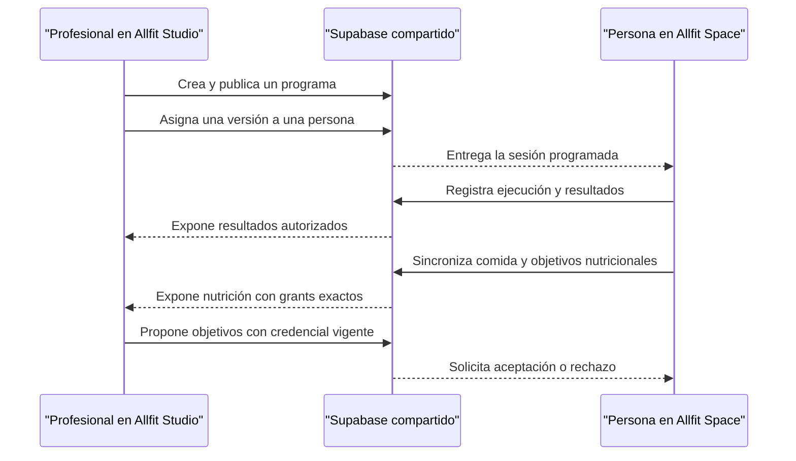
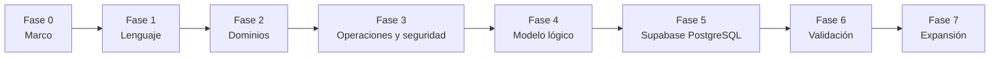

# Fases para diseñar la nueva BD de Allfit One

**Fecha:** 6 de agosto de 2026<br>
**Modalidad:** implementación incremental por rebanadas de HU asistida por IA.<br>
**Contexto:** diseño greenfield sobre Supabase/PostgreSQL, sin clientes ni datos productivos que obliguen a conservar el esquema actual.

## Resultado que debe existir al terminar

El proceso no busca diseñar por adelantado toda la visión futura de Allfit. Busca terminar con una base V1 coherente y ejecutable construida mediante rebanadas verticales para este flujo:



Al terminar deben existir:

- glosario de dominio aprobado;
- mapa de dominios y ownership;
- casos de uso y patrones de acceso V1;
- ERD conceptual y lógico;
- diccionario de tablas;
- matriz de RLS;
- contratos iniciales de Space, Studio y Backoffice;
- migraciones, seeds y pruebas locales;
- flujo vertical validado desde los productos involucrados en la rebanada;
- lista explícita de lo que queda fuera de V1.

## Regla de trabajo con IA

La IA puede acelerar:

- extracción de conceptos desde documentos y código actual;
- detección de nombres ambiguos y entidades duplicadas;
- generación de propuestas de ERD;
- generación de SQL, constraints, índices y policies;
- creación de seeds y pruebas;
- comparación entre documentación y esquema;
- revisión de seguridad y consistencia.

El equipo debe decidir y aprobar:

- qué significa cada concepto del negocio;
- quién es dueño de cada dato;
- qué información puede ver cada actor;
- qué ocurre al terminar una relación;
- qué historial es inmutable;
- qué operaciones deben ser transaccionales;
- qué entra y qué no entra en V1.

La IA propone; el equipo resuelve las reglas del negocio.

## Fase 0 — Preparar el marco de decisión

### Objetivo

Evitar que varias personas, aplicaciones o paquetes produzcan modelos incompatibles.

### Decisiones

- Nombrar un responsable final del modelo de datos.
- Ratificar `allfitone/packages/db` como único propietario de la configuración Supabase y la historia de migraciones.
- Confirmar un único pipeline autorizado para desplegar migraciones.
- Establecer que la BD remota no se modifica manualmente.
- Confirmar que la base actual es evidencia, no la plantilla obligatoria.
- Adoptar el flujo vertical asignar → ejecutar → revisar como frontera de V1.
- Establecer como invariante que Studio solo invita por email/celular y nunca ejecuta `Create User` de WorkOS AuthKit ni crea personas.
- Confirmar WorkOS AuthKit como única autenticación, con un WorkOS environment compartido por ambiente y WorkOS Applications separadas para Space, Studio y Backoffice.
- Confirmar que solo la API propia accede a PostgreSQL; los clientes no usan PostgREST/Data API ni credenciales Supabase.
- Confirmar que el perfil profesional pertenece a la persona, pero toda operación profesional en Studio ocurre dentro de una organización; el onboarding `solo_professional` crea una `professional_practice` que puede crecer a equipo sin cambiar de identidad.
- Confirmar independencia funcional y aislamiento operativo para Space/Studio, aceptando WorkOS AuthKit, API y PostgreSQL como dependencias físicas compartidas en V1.
- Acordar antes de producción SLO, RTO y RPO medibles; no inferirlos de la topología.

### Trabajo de IA

- Resumir la arquitectura y el esquema actuales.
- Crear una lista de conceptos reutilizables, deuda y patrones que no deben copiarse.
- Crear el primer registro de decisiones arquitectónicas.

### Entregable

[`ALLFIT_ARCHITECTURE_DECISIONS.md`](../02_ARCHITECTURE_DECISIONS/ALLFIT_ARCHITECTURE_DECISIONS.md).

### Criterio de salida

Existe una autoridad de migraciones y una definición inequívoca de qué significa “V1 terminada”.

---

## Fase 1 — Definir el lenguaje y el alcance

### Objetivo

Acordar el negocio antes de hablar de tablas.

### Conceptos mínimos

- persona;
- invitación;
- cuenta de acceso;
- elegibilidad adulta;
- perfil fitness;
- procedencia de atributo y verificación;
- profesional;
- organización;
- sede;
- membresía organizacional;
- relación profesional-persona;
- consentimiento;
- definición versionada de scope;
- disciplina;
- tipo de actividad;
- movimiento —ejercicio en fuerza—;
- plantilla de sesión —rutina en fuerza—;
- versión de plantilla;
- paso planificado;
- programa;
- versión de programa;
- asignación;
- sesión planificada;
- sesión ejecutada;
- segmento de sesión;
- resultado;
- contrato versionado de resultados;
- nivel de completitud: `partial`, `summary`, `detailed` o `sensor_enriched`.
- comida registrada e ítem manual;
- valor nutricional canónico y resumen diario calculado;
- línea y versión de objetivos nutricionales;
- propuesta profesional y decisión personal.

Para cada concepto responder:

1. ¿Qué es?
2. ¿Qué no es?
3. ¿Quién lo crea?
4. ¿Quién es dueño del dato?
5. ¿Puede existir sin una cuenta de Auth?
6. ¿Cuál es su ciclo de vida?
7. ¿Qué ejemplos y contraejemplos existen?

Decisión central:

> La persona es el sujeto del Fitness ID y puede registrarse directamente en Space sin invitación. Antes de completar un onboarding elegible no existe persona ni cuenta local; si el flujo inició desde Studio existe una invitación separada y puede existir temporalmente un usuario WorkOS. Studio nunca registra a alguien en su nombre. V1 solo activa personas de 18 años o más.

### Alcance V1

Incluir:

- identidad y Fitness ID;
- registro directo en Space sin invitación, organización o relación profesional;
- control de elegibilidad para personas de 18 años o más antes de activar el Fitness ID;
- invitaciones por email/celular y aceptación transaccional;
- organizaciones y profesionales;
- sedes básicas, membresías organizacionales de staff y roles;
- relación profesional-persona;
- disciplinas, tipos de actividad, movimientos, plantillas y programas versionados;
- asignación y calendario básico;
- ejecución de entrenamiento;
- progreso básico;
- perfil fitness con declaraciones, observaciones, mediciones, inferencias y verificaciones diferenciadas;
- consentimiento explícito mediante siete scopes independientes: `relationship_training`, `prior_training_history`, `body_progress`, `health_context`, `nutrition_intake`, `nutrition_guidance` y `nutrition_media`;
- nutrición no clínica: comidas manuales, seis nutrientes canónicos, resúmenes diarios, una foto opcional y objetivos personales/propuestos.

Excluir:

- clases, reservas, recursos, capacidad y asistencia;
- productos, órdenes, pagos internos/externos/manuales, reembolsos y facturación;
- membresías comerciales y entitlements;
- marketplace, publicación comercial, perfiles públicos, listings y reviews;
- comunidad, mensajería y eventos;
- nutrición clínica o terapéutica, diagnósticos, medicamentos, laboratorios, suplementos y recuperación avanzada;
- catálogo global de alimentos, recetas, menús, códigos de barras, proveedores de composición, IA nutricional y planes automáticos;
- IA contextual, agentes, publicación, investigación y entrenamiento de modelos;
- conectores de wearables, biometría continua, GPS preciso y raw streams;
- taxonomía completa de todos los deportes;
- separación física por producto;
- perfiles o servicios para menores de edad;
- representantes, consentimiento parental, cuentas dependientes o familiares.

`sensor_enriched` puede definirse y probarse como contrato tipado del núcleo, pero no habilita conectores, credenciales, raw de wearables ni scopes adicionales. Nutrición V1 es greenfield y no admite migraciones, ETL, compatibilidad, backfill, IDs ni datos de Factory Fitness. Los dominios diferidos pueden aparecer en el roadmap conceptual; no generan schemas, tablas, columnas, JSON, roles, scopes, endpoints o jobs en la baseline.

### Trabajo de IA

- Extraer vocabulario de `ALLFIT_SPACE.md`, esquema actual y código.
- Marcar colisiones como plan, programa, suscripción, miembro y cliente.
- Proponer definiciones y preguntas pendientes.
- Generar un glosario inicial para revisión humana.

### Entregables

- [`ALLFIT_DOMAIN_GLOSSARY.md`](../03_PROPOSED_DESIGN/ALLFIT_DOMAIN_GLOSSARY.md).
- [`V1_DATABASE_SCOPE.md`](../03_PROPOSED_DESIGN/V1_DATABASE_SCOPE.md).

### Criterio de salida

Cada término tiene una sola definición y el equipo puede explicar V1 sin mencionar nombres de tablas.

---

## Fase 2 — Diseñar dominios, ownership y flujo de datos

### Objetivo

Decidir dónde vive cada concepto y quién controla cada dato.

### Dominios iniciales para evaluar

| Dominio | Responsabilidad |
| --- | --- |
| Identidad | Persona, cuenta, perfil y Fitness ID |
| Organizaciones | Negocios, sedes, staff y roles internos |
| Relaciones | Vínculo profesional-persona y vigencia |
| Privacidad | Consentimientos y scopes compartidos |
| Catálogo | Disciplinas, tipos de actividad, movimientos y taxonomías |
| Planificación | Programas, versiones, plantillas, pasos y calendario |
| Ejecución | Sesiones, segmentos y resultados tipados por modalidad |
| Nutrición | Comidas manuales, nutrientes, resúmenes y objetivos versionados |

Space y Studio no son dominios de datos. Son consumidores diferentes de los mismos dominios.

### Matriz de ownership

Para cada entidad definir:

| Pregunta | Ejemplo de decisión |
| --- | --- |
| ¿Quién es dueño? | La ejecución pertenece a la persona |
| ¿Quién la crea? | Persona, profesional o sistema |
| ¿Quién la modifica? | Actor y ventana de modificación |
| ¿Quién la consulta? | Propietario o relación autorizada |
| ¿Qué ocurre al terminar la relación? | Se corta operación/escritura, los grants pasan a `frozen` en `T` y se impide acceso a datos futuros |
| ¿Qué debe conservarse? | Fitness ID de la persona, autoría y evidencia bilateral mínima |
| ¿Puede eliminarse? | Regla por categoría: eliminar, anonimizar o retener con finalidad/plazo |
| ¿Qué inicia la disposición? | Fin de finalidad, cierre, supresión válida, desconexión o vencimiento |
| ¿Qué la suspende? | Hold acotado y documentado; nunca una excepción global implícita |

### Casos que el modelo debe resolver

- una persona que entrena sola;
- una invitación pendiente de Studio que todavía no representa una persona;
- aceptación de la invitación que crea cuenta/persona y materializa el vínculo aceptado;
- aceptación parcial que crea una relación y rechaza el programa sin conceder scopes implícitos;
- una persona con dos profesionales de organizaciones distintas;
- un profesional que cambia de organización;
- un programa modificado después de ser asignado;
- una relación terminada que conserva historial válido;
- un consentimiento parcial o revocado;
- una sesión con entrenamiento visible, pero dolor/biometría redactados por scopes independientes;
- un grant antiguo que no hereda campos añadidos a una nueva definición.
- una comida capturada offline cuya foto se adjunta después sin duplicar el agregado;
- un profesional con relación, asignación, capability, credencial y grant vigentes que propone objetivos;
- aceptación/rechazo personal, terminación y vista `frozen` limitada a guía emitida hasta `T`.

### Trabajo de IA

- Proponer límites de dominio a partir del glosario.
- Crear la matriz entidad → dominio → propietario.
- Simular los escenarios y detectar duplicaciones o contradicciones.
- Generar el primer ERD conceptual.

### Entregables

- [`DOMAIN_OWNERSHIP_MAP.md`](../03_PROPOSED_DESIGN/DOMAIN_OWNERSHIP_MAP.md).
- [`V1_CONCEPTUAL_ERD.md`](../03_PROPOSED_DESIGN/V1_CONCEPTUAL_ERD.md).

### Criterio de salida

Todos los escenarios se representan sin duplicar personas, asignaciones, ejecuciones o historial entre Space y Studio.

---

## Fase 3 — Definir operaciones, seguridad y contratos

### Objetivo

Diseñar cómo se usa la información antes de definir todas las columnas.

### Matriz de operaciones

| Actor | Operación | Datos | Regla de acceso |
| --- | --- | --- | --- |
| Persona | Completar onboarding | Fitness ID propio | Elegibilidad adulta resuelta; fallo o ausencia cierran el acceso |
| Persona | Actualizar perfil | Declaraciones propias | Nueva revisión; conserva procedencia e historial material |
| Persona | Resolver asignación desacoplada | Snapshot y sesiones futuras propias | Continuar personalmente o terminar; nunca transferir gestión implícita |
| Persona | Ver agenda propia | Asignaciones y sesiones | Solo propias |
| Sistema | Inferir atributo | Inputs autorizados del perfil/historial | Algoritmo/versión/confianza; hereda el scope más restrictivo |
| Verificador autorizado | Verificar afirmación | Valor y evidencia mínima | Alcance, método, vigencia y revocación explícitos |
| Persona | Registrar ejecución | Sesión, segmentos y resultados especializados | Solo propias |
| Persona/sistema | Finalizar ejecución | Envelope y resultados tipados | Contrato congelado, comando idempotente y validación transaccional |
| Profesional | Asignar programa | Programa versionado y relación | Relación activa |
| Profesional | Ver resultados | Ejecuciones compartidas | Consentimiento vigente |
| Profesional | Capturar/anotar | Valores propios y observaciones | Relación + grant + asignación + membresía + capacidad vigentes |
| Profesional | Proponer corrección | Datos declarados por la persona | Aceptación de la persona; sin overwrite |
| Profesional | Revisar captura propia | Valores con procedencia profesional | Revisión append-only y auditoría |
| Persona | Registrar/revisar/eliminar comida | Comida, ítems, nutrientes y foto propia | Self; `ETag`/`If-Match`; disposición para borrado |
| Persona | Publicar/decidir objetivos | Versiones propias o propuesta recibida | Self; decisión única y atómica |
| Profesional nutricional | Leer ingesta/proponer objetivos | Proyección minimizada y guía profesional | Relación + asignación + `guide_nutrition` + credencial + grant exacto |
| Admin | Gestionar staff | Membresías y roles | Solo su organización |

Por cada operación definir:

- comando o consulta;
- actor;
- filtros obligatorios;
- transacción requerida;
- idempotencia;
- paginación y orden;
- comportamiento offline o concurrente;
- información sensible involucrada;
- evento de dominio que produce.

### Matriz de seguridad

Para cada recurso y operación especificar:

- petición sin autenticar;
- usuario WorkOS registrado;
- persona autenticada;
- profesional;
- administrador de organización;
- backend;
- worker/job;
- condición RLS;
- contexto transaccional requerido;
- grants mínimos;
- prueba positiva;
- prueba negativa;
- índice necesario para la policy.

No se aceptan políticas genéricas como “si pertenece al workspace puede verlo todo”.

### Contratos

Definir qué necesita cada aplicación:

- contrato HTTP de Space: agenda personal, programa asignado, ejecución, progreso y nutrición propios;
- contrato HTTP de Studio: creación/asignación, personas relacionadas, resultados y nutrición autorizados;
- funciones SQL internas para comandos que necesiten varias escrituras atómicas;
- vistas internas para consultas estables del backend;
- eventos/outbox para procesos asíncronos;
- DTOs/OpenAPI compartidos mediante `packages/contracts`; los tipos crudos de BD permanecen en el backend.
- field-set y versión de scope requeridos por cada endpoint/proyección.

Definir además el contrato de degradación por producto y dependencia:

- qué fallo queda aislado y cuál afecta ambos productos;
- qué operaciones admiten `draft/local` o `pending_sync`;
- qué operaciones fallan cerradas;
- rate limits, concurrencia, conexiones, timeouts y colas por producto/dominio;
- circuit breakers, retries y DLQ para proveedores/workers;
- métricas, alertas y SLO/RTO/RPO diferenciados.

### Trabajo de IA

- Convertir los flujos en una matriz CRUD y de permisos.
- Detectar accesos ambiguos o demasiado amplios.
- Proponer vistas, RPCs y eventos.
- Generar casos de prueba de autorización y abuso.
- Generar matriz de fallos, degradación y recuperación para Space, Studio y dependencias compartidas.

### Entregables

- [`V1_OPERATIONS_MATRIX.md`](../03_PROPOSED_DESIGN/V1_OPERATIONS_MATRIX.md).
- [`V1_RLS_MATRIX.md`](../03_PROPOSED_DESIGN/V1_RLS_MATRIX.md).
- [`V1_RLS_PHYSICAL_TRACEABILITY_MATRIX.md`](../03_PROPOSED_DESIGN/V1_RLS_PHYSICAL_TRACEABILITY_MATRIX.md).
- [`V1_SPACE_STUDIO_API_CONTRACTS.md`](../03_PROPOSED_DESIGN/V1_SPACE_STUDIO_API_CONTRACTS.md).
- [`V1_OPENAPI_CONTRACT.md`](../03_PROPOSED_DESIGN/V1_OPENAPI_CONTRACT.md) y [`allfit-v1.openapi.yaml`](https://github.com/dinnartec/allfitone/blob/main/packages/contracts/openapi/allfit-v1.openapi.yaml) para la primera rebanada vertical.
- [`V1_VERIFICATION_AND_BREAK_GLASS_GOVERNANCE.md`](../03_PROPOSED_DESIGN/V1_VERIFICATION_AND_BREAK_GLASS_GOVERNANCE.md).
- [`V1_DEGRADATION_AND_RECOVERY_MATRIX.md`](../03_PROPOSED_DESIGN/V1_DEGRADATION_AND_RECOVERY_MATRIX.md).

### Criterio de salida

Toda lectura y escritura del flujo vertical tiene actor, autorización, transacción y contrato definidos; cada ruta de autorización llega a columnas, joins, proyección, índice y pruebas físicos.

---

## Fase 4 — Crear el modelo lógico y el diccionario de datos

### Objetivo

Transformar las decisiones anteriores en tablas y relaciones de PostgreSQL.

### Convenciones mínimas

- nombres `snake_case` en minúsculas;
- una estrategia de IDs consistente;
- `timestamptz` para instantes;
- `date` para fechas civiles;
- `numeric` para dinero;
- `boolean` para banderas;
- FKs con comportamiento de borrado explícito;
- índices sobre FKs y columnas usadas en RLS/consultas;
- constraints para invariantes del negocio;
- JSONB solo para información realmente variable;
- valores y unidades tipados para métricas consultadas;
- núcleo universal independiente de sets, repeticiones o cargas;
- historial versionado o inmutable cuando corresponda;
- soft delete solo cuando exista una razón de negocio;
- `created_at`, `updated_at` y autor/origen cuando aplique.

### Ficha obligatoria por tabla

```text
Nombre:
Propósito:
Dominio propietario:
Fuente de verdad:
Clasificación del dato:
PK:
Columnas:
FKs y comportamiento de borrado:
Uniques y checks:
Actores que leen/escriben:
Políticas RLS:
Patrones de consulta:
Índices:
Retención y eliminación:
Eventos producidos:
```

No se crea una tabla cuya ficha no pueda completarse.

Para completar `Retención y eliminación` se debe:

- clasificar cada dato como `delete`, `anonymize` o `retain_restricted`;
- versionar políticas por categoría, finalidad, trigger y jurisdicción;
- distinguir revocación de acceso, supresión, seudonimización y anonimización irreversible;
- modelar solicitudes de supresión, holds acotados y eventos de disposición;
- incluir cachés, búsquedas, storage, réplicas, backups y todo sistema realmente activo en V1; cada capacidad futura amplía el flujo al incorporarse.

### Revisiones obligatorias

- WorkOS AuthKit y su `sub` están separados de la persona de dominio.
- Lo planificado está separado de lo ejecutado.
- Una asignación referencia una versión inmutable.
- Una asignación separa origen inmutable y gestión efectiva; terminar la relación la desacopla y pausa sin copiarla.
- Una versión de programa referencia versiones publicadas e inmutables de plantilla.
- Pasos y targets pertenecen a una versión de plantilla; ninguna consulta histórica usa “la última”.
- Las FKs impiden referencias cruzadas inválidas.
- Los estados imposibles se bloquean con constraints.
- Las relaciones N:M son explícitas.
- Las referencias polimórficas críticas se evitan.
- Los datos de persona no reciben `organization_id` por costumbre.
- Cada categoría personal tiene política de retención/disposición y no depende de un `deleted_at` universal.
- Cada grant congela una definición publicada de scope; añadir campos/finalidades exige otra versión.
- Scope, access level y capacidad permanecen separados.
- RLS limita filas y tablas/proyecciones autorizadas limitan campos; el frontend no redacta seguridad.
- Las denegaciones de sesiones autónomas se evalúan por relación, prevalecen sobre el grant y se aplican a detalle, conteos y derivados.
- Un derivado hereda la clasificación más restrictiva de sus inputs.
- Los holds tienen alcance, motivo, vigencia y liberación; no mantienen acceso operativo.
- La anonimización elimina identificadores directos, indirectos y llaves de enlace.
- Una disciplina nueva no exige añadir columnas incompatibles a la tabla universal de sesiones.
- Los targets planificados y resultados ejecutados permanecen separados.
- Cada `activity_type` tiene contratos de resultados publicados/versionados y cada ejecución congela uno.
- Toda persona activa tiene evidencia versionada de elegibilidad adulta; intentos no elegibles no crean perfiles parciales.
- Declaraciones, observaciones profesionales, mediciones, inferencias y verificaciones conservan procedencia y pueden coexistir.
- Actor capturador, origen semántico, método y estado de verificación son dimensiones separadas.
- Las proyecciones actuales aplican reglas versionadas y no destruyen afirmaciones ni notas de procedencia.
- Estado de ejecución y completitud de resultados son dimensiones independientes.
- `NULL` representa ausencia de captura y no se reemplaza implícitamente por cero.
- Los derivados registran algoritmo/versión y se recalculan cuando cambian sus inputs.
- Los ítems y valores nutricionales transportan `person_id` mediante FKs compuestas hasta su comida.
- Una meta personal se activa inmediatamente; una propuesta profesional solo se activa por decisión de la persona.
- Una relación terminada cancela propuestas pendientes y `frozen` solo puede proyectar guía profesional emitida por esa relación hasta `T`.

### Trabajo de IA

- Generar el modelo lógico desde el ERD conceptual y las matrices.
- Proponer PKs, FKs, checks, uniques e índices.
- Auditar normalización y relaciones polimórficas.
- Comparar cada tabla contra los casos de uso.
- Generar el diccionario de datos y el ERD lógico.

### Entregables

- [`V1_LOGICAL_ERD.md`](../03_PROPOSED_DESIGN/V1_LOGICAL_ERD.md).
- [`V1_DATA_DICTIONARY.md`](../03_PROPOSED_DESIGN/V1_DATA_DICTIONARY.md).
- [`V1_PHYSICAL_OBJECT_CATALOG.md`](../03_PROPOSED_DESIGN/V1_PHYSICAL_OBJECT_CATALOG.md).
- [`V1_IDEMPOTENCY_CONTRACT.md`](../03_PROPOSED_DESIGN/V1_IDEMPOTENCY_CONTRACT.md).
- [`V1_CROSS_TABLE_INTEGRITY_MATRIX.md`](../03_PROPOSED_DESIGN/V1_CROSS_TABLE_INTEGRITY_MATRIX.md).
- [`V1_RLS_PHYSICAL_TRACEABILITY_MATRIX.md`](../03_PROPOSED_DESIGN/V1_RLS_PHYSICAL_TRACEABILITY_MATRIX.md).
- [`POSTGRES_MODELING_STANDARD.md`](../03_PROPOSED_DESIGN/POSTGRES_MODELING_STANDARD.md).

### Criterio de salida

El modelo lógico completo conserva un inventario reproducible de referencia. Para entrar a implementación no se exige materializarlo entero: cada rebanada debe cerrar, antes de su migración, las fichas, tipos, nombres, constraints, RLS e idempotencia que consume y excluir objetos de HU posteriores.

---

## Fase 5 — Implementar en Supabase

### Objetivo

Convertir HU aprobadas en incrementos reproducibles de PostgreSQL, cerrando el diseño necesario justo antes de cada migración.

### Gate de entrada por rebanada

Una HU sólo entra a Fase 5 cuando:

- su alcance y dependencias están aprobados;
- no conserva `NEW-*`, `PR pendiente` ni objetos por decidir;
- sus P0 dependientes están resueltos;
- operación, contrato, tablas, integridad, RLS, idempotencia y pruebas están trazados;
- la migración no crea placeholders para HU futuras.

Un P0 de otra épica no bloquea esta entrada. El checklist global de readiness se usa para cerrar la baseline V1, no para empezar cada rebanada.

### Estructura

```text
allfitone/packages/db/
├── supabase/
│   ├── config.toml
│   ├── migrations/
│   ├── seed.sql
│   ├── tests/
│   │   └── database/
│   └── schemas/          # sólo si se adopta esquema declarativo
└── types/
    └── database.types.ts
```

### Secuencia acumulativa

La lista siguiente describe el resultado acumulado de Fase 5. Cada rebanada ejecuta sólo los pasos que necesita y deja la base reconstruible antes de continuar:

1. Validar las 22 rutas y 25 operaciones de `allfit-v1.openapi.yaml` con `T-API-01..11` y `T-NUT-API-01..14`; generar sus DTOs antes del primer handler.
2. Crear de forma aditiva los schemas y extensiones necesarios para la rebanada.
3. Crear tipos/catálogos compartidos.
4. Crear definiciones versionadas de scope y sus field-sets revisables.
5. Crear contratos de resultados y asociaciones versionadas con tipos de actividad.
6. Crear tablas padre.
7. Crear relaciones y tablas dependientes.
8. Crear claves portadoras, FKs simples/compuestas y checks.
9. Crear los constraint triggers y guardianes `IX-*` consumidos por la rebanada, incluidos sus triggers recíprocos.
10. Crear índices de FKs, acceso y RLS.
11. Configurar grants mínimos.
12. Habilitar RLS y crear policies.
13. Implementar `access_control.grant_of`, `access_control.frozen_grant_of`, `access_control.can_access`, `access_control.can_read_frozen`, `access_control.has_verified_credential` y `access_control.can_guide_nutrition` con sus contratos físicos exactos.
14. Crear vistas/proyecciones y RPCs de contrato, incluidas las superficies separadas live, frozen, historial personal, nutrición y soporte.
15. Materializar deberes temporales, verificación de credenciales, quorum/expiración break-glass, revisión independiente y suspensión por abuso según ADR-026.
16. Crear `finalize_execution` y validación transaccional por contrato.
17. Crear receipts idempotentes, uniques scoped y guardián terminal según P0-08.
18. Crear las funciones transaccionales cerradas de Nutrición para comidas, metas, propuestas y decisiones; los resúmenes diarios son vistas/proyecciones.
19. Implementar saneamiento de foto sin EXIF/geolocalización, URL HTTPS firmada por 300 segundos y reemplazo atómico solo tras procesamiento exitoso.
20. Crear outbox si el flujo produce trabajo asíncrono; sus payloads nutricionales llevan solo identificadores.
21. Crear políticas, solicitudes, holds, eventos y worker idempotente de disposición.
22. Crear seeds con múltiples personas y organizaciones; ningún deber `A10/A11/A12` se concede por defecto.
23. Ejecutar `T-PHY-01..07` y `T-NUT-PHY-01..04`.
24. Ejecutar `T-SCHEMA-01..06` contra inventario, objetos, JSONB y particiones.
25. Ejecutar `T-IDEM-01..10` y `T-NUT-IDEM-01..06`.
26. Ejecutar `T-VG-01..06`, `T-BGG-01..12`, `T-NUT-INT-01..08` y `T-NUT-RLS-01..24`.
27. Generar DTOs en `packages/contracts` y tipos internos en `packages/db/types`; comprobar que los primeros no difieren del OpenAPI canónico en `packages/contracts/openapi`.

### Datos de prueba mínimos

- persona autónoma con cuenta;
- invitación pendiente sin cuenta ni persona;
- invitación aceptada con cuenta, persona y vínculo materializados;
- registro directo Space-only con persona/Fitness ID y sin invitación, organización, relación, asignación o grant;
- invitación posterior aceptada por esa misma cuenta sin duplicar `person_id`;
- invitación de staff con membresía aceptada;
- invitación de cliente con relación aceptada y programa rechazado;
- invitación de cliente con asignación bloqueada por relación rechazada;
- persona con dos relaciones profesionales;
- dos organizaciones independientes;
- práctica profesional creada con onboarding `solo_professional` que incorpora staff sin cambiar de organización;
- relación de servicio reasignada entre profesionales con historial efectivo;
- grant ligado a relación/organización con parte responsable identificada y coach asignado;
- coach y admin de la misma organización sin asignación, ambos sin acceso al Fitness ID;
- práctica unipersonal donde el coach natural es parte responsable y la organización es frontera operativa;
- reasignación interna que conserva un grant, revoca al actor anterior y notifica a la persona;
- cambio de organización/parte responsable que exige nueva relación y consentimiento;
- programa borrador y versión publicada;
- plantilla con borrador, versiones publicadas v1/v2 y derivación;
- programa v1 fijado a plantilla v1 aunque exista v2;
- asignación activa;
- relación terminada con asignación `detached_pending_choice`, sesiones futuras pausadas y dos decisiones personales posibles;
- sesión planificada con intento abandonado, intento completado primario y retry;
- sesión espontánea sin vínculo a planificación;
- una sesión autónoma visible para una relación, oculta para otra y excluida de todos sus agregados;
- captura profesional revisada conservando original;
- propuesta de corrección aceptada, rechazada y expirada;
- raw de wearable excluido de análisis sin alterar payload;
- observación profesional versionada separada de una declaración personal;
- fuerza con sets, cargas y RPE;
- running por intervalos con laps y heart rate;
- yoga/movilidad con secuencia y duración;
- sesión híbrida con segmentos de fuerza y endurance;
- contratos `summary` y `detailed` para las cuatro familias V1;
- ejecución `sensor_enriched` con detalle válido y muestras asociadas;
- importación `partial` que no satisface `summary` ni alimenta adherencia precisa;
- contrato v1/v2 donde ejecuciones históricas conservan v1;
- casos inválidos: set sin cantidad lograda, running sin distancia, híbrido con una sola familia y unidad incompatible;
- grants V1 independientes, rechazados, concedidos parcialmente, expirados y revocados;
- grant v1 y definición v2 ampliada donde el profesional conserva únicamente el field-set v1;
- sesión de relación con sets visibles y dolor, peso, HR/GPS/raw ocultos sin sus scopes;
- historial previo visible sin programa maestro ni notas privadas de otra organización;
- body progress con foto seleccionada sin EXIF/geolocalización;
- health context minimizado sin historia clínica, biometría o documentos médicos completos;
- `read` que rechaza contribución y `contribute` profesional que conserva procedencia;
- relación activa sin `relationship_training`, con funciones de resultados bloqueadas;
- cuenta cerrada con PII eliminada, tombstone técnico sin PII y evidencia restringida;
- intento de onboarding no elegible sin persona, perfil, relación, grants ni datos fitness;
- perfil con declaración personal, observación profesional e inferencia coexistentes para el mismo atributo;
- transcripción profesional que conserva `person_declared` y registra al profesional como capturador;
- credencial verificada que no marca otros atributos ni el perfil completo como verificados;
- revocación de `body_progress` que bloquea al profesional sin borrar el dato personal;
- categorías vencidas para `delete`, `anonymize` y `retain_restricted`;
- hold vigente y liberado con registros dentro y fuera de su alcance;
- backup restaurado con disposiciones posteriores al snapshot pendientes de reaplicar.
- fixtures adversariales con IDs existentes pero cruzados entre dos personas, dos organizaciones, dos relaciones y dos ejecuciones.
- comida manual offline con ítems, cantidades y los seis nutrientes, sincronizada una sola vez;
- foto nutricional diferida, saneada y adjunta por `PATCH` sin mutación parcial ante fallo;
- dos personas aisladas, con admin/staff de la organización explícitamente denegados;
- profesional asignado con `guide_nutrition`, credencial vigente y grants separados de intake/guidance/media;
- meta personal activa, dos propuestas pendientes de relaciones diferentes y reemplazo de la pendiente de la misma relación;
- aceptación y rechazo personal únicos, con activación/supersesión atómica;
- relación terminada que cancela propuestas pendientes y solo conserva guía profesional minimizada bajo caso histórico;
- revocación de cada scope sin filtración por filas, conteos, cursores, agregados o caché; una foto Studio usa proxy autenticado y el mismo enlace anterior responde `404` sin bytes tras revocar intake o media.

### Trabajo de IA

- Generar SQL inicial por dependencias.
- Revisar migrations generadas por `db diff`.
- Detectar FKs sin índice.
- comparar constraints instalados contra `IX-01..44`;
- Detectar tablas sin RLS.
- comparar policies, vistas, funciones e índices instalados contra `PR-01..29`;
- comparar las 120 fichas y nombres determinísticos contra `pg_catalog`;
- generar fixtures positivos/negativos para cada contrato JSONB V1;
- detectar funciones `security definer` inseguras;
- generar seed idempotente y tipos.

### Entregables

Los siguientes son destinos previstos dentro del monorepo `allfitone`; se convertirán en enlaces cuando existan los artefactos:

- cadena inicial de migraciones: `packages/db/supabase/migrations/`;
- seed de base de datos: `packages/db/supabase/seed.sql`;
- vistas y RPC declarativas, si se adopta ese flujo: `packages/db/supabase/schemas/`; de lo contrario se crean mediante migraciones;
- tipos generados: `packages/db/types/database.types.ts`;
- configuración y reconstrucción local: `packages/db/supabase/config.toml`.

### Criterio de salida

Cualquier integrante puede reconstruir la BD desde cero sin pasos manuales.

---

## Fase 6 — Validar y cerrar la baseline V1

### Objetivo

Probar que el diseño funciona desde los productos involucrados en cada rebanada y que no permite accesos indebidos.

### Pruebas obligatorias

- una persona no puede leer información privada de otra;
- una organización no puede referenciar datos privados de otra;
- las ocho pruebas `T-PHY-*` y cuatro `T-NUT-PHY-*` demuestran compilación física, grants, transiciones, no resurrección comercial, live/frozen, scopes, privilegios, índices y planes de autorización;
- las seis pruebas `T-SCHEMA-*` demuestran inventario 120, objetos nombrados, contracts JSONB y unicidad/mantenimiento particionado;
- las diez pruebas `T-IDEM-*` y seis `T-NUT-IDEM-*` demuestran scope, concurrencia, captura offline, foto diferida, doble decisión, crash, disposición y minimización;
- las nueve pruebas `T-API-*` y catorce `T-NUT-API-*` demuestran contrato OpenAPI resoluble, operación trazable, ejemplos válidos, headers obligatorios, caché, redacción, agregados, autoría mínima, URL firmada Space, proxy autenticado Studio y DTOs sin drift;
- las seis pruebas `T-VG-*` y doce `T-BGG-*` demuestran verificación acotada, conflictos, deberes temporales, quorum, expiración, auditoría y suspensión por abuso;
- las 30 pruebas `T-INT-*` y ocho `T-NUT-INT-*` rechazan cruces aun con `BYPASSRLS`;
- las 162 pruebas RLS previas y 24 `T-NUT-RLS-*` cubren un total de 186 casos funcionales de autorización;
- una transacción puede diferir un guardián para una transición atómica válida, pero un estado incompleto falla al `COMMIT`;
- una persona completa onboarding desde Space sin invitación y una invitación posterior reutiliza el mismo Fitness ID;
- un profesional no puede consultar relaciones ajenas;
- una práctica incorpora integrantes sin cambiar `organization_id` ni perder clientes, programas o auditoría;
- reasignar al profesional responsable conserva el historial anterior y no amplía permisos retroactivamente;
- revocar consentimiento cambia el acceso esperado;
- `relationship_training` no expone historial previo, sesiones autónomas, métricas corporales ni contexto de salud;
- conceder un scope no concede los demás y ninguna relación hereda grants anteriores;
- no existe un scope o endpoint equivalente a `all_data`;
- dolor dentro de una sesión permanece oculto sin `health_context`;
- peso corporal permanece oculto sin `body_progress` aunque haya carga de ejercicio visible;
- `prior_training_history` no expone programas maestros ni notas privadas de otras organizaciones;
- una denegación individual oculta la sesión autónoma por relación, sobrevive a la reasignación del coach y no revela conteos o placeholders;
- ocultar una sesión invalida récords/agregados profesionales y otros scopes no la reexponen dentro de la misma relación;
- una organización no puede cambiar visibilidad ni vincular a su planificación una sesión autónoma oculta;
- `body_progress` no expone EXIF, geolocalización o galería no seleccionada;
- `health_context` no expone historia clínica, biometría, raw o inferencias médicas;
- frecuencia cardiaca, GPS y wearables permanecen fuera de los siete scopes V1;
- `nutrition_media` aislado no revela una comida; Studio requiere además `nutrition_intake/read`;
- revocar cualquier scope nutricional invalida filas, detalles, conteos, cursores, agregados y cachés; revocar intake o media hace que el mismo enlace de foto Studio responda `404` sin bytes inmediatamente;
- Space acepta una meta propia sin `rationale`; Studio rechaza una propuesta profesional con `rationale` ausente, nulo, vacío o mayor de 2000 caracteres antes de persistir;
- frozen incluye una propuesta profesional con `goal_versions.created_at=T` y excluye cualquiera con `created_at>T`;
- un profesional sin relación, asignación, `guide_nutrition`, credencial vigente o grant exacto no lee ni propone;
- `frozen` nutricional nunca expone comidas, fotos, resúmenes o metas personales y se corta al revocar `nutrition_guidance`;
- un grant v1 no hereda campos/finalidades publicados en v2;
- un grant `read` no permite `contribute` y todo aporte profesional conserva procedencia;
- derivados, conteos, errores y nullability no filtran categorías denegadas;
- un grant de servicio identifica relación, organización y parte responsable presentada;
- membresía o rol admin sin asignación/capacidad no permiten ejercer el grant;
- `staff` puede invitar y consultar directorio, pero nunca perfil, ejecución, progreso corporal o salud;
- una suplencia propuesta no concede acceso, la aceptación personal la activa y el vencimiento la corta aunque el job no haya corrido;
- reasignar dentro de la misma parte responsable conserva el grant y cambia actores de forma efectiva/auditada;
- cambiar organización, parte responsable, finalidad o scope exige nueva aceptación;
- cada acceso sensible registra al actor humano y no solo a la organización;
- terminar una relación corta acceso en vivo/escritura y congela en `T` la ventana histórica de los grants definidos;
- terminar una relación desacopla asignaciones administradas, pausa futuras y detiene generación, recordatorios e incumplimiento;
- continuar personalmente reutiliza la misma asignación/snapshot y terminarla cancela solo sesiones futuras no iniciadas;
- una relación nueva no hereda gestión, grants, notas privadas ni acceso a la asignación desacoplada;
- terminar una relación no elimina el Fitness ID ni mantiene a la persona en endpoints/listados operativos; la lectura histórica usa una superficie separada;
- datos creados después de la terminación no son visibles para la organización anterior;
- toda lectura `frozen` exige `historical_access_case` vigente, actor elegible con membresía activa, MFA, propósito cerrado, `access_control.can_read_frozen` y `ACCESS_EVENT` obligatorio según ADR-023;
- break-glass exige AAL2, deber temporal, propósito/caso, un A12 para `nutrition_guidance` estándar o dos distintos para `nutrition_intake` restringida, rechaza `nutrition_media`, exige A10 solicitante exacto y otro A12 revisor; cada lectura/denegación revalida categoría y genera `break_glass_event` y `ACCESS_EVENT` antes del contenido;
- el vencimiento de retención elimina o anonimiza salvo hold documentado;
- una solicitud de supresión resuelve cada categoría mediante su política versionada;
- revocar un scope impide acceso del tercero sin borrar el dato del Fitness ID;
- seudonimización, cifrado o `deleted_at` no cuentan como anonimización irreversible;
- un hold solo suspende targets dentro de su alcance y liberarlo reanuda la disposición;
- datos retenidos quedan fuera de endpoints operativos, marketing, IA y analítica identificable;
- una restauración reaplica disposiciones y no resucita datos eliminados;
- V1 rechaza menores antes de crear persona o materializar invitaciones y no ofrece representantes ni consentimiento parental;
- un usuario WorkOS no elegible permanece sin acceso de dominio y converge a deshabilitación/eliminación;
- descubrir posteriormente que una persona es menor restringe sesiones/grants y activa el flujo de disposición;
- una declaración, observación profesional e inferencia divergentes coexisten sin overwrite y la proyección explica su selección;
- un profesional solo revisa su observación y no convierte una declaración transcrita en autoría propia;
- una medición de dispositivo conserva fuente/unidad/calidad y no se presenta automáticamente como verificada;
- una inferencia conserva algoritmo, versión, inputs, confianza, vigencia y clasificación heredada;
- solo registro oficial o emisor verifican una credencial profesional; conflictos/evidencia ambigua fallan cerrado y vencer/revocar no altera otros atributos;
- los jobs de disposición son idempotentes y dejan un evento auditable;
- publicar o retirar una versión de plantilla no altera programas ni asignaciones históricas;
- una adaptación personal crea revisión de prescripción sin editar plantilla o programa publicados;
- una sesión planificada admite intentos numerados, pero solo una ejecución completada y válida es primaria;
- reanudar no crea intento, cambiar la primaria es explícito y adherencia cuenta máximo un cumplimiento;
- concurrencia e idempotencia no crean números de intento o primarias duplicadas;
- V1 rechaza cumplimiento dividido entre varias ejecuciones;
- un profesional solo revisa directamente capturas/observaciones propias;
- datos de la persona requieren propuesta aceptada y raw de dispositivos permanece inmutable;
- revisiones conservan before/after, actor, motivo y procedencia;
- terminar la relación bloquea nuevas correcciones operativas;
- no existe `manage_execution` ni un patch destructivo de resultados;
- el mismo núcleo representa fuerza, running y yoga/movilidad sin columnas improvisadas;
- una sesión híbrida admite segmentos de modalidades diferentes;
- targets/resultados operativos no dependen de un JSONB sin contrato;
- cada ejecución conserva el contrato/version aplicado y niveles superiores cumplen mínimos inferiores;
- `summary` permite historial pero no finge detalle suficiente para progresión por paso/movimiento;
- `sensor_enriched` exige un detalle válido y no solo muestras huérfanas;
- `sensor_enriched` se valida sin conectores, credenciales o raw stores productivos;
- fuerza, running, yoga/movilidad e híbrido validan sus mínimos V1;
- una importación incompleta queda `partial` y una nueva versión no reinterpreta el historial;
- `finalize_execution` es transaccional, idempotente y rechaza unidades/resultados incompatibles;
- corregir un input invalida o recalcula derivados con algoritmo/version;
- una persona no puede ejecutar una asignación ajena;
- los reintentos no duplican operaciones idempotentes;
- cada intención de invitación se decide por separado y sus reintentos no duplican entidades;
- completar una invitación no concede términos, scopes, pagos ni usos secundarios;
- escrituras concurrentes no corrompen una sesión;
- todas las FKs relevantes tienen índice;
- las consultas principales tienen planes razonables;
- ningún cliente usa una clave secreta o evita RLS;
- la caída de un frontend no afecta al otro producto;
- un worker/proveedor exclusivo degradado no consume recursos reservados para el otro contrato;
- rate limits, conexiones, timeouts, colas y métricas distinguen Space, Studio y dominio;
- PostgreSQL caído bloquea confirmaciones autoritativas y la UI muestra degradación explícita;
- Space sincroniza un borrador local una sola vez después de recuperarse;
- Studio no confirma grants, asignaciones o cambios de sesión desde caché/read model atrasado;
- circuit breakers aíslan email y demás proveedores externos realmente usados por V1;
- la baseline no crea schemas, tablas, permisos, scopes o endpoints para capacidades diferidas;
- los reintentos posteriores a recuperación son idempotentes;
- restauración y recuperación cumplen los SLO/RTO/RPO acordados antes de producción.

### Validación extremo a extremo

1. Studio crea y publica un programa.
2. Studio lo asigna mediante una relación activa.
3. Space consulta la agenda de la persona.
4. Space registra la ejecución.
5. Studio consulta el resultado autorizado.
6. Se revoca el consentimiento.
7. Studio deja de ver lo que ya no está autorizado según la regla definida.
8. Space registra una comida offline y la sincroniza sin duplicados; adjunta la foto saneada después.
9. Studio obtiene ingesta autorizada y un profesional elegible propone objetivos.
10. Space acepta la propuesta; la versión anterior queda `superseded`.
11. Se termina la relación; desaparecen ingesta y metas personales, y solo la guía emitida hasta `T` queda disponible mediante caso histórico.
12. Se revoca `nutrition_guidance`; también desaparece la lectura histórica.

### Trabajo de IA

- Generar pruebas pgTAP y de integración.
- Ejecutar auditoría del catálogo PostgreSQL.
- Revisar RLS con escenarios adversariales.
- Comparar SQL, ERD y diccionario para detectar drift.
- generar el reporte de aceptación V1.

### Entregables

Los siguientes son destinos previstos dentro del monorepo `allfitone`:

- pruebas SQL/pgTAP: `packages/db/supabase/tests/database/`;
- pruebas de integración de la API Space/Studio: `apps/api/tests/integration/space_studio/`;
- `05_VALIDATION/V1_SECURITY_AND_INTEGRITY_REPORT.md`.
- `05_VALIDATION/V1_APPROVED_BASELINE.md`.
- `05_VALIDATION/NEXT_DOMAIN_BACKLOG.md`.

### Criterio de salida

El flujo vertical funciona en local y staging, CI reproduce la base y las pruebas bloquean regresiones de integridad o seguridad.

---

## Fase 7 — Expandir el ecosistema

Después de cerrar la baseline, cada capacidad nueva repite las fases 1 a 6. Orden sugerido:

1. membresías comerciales y operación avanzada de gimnasios;
2. agenda, clases, reservas y asistencia;
3. pagos y productos;
4. marketplace;
5. multideporte y wearables;
6. recuperación y nutrición clínica/terapéutica avanzada;
7. inteligencia;
8. comunidad y comercio ampliado.

No se añaden todas las tablas de un dominio futuro “por si acaso”. Cada ampliación entra con:

- términos definidos;
- ownership;
- casos de uso;
- modelo lógico;
- RLS;
- contratos;
- migraciones;
- pruebas.

Cada capacidad diferida se implementa como rebanada vertical y repite alcance, lenguaje, ownership, privacidad, operaciones, modelo lógico, migraciones, RLS, pruebas y observabilidad. Una columna, permiso o feature flag aislado no cuenta como incorporación válida.

## Orden de ejecución de la jornada



Las fases son puertas de calidad, no bloques de tiempo. Desde Fase 5 se aplican por rebanada: una HU no avanza a SQL si su lenguaje, ownership, operación, seguridad o modelo siguen abiertos, pero una decisión de otra HU no bloquea su implementación. La IA no debe generar una capa como si una decisión consumida por esa rebanada estuviera resuelta.

## Señales para detenerse y corregir

- se discuten columnas antes de definir conceptos;
- una entidad “pertenece a Space” y otra copia “pertenece a Studio”;
- se añade `organization_id` a todas las tablas;
- el `sub` de WorkOS AuthKit representa persona, cliente y miembro simultáneamente;
- un cliente accede directamente a PostgreSQL, PostgREST o una clave Supabase;
- el backend usa contexto RLS de sesión en vez de contexto local a la transacción;
- una plantilla editable también representa el historial ejecutado;
- `exercise`, `set`, `reps` o `weight` son obligatorios en la sesión universal;
- una disciplina nueva obliga a añadir columnas nullable o JSON libre a la tabla central;
- RLS se deja para después del SQL;
- el frontend coordina varias escrituras que deberían ser atómicas;
- se usa JSONB para evitar modelar relaciones conocidas;
- se diseñan funciones futuras antes de validar el flujo vertical;
- dos repositorios despliegan migraciones independientes;
- una consulta o worker de un producto puede agotar sin límite conexiones/concurrencia del otro;
- una caché o réplica atrasada concede permisos, asignaciones o confirmaciones;
- “independencia” se presenta como tolerancia física separada mientras PostgreSQL sigue compartido;
- se propone separar por producto duplicando Fitness ID, grants o transacciones sin fuente de verdad explícita;
- la IA inventa una regla de ownership o privacidad no aprobada.

## Definición final de terminado

La baseline V1 está terminada cuando:

- existe una historia única de migraciones;
- el esquema se reconstruye desde cero;
- no contiene DDL, permisos, endpoints o placeholders de capacidades diferidas;
- Space y Studio completan el flujo vertical;
- la persona conserva una identidad única;
- las asignaciones preservan su versión;
- las ejecuciones preservan historial;
- fuerza, running, yoga/movilidad e híbrido pasan el gate multidisciplina;
- las unidades y resultados operativos están tipados por modalidad;
- los contratos `summary`, `detailed` y `sensor_enriched` están versionados, congelados y probados por `activity_type`;
- Space y Studio tienen contratos de degradación, límites de recursos y observabilidad diferenciados;
- las dependencias físicas compartidas, modos de fallo y SLO/RTO/RPO están documentados y probados;
- drafts/reintentos de recuperación son idempotentes y las operaciones sensibles fallan cerradas;
- constraints y FKs impiden estados inválidos;
- RLS tiene pruebas positivas y negativas;
- consultas y policies tienen índices justificados;
- los tipos se generan y distribuyen automáticamente;
- staging se despliega desde un único pipeline;
- ERD, glosario, diccionario y SQL coinciden.
